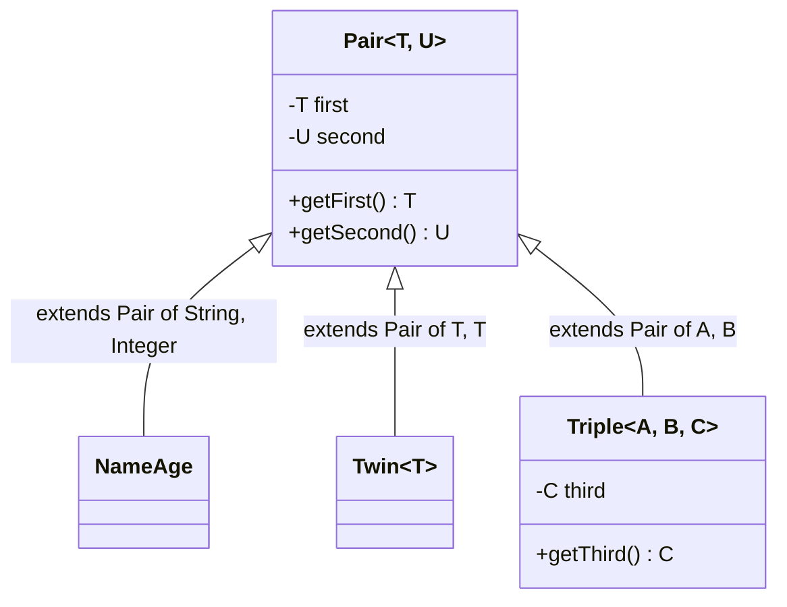

## In One Line
A generic class declares its type parameters right after its name (`class Pair<T, U>`); every object created from it picks the real types (`Pair<Integer, String>`), and from then on every field, parameter and return type written as `T` or `U` means exactly those types for that object.

## Mental Model
Think of a **printed form with two typed blanks**:

> First: ________ *(kind T)*  Second: ________ *(kind U)*

- The **form template** is printed once — that is `class Pair<T, U>`.
- Each customer fills in **which kinds** go in the blanks before writing anything — `Pair<Integer, String>` means "blank T takes whole numbers, blank U takes text".
- A **clerk (the compiler)** checks every entry against the declared kinds, so you cannot write text in the number blank.
- When you **read the form back** (`getFirst()`), you already know what kind of value is in each blank — no guessing, no cast.
- The **same template** serves every customer: `Pair<String, Double>` is just another filled-in copy of the same form.

## Concept
### Declaring a generic class
```java
class Pair<T, U> {            // type parameter section: <T, U>
    private final T first;    // T used as a field type
    private final U second;

    Pair(T first, U second) { // constructor name is Pair, not Pair<T, U>
        this.first = first;
        this.second = second;
    }
    T getFirst()  { return first; }   // T used as a return type
    U getSecond() { return second; }
}
```
- The **type parameter section** `<T, U>` goes right after the class name. Separate several parameters with commas; each name must be unique.
- Inside the class, `T` and `U` behave like real type names — but **only in instance context**.

### Where a class type parameter can and cannot be used
| Allowed | Not allowed |
|---|---|
| Instance field types: `private T first;` | Static fields: `static T cache;` |
| Constructor and method parameters: `Pair(T first, U second)` | Static methods: `static T make()` |
| Return types: `T getFirst()` | Static nested classes: `static class Nested { T x; }` |
| Local variables: `T tmp = first;` | Object creation: `new T()`, arrays `new T[10]` |
| Type arguments of other generics: `List<T>`, `Pair<U, T>` | Class literals and type tests: `T.class`, `x instanceof T` |
| Inner (non-static) classes: `class Inner { T get() {...} }` | Primitive substitution: `Pair<int, ...>` |

Why no static use? A static member is shared by **every** parameterization — `Pair<Integer, String>` and `Pair<String, Double>` share one class and one set of static fields — so "the" `T` of a static field would be meaningless. The compiler says so:
```output
StaticT.java:3: error: non-static type variable T cannot be referenced from a static context
        static T defaultFirst;               // not allowed
               ^
```
The rightmost column comes from **type erasure** — see [Type Erasure](lesson:a04-generics/07-type-erasure).

### Creating objects of a generic class
```java
Pair<Integer, String> a = new Pair<Integer, String>(1, "One"); // Java 5/6 style: types written twice
Pair<Integer, String> b = new Pair<>(1, "One");                 // Java 7+ diamond: inferred from the left
var c = new Pair<>(1, "One");                                   // Java 10+: inferred from the arguments -> Pair<Integer, String>
```
The order of type arguments matters. `Pair<Integer, String> p = new Pair<>("One", 1);` does not compile:
```output
WrongOrder.java:7: error: incompatible types: cannot infer type arguments for Pair<>
        Pair<Integer, String> p = new Pair<>("One", 1);
                                          ^
    reason: inference variable T has incompatible bounds
      equality constraints: Integer
      lower bounds: String
```
Read the message as: "`T` must equal `Integer` (from the left side), but you passed a `String`."

### Using the type parameters inside the class
Type parameters can appear anywhere a type can — including in **other** generic types and in return types. A `swap()` that flips the slots returns a `Pair<U, T>`; a static factory declares its **own** type parameters because static members cannot see `T` and `U`:
```java
Pair<U, T> swap() { return new Pair<>(second, first); }
static <A, B> Pair<A, B> of(A a, B b) { return new Pair<>(a, b); }  // a generic METHOD
@Override public String toString() { return "(" + first + ", " + second + ")"; }
```
```java
Pair<Integer, String> pair = new Pair<>(1, "One");
Pair<String, Double> anotherPair = new Pair<>("Pi", 3.14);
System.out.println(pair + " swapped -> " + pair.swap());
System.out.println(pair.getClass() == anotherPair.getClass());
System.out.println(pair.getClass().getName());

var p = Pair.of("age", 30);                 // Pair<String, Integer> inferred
int next = p.getSecond() + 1;               // no cast, auto-unboxing
System.out.println(p.getFirst() + " next year: " + next);

Pair<String, List<Integer>> scores = Pair.of("Asha", List.of(90, 85));
Map<String, Pair<Integer, Integer>> ranges = Map.of("x", Pair.of(0, 10));
System.out.println(scores + " " + ranges);
```
```output
(1, One) swapped -> (One, 1)
true
PairDemo$Pair
age next year: 31
(Asha, [90, 85]) {x=(0, 10)}
```
Notice line 2: `Pair<Integer, String>` and `Pair<String, Double>` are **the same class at runtime** (`PairDemo$Pair` because this `Pair` is nested inside `PairDemo`). Type arguments are nested freely: `Pair<String, List<Integer>>`, `Map<String, Pair<Integer, Integer>>`. Generic methods like `of` are covered in [Generic Methods](lesson:a04-generics/03-generic-methods).

### What the compiled class looks like
`javap -p` on the course's `Pair.class` shows the generic signature (kept as metadata), while `-s` shows the real JVM descriptors — every `T` and `U` became `Object`:
```output
class Generics.Pair<T, U> {
  private T first;
    descriptor: Ljava/lang/Object;
  private U second;
    descriptor: Ljava/lang/Object;
  public Generics.Pair(T, U);
    descriptor: (Ljava/lang/Object;Ljava/lang/Object;)V

  public T getFirst();
    descriptor: ()Ljava/lang/Object;

  public U getSecond();
    descriptor: ()Ljava/lang/Object;
}
```

### Generic interfaces
Interfaces take type parameters exactly like classes: `Comparable<T>`, `Iterable<T>`, `Comparator<T>`, `Function<T, R>`, `Map<K, V>`. There are three ways to extend a generic class or implement a generic interface:

| Style | Code | Result |
|---|---|---|
| **Fix** the type arguments | `class NameAge extends Pair<String, Integer>` | `NameAge` is not generic; `getSecond()` returns `Integer` |
| **Pass through** a parameter | `class Twin<T> extends Pair<T, T>` | Still generic; both slots share one type |
| **Add** new parameters | `class Triple<A, B, C> extends Pair<A, B>` | Keeps the parent's parameters and adds `C` |

```java
interface Container<T> { T get(); }
static class StringHolder implements Container<String> { public String get() { return "fixed"; } }
static class Holder<T> implements Container<T> {
    private final T value;
    Holder(T value) { this.value = value; }
    public T get() { return value; }
}

NameAge na = new NameAge("Asha", 30);
int age = na.getSecond();                   // Integer, no cast
Twin<Double> t = new Twin<>(1.5, 2.5);
Triple<String, Integer, Boolean> tr = new Triple<>("x", 1, true);
Container<String> c1 = new StringHolder();
Container<Integer> c2 = new Holder<>(42);
System.out.println(na.getFirst() + " " + age);
System.out.println(t.getFirst() + t.getSecond());
System.out.println(tr.getFirst() + tr.getSecond() + tr.getThird());
System.out.println(c1.get() + " " + c2.get());
```
```output
Asha 30
4.0
x1true
fixed 42
```
`t.getFirst() + t.getSecond()` is **numeric** (1.5 + 2.5 = 4.0) because both are `Double`; `tr.getFirst() + ...` is **string** concatenation because the first operand is a `String`.

### Subtyping between generic classes
Subtyping follows the **class hierarchy with the same type arguments**:
- `NameAge` **is a** `Pair<String, Integer>`; `Twin<Double>` **is a** `Pair<Double, Double>`.
- `ArrayList<String>` is a `List<String>` is a `Collection<String>`.
- But `Pair<Integer, String>` is **not** a `Pair<Object, Object>` — changing the type arguments never creates a subtype (invariance). See [Wildcards](lesson:a04-generics/05-wildcards).

### Generic records (Java 16+) — the modern Pair
A record gives you final fields, a constructor, accessors, `equals`, `hashCode` and `toString` in one line — and records can be generic:
```java
record Pair<T, U>(T first, U second) { }

Pair<Integer, String> a = new Pair<>(1, "One");
Pair<Integer, String> b = new Pair<>(1, "One");
System.out.println(a);
System.out.println(a.first() + " / " + a.second());
System.out.println(a.equals(b) + " " + (a.hashCode() == b.hashCode()));
```
```output
Pair[first=1, second=One]
1 / One
true true
```
See [Records](lesson:b05-modern-java/03-records).

### Is there a Pair in the JDK?
Not a general-purpose one. What exists:

| Option | Notes |
|---|---|
| `Map.entry(k, v)` (Java 9+) | Immutable `Map.Entry<K, V>`; rejects `null` with `NullPointerException`; prints as `1=One` |
| `new AbstractMap.SimpleEntry<>(k, v)` | Mutable value (`setValue`) |
| `new AbstractMap.SimpleImmutableEntry<>(k, v)` | Immutable, allows `null` |
| `javafx.util.Pair<K, V>` | In JavaFX (`javafx-base`, which the course `pom.xml` includes) — not part of the JDK itself |
| Your own `record` | Usually the best choice — and a **named** record (`record NameAge(String name, int age)`) says far more than `Pair<String, Integer>` |

### Generic constructors (rare)
A constructor may declare its **own** type parameters, independent of the class's:
```java
static class Printer {
    <T> Printer(T initial) {                    // generic constructor in a non-generic class
        System.out.println("created with " + initial.getClass().getSimpleName());
    }
}
new Printer("hi");
new <Integer>Printer(5);                        // explicit type argument for the constructor
```
```output
created with String
created with Integer
```

### What cannot be generic
- **Enums**: `enum Color<T> { ... }` → *enums cannot be generic*.
- **Exceptions**: `class MyEx<T> extends Exception` → *a generic class may not extend java.lang.Throwable* (a `catch` block cannot distinguish `MyEx<String>` from `MyEx<Integer>` at runtime).
- **Anonymous classes** cannot declare type parameters (they can implement a parameterized type: `new Comparator<String>() {...}`).

## Diagram

The three ways to build on a generic class: fix the type arguments (`NameAge`), pass one through (`Twin`), or add new ones (`Triple`).


What the compiler does with each parameterization: infer, check, then erase to a single runtime class.

## Code
@example Generics/GenericClassExample.java

## Walkthrough
- `package Generics;` — same capitalised package as the rest of the module (see the errata in [Why Generics?](lesson:a04-generics/01-why-generics)).
- `class Pair<T, U> {` — a package-private generic class with **two** type parameters. `T` is the type of the first element, `U` the type of the second (U is simply "the letter after T"). The class comment "Define a generic class with two type parameters T and U" describes it exactly.
- `private T first; private U second;` — two fields whose types are chosen per object. They are private and only exposed through getters, so a `Pair` cannot be changed after construction (though the fields are not `final` — see Traps).
- `public Pair(T first, U second)` — the constructor accepts exactly a `T` and a `U`, in that order. `this.first = first;` copies the parameter into the field.
- `public T getFirst()` / `public U getSecond()` — typed getters: callers get the precise type with no cast.
- `Pair<Integer, String> pair = new Pair<>(1, "One");`
  - The declaration chooses `T = Integer`, `U = String`; the diamond `<>` lets the compiler infer the same arguments for the constructor.
  - `1` is autoboxed to `Integer.valueOf(1)`.
- `"First: " + pair.getFirst() + ", Second: " + pair.getSecond()` — `getFirst()` returns an `Integer`, `getSecond()` a `String`; concatenation converts both to text → `First: 1, Second: One`.
- `Pair<String, Double> anotherPair = new Pair<>("Pi", 3.14);` — the **same class** with the types in a different order. `3.14` is a `double` literal, boxed to `Double`. Prints `First: Pi, Second: 3.14`.
- Both `// Output:` comments match the real output exactly.
- The class has no `toString()`, which is why the example prints each part through the getters. `System.out.println(pair)` would print something like `Generics.Pair@2a139a55` (class name + `@` + hex hash code, which can change between runs and machines).

**Running it:** as with `GenericsExample`, `Pair` is the first class in the file, so on JDK 21 `java GenericClassExample.java` fails with *can't find main(String[]) method in class: Generics.Pair*. Use `javac -d out Generics/GenericClassExample.java` and `java -cp out Generics.GenericClassExample`, or run from the IDE.

## Traps
> [!NOTE] The example is correct and its output comments are accurate. As a design note, `first` and `second` should be `final`: the class has no setters and is meant to be immutable, and `final` makes that a compiler-enforced promise (and safe to share between threads). Today you would write `record Pair<T, U>(T first, U second) {}`.

- **Static members cannot use `T`.** `static T cache;` or `static T make()` → *non-static type variable T cannot be referenced from a static context*. A static factory must declare its own parameters: `static <A, B> Pair<A, B> of(A a, B b)`.
- **Static nested classes cannot see the outer `T`** either — only inner (non-static) classes can.
- **Type-argument order matters.** `Pair<Integer, String> p = new Pair<>("One", 1);` → *cannot infer type arguments for Pair<>*.
- **No `equals`/`hashCode` by default.** Two `Pair<>(1, "One")` objects are **not** `equals` (identity comparison from `Object`), so they fail as `HashMap` keys or in `contains`. Implement both, or use a record.
- **`+` depends on the types, not on "pair-ness".** `new Pair<>(1.5, 2.5)`: `getFirst() + getSecond()` is `4.0` (numeric). With a `String` first, it becomes concatenation.
- **Raw use loses everything:** `Pair raw = pair; raw.getFirst()` returns `Object`, so you are back to casting.
- **Naming a type parameter like a real class shadows it.** In `class Box<String> { String value; ... value.length() }`, `String` is a *type variable*, not `java.lang.String`, so `length()` is *cannot find symbol*. Always use single letters.
- **Enums and exceptions cannot be generic** (*enums cannot be generic*, *a generic class may not extend java.lang.Throwable*).

## Tips & Tricks
- **Where does `<T>` go?** After the **name** for a class (`class Pair<T, U>`), before the **return type** for a method (`static <A, B> Pair<A, B> of(...)`).
- **"Static can't see T"** — static belongs to the one runtime class, `T` belongs to each object's declaration.
- **Three ways to inherit:** *Fix it, Forward it, or Add to it* (`NameAge`, `Twin<T>`, `Triple<A, B, C>`).
- **Prefer a named record over a generic Pair** in domain code: `record Point(int x, int y)` beats `Pair<Integer, Integer>` — names carry meaning and `int` avoids boxing.
- Make generic value classes **immutable** (`final` fields, no setters) — they are then safe to share and to use as map keys (once `equals`/`hashCode` exist).
- Add a static factory `of(...)` to generic classes — it reads well and inference works nicely with it.

## Interview Q&A
### [Basic] How do you declare and use a generic class?
You add a type parameter section after the class name — `class Pair<T, U>` — and use `T` and `U` as types for fields, constructor parameters, method parameters and return types. To use it you supply type arguments: `Pair<Integer, String> p = new Pair<>(1, "One");`. The compiler then treats `p.getFirst()` as returning `Integer` and `p.getSecond()` as returning `String`, and rejects a constructor call with the wrong types.

**Follow-up:** *What does the diamond `<>` do here?* — It tells the compiler to infer the constructor's type arguments (`Integer, String`) from the target type on the left, so you do not repeat them (Java 7+).

### [Basic] Can a generic class have multiple type parameters? Give JDK examples.
Yes, as many as needed, comma-separated: `class Pair<T, U>`. JDK examples: `Map<K, V>`, `Map.Entry<K, V>`, `BiFunction<T, U, R>` (three), `Collector<T, A, R>` (three). Each parameter is independent: `Pair<String, Double>` and `Pair<Double, String>` are different parameterized types.

**Follow-up:** *Can two type parameters have the same name?* — No, the names in one type parameter section must be unique.

### [Intermediate] Why can't a static field or static method use the class's type parameter?
Because static members belong to the class, and there is only one class at runtime for all parameterizations — `Pair<Integer, String>` and `Pair<String, Double>` share the same `Pair.class` and the same static fields. A static field of type `T` would have to be an `Integer` and a `String` at the same time. The compiler reports *non-static type variable T cannot be referenced from a static context*. Static methods that need generics declare their own type parameters: `static <A, B> Pair<A, B> of(A a, B b)`.

**Follow-up:** *Can a static nested class use the outer class's `T`?* — No, for the same reason; only inner (non-static) classes can, because each inner instance belongs to an outer instance.

### [Intermediate] What are the different ways to subclass a generic class or implement a generic interface?
Three: **fix** the type arguments (`class NameAge extends Pair<String, Integer>` — the subclass is no longer generic), **pass through** a type parameter (`class Twin<T> extends Pair<T, T>`), or **add** more parameters (`class Triple<A, B, C> extends Pair<A, B>`). The same applies to interfaces: `class StringHolder implements Container<String>` vs `class Holder<T> implements Container<T>`. You can also implement the raw type (`implements Comparable`), but that gives up type safety.

**Follow-up:** *Is `Twin<Double>` a subtype of `Pair<Double, Double>`?* — Yes. Subtyping follows the class hierarchy when the type arguments match; it never comes from changing type arguments.

### [Intermediate] Are `Pair<Integer, String>` and `Pair<String, Double>` different classes at runtime?
No. Because of type erasure there is exactly one `Pair` class; `pair.getClass() == anotherPair.getClass()` is `true` and both report the name `Pair`. The type arguments exist only at compile time (plus as signature metadata in the class file, which reflection can read for declarations, not for individual objects).

**Follow-up:** *So how does `getFirst()` return an `Integer` without a cast?* — The compiler inserts the cast for you: `(Integer) pair.getFirst()` in the bytecode.

### [Intermediate] Does the JDK have a Pair or Tuple class? What would you use?
There is no general-purpose `Pair` in the JDK. Options are `Map.entry(k, v)` (Java 9, immutable, no nulls), `AbstractMap.SimpleEntry` / `SimpleImmutableEntry`, or third-party ones such as `javafx.util.Pair` or Apache Commons `Pair`. Since Java 16 the best answer is usually a **record**: `record Pair<T, U>(T first, U second) {}` — or, better, a named record like `record NameAge(String name, int age)` that documents what the two values mean.

**Follow-up:** *Why did the JDK never add Pair?* — The designers argued that a named type with meaningful field names is almost always clearer than `first`/`second`; records made named types cheap to write.

### [Advanced] How would you design a production-quality generic Pair?
Make it **immutable** (`private final` fields, no setters), implement **`equals` and `hashCode`** over both fields so it works in hash-based collections, give it a readable **`toString`**, decide on a **null policy** (reject with `Objects.requireNonNull` or allow explicitly), and offer a **static factory** `of(a, b)` for nice inference. In Java 16+ a `record Pair<T, U>(T first, U second)` gives all of that for free, and you can add a compact constructor for null checks.

**Follow-up:** *Can a record be generic and have a static factory?* — Yes: `record Pair<T, U>(T first, U second) { static <A, B> Pair<A, B> of(A a, B b) { return new Pair<>(a, b); } }`.

### [Advanced] What is a generic constructor?
A constructor that declares its own type parameters, independent of the class's: `<T> Printer(T initial) { ... }`. Its type argument is inferred from the arguments, or given explicitly with the unusual syntax `new <Integer>Printer(5)`. It is rare in practice; it is useful when a constructor needs to relate its parameters to each other without making the whole class generic.

**Follow-up:** *Can a generic class also have a generic constructor?* — Yes, e.g. `class Box<T> { <S extends T> Box(S value) {...} }`; the constructor's `S` is separate from the class's `T`.

### [Advanced] What cannot be generic in Java, and why?
Enums (*enums cannot be generic* — each constant is a single shared instance, so there is nowhere to put per-use type arguments), subclasses of `Throwable` (*a generic class may not extend java.lang.Throwable* — `catch` works on the runtime class, which erasure makes identical for all parameterizations), and anonymous classes (they have no name to declare parameters on, though they can implement a parameterized type). Also, a class's type parameters are not visible in static members.

**Follow-up:** *Can a method in an enum be generic?* — Yes. Only the enum type itself cannot declare type parameters; its methods can (`<T> T convert(...)`).

## Quiz
### Which declaration compiles?
- [ ] `class Cache<T> { static T last; }`
- [ ] `enum Level<T> { LOW, HIGH }`
- [x] `class Cache<T> { static <E> Cache<E> empty() { return new Cache<>(); } }`
- [ ] `class Failure<T> extends RuntimeException { }`
> A static method cannot use the class's `T`, but it can declare its own type parameter `E` — that is how static factories work. Static fields of type `T`, generic enums and generic `Throwable` subclasses are all compile errors.

### What does this print?
```java
Pair<String, Integer> p = new Pair<>("age", 30);
Pair<Integer, String> q = p.swap();   // swap() returns Pair<U, T>
System.out.println(q.getFirst() + q.getSecond().length());
```
- [ ] 303
- [x] 33
- [ ] age30
- [ ] Compile error: cannot add `Integer` and `int`
> After the swap, `getFirst()` is the `Integer` 30 and `getSecond()` is the `String` "age". `30 + "age".length()` is `30 + 3` — both numeric, so the result is `33`, not the concatenation `303`.

### What does this print?
```java
Pair<Integer, String> a = new Pair<>(1, "One");
Pair<Integer, String> b = new Pair<>(1, "One");
System.out.println(a.equals(b));
System.out.println(a.getClass() == new Pair<String, Double>("Pi", 3.14).getClass());
```
(`Pair` is the course's class: no `equals` override.)
- [ ] true, false
- [x] false, true
- [ ] true, true
- [ ] false, false
> Without an `equals` override, `Object.equals` compares identity, and `a` and `b` are different objects → `false`. Because of erasure, every `Pair` parameterization shares one runtime class → `true`. A record `Pair` would print `true` for the first line.

### Spot the bug.
```java
Pair<Integer, String> p = new Pair<>("One", 1);
```
- [ ] Nothing — the diamond infers `Pair<String, Integer>`
- [x] The arguments are in the wrong order for `T = Integer, U = String`, so it does not compile
- [ ] It compiles but throws `ClassCastException` when `getFirst()` is called
- [ ] The diamond cannot be used with two type parameters
> The target type fixes `T = Integer`, so the first argument must be an `Integer`. The compiler reports *cannot infer type arguments for Pair<>* (T has equality constraint `Integer` but lower bound `String`). Generics catch this at compile time — no runtime cast failure is possible.

### `class NameAge extends Pair<String, Integer>` — which statement is true?
- [ ] `NameAge` is a generic class with two type parameters
- [x] `NameAge` is not generic, and `getSecond()` returns `Integer` for it
- [ ] `NameAge` is a subtype of `Pair<Object, Object>`
- [ ] It does not compile: a non-generic class cannot extend a generic one
> Fixing the type arguments in the `extends` clause produces an ordinary class whose inherited methods are specialised: `getSecond()` returns `Integer`. It is a `Pair<String, Integer>`, but not a `Pair<Object, Object>` — generic types are invariant.

### What does this print?
```java
Twin<Double> t = new Twin<>(1.5, 2.5);      // class Twin<T> extends Pair<T, T>
Triple<String, Integer, Boolean> tr = new Triple<>("x", 1, true);
System.out.println(t.getFirst() + t.getSecond());
System.out.println(tr.getFirst() + tr.getSecond() + tr.getThird());
```
- [ ] 1.52.5, then x1true
- [x] 4.0, then x1true
- [ ] 4.0, then x2
- [ ] Compile error: cannot add two `T` values
> In `main` the types are concrete: two `Double`s add numerically to `4.0`. In the second line the first operand is a `String`, so everything after it is concatenated: `"x" + 1 + true` → `x1true`. (Inside `Twin` itself, `first + second` would not compile, because there `T` is unknown.)

## Takeaways
- Declare a generic class with a type parameter section after the name (`class Pair<T, U>`); inside, `T` and `U` can type fields, constructor/method parameters, return types and other generics (`Pair<U, T>`, `List<T>`).
- A class's type parameters are instance-level only: static fields, static methods and static nested classes cannot use them — static factories declare their own (`static <A, B> Pair<A, B> of(A a, B b)`).
- Instantiate with explicit arguments, the diamond (`new Pair<>(1, "One")`) or `var`; the order of type arguments matters.
- Extend a generic type three ways: fix the arguments (`extends Pair<String, Integer>`), pass one through (`Twin<T> extends Pair<T, T>`), or add new ones (`Triple<A, B, C> extends Pair<A, B>`); interfaces work the same.
- All parameterizations share one runtime class (`Pair<Integer, String>.getClass() == Pair<String, Double>.getClass()`), and the fields are really `Object` in bytecode.
- The JDK has no general Pair; use `Map.entry`, or better a generic or named `record`, which also gives `equals`, `hashCode` and `toString`.
- Enums, `Throwable` subclasses and anonymous classes cannot be generic.
