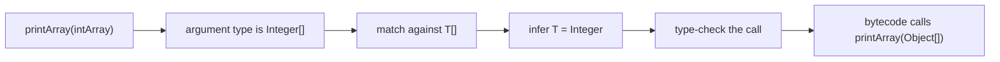
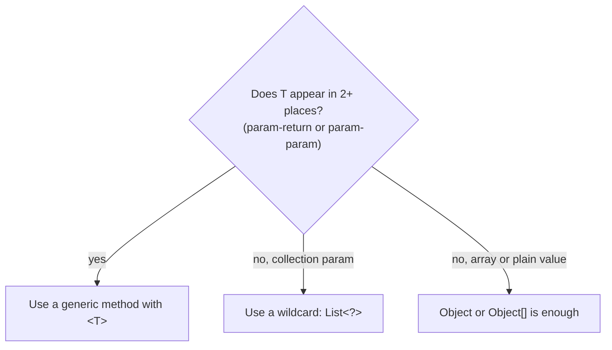

## In One Line
A generic method declares its **own** type parameter just before its return type (`static <T> void printArray(T[] array)`), so a single method works for `Integer[]`, `String[]` or any other element type, and the compiler usually **infers** `T` from the arguments at each call.

## Mental Model
Think of a **universal phone charger with a smart plug**. You do not buy a different charger for each phone; the charger adapts to whatever phone you plug in, and it checks the connector fits before any current flows.

- The **charger** is the method `printArray`. It exists once.
- **Plugging in a phone** is calling it with an argument; the charger *detects* the model — the compiler **infers** `T = Integer` from an `Integer[]`, or `T = String` from a `String[]`.
- The **fit check** is type checking: the charger refuses a plug that does not match its socket shape (`int[]` does not fit `T[]`).
- Unlike a generic *class* (a whole shop configured for one product), the adaptation happens **per call** — every call can use a different `T`.

## Concept
### Syntax: where the `<T>` goes
```java
public static <T> void printArray(T[] array)
//            ^^^ type parameter section: BEFORE the return type
```
| Part | Meaning |
|---|---|
| `public static` | Modifiers come first |
| `<T>` | Declares the method's own type parameter. Several are comma-separated: `<K, V>` |
| `void` | Return type — may itself use `T`: `static <T> T first(T[] a)` |
| `T[] array` | Parameters that use `T` |

The scope of a method's `T` is **that method only** — its parameters, return type and body.

### Generic methods can live anywhere
- **Static methods in a non-generic class** — the example: `GenericMethodExample` is not generic, only `printArray` is. This is the most common form (utility methods like `Collections.sort`, `Arrays.asList`, `List.of`).
- **Instance methods** — in any class.
- **Inside a generic class**, where the method can use the class's `T` *and* its own new parameter:
  ```java
  static class Box<T> {
      private final T value;
      Box(T value) { this.value = value; }
      T get() { return value; }
      // instance generic method: uses the class's T AND its own R
      <R> Box<R> map(Function<? super T, ? extends R> f) { return new Box<>(f.apply(value)); }
  }
  Box<String> name = new Box<>("generics");
  Box<Integer> len = name.map(String::length);   // T = String, R = Integer
  System.out.println(len.get());
  ```
  ```output
  8
  ```
- **Constructors** can be generic too (`<T> Printer(T initial)`), and so can **interface** default and static methods (`Comparator.comparing`, `List.of`).
- **Static methods of a generic class** must be generic methods if they need a type variable, because they cannot see the class's `T` (see [Generic Classes](lesson:a04-generics/02-generic-classes)).

### When is a type parameter worth it? It must *link* things
A type parameter earns its place when it connects **two or more positions** — parameter to return type, or parameter to parameter:
```java
static <T> T first(T[] array) { return array[0]; }                       // param -> return
static <T> void swap(T[] array, int i, int j) { T tmp = array[i]; array[i] = array[j]; array[j] = tmp; }
static <K, V> Map<K, V> zip(List<K> keys, List<V> values) { ... }        // two params -> return
static <T extends Comparable<T>> T max(T a, T b) { return a.compareTo(b) >= 0 ? a : b; }

Integer[] nums = {1, 2, 3};
String[] words = {"A", "B", "C"};
String w = first(words);                  // T = String, no cast
Integer n = first(nums);                  // T = Integer
swap(words, 0, 2);
printArray(words);
Methods.<Integer>printArray(nums);        // explicit type witness
System.out.println(w + " " + n);
System.out.println(zip(List.of("a", "b"), List.of(1, 2)));
System.out.println(max("pear", "apple") + " " + max(3, 7));
```
```output
C B A 
1 2 3 
A 1
{a=1, b=2}
pear 7
```
`first` returns a `String` for a `String[]` and an `Integer` for an `Integer[]` — no casts. `max` uses a **bounded** type parameter so it can call `compareTo` (see [Bounded Type Parameters](lesson:a04-generics/04-bounded-type-parameters)).

**Honest note about the course example:** in `printArray`, `T` appears only once (in the parameter) and nothing is returned, so a plain `static void printArray(Object[] array)` would work just as well — arrays are covariant, so an `Integer[]` *is an* `Object[]`. The example is a good syntax demo; real generic methods link types. (For collections, which are *not* covariant, the non-generic equivalent is a wildcard: `printList(List<?> list)` — see [Wildcards](lesson:a04-generics/05-wildcards).)

### How the compiler picks `T` — inference
At each call the compiler infers `T` from:
1. **The argument types** — `printArray(intArray)` with `Integer[]` → `T = Integer`.
2. **The target type** (where the result goes) — `List<String> e = Collections.emptyList();` → `T = String` even with no arguments.
3. If the arguments disagree, the **closest common supertype**: `pick(1, "two")` with `static <T> T pick(T a, T b)` compiles; `T` becomes a common supertype of `Integer` and `String` (an intersection of `Object`, `Serializable`, `Comparable<...>` and more).

When inference cannot work it out, or you want to force a type, give an **explicit type witness** — which must be *qualified*:
```java
Methods.<Integer>printArray(nums);          // static: ClassName.<T>method(...)
this.<String>helper(x);                     // instance: this.<T>method(...) or obj.<T>method(...)
List<String> empty = Collections.<String>emptyList();
```
An unqualified witness is a syntax error:
```output
Witness.java:5: error: illegal start of expression
        <Integer>printArray(nums);
                 ^
```
More on inference in [Type Inference](lesson:a04-generics/06-type-inference).

### Primitive arrays do not fit `T[]`
`T` can only be a reference type, so an `int[]` can never be a `T[]`:
```output
Prim.java:5: error: method printArray in class Prim cannot be applied to given types;
        printArray(primitives);
        ^
  required: T[]
  found:    int[]
  reason: inference variable T has incompatible bounds
    equality constraints: int
    upper bounds: Object
```
But an `int[]` **is** an object, so it matches a plain `T`: with `static <T> void describe(T x)`, `describe(new int[]{1, 2})` compiles with `T = int[]`. That is exactly why `Arrays.asList(new int[]{1, 2, 3})` returns a `List<int[]>` of size **1** (see Traps).

### Generic varargs
`T...` is a `T[]` under the hood. Because the compiler must create a generic array at the call site, a generic varargs method gets a warning at its declaration:
```output
Varargs.java:3: warning: [unchecked] Possible heap pollution from parameterized vararg type T
    static <T> List<T> listOf(T... items) { return new ArrayList<>(Arrays.asList(items)); }
                                   ^
```
If the method only **reads** the array (never stores into it and never lets it escape), mark it `@SafeVarargs` (allowed on `static` and `final` methods, constructors, and — since Java 9 — `private` instance methods). `List.of(E...)`, `Arrays.asList(T...)` and `Stream.of(T...)` are all `@SafeVarargs`. Details in [Type Erasure](lesson:a04-generics/07-type-erasure).

### Reading JDK generic method signatures
Being able to read these is an interview skill in itself:

| Signature | Read it as |
|---|---|
| `static <T> List<T> asList(T... a)` | "Give me some Ts, I return a list of those Ts" |
| `static <T> void sort(List<T> list, Comparator<? super T> c)` | "Sort a list of T with any comparator that can compare Ts (or their supertypes)" |
| `static <T extends Comparable<? super T>> void sort(List<T> list)` | "T must be comparable to itself (or to a supertype)" |
| `static <T extends Object & Comparable<? super T>> T max(Collection<? extends T> coll)` | "Return the biggest T from any collection of Ts or subtypes" (the `Object &` keeps the erased return type `Object` for pre-Java-5 binary compatibility) |
| `<R> Stream<R> map(Function<? super T, ? extends R> mapper)` | "Turn each T into some R" |

### Rules and restrictions
- **Overloads cannot differ only in type parameters.** `static <T> void m(T t)` and `static void m(Object o)` both erase to `m(Object)`:
  ```output
  Clash.java:3: error: name clash: m(Object) and <T>m(T) have the same erasure
  ```
- **A lambda cannot implement a generic functional method.** For `interface Identity { <T> T apply(T t); }`, `Identity bad = t -> t;` fails with *invalid functional descriptor for lambda expression*, while a method reference (`Lam::same` where `static <T> T same(T t)`) is fine.
- **Overriding** a generic method requires the same number of type parameters with the same bounds (names may differ).

## Diagram

Each call infers its own `T`; after checking, every call targets the same erased method whose parameter is `Object[]`.


A quick decision rule for choosing between a type parameter, a wildcard and plain `Object`.

## Code
@example Generics/GenericMethodExample.java

Better ways to print an array in real code:
```java
Integer[] intArray = {1, 2, 3, 4, 5};
String[] strArray = {"A", "B", "C", "D"};
System.out.println(Arrays.toString(intArray));
System.out.println(String.join(" ", strArray));
System.out.println(Arrays.stream(intArray).map(String::valueOf).collect(Collectors.joining(" ")));
int[] prim = {1, 2, 3};
System.out.println(Arrays.toString(prim));
```
```output
[1, 2, 3, 4, 5]
A B C D
1 2 3 4 5
[1, 2, 3]
```
`Arrays.toString` has overloads for every primitive array type, which a single generic method cannot offer.

## Walkthrough
- `package Generics;` — the module's (unconventionally capitalised) package; see [Why Generics?](lesson:a04-generics/01-why-generics).
- `public class GenericMethodExample` — an ordinary, **non-generic** class. Only the method is generic. Because it is the only class in the file, `java GenericMethodExample.java` works directly.
- `public static <T> void printArray(T[] array)` — `<T>` declares a type parameter owned by this method; `T[] array` accepts an array of any reference type.
- `for (T element : array)` — the enhanced for loop over an array; each `element` has static type `T`.
- `System.out.print(element + " ");` — string concatenation calls `String.valueOf(element)`, i.e. `element.toString()`. The only thing the method can do with a `T` is what `Object` allows (`toString`, `equals`, `hashCode`...), because `T` is unbounded.
- `System.out.println();` — ends the line after the loop.
- `Integer[] intArray = {1, 2, 3, 4, 5};` — an array initializer; each `int` literal is autoboxed to `Integer`. It must be `Integer[]`: an `int[]` would not compile (see Concept).
- `System.out.print("Integer Array: ");` — prints the label **without** a newline, so the numbers printed next appear on the same line.
- `printArray(intArray);` — the compiler infers `T = Integer` from `Integer[]`. Output: `Integer Array: 1 2 3 4 5 ` (note the trailing space).
- `String[] strArray = {"A", "B", "C", "D"};` then `printArray(strArray);` — now `T = String`. Output: `String Array: A B C D `.
- After erasure there is only one method, `printArray(Object[])`; no cast is even needed inside because `print` works on `Object`.

## Traps
> [!ERRATA] The `// Output:` comments are placed on the `System.out.print("Integer Array: ")` / `print("String Array: ")` lines, but those statements only print the label — the numbers and letters come from the `printArray(...)` call on the next line. The comments also drop the **trailing space**: each real output line ends with `" "` (`Integer Array: 1 2 3 4 5 `) because the loop prints a space after every element, including the last. Use `String.join(" ", ...)` or a `StringJoiner` to avoid it.

- **`<T>` in the wrong place.** `public static void <T> printArray(...)` does not compile — the type parameter section goes **before** the return type.
- **Primitive arrays:** `printArray(new int[]{1, 2, 3})` → *cannot be applied to given types ... found: int[]*. Use `Integer[]` or an overload for `int[]`.
- **`Arrays.asList(int[])` has size 1.** `Arrays.asList(new int[]{1, 2, 3}).size()` is `1`, because `T` is inferred as `int[]` and you get a `List<int[]>` holding one array. With `new Integer[]{1, 2, 3}` it is `3`. `List.of(intArray)` has the same trap.
- **Shadowing the class's `T`.** Inside `class Box<T>`, a method `<T> void show(T t)` declares a *new* `T` that hides the class's one. `Box<String> b; b.show(42);` compiles and prints `Integer`. Use a different letter (`<U>`) or drop the method-level `<T>` if you meant the class's type.
- **Unqualified type witness:** `<Integer>printArray(nums)` is *illegal start of expression*; write `GenericMethodExample.<Integer>printArray(nums)`.
- **Inference picks a supertype silently.** `pick(1, "two")` compiles because `T` becomes a common supertype; you may have wanted a compile error. Constrain with an explicit witness (`Util.<Integer>pick(1, "two")` then fails) or a bound.
- **Overloading `m(T)` with `m(Object)`** → *name clash ... have the same erasure*.

## Tips & Tricks
- **"Type parameter before the Return type"** — `<T>` sits right in front of what the method returns, like a label announcing "this method is generic in T".
- **Class `<T>` after the name; method `<T>` before the return type.**
- **The linking rule:** use a type parameter only when it links two places (param-return or param-param). If `T` appears once, a wildcard (`List<?>`) or `Object` is simpler — Effective Java: "if a type parameter appears only once in a method declaration, replace it with a wildcard".
- **Static utility + generics = the Collections/Arrays pattern.** Write reusable helpers as `static <T> ...` methods in a final utility class.
- **Explicit witnesses are rarely needed** since Java 8; if you need one often, the method signature may be too clever.
- **Use a different letter** for method type parameters inside a generic class to avoid shadowing.
- To print arrays, reach for `Arrays.toString` / `Arrays.deepToString` (nested arrays) first.

## Interview Q&A
### [Basic] What is a generic method and how do you declare one?
A generic method is a method that declares its own type parameters, independent of any class type parameters. The type parameter section goes after the modifiers and **before the return type**: `public static <T> void printArray(T[] array)`. Its scope is just that method. The type argument is usually inferred at each call — `printArray(intArray)` infers `T = Integer`, `printArray(strArray)` infers `T = String` — so one method serves every reference type.

**Follow-up:** *Can a non-generic class have generic methods?* — Yes; `Collections` and `Arrays` are non-generic utility classes full of generic methods.

### [Basic] What is the difference between a generic class and a generic method?
In a generic class (`class Box<T>`) the type parameter is fixed per **object** when you declare the variable (`Box<String>`), and it is available to all instance members. In a generic method (`<T> T first(T[] a)`) the type parameter is fixed per **call**, usually by inference, and exists only inside that method. Static methods can only be generic in the second way, because they cannot see a class's `T`.

**Follow-up:** *Can a generic class have generic methods with other type parameters?* — Yes, e.g. `class Box<T> { <R> Box<R> map(Function<? super T, ? extends R> f) }` uses both `T` and `R`.

### [Intermediate] How does the compiler determine `T` in a generic method call?
By type inference: it collects constraints from the **argument types** (an `Integer[]` passed to `T[]` gives `T = Integer`) and, since Java 8, from the **target type** of the call (`List<String> e = Collections.emptyList()` gives `T = String`). If arguments disagree, it infers the most specific common supertype (`pick(1, "two")` gives an intersection of `Object`, `Serializable`, `Comparable` and so on). You can override inference with an explicit type witness, which must be qualified: `Collections.<String>emptyList()`, `this.<String>helper()`.

**Follow-up:** *When do you still need a type witness?* — Rarely: mostly when there is no target type, e.g. passing `Collections.emptyList()` into an overloaded method or chaining `.stream()` on it.

### [Intermediate] Why does `printArray(new int[]{1, 2, 3})` fail, and why does `Arrays.asList(new int[]{1, 2, 3})` compile but return a list of size 1?
Type arguments must be reference types, so `T` cannot be `int`, and an `int[]` can never match `T[]`. But an `int[]` itself is an object, so it can match a plain `T` or a `T...` varargs parameter as a single element: `Arrays.asList(T... a)` infers `T = int[]` and returns a `List<int[]>` containing one array. Use `Integer[]`, `IntStream.of(...).boxed().toList()`, or `Arrays.stream(int[])` instead.

**Follow-up:** *What does `Arrays.toString(new int[]{1, 2, 3})` print?* — `[1, 2, 3]`, because `Arrays.toString` has a dedicated `int[]` overload.

### [Intermediate] When should you use a generic method versus a wildcard parameter?
Use a type parameter when it **links** positions: the return type depends on the argument (`<T> T first(List<T> list)`) or two arguments must agree (`<T> void copy(List<? super T> dst, List<? extends T> src)`). If the type appears only once, prefer a wildcard (`void printList(List<?> list)`) — it is simpler for callers and says "any type" directly. Effective Java item: "if a type parameter appears only once in a method declaration, replace it with a wildcard".

**Follow-up:** *Is there a case where a wildcard is not enough?* — Yes: when the method needs to write elements it read from the same list, e.g. `swap(List<?> list, int i, int j)`; you then call a private generic helper `<T> void swapHelper(List<T> list, ...)` to "capture" the wildcard.

### [Intermediate] Can you overload a method as `<T> void m(T t)` and `void m(Object o)`?
No. After erasure both become `m(Object)`, so the compiler reports *name clash: m(Object) and <T>m(T) have the same erasure*. The same applies to `m(List<String>)` and `m(List<Integer>)`. Overloads must differ after erasure — rename one method or change a parameter's erased type.

**Follow-up:** *What does `<T extends Number> void m(T t)` erase to?* — `m(Number)`, so it *can* coexist with `m(Object)`.

### [Advanced] What does `@SafeVarargs` do on a generic method?
A `T...` parameter is really a `T[]`, and the caller must create an array of a non-reifiable type, which can cause heap pollution; the compiler therefore warns *possible heap pollution from parameterized vararg type T*. `@SafeVarargs` is the author's promise that the method does not store anything into the array and does not expose it, which suppresses the warning at the declaration and at every call site. It is allowed only on methods that cannot be overridden: `static`, `final`, constructors, and (Java 9+) `private` instance methods. `List.of`, `Arrays.asList` and `EnumSet.of` use it.

**Follow-up:** *Give an unsafe example.* — `static <T> T[] toArray(T... args) { return args; }` — returning the array lets an `Object[]` escape where a `String[]` is expected, causing a `ClassCastException` later.

### [Advanced] How would you read `static <T extends Object & Comparable<? super T>> T max(Collection<? extends T> coll)`?
"`max` is generic in `T`. `T` must be comparable to itself or to one of its supertypes (`Comparable<? super T>`), so it works for a class that inherits `compareTo` from a parent. The argument may be a collection of `T` or any subtype (`? extends T`, a producer). It returns a `T`." The odd `Object &` bound exists because erasure uses the **first** bound: with it, `max` erases to return `Object`, exactly as in the pre-Java-5 signature, preserving binary compatibility; without it, the erasure would be `Comparable`.

**Follow-up:** *Why `Comparable<? super T>` and not `Comparable<T>`?* — If `Apple extends Fruit` and `Fruit implements Comparable<Fruit>`, then `Apple` is not `Comparable<Apple>`; `? super T` accepts it.

### [Advanced] Can a lambda implement an interface whose single abstract method is generic?
No. For `interface Identity { <T> T apply(T t); }`, `Identity i = t -> t;` fails with *invalid functional descriptor for lambda expression ... method <T>(T)T in interface Identity is generic*, because lambda syntax has nowhere to declare a type parameter. A method reference to a generic method works (`Identity i = Util::same;` with `static <T> T same(T t)`), and so does an anonymous class.

**Follow-up:** *How do JDK functional interfaces avoid this?* — They put the type parameters on the interface (`Function<T, R>`), not on the method, so each lambda has concrete types.

## Quiz
### Which declaration is syntactically correct?
- [ ] `public static void <T> printArray(T[] array)`
- [x] `public static <T> void printArray(T[] array)`
- [ ] `public <T> static void printArray(T[] array)`
- [ ] `public static void printArray<T>(T[] array)`
> The type parameter section goes after the modifiers and immediately **before the return type**. `printArray<T>(...)` is C#/C++-style and not Java; `<T>` between `public` and `static` is also illegal.

### What happens here?
```java
public static <T> void printArray(T[] array) { ... }

int[] primitives = {1, 2, 3};
printArray(primitives);
```
- [ ] Prints `1 2 3 `
- [ ] Prints the array's identity like `[I@1b6d3586`
- [x] Compile error: `int[]` cannot match `T[]`
- [ ] `ClassCastException` at runtime
> `T` must be a reference type, so it can never be `int`, and `int[]` is not a `T[]`. The compiler reports *cannot be applied to given types ... found: int[]*. Use `Integer[]`.

### What does this print?
```java
System.out.println(Arrays.asList(new int[]{1, 2, 3}).size());
System.out.println(Arrays.asList(new Integer[]{1, 2, 3}).size());
```
- [ ] 3, then 3
- [x] 1, then 3
- [ ] Compile error on the first line
- [ ] 3, then 1
> `asList(T... a)`: for an `int[]` the only possible `T` is `int[]` itself, so the result is a `List<int[]>` with one element. For an `Integer[]`, `T = Integer` and the array *is* the varargs array, giving 3 elements.

### What does this print?
```java
static <T> T pick(T a, T b) { return b; }

System.out.println(pick(1, "two"));
```
- [ ] Compile error: T cannot be both Integer and String
- [x] two
- [ ] 1
- [ ] ClassCastException
> Inference does not require the arguments to have the same class — it picks a common supertype for `T` (an intersection including `Object`, `Serializable` and `Comparable`). The method returns `b`, so it prints `two`. That silent widening is why a signature like this can hide bugs.

### What does this print?
```java
class Box<T> {
    <T> void show(T t) { System.out.println(t.getClass().getSimpleName()); }
}
Box<String> b = new Box<>();
b.show(42);
```
- [ ] String
- [ ] Compile error: 42 is not a String
- [x] Integer
- [ ] int
> The method's `<T>` is a **new** type parameter that shadows the class's `T`. For this call it is inferred as `Integer` (42 is autoboxed), so the class's `T = String` is irrelevant. That is why shadowing is a trap — use a different letter.

### Spot the bug.
```java
static <T> void log(T value) { System.out.println(value); }
static void log(Object value) { System.out.println("obj " + value); }
```
- [ ] Nothing — the generic overload is always preferred
- [ ] Nothing — the `Object` overload is always preferred
- [x] Compile error: both methods erase to `log(Object)`
- [ ] Runtime error: ambiguous call
> After type erasure, `<T> log(T)` becomes `log(Object)`, which clashes with the second method — *name clash ... have the same erasure*. The error is at the declaration, even if nobody calls `log`.

### How do you pass an explicit type argument to the static generic method `printArray`?
- [ ] `<Integer>printArray(nums);`
- [x] `GenericMethodExample.<Integer>printArray(nums);`
- [ ] `printArray<Integer>(nums);`
- [ ] `printArray(<Integer> nums);`
> A type witness must follow a qualifier and a dot: `ClassName.<T>method()` for static methods, `this.<T>method()` or `obj.<T>method()` for instance methods. The unqualified form is *illegal start of expression*.

## Takeaways
- A generic method declares its own type parameters just before the return type: `public static <T> void printArray(T[] array)`; their scope is that method only.
- Generic methods can be static or instance, in generic or non-generic classes, and constructors can be generic too; static methods of a generic class must declare their own type parameters.
- `T` is inferred per call from the arguments and (since Java 8) the target type; an explicit witness must be qualified: `ClassName.<Integer>printArray(nums)`.
- A type parameter is worth it when it links positions (param to return, param to param); if it appears once, a wildcard or `Object` is simpler.
- `T` is never primitive: `int[]` does not match `T[]`, and `Arrays.asList(int[])` gives a one-element `List<int[]>`.
- Methods whose signatures erase to the same thing clash (`<T> m(T)` vs `m(Object)`); a method-level `<T>` inside a generic class shadows the class's `T`.
- Generic varargs (`T...`) cause heap-pollution warnings; `@SafeVarargs` is for methods that only read the array.
