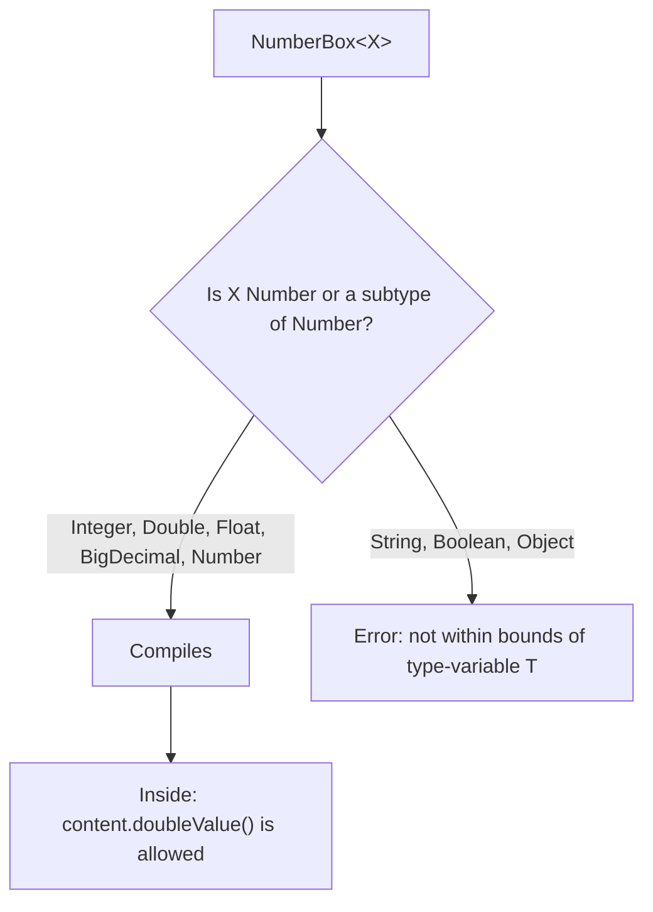
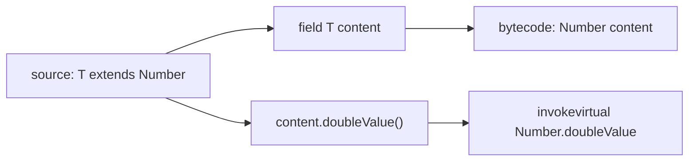

## In One Line
A bound such as `<T extends Number>` restricts which types may be plugged into `T` (only `Number` or its subtypes) — and in exchange lets the code call the bound's methods on a `T`, like `content.doubleValue()`.

## Mental Model
Think of a **"Qualified electricians only" job posting**.

- An unbounded `<T>` is "anyone may apply" — but then you can only ask the worker to do what *every* person can do (`toString`, `equals`: the `Object` methods).
- `<T extends Number>` is "must hold an electrician's licence". Fewer people qualify (`Integer`, `Double`, `BigDecimal`...; `String` is turned away at the door), but everyone who gets in is **guaranteed** to know electrician tasks — so you can hand them `doubleValue()` without checking.
- A multi-bound `<T extends Number & Comparable<T>>` is "licensed electrician **and** a driver" — one employer (class) at most, but any number of extra certificates (interfaces).
- The bound is the **contract**: the compiler checks it at hiring time (the type argument) and relies on it in the job (the method body).

## Concept
### Why bounds exist
Inside a generic class, the compiler only knows what `T` *guarantees*. With a plain `<T>` that is just `Object`, so this does not compile:
```java
static class Box<T> {
    private T content;
    Box(T content) { this.content = content; }
    double getDoubleValue() { return content.doubleValue(); }
}
```
```output
Unbounded.java:5: error: cannot find symbol
        double getDoubleValue() { return content.doubleValue(); }
                                                ^
  symbol:   method doubleValue()
  location: variable content of type T
  where T is a type-variable:
    T extends Object declared in class Box
```
Note the last line: an unbounded `T` is really `T extends Object`. Adding `extends Number` tells the compiler every `T` is a `Number`, so every `Number` method (`intValue()`, `longValue()`, `floatValue()`, `doubleValue()`, `byteValue()`, `shortValue()`) is available.

### Upper bound syntax: always `extends`
```java
class NumberBox<T extends Number> { ... }                      // bound is a class
static <T extends Comparable<T>> T max(T a, T b) { ... }        // bound is an interface: still "extends"
static <T extends Number & Comparable<T>> T maxOf(List<T> l)    // several bounds joined with &
```
- In a bound, `extends` means "is a subtype of" for **both classes and interfaces** — there is no `implements` in a type parameter.
- `extends` is **inclusive**: `T` may be the bound itself. `NumberBox<Number>` is legal.

### What the bound allows and rejects
| Type argument | Allowed? | Why |
|---|---|---|
| `Integer`, `Long`, `Short`, `Byte`, `Double`, `Float` | Yes | Wrapper classes extend `Number` |
| `BigInteger`, `BigDecimal` | Yes | Extend `Number` |
| `AtomicInteger`, `AtomicLong`, `LongAdder`, `DoubleAdder` | Yes | Extend `Number` |
| `Number` | Yes | The bound itself counts |
| `String`, `Boolean`, `Character`, `Object` | No | Not subtypes of `Number` |
| `int`, `double` | No | Primitives are never type arguments |

A type argument outside the bound is rejected at compile time:
```output
NotInBounds.java:7: error: type argument String is not within bounds of type-variable T
        NumberBox<String> box = new NumberBox<>("123");
                  ^
```
The bound itself and other subclasses work — including ones the course example does not show:
```java
NumberBox<Number> any = new NumberBox<>(5);            // T = Number itself is allowed
System.out.println(any.getContent().getClass().getSimpleName() + " " + any.getDoubleValue());
any = new NumberBox<>(2.5);
System.out.println(any.getDoubleValue());

NumberBox<BigDecimal> money = new NumberBox<>(new BigDecimal("0.1"));
NumberBox<AtomicInteger> counter = new NumberBox<>(new AtomicInteger(7));
NumberBox<Long> big = new NumberBox<>(Long.MAX_VALUE);
System.out.println(money.getDoubleValue() + " " + counter.getDoubleValue());
System.out.println(big.getContent() + " -> " + big.getDoubleValue());
```
```output
Integer 5.0
2.5
0.1 7.0
9223372036854775807 -> 9.223372036854776E18
```
Line 1: a `NumberBox<Number>` can hold an `Integer` (and, after reassignment, a box of a `Double`). Line 4: converting to `double` is **lossy** for big `long`s — a `double` has only 53 bits of precision.

### Multiple bounds: `&`
```java
// class bound first, then interfaces, joined with &
static <T extends Number & Comparable<T>> T maxOf(List<T> list) {
    T best = list.get(0);
    for (T t : list) if (t.compareTo(best) > 0) best = t;   // Comparable method
    System.out.println("as double: " + best.doubleValue());  // Number method
    return best;
}
System.out.println(maxOf(List.of(3, 9, 4)));
System.out.println(maxOf(List.of(2.5, 1.5)));
```
```output
as double: 9.0
9
as double: 2.5
2.5
```
Rules (same as a class that extends one class and implements interfaces):
- **At most one class**, and it must come **first**; any number of interfaces after it.
- Separate with `&`, never with `,` (a comma would start a *new* type parameter).
- `T` must satisfy **all** bounds: `AtomicInteger` is a `Number` but not `Comparable`, so `maxOf(List.of(new AtomicInteger(1)))` does not compile.

Putting the interface first gives:
```output
Order.java:3: error: interface expected here
    static <T extends Comparable<T> & Number> T bad(List<T> l) { return null; }
                                      ^
```

### Recursive bounds: `T extends Comparable<? super T>`
`<T extends Comparable<T>>` reads "T can be compared to another T". It is called a **recursive** (or F-bounded) bound because `T` appears in its own bound. It is how you write "a type that can be sorted".

It has a subtle hole. If `Fruit implements Comparable<Fruit>` and `Apple extends Fruit`, then `Apple` is a `Comparable<Fruit>` — **not** a `Comparable<Apple>`. The strict version rejects a `List<Apple>`; the JDK's version adds `? super T`:
```java
static class Fruit implements Comparable<Fruit> {
    final int weight;
    Fruit(int weight) { this.weight = weight; }
    public int compareTo(Fruit other) { return Integer.compare(weight, other.weight); }
    public String toString() { return getClass().getSimpleName() + "(" + weight + ")"; }
}
static class Apple extends Fruit { Apple(int w) { super(w); } }   // Apple is Comparable<Fruit>, not Comparable<Apple>

static <T extends Comparable<T>> T strictMax(List<T> list) { ... }
static <T extends Comparable<? super T>> T flexibleMax(List<T> list) { ... }

List<Apple> apples = List.of(new Apple(120), new Apple(150), new Apple(90));
Apple heaviest = flexibleMax(apples);
System.out.println(heaviest);
System.out.println(Collections.max(apples));
```
```output
Apple(150)
Apple(150)
```
while `strictMax(apples)` fails:
```output
R2.java:27: error: method strictMax in class R2 cannot be applied to given types;
        strictMax(apples);
        ^
  required: List<T>
  found:    List<Apple>
  reason: inference variable T has incompatible equality constraints Fruit,Apple
```
Other recursive bounds in the JDK: `enum`s are `Enum<E extends Enum<E>>` (so `compareTo` only accepts the same enum type), and the "self type" builder pattern `abstract class Builder<B extends Builder<B>>` lets subclass builders return their own type from chained methods.

### How a bound changes erasure
The compiler erases `T` to its **first (leftmost) bound**, not to `Object`. `javap -c -p` on the course's `NumberBox`:
```output
class Generics.NumberBox<T extends java.lang.Number> {
  private T content;

  public Generics.NumberBox(T);
    Code:
       0: aload_0
       1: invokespecial #1                  // Method java/lang/Object."<init>":()V
       4: aload_0
       5: aload_1
       6: putfield      #7                  // Field content:Ljava/lang/Number;
       9: return

  public T getContent();
    Code:
       0: aload_0
       1: getfield      #7                  // Field content:Ljava/lang/Number;
       4: areturn

  public double getDoubleValue();
    Code:
       0: aload_0
       1: getfield      #7                  // Field content:Ljava/lang/Number;
       4: invokevirtual #13                 // Method java/lang/Number.doubleValue:()D
       7: dreturn
}
```
The field is really a `Number`, and `content.doubleValue()` is an ordinary virtual call on `Number` — which is why it needs no cast. With `<T extends Number & Comparable<T>>`, `T` erases to `Number`, and calls to `compareTo` get a cast to `Comparable` inserted. (This is why `Collections.max` is declared `<T extends Object & Comparable<? super T>>`: the leading `Object` keeps its erased return type `Object`, as it was before generics.) See [Type Erasure](lesson:a04-generics/07-type-erasure).

### Only *upper* bounds for type parameters
There is no `<T super Integer>` — it is a syntax error (`> expected`). Lower bounds (`super`) exist only for **wildcards**: `List<? super Integer>`. See [Wildcards](lesson:a04-generics/05-wildcards).

### Bounded type parameter vs bounded wildcard
| | `<T extends Number> double sum(List<T> list)` | `double sum(List<? extends Number> list)` |
|---|---|---|
| Accepts `List<Integer>`, `List<Double>` | Yes | Yes |
| Can name the element type inside | Yes (`T`) | No (only "some Number") |
| Can link to return/other params | Yes: `<T extends Number> T first(List<T> l)` | No |
| Can declare several bounds (`&`) | Yes | No, one bound only |
| Simpler for callers | Same | Slightly — no type parameter to think about |
Rule of thumb: if the bounded type appears **once**, use the wildcard; if it links positions, use the type parameter.

### Where bounds appear in the JDK
- `Collections.sort(List<T> list)` with `<T extends Comparable<? super T>>`.
- `Collections.max`, `Collections.min`: `<T extends Object & Comparable<? super T>>`.
- `EnumSet<E extends Enum<E>>`, `EnumMap<K extends Enum<K>, V>`.
- `Stream.max(Comparator<? super T>)` uses a wildcard instead.
- `Comparator.comparing(Function<? super T, ? extends U>)` with `<T, U extends Comparable<? super U>>`.

## Diagram

The bound is checked where the type argument is supplied, and it is what makes `Number` methods callable inside the class.


Erasure replaces `T` with its first bound, so bounded code compiles to plain calls on `Number`.

## Code
@example Generics/BoundedTypeParameterExample.java

Why the float line looks strange:
```java
float f = 8.9f;
System.out.println(f);
System.out.println((double) f);
System.out.println(new BigDecimal(f));
System.out.println(new BigDecimal(Float.toString(f)).doubleValue());
```
```output
8.9
8.899999618530273
8.8999996185302734375
8.9
```
The float nearest to 8.9 is exactly 8.8999996185302734375. `Float.toString` prints the shortest text that identifies that *float* (`8.9`); after widening to `double`, `Double.toString` needs more digits to identify the same value as a *double*. The last line shows a way to get `8.9` back if you really need it — via the decimal string.

## Walkthrough
- `package Generics;` — module package (see the naming errata in [Why Generics?](lesson:a04-generics/01-why-generics)).
- `class NumberBox<T extends Number>` — a generic class whose type parameter has an **upper bound**. Only `Number` or its subclasses may be used for `T`.
- `private T content;` — stored as a `Number` in bytecode (erasure to the bound).
- `public NumberBox(T content)` — the constructor; `this.content = content` stores the argument.
- `public T getContent()` — returns the precise type: an `Integer` for a `NumberBox<Integer>`, a `Float` for a `NumberBox<Float>`.
- `public double getDoubleValue() { return content.doubleValue(); }` — the whole point of the bound: `doubleValue()` is a `Number` method, and the compiler knows every `T` is a `Number`. The call is dynamically dispatched to `Integer.doubleValue()`, `Double.doubleValue()` or `Float.doubleValue()` at runtime (see [Polymorphism](lesson:a01-oop/04-polymorphism)).
- `NumberBox<Integer> integerBox = new NumberBox<>(123);` — `123` is autoboxed to `Integer`; the diamond infers `Integer`.
  - `getContent()` → `Integer 123` → prints `123`.
  - `getDoubleValue()` → `123.0` (a `double` always prints with a decimal point).
- `NumberBox<Double> doubleBox = new NumberBox<>(45.67);` — `45.67` is a `double` literal, boxed to `Double`. Both lines print `45.67`, because the value is already a `double`.
- `NumberBox<Float> floatBox = new NumberBox<>(8.9f);` — the `f` suffix makes it a `float`, boxed to `Float`.
  - `getContent()` prints `8.9` (`Float.toString`).
  - `getDoubleValue()` prints `8.899999618530273`: widening `float` → `double` is exact, but it reveals that the float never held exactly 8.9 (see the snippet above).
- All six `// Output:` comments match the real output — including the surprising `8.899999618530273`.

**Running it:** `NumberBox` is the first class in the file, so on JDK 21 `java BoundedTypeParameterExample.java` fails with *can't find main(String[]) method in class: Generics.NumberBox*. Compile with `javac` and run `java -cp out Generics.BoundedTypeParameterExample`, or use the IDE.

## Traps
> [!ERRATA] The comment on line 6 says "T can only be a subclass of Number". Not quite: `extends` in a bound is **inclusive** — `T` may be `Number` itself or any subtype. `NumberBox<Number> box = new NumberBox<>(5);` compiles and works. The correct wording is "T must be Number or a subtype of Number".

- **`implements` in a bound** — `<T implements Comparable<T>>` is a syntax error. Always `extends`.
- **Wrong order of multiple bounds** — `<T extends Comparable<T> & Number>` → *interface expected here*. The class goes first.
- **Two classes in a bound** — `<T extends Number & Integer>` → *interface expected here*; only one class is allowed.
- **Comma instead of `&`** — a comma starts a *new type parameter*. `<T extends Number, Comparable<T>>` is a syntax error (`> expected`), but `<T extends Number, Comparable>` **compiles** and declares a second type variable named `Comparable` that shadows the real interface — so `T` is not required to be comparable at all, and any object is accepted wherever that `Comparable` is used.
- **No lower bounds for type parameters** — `<T super Integer>` does not parse. Use a wildcard `? super Integer`.
- **`Number` has no arithmetic.** You cannot write `content + 1` or `a + b` for `T extends Number`; you must convert (`doubleValue()`, `longValue()`), and each conversion can **lose information**: `long` values above 2^53, large `BigInteger`s, and the exact decimal digits of `BigDecimal` do not survive `doubleValue()`.
- **`float` to `double` "changes" the value on screen** (`8.9f` → `8.899999618530273`). The value is identical; only the printing precision differs.
- **Bounds do not create subtyping between parameterizations** — `NumberBox<Integer>` is still not a `NumberBox<Number>`.
- **Strict recursive bound rejects subclasses** — `<T extends Comparable<T>>` refuses a `List<Apple>` when only `Fruit` implements `Comparable<Fruit>`. Use `Comparable<? super T>`.

## Tips & Tricks
- **"extends = is-a, inclusive."** `T extends Number` reads "T is a Number" — and `Number` is a Number.
- **Bounds buy methods.** Ask: "which methods do I need to call on `T`?" — the answer is your bound.
- **Class first, then `&` interfaces** — same order as `class X extends C implements I1, I2`, just with `&`.
- **Erasure goes to the leftmost bound** — put the most useful type first if you control the order (and remember `Object &` trick in `Collections.max`).
- **Sortable types:** memorise `<T extends Comparable<? super T>>` — it is the JDK's standard "T can be sorted" bound.
- **Lower bounds only on wildcards** — "type parameters look up (`extends`), wildcards can look up or down (`extends`/`super`)".
- For money, never go through `double`: keep `BigDecimal` and its own arithmetic.

## Interview Q&A
### [Basic] What is a bounded type parameter?
A type parameter with a restriction on which types may replace it: `<T extends Number>` means `T` must be `Number` or a subtype. It has two effects: the compiler **rejects** type arguments outside the bound (`NumberBox<String>` → *not within bounds of type-variable T*), and inside the generic code you can **call the bound's methods** on a `T` (`content.doubleValue()`), because every possible `T` is guaranteed to have them.

**Follow-up:** *What is an unbounded `T` bounded by?* — Implicitly `Object`: `<T>` means `<T extends Object>`.

### [Basic] Why is `extends` used for interfaces in a bound instead of `implements`?
In a type bound, `extends` just means "is a subtype of", whether the bound is a class or an interface — `<T extends Comparable<T>>`. Java uses one keyword to keep the syntax simple; `implements` is not allowed in a type parameter section.

**Follow-up:** *Is `NumberBox<Number>` allowed for `T extends Number`?* — Yes; the bound is inclusive.

### [Intermediate] How do you specify multiple bounds and what are the rules?
With `&`: `<T extends Number & Comparable<T>>`. At most one bound may be a class, and it must come first; the rest must be interfaces. A type argument must satisfy all of them, and the code may use the methods of all of them. `T` erases to the first bound (`Number` here), and the compiler inserts casts to the other bounds where their methods are used.

**Follow-up:** *What happens with `<T extends Comparable<T> & Number>`?* — Compile error *interface expected here*, because the class must be first.

### [Intermediate] What is a recursive bound like `<T extends Comparable<T>>`, and why does the JDK write `Comparable<? super T>`?
A recursive bound mentions `T` in its own bound: "T is comparable to T". It expresses "sortable type". The JDK widens it to `Comparable<? super T>` to accept types that inherit `compareTo` from a superclass: if `Fruit implements Comparable<Fruit>` and `Apple extends Fruit`, then `Apple` is `Comparable<Fruit>` but not `Comparable<Apple>`. `strictMax(List<Apple>)` fails to compile, while `Collections.max(apples)` — declared with `? super T` — works.

**Follow-up:** *Another recursive bound in the JDK?* — `Enum<E extends Enum<E>>`; it makes `compareTo` and `getDeclaringClass` type-safe for each specific enum.

### [Intermediate] Bounded type parameter or bounded wildcard — `<T extends Number> double sum(List<T>)` vs `double sum(List<? extends Number>)`?
For this method, both accept `List<Integer>`, `List<Double>` and so on. Prefer the wildcard, because the type appears only once and the signature is simpler. Use the type parameter when you need to **name** the type — to return it (`<T extends Number> T first(List<T>)`), to relate two parameters, to declare local variables of it, or to use multiple bounds, which wildcards cannot have.

**Follow-up:** *Can a wildcard have a lower bound?* — Yes, `? super Integer`; type parameters cannot.

### [Intermediate] What does a bounded type parameter erase to?
Its first (leftmost) bound. `NumberBox<T extends Number>` stores its field as a `Number` in bytecode and calls `Number.doubleValue()` directly, so no cast is needed inside the class. An unbounded `T` erases to `Object`. This is why `Collections.max` is declared `<T extends Object & Comparable<? super T>>`: listing `Object` first keeps the erased signature returning `Object`, identical to the pre-generics version, so old compiled code still links.

**Follow-up:** *Can you see this?* — Yes: `javap -s` shows the descriptor `Ljava/lang/Number;` for `private T content`.

### [Advanced] Why can't you do arithmetic on `T extends Number`, and how do you handle numeric generics?
`Number` declares only conversion methods, not `+` or `add`, and Java has no operator overloading, so `a + b` for two `T`s does not compile. Options: convert to a common primitive (`doubleValue()`, accepting precision loss for large `long`s and `BigDecimal`), restrict to a specific type, pass the operation in as a function (`BinaryOperator<T> add`), or use specialised APIs (`IntStream.sum()`, `BigDecimal.add`). This limitation is also why the JDK has `IntStream`, `LongStream` and `DoubleStream` rather than one generic numeric stream.

**Follow-up:** *What does `new NumberBox<>(Long.MAX_VALUE).getDoubleValue()` print?* — `9.223372036854776E18`: `double` has 53 bits of precision, so the last digits are lost.

### [Advanced] Explain `8.9f` printing as `8.899999618530273` after `doubleValue()`.
`8.9` cannot be represented exactly in binary; the nearest `float` is 8.8999996185302734375. `Float.toString` prints the shortest decimal that uniquely identifies that float among floats — `8.9`. Widening to `double` keeps the exact same value, but `Double.toString` must uniquely identify it among the much denser doubles, so it prints `8.899999618530273`. Nothing was lost; the extra digits were always there. If you need the decimal value, go through the string: `new BigDecimal(Float.toString(f))`.

**Follow-up:** *Would `NumberBox<Double>` with `8.9` print `8.9`?* — Yes, because the value is already the closest `double`, and `Double.toString` prints `8.9`.

### [Advanced] Why are there no lower bounds (`super`) on type parameters?
A type parameter is a *name* for a type the code will use, and code can only use a type through what it guarantees; a lower bound (`T super Integer`) guarantees nothing about `T`'s methods beyond `Object`, so it would add little. Where "some supertype of Integer" is useful — accepting a destination for writes — a wildcard `? super Integer` covers it. The language designers therefore allowed `super` only on wildcards.

**Follow-up:** *Where is `? super` used in the JDK?* — `Collections.copy(List<? super T> dest, List<? extends T> src)`, `Comparator<? super T>` in `sort`, `Consumer<? super T>` in `forEach`.

## Quiz
### Which type argument is legal for `class NumberBox<T extends Number>`?
- [x] `NumberBox<Number>`
- [ ] `NumberBox<String>`
- [ ] `NumberBox<int>`
- [ ] `NumberBox<Object>`
> The bound is inclusive: `Number` itself satisfies `T extends Number`. `String` and `Object` are not subtypes of `Number` (*not within bounds*), and primitives are never type arguments. The course comment "can only be a subclass" is the tempting wrong idea.

### What does this print?
```java
NumberBox<Integer> b = new NumberBox<>(7);
System.out.println(b.getDoubleValue() / 2);
System.out.println(b.getContent() / 2);
```
- [ ] 3.5, then 3.5
- [x] 3.5, then 3
- [ ] 3, then 3
- [ ] Compile error: cannot divide a `T`
> `getDoubleValue()` returns a `double`, so `7.0 / 2` is `3.5`. `getContent()` returns an `Integer` for a `NumberBox<Integer>`; it unboxes to `int`, and `7 / 2` is integer division → `3`. In `main` the type is concrete, so dividing is fine.

### What does this print?
```java
NumberBox<Float> fb = new NumberBox<>(8.9f);
System.out.println(fb.getContent());
System.out.println(fb.getDoubleValue());
```
- [ ] 8.9, then 8.9
- [x] 8.9, then 8.899999618530273
- [ ] 8.899999618530273, then 8.899999618530273
- [ ] 8.9f, then 8.9
> `Float.toString` prints the shortest text that identifies the float (`8.9`). Widening to `double` keeps the exact binary value 8.8999996185302734375, which `Double.toString` must show with more digits. Nothing was lost in the conversion.

### Spot the bug.
```java
static <T extends Comparable<T> & Number> T maxOf(List<T> list) { ... }
```
- [ ] `&` must be a comma
- [x] The class bound `Number` must come first: `<T extends Number & Comparable<T>>`
- [ ] Interfaces cannot be used as bounds
- [ ] Nothing, it compiles
> In a multiple bound, at most one class is allowed and it must be listed first, followed by interfaces — the compiler says *interface expected here*. A comma would not fix it: it would declare a second type parameter.

### Why does `content.doubleValue()` compile in `NumberBox<T extends Number>` but not in `Box<T>`?
- [ ] Because `NumberBox` casts `content` to `Double` at runtime
- [x] Because the bound guarantees every `T` is a `Number`, so `Number`'s methods are available on `T`
- [ ] Because `doubleValue()` is a static method
- [ ] Because autoboxing adds `doubleValue()` to every object
> Inside generic code the compiler only allows methods of `T`'s bound. Unbounded `T` means `T extends Object`, which has no `doubleValue()` (*cannot find symbol*). With `extends Number`, `T` erases to `Number` and the call is a normal virtual call — no cast involved.

### `Fruit implements Comparable<Fruit>`, `Apple extends Fruit`. Which signature accepts a `List<Apple>`?
- [ ] `<T extends Comparable<T>> T max(List<T> list)`
- [x] `<T extends Comparable<? super T>> T max(List<T> list)`
- [ ] Both
- [ ] Neither, `Apple` is not comparable
> `Apple` inherits `compareTo(Fruit)`, so it is a `Comparable<Fruit>`, not a `Comparable<Apple>`. The strict bound fails (*incompatible equality constraints Fruit,Apple*); `Comparable<? super T>` accepts "comparable to Apple or to a supertype of Apple".

### What does `T` erase to in `<T extends Number & Comparable<T>>`?
- [ ] `Object`
- [x] `Number`
- [ ] `Comparable`
- [ ] It is not erased because it is bounded
> Erasure uses the first (leftmost) bound. Calls to `compareTo` get a compiler-inserted cast to `Comparable`. That is why the JDK writes `<T extends Object & Comparable<? super T>>` in `Collections.max` — to keep the erasure `Object`.

## Takeaways
- `<T extends Number>` restricts `T` to `Number` or any subtype (the bound is inclusive) and lets generic code call the bound's methods, such as `doubleValue()`.
- Bounds always use `extends`, for classes and interfaces alike; multiple bounds use `&`, with at most one class and it must come first.
- A type argument outside the bound is a compile error: *type argument String is not within bounds of type-variable T*.
- A bounded `T` erases to its first bound (`Number`), so bounded code compiles to plain calls on that type.
- Recursive bounds express "comparable to itself": prefer `<T extends Comparable<? super T>>` so subclasses of a comparable class also work.
- Type parameters only have upper bounds; `super` exists only on wildcards (`? super Integer`).
- `Number` has no arithmetic; converting with `doubleValue()` can lose precision (big `long`s, `BigDecimal`), and `float`→`double` shows extra digits (`8.899999618530273`).
