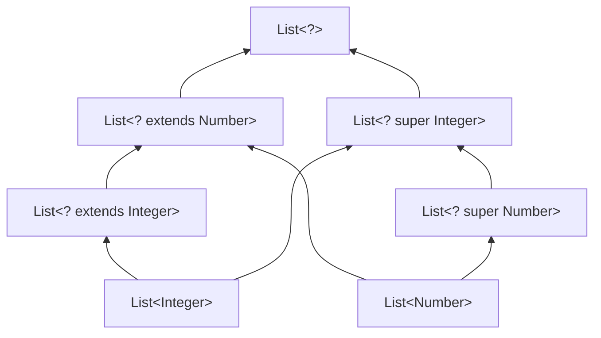
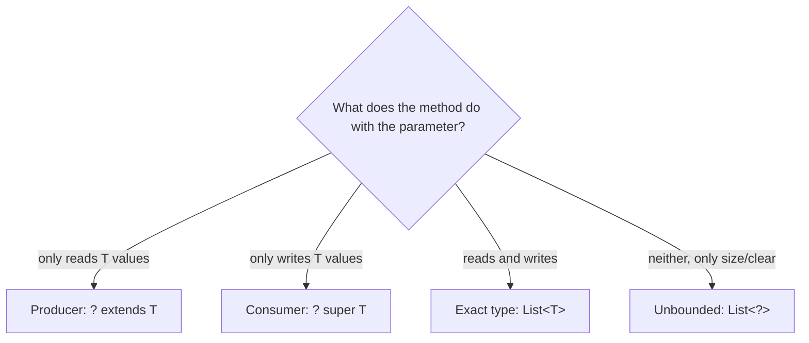

## In One Line
Because `List<Integer>` is **not** a `List<Number>`, Java gives you wildcards — `List<?>` (any list), `List<? extends Number>` (a list you can **read** Numbers from) and `List<? super Integer>` (a list you can **write** Integers into) — and PECS tells you which one to use: **P**roducer **E**xtends, **C**onsumer **S**uper.

## Mental Model
Think of **boxes of fruit at a market stall**.

- A **"box of some kind of fruit"** (`? extends Fruit`) — you do not know if it is apples or bananas. You can safely **take** a piece out and treat it as *fruit*. But you cannot **put** anything in: if you drop a banana into what is really the apple box, you have broken it. It is a **producer**: it gives you fruit.
- A **"box that accepts apples"** (`? super Apple`) — it might be an apple box, a fruit box or a "anything" bin. You can always **put** an apple in. But when you take something out, you only know it is *some object* — maybe a banana from the fruit box. It is a **consumer**: it takes apples.
- A **"box of something"** (`?`) — you can count what is inside, empty it, look at each item as "an object", but you cannot add anything (except `null`, which is "nothing").
- A **plain "box of fruit"** (`List<Fruit>`) is not the same thing as an apple box (`List<Apple>`) — even though every apple is a fruit. That is **invariance**, the reason wildcards exist.

## Concept
### The problem: generics are invariant
`Integer` is a subtype of `Number`, but `List<Integer>` is **not** a subtype of `List<Number>`:
```java
List<Integer> ints = new ArrayList<>(List.of(1, 2, 3));
List<Number> nums = ints;      // if this compiled...
nums.add(3.14);                // ...a Double would sneak into a List<Integer>
```
```output
Invariant.java:5: error: incompatible types: List<Integer> cannot be converted to List<Number>
        List<Number> nums = ints;      // if this compiled...
                            ^
```
The compiler must refuse, because generics are erased and the JVM could not catch the bad `add` at runtime.

**Arrays are different — they are covariant**, and pay for it with a runtime check:
```java
Integer[] ints = {1, 2, 3};
Object[] objs = ints;          // arrays are covariant: compiles
objs[0] = "hello";             // checked at runtime
```
```output
Exception in thread "main" java.lang.ArrayStoreException: java.lang.String
	at ArrayCov.main(ArrayCov.java:5)
```
Arrays know their element type at runtime (they are *reifiable*), so the JVM can throw `ArrayStoreException`. Generic lists do not, so the check has to happen at compile time — hence invariance.

The same rule stops a method with a `List<Object>` parameter from accepting a `List<Integer>` (`List<Integer> cannot be converted to List<Object>`). That is exactly why the course's `printList` takes a `List<?>` instead.

### The three wildcards
| Wildcard | Accepts | Read elements as | Add | Role |
|---|---|---|---|---|
| `List<?>` | Any `List<X>` | `Object` | Only `null` | "I don't care about the type" |
| `List<? extends Number>` | `List<Number>`, `List<Integer>`, `List<Double>`... | `Number` | Only `null` | **Producer** — you get values out |
| `List<? super Integer>` | `List<Integer>`, `List<Number>`, `List<Object>` | `Object` | `Integer` (and its subtypes) | **Consumer** — you put values in |

All three rules in running code:
```java
// ? extends: a PRODUCER - read as the bound, cannot add (except null)
List<Integer> ints = new ArrayList<>(List.of(1, 2, 3));
List<? extends Number> producer = ints;
Number first = producer.get(0);
producer.add(null);                      // the only value that fits every possible type
System.out.println(first + " " + producer);

// ? super: a CONSUMER - add Integers, read only as Object
List<Number> numbers = new ArrayList<>(List.of(3.5));
List<Object> objects = new ArrayList<>();
List<? super Integer> consumer = numbers;
consumer.add(10);
consumer.add(20);
Object read = consumer.get(0);
consumer = objects;                      // also a valid List<? super Integer>
consumer.add(30);
System.out.println(numbers + " " + objects + " " + read);

// ? : unknown - read as Object; size/clear/remove still work
List<?> unknown = new ArrayList<>(List.of("a", "b", "c"));
Object o = unknown.get(0);
unknown.remove("b");
System.out.println(o + " " + unknown + " " + unknown.size() + " " + unknown.contains("c"));
unknown.clear();
System.out.println(unknown.isEmpty());
```
```output
1 [1, 2, 3, null]
[3.5, 10, 20] [30] 3.5
a [a, c] 2 true
true
```

### Why you cannot add to `? extends Number`
`List<? extends Number>` might really be a `List<Integer>`, a `List<Double>` or a `List<BigDecimal>`. There is no value (other than `null`) that fits *all* of them, so the compiler rejects every `add`:
```output
ExtendsAdd.java:5: error: incompatible types: int cannot be converted to CAP#1
        nums.add(1);
                 ^
  where CAP#1 is a fresh type-variable:
    CAP#1 extends Number from capture of ? extends Number
```
`CAP#1` is the compiler's name for "the specific but unknown type behind this `?`" — this is called **wildcard capture**.

### Why you can only read `Object` from `? super Integer`
`List<? super Integer>` might be a `List<Integer>`, a `List<Number>` or a `List<Object>`. Adding an `Integer` is safe for all three. But an element you read could be any `Object` (the `List<Number>` above already held `3.5`):
```output
SuperRead.java:6: error: incompatible types: CAP#1 cannot be converted to Integer
        Integer i = sink.get(0);
                            ^
  where CAP#1 is a fresh type-variable:
    CAP#1 extends Object super: Integer from capture of ? super Integer
```

### PECS — Producer Extends, Consumer Super
Coined by Joshua Bloch (*Effective Java*, "Use bounded wildcards to increase API flexibility"). Ask of each parameter: **does it produce `T`s for me, or consume `T`s from me?**
- The method **reads** `T`s from it → it is a producer → `? extends T`.
- The method **writes** `T`s into it → it is a consumer → `? super T`.
- Both read and write → no wildcard, use exact `T`.
- Neither (only `size()`, `clear()`) → `?`.

The classic example is a copy method — the JDK's `Collections.copy(List<? super T> dest, List<? extends T> src)` has the same shape:
```java
static <T> void copy(List<? super T> dest, List<? extends T> src) {
    for (T item : src) dest.add(item);
}
static double sumList(List<? extends Number> list) { ... }                     // producer
static void fillWithSquares(List<? super Integer> out, int n) {               // consumer
    for (int i = 1; i <= n; i++) out.add(i * i);
}

List<Integer> ints = List.of(1, 2, 3);
List<Double> doubles = List.of(1.5, 2.5);
List<Number> all = new ArrayList<>();
copy(all, ints);                   // T = Integer: List<Number> is a List<? super Integer>
copy(all, doubles);                // T = Double
System.out.println(all + " sum=" + sumList(all));

List<Object> objects = new ArrayList<>();
fillWithSquares(objects, 4);       // a List<Object> can consume Integers
System.out.println(objects);

System.out.println(sumList(List.of(1, 2.5, 3L)));

// Comparator<? super T>: a Comparator<Object> can sort Strings
Comparator<Object> byText = Comparator.comparing(Object::toString);
List<String> words = new ArrayList<>(List.of("pear", "apple", "fig"));
words.sort(byText);
System.out.println(words);

// Consumer<? super T> in forEach
Consumer<Object> printer = o -> System.out.print(o + ";");
words.forEach(printer);
System.out.println();
```
```output
[1, 2, 3, 1.5, 2.5] sum=10.0
[1, 4, 9, 16]
6.5
[apple, fig, pear]
apple;fig;pear;
```
Without the wildcards, `copy(List<T> dest, List<T> src)` would refuse to copy a `List<Integer>` into a `List<Number>`.

PECS applies to **any** generic type, not only collections. Functional interfaces follow it everywhere in the JDK:
| JDK signature | Why |
|---|---|
| `boolean addAll(Collection<? extends E> c)` | `c` produces `E`s |
| `void forEach(Consumer<? super T> action)` | the action consumes `T`s |
| `void sort(Comparator<? super E> c)` | the comparator consumes `E`s (to compare them) |
| `<R> Stream<R> map(Function<? super T, ? extends R> mapper)` | consumes `T`, produces `R` |
| `Stream<T> filter(Predicate<? super T> predicate)` | the predicate consumes `T`s |
| `static <T> void copy(List<? super T> dest, List<? extends T> src)` | dest consumes, src produces |

### `List<?>` vs `List<Object>` vs raw `List`
| | `List<?>` | `List<Object>` | raw `List` |
|---|---|---|---|
| Accepts a `List<String>` argument | Yes | **No** (invariance) | Yes, with warnings |
| `add("x")` | No (only `null`) | Yes | Yes, unchecked — can corrupt the list |
| Read elements as | `Object` | `Object` | `Object` |
| Type-safe | Yes | Yes | **No** |
Use `List<?>` for "a list of anything, read-only-ish"; `List<Object>` for "a list that really holds mixed objects"; raw `List` never.

### Wildcard subtyping
Wildcards restore a *safe* form of subtyping between parameterized types:
- `List<Integer>` is a `List<? extends Integer>`, which is a `List<? extends Number>`, which is a `List<?>`.
- `List<Number>` is a `List<? super Number>`, which is a `List<? super Integer>`.
- `List<Integer>` is also a `List<? super Integer>`.
- `ArrayList<Integer>` is a `Collection<? extends Number>` (class hierarchy and wildcard combine).
- But `ArrayList<Double>` is **not** a `List<? super Integer>` — `Double` is not a supertype of `Integer`.

### Wildcard capture and helper methods
Even when an operation is obviously safe, `?` can get in the way. Swapping two elements of a `List<?>`:
```java
static void swapFirstTwo(List<?> list) {
    list.set(0, list.get(1));          // does not compile
}
```
```output
Capture.java:4: error: incompatible types: Object cannot be converted to CAP#1
        list.set(0, list.get(1));          // does not compile
                            ^
```
The compiler only knows `get` returns "some `CAP#1`, viewed as `Object`", and `set` wants a `CAP#1`. The fix is a private generic **helper** that *captures* the wildcard as a named `T`:
```java
static void swapFirstTwo(List<?> list) { swapHelper(list); }     // public API: simple wildcard
private static <T> void swapHelper(List<T> list) {               // helper "captures" ? as T
    T tmp = list.get(0);
    list.set(0, list.get(1));
    list.set(1, tmp);
}
List<String> names = new ArrayList<>(List.of("Bo", "Al", "Cy"));
swapFirstTwo(names);
System.out.println(names);
```
```output
[Al, Bo, Cy]
```
`Collections.swap(List<?> list, int i, int j)` uses this same idea.

### Where wildcards are not allowed
- **Object creation:** `new ArrayList<?>()` → *unexpected type, required: class or interface without bounds, found: ?*.
- **Supertypes:** `class MyList extends ArrayList<?>` → same error.
- **Type parameter declarations and explicit method type arguments:** `class Box<?>`, `Util.<?>m()`.
- **Return types** — legal, but a bad idea: it forces every caller to deal with wildcards. Return `List<T>` or `List<Number>`.
Wildcards belong on **variables, fields and parameters**, and nested inside type arguments: `new ArrayList<List<?>>()` is fine.

### Wildcard or type parameter?
| Use a wildcard when | Use a type parameter when |
|---|---|
| The type appears once in the signature | It links parameters or parameter and return |
| You only need a lower bound (`super`) — type parameters cannot have one | You need multiple bounds (`&`) |
| You want the simplest signature for callers | You need to name the type in the body (`T tmp`) |

## Diagram

Arrows point from subtype to supertype. `List<Integer>` and `List<Number>` are unrelated to each other, but both reach the wildcard types — that is how one method can accept both.


PECS as a decision: ask what the method does with each parameter, not what the caller has.

## Code
@example Generics/WildcardExample.java

The last line looks like it should show floating-point noise, but it does not — here is the running sum step by step:
```java
double sum = 0.0;
sum += 1.1; System.out.println(sum);
sum += 2.2; System.out.println(sum);
sum += 3.3; System.out.println(sum);
System.out.println(0.1 + 0.2);
```
```output
1.1
3.3000000000000003
6.6
0.30000000000000004
```
The intermediate value `3.3000000000000003` shows the usual binary rounding error; adding `3.3` happens to round back to the double closest to 6.6. You got lucky, not exact — never compare such sums with `==`.

## Walkthrough
- `package Generics;` and the imports `java.util.ArrayList` / `java.util.List` — `List` is the interface used in the signatures; `ArrayList` is the implementation created in `main`.
- `public static void printList(List<?> list)` — an **unbounded wildcard**: it accepts a list of *any* element type. A `List<Object>` parameter would not accept `List<Integer>` (invariance); a raw `List` would, but without type safety.
- `for (Object element : list)` — elements of a `List<?>` can only be read as `Object`. That is enough here, because `print` only needs `toString()`.
- `System.out.print(element + " ");` then `System.out.println();` — prints the elements on one line, each followed by a space (so every list line ends with a trailing space), then ends the line.
- `public static double sumList(List<? extends Number> list)` — an **upper-bounded wildcard**: any list whose element type is `Number` or a subtype. The list is a **producer** of `Number`s — the method only reads.
- `double sum = 0.0;` / `for (Number number : list)` — each element is safely viewed as a `Number`...
- `sum += number.doubleValue();` — ...so `Number.doubleValue()` is callable, dispatched to `Integer.doubleValue()` or `Double.doubleValue()` at runtime.
- `return sum;` — returns a `double`, which is why the integer sum prints as `6.0`.
- `List<Integer> integerList = new ArrayList<>();` + three `add` calls — `1`, `2`, `3` are autoboxed. `printList(integerList)` → `Integer List: 1 2 3 `.
- `List<Double> doubleList = new ArrayList<>();` + `1.1`, `2.2`, `3.3` → `Double List: 1.1 2.2 3.3 `. The **same** `printList` accepts both, which is the whole point of `?`.
- `sumList(integerList)` → `1.0 + 2.0 + 3.0` = `6.0`. `sumList(doubleList)` → `6.6` (see the step-by-step snippet above).
- The example has no `// Output:` comments to compare; the recorded output matches what the code does.
- The example covers `?` and `? extends` but not `? super`; the Concept section above covers the consumer side and PECS.

## Traps
> [!NOTE] The course example is correct, but it only shows two of the three wildcards and never tries to **add** to a wildcard list — which is exactly where interview questions go. Also, `sumList` returns `double`, so summing `Long` values above 2^53 or `BigDecimal`s loses precision; that is a design limitation, not a bug in this demo.

- **Trying to add to `List<? extends T>`** — every `add` except `add(null)` fails with *cannot be converted to CAP#1*. If you need to add, you want `? super T` (or the exact type).
- **Expecting a typed value from `List<? super T>`** — `Integer i = sink.get(0)` fails; you only get `Object`.
- **Using `List<Object>` for "any list"** — it rejects `List<String>` arguments. Use `List<?>`.
- **Assuming arrays behave like lists** — `Object[] objs = new Integer[3]` compiles and throws `ArrayStoreException` on a bad store; `List<Object> objs = new ArrayList<Integer>()` does not compile.
- **Returning wildcard types** — `List<? extends Number> getNumbers()` pushes wildcards onto every caller. Return a concrete type argument.
- **`new ArrayList<?>()`** — wildcards cannot be instantiated (*unexpected type ... found: ?*).
- **"Obviously safe" operations on `List<?>`** like swapping still fail; use a private capture helper `<T> void helper(List<T>)`.
- **Mixing `? super` with the wrong type** — `f(List<? super Integer>)` rejects `ArrayList<Double>`: `Double` is a sibling of `Integer`, not a supertype.

## Tips & Tricks
- **PECS — "Producer Extends, Consumer Super".** Say it from the *method's* point of view: "does this parameter **give** me Ts (extends) or **take** Ts from me (super)?"
- **Alternative phrasing — the Get and Put Principle** (Naftalin & Wadler): use `extends` when you only **get** values out, `super` when you only **put** values in, and no wildcard when you do both.
- **"extends = read, super = write, ? = neither (just look)".**
- **`null` fits everything** — it is the only value you can add to `List<?>` or `List<? extends X>`.
- **Wildcards in parameters, never in return types.**
- **If a type parameter appears only once, make it a wildcard**: `void printList(List<?> list)` beats `<T> void printList(List<T> list)`.
- **Comparators and consumers are always `? super`**: `Comparator<? super T>`, `Consumer<? super T>`, `Predicate<? super T>` — a `Comparator<Object>` can sort anything.

## Interview Q&A
### [Basic] What is a wildcard in Java generics and what kinds are there?
A wildcard `?` in a type argument stands for "some unknown type". There are three forms: the **unbounded** `List<?>` (any element type), the **upper-bounded** `List<? extends Number>` (`Number` or any subtype), and the **lower-bounded** `List<? super Integer>` (`Integer` or any supertype). Wildcards are used in variable, field and parameter types to make APIs accept a family of parameterized types, because generic types themselves are invariant.

**Follow-up:** *Can you write `new ArrayList<?>()`?* — No; you can only instantiate a concrete parameterization. Wildcards describe variables and parameters, not objects.

### [Basic] Why is `List<Integer>` not a subtype of `List<Number>`?
Because it would break type safety. If it were, you could assign a `List<Integer>` to a `List<Number>` variable and then `add(3.14)`, putting a `Double` into a list of integers. Arrays allow that assignment (covariance) but check every store at runtime with `ArrayStoreException`; generic types are erased, so they cannot check at runtime and are made **invariant** instead. Wildcards (`List<? extends Number>`) give you the flexible, read-only version safely.

**Follow-up:** *What is the runtime exception for the array case?* — `ArrayStoreException`, e.g. `Object[] o = new Integer[1]; o[0] = "x";`.

### [Intermediate] Explain PECS with an example.
PECS stands for **Producer Extends, Consumer Super**. If a parameter *produces* values that your method reads, declare it `? extends T`; if it *consumes* values your method writes, declare it `? super T`. The canonical example is `Collections.copy(List<? super T> dest, List<? extends T> src)`: `src` produces `T`s, `dest` consumes them, so you can copy a `List<Integer>` into a `List<Number>` or a `List<Object>`. Other examples: `addAll(Collection<? extends E>)`, `sort(Comparator<? super E>)`, `forEach(Consumer<? super T>)`.

**Follow-up:** *What if a parameter is both read and written?* — Then use the exact type `List<T>`, no wildcard.

### [Intermediate] Why can't you add elements to a `List<? extends Number>`?
The variable might refer to a `List<Integer>`, a `List<Double>` or any other `Number` subtype list, and the compiler does not know which. No value except `null` is valid for all of them, so every `add` is rejected — the error mentions `CAP#1`, the captured unknown type. You can, however, read elements as `Number`, which is why `? extends` is for producers.

**Follow-up:** *Can you remove elements from it?* — Yes. `remove(Object)`, `clear()` and iterator removal do not need to know the element type.

### [Intermediate] What is the difference between `List<?>`, `List<Object>` and the raw `List`?
`List<?>` is a list of some unknown type: it accepts any `List<X>`, you read `Object`s, and you cannot add anything but `null` — fully type-safe. `List<Object>` is a list whose element type is exactly `Object`: you can add anything, but it does not accept a `List<String>` argument because of invariance. The raw `List` switches generic checking off: it accepts any list and lets you add anything with only an unchecked warning, which can corrupt a `List<String>` and cause a `ClassCastException` later.

**Follow-up:** *Which one should a `printAll` method take?* — `List<?>` (or `Collection<?>`/`Iterable<?>`).

### [Intermediate] When would you use a wildcard instead of a type parameter?
When the type appears only once and you do not need to name it — `void printList(List<?> list)` or `double sum(Collection<? extends Number> c)`. Wildcards also offer lower bounds, which type parameters do not. Use a type parameter when it links things: the return type depends on the argument, two parameters must share a type, or you need a local variable of that type or multiple bounds.

**Follow-up:** *Is `<T> void print(List<T> list)` wrong?* — Not wrong, just noisier; `T` is used once, so `List<?>` expresses the same thing more simply.

### [Advanced] What is wildcard capture, and how do you write a method that swaps two elements of a `List<?>`?
When the compiler sees an expression of type `List<?>`, it gives the unknown type a fresh internal name, like `CAP#1` — that is **capture conversion**. Because each occurrence is captured separately, `list.set(0, list.get(1))` fails: `get` returns something viewed as `Object`, and `set` needs a `CAP#1`. The standard fix is a private generic helper, `private static <T> void swapHelper(List<T> list)`, called from the public `swap(List<?> list)`: inference binds the captured type to `T`, and inside the helper `T tmp = list.get(0); list.set(0, list.get(1)); list.set(1, tmp);` is legal. `Collections.swap` is written this way.

**Follow-up:** *Why not simply make the public method generic?* — You could; the helper keeps the public signature as simple as possible (`List<?>`), which is the Effective Java recommendation.

### [Advanced] How do wildcards appear in the Stream and functional APIs, and why?
Every functional parameter follows PECS: `filter(Predicate<? super T>)`, `forEach(Consumer<? super T>)`, `sorted(Comparator<? super T>)` (consumers of `T`), `map(Function<? super T, ? extends R>)` (consumes `T`, produces `R`), `flatMap(Function<? super T, ? extends Stream<? extends R>>)`, `Collectors.toMap(Function<? super T, ? extends K>, ...)`. This lets you reuse general functions: a `Predicate<Object> notNull` can filter a `Stream<String>`, and a `Function<Object, Integer>` can map one. Without the wildcards, the types would have to match exactly.

**Follow-up:** *Why is `Comparator.comparing` declared `<T, U extends Comparable<? super U>>`?* — So the sort key may inherit `compareTo` from a supertype: a `java.sql.Timestamp` key is a `Comparable<java.util.Date>`, not a `Comparable<Timestamp>`, yet `Comparator.comparing(Event::at)` still works.

### [Advanced] Are arrays covariant and generics invariant? What are the trade-offs?
Yes. Arrays are covariant (`Integer[]` is an `Object[]`) and *reified* — each array knows its element type, so bad stores fail at runtime with `ArrayStoreException`. Generics are invariant and *erased* — errors must be caught at compile time, and use-site variance (wildcards) gives back flexibility safely. The trade-off: arrays are simpler but fail late; generics fail early but need wildcards. This mismatch is also why you cannot create generic arrays like `new List<String>[10]`.

**Follow-up:** *Which should you prefer?* — Lists over arrays for reference types in APIs (Effective Java: "Prefer lists to arrays"); arrays remain fine for primitives and performance-critical internals.

## Quiz
### What does this print?
```java
List<? super Integer> list = new ArrayList<Number>();
list.add(10);
list.add(20);
Object first = list.get(0);
System.out.println(first + " " + list.size());
```
- [ ] Compile error: cannot add to a wildcard list
- [x] 10 2
- [ ] Compile error: `get` returns `Integer`, not `Object`
- [ ] ClassCastException
> A `? super Integer` list is a consumer: adding `Integer`s is always safe. Reading gives `Object`, and assigning to an `Object` variable is fine. The "cannot add" rule applies to `? extends`, not `? super`.

### Given `List<? extends Number> nums = new ArrayList<Integer>();` — which line compiles?
- [ ] `nums.add(1);`
- [ ] `nums.add(1.5);`
- [x] `Number n = nums.isEmpty() ? null : nums.get(0);`
- [ ] `Integer i = nums.get(0);`
> Elements of a `? extends Number` list can be read as `Number`. Adding fails because the list could be a `List<Double>` or a `List<Integer>` — the compiler cannot tell. Reading as `Integer` fails because the static type is only "some Number".

### What does this print?
```java
static double sumList(List<? extends Number> list) {
    double sum = 0.0;
    for (Number n : list) sum += n.doubleValue();
    return sum;
}
System.out.println(sumList(List.of(1, 2.5, 3L)));
```
- [ ] Compile error: a list cannot mix Integer, Double and Long
- [ ] 6
- [x] 6.5
- [ ] 6.0
> `List.of(1, 2.5, 3L)` infers a common supertype that includes `Number`, so it is accepted by `List<? extends Number>`. The sum is `1.0 + 2.5 + 3.0 = 6.5`, printed as a `double`.

### What happens?
```java
Integer[] ints = {1, 2, 3};
Object[] objs = ints;
objs[0] = "hello";
```
- [ ] Compile error on the second line
- [ ] Compile error on the third line
- [x] It compiles and throws `ArrayStoreException` on the third line
- [ ] It works; `ints[0]` becomes "hello"
> Arrays are covariant, so the assignment compiles, and the store type-checks against `Object[]`. At runtime the array knows it is an `Integer[]` and rejects the `String` with `ArrayStoreException`. The generic equivalent (`List<Object> o = new ArrayList<Integer>()`) is a compile error instead.

### Which signature correctly applies PECS to "copy all elements from `src` into `dest`"?
- [ ] `static <T> void copy(List<T> dest, List<T> src)`
- [ ] `static <T> void copy(List<? extends T> dest, List<? super T> src)`
- [x] `static <T> void copy(List<? super T> dest, List<? extends T> src)`
- [ ] `static void copy(List<?> dest, List<?> src)`
> `src` produces `T`s (extends), `dest` consumes them (super). The swapped version cannot add to `dest` or read typed values from `src`. Exact `List<T>` works but refuses `List<Integer>` → `List<Number>`. `List<?>` for both cannot add anything to `dest`.

### Spot the bug.
```java
static void swapFirstTwo(List<?> list) {
    Object tmp = list.get(0);
    list.set(0, list.get(1));
    list.set(1, tmp);
}
```
- [ ] Nothing, it compiles and works
- [x] `set` on a `List<?>` needs the captured type, not `Object` — call a private `<T> swapHelper(List<T>)` instead
- [ ] `get` cannot be called on a `List<?>`
- [ ] `List<?>` cannot be passed a `List<String>`
> Reading from `List<?>` gives `Object`, but `set` requires the unknown captured type `CAP#1`, so both `set` calls fail to compile. A generic helper captures the wildcard as `T`, making `T tmp = list.get(0)` and the `set` calls legal.

### Which argument can be passed to `void f(List<? super Integer> list)`?
- [ ] `new ArrayList<Double>()`
- [ ] `new ArrayList<Long>()`
- [x] `new ArrayList<Number>()`
- [ ] `List.of("a")`
> `? super Integer` accepts `List<Integer>`, `List<Number>`, `List<Object>` (and other supertypes such as `List<Comparable<Integer>>`). `Double` and `Long` are siblings of `Integer`, not supertypes.

## Takeaways
- Generic types are invariant: `List<Integer>` is not a `List<Number>` (it would let a `Double` in); arrays are covariant and fail at runtime with `ArrayStoreException` instead.
- `List<?>` accepts any list: read elements as `Object`, add only `null`, but `size`, `remove` and `clear` still work.
- `List<? extends T>` is a producer: read elements as `T`, cannot add (except `null`).
- `List<? super T>` is a consumer: add `T`s, read only `Object`.
- PECS — Producer Extends, Consumer Super — e.g. `Collections.copy(List<? super T> dest, List<? extends T> src)`, `addAll(Collection<? extends E>)`, `sort(Comparator<? super E>)`.
- Use `List<?>` rather than `List<Object>` or a raw `List` for "any list"; never return wildcard types.
- Wildcards cannot be instantiated or extended (`new ArrayList<?>()` fails); a private generic helper "captures" a `?` when you need to write back elements you read.
