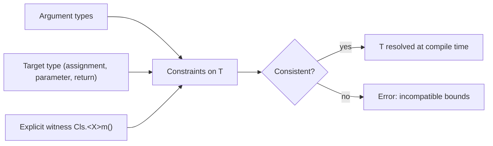
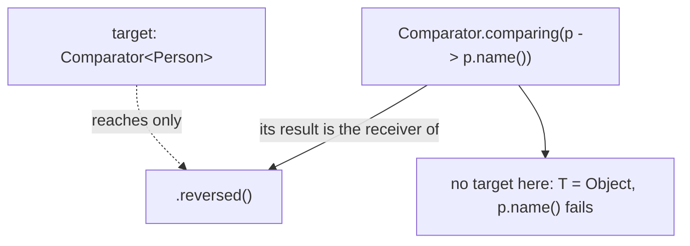

## In One Line
Type inference is the compiler working out the types you did not write — the `<String>` in `new ArrayList<>()`, the `T` of a generic method call, a lambda's parameter types, the type of a `var` — entirely at **compile time**, from the arguments and from where the result is going (the *target type*).

## Mental Model
Think of a **tailor who measures you from the order form**.

- You order "a suit for this person" without writing every measurement. The tailor reads the **context**: the person standing there (the argument types) and the event it is for (the target type — the variable, parameter or return type the value goes into).
- `new ArrayList<>()` is "one suit, please" — the tailor looks at the left side, `List<String> stringList`, and cuts it to `String` size.
- `var list = new ArrayList<>();` is ordering a suit **with no person and no event** — the tailor has nothing to measure and makes a one-size-fits-all `Object` suit. It fits everything, so it protects nothing.
- A chained call like `comparing(p -> p.name()).reversed()` is asking the tailor to cut the suit **before** saying who it is for — the information arrives too late.
- All of this happens at the tailor's table (compile time). Once the suit is made, nobody re-measures you at runtime.

## Concept
### Where Java infers types
| Feature | Since | Example | Inferred from |
|---|---|---|---|
| Generic method calls | Java 5 (much improved in 8) | `Collections.emptyList()` | Arguments + target type |
| Diamond operator `<>` | Java 7 | `List<String> l = new ArrayList<>();` | Target type, else constructor arguments |
| Lambda parameter types | Java 8 | `(a, b) -> a + b` | The functional interface target |
| Method references | Java 8 | `String::length` | The functional interface target |
| Diamond with anonymous classes | Java 9 | `new Comparator<>() { ... }` | Target type |
| `var` local variables | Java 10 | `var names = new ArrayList<String>();` | The initializer only |
| `var` in lambda parameters | Java 11 | `(var a, var b) -> a + "-" + b` | The functional interface target |
| `var` in record patterns | Java 21 | `if (o instanceof Box(var v))` | The record's component types (type arguments of a generic record are inferred too) |
In every case the result is an ordinary **static** type fixed at compile time. Nothing is decided at runtime.

### The diamond operator
Before Java 7 you had to repeat the type arguments: `List<String> list = new ArrayList<String>();`. The diamond `<>` lets the compiler fill them in:
- From the **target type**: `List<String> list = new ArrayList<>();` → `ArrayList<String>`. Targets include assignments, method arguments and return statements (`return new ArrayList<>();` in a method returning `List<Order>`).
- If there is no useful target, from the **constructor arguments**: `var copy = new ArrayList<>(List.of("a", "b"));` → `ArrayList<String>` (adding `1` to it is a compile error).
- If there is **neither**, the type argument becomes its bound — usually `Object`.

**Diamond is not the same as leaving the brackets out.** `new ArrayList()` without `<>` creates a **raw type**, which the compiler only flags with a warning:
```output
NoDiamond.java:4: warning: [unchecked] unchecked conversion
        List<String> list = new ArrayList();     // forgot the <>: raw type
                            ^
  required: List<String>
  found:    ArrayList
```

### The `var` + `<>` trap
`var` takes its type from the initializer alone, and a bare diamond has nothing to infer from, so you get `ArrayList<Object>`:
```java
var list = new ArrayList<>();           // nothing to infer from -> ArrayList<Object>
list.add("Java");
list.add(42);                           // compiles!
System.out.println(list + " " + list.get(1).getClass().getSimpleName());

var names = new ArrayList<String>();    // fix: put the type on the right
names.add("Java");
// names.add(42);                       // would not compile
String first = names.get(0);            // no cast
System.out.println(first);
```
```output
[Java, 42] Integer
Java
```
Rule: with `var`, write the type arguments on the right (`new ArrayList<String>()`), or do not use `var` there.

### Generic method inference and target typing (Java 8)
For a generic method call the compiler collects constraints from the **arguments** and — since Java 8 (JEP 101, "Generalized Target-Type Inference") — from the **target type**, even when the call is itself an argument to another method:
```java
static void printAll(List<String> names) { System.out.println("size " + names.size()); }
static <T> T identity(T t) { return t; }

List<String> empty = Collections.emptyList();   // T inferred from the assignment target
printAll(Collections.emptyList());              // T inferred from the parameter type (Java 8+)
List<Number> nums = Arrays.asList(1, 2);        // T = Number, not Integer, thanks to the target
nums.set(0, 2.5);
System.out.println(nums);
Comparable<String> c = identity("x");
System.out.println(c.compareTo("y"));
```
```output
size 0
[2.5, 2]
-1
```
In Java 7, `printAll(Collections.emptyList())` did not compile — the call inferred `List<Object>` because method arguments were not used as targets — and you had to write `printAll(Collections.<String>emptyList())`. Java 8 made method-call arguments, conditional expressions (`flag ? Collections.emptyList() : List.of("a")`) and lambda bodies **poly expressions**: their type depends on the context they appear in. Streams and collectors rely on this heavily: in `List<String> upper = stream.map(String::toUpperCase).collect(Collectors.toList());`, the `R` of `collect` comes from the target.

### Lambdas and method references are inferred from their target
A lambda has no type of its own; the functional interface it is assigned or passed to supplies it:
```java
BiFunction<Integer, Integer, Integer> add = (a, b) -> a + b;   // a, b inferred as Integer
BinaryOperator<String> join = (var a, var b) -> a + "-" + b;   // Java 11: var in lambda params
Map<String, List<Integer>> scores = new HashMap<>();
scores.computeIfAbsent("Asha", k -> new ArrayList<>()).add(90);  // ArrayList<Integer> inferred from the lambda's target
```
```output
5 x-y
{Asha=[90]}
```
(`var` in lambda parameters exists so you can annotate them, e.g. `(@NonNull var a, @NonNull var b) -> ...`; you must use `var` for all parameters or none.)

### Where inference stops: chained calls
The target type only reaches the **last** call in a chain. In `Comparator.comparing(p -> p.name()).reversed()`, the target `Comparator<Person>` belongs to `reversed()`, not to `comparing(...)`, so `comparing` must infer its `T` from the lambda alone — and a lambda with untyped parameters says nothing, so `T` becomes `Object`:
```output
Chain.java:5: error: cannot find symbol
        Comparator<Person> c = Comparator.comparing(p -> p.name()).reversed();
                                                          ^
  symbol:   method name()
  location: variable p of type Object
```
Four fixes, all compile:
```java
Comparator<Person> byName = Comparator.comparing(p -> p.name());             // OK: target type reaches the lambda
Comparator<Person> fix1 = Comparator.comparing((Person p) -> p.name()).reversed(); // explicit lambda type
Comparator<Person> fix2 = Comparator.comparing(Person::name).reversed();        // exact method reference
Comparator<Person> fix3 = Comparator.<Person, String>comparing(p -> p.name()).reversed(); // type witness
Comparator<Person> fix4 = byName.reversed();                                    // split the chain
```
`Person::name` works because an *exact* method reference (one method with that name, not overloaded) tells the compiler its parameter type.

### Explicit type arguments (type witnesses)
When inference is impossible or picks the wrong type, supply the arguments yourself: `Collections.<String>emptyList()`, `Comparator.<Person, String>comparing(...)`, `this.<T>helper()`. The witness must follow a qualifier and a dot (see [Generic Methods](lesson:a04-generics/03-generic-methods)).

### What the compiler infers when types disagree
If arguments have different types, inference picks the most specific common supertype, which can be an **intersection type**. `var mixed = List.of(1, 2.5);` is a list of "`Number` and `Comparable<...>` and `Constable` and `ConstantDesc`". You can make the compiler reveal it by assigning to the wrong type:
```output
Inter.java:5: error: incompatible types: List<INT#1> cannot be converted to String
        String s = mixed;
                   ^
  where INT#1,INT#2 are intersection types:
    INT#1 extends Number,Comparable<? extends INT#2>,Constable,ConstantDesc
    INT#2 extends Number,Comparable<?>,Constable,ConstantDesc
```
Such types are **non-denotable** (you cannot write them in source), which is one reason diamond with anonymous classes is only allowed when the inferred type is denotable.

### How inference works (JLS chapter 18, simplified)
1. Each missing type argument becomes an **inference variable** (α for `T`).
2. **Reduction:** every argument and the target produce constraints, e.g. `Integer → α` (compatible), `α <: Comparable<α>`, `List<α> → List<Number>`.
3. **Incorporation:** constraints are combined into bounds — equalities (`α = Number`), lower bounds (`Integer <: α`), upper bounds (`α <: Object`) — and contradictions become errors like *inference variable T has incompatible bounds*.
4. **Resolution:** each variable gets a type — the equality if there is one, else the least upper bound of the lower bounds, else the greatest lower bound of the upper bounds.
That is why error messages talk about "equality constraints", "lower bounds" and "upper bounds".

### `var` rules (Java 10+)
`var` is **local variable type inference**: the variable still has a fixed static type; only its *spelling* is inferred.

| Allowed | Not allowed (real javac message) |
|---|---|
| Local variables with an initializer: `var n = 10;` | No initializer: `var a;` → *cannot use 'var' on variable without initializer* |
| Enhanced for: `for (var s : list)` | `var b = null;` → *variable initializer is 'null'* |
| Classic for: `for (var i = 0; i < n; i++)` | `var c = {1, 2};` → *array initializer needs an explicit target-type* |
| try-with-resources: `try (var in = ...)` | `var d = () -> 42;` → *lambda expression needs an explicit target-type* |
| Lambda parameters (Java 11) | `var m = VarBad::main;` → *method reference needs an explicit target-type* |
| | Fields, method parameters, return types: *'var' is not allowed here* |
| | `var e = 1, f = 2;` → *'var' is not allowed in a compound declaration* |

`var` is a **reserved type name**, not a keyword: `int var = 5;` still compiles, but you can no longer name a class `var`. And the type is fixed: `var x = 1; x = "one";` → *incompatible types: String cannot be converted to int*. See also [var and Immutable Collections](lesson:b05-modern-java/02-var-and-immutable-collections).

## Diagram

Inference gathers constraints from the arguments, the target and any explicit witness, then solves them — or reports the contradiction.


In a chain, the target type belongs to the last call; the inner call infers from its own arguments only.

## Code
@example Generics/TypeInferenceExample.java

What the compiler actually generated for the loop (`javap -c`), showing that inference and generics end at compile time — the element is fetched as `Object` and cast to `String`:
```output
      36: invokeinterface #22,  1           // InterfaceMethod java/util/List.iterator:()Ljava/util/Iterator;
      41: astore_2
      42: aload_2
      43: invokeinterface #26,  1           // InterfaceMethod java/util/Iterator.hasNext:()Z
      48: ifeq          71
      51: aload_2
      52: invokeinterface #32,  1           // InterfaceMethod java/util/Iterator.next:()Ljava/lang/Object;
      57: checkcast     #36                 // class java/lang/String
      60: astore_3
      61: getstatic     #38                 // Field java/lang/System.out:Ljava/io/PrintStream;
      64: aload_3
      65: invokevirtual #44                 // Method java/io/PrintStream.println:(Ljava/lang/String;)V
```

## Walkthrough
- `package Generics;` — module package (see the naming note in [Why Generics?](lesson:a04-generics/01-why-generics)).
- `import java.util.ArrayList; import java.util.List;` — the interface for the variable type and the implementation for the object.
- `List<String> stringList = new ArrayList<>();` — the heart of the example. The variable type `List<String>` is the **target type**; the diamond `<>` tells the compiler to infer the constructor's type argument from it, giving `new ArrayList<String>()`. Declaring the variable as the interface `List` and creating an `ArrayList` is ordinary polymorphism.
- `stringList.add("Java"); ... add("Generics"); ... add("Type Inference");` — each `add` is checked against `String`. `stringList.add(42)` would not compile. In bytecode (above) these are calls to `List.add(Object)` — erasure.
- `for (String s : stringList)` — the enhanced for loop becomes an `Iterator` loop. The element type `String` comes from the list's type argument; the compiler inserts `checkcast String` after `Iterator.next()` (instruction 57 above). You could also write `for (var s : stringList)` (Java 10+) and `s` would still be a `String`.
- `System.out.println(s);` — prints each element on its own line, in insertion order, because `ArrayList` keeps order: `Java`, `Generics`, `Type Inference`.
- The `// Output:` comment block matches the real output (its odd indentation is only cosmetic).

## Traps
> [!NOTE] The example is correct, but it demonstrates only one kind of inference — the diamond in an assignment. Interviews probe the others: generic method inference, target typing in arguments, lambdas, chained calls and `var`, all covered above.

- **`var` + diamond = `Object`.** `var list = new ArrayList<>();` is an `ArrayList<Object>` that accepts anything. Write `new ArrayList<String>()` or declare `List<String>`.
- **Forgetting the diamond** (`new ArrayList()`) silently creates a **raw type**; only an *unchecked conversion* warning tells you.
- **Chained calls lose the target type**: `Comparator.comparing(p -> p.name()).reversed()` fails because `p` is `Object`. Give the lambda parameter a type, use a method reference, add a witness or split the chain.
- **Inference may pick a wider type than you expect**: `Arrays.asList(1, 2)` assigned to `List<Number>` is a `List<Number>` (you can `set` a `Double`), while `var l = Arrays.asList(1, 2)` is a `List<Integer>`. And `List.of(1, 2.5)` is a list of an intersection type, not `List<Number>`.
- **`var` hides types from readers**: `var result = service.process(order);` — what is `result`? Use `var` when the right side makes the type obvious (`new`, literals, well-named factories).
- **`var` is not dynamic typing** — `var x = 1; x = "one";` does not compile.
- **Diamond with anonymous classes needs Java 9+**; with `--release 8` javac says *'<>' with anonymous inner classes is not supported in -source 8*.

## Tips & Tricks
- **"Diamond looks left, `var` looks right."** The diamond needs a target on the left; `var` needs full information on the right. Never use both on the same line without type arguments.
- **"The target reaches only the last link of a chain."** If a chained generic call fails, type the first link.
- **Prefer method references** in `comparing(...)`: `Comparator.comparing(Person::name).reversed()` just works.
- **Read inference errors by their bounds**: "equality constraints" = what the target demands, "lower bounds" = what you passed, "upper bounds" = the declared bound.
- **Type witness as a debugging tool**: when inference surprises you, write the type arguments explicitly and the compiler tells you exactly what does not fit.
- **Good `var` style**: obvious right-hand side, short scopes, meaningful variable names — and keep the interface type (`List<String> x = new ArrayList<>()`) when you want to program to the interface.

## Interview Q&A
### [Basic] What is type inference in Java?
It is the compiler's ability to deduce types you did not write explicitly — type arguments for generic method calls (`Collections.emptyList()`), for constructors with the diamond (`new ArrayList<>()`), lambda parameter types, and the declared type of `var` local variables. It uses the argument types and the target type (where the value is going). It happens entirely at compile time; the resulting program is just as statically typed as if you had written every type.

**Follow-up:** *Does type inference make Java dynamically typed?* — No. `var x = 1;` makes `x` an `int` forever; `x = "one"` is a compile error.

### [Basic] What is the diamond operator?
Introduced in Java 7, `<>` on a constructor call tells the compiler to infer the type arguments: `List<String> list = new ArrayList<>();` means `new ArrayList<String>()`. It infers from the target type, or from the constructor arguments if there is no target (`new ArrayList<>(List.of("a"))` → `ArrayList<String>`). Since Java 9 it also works with anonymous classes when the inferred type is denotable.

**Follow-up:** *Is `new ArrayList()` the same as `new ArrayList<>()`?* — No. Without `<>` you create a raw type with no generic checking; the compiler only warns (*unchecked conversion*).

### [Intermediate] What type is `list` in `var list = new ArrayList<>();`?
`ArrayList<Object>`. `var` takes its type only from the initializer, and a bare diamond with no target and no constructor arguments falls back to the type parameter's bound, `Object`. So `list.add("a"); list.add(42);` both compile and type safety is lost. Write `var list = new ArrayList<String>();` or `List<String> list = new ArrayList<>();`.

**Follow-up:** *What about `var copy = new ArrayList<>(List.of("a", "b"));`?* — `ArrayList<String>`, inferred from the constructor argument; `copy.add(1)` does not compile.

### [Intermediate] What changed in type inference in Java 8?
JEP 101 generalised target typing. Before Java 8, a generic method call only used the target type in an assignment context; as a method argument it inferred from its own arguments, so `printAll(Collections.emptyList())` became `List<Object>` and failed. Java 8 treats method invocations in argument positions, conditional expressions and lambda bodies as **poly expressions** whose type can depend on the context, and it infers across nested calls. This was essential for lambdas and the Stream API (`collect(Collectors.toList())` gets its type from the target).

**Follow-up:** *What still doesn't work?* — The receiver of a chained call: in `a().b()`, the target type of the whole expression does not flow into `a()`.

### [Intermediate] Why does `Comparator.comparing(p -> p.getName()).reversed()` not compile, and how do you fix it?
The target type `Comparator<Person>` applies to `reversed()`, the last call. `comparing(...)` is the receiver of `reversed()`, so it is not in an assignment context and must infer `T` from its argument alone. An implicitly typed lambda gives no information, so `T` is `Object` and `p.getName()` is *cannot find symbol*. Fixes: type the lambda parameter `(Person p) -> p.getName()`, use a method reference `Person::getName`, add a type witness `Comparator.<Person, String>comparing(...)`, or build the comparator first and call `reversed()` on the variable.

**Follow-up:** *Why does `Person::getName` work?* — It is an exact method reference, so its parameter type (`Person`) is known and gives the inference a constraint.

### [Intermediate] What are the rules and restrictions of `var`?
`var` works only for local variables that have an initializer — including for-loop variables and try-with-resources — and (Java 11) lambda parameters. It is not allowed for fields, method parameters, return types, or compound declarations; the initializer cannot be `null`, an array initializer `{1, 2}`, a lambda or a method reference, because none of those has a standalone type. `var` is a reserved type name, not a keyword, so `int var = 5;` still compiles. The inferred type is the static type of the initializer, fixed for good.

**Follow-up:** *What is the type of `var x = List.of(1, 2.5);`?* — A `List` of an intersection type (`Number & Comparable<...> & Constable & ConstantDesc`) — a non-denotable type you could not write yourself.

### [Advanced] How does the compiler actually infer type arguments?
JLS chapter 18 describes it. Each unknown type argument becomes an inference variable. The compiler **reduces** the call — the argument expressions, the target type, the declared bounds — into constraints such as "`Integer` is compatible with α" or "α is a subtype of `Comparable<α>`". **Incorporation** combines these into bounds (equalities, lower bounds, upper bounds) and detects contradictions. **Resolution** then picks a type for each variable: an equality bound if present, else the least upper bound of the lower bounds (which may be an intersection type), else the greatest lower bound of the upper bounds. Lambdas with implicit parameter types are postponed until their target's parameter types are known.

**Follow-up:** *What does "inference variable T has incompatible bounds: equality constraints: Integer, lower bounds: String" mean?* — The target requires `T = Integer`, but an argument supplies a `String`.

### [Advanced] Why was the diamond not allowed with anonymous classes before Java 9, and is it unrestricted now?
An anonymous class is compiled into a real class whose supertype must be written in the class file's signature. If inference produced a non-denotable type (a capture type like `CAP#1` or an intersection type), that supertype could not be expressed, so Java 7 and 8 simply banned `<>` with anonymous classes. Java 9 (JEP 213) allows it as long as every inferred type argument is denotable; otherwise it is still a compile error.

**Follow-up:** *What does javac say with `--release 8`?* — *'<>' with anonymous inner classes is not supported in -source 8 (use -source 9 or higher to enable '<>' with anonymous inner classes)*.

### [Basic] Does type inference have any runtime cost?
No. Inference is purely a compile-time activity; the bytecode is identical to what you would get by writing the type arguments by hand. Because of erasure, the type arguments are not even in the executable code — only compiler-inserted casts such as the `checkcast String` in the course example's loop.

**Follow-up:** *Does `var` change the bytecode?* — No; a `var` local compiles to exactly the same bytecode as the explicitly typed declaration.

## Quiz
### What does this print?
```java
var list = new ArrayList<>();
list.add(1);
list.add("two");
System.out.println(list.size() + " " + list.get(1).getClass().getSimpleName());
```
- [ ] Compile error: cannot add a String to a list of Integer
- [x] 2 String
- [ ] 2 Object
- [ ] Compile error: cannot infer type for `var`
> With no target and no constructor arguments, the diamond infers `ArrayList<Object>`, so both adds compile. `getClass()` reports the runtime class of the element, `String` — not the static type `Object`.

### What is the type of `copy`?
```java
var copy = new ArrayList<>(List.of("a", "b"));
```
- [ ] `ArrayList<Object>`
- [x] `ArrayList<String>`
- [ ] `List<String>`
- [ ] Raw `ArrayList`
> With no target type, the diamond infers from the constructor argument: `ArrayList(Collection<? extends E>)` receives a `List<String>`, so `E = String`. `var` then takes the exact type of the initializer, `ArrayList<String>` (not the interface `List`).

### Spot the bug.
```java
record Person(String name, int age) { }
Comparator<Person> c = Comparator.comparing(p -> p.name()).reversed();
```
- [ ] `reversed()` does not exist on `Comparator`
- [x] The target type does not reach `comparing(...)`, so `p` is inferred as `Object` and `p.name()` fails
- [ ] Records cannot be compared
- [ ] Nothing, it compiles
> The assignment's target type belongs to `reversed()`, the last call. `comparing` must infer from its lambda alone, which says nothing, so `T = Object` (*cannot find symbol: method name(), location: variable p of type Object*). `Comparator.comparing(Person::name).reversed()` fixes it.

### Which declaration compiles?
- [ ] `var a;`
- [ ] `var b = null;`
- [ ] `var c = {1, 2};`
- [x] `var d = new int[]{1, 2};`
> `var` needs an initializer with a standalone type. `new int[]{1, 2}` has type `int[]`. No initializer, `null` and a bare array initializer are all rejected with *cannot infer type for local variable*.

### What does this print?
```java
List<Number> nums = Arrays.asList(1, 2);
nums.set(0, 2.5);
System.out.println(nums);
```
- [ ] Compile error: `List<Integer>` cannot be converted to `List<Number>`
- [x] [2.5, 2]
- [ ] ArrayStoreException
- [ ] [2, 2.5]
> The target type `List<Number>` takes part in inference, so `asList` is called with `T = Number` — it never was a `List<Integer>`. The backing array is a `Number[]`, so storing a `Double` is fine. (`set` works on `Arrays.asList`; only size-changing operations are unsupported.)

### What does this code do?
```java
List<String> list = new ArrayList();
list.add("ok");
System.out.println(list);
```
- [ ] Compile error: missing type arguments
- [x] Compiles with an unchecked warning and prints `[ok]`
- [ ] Same as `new ArrayList<>()`, no warning
- [ ] Throws ClassCastException
> Without `<>`, `new ArrayList()` is a raw type; assigning it to `List<String>` is an *unchecked conversion* — a warning, not an error. It works here, but the compiler's type-safety guarantee is gone. Always write the diamond.

### Since which Java version can you write `new Comparator<>() { ... }` (diamond with an anonymous class)?
- [ ] Java 7
- [ ] Java 8
- [x] Java 9
- [ ] Java 10
> The diamond arrived in Java 7 but was forbidden with anonymous classes until Java 9 (JEP 213), which allows it when the inferred type is denotable. Java 10 added `var`, not this.

## Takeaways
- Type inference lets the compiler fill in types you omit — generic method type arguments, the diamond `<>`, lambda parameters and `var` — purely at compile time with zero runtime cost.
- The diamond (Java 7) infers from the target type, else from constructor arguments, else falls back to the bound (`Object`); leaving out `<>` creates a raw type instead.
- `var list = new ArrayList<>();` is an `ArrayList<Object>` — with `var`, put the type arguments on the right.
- Java 8 target typing lets generic calls infer from method parameters, conditionals and lambda contexts (`printAll(Collections.emptyList())`), which the Stream API depends on.
- The target type reaches only the last call in a chain: `comparing(p -> p.name()).reversed()` fails; use a typed lambda, a method reference, a witness or split the chain.
- `var` is only for initialized local variables (and lambda parameters since Java 11); not fields, parameters, return types, `null`, array initializers, lambdas or method references — and it is still static typing.
- The diamond works with anonymous classes since Java 9, as long as the inferred type is denotable.
