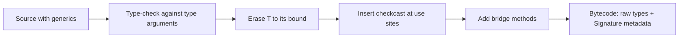
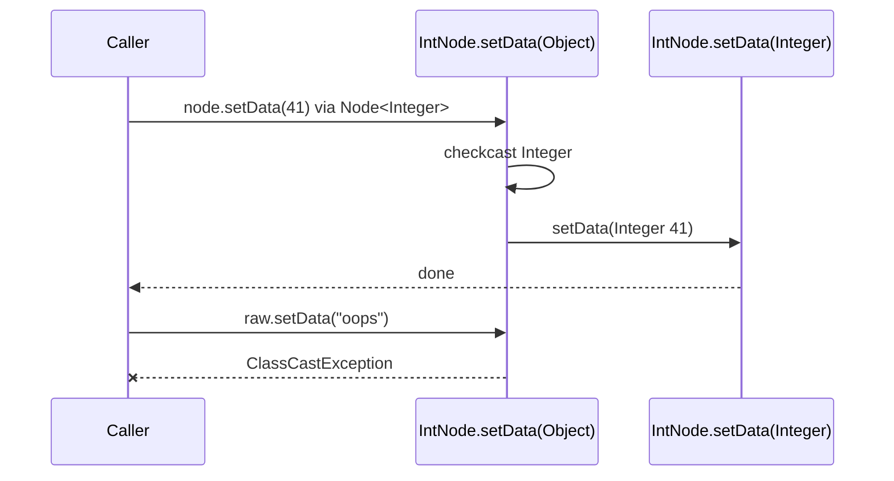

## In One Line
Java generics exist only at compile time: after checking your types, the compiler **erases** them — replacing each type parameter with its bound (usually `Object`), inserting casts where values come out, and adding **bridge methods** — so at runtime `List<String>` and `List<Integer>` are the same plain `ArrayList`.

## Mental Model
Think of **airport security and the plane**.

- **Security (the compiler)** checks every passenger's boarding pass against the flight: a `String` passenger can only board the `List<String>` flight. Anyone suspicious is stopped *before* take-off (compile error).
- **On the plane (the JVM)**, nobody checks boarding passes any more. The seats are just "seats" (`Object`); the flight number on the ticket has been torn off (erasure).
- When passengers **leave the plane**, a quick ID check at the gate confirms they are who security said (the compiler-inserted `checkcast`). If security did its job, that check never fails.
- **Heap pollution** is someone slipping onto the plane through the cargo door (a raw type or unchecked cast) without going through security. The plane happily flies; the problem only shows up at the exit gate — far from where the intruder got in.
- Because the flight number is gone on board, you cannot ask the plane "which flight are you?" — no `new T()`, no `T.class`, no `instanceof List<String>`.

## Concept
### What the compiler does
1. **Type-checks** every use of generic types against the type arguments.
2. **Erases** type parameters: each `T` becomes its **leftmost bound** — `Object` for `<T>`, `Number` for `<T extends Number>`, `Number` for `<T extends Number & Comparable<T>>`. Parameterized types become raw types: `List<String>` → `List`.
3. **Inserts casts** (`checkcast`) wherever a value of type `T` is used as a more specific type.
4. **Generates bridge methods** so overriding still works after erasure.
5. **Keeps generic signatures as metadata** (the class file's `Signature` attribute) for the compiler and for reflection — but the JVM never uses it to check anything.

### Seeing erasure in the bytecode
```java
static class Box<T> {
    private T value;
    Box(T value) { this.value = value; }
    T get() { return value; }
}
Box<String> box = new Box<>("hi");
String s = box.get();
System.out.println(s.length());
```
`javap -c -p` of `Box` and of `main`:
```output
class Erased$Box<T> {
  private T value;

  Erased$Box(T);
    Code:
       0: aload_0
       1: invokespecial #1                  // Method java/lang/Object."<init>":()V
       4: aload_0
       5: aload_1
       6: putfield      #7                  // Field value:Ljava/lang/Object;
       9: return

  T get();
    Code:
       0: aload_0
       1: getfield      #7                  // Field value:Ljava/lang/Object;
       4: areturn
}
  public static void main(java.lang.String[]);
    Code:
       0: new           #7                  // class Erased$Box
       3: dup
       4: ldc           #9                  // String hi
       6: invokespecial #11                 // Method Erased$Box."<init>":(Ljava/lang/Object;)V
       9: astore_1
      10: aload_1
      11: invokevirtual #14                 // Method Erased$Box.get:()Ljava/lang/Object;
      14: checkcast     #18                 // class java/lang/String
      17: astore_2
```
The field is an `Object`, `get()` returns `Object`, and the **caller** contains the `checkcast String` you never wrote. (`javap` still prints `T` in the headers because it reads the `Signature` metadata; the `Field value:Ljava/lang/Object;` comments show the real types.) The compiler only inserts a cast when it is needed: `Object o = box.get()` or `"x" + box.get()` (which calls `String.valueOf(Object)`) get no cast at all.

### Proof at runtime: one class for all parameterizations
```java
List<String> strings = new ArrayList<>();
List<Integer> numbers = new ArrayList<>();
System.out.println(strings.getClass() == numbers.getClass());
System.out.println(strings.getClass().getName());
System.out.println(strings instanceof ArrayList<?>);
```
```output
true
java.util.ArrayList
true
```
Consequences: static fields are shared by all parameterizations (three `new Box<String>()`, `new Box<Integer>()`, `new Box<Double>()` increment one `static int created` to `3`), and an object cannot tell you its type arguments.

### Why Java chose erasure
Generics arrived in Java 5 (2004) into a huge ecosystem of existing libraries and bytecode. Erasure gave **migration compatibility**:
- The **JVM did not need to change** — generic code compiles to the same kind of bytecode as before.
- **Old and new code interoperate**: a pre-Java-5 library taking a raw `List` can be called with a `List<String>`, and `java.util.ArrayList` could become `ArrayList<E>` without breaking a single compiled client.
- Libraries could be generified **one at a time**.
The price is everything in the "what you can't do" list below, plus boxing for primitives. C# (reified generics) and C++ (templates, one copy per instantiation) made the opposite trade-off.

### Bridge methods
Erasure can break overriding. `IntNode` overrides `setData(T)` with `setData(Integer)`, but `Node.setData(T)` erases to `setData(Object)` — a different signature. So the compiler adds a synthetic **bridge method** `setData(Object)` in `IntNode` that casts and delegates:
```java
static class Node<T> {
    T data;
    void setData(T data) { System.out.println("Node.setData"); this.data = data; }
}
static class IntNode extends Node<Integer> {
    @Override
    void setData(Integer data) { System.out.println("IntNode.setData " + (data + 1)); super.setData(data); }
}

for (Method m : IntNode.class.getDeclaredMethods())
    System.out.println(m.getName() + "(" + m.getParameterTypes()[0].getSimpleName() + ") bridge=" + m.isBridge());

Node<Integer> node = new IntNode();
node.setData(41);                  // compiled as Node.setData(Object) -> bridge -> setData(Integer)

Node raw = node;
raw.setData("oops");               // bridge casts to Integer and fails
```
```output
setData(Integer) bridge=false
setData(Object) bridge=true
IntNode.setData 42
Node.setData
Exception in thread "main" java.lang.ClassCastException: class java.lang.String cannot be cast to class java.lang.Integer (java.lang.String and java.lang.Integer are in module java.base of loader 'bootstrap')
	at Bridge$IntNode.setData(Bridge.java:8)
	at Bridge.main(Bridge.java:20)
```
The bridge in `javap -c -p`:
```output
  void setData(java.lang.Object);
    Code:
       0: aload_0
       1: aload_1
       2: checkcast     #14                 // class java/lang/Integer
       5: invokevirtual #33                 // Method setData:(Ljava/lang/Integer;)V
       8: return
```
Note the stack trace: the failing frame is `IntNode.setData` at line 8 — the class declaration line, because the bridge has no source line of its own. Bridges are everywhere: `String` has both `compareTo(String)` and a bridge `compareTo(Object)` (for `Comparable<String>`), and **covariant return types** (see [Polymorphism](lesson:a01-oop/04-polymorphism)) are implemented with bridges too.

### What you cannot do because of erasure
| Not allowed | javac says | Why | Workaround |
|---|---|---|---|
| `List<int>` | *unexpected type, required: reference* | `T` erases to `Object`; `int` is not an object | `List<Integer>`, `IntStream`, `int[]` |
| `new T()` | *unexpected type* | The JVM does not know what `T` is | Pass a `Supplier<T>` or `Class<T>` |
| `new T[10]` | *generic array creation* | Arrays need their element type at runtime | `(T[]) new Object[n]` inside the class, or `Array.newInstance(type, n)` |
| `new List<String>[10]` | *generic array creation* | Array store checks cannot check `String` | `List<List<String>>`, or `new List<?>[10]` |
| `T.class`, `List<String>.class` | *cannot select from a type variable* / *<identifier> expected* | There is one `Class` object per raw type | Pass `Class<T>`; super type tokens |
| `o instanceof T` | *Object cannot be safely cast to T* | Nothing to test against at runtime | `type.isInstance(o)` with a `Class<T>` |
| `o instanceof List<String>` | *Object cannot be safely cast to List<String>* | Type arguments are gone at runtime | `o instanceof List<?>` |
| `static T field;` | *non-static type variable T cannot be referenced from a static context* | One class, one static field for all `T`s | Instance field, or a static generic method |
| `class MyEx<T> extends Exception` | *a generic class may not extend java.lang.Throwable* | `catch` matches by runtime class | Non-generic exception with a field |
| `catch (T e)` | *unexpected type* | Same | Catch the bound, then inspect |
| `m(List<String>)` + `m(List<Integer>)` | *name clash: ... have the same erasure* | Both erase to `m(List)` | Different method names |

**Java 16+ nuance:** `instanceof` with a parameterized type is allowed when the compiler can prove it is safe from the static type — `Collection<String> c; c instanceof List<String> list` compiles on Java 21 (on `--release 15` it was *reifiable types in instanceof are not supported*). From an `Object` it is still an error.

Two workarounds in code:
```java
static class Factory<T> {
    private final Supplier<T> maker;
    Factory(Supplier<T> maker) { this.maker = maker; }
    T create() { return maker.get(); }               // instead of new T()
}
static <T> T createVia(Class<T> type) throws ReflectiveOperationException {
    return type.getDeclaredConstructor().newInstance();   // Class<T> as a "type token"
}
Factory<StringBuilder> f = new Factory<>(StringBuilder::new);
System.out.println(f.create().append("built").toString());
StringBuilder sb = createVia(StringBuilder.class);
System.out.println(sb.length());
```
```output
built
0
```
And the standard trick for a generic array inside a collection class (this is how `ArrayList` stores its elements):
```java
static class Stack<E> {
    private E[] elements;
    @SuppressWarnings("unchecked")      // safe: the array never leaves this class
    Stack(int capacity) { elements = (E[]) new Object[capacity]; }
    ...
}
String[] arr = newArray(String.class, 3);   // Array.newInstance: a real String[]
List<?>[] wild = new List<?>[2];            // unbounded wildcard arrays are allowed
```

### Reifiable vs non-reifiable types
A **reifiable** type is one whose full type information is available at runtime:

| Reifiable | Non-reifiable |
|---|---|
| Primitives: `int`, `double` | Type variables: `T` |
| Non-generic types: `String`, `Integer` | Parameterized types: `List<String>`, `Map<K, V>` |
| Raw types: `List`, `ArrayList` | Bounded wildcard types: `List<? extends Number>` |
| Unbounded wildcards: `List<?>`, `Map<?, ?>` | Arrays of non-reifiable types: `List<String>[]` |
| Arrays of reifiable types: `String[]`, `List<?>[]` | |
Only reifiable types may be used in `instanceof` (before Java 16 without exception), as array element types in `new`, and as `catch` types. `List<?>` is reifiable because "a list of something" is exactly what the runtime knows.

### Heap pollution
**Heap pollution** is when a variable of a parameterized type refers to an object that is not of that type — for example a `List<String>` that actually contains an `Integer`. It can only happen through an **unchecked** operation (raw types, unchecked casts, generic varargs) — which is exactly what the compiler's unchecked warnings point at.
```java
List<String> strings = new ArrayList<>();
List raw = strings;
raw.add(42);                             // heap pollution happens here - no error
System.out.println(strings.size());      // 1
Object o = strings.get(0);               // no cast needed for Object - still fine
System.out.println(o);
String s = strings.get(0);               // compiler-inserted cast fails HERE
```
```output
1
42
Exception in thread "main" java.lang.ClassCastException: class java.lang.Integer cannot be cast to class java.lang.String (java.lang.Integer and java.lang.String are in module java.base of loader 'bootstrap')
	at Pollution.main(Pollution.java:10)
```
The failure is on line 10, the bug is on line 6. Careful: even `System.out.println(strings.get(0))` throws, because overload resolution picks `println(String)` and the compiler inserts a cast for it.

To catch pollution **at the culprit**, wrap the collection with a runtime-checked view:
```java
List<String> strings = Collections.checkedList(new ArrayList<>(), String.class);
List raw = strings;
raw.add(42);                             // fails immediately, at the real culprit
```
```output
Exception in thread "main" java.lang.ClassCastException: Attempt to insert class java.lang.Integer element into collection with element type class java.lang.String
	at java.base/java.util.Collections$CheckedCollection.typeCheck(Collections.java:3356)
	at java.base/java.util.Collections$CheckedCollection.add(Collections.java:3404)
	at Checked.main(Checked.java:6)
```

### Generic varargs and `@SafeVarargs`
A `T...` parameter is a `T[]`, so every call must create an array of a possibly non-reifiable type. Letting that array escape causes pollution — the classic example from *Effective Java*:
```java
static <T> T[] toArray(T... args) { return args; }          // lets the varargs array escape
static <T> T[] pickTwo(T a, T b, T c) {
    return toArray(a, b);                                   // T is unknown here: creates an Object[]
}
String[] attributes = pickTwo("Good", "Fast", "Cheap");      // ClassCastException
```
```output
PickTwo.java:3: warning: [unchecked] Possible heap pollution from parameterized vararg type T
    static <T> T[] toArray(T... args) { return args; }          // lets the varargs array escape
                                ^
PickTwo.java:5: warning: [unchecked] unchecked generic array creation for varargs parameter of type T[]
        return toArray(a, b);                                   // T is unknown here: creates an Object[]
                      ^
Exception in thread "main" java.lang.ClassCastException: class [Ljava.lang.Object; cannot be cast to class [Ljava.lang.String; ([Ljava.lang.Object; and [Ljava.lang.String; are in module java.base of loader 'bootstrap')
	at PickTwo.main(PickTwo.java:8)
```
Inside `pickTwo`, `T` is erased, so the array created for `toArray(a, b)` is an `Object[]`; the caller's inserted cast to `String[]` fails. A varargs method is safe — and may be annotated `@SafeVarargs` (Java 7+; on `static`/`final` methods and constructors, and `private` instance methods since Java 9) — only if it **never stores into** the array and **never lets it escape** to untrusted code.

### What survives erasure: signatures and reflection
Erasure removes type arguments from *objects* and *executable code*, but declarations keep them in the class file's `Signature` attribute. Reflection can read them:
```java
static class StringList extends ArrayList<String> { }           // type argument recorded in the class file
static abstract class TypeRef<T> {                              // "super type token"
    final Type type = ((ParameterizedType) getClass().getGenericSuperclass()).getActualTypeArguments()[0];
}
static List<String> names = new ArrayList<>();

System.out.println(StringList.class.getGenericSuperclass());
System.out.println(Reflect.class.getDeclaredField("names").getGenericType());
System.out.println(new TypeRef<Map<String, List<Integer>>>() { }.type);
List<String> local = new ArrayList<>();
System.out.println(local.getClass().getTypeParameters()[0]);  // only the declared variable name E
```
```output
java.util.ArrayList<java.lang.String>
java.util.List<java.lang.String>
java.util.Map<java.lang.String, java.util.List<java.lang.Integer>>
E
```
Superclass type arguments, field types and method signatures are available; the type arguments of an individual object (`local`) are not — you only see the declared type variable `E`. The anonymous subclass trick in the third line is the **super type token** used by Jackson's `TypeReference` and Gson's `TypeToken` to deserialize into `List<Order>`.

### Erasure and API design: the `Collections.max` story
Erasure uses the **first** bound. `Collections.max` is declared `<T extends Object & Comparable<? super T>> T max(Collection<? extends T>)` so that its erased descriptor still returns `Object`, exactly as in Java 1.4 — old compiled callers keep linking. `javap -s` shows the result:
```output
  public static <T extends java.lang.Comparable<? super T>> T max(java.util.Collection<? extends T>);
    descriptor: (Ljava/util/Collection;)Ljava/lang/Object;
```
(`javap` omits the `Object &` when printing the signature, but the descriptor proves it: the method returns `Ljava/lang/Object;`, not `Comparable`.)

### Unchecked casts and the "sneaky throw"
An unchecked cast like `(T) obj` or `(E) throwable` compiles to **no check at all** when `T` erases to its bound — the JVM cannot test a type it does not know. That is why it is "unchecked". A famous (ab)use lets a method throw a checked exception without declaring it:
```java
@SuppressWarnings("unchecked")
static <E extends Throwable> void sneakyThrow(Throwable e) throws E {
    throw (E) e;                       // unchecked cast: erased to Throwable, never checked
}
Sneaky.<RuntimeException>sneakyThrow(new java.io.IOException("checked, but undeclared"));
```
```output
java.io.IOException: checked, but undeclared
```
(caught and printed by a `catch (Exception e)` block). Lombok's `@SneakyThrows` works this way. It shows that checked exceptions, like generics, are a compile-time-only concept.

## Diagram

Everything generic happens in the compiler; the JVM receives ordinary bytecode, plus signatures that only reflection reads.


The call goes through the erased signature `setData(Object)`, where the compiler-generated bridge casts and delegates — or fails for a polluted argument.

## Code
This lesson has no course example; every snippet above is runnable. Here is a compact summary program that proves the three core facts — one runtime class, compiler-inserted casts, and shared statics:
```java
import java.util.*;

public class ErasureFacts {
    static class Box<T> {
        static int created = 0;          // one static for ALL Box<...> parameterizations
        private final T value;
        Box(T value) { this.value = value; created++; }
        T get() { return value; }
    }
    public static void main(String[] args) {
        Box<String> s = new Box<>("text");
        Box<Integer> i = new Box<>(7);
        System.out.println(s.getClass() == i.getClass());   // same runtime class
        System.out.println(Box.created);                     // shared static

        Box raw = i;                                          // raw type: unchecked territory
        @SuppressWarnings("unchecked")
        Box<String> lie = raw;                                // heap pollution
        Object ok = lie.get();                                // no cast inserted -> fine
        System.out.println(ok);
        try {
            String boom = lie.get();                          // checkcast String inserted -> fails
        } catch (ClassCastException e) {
            System.out.println("ClassCastException at the read, not at the lie");
        }
    }
}
```
```output
true
2
7
ClassCastException at the read, not at the lie
```

## Walkthrough
- `static class Box<T>` with `static int created` — the static counter is shared by `Box<String>` and `Box<Integer>`, because after erasure there is only one `Box` class. Two boxes were created, so it prints `2`.
- `s.getClass() == i.getClass()` — `true`: both objects are instances of the one erased `Box` class.
- `Box raw = i;` — assigning to a raw type is allowed (it is how pre-Java-5 code sees generic classes).
- `Box<String> lie = raw;` — an *unchecked conversion*: the compiler cannot verify it and only warns (suppressed here to keep the output clean). Now a `Box<String>` variable points at a box holding an `Integer` — **heap pollution**.
- `Object ok = lie.get();` — `get()` returns `Object` in bytecode and the target is `Object`, so no cast is inserted and nothing fails. It prints `7`.
- `String boom = lie.get();` — now the compiler inserts `checkcast String`, which throws `ClassCastException`. The error surfaces at the read, far from the unchecked assignment that caused it.
- **The lesson:** the JVM never checks type arguments; safety comes only from the compiler, and every unchecked warning is a hole in it.

## Traps
- **Ignoring unchecked warnings.** They are the only places heap pollution can enter. `@SuppressWarnings("unchecked")` should cover the smallest scope and carry a comment proving safety.
- **The exception appears far from the bug.** A `ClassCastException` on a line with no visible cast (`String s = strings.get(0);`) almost always means heap pollution earlier. Use `Collections.checkedList` / `checkedMap` while debugging.
- **`System.out.println(list.get(0))` can throw** on a polluted `List<String>`, because the `println(String)` overload makes the compiler insert a cast.
- **`(T) obj` does not check anything.** An unchecked cast to a type variable compiles to no instruction (or a cast to the bound); the failure happens later at a real use site.
- **Overloading on type arguments** — `print(List<String>)` and `print(List<Integer>)` clash (*same erasure*).
- **Generic arrays** — `new T[n]` and `new List<String>[n]` are illegal; `(T[]) new Object[n]` is fine only if the array never escapes (returning it as `T[]` to a caller that expects `String[]` causes a `ClassCastException`, like `pickTwo`).
- **`getClass()` on a generic object tells you nothing about type arguments** — `new ArrayList<String>().getClass()` is just `ArrayList`.
- **Static state is shared** across all parameterizations; a "per-type" static cache in a generic class does not work.
- **Bridge methods appear in reflection and stack traces.** Filter with `Method.isBridge()` / `isSynthetic()` in frameworks.

> [!NOTE] Project Valhalla aims to add value classes and, later, generics over primitive and value types (so `List<int>` could avoid boxing). None of it is part of Java 21; erasure remains the model for reference types.

## Tips & Tricks
- **Mnemonic — "Check, Erase, Cast, Bridge"** (C-E-C-B): the four things the compiler does with generics.
- **"Erasure goes to the leftmost bound"** — `<T>` → `Object`, `<T extends Number>` → `Number`.
- **"If it needs the type at runtime, it can't use `T`."** `new`, `instanceof`, `.class`, arrays, `catch` — all need runtime types; pass a `Class<T>` or `Supplier<T>` instead.
- **Reifiable = "fully known at runtime"**: primitives, plain classes, raw types, `List<?>`, and arrays of those.
- **Pollution needs an unchecked operation** — no unchecked warnings, no pollution, no surprise `ClassCastException`s.
- **Prefer `List<E>` over `E[]`** in generic code; if you must use an array internally, create `Object[]`, cast once in the constructor with a justified `@SuppressWarnings`, and never return it.
- **Need the type argument at runtime?** Use a type token (`Class<T>`) or a super type token (`new TypeReference<List<Order>>() {}`).

## Interview Q&A
### [Basic] What is type erasure?
Type erasure is how Java implements generics: the compiler checks all generic types, then removes the type arguments from the bytecode. Each type parameter is replaced by its leftmost bound (`Object` if unbounded), parameterized types become raw types, casts are inserted where values of type `T` are used, and bridge methods are generated to preserve overriding. At runtime `List<String>` and `List<Integer>` are both just `ArrayList` — `strings.getClass() == numbers.getClass()` is `true`.

**Follow-up:** *Why did Java choose erasure?* — Migration compatibility: the JVM did not need to change, and pre-Java-5 code and generic code could call each other, so existing libraries kept working.

### [Basic] What can't you do with generics because of erasure?
You cannot use primitives as type arguments, create instances or arrays of a type parameter (`new T()`, `new T[n]`), create arrays of parameterized types (`new List<String>[n]`), use `T.class` or `List<String>.class`, test `instanceof T` or (from `Object`) `instanceof List<String>`, declare static fields of type `T`, make generic exception classes or catch a type parameter, or overload methods whose parameters erase to the same type. All of these need the type argument at runtime, which erasure removes.

**Follow-up:** *How do you create a `T` then?* — Pass a `Supplier<T>` (`Factory<>(StringBuilder::new)`) or a `Class<T>` and use reflection.

### [Intermediate] What are bridge methods and why are they needed?
When a subclass overrides a generic method with a specific type — `IntNode extends Node<Integer>` overriding `setData(T)` as `setData(Integer)` — erasure turns the parent method into `setData(Object)`, so the two signatures no longer match. The compiler generates a synthetic **bridge** `setData(Object)` in the subclass that casts the argument to `Integer` and calls `setData(Integer)`, keeping polymorphism working. You can see them with `javap -c` or `Method.isBridge()`. Calling through a raw reference with a wrong type makes the bridge's cast throw `ClassCastException`.

**Follow-up:** *Where else are bridges used?* — Covariant return types (`Maruti copy()` overriding `Car copy()`), and every class implementing `Comparable<X>` gets a bridge `compareTo(Object)` — `String` has one.

### [Intermediate] What is a reifiable type? Give examples.
A reifiable type is one whose complete type information is available at runtime: primitives, non-generic classes (`String`), raw types (`List`), unbounded wildcard parameterizations (`List<?>`, `Map<?, ?>`), and arrays of reifiable types. Non-reifiable types are type variables (`T`), concrete or bounded parameterizations (`List<String>`, `List<? extends Number>`) and arrays of them. Array creation, `instanceof` (except the Java 16+ provably-safe case) and `catch` require reifiable types.

**Follow-up:** *Why is `new List<?>[10]` allowed but `new List<String>[10]` not?* — The array's runtime store check can verify "is a `List`" but cannot verify "is a `List<String>`", so only the reifiable element type is allowed.

### [Intermediate] What is heap pollution and how does it happen?
Heap pollution occurs when a variable of a parameterized type refers to an object that is not of that type — e.g. a `List<String>` containing an `Integer`. It can only happen through unchecked operations: raw types (`List raw = strings; raw.add(42);`), unchecked casts (`(List<String>) obj`), or generic varargs arrays escaping. The damage shows up later, when a compiler-inserted cast fails with `ClassCastException` on an innocent line such as `String s = strings.get(0);`. `Collections.checkedList` catches the bad insert immediately.

**Follow-up:** *Does `Object o = strings.get(0);` throw?* — No; no cast is needed for `Object`, so no `checkcast` is emitted. `System.out.println(strings.get(0))` does throw, because `println(String)` is selected.

### [Intermediate] Why can't you overload `void print(List<String>)` and `void print(List<Integer>)`?
Both methods erase to `print(List)`, so the class file would contain two methods with identical descriptors. The compiler rejects it with *name clash: print(List<Integer>) and print(List<String>) have the same erasure*. Use different method names, or a single generic method.

**Follow-up:** *Can `<T extends Number> void m(T)` coexist with `void m(Object)`?* — Yes, because the first erases to `m(Number)`.

### [Advanced] What does `@SafeVarargs` guarantee and when is it valid?
A generic varargs parameter `T...` makes callers create a `T[]`, which may be a non-reifiable array; if the method stores into it or lets it escape, heap pollution follows — the `pickTwo` example returns an `Object[]` where a `String[]` is expected and fails with `ClassCastException`. `@SafeVarargs` is the author's promise that the method only reads the array; it suppresses the warnings at the declaration and all call sites. It is allowed only on methods that cannot be overridden: `static`, `final`, constructors, and `private` instance methods (Java 9+). `List.of`, `Arrays.asList` and `Stream.of` carry it.

**Follow-up:** *Why not on ordinary instance methods?* — An override might break the promise, and the annotation is not inherited, so the compiler only trusts it where overriding is impossible.

### [Advanced] If types are erased, how do libraries like Jackson or Gson know you want a `List<Order>`?
Declarations keep their generic signatures in the class file's `Signature` attribute, readable through reflection: `getGenericSuperclass()`, `Field.getGenericType()`, `Method.getGenericReturnType()`. A **super type token** exploits this: `new TypeReference<List<Order>>() {}` creates an anonymous subclass whose superclass is `TypeReference<List<Order>>`, and the library reads `List<Order>` from `getGenericSuperclass()`. What reflection can never recover is the type argument of an individual object: `new ArrayList<String>().getClass()` only knows it is an `ArrayList<E>`.

**Follow-up:** *Why doesn't `Class<T>` work for `List<Order>`?* — Class literals are raw: there is no `List<Order>.class`, only `List.class`.

### [Advanced] Compare Java's erased generics with C# and C++.
Java: one class per generic type, type arguments erased, casts inserted, primitives must be boxed, no runtime type-argument information — but full binary compatibility with pre-generics code. C#: **reified** generics — the CLR knows type arguments at runtime, so `new T()` (with a constraint), `typeof(T)` and `List<int>` without boxing work, and value-type instantiations get specialised code. C++: **templates** are compile-time code generation — each instantiation (`vector<int>`, `vector<string>`) produces a separate copy, which is fast but increases code size, and constraints were historically duck-typed until C++20 concepts.

**Follow-up:** *Is Java moving towards reification?* — Project Valhalla plans value classes and specialised generics for primitives/values, but reference-type generics will stay erased for compatibility; none of it is in Java 21.

### [Advanced] Why is `Collections.max` declared `<T extends Object & Comparable<? super T>>`?
Because erasure uses the first bound. With just `<T extends Comparable<? super T>>`, `max` would erase to return `Comparable`, changing its binary signature from the pre-Java-5 version that returned `Object` and breaking already-compiled callers. Adding `Object` as the first bound makes the erasure `Object` while keeping the `Comparable` constraint for the compiler. `javap -s` confirms the descriptor `(Ljava/util/Collection;)Ljava/lang/Object;`.

**Follow-up:** *What does `<T extends Number & Comparable<T>>` erase to?* — `Number`; calls to `compareTo` get a cast to `Comparable` inserted.

## Quiz
### What does this print?
```java
List<String> strings = new ArrayList<>();
List<Integer> numbers = new ArrayList<>();
System.out.println(strings.getClass() == numbers.getClass());
System.out.println(strings.getClass().getName());
```
- [ ] false, then java.util.ArrayList<java.lang.String>
- [x] true, then java.util.ArrayList
- [ ] true, then java.util.List
- [ ] Compile error: incomparable types
> Erasure leaves one runtime class, `ArrayList`, for every parameterization, so the classes are identical and the name has no type arguments. `getClass()` reports the object's class, not the variable's interface type `List`.

### Which line throws?
```java
List<String> strings = new ArrayList<>();
List raw = strings;
raw.add(42);                         // line A
System.out.println(strings.size());  // line B
Object o = strings.get(0);           // line C
String s = strings.get(0);           // line D
```
- [ ] Line A — the list rejects the Integer
- [ ] Line C — reading an Integer from a List<String>
- [x] Line D — the compiler-inserted cast to String fails
- [ ] None — it runs without errors
> The raw `add` succeeds (heap pollution, only a warning), `size()` prints `1`, and assigning to `Object` needs no cast. Only line D gets a `checkcast String`, which throws `ClassCastException` — far from the real bug on line A.

### What is `T` erased to in `class Box<T extends Number & Comparable<T>>`?
- [ ] `Object`
- [ ] `Comparable`
- [x] `Number`
- [ ] Nothing — bounded types are not erased
> Erasure replaces a type variable with its leftmost bound. Uses of `Comparable` methods get an extra cast inserted. Unbounded `T` would erase to `Object`.

### Which of these is a reifiable type?
- [ ] `List<String>`
- [ ] `List<? extends Number>`
- [x] `List<?>`
- [ ] `T`
> `List<?>` says only "a list of something", which is exactly what the runtime knows, so it is reifiable (usable in `instanceof` and `new List<?>[n]`). Concrete or bounded parameterizations and type variables lose information at runtime.

### Spot the bug.
```java
class Repository<T> {
    T create() { return new T(); }
}
```
- [ ] `create` must be static
- [x] `new T()` is illegal: `T` is erased, so the JVM does not know which class to instantiate — pass a `Supplier<T>` or `Class<T>`
- [ ] `T` needs a bound `extends Object`
- [ ] Nothing — it compiles if `T` has a no-arg constructor
> After erasure there is no runtime `T` to construct, and there is no way to require a constructor in a bound. The compiler says *unexpected type*. Take a `Supplier<T>` (e.g. `Repository<>(Order::new)`) or a `Class<T>` token.

### What does this print?
```java
static class Box<T> {
    static int created = 0;
    Box() { created++; }
}
new Box<String>(); new Box<Integer>(); new Box<Double>();
System.out.println(Box.created);
```
- [ ] 1
- [x] 3
- [ ] Compile error: static field in a generic class
- [ ] 0
> Static fields are allowed in generic classes as long as their type does not use `T`. There is only one `Box` class after erasure, so all three parameterizations share one counter.

### Why does the compiler generate `setData(Object)` in `class IntNode extends Node<Integer>` that overrides `setData(Integer)`?
- [ ] To support raw types only
- [x] It is a bridge method: `Node.setData(T)` erases to `setData(Object)`, so the bridge keeps the override working and casts to `Integer`
- [ ] To allow `null` arguments
- [ ] It is a leftover from Java 1.4 and does nothing
> Without the bridge, a call through a `Node<Integer>` reference (compiled as `setData(Object)`) would reach `Node`'s method instead of the override. The bridge casts and delegates, and is marked `isBridge() == true` in reflection.

### Which declaration compiles on Java 21?
- [ ] `List<String>[] arr = new List<String>[3];`
- [ ] `boolean b = obj instanceof List<String>;` (with `Object obj`)
- [ ] `class Oops<T> extends Exception { }`
- [x] `List<?>[] arr = new List<?>[3];`
> Arrays of unbounded wildcard types are reifiable and allowed. Generic array creation, `instanceof List<String>` from an `Object`, and generic `Throwable` subclasses all need runtime type arguments that erasure removes.

## Takeaways
- Type erasure: the compiler checks generic types, then replaces each type parameter with its leftmost bound (`Object` if unbounded), inserts casts where needed and generates bridge methods; the JVM sees only raw types.
- Erasure exists for migration compatibility — generic and pre-Java-5 code share the same bytecode model, and the JVM did not change.
- All parameterizations share one runtime class (`new ArrayList<String>().getClass() == new ArrayList<Integer>().getClass()`) and the same static fields.
- Because of erasure you cannot use `new T()`, `new T[n]`, `new List<String>[n]`, `T.class`, `instanceof T`/`List<String>` (except Java 16+ provably-safe checks), generic exceptions, or overloads with the same erasure.
- Bridge methods keep overriding working after erasure (`setData(Object)` casting to `Integer`); they also implement covariant return types and `Comparable` bridges.
- Reifiable types (primitives, plain classes, raw types, `List<?>`, arrays of these) are fully known at runtime; only they can be used in array creation, `instanceof` and `catch`.
- Heap pollution — a `List<String>` holding an `Integer` — enters only through unchecked operations (raw types, unchecked casts, generic varargs) and fails later at a compiler-inserted cast; `Collections.checkedList` and `@SafeVarargs` discipline prevent it.
- Declarations keep generic signatures for reflection (`getGenericSuperclass`, super type tokens), but individual objects never carry their type arguments.
