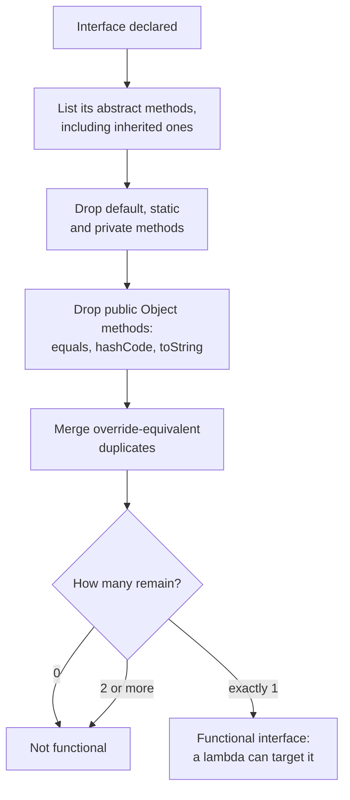
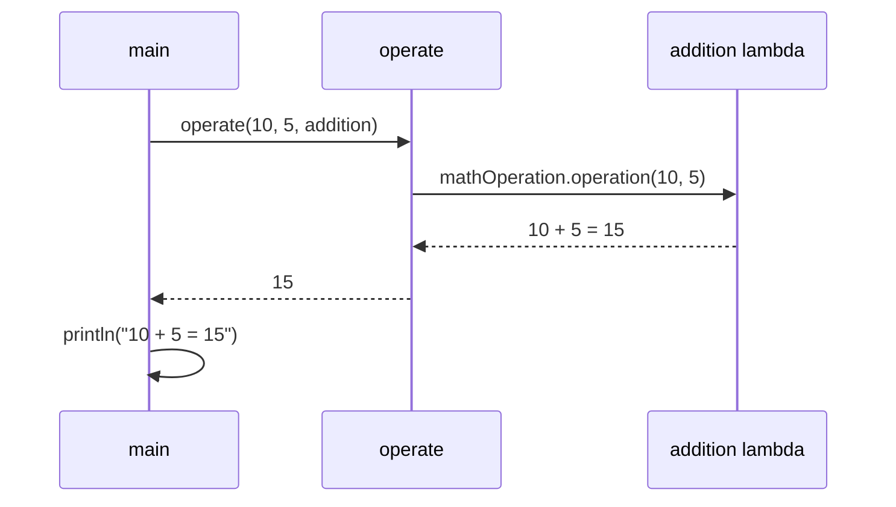

## In One Line
A **functional interface** is an interface with **exactly one abstract method**; that one method is the "slot" a lambda or method reference fills, which is how Java 8 lets you pass behaviour (add, subtract, compare, filter) around as a value.

## Mental Model
Think of a **wall socket**. The socket defines one contract — "two pins, 230 V". It does not care whether you plug in a kettle, a lamp or a phone charger; anything with the right plug fits.

In the code:
- The **socket** is the functional interface `MathOperation` with its single abstract method `int operation(int a, int b)`. That method's shape — two `int`s in, one `int` out — is the plug shape.
- Each **appliance** is a lambda: `(a, b) -> a + b`, `(a, b) -> a - b`, ... Anything that takes two ints and returns an int fits.
- **Plugging in** is assigning the lambda to a `MathOperation` variable or passing it to `operate(...)`.
- **Switching on** is calling `mathOperation.operation(a, b)` — the socket does not know or care which appliance is attached; it just calls the one method.

A socket with *two* different pin layouts would be ambiguous — you would not know which one the plug is meant for. That is exactly why a lambda can only target an interface with **one** abstract method.

## Concept
### Why functional interfaces exist
Java has no function types like `(int, int) -> int`. Every value in Java has a class or interface type. When Java 8 added lambdas, the designers did not invent a new kind of type; they reused interfaces. A lambda is simply a compact way to write an object that implements an interface with one abstract method. That interface is called a **functional interface** (also a *SAM type*, "Single Abstract Method").

The payoff: you can pass *behaviour* to a method as easily as you pass data — `operate(10, 5, addition)`, `list.sort(comparator)`, `stream.filter(predicate)`, `executor.submit(task)`.

### The exact rule: what counts as "one abstract method"
An interface is functional if, after ignoring the methods below, **exactly one abstract method** remains:

| Member | Counts toward the one? | Why |
|---|---|---|
| Abstract method you declare | **Yes** | This is the slot. |
| Abstract method **inherited** from a super-interface | **Yes** | Inherited abstract methods are still abstract. |
| Two inherited abstract methods with the same (override-equivalent) signature | Counted **once** | `interface AB extends A, B {}` where both declare `void run()` is still functional. |
| `default` methods | No | They have a body. |
| `static` methods | No | They have a body and belong to the interface, not the object. |
| `private` methods (Java 9+) | No | They have a body. |
| Abstract re-declarations of **public** `Object` methods (`equals`, `hashCode`, `toString`) | No | Every object already inherits an implementation from `Object`. |
| Abstract `Object clone()` | **Yes** | `clone()` is *protected* in `Object`, so only public `Object` methods are excluded. |

This is why `java.util.Comparator` is functional even though it declares two abstract methods, `compare(T, T)` and `equals(Object)` — `equals` is a public `Object` method, so it does not count. It also has 7 default methods and 9 static ones (`comparing`, `naturalOrder`, `reverseOrder`, ...), none of which count.

The single abstract method's signature is called the **function descriptor**. For `MathOperation` it is `(int, int) -> int`. A lambda fits if its parameters and return match the descriptor.

### `@FunctionalInterface` — optional but useful
```java
@FunctionalInterface
interface MathOperation {
    int operation(int a, int b);
}
```
- The annotation is **not required**. Any interface with one abstract method is functional and can be the target of a lambda. `Comparable`, `Iterable` and `AutoCloseable` are not annotated, yet `AutoCloseable ac = () -> System.out.println("closed");` compiles.
- What it does: it asks the **compiler to verify** the rule and fail the build if someone later adds a second abstract method. It also documents intent ("this interface is meant for lambdas").
- It is retained at runtime (`@Retention(RUNTIME)`), so tools can read it through reflection.
- Real compiler errors (JDK 21):

```text
Fi1.java:1: error: Unexpected @FunctionalInterface annotation
  Two is not a functional interface
    multiple non-overriding abstract methods found in interface Two

Fi1.java:3: error: Unexpected @FunctionalInterface annotation
  None is not a functional interface
    no abstract method found in interface None
```
Putting it on a class fails too ("NotAnInterface is not a functional interface"): the annotation applies only to interfaces.

### Where the compiler accepts a lambda: the target type
A lambda has **no type of its own**. The compiler gives it a type from the context it appears in, called the **target type**, and the target type must be a functional interface:

| Context | Example |
|---|---|
| Variable assignment | `MathOperation add = (a, b) -> a + b;` |
| Method argument | `operate(10, 5, (a, b) -> a + b)` |
| Return statement | `return (a, b) -> a + b;` inside a method returning `MathOperation` |
| Cast | `(MathOperation) (a, b) -> a + b` |
| Conditional expression | `flag ? (a, b) -> a + b : (a, b) -> a - b` |

Without a functional interface target the compiler refuses:
```text
Object o = () -> System.out.println("hi");
error: incompatible types: Object is not a functional interface

var f = (String s) -> s.length();
error: cannot infer type for local variable f
  (lambda expression needs an explicit target-type)
```
The same lambda text can become different types in different contexts: `(a, b) -> a + b` can be a `MathOperation`, an `IntBinaryOperator` or a `BinaryOperator<Integer>`. The lambda adapts to the socket.

### Four ways to implement a functional interface
```java
// 1. A named class (pre-Java 8, verbose)
class Addition implements MathOperation {
    public int operation(int a, int b) { return a + b; }
}
// 2. An anonymous class (pre-Java 8, still verbose)
MathOperation add2 = new MathOperation() {
    @Override public int operation(int a, int b) { return a + b; }
};
// 3. A lambda (Java 8)
MathOperation add3 = (a, b) -> a + b;
// 4. A method reference (Java 8) - reuse an existing method with the right shape
MathOperation add4 = Integer::sum;
```
All four produce an object whose class implements `MathOperation`. Options 3 and 4 are only possible **because** the interface is functional. An anonymous class can implement any interface (or extend a class), however many methods it has.

### The built-in functional interfaces (`java.util.function`)
Java 8 added the package `java.util.function` with **43** ready-made functional interfaces, so you rarely need to write your own. Learn the **core six** and the naming scheme, and you can decode all 43:

| Interface | Abstract method | Shape | Typical use |
|---|---|---|---|
| `Predicate<T>` | `boolean test(T t)` | T → boolean | `filter`, `removeIf` |
| `Function<T,R>` | `R apply(T t)` | T → R | `map`, `comparing` |
| `Consumer<T>` | `void accept(T t)` | T → nothing | `forEach` |
| `Supplier<T>` | `T get()` | nothing → T | `orElseGet`, `generate` |
| `UnaryOperator<T>` | `T apply(T t)` | T → T | `replaceAll`, `iterate` |
| `BinaryOperator<T>` | `T apply(T t1, T t2)` | (T, T) → T | `reduce` |

Naming scheme for the other 37:
- **`Bi` prefix** = two inputs: `BiPredicate<T,U>`, `BiFunction<T,U,R>`, `BiConsumer<T,U>`.
- **`Int` / `Long` / `Double` prefix** = the *input* is that primitive: `IntPredicate`, `IntFunction<R>`, `IntConsumer`, `IntSupplier`, `IntUnaryOperator`, `IntBinaryOperator`.
- **`To<Prim>` prefix** = the *output* is that primitive: `ToIntFunction<T>`, `ToDoubleBiFunction<T,U>`.
- **`<Prim>To<Prim>`** = primitive in, other primitive out: `IntToLongFunction`, `DoubleToIntFunction`.
- **`Obj<Prim>Consumer`** = an object and a primitive in: `ObjIntConsumer<T>` (`accept(T, int)`).
- **`BooleanSupplier`** is the only `boolean` specialisation. There are no `char`, `byte`, `short` or `float` versions.

Why primitive versions exist: generics only work with reference types, so `Function<Integer,Integer>` boxes every `int` into an `Integer`. `IntUnaryOperator` works on raw `int`s with no boxing and no garbage.

Older single-method interfaces were retro-fitted with `@FunctionalInterface` in Java 8: `Runnable` (`run()`), `Callable<V>` (`call() throws Exception`), `Comparator<T>` (`compare`), `FileFilter`, `FilenameFilter`, `PathMatcher`, `Thread.UncaughtExceptionHandler`, `PrivilegedAction`.

### When to write your own functional interface
Prefer the built-ins, because every Java developer already knows them and the JDK APIs accept them. Write your own when:
1. **The domain name adds meaning.** `MathOperation`, `PriceRule`, `Validator` read better than `IntBinaryOperator` in a business API.
2. **You need a checked exception.** None of the `java.util.function` methods declares `throws`, so a method that throws `IOException` cannot be used as a `Function`:
   ```text
   Function<String, String> f = Q2::load;   // load(...) throws IOException
   error: incompatible thrown types IOException in functional expression
   ```
   A custom `interface ThrowingFunction<T, R> { R apply(T t) throws Exception; }` solves it (see the Code section).
3. **You need three or more parameters** (`TriFunction<A,B,C,R>` does not exist in the JDK) or a primitive shape the JDK lacks (`CharPredicate`, `FloatUnaryOperator`).

A custom functional interface may be **generic** (`interface MathOperation<T> { T operation(T a, T b); }`), may **extend** another interface, and may add `default` and `static` helper methods — for example `Checker<T>` with a `default Checker<T> not()` and a `static Checker<T> always()`. The helpers do not break the "one abstract method" rule.

### Edge cases interviewers like
- **Generic abstract method.** If the one abstract method is itself generic — `interface G { <T> T id(T t); }` — a **lambda cannot implement it** (a lambda cannot declare type parameters), but a method reference can:
  ```text
  G bad = x -> x;
  error: incompatible types: invalid functional descriptor for lambda expression
      method <T>(T)T in interface G is generic
  ```
- **Intersection target.** A cast can combine a functional interface with marker interfaces: `(Runnable & Serializable) () -> ...` produces a serializable lambda.
- **Sub-interfaces.** `interface MyRunnable extends Runnable {}` is still functional (it inherits one abstract method). `interface Stoppable extends Runnable { void stop(); }` is not (two abstract methods).

### How it works under the hood (short version)
When `javac` compiles `(a, b) -> a + b`, it moves the body into a private synthetic method (e.g. `lambda$main$0`) and emits an `invokedynamic` instruction. At runtime the JVM calls `LambdaMetafactory`, which spins up a small hidden class that **implements `MathOperation`** and whose `operation` method calls `lambda$main$0`. So at runtime a lambda really is an object of a class implementing the functional interface — the interface is what the lambda "becomes". The full story is in [Lambda Expressions](lesson:a05-java8/02-lambda-expressions).

## Diagram

The compiler's test in order. `@FunctionalInterface` just makes the compiler run this test and fail loudly if the answer is not "exactly 1".


`operate` only knows the interface. The behaviour it runs comes from whichever lambda the caller passed in.

## Code
@example Java8Features/LambdaExpressionsandFunctionalInterfaces/FunctionalInterfaceExample.java

The same interface implemented three other ways, plus integer-division behaviour and the JDK's built-in equivalent:
```java
import java.util.function.IntBinaryOperator;

public class Snippet {
    @FunctionalInterface
    interface MathOperation {
        int operation(int a, int b);
    }

    static int operate(int a, int b, MathOperation op) {
        return op.operation(a, b);
    }

    public static void main(String[] args) {
        // 1. Before Java 8: an anonymous class
        MathOperation modulo = new MathOperation() {
            @Override
            public int operation(int a, int b) {
                return a % b;
            }
        };
        // 2. Java 8: a lambda
        MathOperation power = (a, b) -> (int) Math.pow(a, b);
        // 3. Java 8: a method reference
        MathOperation max = Math::max;

        System.out.println("10 % 3 = " + operate(10, 3, modulo));
        System.out.println("2 ^ 5 = " + operate(2, 5, power));
        System.out.println("max(4, 9) = " + operate(4, 9, max));

        // Integer division truncates toward zero
        System.out.println("7 / 2 = " + operate(7, 2, (a, b) -> a / b));
        System.out.println("-7 / 2 = " + operate(-7, 2, (a, b) -> a / b));

        // The JDK already ships this shape
        IntBinaryOperator add = (a, b) -> a + b;
        System.out.println("built-in: " + add.applyAsInt(10, 5));

        // Division by zero
        try {
            operate(10, 0, (a, b) -> a / b);
        } catch (ArithmeticException e) {
            System.out.println("Caught: " + e.getMessage());
        }
    }
}
```
```output
10 % 3 = 1
2 ^ 5 = 32
max(4, 9) = 9
7 / 2 = 3
-7 / 2 = -3
built-in: 15
Caught: / by zero
```

A custom functional interface that allows checked exceptions, with a `default` method and a `static` adapter — all legal in a functional interface:
```java
import java.io.*;
import java.util.*;
import java.util.function.*;

public class Q1 {
    @FunctionalInterface
    interface Greeter {
        String greet(String name);
        default Greeter twice() { return n -> greet(greet(n)); }
    }

    @FunctionalInterface
    interface ThrowingFunction<T, R> {
        R apply(T t) throws Exception;                 // checked exceptions allowed
        static <T, R> Function<T, R> unchecked(ThrowingFunction<T, R> f) {
            return t -> {
                try { return f.apply(t); }
                catch (Exception e) { throw new RuntimeException(e); }
            };
        }
    }

    static String load(String name) throws IOException {
        if (name.isEmpty()) throw new IOException("empty name");
        return "content of " + name;
    }

    public static void main(String[] args) {
        Greeter hi = n -> "Hi " + n;
        System.out.println(hi.twice().greet("Bob"));

        ThrowingFunction<String, String> loader = Q1::load;
        Function<String, String> safe = ThrowingFunction.unchecked(loader);
        System.out.println(List.of("a.txt", "b.txt").stream().map(safe).toList());
        try { safe.apply(""); } catch (RuntimeException e) { System.out.println("wrapped: " + e.getCause()); }

        Runnable r = (Runnable & Serializable) () -> System.out.println("serializable lambda");
        r.run();
        System.out.println(r instanceof Serializable);
    }
}
```
```output
Hi Hi Bob
[content of a.txt, content of b.txt]
wrapped: java.io.IOException: empty name
serializable lambda
true
```

## Walkthrough
- `package Java8Features.LambdaExpressionsandFunctionalInterfaces;` — the file lives in this package folder. The interface and the class share one source file; only one top-level type (`FunctionalInterfaceExample`) may be `public`, and it must match the file name.
- `// Define a functional interface` + `@FunctionalInterface interface MathOperation { int operation(int a, int b); }` — one abstract method, so the interface is functional. The annotation makes the compiler check it. `MathOperation` has no modifier, so it is **package-private**: usable only inside this package. Its method is implicitly `public abstract`.
- `MathOperation addition = (int a, int b) -> a + b;` — a lambda with **explicitly typed** parameters. The types must match the descriptor `(int, int) -> int` exactly. The body `a + b` is a single expression, so its value is returned automatically — no `return`, no braces.
- `MathOperation subtraction = (a, b) -> a - b;` — the same thing with **implicitly typed** parameters. The compiler infers `int a, int b` from `MathOperation.operation`. This is the usual style.
- `multiplication = (a, b) -> a * b;` and `division = (a, b) -> a / b;` — two more implementations. `division` does **integer division**: `10 / 5` is `2`, but `7 / 2` would be `3` (truncated), and `10 / 0` would throw `ArithmeticException: / by zero`.
- At this point four **objects** exist, each of a different hidden class implementing `MathOperation`. No arithmetic has happened yet — creating a lambda does not run its body.
- `private static int operate(int a, int b, MathOperation mathOperation)` — a **higher-order method**: it takes behaviour as a parameter. It does not know which operation it received; it just calls `mathOperation.operation(a, b)`, which runs the body of whichever lambda was passed. This is the Strategy pattern in one line.
- `System.out.println("10 + 5 = " + operate(10, 5, addition));` — `operate` returns `15`; string concatenation builds `"10 + 5 = 15"`. Each of the four lines works the same way with a different lambda, which gives the four output lines `15`, `5`, `50`, `2`.
- All four `// Output:` comments match the recorded output.

> [!NOTE] `MathOperation` has the same shape as the JDK's `java.util.function.IntBinaryOperator` (`int applyAsInt(int left, int right)`). The course defines its own to show that *any* one-method interface works; in production code you would use the built-in unless the domain name adds clarity.

## Traps
> [!WARNING] **`java FunctionalInterfaceExample.java` fails on JDK 21.** The single-file source launcher runs the **first top-level type** in the file, and here that is the interface `MathOperation`, which has no `main`: `error: can't find main(String[]) method in class: Java8Features.LambdaExpressionsandFunctionalInterfaces.MathOperation`. Run it from the IDE / Maven, or compile first: `javac -d out FunctionalInterfaceExample.java` then `java -cp out Java8Features.LambdaExpressionsandFunctionalInterfaces.FunctionalInterfaceExample`. (Moving the public class to the top of the file also fixes it.)

- **"Functional" does not mean "has one method".** It means one *abstract* method. Default, static and private methods are allowed in any number, and re-declared public `Object` methods are ignored.
- **Adding a second abstract method breaks every lambda.** Without `@FunctionalInterface` the error appears at each lambda site (far from the cause); with it, the error appears at the interface. Use the annotation on every interface meant for lambdas.
- **Mixing explicit and implicit parameter types** — `(int a, b) -> a + b` does not compile (see the Lambda lesson).
- **Integer division and division by zero.** `division` returns an `int`: `7 / 2 == 3`, `-7 / 2 == -3` (truncates toward zero), and `/ 0` throws `ArithmeticException`. With `double`s, `/ 0.0` gives `Infinity` instead.
- **Checked exceptions.** The body of a lambda can only throw checked exceptions that the functional interface's method declares. `java.util.function` interfaces declare none.
- **A lambda cannot target an abstract class**, even one with a single abstract method. Only interfaces. Use an anonymous class for abstract classes.
- **Package naming.** The course packages (`Java8Features...`) start with an upper-case letter; Java convention is all lower-case (`java8features.lambdas`). It compiles, but do not copy the style.

## Tips & Tricks
- **Mnemonic — "SAM": Single Abstract Method.** Defaults, statics, privates and `Object`'s public methods are "free extras" that never count.
- **Decode any `java.util.function` name in two steps:** prefix = input (`Bi` two inputs, `Int`/`Long`/`Double` primitive input), suffix = shape (`Predicate` → boolean, `Function` → value, `Consumer` → nothing, `Supplier` → no input, `Operator` → same type out as in). `ToIntBiFunction<T,U>` = two objects in, `int` out.
- **Core-four memory hook:** *"Predicate tests, Function transforms, Consumer eats, Supplier makes."*
- Always put **`@FunctionalInterface`** on interfaces you design for lambdas — it is free compile-time protection.
- Before writing a custom functional interface, check the 43 built-ins. Write your own only for a clearer domain name, checked exceptions, 3+ parameters or a missing primitive shape.
- Keep the abstract method's name meaningful (`operation`, `validate`, `apply`) — it is what callers write when they invoke the behaviour.

## Interview Q&A
### [Basic] What is a functional interface?
An interface with exactly one abstract method (a SAM — Single Abstract Method — type). Because there is only one method to implement, a lambda expression or method reference can provide its implementation: the lambda's parameters and body become that method. Examples: `Runnable` (`run()`), `Comparator<T>` (`compare`), `Predicate<T>` (`test`), or a custom `MathOperation` (`int operation(int a, int b)`). It may also contain any number of default, static and private methods.

**Follow-up:** *Why must there be exactly one abstract method?* — A lambda provides one body. With two abstract methods the compiler would not know which one the lambda implements.

### [Basic] Is `@FunctionalInterface` mandatory?
No. Any interface with a single abstract method is functional and can be the target of a lambda — `Comparable` and `AutoCloseable` are not annotated, yet `AutoCloseable ac = () -> {};` compiles. The annotation is a compile-time safety check and documentation: if the interface does not have exactly one abstract method, compilation fails with "Unexpected @FunctionalInterface annotation ... multiple non-overriding abstract methods found". It protects against someone adding a second abstract method later and silently breaking every lambda.

**Follow-up:** *Can you put it on a class or abstract class?* — No, it is a compile error; lambdas can only target interfaces.

### [Basic] Can a functional interface have default and static methods?
Yes, as many as you like. Only abstract methods count. `Function<T,R>` has one abstract method `apply`, two default methods (`andThen`, `compose`) and one static method (`identity`). `Comparator<T>` has one counted abstract method (`compare`), 7 default methods and 9 static ones. Private methods (Java 9+) are also allowed.

**Follow-up:** *Comparator declares `compare` AND `equals` as abstract. How is it functional?* — `equals(Object)` is a public method of `java.lang.Object`; every implementation inherits it, so it is excluded from the count.

### [Basic] Name the main functional interfaces in `java.util.function`.
`Predicate<T>` (`boolean test(T)`), `Function<T,R>` (`R apply(T)`), `Consumer<T>` (`void accept(T)`), `Supplier<T>` (`T get()`), `UnaryOperator<T>` (`T apply(T)`, extends `Function<T,T>`) and `BinaryOperator<T>` (`T apply(T,T)`, extends `BiFunction<T,T,T>`). The package has 43 interfaces in total: `Bi` variants for two arguments (`BiFunction`, `BiPredicate`, `BiConsumer`) and primitive specialisations for `int`, `long`, `double` (and one `BooleanSupplier`) that avoid boxing, such as `IntPredicate`, `ToIntFunction<T>`, `IntBinaryOperator`.

**Follow-up:** *Why primitive specialisations?* — Generics cannot use primitives, so `Function<Integer,Integer>` boxes every value; `IntUnaryOperator` works on raw `int` with no allocation, which matters in hot loops and `IntStream`s.

### [Intermediate] What is the "target type" of a lambda?
A lambda has no type by itself. The compiler takes the type expected by the surrounding context — assignment, method parameter, return type, cast or conditional — and that type must be a functional interface. The lambda is then checked against that interface's single abstract method (the *function descriptor*). The same text `(a, b) -> a + b` can become a `MathOperation`, an `IntBinaryOperator` or a `BinaryOperator<Integer>`. With no target — `Object o = () -> {}` or `var f = x -> x` — it does not compile.

**Follow-up:** *How do you make a lambda compile when assigned to `Object`?* — Cast it: `Object o = (Runnable) () -> {};`.

### [Intermediate] How do you use a method that throws a checked exception inside a lambda?
The built-in interfaces do not declare checked exceptions, so `Function<String,String> f = this::load;` (where `load` throws `IOException`) fails with "incompatible thrown types". Options: (1) catch the exception inside the lambda and wrap it in an unchecked exception (`UncheckedIOException` for IO); (2) define your own functional interface whose method declares `throws Exception` and add an adapter that wraps it, e.g. `static <T,R> Function<T,R> unchecked(ThrowingFunction<T,R> f)`; (3) use `Callable<V>`, whose `call()` already declares `throws Exception`.

**Follow-up:** *Why didn't Java 8 add `throws` to `Function`?* — Then every caller of `apply` would have to handle `Exception`, including all stream code; the designers chose clean call sites over checked-exception support.

### [Intermediate] Can a functional interface extend another interface?
Yes. It stays functional as long as the total number of abstract methods (own plus inherited, with override-equivalent duplicates merged) is one. `interface MyTask extends Runnable {}` is functional; `interface AB extends A, B {}` where `A` and `B` both declare `void run()` is functional (one merged method); `interface Stoppable extends Runnable { void stop(); }` is not (two methods). A sub-interface can also add default methods, or turn the parent's abstract method into a default one — then it has zero abstract methods and is no longer functional.

**Follow-up:** *What if `A.run()` returns `void` and `B.run()` returns `int`?* — The signatures clash (same parameters, incompatible returns), so `interface AB extends A, B` does not even compile.

### [Intermediate] Lambda or anonymous class — when must you still use an anonymous class?
When the target is not a functional interface: an interface with several abstract methods, an abstract or concrete class to extend, or when you need **state** (fields), several methods, or `this` to refer to the implementing object. Also when the single abstract method is **generic** (`<T> T id(T t)`), which a lambda cannot implement. Otherwise a lambda is shorter and does not generate a separate `.class` file.

**Follow-up:** *Does `this` mean the same thing in both?* — No. In an anonymous class `this` is the anonymous object; in a lambda it is the enclosing instance.

### [Advanced] Why can't a lambda implement `interface G { <T> T id(T t); }`?
The abstract method is generic — it has its own type parameter `T`. Lambda syntax has no place to declare type parameters, so the compiler reports "invalid functional descriptor for lambda expression; method <T>(T)T in interface G is generic". A method reference to a generic method, such as `G g = Util::same;` where `static <T> T same(T t)`, does compile, because the referenced method brings its own type parameter. An anonymous class also works.

**Follow-up:** *And `interface G<T> { T id(T t); }`?* — That is fine: the interface is generic, not the method, so `G<String> g = s -> s;` compiles.

### [Advanced] What is a function descriptor and how does the compiler check a lambda against it?
The function descriptor is the signature of the functional interface's single abstract method after type arguments are substituted: parameter types, return type and thrown exceptions. For `MathOperation` it is `(int, int) -> int`; for `Function<String,Integer>` it is `(String) -> Integer`. The compiler checks that the lambda has the same number of parameters (and identical types if they are written explicitly), that its body returns a value compatible with the return type (or is a statement if the return type is `void`), and that it throws no checked exception the descriptor does not declare.

**Follow-up:** *Can `(int a, int b) -> a + b` target `BinaryOperator<Integer>`?* — No. Explicit parameter types must match exactly, and the descriptor wants `Integer`, not `int` ("incompatible parameter types in lambda expression"). Drop the types and it compiles.

## Quiz
### Which interface is a functional interface?
- [ ] `interface A { void a(); void b(); }`
- [x] `interface B { void run(); boolean equals(Object o); default void log() {} }`
- [ ] `interface C { default void x() {} static void y() {} }`
- [ ] `interface D extends Runnable { void stop(); }`
> `B` has one real abstract method (`run`): `equals(Object)` is a public `Object` method and the default method has a body, so neither counts. `A` has two abstract methods, `C` has zero, and `D` has two (`run` inherited from `Runnable` plus `stop`). It is tempting to rule out `B` because it lists two abstract-looking methods.

### What does this print?
```java
@FunctionalInterface
interface MathOperation { int operation(int a, int b); }

static int operate(int a, int b, MathOperation op) { return op.operation(a, b); }

System.out.println(operate(7, 2, (a, b) -> a / b));
```
- [ ] 3.5
- [x] 3
- [ ] 4
- [ ] Compile error: the lambda must declare `int a, int b`
> The descriptor is `(int, int) -> int`, so `a / b` is integer division and truncates: `7 / 2 == 3`. It is never `3.5` because no `double` is involved. Parameter types may be omitted; the compiler infers `int` from the target type.

### What happens when this compiles?
```java
@FunctionalInterface
interface Shape {
    double area();
    double perimeter();
}
```
- [ ] It compiles; the annotation is only documentation
- [x] Compile error: multiple non-overriding abstract methods found in interface Shape
- [ ] It compiles, but lambdas implementing it fail at runtime
- [ ] It compiles, and a lambda implements `area()` only
> `@FunctionalInterface` makes the compiler verify the one-abstract-method rule. Two abstract methods fail the check at compile time. Without the annotation the interface would compile, but no lambda could target it.

### What does this print?
```java
@FunctionalInterface
interface Greeter {
    String greet(String name);
    default Greeter twice() { return n -> greet(greet(n)); }
}

Greeter hi = n -> "Hi " + n;
System.out.println(hi.twice().greet("Bob"));
```
- [ ] Hi Bob
- [x] Hi Hi Bob
- [ ] Hi Bob Hi Bob
- [ ] Compile error: a functional interface cannot have default methods
> Default methods are allowed and do not count. `twice()` returns a new `Greeter` that calls the original `greet` on the result of `greet`: `"Hi " + ("Hi " + "Bob")` = `Hi Hi Bob`. It is not concatenated twice side by side.

### Spot the bug
```java
Object task = () -> System.out.println("running");
```
- [ ] `println` cannot be used in a lambda
- [ ] A lambda must have a block body `{ }`
- [x] `Object` is not a functional interface, so the lambda has no target type
- [ ] Lambdas cannot be stored in variables
> A lambda gets its type from the context, and the context must be a functional interface. `Object` is a class, so the compiler says "Object is not a functional interface". `Runnable task = ...` or a cast `(Runnable) () -> ...` fixes it.

### Why does `Comparator<T>` count as a functional interface even though it declares `compare` and `equals` as abstract?
- [ ] Because it is annotated with `@FunctionalInterface`, which overrides the rule
- [x] Because `equals(Object)` is a public method of `Object`, so it is not counted
- [ ] Because `equals` is actually a default method
- [ ] It is not functional; `Comparator` is always implemented with anonymous classes
> Abstract re-declarations of public `Object` methods are excluded: every implementation already inherits `equals` from `Object`. The annotation never overrides the rule — it only asks the compiler to enforce it.

### Which statement about the built-in functional interfaces is true?
- [ ] `Function.apply` declares `throws Exception`
- [ ] There is a `CharPredicate` for `char` values
- [x] `ToIntFunction<T>` takes a `T` and returns a primitive `int`
- [ ] `IntFunction<R>` takes an object and returns an `int`
> `To<Prim>` means the *output* is primitive; an `Int` prefix means the *input* is primitive — so `IntFunction<R>` is `int -> R`, the reverse of the tempting option. None of the 43 interfaces declares checked exceptions, and only `int`, `long`, `double` (plus `BooleanSupplier`) have specialisations.

## Takeaways
- A functional interface has exactly one abstract method (SAM); default, static, private methods and re-declared public `Object` methods do not count.
- A lambda or method reference is an implementation of that one method; the functional interface is the lambda's target type, and without one (`Object`, `var`) a lambda does not compile.
- `@FunctionalInterface` is optional; it makes the compiler enforce the one-abstract-method rule and documents intent.
- `java.util.function` has 43 interfaces: the core Predicate / Function / Consumer / Supplier / UnaryOperator / BinaryOperator, `Bi` variants for two inputs and `Int`/`Long`/`Double` specialisations that avoid boxing.
- Write a custom functional interface for a clearer domain name, checked exceptions, 3+ parameters or a missing primitive shape.
- A lambda cannot implement a generic abstract method or an abstract class — use a method reference or an anonymous class there.
