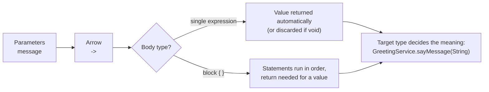
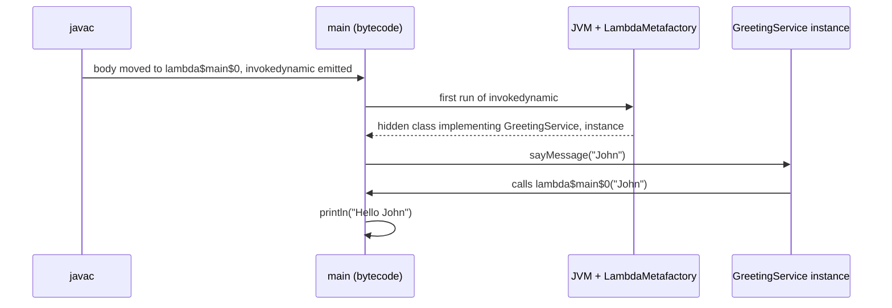

## In One Line
A **lambda expression** is an anonymous function — `parameters -> body` — that you can store in a variable or pass to a method; the compiler turns it into an object implementing a functional interface, so `message -> System.out.println("Hello " + message)` becomes a ready-to-use `GreetingService`.

## Mental Model
Think of a **sticky note with instructions** that you hand to a colleague: "When a name arrives, say *Hello* + name." Writing the note does not greet anybody. The colleague keeps the note and follows it **each time** a name arrives.

In the code:
- **Writing the note** is the lambda expression `message -> System.out.println("Hello " + message)`. Nothing prints when it is written.
- **The colleague's job title** is the functional interface `GreetingService`: "I am someone who can `sayMessage(String)`". The note is only accepted because it fits that job.
- **Following the note** is calling `greetService1.sayMessage("John")` — only now does the body run.
- A **one-line note** is an *expression lambda*; a **note with several numbered steps** is a *block lambda* `{ ...; ...; }`.
- The note may mention things from your desk (local variables), but only things that **will not change** after you hand it over — that is the "effectively final" rule.

## Concept
### Why lambdas were added (Java 8, 2014)
Before Java 8, passing behaviour meant writing an anonymous class — five lines of ceremony around one line of logic:
```java
GreetingService old = new GreetingService() {
    @Override
    public void sayMessage(String message) {
        System.out.println("Hello " + message);
    }
};
GreetingService modern = message -> System.out.println("Hello " + message);
```
Lambdas remove the boilerplate, make APIs like the Stream API practical, and push Java towards a **functional style**: pass behaviour as data, prefer expressions without side effects, compose small functions.

### Anatomy
```text
(parameters)  ->  body
 message      ->  System.out.println("Hello " + message)
```
1. **Parameter list** — matches the functional interface method's parameters.
2. **Arrow token** `->` — separates parameters from body.
3. **Body** — either a single **expression** (its value is returned automatically) or a **block** `{ ... }` of statements (use `return` if a value is needed).

### Every syntax form (all verified on JDK 21)
| Form | Example | Rule |
|---|---|---|
| No parameters | `() -> System.out.println("no parameters")` | Empty `()` is mandatory. |
| One parameter, inferred | `msg -> ...` | Parentheses optional for exactly one inferred parameter. |
| Several parameters | `(a, b) -> a + b` | Parentheses mandatory. |
| Explicit types | `(Integer a, Integer b) -> a * b` | Types must match the descriptor exactly. |
| `var` (Java 11+) | `(var a, var b) -> a - b` | Lets you add annotations/modifiers without writing the type. |
| Modifiers | `(final String s, final Integer n) -> s.repeat(n)` | `final` and annotations need explicit types or `var`. |
| Block body | `n -> { String sign = ...; return n + " is " + sign; }` | Needs `return` when a value is expected. |

What does **not** compile (real `javac` messages):
```text
(int a, b) -> a + b      error: invalid lambda parameter declaration
                           (cannot mix implicitly-typed and explicitly-typed parameters)
(var a, b) -> a + b      (cannot mix 'var' and implicitly-typed parameters)
(var a, Integer b) -> …  (cannot mix 'var' and explicitly-typed parameters)
var x -> x               error: ';' expected   (a lone 'var' parameter needs parentheses)
```

### Expression body vs block body, void vs value
- **Expression body** `x -> x * 2`: the expression's value is the return value. If the interface returns `void`, the expression must be a *statement expression* (method call, assignment, `++`, `new`) and its value is thrown away. That is why `Consumer<String> c = s -> s.length();` compiles.
- **Block body** `x -> { ...; return y; }`: behaves like a method body. Every path must `return` a value for a value-returning interface, and no `return value;` is allowed for a `void` one.

```text
Runnable r = () -> "done";
error: incompatible types: lambda body is not compatible with a void functional interface

Supplier<String> s = () -> System.out.println("x");
error: incompatible types: bad return type in lambda expression
    void cannot be converted to String

Function<String, Integer> f = s -> { s.length(); };
error: incompatible types: bad return type in lambda expression
    missing return value
```

### Target typing and type inference
A lambda has no type of its own; it takes the type the context expects (the **target type**), which must be a functional interface — see [Functional Interfaces](lesson:a05-java8/01-functional-interfaces). From the target, the compiler infers the parameter types (`message` is a `String` because `sayMessage(String)` says so) and checks the body's return type.

Because of this, **overloaded methods** that take different functional interfaces are resolved by the lambda's shape:
```java
static void run(Runnable r)         { System.out.println("Runnable version"); }
static void run(Supplier<String> s) { System.out.println("Supplier version"); }

run(() -> System.out.println("hi")); // Runnable version  (void only)
run(() -> "x");                      // Supplier version  ("x" is not a statement)
run(() -> foo());                    // Supplier version  (fits both; value-returning is more specific)
run(() -> { foo(); });               // Runnable version  (block with no return)
```
This is exactly how `ExecutorService.submit(() -> foo())` picks `submit(Callable)` over `submit(Runnable)` and returns a `Future` holding `foo()`'s result.

### Capturing variables: the effectively-final rule
A lambda body can read:
- its own parameters and local variables,
- **instance and static fields** (read *and* write — a field access really goes through `this` or the class),
- **local variables of the enclosing method, only if they are final or effectively final** — assigned exactly once and never changed, before or after the lambda.

```text
int count = 0;
Runnable r = () -> count++;
error: local variables referenced from a lambda expression must be final or effectively final
```
It fails even if the reassignment happens *after* the lambda (`int later = 1; Runnable r2 = () -> println(later); later = 2;` is also rejected).

**Why the rule exists:**
1. **Captured values are copies.** The lambda object may outlive the method call (stored in a field, run on another thread), but local variables live on the stack and vanish when the method returns. So the lambda captures a *copy* of the value. If the variable could change later, the copy and the original would silently disagree.
2. **Thread safety.** Lambdas are often run on other threads (streams, executors). Allowing them to mutate stack variables would create data races on something that is not even shared memory.

Note that "effectively final" applies to the **variable**, not the object: `List<String> out = new ArrayList<>(); names.forEach(n -> out.add(n));` compiles because `out` always points to the same list. Mutating shared objects from lambdas is legal but usually a smell — in streams prefer `collect(...)`. If you really need a counter, use `AtomicInteger` (thread-safe), not a one-element array hack.

**Classic loop case:** in `for (int i = 0; i < 3; i++) tasks.add(() -> print(i));` the variable `i` changes, so it does not compile. In an enhanced for loop, `for (String name : list) tasks.add(() -> print(name));` compiles — each iteration declares a **fresh** effectively final `name`.

### Scope: a lambda is not a new scope level
A lambda body shares the enclosing method's scope (unlike an anonymous class, which opens a new class scope):
- **Parameters cannot shadow locals:** `String x = "outer"; Function<String,String> g = x -> x;` → `error: variable x is already defined in method main(String[])`.
- **`this` and `super` mean the enclosing instance**, not the lambda. In an anonymous class, `this` is the anonymous object itself (verified: a lambda printed `this` as the enclosing `L6 instance`; the anonymous class printed its own class `L6$1`).
- A lambda **cannot refer to itself** while being initialised: `Runnable self = () -> self.run();` → `variable self might not have been initialized`. For recursion use a method, or a field referenced by its qualified name (`static IntUnaryOperator fact = n -> n <= 1 ? 1 : n * Outer.fact.applyAsInt(n - 1);` — the unqualified form fails with "self-reference in initializer").

### Exceptions
A lambda body can throw unchecked exceptions freely. It can throw a **checked** exception only if the functional interface method declares it: `Runnable r = () -> Thread.sleep(10);` → `unreported exception InterruptedException; must be caught or declared to be thrown`. Catch it inside the lambda, or use an interface like `Callable` that declares `throws Exception`.

### Lambda vs anonymous class
| | Lambda | Anonymous class |
|---|---|---|
| Can implement | Functional interfaces only | Any interface or class (abstract or concrete) |
| Methods | Exactly one | Any number, plus fields (state) |
| `this` | Enclosing instance | The anonymous object |
| Scope | Same as the enclosing method; cannot shadow locals | New scope; can shadow |
| Compiled to | A private method + `invokedynamic`; no `.class` file | A separate `Outer$1.class` file |
| Instance creation | Linked once per call site; non-capturing lambdas are typically reused | `new` every time the expression runs |
| Captured locals | Must be effectively final | Must be effectively final (since Java 8; before that, explicitly `final`) |

### How lambdas are compiled and run
1. `javac` moves each lambda body into a **private synthetic method** of the enclosing class. For the lesson's example `javap -p` shows `private static void lambda$main$0(java.lang.String)` and `lambda$main$1(java.lang.String)` — and no extra `.class` files, only `LambdaExpressionsExample.class` and `GreetingService.class`. Captured locals become extra leading parameters (`lambda$demo$1(int)`); a lambda that uses `this` or an instance field becomes an **instance** method instead of a static one.
2. Where the lambda appears, `javac` emits an **`invokedynamic`** instruction whose bootstrap method is `LambdaMetafactory.metafactory`.
3. The **first time** that instruction runs, the JVM calls the bootstrap method, which generates a hidden class implementing `GreetingService` (its name looks like `Lj$$Lambda/0x00007fecf4000a08` on JDK 21) and links the call site.
4. Every later execution just produces an instance. For a **non-capturing** lambda HotSpot returns the same instance every time (verified: `arr[0] == arr[1]` was `true`); a **capturing** lambda gets a new instance holding the captured values (`false`). This is an implementation detail — never rely on lambda identity.

Why not just generate anonymous classes? `invokedynamic` defers the strategy to the JVM, keeps jar files small (no class per lambda) and lets future JVMs change the implementation without recompiling.

### Functions that return functions
Because lambdas are values, a method (or lambda) can return one. Nested lambdas give **currying**:
```java
Function<Integer, Function<Integer, Integer>> add = a -> b -> a + b;
Function<Integer, Integer> add10 = add.apply(10);
System.out.println(add10.apply(5) + " " + add.apply(1).apply(2)); // 15 3
```

### Best practices
- Keep lambdas **short** (one to three lines). Longer logic belongs in a named method, referenced with a method reference.
- Prefer a **method reference** when the lambda only calls one method: `s -> s.length()` → `String::length`.
- Prefer **side-effect-free** lambdas in streams. Stateful lambdas break under `parallel()`.
- Use descriptive parameter names in multi-line lambdas; `x`, `a`, `b` are fine for one-liners.
- Stack traces show frames like `lambda$main$0` — naming the logic as a method makes traces readable.

## Diagram

Every lambda is parameters, an arrow and a body; the functional interface it is assigned to supplies the types and the method it implements.


Creating the lambda only builds an object. The body runs later, when the interface method is called.

## Code
@example Java8Features/LambdaExpressionsandFunctionalInterfaces/LambdaExpressionsExample.java

Every syntax form, plus the enhanced-for capture that does compile:
```java
import java.util.*;
import java.util.function.*;

public class Syntax {
    public static void main(String[] args) {
        Runnable noArgs              = () -> System.out.println("no parameters");
        Consumer<String> oneArg      = msg -> System.out.println("one parameter: " + msg);
        BinaryOperator<Integer> two  = (a, b) -> a + b;
        BinaryOperator<Integer> typed = (Integer a, Integer b) -> a * b;
        BinaryOperator<Integer> vars = (var a, var b) -> a - b;          // Java 11+
        BiFunction<String, Integer, String> modifiers = (final String s, final Integer n) -> s.repeat(n);
        Function<Integer, String> block = n -> {
            String sign = n >= 0 ? "positive" : "negative";
            return n + " is " + sign;                                  // block body needs return
        };
        Supplier<List<String>> value = () -> new ArrayList<>();

        noArgs.run();
        oneArg.accept("hi");
        System.out.println(two.apply(2, 3) + " " + typed.apply(2, 3) + " " + vars.apply(2, 3));
        System.out.println(modifiers.apply("ab", 3));
        System.out.println(block.apply(-4));
        System.out.println(value.get());

        List<Runnable> tasks = new ArrayList<>();
        for (String name : List.of("A", "B", "C")) {
            tasks.add(() -> System.out.print(name + " "));   // a fresh 'name' each iteration
        }
        tasks.forEach(Runnable::run);
        System.out.println();
    }
}
```
```output
no parameters
one parameter: hi
5 6 -1
ababab
-4 is negative
[]
A B C 
```

What a lambda may capture — fields freely, locals only if effectively final:
```java
import java.util.*;
import java.util.concurrent.atomic.*;

public class L8 {
    int hits = 0;                       // instance field
    static int total = 0;               // static field

    void demo() {
        List<String> names = List.of("a", "b", "c");
        names.forEach(n -> hits++);        // OK: really this.hits++
        names.forEach(n -> total++);       // OK: static field
        AtomicInteger counter = new AtomicInteger();
        names.forEach(n -> counter.incrementAndGet());   // OK: the reference never changes
        int[] box = {0};
        names.forEach(n -> box[0]++);      // compiles, but a hack
        System.out.println(hits + " " + total + " " + counter.get() + " " + box[0]);
        List<String> out = new ArrayList<>();
        names.forEach(n -> out.add(n.toUpperCase()));  // mutating the object is allowed
        System.out.println(out);
    }

    public static void main(String[] args) { new L8().demo(); }
}
```
```output
3 3 3 3
[A, B, C]
```

## Walkthrough
- `@FunctionalInterface interface GreetingService { void sayMessage(String message); }` — the target type for both lambdas. Its descriptor is `(String) -> void`: one `String` in, nothing out. (It has the same shape as the built-in `Consumer<String>`.)
- `GreetingService greetService1 = message -> System.out.println("Hello " + message);` — the comment says "a single parameter": with exactly one inferred parameter the parentheses can be dropped (`(message) -> ...` is equivalent). The type of `message` is inferred as `String`. The body is one expression; `println` returns `void`, which fits because `sayMessage` returns `void`. **Nothing is printed on this line** — it only creates the object.
- `GreetingService greetService2 = message -> { ... };` — "a block of code": braces allow several statements, here two `println` calls. No `return` because the method is `void`. The semicolon after `}` ends the assignment statement.
- `greetService1.sayMessage("John");` — "Call the method sayMessage of GreetingService". The call goes through the interface to the hidden class, which calls the synthetic `lambda$main$0("John")` → prints `Hello John`.
- `greetService2.sayMessage("Alice");` — runs the block: `Hello Alice`, then `Welcome to lambda expressions in Java!`.
- The recorded output has exactly those three lines, matching the `// Output:` comment. Note the order: output appears in the order of the **calls**, not the order in which the lambdas were written.
- Under the hood, `javap -p` shows two private static methods, `lambda$main$0(String)` and `lambda$main$1(String)`, and no `LambdaExpressionsExample$1.class` — lambdas are not compiled to anonymous classes.

## Traps
> [!WARNING] **`java LambdaExpressionsExample.java` fails on JDK 21**: the single-file launcher runs the first top-level type, `GreetingService`, which has no `main` (`error: can't find main(String[]) method in class: ...GreetingService`). Run it from the IDE/Maven, compile with `javac` and run the class by name, or move the public class above the interface.

- **Writing a lambda does not run it.** The body runs only when the interface method is called — possibly many times, possibly never.
- **Mutating a captured local** (`count++`, reassigning later) does not compile. Loop counters of a classic `for` loop cannot be captured; copy them into a local first (`int k = i;`) or use an enhanced for loop.
- **Parameter names clash with locals.** `String x = ...; list.forEach(x -> ...)` is "variable x is already defined". Anonymous classes allowed this shadowing; lambdas do not.
- **`this` inside a lambda is the enclosing object**, not the lambda. Code migrated from anonymous classes that used `this` to mean "the listener" changes meaning.
- **`return` inside a lambda returns from the lambda**, not from the enclosing method; and `break`/`continue` cannot jump out of a lambda (e.g. out of `forEach`). Use a plain loop when you need them.
- **Checked exceptions** cannot escape a lambda whose interface does not declare them.
- **Void vs value confusion:** `Runnable r = () -> "done";` and `Supplier<String> s = () -> System.out.println("x");` both fail.
- **Relying on lambda identity or `toString()`** — the class name (`$$Lambda/0x...`) and whether instances are reused are JVM implementation details.

## Tips & Tricks
- **Mnemonic — "PAB": Parameters, Arrow, Body.** Parentheses can be dropped only for *one inferred* parameter; braces can be dropped only for *one expression*.
- **"Effectively final" test:** mentally add `final` to the variable. If the code still compiles, the lambda may capture it.
- **Lambda `this` = the room you are standing in.** Anonymous class `this` = the new room you just built.
- **Refactor ladder:** anonymous class → block lambda → expression lambda → method reference. Stop at the most readable step.
- Need a counter inside a lambda? Ask first whether a stream operation (`count()`, `sum()`, `collect`) does the job; if not, `AtomicInteger`.
- Name complex logic: `list.removeIf(this::isExpired)` reads better than a five-line lambda and gives a clear stack trace.

## Interview Q&A
### [Basic] What is a lambda expression in Java?
A lambda is an anonymous function — a block of behaviour with parameters and a body but no name, class or return-type declaration — written as `(params) -> body`. It can be assigned to a variable, passed to a method, or returned, as long as the target type is a functional interface. The compiler infers parameter types from that interface and turns the lambda into an object implementing it. Introduced in Java 8, lambdas replace most anonymous classes and power the Stream API: `names.forEach(n -> System.out.println(n))`.

**Follow-up:** *What are the advantages?* — Less boilerplate, behaviour-as-data (strategies, callbacks), internal iteration with streams, easier parallelism, and no extra class file per lambda.

### [Basic] What are the syntax rules of a lambda?
Parameters, arrow `->`, body. Zero parameters need `()`. One inferred parameter may drop the parentheses (`x -> ...`). Two or more need parentheses. Parameter types can all be inferred, all explicit, or all `var` (Java 11) — never mixed. The body is either one expression (its value is returned; no `return` keyword) or a block in braces with `return` when a value is required. `final` or annotations on parameters require explicit types or `var`.

**Follow-up:** *Why use `var` in a lambda if types are inferred anyway?* — To attach annotations or `final` without spelling the type: `(@NonNull var s) -> ...`.

### [Basic] What does "effectively final" mean and why do lambdas require it?
A local variable is effectively final if it is assigned once and never changed — adding `final` would not break the code. Lambdas (and anonymous/local classes) may only capture such locals. The reason: the lambda captures a **copy** of the value, because it can outlive the method's stack frame (for example, run later on another thread). If the variable could change, the copy would be stale and the behaviour confusing; forbidding mutation also avoids data races on stack variables. Instance and static fields are not restricted, because they live on the heap and the lambda accesses them through `this` or the class.

**Follow-up:** *How do you count inside a lambda?* — Prefer a stream terminal op (`count()`); otherwise an `AtomicInteger` or a field. The one-element-array trick compiles but is not thread-safe.

### [Intermediate] What is the difference between a lambda and an anonymous inner class?
A lambda can only implement a functional interface; an anonymous class can implement any interface or extend any class, and can have fields and several methods. In a lambda `this` refers to the enclosing instance and the body shares the enclosing scope (parameters cannot shadow locals); in an anonymous class `this` is the anonymous object and it has its own scope. Compilation differs too: an anonymous class becomes a separate `Outer$1.class` created with `new` each time, while a lambda becomes a private synthetic method plus an `invokedynamic` call site that the JVM links through `LambdaMetafactory` at first use.

**Follow-up:** *Is a lambda faster?* — Startup cost is paid once per call site at first execution; after that performance is comparable, and non-capturing lambdas avoid an allocation per evaluation. Choose on readability.

### [Intermediate] How does the JVM implement lambdas internally?
`javac` compiles the body to a private synthetic method (`lambda$main$0`), static if it does not use `this`, with captured locals as extra parameters. At the lambda's location it emits `invokedynamic` with `LambdaMetafactory.metafactory` as the bootstrap method. On first execution the bootstrap spins a hidden class that implements the functional interface and delegates to the synthetic method, and links the call site. Subsequent executions create (or, for non-capturing lambdas, reuse) an instance. Method references go through the same path but point the metafactory straight at the referenced method.

**Follow-up:** *Why `invokedynamic` instead of inner classes?* — It leaves the translation strategy to the JVM (can be improved without recompiling), avoids one class file per lambda, and reduces class-loading cost.

### [Intermediate] What does `this` refer to inside a lambda?
The instance of the enclosing class — exactly what `this` means on the line just outside the lambda. A lambda does not introduce a new object scope, so `this.toString()` inside a lambda calls the enclosing object's `toString()`. In a static method, a lambda has no `this` at all. In an anonymous class, `this` is the anonymous class instance.

**Follow-up:** *Then how can a lambda refer to itself, e.g. for recursion?* — It cannot directly; use a named method, or store it in a field and refer to it with a qualified name (`Outer.fact`).

### [Intermediate] Can a lambda throw a checked exception?
Only if the functional interface's abstract method declares it. `Runnable.run()` declares nothing, so `() -> Thread.sleep(10)` fails with "unreported exception InterruptedException". Options: try/catch inside the lambda (often rethrowing as an unchecked exception), use an interface that declares the exception (`Callable.call() throws Exception`), or define a custom functional interface with a `throws` clause.

**Follow-up:** *Can a lambda throw an unchecked exception?* — Yes, always; it propagates out of the interface method call to the caller.

### [Advanced] How does overload resolution work with lambdas? Why does `executor.submit(() -> compute())` return a result?
The compiler checks which overloads' functional interfaces the lambda is compatible with. `() -> compute()` where `compute()` returns a value is compatible with both `Runnable` (a method call is a valid statement; the value is discarded) and `Callable<T>` (value returned). When both fit, the rule for explicitly typed lambdas (zero-parameter lambdas count) prefers the interface with a non-void return, so `submit(Callable)` wins and the `Future` holds the result. `() -> { compute(); }` has a block with no `return`, so only `Runnable` fits.

**Follow-up:** *When does this become ambiguous?* — With implicitly typed parameters and overloads whose functional interfaces have the same arity, e.g. `m(Function<String,Integer>)` and `m(ToIntFunction<String>)` called as `m(s -> s.length())` — cast the lambda or use distinct method names.

### [Advanced] Does every evaluation of a lambda expression create a new object?
Not necessarily, and you must not depend on either behaviour. HotSpot returns the **same instance** for a non-capturing lambda evaluated at the same call site (because it has no state), and a **new instance** for a capturing lambda (it must hold the captured values). In a loop, `() -> "x"` produced identical objects while `() -> "x" + k` produced different ones. The JLS only says the result is "a reference to an instance of a class with the following properties" — identity, `equals` and `toString` are unspecified.

**Follow-up:** *So can I use a lambda as a key to remove a listener later?* — Keep the reference you registered; do not create the "same" lambda again and expect it to be equal.

### [Advanced] Can a lambda be serialized?
Only if its target type is serializable, for example by casting to an intersection type: `Runnable r = (Runnable & Serializable) () -> ...;`. The compiler then generates a `$deserializeLambda$` method and the lambda is written as a `SerializedLambda`. It is fragile: it depends on the capturing class, the synthetic method names and captured values, so recompiling can break deserialization. The Java docs strongly discourage serializing lambdas.

**Follow-up:** *Are method references serializable the same way?* — Yes, with the same intersection-cast trick and the same caveats.

## Quiz
### What does this print?
```java
public class L6 {
    public String toString() { return "L6 instance"; }
    void demo() {
        Runnable lambda = () -> System.out.println("lambda this = " + this);
        Runnable anon = new Runnable() {
            public void run() { System.out.println("anon this = " + this.getClass().getName()); }
        };
        lambda.run();
        anon.run();
    }
    public static void main(String[] args) { new L6().demo(); }
}
```
- [ ] `lambda this = L6$$Lambda...` then `anon this = L6$1`
- [x] `lambda this = L6 instance` then `anon this = L6$1`
- [ ] `lambda this = L6 instance` then `anon this = L6`
- [ ] Compile error: `this` is not allowed in a lambda
> Inside a lambda, `this` is the enclosing `L6` object, so its `toString()` gives `L6 instance`. Inside an anonymous class, `this` is the anonymous object, whose class is `L6$1`. The tempting first option assumes a lambda is its own object for `this`, which it is not.

### Which lambda does NOT compile?
- [ ] `(var a, var b) -> a + b`
- [ ] `s -> s.length()` as a `Consumer<String>`
- [x] `(int a, b) -> a + b`
- [ ] `() -> {}` as a `Runnable`
> Parameter types must be all inferred, all explicit or all `var`; `(int a, b)` mixes explicit and inferred ("cannot mix implicitly-typed and explicitly-typed parameters"). `s -> s.length()` is fine as a `Consumer`: a method call is a statement expression and its value is discarded.

### Spot the bug
```java
List<Runnable> tasks = new ArrayList<>();
for (int i = 0; i < 3; i++) {
    tasks.add(() -> System.out.print(i + " "));
}
```
- [ ] `print` cannot be used in a lambda
- [x] `i` is modified by `i++`, so it is not effectively final and cannot be captured
- [ ] It compiles and prints `3 3 3` when the tasks run
- [ ] `Runnable` cannot be stored in a `List`
> Captured locals must be effectively final; the loop counter changes on every iteration, so javac reports "local variables referenced from a lambda expression must be final or effectively final". The `3 3 3` answer is what JavaScript's old `var` would do — Java refuses to compile instead. Fix: `int k = i;` inside the loop, or use an enhanced for loop.

### What does this print?
```java
static void run(Runnable r)         { System.out.println("Runnable version"); }
static void run(Supplier<String> s) { System.out.println("Supplier version"); }
static String foo() { return "foo"; }

run(() -> foo());
run(() -> { foo(); });
```
- [ ] `Runnable version` twice
- [x] `Supplier version` then `Runnable version`
- [ ] `Supplier version` twice
- [ ] Compile error: ambiguous call
> `() -> foo()` fits both (a method call can be a void statement or a value), and the value-returning interface is more specific, so `Supplier` wins. `() -> { foo(); }` is a block without `return`, compatible only with `Runnable`. It is not ambiguous because a zero-parameter lambda is treated as explicitly typed, which enables the more-specific rule.

### What does this print?
```java
Function<Integer, Function<Integer, Integer>> add = a -> b -> a + b;
Function<Integer, Integer> add10 = add.apply(10);
System.out.println(add10.apply(5) + " " + add.apply(1).apply(2));
```
- [x] `15 3`
- [ ] `15 12`
- [ ] `18`
- [ ] Compile error: a lambda cannot return a lambda
> `add.apply(10)` returns the inner lambda `b -> 10 + b` (it captures `a = 10`); applying it to 5 gives 15. `add.apply(1).apply(2)` gives 3. The two numbers are joined with a space into a String, so it is never added up to 18. Returning lambdas from lambdas (currying) is legal.

### Why must a captured local variable be effectively final?
- [ ] Because lambdas run faster when variables are final
- [ ] Because the JVM stores all lambdas in the constant pool
- [x] Because the lambda captures a copy of the value and may run after the method (and its stack frame) has finished
- [ ] Because lambdas cannot read variables at all without `final`
> Locals live on the stack; a lambda can outlive the method call, so it keeps a copy. Allowing later changes would make the copy silently stale and invite races between threads. Speed has nothing to do with it, and fields (heap data) can still be read and written.

### Which statement is true about how this line is compiled? `GreetingService g = m -> System.out.println(m);`
- [ ] javac generates a class file `Outer$1.class` for it
- [x] javac generates a private synthetic method and an `invokedynamic` instruction
- [ ] The body is interpreted as a string at runtime
- [ ] It is converted to a `java.lang.reflect.Method` call
> Lambdas are not compiled to anonymous classes. The body becomes a method like `lambda$main$0`, and `invokedynamic` + `LambdaMetafactory` create an implementing hidden class at runtime. `Outer$1.class` is what an anonymous class would produce.

## Takeaways
- A lambda `(params) -> body` is an anonymous function; its type comes from the target functional interface, and creating it does not run it.
- Parentheses are optional only for one inferred parameter; braces are optional only for one expression; parameter types are all inferred, all explicit or all `var`.
- Lambdas may capture only final or effectively final locals (they hold a copy), but can freely read and write fields.
- A lambda shares the enclosing scope: `this` is the enclosing instance, and parameters cannot shadow local variables.
- Checked exceptions can leave a lambda only if the functional interface method declares them.
- Lambdas compile to a private synthetic method plus `invokedynamic`/`LambdaMetafactory`, not to anonymous classes; never rely on lambda identity.
