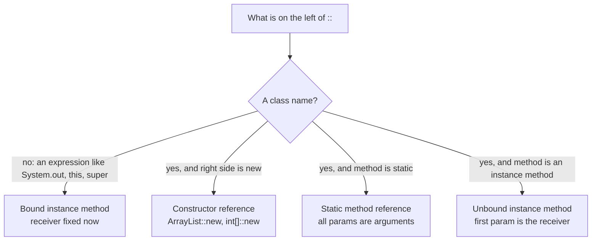
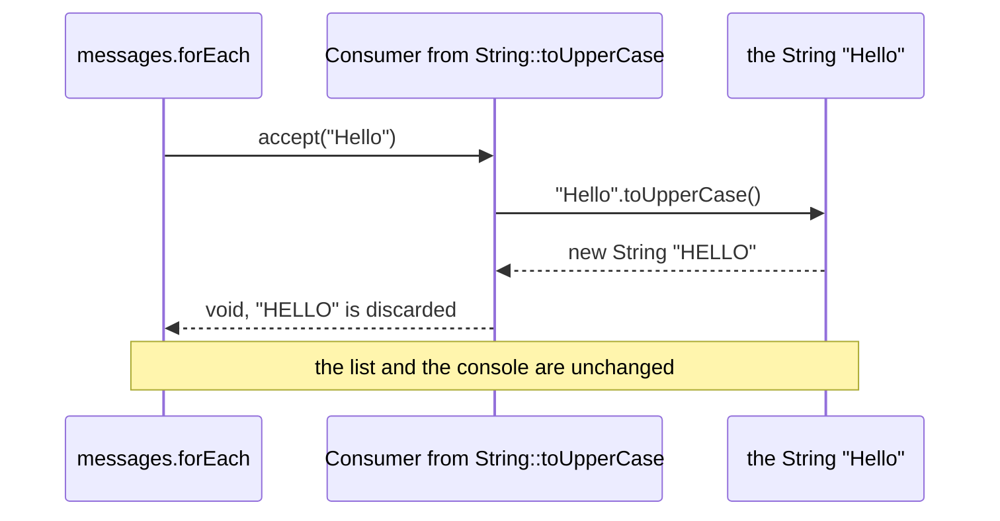

## In One Line
A **method reference** (`Class::method`, `object::method`, `Class::new`) is a shorthand for a lambda that does nothing but call one existing method — `messages.forEach(MethodReferencesExample::printMessage)` means exactly `messages.forEach(m -> MethodReferencesExample.printMessage(m))`.

## Mental Model
Think of **speed-dial on a phone**. Instead of writing out the full number every time ("take the message, then call `printMessage` with it"), you store a shortcut that *points at* someone who already knows how to handle the call.

In the code:
- The **contact** is an existing method: `printMessage(String)`, `String.toUpperCase()`, the `ArrayList` constructor.
- The **speed-dial entry** is the method reference `MethodReferencesExample::printMessage`. It does not call anyone yet; it just remembers *who* to call.
- **Pressing the button** is the functional interface call: `forEach` calls `accept(message)`, which rings `printMessage(message)`.
- The **four kinds** of entries are four ways to say who answers: a class's static line (`Class::staticMethod`), one particular person (`object::method`), "whoever the call is about" (`Class::instanceMethod` — the first argument answers), or "a brand-new person" (`Class::new`).

## Concept
### Why method references exist
Many lambdas only forward their arguments to a method that already exists:
```java
messages.forEach(m -> System.out.println(m));
messages.forEach(System.out::println);        // same behaviour, no parameter noise
```
A method reference removes the parameter names and the arrow and says *which method* does the job. It is not a new feature of the runtime — it is another way to produce an instance of a functional interface. It needs a **target type** exactly like a lambda does (see [Functional Interfaces](lesson:a05-java8/01-functional-interfaces)).

### The four kinds
| # | Kind | Syntax | Equivalent lambda | Example |
|---|---|---|---|---|
| 1 | **Static method** | `ClassName::staticMethod` | `(args) -> ClassName.staticMethod(args)` | `Integer::parseInt`, `MethodReferencesExample::printMessage` |
| 2 | **Bound instance method** (a *particular* object) | `expression::method` | `(args) -> expression.method(args)` | `System.out::println`, `prefix::concat`, `this::shout`, `super::describe` |
| 3 | **Unbound instance method** (an *arbitrary* object of a type) | `ClassName::instanceMethod` | `(obj, args) -> obj.method(args)` | `String::toUpperCase`, `String::length`, `String::compareToIgnoreCase`, `Person::name` |
| 4 | **Constructor** | `ClassName::new` / `Type[]::new` | `(args) -> new ClassName(args)` | `ArrayList::new`, `Person::new`, `int[]::new`, `String[]::new` |

The difference between kinds 2 and 3 is the key interview point:
- **Bound** (`obj::method`): the receiver is fixed when the reference is created. All the functional interface's parameters become the method's arguments. `System.out::println` as a `Consumer<String>` = `s -> System.out.println(s)`.
- **Unbound** (`Type::method` where `method` is an instance method): there is no receiver yet. The **first parameter** of the functional interface becomes the receiver, and the rest become arguments. `String::toUpperCase` as a `Function<String,String>` = `s -> s.toUpperCase()`; `String::concat` as a `BiFunction<String,String,String>` = `(a, b) -> a.concat(b)`.

### How the compiler picks the method
The functional interface's descriptor decides everything:
1. It determines the **parameter types** to look for. For `Function<String, Integer> parse = Integer::parseInt`, the compiler searches `Integer` for a method that can be called with one `String` → `static int parseInt(String)`, whose `int` result is boxed to `Integer`.
2. For `ClassName::name` it tries **both** a static method taking all parameters and an instance method on the first parameter. If both match, it is ambiguous:
   ```text
   Function<Integer, String> f = Integer::toString;
   error: incompatible types: invalid method reference
       reference to toString is ambiguous
         both method toString(int) in Integer and method toString() in Integer match
   ```
   Use a lambda (`i -> i.toString()`) or `String::valueOf`.
3. **Overloads are resolved per target.** `System.out::println` becomes `println(String)` for a `Consumer<String>`, `println(Object)` for a `Consumer<Integer>`, and `println(int)` for an `IntConsumer`.
4. **Constructors are chosen the same way.** `ArrayList::new` is `new ArrayList<>()` for a `Supplier<List<String>>` but `new ArrayList<>(int capacity)` for a `Function<Integer, List<String>>`. `Person::new` for a `BiFunction<String, Integer, Person>` picks the two-argument constructor.
5. **A value-returning method may target a `void` interface** — the result is silently discarded. `String::toUpperCase` fits `Consumer<String>`. This is the bug in the lesson's example.
6. **Checked exceptions** must be declared by the functional interface: a method that `throws IOException` cannot be referenced as a `Function` ("incompatible thrown types IOException in functional expression").

### Bound references evaluate the receiver once, eagerly
This is the biggest behavioural difference from a lambda:
```java
Supplier<String> ref = next()::toUpperCase;         // next() runs ONCE, right now
Supplier<String> lam = () -> next().toUpperCase();  // next() runs on every get()
```
- Evaluated at creation: `ref.get()` twice returned `OBJ1 OBJ1`; `lam.get()` twice returned `OBJ2 OBJ3`.
- **Null receivers fail immediately:** `String s = null; Supplier<Integer> eager = s::length;` throws `NullPointerException` **at creation**, while `() -> s.length()` is created fine and would only fail when called.
- **`System.out::println` captures the current `System.out`.** After `System.setOut(buffer)`, a stored `System.out::println` still prints to the original console, whereas `s -> System.out.println(s)` prints to the new stream (verified below).

### `this::` and `super::`
Inside an instance method, `this::shout` is a bound reference to the current object and `super::describe` calls the **parent's** implementation, skipping the override — something a lambda can only express as `s -> super.describe(s)`.

### Constructor and array references
- `Supplier<List<String>> s = ArrayList::new;` — a factory. Useful for `Collectors.toCollection(TreeSet::new)`, `groupingBy(..., TreeMap::new, ...)`, `computeIfAbsent(key, k -> new ArrayList<>())` (here a lambda is needed because the key must be ignored).
- `IntFunction<int[]> newArray = int[]::new;` — array constructor: `n -> new int[n]`. Its most famous use is `stream.toArray(String[]::new)`, which returns a `String[]` instead of `Object[]`.
- Generic constructors infer type arguments from the target; you can write them explicitly: `ArrayList<String>::new`.

### How method references are compiled
Like lambdas, they compile to `invokedynamic` with `LambdaMetafactory` as the bootstrap. The difference: **no synthetic `lambda$` method is generated** — the bootstrap receives a direct `MethodHandle` to the target. For the lesson's example, `javap -v` shows bootstrap arguments `REF_invokeStatic ...MethodReferencesExample.printMessage` and `REF_invokeVirtual java/lang/String.toUpperCase`, and `javap -p` lists only `printMessage`, `main` and the constructor. (Some cases — e.g. varargs, `super::`, certain accessibility cases — still get a bridge `lambda$` method.)

### Method reference or lambda?
| Use a method reference when... | Use a lambda when... |
|---|---|
| The lambda just forwards its parameters to one method, in order | You need extra arguments or constants: `s -> s.substring(1)` |
| The method name says what happens: `Person::name`, `Objects::nonNull` | The logic is an expression: `n -> n * 2 + 1` |
| You want a direct method handle (clean stack traces, no synthetic method) | The receiver must be evaluated lazily or may be `null` at creation |
| | The reference would be ambiguous (`Integer::toString`) |

## Diagram

Decide the kind from what sits before `::` and what kind of method follows it.


Why the example's second `forEach` has no visible effect: `Consumer.accept` returns `void`, so the new upper-case string is thrown away.

## Code
@example Java8Features/LambdaExpressionsandFunctionalInterfaces/MethodReferencesExample.java

All four kinds side by side, the fix for the example's bug, and the eager receiver:
```java
import java.util.*;
import java.util.function.*;
import java.util.stream.*;

public class M1 {
    public static void main(String[] args) {
        List<String> messages = Arrays.asList("Hello", "World");
        messages.forEach(String::toUpperCase);           // result thrown away
        System.out.println("after forEach: " + messages);
        messages.stream().map(String::toUpperCase).forEach(System.out::println);
        messages.replaceAll(String::toUpperCase);        // Arrays.asList supports set()
        System.out.println("after replaceAll: " + messages);

        // 1. static
        Function<String, Integer> parse = Integer::parseInt;
        // 2. bound (particular object)
        String prefix = "Mr. ";
        Function<String, String> greet = prefix::concat;
        // 3. unbound (arbitrary object of a type): first arg becomes the receiver
        BiFunction<String, String, Boolean> eqIgnore = String::equalsIgnoreCase;
        Function<String, Integer> len = String::length;
        // 4. constructor
        Supplier<List<String>> newList = ArrayList::new;
        Function<Integer, List<String>> withCapacity = ArrayList::new;
        IntFunction<int[]> newArray = int[]::new;
        System.out.println(parse.apply("42") + 1);
        System.out.println(greet.apply("Bean"));
        System.out.println(eqIgnore.apply("JAVA", "java"));
        System.out.println(len.apply("lambda"));
        System.out.println(newList.get() + " " + withCapacity.apply(100).size() + " " + newArray.apply(3).length);
        String[] arr = Stream.of("x", "y").toArray(String[]::new);
        System.out.println(Arrays.toString(arr));
    }
}
```
```output
after forEach: [Hello, World]
HELLO
WORLD
after replaceAll: [HELLO, WORLD]
43
Mr. Bean
true
6
[] 0 3
[x, y]
```

`this::`, `super::`, references to record accessors in comparators, and a two-argument constructor:
```java
import java.util.*;
import java.util.function.*;

public class Kinds {
    static class Base {
        String describe(String s) { return "Base sees " + s; }
    }
    static class Child extends Base {
        @Override String describe(String s) { return "Child sees " + s; }
        String shout(String s) { return s.toUpperCase() + "!"; }
        void demo() {
            Function<String, String> mine   = this::shout;       // bound to this object
            Function<String, String> parent = super::describe;   // the parent's version
            Function<String, String> own    = this::describe;    // the override
            System.out.println(mine.apply("hi") + " | " + parent.apply("x") + " | " + own.apply("x"));
        }
    }
    record Person(String name, int age) {}

    public static void main(String[] args) {
        new Child().demo();

        List<Person> people = new ArrayList<>(List.of(
            new Person("Ravi", 31), new Person("Anu", 25), new Person("Zoe", 28)));
        people.sort(Comparator.comparing(Person::name));          // unbound: p -> p.name()
        System.out.println(people.stream().map(Person::name).toList());
        people.sort(Comparator.comparingInt(Person::age).reversed());
        System.out.println(people.stream().map(Person::age).toList());

        BiFunction<String, String, String> join = String::concat;  // (a, b) -> a.concat(b)
        System.out.println(join.apply("method", "ref"));
        Comparator<String> ci = String::compareToIgnoreCase;       // (a, b) -> a.compareToIgnoreCase(b)
        System.out.println(ci.compare("apple", "APPLE"));

        BiFunction<String, Integer, Person> maker = Person::new;   // constructor with 2 args
        System.out.println(maker.apply("Kim", 40));
        Function<String, Integer> parse = Integer::valueOf;
        System.out.println(parse.apply("7") + 1);
    }
}
```
```output
HI! | Base sees x | Child sees x
[Anu, Ravi, Zoe]
[31, 28, 25]
methodref
0
Person[name=Kim, age=40]
8
```

A bound reference captures its receiver when it is created — even `System.out`:
```java
import java.io.*;
import java.util.function.*;

public class SetOut {
    public static void main(String[] args) {
        PrintStream original = System.out;
        Consumer<String> ref = System.out::println;          // System.out read NOW
        Consumer<String> lam = s -> System.out.println(s);   // System.out read on each call
        ByteArrayOutputStream buffer = new ByteArrayOutputStream();
        System.setOut(new PrintStream(buffer, true));
        ref.accept("via method reference");
        lam.accept("via lambda");
        System.setOut(original);
        System.out.println("captured in buffer: [" + buffer.toString().trim() + "]");
    }
}
```
```output
via method reference
captured in buffer: [via lambda]
```

## Walkthrough
- `import java.util.Arrays; import java.util.List;` — needed for `Arrays.asList` and the `List` type.
- `public static void printMessage(String message) { System.out.println(message); }` — "Static method": an ordinary static method with the shape `(String) -> void`, the same shape as `Consumer<String>.accept`. That is what makes it usable as a method reference.
- `List<String> messages = Arrays.asList("Hello", "World", "Method", "References", "in", "Java");` — `Arrays.asList` returns a **fixed-size** list backed by an array: you can `set` (and so `replaceAll`) elements, but `add`/`remove` throw `UnsupportedOperationException`.
- `messages.forEach(MethodReferencesExample::printMessage);` — "method reference to a static method". `forEach` is a **default method of `Iterable`** (Java 8) that takes a `Consumer<? super String>`. The compiler matches `accept(String)` to `printMessage(String)`, so for each element it calls `printMessage(element)`. This produces all six recorded output lines, `Hello` to `Java`, in list order.
- `messages.forEach(String::toUpperCase);` — "method reference to an instance method of an arbitrary object of a particular type". The comment names the kind correctly: this is an **unbound** reference, so each element becomes the receiver: `element.toUpperCase()`. But `toUpperCase()` **returns a new String** (strings are immutable) and `Consumer.accept` returns `void`, so every result is discarded. The line prints nothing and changes nothing.
- The `// Output:` comment lists six lines, and that matches the recorded output — but only because the second `forEach` is a no-op. A reader expecting `HELLO`, `WORLD`, ... will be surprised (see Errata).
- Under the hood both references compile to `invokedynamic` with direct method handles (`REF_invokeStatic printMessage`, `REF_invokeVirtual String.toUpperCase`) and no synthetic `lambda$` methods.

## Traps
> [!ERRATA] `messages.forEach(String::toUpperCase);` does nothing observable. `toUpperCase()` returns a new string, and `forEach` takes a `Consumer` whose `accept` returns `void`, so the result is thrown away; the list is unchanged and nothing is printed. That is why the output (and the `// Output:` comment) shows only the six original words. To see upper-case words, use `messages.stream().map(String::toUpperCase).forEach(System.out::println);` (prints `HELLO` ... `JAVA`), or to change the list in place, `messages.replaceAll(String::toUpperCase);` (works on `Arrays.asList` because it only calls `set`).

- **Value silently discarded.** Any value-returning method can be referenced where a `void` interface is expected (`Consumer`, `Runnable`). The compiler will not warn you.
- **Ambiguity with `ClassName::method`** when both a static and an instance method fit: `Integer::toString` as `Function<Integer,String>` does not compile. Same for `Integer::compare`-style overload clashes in some targets.
- **Bound receiver is evaluated eagerly.** `obj::m` with `obj == null` throws `NullPointerException` immediately; `getX()::m` calls `getX()` once. A stored `System.out::println` keeps printing to the old stream after `System.setOut`.
- **Parameter order for unbound references is fixed**: the first parameter is always the receiver. `BiFunction<String,String,Boolean> f = String::startsWith;` means `(a, b) -> a.startsWith(b)` — you cannot swap them without a lambda.
- **You cannot pass extra arguments.** `s -> s.substring(1)` has no method-reference form.
- **`Arrays.asList` is fixed-size**: `replaceAll` works, `add`/`remove` throw `UnsupportedOperationException`.

## Tips & Tricks
- **Mnemonic — "S-B-U-C": Static, Bound, Unbound, Constructor.** Ask: *what is left of the `::`?* A class with a static method → S. An object/expression → B. A class with an instance method → U (first argument becomes the receiver). `new` → C.
- **Unbound rule of thumb:** "`Type::instanceMethod` needs one *more* parameter than the method has" — `String::length` (0 params) fits a 1-param `Function<String,Integer>`; `String::concat` (1 param) fits a 2-param `BiFunction`.
- **Readability test:** if the lambda's parameters appear in the same order, once each, as arguments of a single call, convert it to a method reference; otherwise keep the lambda.
- Favourites worth memorising: `System.out::println`, `String::length`, `String::valueOf`, `Integer::parseInt`, `Integer::sum`, `Integer::compare`, `Objects::nonNull`, `Objects::isNull`, `String::isBlank`, `Map.Entry::getKey`, `ArrayList::new`, `String[]::new`.
- In IntelliJ, *Alt+Enter → Replace lambda with method reference* and back — a quick way to learn the equivalences.

## Interview Q&A
### [Basic] What is a method reference?
A compact form of a lambda that only calls an existing method, written with `::`. `list.forEach(System.out::println)` is equivalent to `list.forEach(x -> System.out.println(x))`. Like a lambda it needs a functional-interface target type; the compiler matches the interface's abstract-method signature against the referenced method's parameters and return type. It makes code shorter and names the operation instead of describing it.

**Follow-up:** *Does it call the method when it is created?* — No, it creates a functional-interface instance; the method runs when the interface method is invoked. (The receiver expression of a bound reference, however, is evaluated at creation.)

### [Basic] What are the four types of method references?
1. Static: `ClassName::staticMethod` — `Integer::parseInt` = `s -> Integer.parseInt(s)`.
2. Instance method of a particular object (bound): `object::method` — `System.out::println`, `this::validate`.
3. Instance method of an arbitrary object of a particular type (unbound): `ClassName::instanceMethod` — `String::toUpperCase` = `s -> s.toUpperCase()`; the first parameter becomes the receiver.
4. Constructor: `ClassName::new` — `ArrayList::new` = `() -> new ArrayList<>()`; arrays use `int[]::new`.

**Follow-up:** *Which kind is `String::compareToIgnoreCase` used as a `Comparator<String>`?* — Unbound: `(a, b) -> a.compareToIgnoreCase(b)`.

### [Basic] Why does `messages.forEach(String::toUpperCase)` print nothing?
Because it only converts each string and throws the result away. `forEach` takes a `Consumer`, whose `accept` returns `void`; Java allows a value-returning method there and discards the value. Strings are immutable, so `toUpperCase()` returns a new string and the list is not modified. To print: `messages.stream().map(String::toUpperCase).forEach(System.out::println)`. To modify the list: `messages.replaceAll(String::toUpperCase)`.

**Follow-up:** *Would `messages.stream().map(String::toUpperCase)` alone print anything?* — No. Streams are lazy; without a terminal operation nothing runs.

### [Intermediate] What is the difference between a bound and an unbound instance method reference?
A bound reference (`expr::method`) has its receiver fixed at creation: `"Mr. "::concat` always calls `concat` on `"Mr. "`, and all interface parameters are passed as arguments (`Function<String,String>`). An unbound reference (`Type::method`) has no receiver yet: the first interface parameter becomes the receiver and the rest are arguments, so `String::concat` needs a `BiFunction<String,String,String>` — `(a, b) -> a.concat(b)`. Consequently, an unbound reference needs one more parameter than the method declares.

**Follow-up:** *When is the bound receiver evaluated?* — Once, when the reference is created. A `null` receiver throws `NullPointerException` right there.

### [Intermediate] How does the compiler resolve overloaded methods and constructors in a method reference?
From the target's function descriptor. For `Consumer<String>`, `System.out::println` resolves to `println(String)`; for `IntConsumer`, to `println(int)`. `ArrayList::new` is the no-arg constructor for a `Supplier`, the `(int)` constructor for a `Function<Integer, List<T>>` or `IntFunction`. For `Type::method`, the compiler searches both static methods (all parameters as arguments) and instance methods (first parameter as receiver); if both succeed it reports "reference to ... is ambiguous", as with `Integer::toString` for `Function<Integer,String>`.

**Follow-up:** *How do you fix the ambiguity?* — Write a lambda (`i -> Integer.toString(i)`) or choose an unambiguous method such as `String::valueOf`.

### [Intermediate] Is a method reference exactly the same as the equivalent lambda?
Almost, with differences worth knowing: (1) a bound receiver expression is evaluated once, eagerly, while in a lambda it is evaluated on every call — so `getLogger()::info` and `s -> getLogger().info(s)` differ, and `null::` fails immediately; (2) method references usually compile to a direct method handle, while lambdas get a synthetic `lambda$` method, which changes stack traces; (3) `super::m` is the concise way to reference a parent implementation. Otherwise they are interchangeable.

**Follow-up:** *Give a real bug caused by (1).* — Storing `System.out::println` and later redirecting `System.setOut(...)`: the stored reference still writes to the old stream.

### [Intermediate] What is a constructor reference and where is it used?
`ClassName::new` creates a functional interface whose method calls a constructor. The constructor is chosen by the target's parameters: `Supplier<Person>` → no-arg, `BiFunction<String,Integer,Person>` → `(String, int)`. Array constructor references like `String[]::new` are `IntFunction<String[]>`. Common uses: `stream.toArray(String[]::new)`, `Collectors.toCollection(TreeSet::new)`, `Collectors.groupingBy(f, TreeMap::new, toList())`, factory maps like `Map<String, Supplier<Shape>> shapes = Map.of("circle", Circle::new)`.

**Follow-up:** *Why is `toArray(String[]::new)` better than `toArray()`?* — `toArray()` returns `Object[]`; the generator creates an array of the right runtime type.

### [Advanced] How are method references compiled? Is there a `lambda$` method?
They use `invokedynamic` with `LambdaMetafactory.metafactory`, like lambdas. Normally javac passes a direct `MethodHandle` to the referenced method as a bootstrap argument (`REF_invokeStatic` for static methods, `REF_invokeVirtual` / `REF_invokeInterface` for instance methods, `REF_newInvokeSpecial` for constructors), so **no synthetic method is generated** — in the course example `javap -p` shows only `printMessage`, `main` and the constructor. For some cases, such as `super::method`, varargs adaptation or certain access situations, javac generates a bridging `lambda$` method instead.

**Follow-up:** *What does the JVM generate at runtime?* — The same as for lambdas: a hidden class implementing the functional interface, created on first execution of the call site.

### [Advanced] Can a method reference be used when the functional interface's method throws checked exceptions or has different primitive/boxed types?
Yes, within the normal method-invocation conversions. Boxing and unboxing are applied: `Function<String,Integer> parse = Integer::parseInt` (returns `int`, boxed to `Integer`), and widening works. Return values can be discarded for `void` targets. Checked exceptions thrown by the referenced method must be declared by the interface method; otherwise javac reports "incompatible thrown types". So `Callable<String> c = this::loadConfig;` (where `String loadConfig() throws IOException`) compiles only because `Callable.call()` declares `throws Exception`; the same reference as a `Supplier<String>` does not.

**Follow-up:** *And varargs methods?* — Allowed: `Function<String, List<String>> f = Arrays::asList` passes the single argument as a one-element varargs array.

## Quiz
### What does the original example's second `forEach` print?
```java
messages.forEach(String::toUpperCase);
```
- [ ] HELLO WORLD METHOD REFERENCES IN JAVA, one per line
- [x] Nothing — the upper-case strings are computed and discarded
- [ ] The list is changed to upper case, but nothing is printed
- [ ] Compile error: `toUpperCase` returns a value but `Consumer` returns void
> `forEach` expects a `Consumer`, and a value-returning method may be used as one; the return value is discarded. Strings are immutable, so the list is not changed either. It compiles — Java deliberately allows discarding results.

### Which kind of method reference is `String::length` used as `Function<String, Integer>`?
- [ ] Static method reference
- [ ] Bound instance method reference
- [x] Unbound instance method reference
- [ ] Constructor reference
> `length()` is an instance method and the left side is a class name, so the receiver is not fixed: each `String` passed to `apply` becomes the receiver (`s -> s.length()`). It is not static — `String` has no static `length` method.

### What does this print?
```java
static int calls = 0;
static String next() { calls++; return "obj" + calls; }

Supplier<String> ref = next()::toUpperCase;
Supplier<String> lam = () -> next().toUpperCase();
System.out.println(ref.get() + " " + ref.get() + " calls=" + calls);
System.out.println(lam.get() + " " + lam.get() + " calls=" + calls);
```
- [ ] `OBJ1 OBJ2 calls=2` then `OBJ3 OBJ4 calls=4`
- [x] `OBJ1 OBJ1 calls=1` then `OBJ2 OBJ3 calls=3`
- [ ] `OBJ1 OBJ1 calls=0` then `OBJ1 OBJ2 calls=2`
- [ ] Compile error: a method call cannot appear before `::`
> In a bound reference the receiver expression `next()` is evaluated once, when `ref` is created (calls becomes 1), so both `get()` calls reuse `"obj1"`. The lambda calls `next()` on every `get()`, producing `obj2` and `obj3`. Any expression may appear before `::`.

### Spot the bug
```java
Function<Integer, String> toText = Integer::toString;
```
- [ ] `Integer` has no `toString` method
- [x] It is ambiguous: both static `toString(int)` and instance `toString()` match
- [ ] Method references cannot return `String`
- [ ] It compiles and works fine
> For `ClassName::method` the compiler tries a static method taking the `Integer` (after unboxing, `toString(int)`) and an instance method on it (`toString()`). Both fit, so javac reports "reference to toString is ambiguous". Use `String::valueOf` or `i -> i.toString()`.

### What does this print?
```java
BiFunction<String, String, String> join = String::concat;
System.out.println(join.apply("method", "ref"));
```
- [x] methodref
- [ ] refmethod
- [ ] method
- [ ] Compile error: `concat` takes one argument, `BiFunction` supplies two
> An unbound reference uses the first parameter as the receiver and the rest as arguments: `(a, b) -> a.concat(b)` = `"method".concat("ref")`. The "one argument" objection forgets that the receiver is also a parameter.

### Which lambda CANNOT be replaced by a method reference?
- [ ] `s -> System.out.println(s)`
- [ ] `() -> new ArrayList<String>()`
- [ ] `(a, b) -> a.compareTo(b)`
- [x] `s -> s.substring(1)`
> A method reference can only forward the lambda's own parameters. `substring(1)` needs the extra constant `1`, which has nowhere to go. The others are `System.out::println`, `ArrayList::new` and `String::compareTo` (unbound).

### What is printed to the console?
```java
Consumer<String> ref = System.out::println;
System.setOut(new PrintStream(new ByteArrayOutputStream()));
ref.accept("hello");
```
- [ ] Nothing, because output now goes to the buffer
- [x] hello
- [ ] A `NullPointerException`
- [ ] Compile error: `System.out` is not a variable
> `System.out::println` is bound: the value of `System.out` (the console stream) is captured when `ref` is created, so later `setOut` calls do not affect it. A lambda `s -> System.out.println(s)` would read `System.out` on each call and write to the buffer.

## Takeaways
- A method reference is a shorthand lambda that calls one existing method; it needs a functional-interface target, just like a lambda.
- Four kinds: static (`Integer::parseInt`), bound (`System.out::println`, `this::m`, `super::m`), unbound (`String::length` — first parameter becomes the receiver) and constructor (`ArrayList::new`, `String[]::new`).
- The target's descriptor picks overloads and constructors; if a static and an instance method both fit (`Integer::toString`), it is ambiguous.
- A bound receiver is evaluated once, when the reference is created — a `null` receiver fails immediately and `System.out::println` keeps the old stream.
- Value-returning methods may target `void` interfaces and the result is silently discarded — the reason `forEach(String::toUpperCase)` does nothing.
- Method references compile to `invokedynamic` with a direct method handle (usually no synthetic `lambda$` method).
