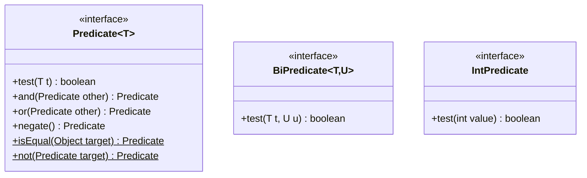
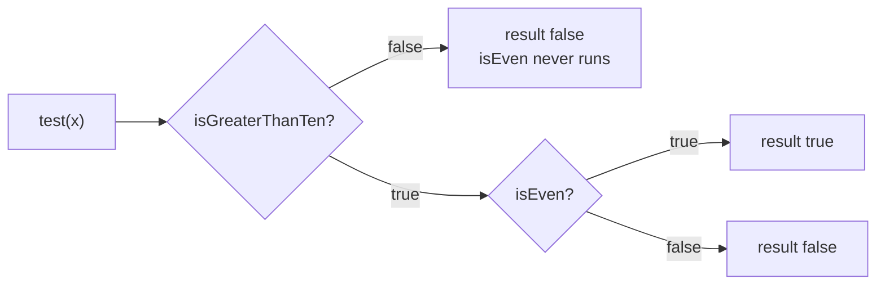

## In One Line
`Predicate<T>` is the built-in functional interface for a **yes/no question about a value** — its one abstract method is `boolean test(T t)` — and it comes with `and`, `or`, `negate`, `isEqual` and `not` so you can build complex conditions out of small, reusable ones.

## Mental Model
Think of an **airport security checkpoint**. Each check is a gate that answers one question: "Is the bag under 7 kg?", "Is there a boarding pass?", "Are liquids under 100 ml?". Each gate says **yes or no**, and gates can be lined up:

- A gate is a `Predicate<Passenger>`; walking through it is `test(passenger)`.
- **Two gates in a row** where both must say yes is `gateA.and(gateB)`. If the first says no, you never reach the second (short-circuit).
- **Either gate is enough** (fast-track *or* business class) is `gateA.or(gateB)`.
- **The opposite gate** ("NOT on the no-fly list") is `gate.negate()`.
- The **crowd filtering** through the checkpoint is `stream.filter(gate)`: only those who get a "yes" continue.

The gates never change the passenger — they only answer. That is the contract of a predicate: no side effects, just `true` or `false`.

## Concept
### The interface
```java
@FunctionalInterface
public interface Predicate<T> {
    boolean test(T t);                                           // the one abstract method

    default Predicate<T> and(Predicate<? super T> other) { ... } // this && other
    default Predicate<T> or(Predicate<? super T> other)  { ... } // this || other
    default Predicate<T> negate()                        { ... } // !this

    static <T> Predicate<T> isEqual(Object targetRef)    { ... } // Java 8
    static <T> Predicate<T> not(Predicate<? super T> target) { ... } // Java 11
}
```
Descriptor: `T -> boolean`. It lives in `java.util.function` (Java 8).

### What each method does (and how the JDK implements it)
| Method | Returns | JDK implementation (simplified) | Notes |
|---|---|---|---|
| `test(T t)` | `boolean` | *you write it* | The question itself. |
| `and(other)` | new `Predicate<T>` | `Objects.requireNonNull(other); return t -> test(t) && other.test(t);` | Short-circuits: if `this` is false, `other` is **not evaluated**. |
| `or(other)` | new `Predicate<T>` | `Objects.requireNonNull(other); return t -> test(t) \|\| other.test(t);` | Short-circuits: if `this` is true, `other` is not evaluated. |
| `negate()` | new `Predicate<T>` | `return t -> !test(t);` | Logical NOT. |
| `Predicate.isEqual(target)` | `Predicate<T>` | `target == null ? Objects::isNull : obj -> target.equals(obj)` | Uses `equals`, not `==`; null-safe. |
| `Predicate.not(p)` (Java 11) | `Predicate<T>` | `Objects.requireNonNull(p); return (Predicate<T>) p.negate();` | Lets you negate a method reference inline. |

Key facts:
- **Composition never evaluates anything.** `and`, `or` and `negate` just build a new predicate object that remembers the two parts. The work happens when you call `test`.
- **`null` arguments fail fast.** `isEven.and(null)` throws `NullPointerException` immediately, at composition time, not at `test` time.
- **Order matters for safety.** `notNull.and(notEmpty).test(null)` is `false` (the second check never runs). `notEmpty.and(notNull).test(null)` throws `NullPointerException`, because `notEmpty` runs first and calls `null.isEmpty()`. Put the cheap and guarding checks first — exactly as with `&&`.
- **Chaining is left to right, not by operator precedence.** `a.or(b).and(c)` means `(a || b) && c`, while the Java expression `a || b && c` means `a || (b && c)` because `&&` binds tighter. With `x = 101`, `a = x > 100`, `b = x > 0`, `c = even`, the first gives `false` and the second `true`. Use nesting (`a.or(b.and(c))`) to get the other grouping.
- **Wildcards:** `and(Predicate<? super T>)` lets a `Predicate<String>` combine with a more general `Predicate<Object>` (e.g. `isEmpty.and(Objects::nonNull)`), but not the other way round: `Predicate<Object>.and(Predicate<String>)` does not compile ("Predicate<String> cannot be converted to Predicate<? super Object>").

### Negating a method reference: why `Predicate.not` was added
A method reference has no type until it has a target, so you cannot call a method on it:
```text
Predicate<String> p = String::isEmpty.negate();
error: method reference not expected here
```
In Java 8 you needed a cast: `((Predicate<String>) String::isEmpty).negate()` or a lambda `s -> !s.isEmpty()`. Java 11 added `Predicate.not`, which reads naturally inside a stream:
```java
words.stream().filter(Predicate.not(String::isBlank))   // with a static import: filter(not(String::isBlank))
```

### The Predicate family
| Interface | Abstract method | Default methods | Static methods |
|---|---|---|---|
| `Predicate<T>` | `boolean test(T t)` | `and`, `or`, `negate` | `isEqual`, `not` |
| `BiPredicate<T,U>` | `boolean test(T t, U u)` | `and`, `or`, `negate` | — |
| `IntPredicate` | `boolean test(int value)` | `and`, `or`, `negate` | — |
| `LongPredicate` | `boolean test(long value)` | `and`, `or`, `negate` | — |
| `DoublePredicate` | `boolean test(double value)` | `and`, `or`, `negate` | — |

- `BiPredicate` tests two values together: `(s, len) -> s.length() == len`. The JDK uses it in `Files.find(path, depth, BiPredicate<Path, BasicFileAttributes>)`.
- The primitive versions avoid boxing. `Predicate<Integer>` boxes every `int` (`Integer.valueOf`) and unboxes it in the body; `IntPredicate` works on raw `int` and is what `IntStream.filter` takes.
- There is **no** `isEqual`/`not` on the primitive and `Bi` versions, and there is no `BooleanPredicate`, `CharPredicate` or `TriPredicate`.

### Where predicates are used in the JDK
| API | Signature | What it does |
|---|---|---|
| `Stream.filter` | `filter(Predicate<? super T>)` | Keeps elements that pass. |
| `Stream.anyMatch / allMatch / noneMatch` | `(Predicate<? super T>)` | Short-circuiting terminal checks. On an **empty** stream `allMatch` and `noneMatch` return `true`, `anyMatch` returns `false`. |
| `Stream.takeWhile / dropWhile` (Java 9) | `(Predicate<? super T>)` | Take / skip the leading run of elements that pass. |
| `Collection.removeIf` | `removeIf(Predicate<? super E>)` | Removes matching elements in place; returns `true` if anything was removed. |
| `Optional.filter` | `filter(Predicate<? super T>)` | Keeps the value only if it passes, else `Optional.empty()`. |
| `Collectors.partitioningBy` | `partitioningBy(Predicate<? super T>)` | Splits into `{false=[...], true=[...]}`. |
| `Collectors.filtering` (Java 9) | `filtering(Predicate, downstream)` | Filters inside a `groupingBy`. |
| `Pattern.asPredicate()` / `asMatchPredicate()` (Java 11) | returns `Predicate<String>` | `find()` anywhere vs `matches()` the whole string. |
| `Stream.iterate(seed, hasNext, next)` (Java 9) | `Predicate<? super T> hasNext` | Loop-style stream with a stop condition. |

### Designing with predicates
- **Name them.** `Predicate<Order> isOverdue = o -> o.dueDate().isBefore(today);` makes `orders.stream().filter(isOverdue.and(isUnpaid))` read like a sentence. This is the **Specification pattern** in miniature.
- **Keep them pure.** A predicate should not modify anything or depend on mutable external state; streams may call it in any order, several times, or in parallel.
- **Build rules dynamically:** `Predicate<T> all = rules.stream().reduce(x -> true, Predicate::and);` combines a list of rules into one.

## Diagram

One abstract method (`test`); every other method builds a new predicate. Static methods are underlined/marked with `$`. The `Bi` and primitive versions have `and`/`or`/`negate` but no static helpers.


`isGreaterThanTen.and(isEven)` evaluates like `&&`: the second predicate runs only when the first one is true.

## Code
@example Java8Features/FunctionalInterfaces/PredicateExample.java

A tour of every `Predicate` method and the main places the JDK uses it:
```java
import java.util.*;
import java.util.function.*;
import java.util.stream.*;

public class PredicateTour {
    public static void main(String[] args) {
        Predicate<Integer> isGreaterThanTen = n -> n > 10;
        Predicate<Integer> isEven = n -> n % 2 == 0;

        // default methods: and, or, negate
        System.out.println(isGreaterThanTen.and(isEven).test(12));   // true && true
        System.out.println(isGreaterThanTen.and(isEven).test(15));   // true && false
        System.out.println(isGreaterThanTen.or(isEven).test(4));     // false || true
        System.out.println(isGreaterThanTen.negate().test(15));      // !true

        // static methods: isEqual (Java 8) and not (Java 11)
        Predicate<String> isJava = Predicate.isEqual("Java");
        System.out.println(isJava.test("Java") + " " + isJava.test(null));
        List<String> words = List.of("a", " ", "", "b");
        System.out.println(words.stream().filter(Predicate.not(String::isBlank)).toList());

        // where predicates are used
        List<Integer> nums = new ArrayList<>(List.of(5, 12, 18, 7, 30));
        nums.removeIf(isGreaterThanTen.negate());                              // Collection.removeIf
        System.out.println(nums);
        System.out.println(Stream.of(3, 14, 22, 9).filter(isGreaterThanTen).toList());  // Stream.filter
        System.out.println(nums.stream().anyMatch(isEven) + " "
                + nums.stream().allMatch(isEven) + " "
                + nums.stream().noneMatch(isGreaterThanTen));
        System.out.println(Stream.of(3, 14, 22, 9).collect(Collectors.partitioningBy(isGreaterThanTen)));
        System.out.println(Stream.of(12, 15, 4, 20).takeWhile(isGreaterThanTen).toList() + " "
                + Stream.of(12, 15, 4, 20).dropWhile(isGreaterThanTen).toList());   // Java 9
        System.out.println(Optional.of(15).filter(isGreaterThanTen) + " " + Optional.of(5).filter(isGreaterThanTen));

        // BiPredicate and IntPredicate
        BiPredicate<String, Integer> hasLength = (s, len) -> s.length() == len;
        System.out.println(hasLength.test("four", 4) + " " + hasLength.negate().test("four", 4));
        IntPredicate positive = i -> i > 0;
        System.out.println(IntStream.rangeClosed(-2, 3).filter(positive.and(i -> i % 2 == 1)).boxed().toList());
    }
}
```
```output
true
false
true
false
true false
[a, b]
[12, 18, 30]
[14, 22]
true true false
{false=[3, 9], true=[14, 22]}
[12, 15] [4, 20]
Optional[15] Optional.empty
true false
[1, 3]
```

Short-circuiting, and why `a.or(b).and(c)` is not `a || b && c`:
```java
import java.util.function.*;

public class ShortCircuit {
    public static void main(String[] args) {
        Predicate<String> notNull = s -> { System.out.println("  notNull?"); return s != null; };
        Predicate<String> notEmpty = s -> { System.out.println("  notEmpty?"); return !s.isEmpty(); };
        System.out.println("null -> " + notNull.and(notEmpty).test(null));
        System.out.println("\"hi\" -> " + notNull.and(notEmpty).test("hi"));

        // chaining builds left to right; it does NOT follow && / || precedence
        Predicate<Integer> a = n -> n > 100;
        Predicate<Integer> b = n -> n > 0;
        Predicate<Integer> c = n -> n % 2 == 0;
        int x = 101;
        System.out.println(a.or(b).and(c).test(x));        // (a || b) && c
        System.out.println(a.or(b.and(c)).test(x));        // a || (b && c)
        System.out.println(x > 100 || x > 0 && x % 2 == 0); // && binds tighter than ||
    }
}
```
```output
  notNull?
null -> false
  notNull?
  notEmpty?
"hi" -> true
false
true
true
```

## Walkthrough
- `import java.util.function.Predicate;` — the interface lives in `java.util.function`, added in Java 8.
- `Predicate<Integer> isGreaterThanTen = number -> number > 10;` — the lambda implements `boolean test(Integer number)`. `T` is `Integer` (generics cannot use `int`), so inside the body `number > 10` **auto-unboxes** the `Integer`. The comment "Predicate to check if a number is greater than 10" describes it exactly.
- `int testNumber = 15;` — a primitive `int`.
- `isGreaterThanTen.test(testNumber)` — "Test the predicate". The `int` is **auto-boxed** to `Integer.valueOf(15)` to fit `test(Integer)`, then the body runs: `15 > 10` → `true`.
- The `if/else` uses the boolean: the `true` branch prints `15 is greater than 10` (the recorded output, matching the `// Output:` comment). With `testNumber = 10` the `else` branch would print `10 is not greater than 10`, because `>` excludes 10.
- Only one of the interface's six methods is used here (`test`). The Code section above shows the other five (`and`, `or`, `negate`, `isEqual`, `not`) and the APIs that accept predicates.

> [!NOTE] The boxing round-trip is harmless here, but in a hot loop or a large stream prefer `IntPredicate isGreaterThanTen = n -> n > 10;` — same lambda text, no `Integer` objects.

## Traps
- **`Predicate<Integer>` and `null`.** `isGreaterThanTen.test(null)` throws `NullPointerException` when the body unboxes `null` for `number > 10`.
- **Order of `and` is a null guard.** `notEmpty.and(notNull).test(null)` throws; `notNull.and(notEmpty).test(null)` returns `false`. Put the guard first.
- **Fluent chaining ignores `&&`-over-`||` precedence.** `a.or(b).and(c)` is `(a || b) && c`. Nest explicitly when you mean `a || (b && c)`.
- **`and(null)` / `or(null)` / `Predicate.not(null)` throw `NullPointerException` immediately**, at composition time.
- **You cannot call `.negate()` on a method reference directly** (`String::isEmpty.negate()` → "method reference not expected here"). Use `Predicate.not(String::isEmpty)` (Java 11) or a cast.
- **Empty streams:** `allMatch` → `true` and `noneMatch` → `true` (vacuous truth), `anyMatch` → `false`. Code like "if all orders are paid, ship" ships an empty order list.
- **`Predicate.isEqual` uses `equals`**, not `==`: `Predicate.isEqual(new String("Java")).test("Java")` is `true`.
- **Side effects in predicates** (counting, logging, modifying) make streams unpredictable — `filter` may be skipped by short-circuit operations or run in parallel.
- **`removeIf` on an immutable list** (`List.of(...)`) throws `UnsupportedOperationException` — copy into an `ArrayList` first, as the tour does.

## Tips & Tricks
- **Memory hook: "Predicate = Test → boolean".** P for *Proposition*: something that is true or false about a value.
- **Composition cheat sheet:** `and` = `&&`, `or` = `||`, `negate` = `!`, `not(p)` = `!p` for method references, `isEqual(x)` = `Objects.equals(x, value)`.
- **Guard first, expensive last:** `notNull.and(cheapCheck).and(databaseCheck)` — short-circuiting saves the expensive work.
- Static-import `java.util.function.Predicate.not` and write `filter(not(String::isBlank))`.
- Use `IntPredicate` / `LongPredicate` / `DoublePredicate` with primitive streams and large loops.
- Combine a dynamic list of rules with `rules.stream().reduce(x -> true, Predicate::and)` (or `x -> false, Predicate::or`).
- When a filter lambda gets long, name it: `Predicate<Order> isOverdue = ...;` — reusable, testable, readable.

## Interview Q&A
### [Basic] What is `Predicate` in Java 8?
A functional interface in `java.util.function` whose abstract method is `boolean test(T t)`. It represents a condition on one value. It has default methods `and`, `or` and `negate` for composing conditions, and static methods `isEqual` (Java 8) and `not` (Java 11). It is used by `Stream.filter`, `anyMatch`/`allMatch`/`noneMatch`, `Collection.removeIf`, `Optional.filter`, `Collectors.partitioningBy` and more.

**Follow-up:** *Why not just use `Function<T, Boolean>`?* — `Predicate` returns a primitive `boolean` (no boxing), has a clearer name, and ships with the composition methods.

### [Basic] How do `and`, `or` and `negate` work?
Each returns a **new** predicate without evaluating anything. `p.and(q)` returns `t -> p.test(t) && q.test(t)`, `p.or(q)` returns `t -> p.test(t) || q.test(t)`, and `p.negate()` returns `t -> !p.test(t)`. Because they use `&&` and `||`, they short-circuit: in `p.and(q)` the second predicate is not evaluated when the first is false. Passing `null` to `and`/`or` throws `NullPointerException` immediately.

**Follow-up:** *Does `p.and(q)` modify `p`?* — No. Predicates are typically immutable; composition creates a new object that holds references to `p` and `q`.

### [Basic] What is the difference between `Predicate` and `BiPredicate`?
`Predicate<T>` tests one value: `boolean test(T t)`. `BiPredicate<T, U>` tests two values together: `boolean test(T t, U u)` — e.g. `(name, minLength) -> name.length() >= minLength`. Both have `and`, `or`, `negate`; only `Predicate` has the static `isEqual` and `not`. `Files.find` is a JDK method that takes a `BiPredicate<Path, BasicFileAttributes>`.

**Follow-up:** *Is there a predicate with three arguments?* — No; define your own functional interface or pass an object that groups the values.

### [Intermediate] Why and when would you use `IntPredicate` instead of `Predicate<Integer>`?
`Predicate<Integer>` works on `Integer` objects, so every `int` is boxed on the way in and unboxed in the body — extra allocation and indirection, and a `NullPointerException` risk. `IntPredicate` has `boolean test(int value)` and works on raw `int`s. Use it with `IntStream.filter`, in hot loops, and whenever values are naturally primitive. Likewise `LongPredicate`, `DoublePredicate`.

**Follow-up:** *Can you pass an `IntPredicate` to `Stream<Integer>.filter`?* — No, `filter` wants a `Predicate<? super Integer>`; they are unrelated interfaces. Use a method reference `ip::test` to adapt it.

### [Intermediate] What does `Predicate.not` solve?
Negating a method reference inline. A method reference has no type until it has a target, so `String::isBlank.negate()` does not compile ("method reference not expected here"). Before Java 11 you had to write `s -> !s.isBlank()` or cast `((Predicate<String>) String::isBlank).negate()`. Java 11's `Predicate.not(String::isBlank)` infers the type from the argument and returns the negation: `lines.stream().filter(not(String::isBlank))`.

**Follow-up:** *What does `Predicate.isEqual(null)` return?* — A predicate equivalent to `Objects::isNull`; otherwise `isEqual(x)` tests with `x.equals(value)`.

### [Intermediate] What does `a.or(b).and(c)` evaluate to — `(a || b) && c` or `a || (b && c)`?
`(a || b) && c`. Fluent calls are applied left to right: `a.or(b)` builds a new predicate, and `.and(c)` wraps that whole predicate. This differs from Java's operator precedence, where `a || b && c` means `a || (b && c)`. With `x = 101`, `a = x > 100`, `b = x > 0`, `c = x is even`, the fluent chain gives `false` and the expression gives `true`. To get the other grouping, nest: `a.or(b.and(c))`.

**Follow-up:** *How would you combine a `List<Predicate<T>>` into one?* — `list.stream().reduce(t -> true, Predicate::and)` for "all", or `reduce(t -> false, Predicate::or)` for "any".

### [Intermediate] What do `allMatch`, `anyMatch` and `noneMatch` return on an empty stream, and why?
`allMatch` → `true`, `noneMatch` → `true`, `anyMatch` → `false`. This is vacuous truth: "every element passes" is true when there are no elements; "some element passes" is false. All three are short-circuiting — `anyMatch` stops at the first `true`, `allMatch` at the first `false`.

**Follow-up:** *Why could that be a bug?* — `if (orders.stream().allMatch(Order::isPaid)) ship();` ships when the list is empty. Check `!orders.isEmpty()` too.

### [Advanced] Why are the parameters of `and`/`or` declared as `Predicate<? super T>`?
For flexibility (PECS — a predicate *consumes* `T`, so it is a consumer and uses `super`). Any predicate that can test a supertype of `T` can also test a `T`. So `Predicate<String> nonEmpty = s -> !s.isEmpty(); nonEmpty.and(Objects::nonNull)` works where the second is a `Predicate<Object>`. The reverse, `Predicate<Object>.and(Predicate<String>)`, is rejected because a `Predicate<String>` cannot test an arbitrary `Object`.

**Follow-up:** *What is the return type of `nonEmpty.and(...)`?* — `Predicate<String>`: the result keeps the receiver's `T`.

### [Advanced] Should a predicate have side effects? What can go wrong in streams?
No. Stream operations are specified in terms of stateless, non-interfering functions. A predicate that counts, logs or mutates state may be called in an unexpected order (parallel streams), fewer times than you expect (short-circuiting like `anyMatch`, `limit`, `takeWhile`), or not at all (a pipeline without a terminal operation). Mutating the stream's source inside a predicate can throw `ConcurrentModificationException`. Keep predicates pure; if you need counts, use the stream's own terminal operations.

**Follow-up:** *Is `removeIf` safe while iterating?* — Yes, `removeIf` is the safe alternative to removing in a for-each loop, which throws `ConcurrentModificationException`.

## Quiz
### What does this print?
```java
Predicate<String> longWord = s -> s.length() > 3;
Predicate<String> startsA = s -> s.startsWith("a");
System.out.println(longWord.negate().or(startsA).test("apple"));
```
- [x] true
- [ ] false
- [ ] Compile error: `negate()` cannot be chained
- [ ] NullPointerException
> `longWord.test("apple")` is true, so `negate()` gives false; `or(startsA)` then checks `"apple".startsWith("a")` → true. `false || true` is `true`. Composition methods return new predicates, so chaining compiles.

### What does this print?
```java
Predicate<String> notEmpty = s -> !s.isEmpty();
Predicate<String> notNull  = Objects::nonNull;
System.out.println(notNull.and(notEmpty).test(null));
```
- [ ] true
- [x] false
- [ ] NullPointerException
- [ ] Compile error
> `and` short-circuits: `notNull.test(null)` is false, so `notEmpty` never runs and `null.isEmpty()` is never called. Reversing the order (`notEmpty.and(notNull)`) would throw `NullPointerException` — that is the trap.

### With `x = 101`, `a = n > 100`, `b = n > 0`, `c = n % 2 == 0`, what is `a.or(b).and(c).test(x)`?
- [x] false
- [ ] true
- [ ] It depends on JVM optimisation
- [ ] Compile error: `or` returns boolean
> Fluent chaining builds `(a || b) && c` = `(true || true) && false` = `false`. The tempting `true` comes from reading it like the Java expression `a || b && c`, where `&&` binds first.

### What does this print?
```java
System.out.println(Stream.<Integer>empty().allMatch(n -> n > 0) + " "
        + Stream.<Integer>empty().anyMatch(n -> n > 0));
```
- [ ] false false
- [x] true false
- [ ] true true
- [ ] NoSuchElementException
> On an empty stream, "all elements pass" is vacuously true, and "some element passes" is false. No exception is thrown; there is simply nothing to test.

### Spot the bug
```java
Predicate<String> notBlank = String::isBlank.negate();
```
- [ ] `isBlank` does not exist
- [x] A method reference has no type until it has a target, so `.negate()` cannot be called on it
- [ ] `negate()` is a static method
- [ ] `Predicate` has no `negate` method
> javac reports "method reference not expected here". Fix: `Predicate.not(String::isBlank)` (Java 11), `s -> !s.isBlank()`, or `((Predicate<String>) String::isBlank).negate()`. `negate()` is a default (instance) method, not static.

### What does this print?
```java
List<Integer> list = new ArrayList<>(List.of(1, 2, 3, 4, 5, 6));
boolean changed = list.removeIf(n -> n % 3 == 0);
System.out.println(changed + " " + list);
```
- [ ] false [1, 2, 4, 5]
- [x] true [1, 2, 4, 5]
- [ ] true [3, 6]
- [ ] ConcurrentModificationException
> `removeIf` removes every element for which the predicate is **true** (3 and 6) and returns `true` because something was removed. It keeps the others — it is the opposite of `filter`, which keeps the matching ones. It is the safe way to remove while iterating.

### Which method is NOT available on `IntPredicate`?
- [ ] `and`
- [ ] `or`
- [ ] `negate`
- [x] `not`
> The primitive and `Bi` predicates have only the three default methods. `isEqual` and `not` are static methods that exist only on `Predicate<T>`.

## Takeaways
- `Predicate<T>` = `boolean test(T t)`: a side-effect-free yes/no check on one value.
- Default methods `and`, `or`, `negate` build new predicates and short-circuit like `&&`, `||`, `!`; `null` arguments throw `NullPointerException` immediately.
- Static helpers: `Predicate.isEqual(x)` (uses `equals`, null-safe) and `Predicate.not(p)` (Java 11, negates method references inline).
- Fluent chains evaluate left to right: `a.or(b).and(c)` is `(a || b) && c`, not Java's `a || (b && c)`; put null guards first.
- Family: `BiPredicate<T,U>` for two inputs, `IntPredicate`/`LongPredicate`/`DoublePredicate` to avoid boxing (no static helpers on those).
- Used by `filter`, `anyMatch`/`allMatch`/`noneMatch` (empty stream: true/true/false), `takeWhile`/`dropWhile`, `removeIf`, `Optional.filter`, `partitioningBy`.
