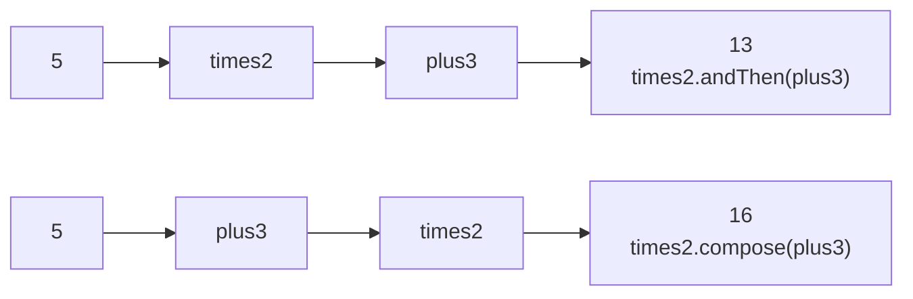
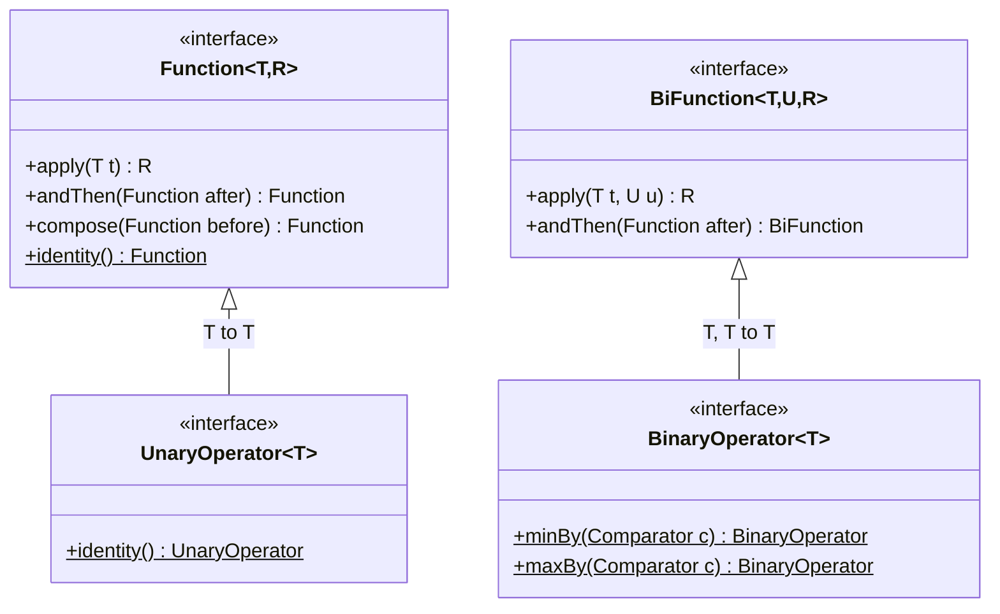

## In One Line
`Function<T, R>` is the built-in functional interface for **turning one value into another** — its one abstract method is `R apply(T t)` — and its `andThen`, `compose` and `identity` methods let you snap small transformations together into pipelines.

## Mental Model
Think of a **machine on a factory line**. Raw material goes in one side, a product comes out the other: a *cutter* turns a log into planks, a *painter* turns planks into painted planks.

- One machine is a `Function<T, R>`: input type `T` (log), output type `R` (planks). Running it is `apply(log)`.
- **Bolting a second machine after the first** is `cutter.andThen(painter)`: the output of the first becomes the input of the second.
- **Bolting a machine in front** is `painter.compose(cutter)`: same line, described from the other end — "before painting, cut".
- A **conveyor belt with no machine** is `Function.identity()`: what goes in comes out unchanged. Useful when an API insists on a machine but you want the item itself.

In the example, the machine `stringLength` takes a `String` and outputs its length as an `Integer`: `"Hello, World!"` in, `13` out.

## Concept
### The interface
```java
@FunctionalInterface
public interface Function<T, R> {
    R apply(T t);                                                      // the one abstract method

    default <V> Function<V, R> compose(Function<? super V, ? extends T> before) {
        Objects.requireNonNull(before);
        return (V v) -> apply(before.apply(v));                         // before first, then this
    }
    default <V> Function<T, V> andThen(Function<? super R, ? extends V> after) {
        Objects.requireNonNull(after);
        return (T t) -> after.apply(apply(t));                          // this first, then after
    }
    static <T> Function<T, T> identity() {
        return t -> t;
    }
}
```
Descriptor: `T -> R`. The input and output types may be the same (`Function<Integer,Integer>`) or different (`Function<String,Integer>`).

### `andThen` vs `compose` — the most-asked detail
| Call | Means | Mathematical notation | Example with `times2`, `plus3` on 5 |
|---|---|---|---|
| `f.andThen(g)` | run `f`, then `g` on the result | `g(f(x))` | `times2.andThen(plus3)` → (5×2)+3 = **13** |
| `f.compose(g)` | run `g`, then `f` on the result | `f(g(x))` = f ∘ g | `times2.compose(plus3)` → (5+3)×2 = **16** |

- `andThen` reads in **execution order** ("do this, and then that"); `compose` reads like maths ("f of g of x").
- Types flow through the chain: `Function<String,Integer> length` `.andThen(Function<Integer,String> stars)` gives a `Function<String,String>`. The generic signatures (`? super R`, `? extends V`) are what make mixed types line up.
- Both reject `null` immediately with `NullPointerException` (they call `Objects.requireNonNull`).
- Neither runs anything; they return a new function. Work happens on `apply`.

### `Function.identity()`
Returns a function that returns its argument unchanged (`t -> t`). You need it when an API demands a `Function` but you want the element itself:
- `Collectors.toMap(Function.identity(), String::length)` — key is the word itself.
- `Collectors.groupingBy(Function.identity(), Collectors.counting())` — count duplicates.
- As the starting value when reducing a list of functions: `steps.stream().reduce(Function.identity(), Function::andThen)`.

`x -> x` works too. `Function.identity()` names the intent and, on HotSpot, returns the same object every time (`Function.identity() == Function.identity()` printed `true`) — an implementation detail. Note `UnaryOperator.identity()` exists as well and returns a `UnaryOperator<T>`.

### The Function family
| Interface | Abstract method | Shape | Defaults / statics |
|---|---|---|---|
| `Function<T,R>` | `R apply(T t)` | T → R | `andThen`, `compose`, `identity()` |
| `BiFunction<T,U,R>` | `R apply(T t, U u)` | (T, U) → R | `andThen` only |
| `UnaryOperator<T>` | `T apply(T t)` (inherited) | T → T | extends `Function<T,T>`; `identity()` — see [UnaryOperator](lesson:a05-java8/08-unary-operator) |
| `BinaryOperator<T>` | `T apply(T t1, T t2)` (inherited) | (T, T) → T | extends `BiFunction<T,T,T>`; `minBy`, `maxBy` — see [BinaryOperator](lesson:a05-java8/09-binary-operator) |
| `IntFunction<R>`, `LongFunction<R>`, `DoubleFunction<R>` | `R apply(int value)` ... | primitive → R | none |
| `ToIntFunction<T>`, `ToLongFunction<T>`, `ToDoubleFunction<T>` | `int applyAsInt(T value)` ... | T → primitive | none |
| `ToIntBiFunction<T,U>`, `ToLongBiFunction`, `ToDoubleBiFunction` | `int applyAsInt(T t, U u)` ... | (T, U) → primitive | none |
| `IntToLongFunction`, `IntToDoubleFunction`, `LongToIntFunction`, `LongToDoubleFunction`, `DoubleToIntFunction`, `DoubleToLongFunction` | `long applyAsLong(int value)` ... | primitive → other primitive | none |

Points to remember:
- **Why `BiFunction` has no `compose`:** `compose` would have to run a function *before* this one and feed its result in, but one function returns one value while a `BiFunction` needs two inputs. `andThen` is fine: the `BiFunction` produces one result that a plain `Function` can transform.
- **Primitive versions use different method names** (`applyAsInt`, `applyAsLong`, `applyAsDouble`) so that one class can implement several of them without clashes, and they have **no** `andThen`/`compose`.
- **Why they exist:** `Function<String,Integer>` boxes the length into an `Integer`; `ToIntFunction<String>` returns a raw `int`. `Stream.mapToInt(ToIntFunction)` produces an `IntStream`, whose `sum()`, `average()` and `max()` avoid boxing.

### Where functions are used in the JDK
| API | Parameter | Example |
|---|---|---|
| `Stream.map` | `Function<? super T, ? extends R>` | `words.stream().map(String::length)` |
| `Stream.flatMap` | `Function<? super T, ? extends Stream<? extends R>>` | `lines.flatMap(l -> Arrays.stream(l.split(" ")))` |
| `Stream.mapToInt / mapToLong / mapToDouble` | `ToIntFunction` ... | `words.stream().mapToInt(String::length).sum()` |
| `IntStream.mapToObj` | `IntFunction<R>` | `IntStream.range(0, 3).mapToObj(i -> "#" + i)` |
| `Comparator.comparing` | key extractor `Function<? super T, ? extends U>` | `Comparator.comparing(String::length)` |
| `Collectors.toMap`, `groupingBy`, `mapping` | key/value mappers | `groupingBy(String::length)` |
| `Map.computeIfAbsent` | `Function<? super K, ? extends V>` | `map.computeIfAbsent(k, x -> new ArrayList<>()).add(v)` |
| `Map.computeIfPresent`, `compute`, `merge`, `replaceAll` | `BiFunction` | `map.merge(word, 1, Integer::sum)` |
| `Optional.map` / `flatMap` | `Function` | `opt.map(String::length).orElse(0)` |
| `CompletableFuture.thenApply` | `Function` | `future.thenApply(String::trim)` |
| `String.transform` (Java 12) | `Function<? super String, ? extends R>` | `"hello".transform(String::toUpperCase)` |

### Good functional style
- **Pure functions**: the same input always gives the same output and nothing else changes. Pure functions are easy to test, cache, compose and run in parallel.
- **Small and composable**: `normalize.andThen(validate).andThen(format)` reads like a spec, and each piece can be unit-tested alone.
- **Higher-order functions** — functions that take or return functions — are ordinary Java methods: `static Function<Integer,Integer> adder(int n) { return x -> x + n; }`.
- **Memoisation with `computeIfAbsent`** works for non-recursive functions. For recursive ones (Fibonacci), a `HashMap` throws `ConcurrentModificationException` (Java 9+) because the mapping function modifies the map while it is being computed — use an explicit `get`/`put` or an array.

## Diagram

`andThen` runs the receiver first; `compose` runs the argument first. Same two functions, different order, different result.


The operators are just functions whose input and output types are the same; everything else is inherited.

## Code
@example Java8Features/FunctionalInterfaces/FunctionExample.java

Every `Function` method, the primitive versions, and the main APIs that take a function:
```java
import java.util.*;
import java.util.function.*;
import java.util.stream.*;

public class FunctionTour {
    public static void main(String[] args) {
        Function<Integer, Integer> times2 = x -> x * 2;
        Function<Integer, Integer> plus3  = x -> x + 3;
        System.out.println(times2.andThen(plus3).apply(5));  // plus3(times2(5)) = 13
        System.out.println(times2.compose(plus3).apply(5));  // times2(plus3(5)) = 16

        // types can change along the chain: String -> Integer -> String
        Function<String, Integer> length = String::length;
        Function<Integer, String> stars = n -> "*".repeat(n);
        Function<String, String> masked = length.andThen(stars);
        System.out.println(masked.apply("secret"));

        // identity()
        Map<String, Integer> byWord = Stream.of("apple", "kiwi", "banana")
                .collect(Collectors.toMap(Function.identity(), String::length));
        System.out.println(new TreeMap<>(byWord));

        // BiFunction has andThen (but no compose)
        BiFunction<Integer, Integer, Integer> multiply = (a, b) -> a * b;
        System.out.println(multiply.andThen(r -> "result=" + r).apply(6, 7));

        // primitive specialisations
        ToIntFunction<String> len2 = String::length;           // T -> int
        IntFunction<String> repeatX = n -> "x".repeat(n);      // int -> R
        IntToDoubleFunction half = n -> n / 2.0;              // int -> double
        ToDoubleBiFunction<Integer, Integer> avg = (p, q) -> (p + q) / 2.0;
        System.out.println(len2.applyAsInt("abcd") + " " + repeatX.apply(3) + " "
                + half.applyAsDouble(7) + " " + avg.applyAsDouble(3, 4));

        // Functions in the Stream API
        List<String> words = List.of("java", "is", "fun");
        System.out.println(words.stream().map(String::length).toList());            // map(Function)
        System.out.println(words.stream().mapToInt(String::length).sum());          // mapToInt(ToIntFunction)
        System.out.println(words.stream().sorted(Comparator.comparing(String::length)).toList());
        Map<Integer, List<String>> byLen = words.stream()
                .collect(Collectors.groupingBy(String::length, TreeMap::new, Collectors.toList()));
        System.out.println(byLen);

        // a pipeline built from a list of functions
        List<Function<Integer, Integer>> steps = List.of(times2, plus3, x -> x * x);
        Function<Integer, Integer> pipeline = steps.stream().reduce(Function.identity(), Function::andThen);
        System.out.println(pipeline.apply(1));   // ((1*2)+3)^2 = 25

        // Map.computeIfAbsent and Optional.map take a Function
        Map<Integer, List<String>> groups = new TreeMap<>();
        for (String w : List.of("a", "bb", "cc", "d")) {
            groups.computeIfAbsent(w.length(), k -> new ArrayList<>()).add(w);
        }
        System.out.println(groups);
        System.out.println(Optional.of("Hello, World!").map(String::length).orElse(0));
    }
}
```
```output
13
16
******
{apple=5, banana=6, kiwi=4}
result=42
4 xxx 3.5 3.5
[4, 2, 3]
9
[is, fun, java]
{2=[is], 3=[fun], 4=[java]}
25
{1=[a, d], 2=[bb, cc]}
13
```

## Walkthrough
- `import java.util.function.Function;` — the interface from `java.util.function` (Java 8).
- `Function<String, Integer> stringLength = str -> str.length();` — "Function to convert a string to its length". Type arguments: `T = String` (input), `R = Integer` (output). The lambda implements `Integer apply(String str)`; `str.length()` returns an `int`, which is **auto-boxed** to `Integer` because `R` must be a reference type. The idiomatic form is the method reference `String::length`.
- `String testString = "Hello, World!";` — 13 characters: `Hello` (5) + `,` + space + `World` (5) + `!`.
- `int length = stringLength.apply(testString);` — "Apply the function". `apply` returns an `Integer`, which is **auto-unboxed** into the `int` variable. If the function ever returned `null`, this line would throw `NullPointerException`.
- `System.out.println("The length of \"" + testString + "\" is " + length);` — `\"` is an escaped double quote inside a string literal, which is why the output shows the text in quotes: `The length of "Hello, World!" is 13`. This matches the recorded output and the `// Output:` comment.
- The example uses only `apply`. The tour above adds `andThen`, `compose`, `identity`, `BiFunction.andThen`, the primitive versions and the stream APIs.

> [!NOTE] For a pure `String -> int` conversion, `ToIntFunction<String> stringLength = String::length;` with `applyAsInt` avoids the boxing round trip (`int` → `Integer` → `int`). Use `Function<String,Integer>` when you need `andThen`/`compose` or an API that expects a `Function`.

## Traps
- **Mixing up `andThen` and `compose`.** `f.andThen(g)` = `g(f(x))`; `f.compose(g)` = `f(g(x))`. With `times2`/`plus3` on 5 you get 13 vs 16 — test with numbers where the order matters.
- **Unboxing `null`.** `int n = lookup.apply("x");` throws `NullPointerException` if the function returns `null`.
- **`BiFunction` has no `compose`**, and the primitive functions (`IntFunction`, `ToIntFunction`, ...) have no `andThen`/`compose` at all.
- **Primitive method names differ:** `ToIntFunction.applyAsInt`, not `apply`. `IntFunction<R>` is *int in*, `ToIntFunction<T>` is *int out* — easy to swap.
- **Side effects in `map`.** `stream.map(x -> { list.add(x); return x; })` breaks with parallel streams and when operations are short-circuited. Use `collect`.
- **Recursive `computeIfAbsent`** (memoised Fibonacci) on a `HashMap` throws `ConcurrentModificationException` on Java 9+ — the mapping function must not modify the map.
- **Overload inference surprises.** `System.out.println("hello".transform(String::toUpperCase))` fails to compile ("reference to println is ambiguous" between `println(char[])` and `println(String)`), because the generic `R` could be either. Assign to a `String` variable first.
- **`toMap(Function.identity(), ...)` throws `IllegalStateException` on duplicate keys** unless you pass a merge function.

## Tips & Tricks
- **Memory hook: "andThen = and then (reading order); compose = compose like maths (right to left)."** `f.andThen(g)` → f first. `f.compose(g)` → g first.
- **Name decoder:** `IntFunction` = *from* int; `ToIntFunction` = *to* int; `IntToLongFunction` = from int to long.
- Prefer method references for one-call functions: `String::length`, `String::trim`, `Integer::valueOf`, `Person::name`.
- **Pipeline trick:** `functions.stream().reduce(Function.identity(), Function::andThen)` turns a list of steps into one function.
- Use `mapToInt(...).sum()` instead of `map(...).reduce(0, Integer::sum)` — no boxing and clearer.
- Keep functions **pure**; if you need side effects, you want a `Consumer`, not a `Function`.

## Interview Q&A
### [Basic] What is the `Function` interface?
`java.util.function.Function<T, R>` is a functional interface representing a transformation from a `T` to an `R`. Its abstract method is `R apply(T t)`. It has two default methods for composition — `andThen(after)` and `compose(before)` — and a static `identity()`. It is the parameter type of `Stream.map`, `Optional.map`, `Comparator.comparing`, `Map.computeIfAbsent`, `Collectors.groupingBy` and `toMap`.

**Follow-up:** *What is the difference between `Function` and `Consumer`?* — A `Function` returns a result and should have no side effects; a `Consumer` returns nothing and exists for side effects.

### [Basic] What is the difference between `andThen` and `compose`?
`f.andThen(g)` returns a function that applies `f` first and then `g` to the result: `g(f(x))`. `f.compose(g)` applies `g` first and then `f`: `f(g(x))`. With `times2 = x -> x * 2` and `plus3 = x -> x + 3`, `times2.andThen(plus3).apply(5)` is 13 and `times2.compose(plus3).apply(5)` is 16. Both return new functions and throw `NullPointerException` if the argument is `null`.

**Follow-up:** *Which one exists on `BiFunction`?* — Only `andThen`, because a single-result function cannot feed two inputs into a `BiFunction`.

### [Basic] What is `Function.identity()` used for?
It returns a function that returns its input unchanged. It is used when an API requires a `Function` but you want the element itself: `Collectors.toMap(Function.identity(), String::length)`, `groupingBy(Function.identity(), counting())` to count duplicates, or as the identity value when reducing a list of functions with `Function::andThen`.

**Follow-up:** *Is `Function.identity()` the same as `x -> x`?* — Behaviourally yes. `identity()` documents intent and, in HotSpot, returns a shared instance; each `x -> x` lambda site is a separate lambda.

### [Intermediate] What are the primitive specialisations of `Function` and why do they exist?
Because generics cannot use primitives, `Function<Integer,Integer>` boxes values. The package provides `IntFunction<R>`/`LongFunction<R>`/`DoubleFunction<R>` (primitive in, object out), `ToIntFunction<T>`/`ToLongFunction<T>`/`ToDoubleFunction<T>` (object in, primitive out), their `Bi` versions (`ToIntBiFunction<T,U>`...), and six primitive-to-primitive ones (`IntToLongFunction`, `DoubleToIntFunction`...). Their methods are named `applyAsInt`, `applyAsLong`, `applyAsDouble` when the result is primitive. Streams use them: `mapToInt(ToIntFunction)`, `IntStream.mapToObj(IntFunction)`.

**Follow-up:** *Do they have `andThen`?* — No. Only `Function`, `BiFunction` and the unary operators (`IntUnaryOperator` etc.) have composition methods.

### [Intermediate] How would you build a processing pipeline from a list of functions?
Reduce them with `andThen`, starting from `identity()`:
```java
List<Function<Integer, Integer>> steps = List.of(x -> x * 2, x -> x + 3, x -> x * x);
Function<Integer, Integer> pipeline = steps.stream().reduce(Function.identity(), Function::andThen);
pipeline.apply(1);   // ((1*2)+3)^2 = 25
```
This is how configurable transformations (text normalisers, validation chains) are built. Using `Function::compose` instead would run the steps in reverse order.

**Follow-up:** *Why is `identity()` the right starting value?* — It is the neutral element of composition: `identity().andThen(f)` behaves exactly like `f`.

### [Intermediate] Where does the Stream API use `Function`?
`map` (T → R), `flatMap` (T → Stream<R>), `mapToObj` on primitive streams (via `IntFunction`), `mapToInt/Long/Double` (via `ToXFunction`), and in collectors: `toMap(keyMapper, valueMapper)`, `groupingBy(classifier)`, `mapping(mapper, downstream)`, `collectingAndThen(downstream, finisher)`. Comparators use it too: `sorted(Comparator.comparing(Person::name))`.

**Follow-up:** *What is the difference between `map` and `flatMap`?* — `map` produces one output per element; `flatMap`'s function returns a stream per element and the streams are flattened into one.

### [Advanced] Why are the parameters of `andThen` declared as `Function<? super R, ? extends V>`?
For maximum flexibility (PECS). The `after` function *consumes* this function's result `R`, so any function that accepts `R` or a supertype of it (`? super R`) will do. It *produces* a `V`, and any subtype is acceptable (`? extends V`). For example, `Function<String,Integer> length` can be followed by a `Function<Object,String> describe = o -> "value " + o` — a `Function<Object,...>` can accept an `Integer`.

**Follow-up:** *What is the result type of `length.andThen(describe)`?* — `Function<String, String>`: input from the first, output from the second.

### [Advanced] What is a pure function and why do streams care?
A pure function's result depends only on its input and it has no side effects — no mutation of shared state, no I/O. Streams may evaluate functions lazily, in any order, fewer times than expected (short-circuiting) or on several threads (parallel streams). With pure functions the result is the same regardless; with impure ones you get race conditions, missing side effects, or `ConcurrentModificationException`. Pure functions are also trivially testable and cacheable (memoisation).

**Follow-up:** *How can you memoise a `Function`?* — Wrap it: `Map<T,R> cache = new ConcurrentHashMap<>(); Function<T,R> memo = t -> cache.computeIfAbsent(t, f);` — valid as long as `f` does not itself modify the cache (not for naive recursion).

## Quiz
### What does this print?
```java
Function<Integer, Integer> times2 = x -> x * 2;
Function<Integer, Integer> plus3  = x -> x + 3;
System.out.println(times2.compose(plus3).apply(5));
```
- [ ] 13
- [x] 16
- [ ] 10
- [ ] 8
> `compose` runs the argument first: `plus3(5) = 8`, then `times2(8) = 16`. 13 would be `andThen` (`times2` first, then `plus3`).

### What does this print?
```java
Function<Integer, Integer> f = x -> x + 1;
Function<Integer, Integer> g = x -> x * 10;
System.out.println(f.compose(g).andThen(f).apply(2));
```
- [ ] 31
- [x] 22
- [ ] 21
- [ ] 40
> `f.compose(g)` is `f(g(x))` = `f(20)` = 21; `.andThen(f)` then adds one more → 22. 21 forgets the final `andThen`; 31 applies `f` before `g`.

### Which interface should replace `Function<String, Integer>` to avoid boxing the result?
- [ ] `IntFunction<String>`
- [x] `ToIntFunction<String>`
- [ ] `IntUnaryOperator`
- [ ] `Supplier<Integer>`
> `ToIntFunction<T>` takes a `T` and returns a primitive `int` via `applyAsInt`. `IntFunction<R>` is the reverse — it takes an `int` and returns an object — which is the usual mix-up.

### What happens here?
```java
Function<String, Integer> lookup = s -> null;
int n = lookup.apply("x");
```
- [ ] `n` is 0
- [x] NullPointerException
- [ ] Compile error: a Function cannot return null
- [ ] `n` is -1
> The function legally returns a `null` `Integer`; assigning it to an `int` auto-unboxes it with `intValue()`, which throws `NullPointerException`. Java never converts `null` to 0.

### Spot the bug
```java
BiFunction<Integer, Integer, Integer> add = (a, b) -> a + b;
Function<Integer, Integer> doubleIt = x -> x * 2;
BiFunction<Integer, Integer, Integer> combined = add.compose(doubleIt);
```
- [ ] `BiFunction` cannot be written as a lambda
- [x] `BiFunction` has no `compose`; only `andThen` exists
- [ ] `doubleIt` must be a `BiFunction`
- [ ] It compiles and doubles both inputs
> `compose` would need to produce two inputs from one result, which a `Function` cannot do, so `BiFunction` only offers `andThen`. `add.andThen(doubleIt)` compiles and computes `(a + b) * 2`.

### What does `Stream.of("apple", "kiwi").collect(Collectors.toMap(Function.identity(), String::length))` contain?
- [x] `{apple=5, kiwi=4}` (in some map order)
- [ ] `{5=apple, 4=kiwi}`
- [ ] `[apple, kiwi]`
- [ ] It throws because identity() returns null
> `Function.identity()` returns each element unchanged, so the words become the keys and `String::length` gives the values. Keys and values are not swapped; `identity()` never returns `null` for a non-null input.

## Takeaways
- `Function<T,R>` = `R apply(T t)`: transform one value into another, ideally without side effects.
- `f.andThen(g)` = `g(f(x))` (f first); `f.compose(g)` = `f(g(x))` (g first); both return new functions and reject `null`.
- `Function.identity()` returns its input unchanged — used in `toMap`, `groupingBy` and as the start value when chaining functions.
- `BiFunction<T,U,R>` has only `andThen`; `UnaryOperator` and `BinaryOperator` are the same-type specialisations of `Function` and `BiFunction`.
- Primitive versions (`IntFunction`, `ToIntFunction`, `IntToLongFunction`, ...) avoid boxing, use `applyAsX` names and have no composition methods.
- Functions power `map`, `flatMap`, `mapToInt`, `Comparator.comparing`, `groupingBy`, `toMap`, `computeIfAbsent` and `Optional.map`.
