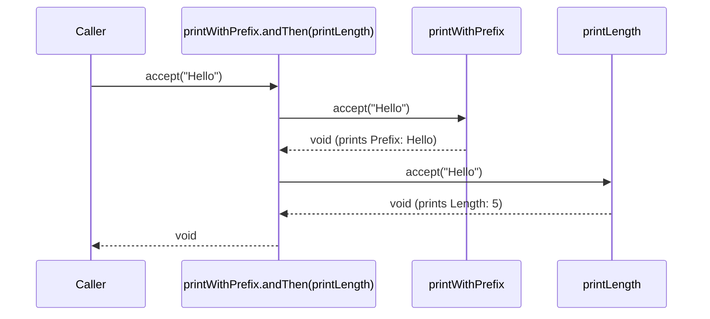
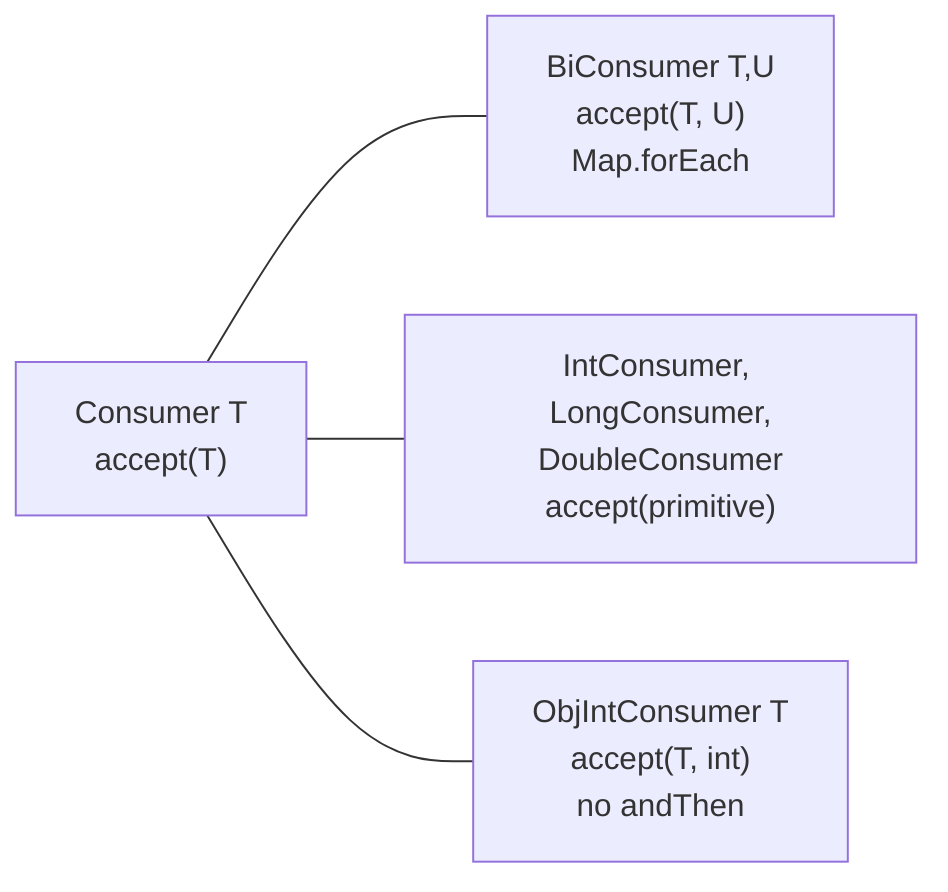

## In One Line
`Consumer<T>` is the built-in functional interface for **doing something with a value and returning nothing** — its one abstract method is `void accept(T t)` — so it exists purely for side effects such as printing, saving, sending or mutating, and `andThen` chains several such actions on the same input.

## Mental Model
Think of a **letterbox**. You push a letter in and nothing comes back out — but something *happens*: the letter is read, filed, forwarded.

- The letterbox is a `Consumer<Letter>`; posting a letter is `accept(letter)`.
- It **returns nothing** (`void`). Its whole value is what it *does* (its side effect).
- **Two letterboxes chained with `andThen`** are like a letter that is **photocopied**: the same letter goes to the first box, then to the second. The second box does not receive anything *from* the first — it gets the original letter too.
- **`BiConsumer`** is a letterbox with two slots (a key and a value), which is exactly what `Map.forEach` posts into.

In the example, `printWithPrefix` is a letterbox that prints whatever it receives with `"Prefix: "` in front.

## Concept
### The interface
```java
@FunctionalInterface
public interface Consumer<T> {
    void accept(T t);                                     // the one abstract method

    default Consumer<T> andThen(Consumer<? super T> after) {
        Objects.requireNonNull(after);
        return (T t) -> { accept(t); after.accept(t); };  // same t for both
    }
}
```
Descriptor: `T -> void`. That is all — one abstract method and one default method, no static methods.

### `andThen` in detail
- **Same input to both.** `first.andThen(second).accept(x)` calls `first.accept(x)` and then `second.accept(x)`. Unlike `Function.andThen`, nothing is passed from the first to the second — there is no result to pass.
- **Order is guaranteed**: first, then second.
- **Exceptions stop the chain.** If `first` throws, `second` does not run and the exception reaches the caller. If `second` throws, `first` has already run (its side effect is not undone).
- **`andThen(null)` throws `NullPointerException` immediately.**
- The `? super T` wildcard lets a `Consumer<String>` be followed by a `Consumer<Object>` (e.g. a generic logger).

### The Consumer family
| Interface | Abstract method | Default methods | Typical JDK use |
|---|---|---|---|
| `Consumer<T>` | `void accept(T t)` | `andThen(Consumer)` | `Iterable.forEach`, `Stream.forEach`, `peek`, `Optional.ifPresent` |
| `BiConsumer<T,U>` | `void accept(T t, U u)` | `andThen(BiConsumer)` | `Map.forEach`, the accumulator/combiner of `Stream.collect(...)`, `Stream.mapMulti` (Java 16) |
| `IntConsumer`, `LongConsumer`, `DoubleConsumer` | `void accept(int value)` ... | `andThen(IntConsumer)` ... | `IntStream.forEach`, `PrimitiveIterator.OfInt.forEachRemaining` |
| `ObjIntConsumer<T>`, `ObjLongConsumer<T>`, `ObjDoubleConsumer<T>` | `void accept(T t, int value)` ... | **none** | `IntStream.collect(supplier, ObjIntConsumer, BiConsumer)` |

The `Obj*Consumer` interfaces take an object **and** a primitive — for example, a `StringBuilder` and a count. They are the only consumers without `andThen`.

### Where consumers appear in the JDK
| API | Parameter | Notes |
|---|---|---|
| `Iterable.forEach` (default method, Java 8) | `Consumer<? super T>` | `list.forEach(System.out::println)` |
| `Map.forEach` | `BiConsumer<? super K, ? super V>` | `map.forEach((k, v) -> ...)` |
| `Stream.forEach` / `forEachOrdered` | `Consumer<? super T>` | `forEach` gives **no order guarantee** on parallel streams; `forEachOrdered` keeps encounter order. |
| `Stream.peek` | `Consumer<? super T>` | Meant for debugging; may not run at all (see Traps). |
| `Optional.ifPresent` / `ifPresentOrElse` (Java 9) | `Consumer<? super T>` (+ `Runnable`) | Run an action only when a value exists. |
| `Iterator.forEachRemaining` | `Consumer<? super E>` | Processes the elements not yet returned by `next()`. |
| `Spliterator.tryAdvance` / `forEachRemaining` | `Consumer<? super T>` | The low-level engine behind streams. |
| `Stream.collect(supplier, accumulator, combiner)` | two `BiConsumer`s | `collect(ArrayList::new, ArrayList::add, ArrayList::addAll)` |
| `Stream.mapMulti` (Java 16) | `BiConsumer<T, Consumer<R>>` | Push zero or more results per element into the downstream `Consumer`. |
| `CompletableFuture.thenAccept` | `Consumer<? super T>` | Final step of an async pipeline. |

### Consumer vs the others
| | Input | Output | Purpose |
|---|---|---|---|
| `Consumer<T>` | T | nothing | side effect |
| `Function<T,R>` | T | R | transformation (no side effects ideally) |
| `Supplier<T>` | nothing | T | produce a value |
| `Runnable` | nothing | nothing | side effect with no input |

A `Consumer` returning `void` is also why a value-returning method can be used as one and the result is silently dropped — `list.forEach(String::toUpperCase)` does nothing visible (see [Method References](lesson:a05-java8/03-method-references)).

### Using consumers well
- **Consumers are the "end of the line".** In a stream, `forEach` is a terminal operation; in functional style prefer producing values (`map`, `collect`) and keep side effects at the edges.
- **Mutating the argument works; reassigning it does not.** `list -> list.add("item")` changes the caller's list. `s -> { s = s.toUpperCase(); }` only changes the lambda's local parameter — Java is pass-by-value.
- **Don't use `forEach` to build collections** (`stream.forEach(x -> result.add(x))`); it is not thread-safe for parallel streams. Use `collect(Collectors.toList())` or `toList()`.
- **Composable event handlers**: `Consumer<Order> onPlaced = saveToDb.andThen(sendEmail).andThen(auditLog);` — each piece small and testable.

## Diagram

`andThen` hands the **same** input to each consumer in order; no value flows from the first to the second.


Four shapes of "take something, return nothing". Only the `Obj*Consumer` versions lack `andThen`.

## Code
@example Java8Features/FunctionalInterfaces/ConsumerExample.java

`andThen`, `BiConsumer`, the primitive versions and every major API that takes a consumer:
```java
import java.util.*;
import java.util.function.*;
import java.util.stream.*;

public class ConsumerTour {
    public static void main(String[] args) {
        // andThen: both consumers receive the SAME input
        Consumer<String> printWithPrefix = str -> System.out.println("Prefix: " + str);
        Consumer<String> printLength = str -> System.out.println("Length: " + str.length());
        printWithPrefix.andThen(printLength).accept("Hello");

        // consumers act by side effects, e.g. mutating an object
        Consumer<List<String>> addItem = list -> list.add("item");
        Consumer<List<String>> addTwice = addItem.andThen(addItem);
        List<String> cart = new ArrayList<>();
        addTwice.accept(cart);
        System.out.println(cart);

        // Iterable.forEach and Map.forEach (BiConsumer)
        List.of("a", "b").forEach(printWithPrefix);
        Map<String, Integer> stock = new TreeMap<>(Map.of("apple", 3, "kiwi", 0));
        BiConsumer<String, Integer> report = (k, v) -> System.out.println(k + " -> " + v);
        stock.forEach(report.andThen((k, v) -> { if (v == 0) System.out.println("  reorder " + k); }));

        // primitive and Obj-primitive consumers
        IntConsumer show = i -> System.out.print(i + " ");
        IntStream.range(0, 3).forEach(show.andThen(i -> System.out.print("| ")));
        System.out.println();
        ObjIntConsumer<StringBuilder> repeatDot = (sb, n) -> sb.append(".".repeat(n));
        StringBuilder sb = new StringBuilder("load");
        repeatDot.accept(sb, 3);
        System.out.println(sb);

        // Optional.ifPresent / ifPresentOrElse (Java 9)
        Optional.of("found").ifPresent(printWithPrefix);
        Optional.<String>empty().ifPresentOrElse(printWithPrefix, () -> System.out.println("nothing"));

        // Iterator.forEachRemaining
        Iterator<String> it = List.of("x", "y", "z").iterator();
        it.next();
        it.forEachRemaining(s -> System.out.print(s + " "));
        System.out.println();

        // Stream.collect(supplier, BiConsumer accumulator, BiConsumer combiner)
        ArrayList<String> upper = Stream.of("p", "q").collect(ArrayList::new, (l, s) -> l.add(s.toUpperCase()), ArrayList::addAll);
        System.out.println(upper);

        // mapMulti (Java 16) takes a BiConsumer<T, Consumer<R>>
        List<Integer> expanded = Stream.of(1, 2, 3)
                .<Integer>mapMulti((n, downstream) -> { if (n != 2) { downstream.accept(n); downstream.accept(n * 10); } })
                .toList();
        System.out.println(expanded);
    }
}
```
```output
Prefix: Hello
Length: 5
[item, item]
Prefix: a
Prefix: b
apple -> 3
kiwi -> 0
  reorder kiwi
0 | 1 | 2 | 
load...
Prefix: found
nothing
y z 
[P, Q]
[1, 10, 3, 30]
```

The pitfalls, demonstrated:
```java
import java.util.*;
import java.util.function.*;
import java.util.stream.*;

public class Pitfalls {
    public static void main(String[] args) {
        // 1. if the first consumer throws, the second never runs
        Consumer<String> risky = s -> { if (s.isEmpty()) throw new IllegalArgumentException("empty"); };
        Consumer<String> log = s -> System.out.println("logged: " + s);
        try {
            risky.andThen(log).accept("");
        } catch (IllegalArgumentException e) {
            System.out.println("caught " + e.getMessage() + ", log did not run");
        }

        // 2. peek is skipped when count() can be computed from the source (Java 9+)
        long n = Stream.of(1, 2, 3).peek(x -> System.out.println("peek " + x)).count();
        System.out.println("count = " + n);
        long m = Stream.of(1, 2, 3).filter(x -> x > 1).peek(x -> System.out.println("peek " + x)).count();
        System.out.println("count = " + m);

        // 3. forEach on a parallel stream does not keep order; forEachOrdered does
        StringBuilder a = new StringBuilder(), b = new StringBuilder();
        IntStream.rangeClosed(1, 8).parallel().forEachOrdered(i -> b.append(i));
        System.out.println("forEachOrdered: " + b);

        // 4. reassigning the parameter inside a consumer changes nothing outside
        Consumer<String> reassign = s -> { s = s.toUpperCase(); };
        String word = "hello";
        reassign.accept(word);
        System.out.println(word);

        // 5. andThen(null)
        try { log.andThen(null); } catch (NullPointerException e) { System.out.println("andThen(null) -> NPE"); }
    }
}
```
```output
caught empty, log did not run
count = 3
peek 2
peek 3
count = 2
forEachOrdered: 12345678
hello
andThen(null) -> NPE
```
With plain `forEach` instead of `forEachOrdered`, adding `1..8` to a synchronized list from a parallel stream printed `[6, 5, 8, 7, 3, 4, 1, 2]` on one run — the order depends on how the work is split across threads and can differ between machines and runs.

## Walkthrough
- `import java.util.function.Consumer;` — from `java.util.function` (Java 8).
- `Consumer<String> printWithPrefix = str -> System.out.println("Prefix: " + str);` — "Consumer to print a string with a prefix". The lambda implements `void accept(String str)`. The body is a single `println` call, which returns `void` — exactly what `accept` wants. Creating the consumer prints nothing.
- `String testString = "Hello, World!";` — the value to hand over.
- `printWithPrefix.accept(testString);` — this is the moment the body runs: `"Prefix: " + "Hello, World!"` is printed as `Prefix: Hello, World!`, matching the recorded output and the `// Output:` comment.
- There is no return value to store: `var x = printWithPrefix.accept(...)` would not compile (`void` cannot be assigned).
- The example shows only `accept`. The tour above covers `andThen`, `BiConsumer`, `IntConsumer`, `ObjIntConsumer` and the APIs that take consumers.

## Traps
> [!ERRATA] The comment `// Accept the consumer` has it backwards. You do not "accept the consumer"; you **call the consumer's `accept` method**, and the consumer accepts (consumes) the string. A clearer comment: `// Pass the string to the consumer`.

- **`andThen` does not pipe values.** Both consumers get the original input. If you need the first step's output, you want `Function.andThen`, ending with a consumer.
- **An exception in the first consumer skips the rest** of an `andThen` chain; there is no rollback of steps already done.
- **`peek` may not run.** Since Java 9, `count()` can compute the size directly from a sized source and skip the pipeline, so `Stream.of(1, 2, 3).peek(...).count()` printed nothing. Add a `filter` and `peek` runs again. Never put business logic in `peek`.
- **`forEach` on a parallel stream has no order.** Use `forEachOrdered` when order matters (at a cost in parallelism).
- **Consumers cannot change the caller's variable.** Reassigning the parameter (`s = s.toUpperCase()`) is local to the lambda; only mutating a mutable object (a list, a `StringBuilder`) is visible outside.
- **Building collections with `forEach` + `add`** is not thread-safe and bypasses the stream's design. Use `collect`.
- **`ObjIntConsumer` has no `andThen`**, and consumers have no `compose`.
- **Silent discard**: any method returning a value fits a `Consumer`, and the value is dropped without warning.

## Tips & Tricks
- **Memory hook: "Consumer eats, returns nothing."** It *accepts* food and gives nothing back — only side effects.
- **`andThen` for consumers = photocopy; `andThen` for functions = assembly line.** Consumer: same input to both. Function: output of the first is input to the second.
- `System.out::println` is the most common `Consumer` in the world; `map::put` fits a `BiConsumer<K,V>`.
- Use `Map.forEach((k, v) -> ...)` instead of iterating `entrySet()` for simple processing.
- Keep side effects at the end of a pipeline: `stream.filter(...).map(...).forEach(sink)`.
- Prefer `ifPresent` / `ifPresentOrElse` over `if (opt.isPresent()) { opt.get() ... }`.

## Interview Q&A
### [Basic] What is `Consumer` in Java 8?
A functional interface in `java.util.function` whose abstract method is `void accept(T t)`. It takes one argument and returns nothing, so it represents an operation performed for its side effect — printing, logging, saving, updating an object. Its only default method is `andThen`. It is the parameter type of `Iterable.forEach`, `Stream.forEach`, `Stream.peek` and `Optional.ifPresent`.

**Follow-up:** *How is it different from `Function`?* — A `Function` returns a result and should be side-effect free; a `Consumer` returns `void` and exists for side effects.

### [Basic] What does `Consumer.andThen` do?
It returns a composed consumer that calls this consumer and then the `after` consumer, **with the same input**: `(t) -> { accept(t); after.accept(t); }`. If the first throws, the second is not called. A `null` argument throws `NullPointerException` immediately. Example: `saveToDb.andThen(sendEmail).accept(order)` saves, then emails, the same order.

**Follow-up:** *How is that different from `Function.andThen`?* — `Function.andThen` feeds the first result into the second function; `Consumer.andThen` has no result to feed, so both see the original input.

### [Basic] What is a `BiConsumer` and where is it used?
A consumer of two arguments: `void accept(T t, U u)`, with `andThen(BiConsumer)`. The best-known use is `Map.forEach((key, value) -> ...)`. It is also the accumulator and combiner in the three-argument `Stream.collect(supplier, accumulator, combiner)` — e.g. `collect(ArrayList::new, ArrayList::add, ArrayList::addAll)` — and the parameter of `Stream.mapMulti` in Java 16.

**Follow-up:** *Why is `ArrayList::add` a valid `BiConsumer<ArrayList<T>, T>` even though `add` returns `boolean`?* — It is an unbound method reference (the list is the receiver, the element the argument) and the `boolean` result is discarded because `accept` is `void`.

### [Intermediate] What are the primitive specialisations of Consumer?
`IntConsumer`, `LongConsumer` and `DoubleConsumer` (`accept(int)` etc., each with `andThen`), used by `IntStream.forEach` and primitive iterators, and `ObjIntConsumer<T>`, `ObjLongConsumer<T>`, `ObjDoubleConsumer<T>` (`accept(T, int)` etc., no `andThen`), used as accumulators in `IntStream.collect(Supplier, ObjIntConsumer, BiConsumer)`. They avoid boxing each primitive into a wrapper object.

**Follow-up:** *Is there a `BiIntConsumer`?* — No. For two ints you would write your own interface or use a `BiConsumer<Integer,Integer>`.

### [Intermediate] What is the difference between `forEach` and `forEachOrdered`?
Both are terminal operations that take a `Consumer`. On a sequential stream they behave the same. On a parallel stream `forEach` processes elements in whatever order the threads reach them (explicitly nondeterministic), while `forEachOrdered` respects the stream's encounter order, which limits parallelism. For example `IntStream.rangeClosed(1, 8).parallel().forEachOrdered(...)` always yields `12345678`, while `forEach` produced `[6, 5, 8, 7, 3, 4, 1, 2]` on one run.

**Follow-up:** *And `Iterable.forEach` vs `Stream.forEach`?* — `Iterable.forEach` iterates the collection directly in its iteration order; `Stream.forEach` goes through the stream pipeline.

### [Intermediate] Why is `peek` dangerous for real logic?
`peek(Consumer)` is an intermediate operation intended for debugging. It only runs if a terminal operation pulls the elements through, and the stream implementation may skip it: since Java 9, `Stream.of(1, 2, 3).peek(print).count()` does not print anything because `count()` is computed from the known size. Short-circuiting operations (`findFirst`, `limit`) also mean `peek` sees fewer elements. Side effects in `peek` can therefore silently disappear.

**Follow-up:** *What should you use instead for side effects?* — A terminal `forEach`, or restructure the logic so the stream produces values and the side effect happens afterwards.

### [Intermediate] Can a Consumer modify the object it receives? Can it change the caller's variable?
It can **mutate** a mutable object — `Consumer<List<String>> c = l -> l.add("x")` changes the caller's list, because the lambda receives a copy of the reference to the same object. It cannot **reassign** the caller's variable: `s -> { s = s.toUpperCase(); }` only rebinds the lambda's parameter. This is Java's pass-by-value applied to lambdas. Strings are immutable, so a `Consumer<String>` can never change the caller's string.

**Follow-up:** *How would you "return" something from a consumer?* — You should not; use a `Function`. If an API forces a consumer, collect into a mutable container you own (`AtomicReference`, a list) — but prefer redesigning.

### [Advanced] How does `Stream.mapMulti` use consumers, and when is it better than `flatMap`?
`mapMulti(BiConsumer<? super T, ? super Consumer<R>> mapper)` (Java 16) calls your `BiConsumer` with each element and a downstream `Consumer<R>`; you call `downstream.accept(...)` zero or more times to emit results. `Stream.of(1, 2, 3).<Integer>mapMulti((n, d) -> { if (n != 2) { d.accept(n); d.accept(n * 10); } })` gives `[1, 10, 3, 30]`. It avoids creating a small `Stream` per element as `flatMap` does, which helps when each element maps to few results, and it is handy for imperative logic (conditionals, loops) during expansion.

**Follow-up:** *Why is the explicit type witness `<Integer>` often needed?* — The compiler cannot infer `R` from the lambda body, since results are passed to a consumer rather than returned.

## Quiz
### What does this print?
```java
StringBuilder sb = new StringBuilder();
Consumer<StringBuilder> addA = s -> s.append("A");
Consumer<StringBuilder> addB = s -> s.append("B");
addB.andThen(addA).accept(sb);
System.out.println(sb);
```
- [ ] AB
- [x] BA
- [ ] B
- [ ] Compile error: `accept` returns void so it cannot be chained
> `addB.andThen(addA)` runs `addB` first, then `addA`, both on the same `StringBuilder`, giving `"BA"`. `andThen` is called on the consumer (which returns a new consumer), not on the `void` result of `accept`.

### What does this print?
```java
Consumer<String> reassign = s -> { s = s.toUpperCase(); };
String word = "hello";
reassign.accept(word);
System.out.println(word);
```
- [x] hello
- [ ] HELLO
- [ ] null
- [ ] Compile error: lambda parameters are final
> The lambda reassigns its own parameter `s`; the caller's `word` still refers to the original immutable `"hello"`. Lambda parameters are not implicitly final, so it compiles — it just has no visible effect.

### What does this print (Java 9+)?
```java
long n = Stream.of(1, 2, 3).peek(x -> System.out.println("peek " + x)).count();
System.out.println("count = " + n);
```
- [ ] peek 1, peek 2, peek 3, then count = 3
- [x] Only `count = 3`
- [ ] Only `count = 0`
- [ ] peek 1 then count = 1
> Since Java 9, `count()` can take the size straight from a sized source without traversing the pipeline, so `peek` never runs. On Java 8 the three `peek` lines would appear — a classic version difference and the reason not to put logic in `peek`.

### What is printed?
```java
Consumer<String> risky = s -> { if (s.isEmpty()) throw new IllegalArgumentException("empty"); };
Consumer<String> log = s -> System.out.println("logged: " + s);
try { risky.andThen(log).accept(""); }
catch (IllegalArgumentException e) { System.out.println("caught " + e.getMessage()); }
```
- [ ] `logged: ` then `caught empty`
- [x] `caught empty`
- [ ] `logged: ` only
- [ ] Nothing
> The composed consumer calls `risky` first; it throws, so `log` never runs and the exception propagates to the `catch`. `andThen` does not guarantee that the second consumer runs.

### Which interface does `Map.forEach` take?
- [ ] `Consumer<Map.Entry<K,V>>`
- [x] `BiConsumer<? super K, ? super V>`
- [ ] `BiFunction<K, V, Void>`
- [ ] `ObjIntConsumer<K>`
> `Map.forEach` passes key and value as two separate arguments to a `BiConsumer`. You would use `Consumer<Map.Entry<K,V>>` with `map.entrySet().forEach(...)`, which is the tempting but different API.

### Spot the bug
```java
List<Integer> result = new ArrayList<>();
IntStream.range(0, 1000).parallel().forEach(result::add);
```
- [ ] `forEach` cannot take a method reference
- [ ] `IntStream` has no `forEach`
- [x] `ArrayList` is not thread-safe; parallel `forEach` corrupts it or loses elements
- [ ] It works; `forEach` is always sequential
> A parallel stream calls the consumer from several threads at once; unsynchronised `ArrayList.add` can lose elements or throw `ArrayIndexOutOfBoundsException`. Use `boxed().toList()` or `collect(...)`. (It compiles: `result::add` fits `IntConsumer` via boxing.)

## Takeaways
- `Consumer<T>` = `void accept(T t)`: takes a value, returns nothing, exists for side effects.
- `andThen` runs both consumers on the **same** input, in order; if the first throws, the second is skipped.
- Family: `BiConsumer<T,U>` (`Map.forEach`, `collect` accumulators), `IntConsumer`/`LongConsumer`/`DoubleConsumer`, and `ObjIntConsumer<T>` etc. (object + primitive, no `andThen`).
- Used by `Iterable.forEach`, `Stream.forEach`/`forEachOrdered`, `peek`, `Optional.ifPresent`/`ifPresentOrElse`, `Iterator.forEachRemaining`, `mapMulti`.
- `forEach` on a parallel stream is unordered — use `forEachOrdered`; never build collections with `forEach` + `add`.
- `peek` is for debugging only: since Java 9 `count()` may skip it entirely.
