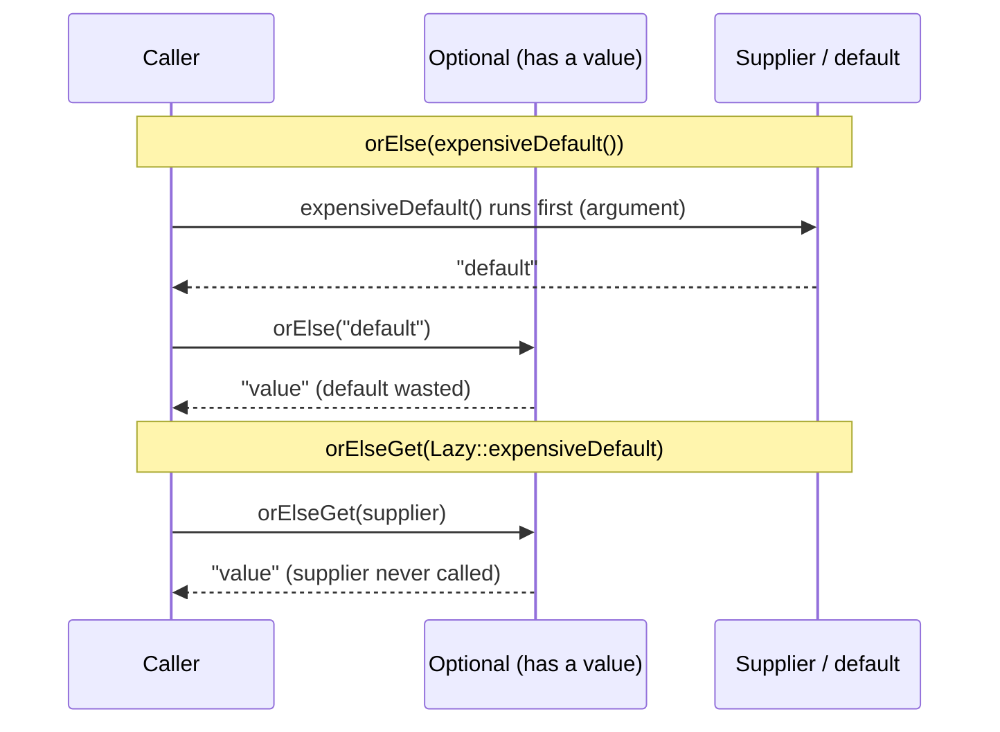
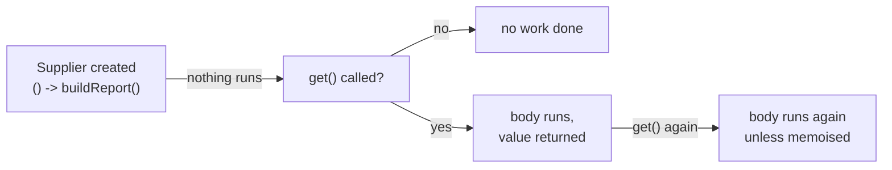

## In One Line
`Supplier<T>` is the built-in functional interface for **producing a value on demand from nothing** — its one abstract method is `T get()` — which makes it the standard tool for factories, default values and, above all, **lazy evaluation**: the code runs only when someone calls `get()`.

## Mental Model
Think of a **vending machine**. You put nothing in (no argument), press the button (`get()`), and something comes out (a `T`).

- The machine is a `Supplier<Snack>`. Installing it in the corridor (creating the lambda) makes no snacks yet.
- **Pressing the button** is `get()`. Only now is a snack produced — so if nobody is hungry, nothing is wasted. That is **laziness**.
- Some machines hand out a **new** item every press (`ArrayList::new`, `() -> new String(...)`); others hand out the **same** thing every time (`() -> "Hello, World!"` — the same pooled string).
- `orElseGet(machine)` means "only if the fridge is empty, press the machine's button". `orElse(snack)` means "buy a snack *now*, just in case" — wasted if the fridge was full.

## Concept
### The interface
```java
@FunctionalInterface
public interface Supplier<T> {
    T get();
}
```
Descriptor: `() -> T`. That is the **entire** interface — no default methods, no static methods. There is nothing to compose: a supplier has no input, so it cannot be chained after another function, and "supplier then function" is simply `() -> f.apply(s.get())`.

### Why a function with no input is useful
1. **Deferred (lazy) execution.** The body runs only when `get()` is called — maybe never. Passing a `Supplier` instead of a value lets the *callee* decide whether the value is needed at all.
2. **Factories.** A `Supplier<T>` is the smallest possible factory: `Supplier<List<String>> f = ArrayList::new;` creates a new list on every `get()`. APIs accept suppliers so that you choose the concrete type (`TreeSet::new`, `LinkedHashMap::new`).
3. **Repeated generation.** `Stream.generate(supplier)` calls `get()` again and again to build an infinite stream.
4. **Values that must be fresh per thread / per call**, e.g. `ThreadLocal.withInitial(StringBuilder::new)`.

### Eager vs lazy — the classic `orElse` vs `orElseGet`
```java
Optional<String> present = Optional.of("value");
present.orElse(expensiveDefault());                       // expensiveDefault() RUNS, result thrown away
present.orElseGet(SupplierTour::expensiveDefault);        // not called: the Optional has a value
```
Java evaluates method **arguments before the call**, so `orElse(expensiveDefault())` always computes the default. `orElseGet` receives a *recipe* (`Supplier`) and only follows it when the Optional is empty. The verified output shows `(computing default...)` printed once — by `orElse`. See also [Optional](lesson:a05-java8/20-optional).

The same idea appears across the JDK:
| API | Supplier parameter | What stays lazy |
|---|---|---|
| `Optional.orElseGet(Supplier<? extends T>)` | the default value | only built when empty |
| `Optional.orElseThrow(Supplier<? extends X>)` | the exception | only created when empty |
| `Optional.or(Supplier<Optional<T>>)` (Java 9) | an alternative Optional | only computed when empty |
| `Objects.requireNonNull(obj, Supplier<String>)` | the error message | only built when `obj` is null |
| `Objects.requireNonNullElseGet(obj, Supplier)` (Java 9) | the fallback | only built when `obj` is null |
| `Logger.fine(Supplier<String>)` (java.util.logging), SLF4J 2 / Log4j 2 lambdas | the log message | only built when the level is enabled — verified: 0 calls at level INFO |
| `Map.computeIfAbsent` (takes a `Function`, same idea) | the new value | only computed when the key is absent |

### Factories and generators in the JDK
| API | Supplier parameter |
|---|---|
| `Stream.generate(Supplier<T>)`, `IntStream.generate(IntSupplier)` | element generator — infinite, so combine with `limit` |
| `Collectors.toCollection(Supplier<C>)` | which collection to build: `toCollection(TreeSet::new)` |
| `Collectors.toMap(k, v, merge, Supplier<M>)`, `groupingBy(f, Supplier<M>, downstream)` | which map to build: `TreeMap::new` |
| `Stream.collect(Supplier<R>, BiConsumer, BiConsumer)` | the mutable result container |
| `ThreadLocal.withInitial(Supplier<S>)` | per-thread initial value |
| `CompletableFuture.supplyAsync(Supplier<U>)` | the task that produces the async result — see [CompletableFuture](lesson:a05-java8/23-completablefuture) |

### The Supplier family
| Interface | Abstract method | Notes |
|---|---|---|
| `Supplier<T>` | `T get()` | generic |
| `BooleanSupplier` | `boolean getAsBoolean()` | the **only** `boolean` specialisation in `java.util.function` |
| `IntSupplier` | `int getAsInt()` | `IntStream.generate` |
| `LongSupplier` | `long getAsLong()` | `LongStream.generate` |
| `DoubleSupplier` | `double getAsDouble()` | `DoubleStream.generate`, e.g. `Math::random` |

None of them has default or static methods.

### Supplier vs Callable vs Runnable
| | Input | Output | Checked exceptions | Package / typical use |
|---|---|---|---|---|
| `Supplier<T>` | none | `T` | **no** | `java.util.function` — lazy values, factories, streams |
| `Callable<V>` | none | `V` | **yes** (`call() throws Exception`) | `java.util.concurrent` — tasks for `ExecutorService.submit` |
| `Runnable` | none | none | no | `java.lang` — threads, fire-and-forget tasks |

`Supplier` and `Callable` have the same shape, but they are unrelated types: you cannot pass a `Supplier` variable where a `Callable` is expected (a lambda literal or `supplier::get` adapts it).

### Patterns built on Supplier
- **Lazy initialisation / memoisation:** compute an expensive value once, on first use, then cache it. A small `memoize(Supplier)` wrapper does it (see Code). Guava offers `Suppliers.memoize`.
- **Reusable stream source:** streams are single-use, but a `Supplier<Stream<T>>` returns a fresh stream each time.
- **Dependency injection / strategy for creation:** a class receives a `Supplier<Connection>` or `Supplier<Clock>` instead of calling `new` itself — easy to swap in tests.
- **Default values in APIs:** `getOrCompute(key, () -> loadFromDb(key))`.

## Diagram

Arguments are evaluated before a call; a `Supplier` postpones the work until the callee decides it needs it.


A supplier is a recipe, not a value: every `get()` follows the recipe again, which is why caching needs a memoising wrapper.

## Code
@example Java8Features/FunctionalInterfaces/SupplierExample.java

Same-vs-new objects, laziness, factories, generators and the JDK APIs that take a supplier:
```java
import java.util.*;
import java.util.concurrent.*;
import java.util.function.*;
import java.util.stream.*;

public class SupplierTour {
    static String expensiveDefault() {
        System.out.println("  (computing default...)");
        return "default";
    }

    public static void main(String[] args) throws Exception {
        // same object or new object?
        Supplier<String> literal = () -> "Hello, World!";
        Supplier<String> fresh = () -> new String("Hello, World!");
        System.out.println(literal.get() == literal.get());   // same pooled literal
        System.out.println(fresh.get() == fresh.get());       // a new object each call

        // laziness: orElse evaluates its argument always, orElseGet only when empty
        Optional<String> present = Optional.of("value");
        System.out.println("orElse:    " + present.orElse(expensiveDefault()));
        System.out.println("orElseGet: " + present.orElseGet(SupplierTour::expensiveDefault));

        // factories via constructor references
        Supplier<List<String>> listFactory = ArrayList::new;
        List<String> l1 = listFactory.get(), l2 = listFactory.get();
        System.out.println(l1 == l2);
        TreeSet<String> sorted = Stream.of("pear", "fig", "apple").collect(Collectors.toCollection(TreeSet::new));
        System.out.println(sorted);

        // infinite streams
        IntSupplier counter = new IntSupplier() {
            int next = 1;
            public int getAsInt() { return next++; }
        };
        System.out.println(IntStream.generate(counter).limit(5).boxed().toList());
        System.out.println(Stream.generate(() -> "ab").limit(3).collect(Collectors.joining("-")));

        // exceptions on demand
        Optional<String> empty = Optional.empty();
        try {
            empty.orElseThrow(() -> new NoSuchElementException("no user"));
        } catch (NoSuchElementException e) {
            System.out.println("orElseThrow: " + e.getMessage());
        }

        // lazy error messages
        String name = null;
        try {
            Objects.requireNonNull(name, () -> "name must not be null");
        } catch (NullPointerException e) {
            System.out.println("requireNonNull: " + e.getMessage());
        }
        System.out.println(Objects.requireNonNullElseGet(name, () -> "guest"));   // Java 9

        // ThreadLocal and CompletableFuture
        ThreadLocal<StringBuilder> buffer = ThreadLocal.withInitial(StringBuilder::new);
        buffer.get().append("per-thread");
        System.out.println(buffer.get());
        CompletableFuture<Integer> future = CompletableFuture.supplyAsync(() -> 6 * 7);
        System.out.println("async: " + future.get());

        // primitive suppliers
        BooleanSupplier isWeekendDemo = () -> false;
        DoubleSupplier pi = () -> Math.PI;
        LongSupplier big = () -> 10_000_000_000L;
        System.out.println(isWeekendDemo.getAsBoolean() + " " + pi.getAsDouble() + " " + big.getAsLong());
    }
}
```
```output
true
false
  (computing default...)
orElse:    value
orElseGet: value
false
[apple, fig, pear]
[1, 2, 3, 4, 5]
ab-ab-ab
orElseThrow: no user
requireNonNull: name must not be null
guest
per-thread
async: 42
false 3.141592653589793 10000000000
```

A memoising supplier, lazy logging, and `Supplier<Stream>` for re-usable stream sources:
```java
import java.util.function.*;
import java.util.logging.*;
import java.util.stream.*;

public class Lazy {
    // A memoizing supplier: computes once, on first use, then caches
    static <T> Supplier<T> memoize(Supplier<T> delegate) {
        return new Supplier<T>() {
            private T value;
            private boolean done;
            public synchronized T get() {
                if (!done) { value = delegate.get(); done = true; }
                return value;
            }
        };
    }

    static int built = 0;
    static String buildReport() { built++; return "report #" + built; }

    public static void main(String[] args) {
        Supplier<String> report = memoize(Lazy::buildReport);
        System.out.println("created, built=" + built);
        System.out.println(report.get() + ", " + report.get() + ", built=" + built);

        // logging: the Supplier is only called if the level is enabled
        Logger log = Logger.getLogger("demo");
        log.setLevel(Level.INFO);
        int[] calls = {0};
        log.fine(() -> { calls[0]++; return "debug detail " + buildReport(); });
        System.out.println("fine() message supplier calls: " + calls[0]);

        // streams are single-use; a Supplier<Stream> gives a fresh one each time
        Stream<String> once = Stream.of("a", "b");
        once.count();
        try { once.count(); } catch (IllegalStateException e) { System.out.println(e.getMessage()); }
        Supplier<Stream<String>> streams = () -> Stream.of("a", "b");
        System.out.println(streams.get().count() + " " + streams.get().map(String::toUpperCase).toList());
    }
}
```
```output
created, built=0
report #1, report #1, built=1
fine() message supplier calls: 0
stream has already been operated upon or closed
2 [A, B]
```

## Walkthrough
- `import java.util.function.Supplier;` — from `java.util.function` (Java 8).
- `Supplier<String> stringSupplier = () -> "Hello, World!";` — the empty parentheses `()` are required: a supplier takes **no arguments**. The body is a single expression, so its value is returned by `get()`. Nothing is produced at this line; the lambda is only a recipe.
- `String suppliedString = stringSupplier.get();` — "Get the supplied value". Calling `get()` runs the body and returns the string literal.
- `System.out.println(suppliedString);` — prints `Hello, World!`, matching the recorded output and the `// Output:` comment.
- Note what the example does *not* show: why you would wrap a constant in a supplier at all. The value appears when the body is **expensive or should be delayed** (a database lookup, a default that may not be needed, a new object per call) — see the tour above.

## Traps
> [!ERRATA] The comment says `// Supplier to provide a new String`, but `() -> "Hello, World!"` returns the **same** pooled string-literal object on every call — `stringSupplier.get() == stringSupplier.get()` is `true`. Only `() -> new String("Hello, World!")` (or a factory like `ArrayList::new`) produces a new object per `get()`. A more accurate comment: `// Supplier that provides a String`.

- **`orElse(compute())` is eager.** The argument is evaluated even when the Optional has a value. Use `orElseGet(() -> compute())` for anything expensive or with side effects (database calls, logging, creating objects).
- **A supplier does not cache.** Each `get()` runs the body again. Wrap it (memoise) if the value should be computed once.
- **Thread safety of memoisation.** A naive `if (value == null) value = compute();` can compute twice under concurrency; synchronise, use double-checked locking with `volatile`, or the holder idiom.
- **Infinite streams:** `Stream.generate(s)` never ends on its own. Forget `limit` (or a short-circuiting terminal op) and `collect` runs forever / runs out of memory.
- **Streams are single-use:** a second terminal operation throws `IllegalStateException: stream has already been operated upon or closed`. Store a `Supplier<Stream<T>>`, not a `Stream<T>`.
- **No checked exceptions:** a supplier body cannot throw `IOException` etc. unless caught. Use `Callable` when the task can fail with a checked exception.
- **`Supplier` has no `andThen`.** Compose manually: `Supplier<Integer> len = () -> length.apply(s.get());`.
- **Stateful suppliers in parallel streams** (like the counting `IntSupplier` above) are not thread-safe; `Stream.generate` on a parallel stream would call them concurrently.

## Tips & Tricks
- **Memory hook: "Supplier = vending machine — nothing in, something out, only when you press."**
- **Rule of thumb:** if an argument is expensive to compute and may not be used, the API should take a `Supplier` — and you should call the `...Get` / supplier version (`orElseGet`, `requireNonNullElseGet`, `log.fine(() -> ...)`).
- `ArrayList::new`, `HashMap::new`, `TreeSet::new`, `StringBuilder::new` are ready-made suppliers — use them with `toCollection`, `groupingBy`, `withInitial`.
- `orElseThrow(IllegalStateException::new)` is a constructor reference used as a `Supplier<IllegalStateException>`.
- Keep a `Supplier<Stream<T>>` when you need to run several pipelines over the same source.
- Inject `Supplier<Instant>` / `Clock` instead of calling `Instant.now()` directly — tests can then control time.

## Interview Q&A
### [Basic] What is `Supplier` in Java 8?
A functional interface in `java.util.function` with one abstract method `T get()` — it takes no arguments and returns a value. It has no default or static methods. It represents a source of values: a factory (`ArrayList::new`), a generator for `Stream.generate`, or a deferred computation for lazy APIs like `Optional.orElseGet`, `orElseThrow`, `Objects.requireNonNull(obj, messageSupplier)` and `CompletableFuture.supplyAsync`.

**Follow-up:** *Does it return a new object on every call?* — Only if the body creates one. `() -> "text"` returns the same literal each time; `ArrayList::new` returns a new list each time.

### [Basic] What is the difference between `orElse` and `orElseGet`?
`orElse(T other)` takes a ready value, and because Java evaluates arguments before the call, the expression for `other` is computed even when the Optional is present. `orElseGet(Supplier<? extends T>)` takes a supplier and calls it only when the Optional is empty. So `opt.orElse(loadDefault())` always runs `loadDefault()`, while `opt.orElseGet(this::loadDefault)` runs it only when needed. Use `orElse` for constants, `orElseGet` for anything costly or with side effects.

**Follow-up:** *Can `orElseGet`'s supplier return null?* — Yes, and then `orElseGet` returns `null`; it does not wrap or check the result.

### [Basic] What are the primitive specialisations of `Supplier`?
`BooleanSupplier` (`getAsBoolean`), `IntSupplier` (`getAsInt`), `LongSupplier` (`getAsLong`) and `DoubleSupplier` (`getAsDouble`). They return primitives without boxing, and are used by `IntStream.generate`, `LongStream.generate`, `DoubleStream.generate`. `BooleanSupplier` is the only `boolean` specialisation in the whole `java.util.function` package.

**Follow-up:** *Give a one-line `DoubleSupplier`.* — `DoubleSupplier random = Math::random;`

### [Intermediate] What is the difference between `Supplier` and `Callable`?
Both take no input and return a value. `Callable<V>.call()` is declared `throws Exception`, lives in `java.util.concurrent`, and is what `ExecutorService.submit` and `invokeAll` accept — a task that may fail with a checked exception. `Supplier<T>.get()` declares no checked exceptions and is used for lazy values, factories and streams. They are different types; a `Supplier` variable must be adapted (`executor.submit(supplier::get)`), although the same lambda text can target either.

**Follow-up:** *Which one does `CompletableFuture.supplyAsync` take?* — A `Supplier`, which is why checked exceptions must be handled inside it.

### [Intermediate] How does a `Supplier` enable lazy evaluation? Give real JDK examples.
It turns "compute a value" into "here is how to compute a value", so the receiver decides if and when to compute it. Examples: `Optional.orElseGet`, `orElseThrow(Supplier)`, `Optional.or` (Java 9); `Objects.requireNonNull(obj, () -> "msg")` builds the message only on failure; `java.util.logging.Logger.fine(Supplier<String>)` builds the message only if FINE is enabled (verified: zero calls at level INFO); `Map.computeIfAbsent` (with a `Function`) builds the value only for missing keys.

**Follow-up:** *Why does lazy logging matter?* — String concatenation and `toString()` calls on large objects would otherwise happen on every call even though the message is discarded.

### [Intermediate] Why can't you reuse a stream, and how does a `Supplier` help?
A stream is a one-shot pipeline over its source: once a terminal operation runs, it is consumed and a second terminal operation throws `IllegalStateException: stream has already been operated upon or closed`. Store a recipe instead: `Supplier<Stream<String>> streams = () -> list.stream();` and call `streams.get()` for each pipeline — every call builds a fresh stream.

**Follow-up:** *Does that re-read the source each time?* — Yes; for a collection that is cheap, for a file or network source it re-reads the data.

### [Advanced] How would you implement a thread-safe memoising (lazy) supplier?
Wrap the delegate and cache the first result. The simplest correct version synchronises `get()`:
```java
static <T> Supplier<T> memoize(Supplier<T> delegate) {
    return new Supplier<T>() {
        private T value; private boolean done;
        public synchronized T get() {
            if (!done) { value = delegate.get(); done = true; }
            return value;
        }
    };
}
```
The `done` flag supports `null` results. For less contention, use double-checked locking with a `volatile` field, or, for a single static value, the initialization-on-demand holder idiom. Guava's `Suppliers.memoize` does this for you.

**Follow-up:** *Why not use `computeIfAbsent` on a `ConcurrentHashMap`?* — That also works for keyed caches; for a single value the wrapper is simpler.

### [Advanced] Why does `Supplier` have no `andThen` or `compose`?
`compose` would need to run something *before* the supplier and feed it input, but a supplier takes no input. `andThen` could exist (`Supplier<R> andThen(Function<T,R>)`), but the designers kept `Supplier` minimal; the same thing is a one-line lambda: `() -> f.apply(s.get())`. The JDK favours composing at the consuming side — for example `Optional.map` or `Stream.map` after `Stream.generate`.

**Follow-up:** *So how would you map a supplier's result lazily?* — `Supplier<Integer> len = () -> text.get().length();` — still lazy, since nothing runs until `len.get()`.

## Quiz
### What does this print?
```java
static String expensiveDefault() { System.out.println("computing"); return "default"; }

Optional<String> present = Optional.of("value");
System.out.println(present.orElse(expensiveDefault()));
System.out.println(present.orElseGet(() -> expensiveDefault()));
```
- [ ] value, value
- [x] computing, value, value
- [ ] computing, value, computing, value
- [ ] computing, default, value
> The argument of `orElse` is evaluated before the call, so `computing` is printed once even though the default is not used. `orElseGet` receives a supplier and never calls it because the Optional has a value. The result is `value` both times, never `default`.

### What does this print?
```java
Supplier<String> literal = () -> "Hello, World!";
Supplier<List<String>> lists = ArrayList::new;
System.out.println((literal.get() == literal.get()) + " " + (lists.get() == lists.get()));
```
- [ ] true true
- [x] true false
- [ ] false false
- [ ] false true
> A string literal is a single pooled object, so both `get()` calls return the same reference. `ArrayList::new` runs the constructor on each `get()`, so the two lists are different objects. That is why the example's "new String" comment is wrong.

### How many methods does `Supplier<T>` declare in total (abstract, default and static)?
- [x] One: `get()`
- [ ] Two: `get()` and `andThen()`
- [ ] Three: `get()`, `andThen()`, `compose()`
- [ ] Two: `get()` and `identity()`
> `Supplier` declares only `T get()`. There is nothing to compose into a no-input function, and the designers did not add `andThen`. `identity()` belongs to `Function` and `UnaryOperator`.

### Spot the bug
```java
Stream<String> names = users.stream().map(User::name);
long count = names.count();
List<String> list = names.toList();
```
- [ ] `map` cannot take a method reference
- [x] A stream can only be consumed once; the second terminal operation throws `IllegalStateException`
- [ ] `count()` returns an int
- [ ] It works; streams are re-iterable
> `count()` consumes the stream; `toList()` then fails with "stream has already been operated upon or closed". Keep a `Supplier<Stream<String>> names = () -> users.stream().map(User::name);` and call `names.get()` per pipeline.

### What does this print?
```java
System.out.println(Stream.generate(() -> "ab").limit(3).collect(Collectors.joining("-")));
```
- [x] ab-ab-ab
- [ ] ab
- [ ] It never terminates
- [ ] ab-ab-ab-
> `generate` calls the supplier repeatedly to build an infinite stream, and `limit(3)` cuts it to three elements; `joining("-")` puts the delimiter only between elements. Without `limit` it would never terminate.

### Which interface should a task use if it must throw `IOException` and return a result to an `ExecutorService`?
- [ ] `Supplier<String>`
- [x] `Callable<String>`
- [ ] `Runnable`
- [ ] `BooleanSupplier`
> `Callable.call()` is declared `throws Exception`, so checked exceptions can escape and are wrapped in `ExecutionException` by `Future.get()`. `Supplier.get()` declares no checked exceptions, and `Runnable` returns nothing.

## Takeaways
- `Supplier<T>` = `T get()`: no input, one output, and no default or static methods at all.
- Its superpower is laziness: the body runs only on `get()` — hence `orElseGet` over `orElse(compute())`, `orElseThrow(Supplier)`, `requireNonNull(obj, () -> msg)` and supplier-based logging.
- Suppliers are factories: `ArrayList::new`, `TreeSet::new` with `toCollection`, `groupingBy(..., TreeMap::new, ...)`, `ThreadLocal.withInitial`, `CompletableFuture.supplyAsync`.
- A supplier returns a new object only if its body creates one; a literal like `() -> "text"` returns the same pooled instance, and a supplier never caches — memoise it if needed.
- Primitive versions: `BooleanSupplier` (the only boolean one), `IntSupplier`, `LongSupplier`, `DoubleSupplier` — used by `IntStream.generate` and friends.
- `Supplier` vs `Callable`: same shape, but `Callable.call()` throws checked exceptions and is the executor task type.
