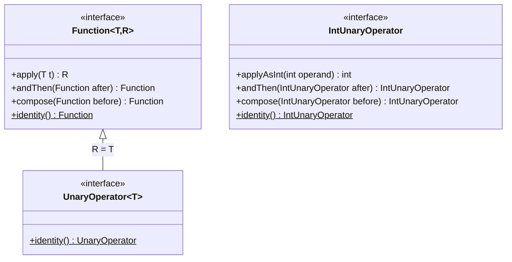
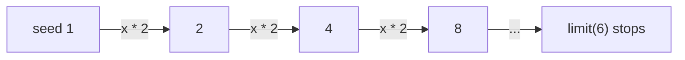

## In One Line
`UnaryOperator<T>` is a `Function<T, T>` whose input and output have the **same type** — "take a `T`, give back a `T`" — used wherever a value is transformed into another value of its own kind: `replaceAll`, `Stream.iterate`, `AtomicInteger.updateAndGet`.

## Mental Model
Think of a **photo filter** on your phone. A photo goes in and a photo comes out: brighter, cropped, black-and-white — but still a photo. You can apply filters one after another, because each one's output is a valid input for the next.

- A filter is a `UnaryOperator<Photo>`; applying it is `apply(photo)`.
- "Same type in and out" is the whole point: `increment` takes an `Integer` and returns an `Integer`, so it can be applied again and again (`Stream.iterate(1, x -> x * 2)`).
- A general `Function<Photo, Thumbnail>` would be a *converter*, not a filter — different type out.
- "No filter" is `UnaryOperator.identity()`: the photo comes out untouched.

## Concept
### The interface
```java
@FunctionalInterface
public interface UnaryOperator<T> extends Function<T, T> {
    static <T> UnaryOperator<T> identity() {
        return t -> t;
    }
}
```
That is the whole source. `UnaryOperator` declares **no abstract method of its own**: it inherits `T apply(T t)` from `Function<T, T>`, so it is still a functional interface (one abstract method). It also inherits the default methods `andThen` and `compose`. Its only new member is a static `identity()` that returns a `UnaryOperator<T>` instead of a `Function<T,T>`.

"Unary" means "one operand" — like the unary minus in `-x`. Compare [BinaryOperator](lesson:a05-java8/09-binary-operator), which takes two operands of the same type.

### Why have it if `Function<T,T>` already exists?
1. **Readability:** `UnaryOperator<String>` says "transforms a string into a string" with one type argument instead of `Function<String, String>`.
2. **API precision:** methods like `List.replaceAll(UnaryOperator<E>)` and `Stream.iterate(T seed, UnaryOperator<T> f)` **require** the result to be the same type as the input — replacing a list element with a different type would break the list. The type system enforces it.

### Is-a relationship and its consequences
| Direction | Works? | Why |
|---|---|---|
| `Function<Integer,Integer> f = increment;` | **Yes** | A `UnaryOperator<Integer>` **is a** `Function<Integer,Integer>` (subinterface). |
| `UnaryOperator<String> u = someFunction;` | **No** | A `Function<String,String>` is not a `UnaryOperator` — "incompatible types: Function<String,String> cannot be converted to UnaryOperator<String>". Adapt with `someFunction::apply`. |
| `UnaryOperator<Integer> twice = inc.andThen(inc);` | **No** | The inherited `andThen`/`compose` return `Function`, not `UnaryOperator`. Declare the result as `Function<Integer,Integer>`, or adapt: `inc.andThen(inc)::apply`. |

The real error for the last case:
```text
error: incompatible types: no instance(s) of type variable(s) V exist so that
       Function<Integer,V> conforms to UnaryOperator<Integer>
```

### Methods at a glance
| Method | Where it comes from | Returns |
|---|---|---|
| `T apply(T t)` | abstract, inherited from `Function<T,T>` | `T` |
| `andThen(Function<? super T, ? extends V> after)` | default, inherited | `Function<T, V>` |
| `compose(Function<? super V, ? extends T> before)` | default, inherited | `Function<V, T>` |
| `UnaryOperator.identity()` | static, declared here | `UnaryOperator<T>` |
| `Function.identity()` | static on `Function` — **not inherited** (static interface methods never are) | `Function<T, T>` |

`andThen` / `compose` order is the same as for functions: `f.andThen(g)` = `g(f(x))`, `f.compose(g)` = `f(g(x))`. With `increment` and `square` on 3: `increment.andThen(square)` = (3+1)² = 16; `increment.compose(square)` = 3²+1 = 10.

### Primitive specialisations
| Interface | Abstract method | Defaults | Static |
|---|---|---|---|
| `IntUnaryOperator` | `int applyAsInt(int operand)` | `andThen(IntUnaryOperator)`, `compose(IntUnaryOperator)` | `identity()` |
| `LongUnaryOperator` | `long applyAsLong(long operand)` | `andThen`, `compose` | `identity()` |
| `DoubleUnaryOperator` | `double applyAsDouble(double operand)` | `andThen`, `compose` | `identity()` |

These are **not** subtypes of `UnaryOperator` or `Function` — they are separate interfaces, but they have their own `andThen`/`compose` that return the primitive type (so chaining keeps `IntUnaryOperator`). They avoid boxing: `UnaryOperator<Integer> increment = x -> x + 1;` unboxes and re-boxes on every call, `IntUnaryOperator` does not.

### Where UnaryOperator is used in the JDK
| API | Parameter | Example |
|---|---|---|
| `List.replaceAll` | `UnaryOperator<E>` | `names.replaceAll(String::toUpperCase)` — in place |
| `Stream.iterate(seed, f)` | `UnaryOperator<T>` | `Stream.iterate(1, x -> x * 2).limit(6)` → 1, 2, 4, 8, 16, 32 |
| `Stream.iterate(seed, hasNext, next)` (Java 9) | `Predicate<T>` + `UnaryOperator<T>` | like a `for` loop: `Stream.iterate(1, x -> x <= 100, x -> x * 3)` |
| `IntStream.iterate`, `IntStream.map` | `IntUnaryOperator` | `IntStream.rangeClosed(1, 4).map(x -> x * 10)` |
| `DoubleStream.map` | `DoubleUnaryOperator` | unit conversions |
| `AtomicInteger.updateAndGet / getAndUpdate` | `IntUnaryOperator` | lock-free update: `counter.updateAndGet(x -> x * 2)` |
| `AtomicLong.updateAndGet`, `AtomicReference.updateAndGet` | `LongUnaryOperator`, `UnaryOperator<V>` | `ref.updateAndGet(s -> s + "b")` |
| `String.transform` (Java 12) | `Function<? super String, ? extends R>` | not a `UnaryOperator`: the result may be any type |

`updateAndGet` returns the **new** value; `getAndUpdate` returns the **old** one. The function may be re-applied if another thread wins the race, so it must be side-effect free.

### Good practice
- Use `UnaryOperator<T>` for "same-type transformation" parameters in your own APIs (normalisers, sanitisers, decorators).
- Keep operators **pure** — especially for atomics and streams, where they may be called more than once or on other threads.
- For many steps, keep a `List<UnaryOperator<T>>` and fold them (loop, or `reduce(UnaryOperator.identity(), (a, b) -> x -> b.apply(a.apply(x)))`).
- Prefer `IntUnaryOperator`/`LongUnaryOperator`/`DoubleUnaryOperator` for numeric work.

## Diagram

`UnaryOperator` adds nothing abstract: it is `Function<T,T>` plus its own `identity()`. `IntUnaryOperator` is a separate, unrelated interface for raw `int`s.


`Stream.iterate(1, x -> x * 2)` feeds each output back in as the next input — only possible because input and output have the same type.

## Code
@example Java8Features/FunctionalInterfaces/UnaryOperatorExample.java

Inherited `andThen`/`compose`, `identity()`, `replaceAll`, `iterate`, primitive operators and atomics:
```java
import java.util.*;
import java.util.concurrent.atomic.*;
import java.util.function.*;
import java.util.stream.*;

public class UnaryTour {
    public static void main(String[] args) {
        UnaryOperator<Integer> increment = x -> x + 1;
        UnaryOperator<Integer> square = x -> x * x;

        // inherited from Function: andThen / compose (they return Function, not UnaryOperator)
        Function<Integer, Integer> incThenSquare = increment.andThen(square);
        Function<Integer, Integer> squareThenInc = increment.compose(square);
        System.out.println(incThenSquare.apply(3) + " " + squareThenInc.apply(3));   // 16 10

        // identity()
        UnaryOperator<String> same = UnaryOperator.identity();
        System.out.println(same.apply("unchanged"));

        // List.replaceAll(UnaryOperator)
        List<String> names = new ArrayList<>(List.of("ravi", "anu", "zoe"));
        names.replaceAll(String::toUpperCase);
        System.out.println(names);

        // Stream.iterate(seed, UnaryOperator) and Java 9 iterate(seed, hasNext, next)
        System.out.println(Stream.iterate(1, x -> x * 2).limit(6).toList());
        System.out.println(Stream.iterate(1, x -> x <= 100, x -> x * 3).toList());

        // primitive: IntUnaryOperator with its own andThen / compose / identity
        IntUnaryOperator plus1 = x -> x + 1;
        IntUnaryOperator times10 = x -> x * 10;
        System.out.println(plus1.andThen(times10).applyAsInt(2) + " " + plus1.compose(times10).applyAsInt(2)
                + " " + IntUnaryOperator.identity().applyAsInt(7));
        System.out.println(IntStream.iterate(1, plus1).limit(5).boxed().toList());
        System.out.println(IntStream.rangeClosed(1, 4).map(times10).boxed().toList());

        // atomics use them for lock-free updates
        AtomicInteger counter = new AtomicInteger(5);
        System.out.println(counter.updateAndGet(x -> x * 2) + " " + counter.getAndUpdate(x -> x + 1) + " " + counter.get());
        AtomicReference<String> ref = new AtomicReference<>("a");
        ref.updateAndGet(s -> s + "b");
        System.out.println(ref.get());

        // chaining several UnaryOperators into one
        List<UnaryOperator<String>> cleanup = List.of(String::strip, String::toLowerCase, s -> s.replace(' ', '-'));
        UnaryOperator<String> slugify = s -> {
            for (UnaryOperator<String> step : cleanup) s = step.apply(s);
            return s;
        };
        System.out.println(slugify.apply("  Java Ace Lessons  "));

        DoubleUnaryOperator half = d -> d / 2;
        LongUnaryOperator negate = l -> -l;
        System.out.println(half.applyAsDouble(5) + " " + negate.applyAsLong(9L));
    }
}
```
```output
16 10
unchanged
[RAVI, ANU, ZOE]
[1, 2, 4, 8, 16, 32]
[1, 3, 9, 27, 81]
30 21 7
[1, 2, 3, 4, 5]
[10, 20, 30, 40]
10 10 11
ab
java-ace-lessons
2.5 -9
```

Converting between `Function` and `UnaryOperator`, and the edge cases:
```java
import java.util.*;
import java.util.function.*;

public class Ok8 {
    public static void main(String[] args) {
        UnaryOperator<Integer> inc = x -> x + 1;
        UnaryOperator<Integer> twice = inc.andThen(inc)::apply;     // adapt with a method reference
        Function<String, String> upper = String::toUpperCase;
        List<String> names = new ArrayList<>(List.of("a", "b"));
        names.replaceAll(upper::apply);
        System.out.println(twice.apply(5) + " " + names);
        Function<Integer, Integer> asFunction = inc;                 // a UnaryOperator IS a Function
        System.out.println(asFunction.apply(1));
        try { inc.apply(null); } catch (NullPointerException e) { System.out.println("NPE on null"); }
        int value = 5;
        int incrementedValue = inc.apply(value);
        System.out.println("Incremented value of " + value + " is " + incrementedValue);
        UnaryOperator<Integer> big = x -> x + 1;
        System.out.println(big.apply(Integer.MAX_VALUE));
    }
}
```
```output
7 [A, B]
2
NPE on null
Incremented value of 5 is 6
-2147483648
```

## Walkthrough
- `import java.util.function.UnaryOperator;` — from `java.util.function` (Java 8).
- `UnaryOperator<Integer> increment = x -> x + 1;` — "UnaryOperator to increment an integer". There is only **one** type argument: input and output are both `Integer`. The lambda implements the inherited `Integer apply(Integer x)`. Inside, `x + 1` unboxes `x`, adds, and the result is boxed back to `Integer`.
- `int value = 5;` — a primitive.
- `int incrementedValue = increment.apply(value);` — "Apply the unary operator". Four conversions happen: `5` is boxed to `Integer` for the call, unboxed for `x + 1`, the sum `6` is boxed as the return value, then unboxed into the `int` variable. Correct, but wasteful in a hot loop — `IntUnaryOperator increment = x -> x + 1;` with `applyAsInt` does none of that.
- `System.out.println("Incremented value of " + value + " is " + incrementedValue);` — string concatenation gives `Incremented value of 5 is 6`, matching the recorded output and the `// Output:` comment.
- The method called is `apply`, the same name as in `Function` — because it *is* `Function.apply`, inherited.

## Traps
- **`andThen`/`compose` return a `Function`, not a `UnaryOperator`.** `UnaryOperator<Integer> twice = inc.andThen(inc);` does not compile. Use `Function<Integer,Integer>` for the result or adapt with `::apply`.
- **A `Function<T,T>` is not a `UnaryOperator<T>`.** `names.replaceAll(upperFunction)` fails; pass `upperFunction::apply` or declare it as `UnaryOperator<String>` in the first place.
- **Unboxing `null`**: `increment.apply(null)` throws `NullPointerException` inside the lambda (`x + 1` unboxes `null`).
- **Integer overflow is silent:** `increment.apply(Integer.MAX_VALUE)` returns `-2147483648`. Use `Math.incrementExact` / `addExact` if overflow must be detected.
- **Side effects in `updateAndGet`**: the function can be called more than once when threads race (compare-and-set retries). Never log, count or do I/O inside it.
- **`Stream.iterate(seed, f)` is infinite.** Add `limit(n)` or use the Java 9 three-argument form with a `hasNext` predicate.
- **`IntUnaryOperator` is not a `UnaryOperator<Integer>`** — they are unrelated types, and the method name differs (`applyAsInt`).
- **`UnaryOperator.identity()` vs `Function.identity()`**: calling `UnaryOperator.identity()` where a `UnaryOperator` is required matters — `Function.identity()` will not fit `replaceAll`.

## Tips & Tricks
- **Memory hook: "Unary = one operand, same type back"** — like `-x` or `x++`. If the input type equals the output type, reach for `UnaryOperator`.
- **Photo-filter rule:** if you might apply it again to its own result (`iterate`, loops, pipelines of normalisers), it should be a `UnaryOperator`.
- `list.replaceAll(String::trim)` — the cleanest in-place transformation of a list.
- `counter.updateAndGet(x -> Math.max(x, candidate))` — a lock-free "keep the maximum".
- Use `Stream.iterate(start, cond, next)` (Java 9) as a stream-shaped `for` loop.
- Prefer `IntUnaryOperator` & co. for arithmetic; their `andThen`/`compose` keep the primitive type.

## Interview Q&A
### [Basic] What is `UnaryOperator`?
A functional interface in `java.util.function` that extends `Function<T, T>`: it takes one argument and returns a result of the same type. It declares no abstract method of its own — `T apply(T t)` is inherited — plus the inherited defaults `andThen`/`compose`, and adds a static `identity()` returning `UnaryOperator<T>`. Example: `UnaryOperator<String> upper = String::toUpperCase;`. It is used by `List.replaceAll`, `Stream.iterate` and `AtomicReference.updateAndGet`.

**Follow-up:** *Is it a functional interface if it declares no method?* — Yes; it has exactly one abstract method, the inherited `apply`.

### [Basic] What is the difference between `Function<T,T>` and `UnaryOperator<T>`?
Behaviourally none — `UnaryOperator<T>` *is* a `Function<T,T>`. It exists for readability (one type argument, clear intent: same type in and out) and for API precision: `List.replaceAll(UnaryOperator<E>)` and `Stream.iterate(T, UnaryOperator<T>)` require it, so a `Function<T,T>` variable cannot be passed there without adapting (`f::apply`). A `UnaryOperator` can always be used where a `Function<T,T>` is expected.

**Follow-up:** *What does `increment.andThen(square)` return?* — A `Function<Integer,Integer>`, because the default method is inherited from `Function`.

### [Basic] Which JDK methods take a `UnaryOperator`?
`List.replaceAll(UnaryOperator<E>)`, `Stream.iterate(seed, UnaryOperator)` and its Java 9 three-argument form, `AtomicReference.updateAndGet/getAndUpdate(UnaryOperator<V>)`. Primitive versions: `IntStream.iterate`/`map` (`IntUnaryOperator`), `AtomicInteger.updateAndGet`/`getAndUpdate` (`IntUnaryOperator`), `AtomicLong` (`LongUnaryOperator`), `DoubleStream.map` (`DoubleUnaryOperator`).

**Follow-up:** *Difference between `updateAndGet` and `getAndUpdate`?* — The first returns the new value, the second the previous value; both update atomically with a CAS loop.

### [Intermediate] Why doesn't `UnaryOperator<Integer> twice = inc.andThen(inc);` compile?
`andThen` is inherited from `Function` and is declared to return `Function<T, V>`. Java does not re-declare it in `UnaryOperator` with a narrower return type, so the result is a `Function<Integer,Integer>`, and a `Function` is not a `UnaryOperator` (the subtype relation goes the other way). Fixes: declare `Function<Integer,Integer> twice = ...`, or adapt with a method reference: `UnaryOperator<Integer> twice = inc.andThen(inc)::apply;`.

**Follow-up:** *Does `IntUnaryOperator.andThen` have the same problem?* — No; `IntUnaryOperator` declares its own `andThen(IntUnaryOperator)` returning `IntUnaryOperator`.

### [Intermediate] What are `IntUnaryOperator`, `LongUnaryOperator` and `DoubleUnaryOperator`?
Primitive specialisations with `applyAsInt(int)`, `applyAsLong(long)`, `applyAsDouble(double)`. Each has its own `andThen`, `compose` and static `identity()`, all typed to the same primitive, so chains stay unboxed. They are separate interfaces, not subtypes of `UnaryOperator`. They are used by `IntStream.map`/`iterate`, `AtomicInteger.updateAndGet` etc. and avoid the box/unbox round trip of `UnaryOperator<Integer>`.

**Follow-up:** *How many boxing conversions happen in `int r = increment.apply(5)` with `UnaryOperator<Integer>`?* — Four: box 5, unbox for `x + 1`, box the result, unbox into `r`.

### [Intermediate] How does `List.replaceAll` differ from `stream().map(...)`?
`replaceAll(UnaryOperator<E>)` modifies the list **in place**, replacing each element with the operator's result; the element type cannot change. `stream().map(Function<T,R>)` leaves the source untouched and produces new elements, possibly of another type, which you then collect into a new collection. `replaceAll` works on any modifiable list, including `Arrays.asList` (it only uses `set`), but throws `UnsupportedOperationException` on `List.of(...)`.

**Follow-up:** *Is there a `replaceAll` for maps?* — `Map.replaceAll(BiFunction<K,V,V>)`, which receives key and value and returns the new value.

### [Advanced] Why must the function passed to `AtomicInteger.updateAndGet` be side-effect free?
`updateAndGet` is implemented as a compare-and-set loop: read the current value, apply the function, try `compareAndSet(old, new)`; if another thread changed the value in between, retry — calling the function again. The Javadoc states that the function "should be side-effect-free, since it may be re-applied when attempted updates fail due to contention among threads". Logging, counting or I/O inside it could therefore happen several times for one update.

**Follow-up:** *How would you keep a running maximum lock-free?* — `max.updateAndGet(x -> Math.max(x, candidate))` or `max.accumulateAndGet(candidate, Math::max)`.

### [Advanced] How would you combine a list of `UnaryOperator<T>` into a single `UnaryOperator<T>`?
Fold them in order. A loop is simplest:
```java
UnaryOperator<String> all = s -> { for (UnaryOperator<String> step : steps) s = step.apply(s); return s; };
```
With streams: `steps.stream().reduce(UnaryOperator.identity(), (a, b) -> x -> b.apply(a.apply(x)))` — the explicit lambda keeps the result a `UnaryOperator`, which `Function::andThen` would not. `UnaryOperator.identity()` is the neutral start value.

**Follow-up:** *Why not `reduce(UnaryOperator.identity(), UnaryOperator::andThen)`?* — `andThen` returns `Function`, so the accumulator does not produce a `UnaryOperator` and it will not type-check as a `BinaryOperator<UnaryOperator<String>>`.

## Quiz
### What does this print?
```java
UnaryOperator<Integer> increment = x -> x + 1;
UnaryOperator<Integer> square = x -> x * x;
System.out.println(increment.andThen(square).apply(3) + " " + increment.compose(square).apply(3));
```
- [ ] 10 16
- [x] 16 10
- [ ] 16 16
- [ ] Compile error: `andThen` is not available on `UnaryOperator`
> `andThen` runs `increment` first: (3 + 1)² = 16. `compose` runs `square` first: 3² + 1 = 10. Both methods are inherited from `Function`, so they exist.

### Why does this not compile?
```java
UnaryOperator<Integer> inc = x -> x + 1;
UnaryOperator<Integer> twice = inc.andThen(inc);
```
- [ ] `UnaryOperator` has no `andThen`
- [x] `andThen` returns a `Function<Integer,Integer>`, which is not a `UnaryOperator`
- [ ] A lambda cannot be passed to `andThen`
- [ ] `inc` cannot be combined with itself
> The inherited default method is declared on `Function` and returns `Function`. A `Function` is not a subtype of `UnaryOperator`. Declare `twice` as `Function<Integer,Integer>` or append `::apply`.

### What does this print?
```java
System.out.println(Stream.iterate(1, x -> x <= 100, x -> x * 3).toList());
```
- [ ] [1, 3, 9, 27, 81, 243]
- [x] [1, 3, 9, 27, 81]
- [ ] [3, 9, 27, 81]
- [ ] It never terminates
> The Java 9 overload works like a `for` loop: start at the seed 1, keep going while `x <= 100`, next value `x * 3`. 243 fails the condition and is not emitted. The seed itself is included.

### What does this print?
```java
AtomicInteger counter = new AtomicInteger(5);
System.out.println(counter.updateAndGet(x -> x * 2) + " " + counter.getAndUpdate(x -> x + 1) + " " + counter.get());
```
- [ ] 10 11 11
- [x] 10 10 11
- [ ] 5 10 11
- [ ] 10 10 10
> `updateAndGet` returns the **new** value (10). `getAndUpdate` returns the **old** value (10) and sets 11. `get()` then shows 11. The operands are evaluated left to right.

### Which statement is true?
- [x] Every `UnaryOperator<T>` can be assigned to a `Function<T, T>` variable
- [ ] Every `Function<T, T>` can be assigned to a `UnaryOperator<T>` variable
- [ ] `IntUnaryOperator` extends `UnaryOperator<Integer>`
- [ ] `UnaryOperator` declares its own abstract method `operate(T)`
> `UnaryOperator<T> extends Function<T,T>`, so upcasting works; the reverse needs an adapter. `IntUnaryOperator` is an unrelated interface, and `UnaryOperator`'s only abstract method is the inherited `apply`.

### What does this print?
```java
UnaryOperator<Integer> increment = x -> x + 1;
System.out.println(increment.apply(Integer.MAX_VALUE));
```
- [ ] 2147483648
- [x] -2147483648
- [ ] ArithmeticException
- [ ] NullPointerException
> `int` arithmetic overflows silently and wraps to `Integer.MIN_VALUE`. Only the `Math.*Exact` methods throw `ArithmeticException` on overflow; a result outside the `int` range can never be printed.

## Takeaways
- `UnaryOperator<T>` extends `Function<T,T>`: one input, same-type output; its abstract method is the inherited `apply`.
- It adds only a static `identity()`; the inherited `andThen`/`compose` return `Function`, not `UnaryOperator`.
- A `UnaryOperator` is a `Function`, but a `Function<T,T>` must be adapted (`f::apply`) to be used as a `UnaryOperator`.
- Used by `List.replaceAll` (in place), `Stream.iterate` (infinite or Java 9 bounded), and `AtomicReference`/`AtomicInteger.updateAndGet` (must be side-effect free).
- `IntUnaryOperator`, `LongUnaryOperator`, `DoubleUnaryOperator` avoid boxing and have their own typed `andThen`, `compose`, `identity`.
- `UnaryOperator<Integer>` boxes and unboxes on each call, can throw `NullPointerException` on `null`, and overflows silently.
