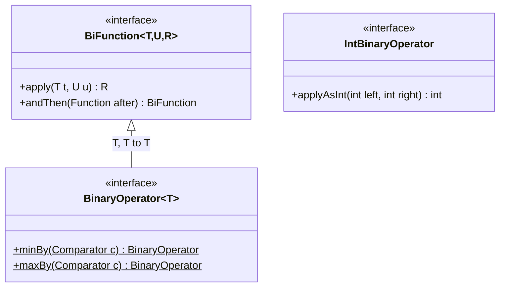
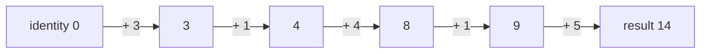
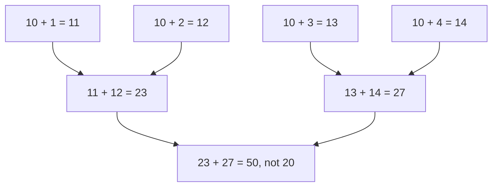

## In One Line
`BinaryOperator<T>` is a `BiFunction<T, T, T>` — it takes **two values of the same type and combines them into one value of that type** (`(a, b) -> a + b`, `Integer::max`, `String::concat`), which is exactly what `reduce`, merge functions and accumulators need.

## Mental Model
Think of a **tournament bracket** or a **blender**.

- Two things of the same kind go in, one thing of the **same kind** comes out: two teams play, one team advances; two fruits go in the blender, one smoothie comes out — and that smoothie can go in again with the next fruit.
- Because the output is the same type as the inputs, you can **keep feeding the result back in**: `((3 + 1) + 4) + 1`. That is what `reduce` does — it plays the whole bracket until one winner is left.
- The *rule* of the match is the operator: "higher score wins" is `BinaryOperator.maxBy(comparator)`, "add the scores" is `Integer::sum`.
- A bracket can be played in parallel (several matches at once) **only if the order of matches does not change the winner** — in code, the operator must be *associative*.

In the code: the blender is the `BinaryOperator<Integer> add`, pouring two fruits in is `add.apply(a, b)`, and the smoothie is the returned `Integer`.

## Concept
### The interface (whole source, Java 8+)
```java
@FunctionalInterface
public interface BinaryOperator<T> extends BiFunction<T, T, T> {

    static <T> BinaryOperator<T> minBy(Comparator<? super T> comparator) {
        Objects.requireNonNull(comparator);
        return (a, b) -> comparator.compare(a, b) <= 0 ? a : b;
    }

    static <T> BinaryOperator<T> maxBy(Comparator<? super T> comparator) {
        Objects.requireNonNull(comparator);
        return (a, b) -> comparator.compare(a, b) >= 0 ? a : b;
    }
}
```
- It declares **no abstract method of its own**. Its single abstract method is inherited from `BiFunction<T, U, R>` with all three type parameters set to `T`: **`T apply(T t, T u)`**.
- It inherits one default method, `andThen(Function<? super T, ? extends V> after)`, which returns a **`BiFunction<T, T, V>`** — not a `BinaryOperator`.
- It adds two **static factories**, `minBy` and `maxBy`, that turn a `Comparator` into a "pick the smaller/larger" operator.
- "Binary" means "two operands" — like `a + b`, `a * b`, `max(a, b)`. It is the two-argument sibling of [UnaryOperator](lesson:a05-java8/08-unary-operator).

### Relation to BiFunction
| | `BiFunction<T, U, R>` | `BinaryOperator<T>` |
|---|---|---|
| Shape | (T, U) → R — three independent types | (T, T) → T — one type |
| Abstract method | `R apply(T t, U u)` | same method, inherited: `T apply(T t, T u)` |
| Default methods | `andThen` | `andThen` (inherited, returns `BiFunction`) |
| Static methods | none | `minBy`, `maxBy` |
| Typical use | combine two *different* things: `(name, age) -> new Person(name, age)`, `Map.compute` | combine two *equal-kind* things: `reduce`, merge functions |

Assignability follows the subtype direction:
- `BiFunction<Integer, Integer, Integer> f = add;` — **works**, a `BinaryOperator<Integer>` *is a* `BiFunction<Integer,Integer,Integer>`.
- `BinaryOperator<Integer> g = someBiFunction;` — **does not compile**; adapt with `someBiFunction::apply`.
- `BinaryOperator<Integer> h = add.andThen(x -> x * 2);` — **does not compile**, because `andThen` returns a `BiFunction`:
```text
error: incompatible types: no instance(s) of type variable(s) V exist so that
       BiFunction<Integer,Integer,V> conforms to BinaryOperator<Integer>
```

Why have a separate type at all? For the same two reasons as `UnaryOperator`: **readability** (one type argument, clear intent) and **API precision** — `reduce(T identity, BinaryOperator<T> op)` must be able to feed the result back in as the next input, so the result type has to equal the input type, and the type system enforces it.

### minBy and maxBy
`BinaryOperator.minBy(cmp)` returns `(a, b) -> cmp.compare(a, b) <= 0 ? a : b`, and `maxBy(cmp)` returns `(a, b) -> cmp.compare(a, b) >= 0 ? a : b`.
- **Ties keep the first argument** (`a`) in both — because of `<=` and `>=`. In a left-to-right `reduce`, `a` is the value accumulated so far, so the **first** of several equal elements wins.
- A `null` comparator fails immediately (`Objects.requireNonNull`), not when the operator is used.
- `Stream.max(cmp)` / `Stream.min(cmp)` are implemented as `reduce(BinaryOperator.maxBy(cmp))` / `reduce(BinaryOperator.minBy(cmp))`, and `Collectors.maxBy`/`minBy` as `reducing(BinaryOperator.maxBy(cmp))` — so they also return the first of tied elements.
- They are the natural input for `AtomicReference.accumulateAndGet`, `reduce`, and `toMap` merge functions ("keep the longest name").

### BinaryOperator in reduce
`Stream` has three `reduce` overloads; two use `BinaryOperator` directly and the third uses it as the **combiner**:

| Overload | Returns | Notes |
|---|---|---|
| `T reduce(T identity, BinaryOperator<T> accumulator)` | `T` | Empty stream → returns `identity`. |
| `Optional<T> reduce(BinaryOperator<T> accumulator)` | `Optional<T>` | Empty stream → `Optional.empty()`; no identity needed. |
| `<U> U reduce(U identity, BiFunction<U, ? super T, U> accumulator, BinaryOperator<U> combiner)` | `U` | The result type differs from the element type; the **combiner** merges partial results of parallel chunks (both are `U`, so it is a `BinaryOperator<U>`). |

The rules (from the `java.util.stream` package docs) that the operator must satisfy:
1. **Associative**: `op(op(a, b), c)` equals `op(a, op(b, c))`. Addition, multiplication, `max`, `min`, string concatenation are associative; **subtraction and division are not**.
2. **The identity is a real identity**: `op(identity, x) == x` for every `x` — `0` for sum, `1` for product, `""` for concatenation. `Integer.MIN_VALUE` works for max, but prefer the `Optional` overload.
3. **Stateless and non-interfering**: no side effects, no mutation of the source.

Break rule 1 or 2 and a sequential stream may still look right, while a **parallel** stream silently gives a different answer — see the Code section. Streams in depth: [Stream operations](lesson:a05-java8/13-stream-operations) and [Parallel streams](lesson:a05-java8/19-parallel-streams).

### Where the JDK asks for a BinaryOperator
| API | Parameter | Example |
|---|---|---|
| `Stream.reduce` (two overloads + combiner of the third) | `BinaryOperator<T>` | `nums.stream().reduce(0, Integer::sum)` |
| `Stream.max/min`, `Collectors.maxBy/minBy` | take a `Comparator`, built on `maxBy/minBy` internally | `names.stream().max(byLength)` |
| `Collectors.toMap(k, v, merge)` / `toMap(k, v, merge, mapFactory)` / `toConcurrentMap` | `BinaryOperator<U> mergeFunction` | `(x, y) -> x + "|" + y` for duplicate keys |
| `Collectors.reducing(...)` | `BinaryOperator<T>` | `reducing(1, (x, y) -> x * y)` |
| `Collector.of(...)` / `Collector.combiner()` | `BinaryOperator<A>` | merges two partial containers in parallel collection |
| `Arrays.parallelPrefix(T[], op)` | `BinaryOperator<T>` | running totals in place |
| `AtomicReference.accumulateAndGet / getAndAccumulate` | `BinaryOperator<V>` | `longest.accumulateAndGet(s, longer)` |
| `Map.merge(key, value, fn)` | declared as `BiFunction<? super V, ? super V, ? extends V>` — same shape, so a `BinaryOperator<V>` fits | `counts.merge(word, 1, Integer::sum)` |

Ready-made operators as method references: `Integer::sum`, `Integer::max`, `Integer::min`, `Math::max`, `Long::sum`, `Double::sum`, `BigDecimal::add`, `BigInteger::multiply`, `String::concat`, `Boolean::logicalAnd`, `Boolean::logicalOr`, `Boolean::logicalXor`.

### Primitive specialisations
| Interface | Abstract method | Used by |
|---|---|---|
| `IntBinaryOperator` | `int applyAsInt(int left, int right)` | `IntStream.reduce`, `Arrays.parallelPrefix(int[], ...)`, `AtomicInteger.accumulateAndGet` |
| `LongBinaryOperator` | `long applyAsLong(long left, long right)` | `LongStream.reduce`, `AtomicLong.accumulateAndGet`, `LongAccumulator` |
| `DoubleBinaryOperator` | `double applyAsDouble(double left, double right)` | `DoubleStream.reduce`, `DoubleAccumulator` |

- They have **no default or static methods** (no `andThen`, no `minBy`) and are **not** subtypes of `BinaryOperator` or `BiFunction`.
- They avoid boxing: `BinaryOperator<Integer> add = (a, b) -> a + b;` boxes and unboxes on every call; `IntBinaryOperator` works on raw `int`s.
- `IntStream.reduce(IntBinaryOperator)` returns `OptionalInt`, not `Optional<Integer>`.
- There is no `ToIntBinaryOperator`; for "two `T` to `int`" use `ToIntBiFunction<T, T>`.

### Why there is no `BinaryOperator.identity()`
`UnaryOperator.identity()` exists because "return the input unchanged" is meaningful for any one-argument function. For a two-argument operator there is no universal neutral behaviour — the neutral **value** depends on the operation (`0` for sum, `1` for product, `""` for concatenation), which is why `reduce` takes the identity as a separate argument.

## Diagram

`BinaryOperator` is `BiFunction` with all three types equal, plus two static factories. `IntBinaryOperator` is a separate interface with no default or static methods.


`reduce(0, Integer::sum)` over `[3, 1, 4, 1, 5]`: each step feeds the previous result back into the operator as its first argument — only possible because input and output have the same type.


A parallel `reduce(10, Integer::sum)` on `[1, 2, 3, 4]`: every chunk starts from the "identity", so a value that is not a true identity is added once per chunk.

## Code
@example Java8Features/FunctionalInterfaces/BinaryOperatorExample.java

A tour: `BiFunction` relation, `minBy`/`maxBy`, the `reduce` overloads, collectors, `Map.merge`, arrays, atomics and the primitive versions:
```java
import java.util.*;
import java.util.concurrent.atomic.*;
import java.util.function.*;
import java.util.stream.*;

public class BinaryTour {
    public static void main(String[] args) {
        // the same shape as BiFunction<T,T,T>
        BinaryOperator<Integer> add = Integer::sum;
        BiFunction<Integer, Integer, Integer> asBiFunction = add;          // a BinaryOperator IS a BiFunction
        BiFunction<Integer, Integer, String> addThenText = add.andThen(n -> "sum=" + n);   // andThen -> BiFunction
        System.out.println(add.apply(2, 3) + " " + asBiFunction.apply(4, 5) + " " + addThenText.apply(6, 7));

        // minBy / maxBy build an operator from a Comparator
        BinaryOperator<String> shorter = BinaryOperator.minBy(Comparator.comparingInt(String::length));
        BinaryOperator<String> longer  = BinaryOperator.maxBy(Comparator.comparingInt(String::length));
        System.out.println(shorter.apply("kiwi", "fig") + " " + longer.apply("kiwi", "fig"));
        System.out.println("ties: " + shorter.apply("amy", "bob") + " " + longer.apply("amy", "bob"));

        // reduce: the three overloads
        List<Integer> nums = List.of(3, 1, 4, 1, 5);
        System.out.println(nums.stream().reduce(0, Integer::sum));                          // identity + op
        System.out.println(nums.stream().reduce(Integer::max));                             // Optional
        System.out.println(Stream.<Integer>empty().reduce(Integer::max));                   // Optional.empty
        System.out.println(Stream.of("a", "bb", "ccc").reduce(0, (acc, s) -> acc + s.length(), Integer::sum));
        System.out.println(Stream.of("kiwi", "fig", "banana", "plum").reduce(BinaryOperator.maxBy(Comparator.comparingInt(String::length))).get());

        // Collectors: toMap merge function and reducing
        Map<Character, String> byFirst = Stream.of("apple", "avocado", "banana", "blueberry", "cherry")
                .collect(Collectors.toMap(s -> s.charAt(0), s -> s, (x, y) -> x + "|" + y, TreeMap::new));
        System.out.println(byFirst);
        System.out.println(Stream.of(2, 3, 4).collect(Collectors.reducing(1, (x, y) -> x * y)));

        // Map.merge takes a BiFunction, and a BinaryOperator fits it
        Map<String, Integer> counts = new TreeMap<>();
        for (String w : "to be or not to be".split(" ")) counts.merge(w, 1, add);
        System.out.println(counts);

        // arrays and atomics
        Integer[] running = {1, 2, 3, 4, 5};
        Arrays.parallelPrefix(running, add);
        System.out.println(Arrays.toString(running));
        AtomicReference<String> longest = new AtomicReference<>("");
        for (String s : List.of("pear", "watermelon", "fig")) longest.accumulateAndGet(s, longer);
        System.out.println(longest.get());

        // primitive specialisations: no boxing
        IntBinaryOperator mul = (x, y) -> x * y;
        LongBinaryOperator lmax = Math::max;
        DoubleBinaryOperator hyp = Math::hypot;
        System.out.println(mul.applyAsInt(6, 7) + " " + lmax.applyAsLong(3L, 9L) + " " + hyp.applyAsDouble(3, 4));
        System.out.println(IntStream.rangeClosed(1, 5).reduce(1, mul) + " " + IntStream.empty().reduce(mul));
        AtomicInteger best = new AtomicInteger(10);
        System.out.println(best.accumulateAndGet(25, Math::max) + " " + best.getAndAccumulate(5, Integer::sum) + " " + best.get());
        LongAccumulator total = new LongAccumulator(Long::sum, 0);
        LongStream.rangeClosed(1, 100).parallel().forEach(total::accumulate);
        System.out.println(total.get());
    }
}
```
```output
5 9 sum=13
fig kiwi
ties: amy amy
14
Optional[5]
Optional.empty
6
banana
{a=apple|avocado, b=banana|blueberry, c=cherry}
24
{be=2, not=1, or=1, to=2}
[1, 3, 6, 10, 15]
watermelon
42 9 5.0
120 OptionalInt.empty
25 25 30
5050
```

What goes wrong — `null`, non-associative operators, a fake identity, ties in `max`, duplicate keys, overflow:
```java
BinaryOperator<Integer> add = (a, b) -> a + b;
try { add.apply(null, 1); } catch (NullPointerException e) { System.out.println("apply(null, 1) -> NullPointerException"); }

List<Integer> nums = List.of(1, 2, 3, 4);
System.out.println("minus, sequential: " + nums.stream().reduce(0, (a, b) -> a - b));
System.out.println("minus, parallel:   " + nums.parallelStream().reduce(0, (a, b) -> a - b));
System.out.println("identity 10, sequential: " + nums.stream().reduce(10, Integer::sum));
System.out.println("identity 10, parallel:   " + nums.parallelStream().reduce(10, Integer::sum));

List<String> names = List.of("amy", "bob", "cy", "dan");
Comparator<String> byLength = Comparator.comparingInt(String::length);
System.out.println("Stream.max: " + names.stream().max(byLength).get()
        + ", Stream.min: " + names.stream().min(byLength).get()
        + ", Collections.max: " + Collections.max(names, byLength));

try {
    Stream.of("apple", "avocado").collect(Collectors.toMap(s -> s.charAt(0), s -> s));
} catch (IllegalStateException e) {
    System.out.println("toMap without merge -> " + e.getMessage());
}
System.out.println(Stream.of("apple", "avocado").collect(Collectors.toMap(s -> s.charAt(0), s -> s, (first, second) -> first)));

Integer big = Integer.MAX_VALUE;
System.out.println(add.apply(big, 1));
BinaryOperator<Integer> exact = Math::addExact;
try { exact.apply(big, 1); } catch (ArithmeticException e) { System.out.println("addExact -> ArithmeticException: " + e.getMessage()); }
```
```output
apply(null, 1) -> NullPointerException
minus, sequential: -10
minus, parallel:   0
identity 10, sequential: 20
identity 10, parallel:   50
Stream.max: amy, Stream.min: cy, Collections.max: amy
toMap without merge -> Duplicate key a (attempted merging values apple and avocado)
{a=apple}
-2147483648
addExact -> ArithmeticException: integer overflow
```
The two parallel lines are *wrong* answers: the exact wrong value depends on how the stream is split into chunks (here: four one-element chunks), which is precisely why the rules must hold.

`BinaryOperator` as a strategy — a lookup table of operators, and an enum that *is* an `IntBinaryOperator`:
```java
import java.util.*;
import java.util.function.*;

public class Calc {
    enum Op implements IntBinaryOperator {
        PLUS("+")  { public int applyAsInt(int a, int b) { return a + b; } },
        MINUS("-") { public int applyAsInt(int a, int b) { return a - b; } },
        TIMES("*") { public int applyAsInt(int a, int b) { return a * b; } };

        final String symbol;
        Op(String symbol) { this.symbol = symbol; }
    }

    public static void main(String[] args) {
        Map<String, BinaryOperator<Integer>> ops = Map.of(
                "+", Integer::sum,
                "max", Integer::max,
                "pow", (base, exp) -> (int) Math.pow(base, exp));
        System.out.println(ops.get("+").apply(7, 3) + " " + ops.get("max").apply(7, 3) + " " + ops.get("pow").apply(2, 10));
        StringJoiner line = new StringJoiner("; ");
        for (Op op : Op.values()) line.add("8 " + op.symbol + " 2 = " + op.applyAsInt(8, 2));
        System.out.println(line);
        System.out.println(java.util.stream.IntStream.of(1, 2, 3, 4).reduce(0, Op.PLUS));
    }
}
```
```output
10 7 1024
8 + 2 = 10; 8 - 2 = 6; 8 * 2 = 16
10
```

## Walkthrough
- `package Java8Features.FunctionalInterfaces;` and `import java.util.function.BinaryOperator;` — `BinaryOperator` lives in `java.util.function` (Java 8) with the other built-in functional interfaces.
- `BinaryOperator<Integer> add = (a, b) -> a + b;` — "BinaryOperator to add two integers". There is **one** type argument: both inputs and the output are `Integer`. The lambda implements the inherited `Integer apply(Integer a, Integer b)`; the parameter types are inferred from the target type. Inside, `a + b` **unboxes** both `Integer`s, adds the `int`s, and the result is **boxed** back to `Integer`. `Integer::sum` would be an equivalent method reference.
- `int a = 5; int b = 10;` — two primitive locals. Note the order: they are declared **after** the lambda. Lambda parameters may not reuse the name of a local variable that is in scope, so if these two lines came first, `(a, b) -> a + b` would not compile (*variable a is already defined in method main(String[])*). Here the locals are not yet in scope at the lambda, so it compiles — but it is fragile (see Traps).
- `int result = add.apply(a, b);` — "Apply the binary operator". `5` and `10` are boxed to `Integer` for the call, unboxed inside for the addition, `15` is boxed as the return value, then unboxed into the `int result`. `IntBinaryOperator` with `applyAsInt` would avoid all four conversions.
- `System.out.println(a + " + " + b + " = " + result);` — once the first operand is joined with a `String`, `+` means concatenation, so this prints `5 + 10 = 15`, matching the recorded output and the `// Output:` comment. (Had it started with `a + b + " = "`, the first `+` would be arithmetic.)
- The method is called `apply` — the same name as in `BiFunction` — because it *is* `BiFunction.apply`, inherited.

## Traps
> [!NOTE] The example is correct and its `// Output:` comment matches the real run. Two things worth knowing: the lambda parameters `a`, `b` and the later local variables `a`, `b` share names, which only compiles because the locals are declared after the lambda; and `BinaryOperator<Integer>` boxes on every call — `IntBinaryOperator add = (x, y) -> x + y;` with `add.applyAsInt(a, b)` is the allocation-free version (for `int` arithmetic like this, even `Integer::sum` / `Math::addExact` are clearer than a hand-written lambda).

- **Lambda parameters cannot shadow locals.** Move `int a = 5; int b = 10;` above the lambda and it fails with *variable a is already defined*. Use distinct names (`(x, y) -> x + y`).
- **`andThen` returns a `BiFunction`**, so `BinaryOperator<Integer> h = add.andThen(...)` does not compile; declare `BiFunction<Integer,Integer,R>` or adapt with `::apply`.
- **A `BiFunction<T,T,T>` variable is not a `BinaryOperator<T>`** — pass `biFn::apply` to `reduce`.
- **Non-associative operators in `reduce`** (subtraction, division, averaging `(a, b) -> (a + b) / 2`) give correct-looking sequential results and wrong parallel ones.
- **A wrong identity** (`reduce(10, Integer::sum)`) is added once per parallel chunk. If you want "start at 10", add it after the reduction: `10 + stream.reduce(0, Integer::sum)`.
- **`minBy`/`maxBy` keep the first on ties** — relevant when you pick "the first longest name". If you need the *last* one, reverse the tie-break with `thenComparing` or use `(a, b) -> cmp.compare(a, b) > 0 ? a : b`.
- **`Collectors.toMap` without a merge function throws `IllegalStateException: Duplicate key`** on the first duplicate. Provide a `BinaryOperator`: `(first, second) -> first`, `(a, b) -> b`, or a real combination.
- **`Map.merge` returning `null` removes the entry** — a remapping function like `(old, delta) -> old + delta == 0 ? null : old + delta` deletes keys whose count reaches zero.
- **Unboxing `null`**: `add.apply(null, 1)` throws `NullPointerException` inside the lambda.
- **Silent overflow**: `add.apply(Integer.MAX_VALUE, 1)` is `-2147483648`; use `Math::addExact` / `Math::multiplyExact` when overflow must be caught.
- **Side effects in accumulators**: `accumulateAndGet` and `LongAccumulator` may re-apply the function under contention, and `LongAccumulator` does not guarantee the order of accumulation — use only side-effect-free, order-insensitive (associative and commutative) functions there.

## Tips & Tricks
- **Memory hook: "Binary = two of a kind in, one of the same kind out"** — like `a + b`. If both inputs and the output share one type, reach for `BinaryOperator<T>`; if they differ, it is a `BiFunction<T, U, R>`.
- **Reduce checklist — "A-I-S":** **A**ssociative operator, true **I**dentity, **S**tateless. All three → safe in parallel.
- **Prefer method references:** `Integer::sum`, `Integer::max`, `BigDecimal::add`, `String::concat` read better than lambdas and avoid typos.
- **No identity? Use the `Optional` overload:** `stream.reduce(Integer::max)` — then decide what "empty" means with `orElse`.
- **"Keep one of the duplicates"** in `toMap`: `(first, second) -> first` (keep oldest) or `(first, second) -> second` (keep newest).
- **Pick the best of two with a comparator:** `BinaryOperator.maxBy(Comparator.comparing(Employee::salary))`.
- **Numeric hot paths:** `IntBinaryOperator` / `LongBinaryOperator` / `DoubleBinaryOperator` and `IntStream.reduce` — no boxing.
- Decode the family: `UnaryOperator<T>` = one T → T, `BinaryOperator<T>` = two T → T; both are "operators" because the output type equals the input type.

## Interview Q&A
### [Basic] What is `BinaryOperator`?
A functional interface in `java.util.function` (Java 8) that extends `BiFunction<T, T, T>`: it takes two arguments of the same type and returns a result of that same type. Its single abstract method is the inherited `T apply(T t, T u)`; it inherits `andThen` (which returns a `BiFunction`) and adds two static factories, `minBy(Comparator)` and `maxBy(Comparator)`. Example: `BinaryOperator<Integer> add = Integer::sum;`. It is the operator type of `Stream.reduce`, the merge function of `Collectors.toMap`, and the accumulator of `AtomicReference.accumulateAndGet`.

**Follow-up:** *Is it a functional interface even though it declares no abstract method?* — Yes. It has exactly one abstract method, the inherited `apply`; the two statics and the inherited default do not count.

### [Basic] What is the difference between `BinaryOperator<T>` and `BiFunction<T, U, R>`?
`BiFunction<T, U, R>` has three independent types — two inputs that may differ and an output that may be different again, e.g. `BiFunction<String, Integer, String> repeat = String::repeat`. `BinaryOperator<T>` is the special case where all three are the same type, and it is a subinterface, so every `BinaryOperator<T>` can be used as a `BiFunction<T, T, T>` but not the other way round. It exists for readability and so that APIs like `reduce` can require "same type in and out", which lets them feed each result back in as the next input. It also adds `minBy`/`maxBy`.

**Follow-up:** *What does `add.andThen(x -> "sum=" + x)` return?* — A `BiFunction<Integer, Integer, String>`: `andThen` is inherited from `BiFunction`, and the result type may differ.

### [Basic] Where does the JDK use `BinaryOperator`?
`Stream.reduce(identity, op)` and `reduce(op)`, the combiner of the three-argument `reduce`, `Collectors.toMap(..., mergeFunction)`, `Collectors.reducing`, `Collector.combiner()`, `Arrays.parallelPrefix`, and `AtomicReference.accumulateAndGet`/`getAndAccumulate`. `Stream.max/min` and `Collectors.maxBy/minBy` are built on `BinaryOperator.maxBy/minBy`. Primitive versions appear in `IntStream.reduce`, `AtomicInteger.accumulateAndGet`, `LongAccumulator` and `DoubleAccumulator`. `Map.merge` declares a `BiFunction<? super V, ? super V, ? extends V>`, which has the same shape, so any `BinaryOperator<V>` can be passed.

**Follow-up:** *What happens in `Collectors.toMap` when two elements have the same key and no merge function is given?* — It throws `IllegalStateException: Duplicate key ...`; the merge `BinaryOperator` decides which value (or combination) to keep.

### [Intermediate] How do `BinaryOperator.minBy` and `maxBy` work, and what happens on ties?
They wrap a `Comparator` into an operator: `minBy(cmp)` returns `(a, b) -> cmp.compare(a, b) <= 0 ? a : b` and `maxBy(cmp)` returns `(a, b) -> cmp.compare(a, b) >= 0 ? a : b`. Because of `<=` and `>=`, a tie returns the **first** argument. In a sequential `reduce` the first argument is the running result, so the earliest of the tied elements wins — and since `Stream.max/min` are implemented as `reduce(maxBy/minBy)`, `names.stream().max(byLength)` on `["amy", "bob", "cy", "dan"]` returns `"amy"`. A `null` comparator throws `NullPointerException` immediately.
```java
BinaryOperator<String> longer = BinaryOperator.maxBy(Comparator.comparingInt(String::length));
longer.apply("amy", "bob");   // "amy"
```
**Follow-up:** *How would you break ties deterministically?* — Add a secondary key: `Comparator.comparingInt(String::length).thenComparing(Comparator.naturalOrder())`.

### [Intermediate] Explain the three `reduce` overloads and where `BinaryOperator` appears in each.
1. `T reduce(T identity, BinaryOperator<T> accumulator)` — folds all elements starting from `identity`; an empty stream returns `identity`. `nums.stream().reduce(0, Integer::sum)`.
2. `Optional<T> reduce(BinaryOperator<T> accumulator)` — no identity; returns `Optional.empty()` for an empty stream. `nums.stream().reduce(Integer::max)`.
3. `<U> U reduce(U identity, BiFunction<U, ? super T, U> accumulator, BinaryOperator<U> combiner)` — the result type `U` differs from the element type `T`, so the accumulator is a `BiFunction` (U, T) → U. In parallel, each chunk produces a partial `U`, and the **combiner** — a `BinaryOperator<U>` — merges two partials. `Stream.of("a", "bb", "ccc").reduce(0, (acc, s) -> acc + s.length(), Integer::sum)` gives `6`.

For overload 3 the accumulator and combiner must be compatible: `combiner.apply(u, accumulator.apply(identity, t))` must equal `accumulator.apply(u, t)`.

**Follow-up:** *When would you use `collect` instead of the three-argument `reduce`?* — When the result is a **mutable** container (list, map, `StringBuilder`); `reduce` is for immutable values, and mutating inside it breaks in parallel.

### [Intermediate] What rules must the operator passed to `reduce` follow, and what happens if you break them?
It must be **associative** (`(a op b) op c == a op (b op c)`), the identity must be a **true identity** (`identity op x == x`), and the function must be **stateless and side-effect free**. A parallel stream splits the data into chunks, reduces each chunk starting from the identity, and combines the partial results in a tree. With subtraction, `List.of(1, 2, 3, 4)` gives `-10` sequentially but `0` in parallel; with `reduce(10, Integer::sum)` it gives `20` sequentially but `50` in parallel, because `10` is added once per chunk. The sequential run hides the bug.

**Follow-up:** *Is string concatenation safe for parallel reduce?* — Yes, it is associative and `""` is its identity (order is preserved for ordered streams), though `Collectors.joining()` is far more efficient.

### [Intermediate] What are `IntBinaryOperator`, `LongBinaryOperator` and `DoubleBinaryOperator`?
Primitive specialisations with `int applyAsInt(int left, int right)`, `long applyAsLong(long, long)` and `double applyAsDouble(double, double)`. They avoid boxing, which matters in numeric loops and streams. They are standalone interfaces — not subtypes of `BinaryOperator` or `BiFunction` — and have **no** default or static methods (no `andThen`, `minBy`, `maxBy`). They are used by `IntStream.reduce` (returning `int` or `OptionalInt`), `Arrays.parallelPrefix(int[], ...)`, `AtomicInteger.accumulateAndGet`, `LongAccumulator` and `DoubleAccumulator`.

**Follow-up:** *Can an `IntBinaryOperator` be passed where a `BinaryOperator<Integer>` is expected?* — Not directly; the types are unrelated. Adapt with a method reference: `BinaryOperator<Integer> b = intOp::applyAsInt;`.

### [Advanced] Why is there `UnaryOperator.identity()` but no `BinaryOperator.identity()`?
An identity *function* makes sense for one argument — return it unchanged. For two arguments there is no operation-independent "neutral" behaviour: the neutral **element** belongs to a particular operation — `0` for addition, `1` for multiplication, `""` for concatenation, `Integer.MIN_VALUE` for `max`. That is why `reduce` takes the identity value as a separate parameter next to the operator, and why the `Optional`-returning `reduce` exists for operations without a convenient identity. (Mathematically, operator + identity + associativity is a *monoid*, the structure that makes parallel reduction work.)

**Follow-up:** *What is the identity for `BinaryOperator.minBy(cmp)`?* — There is no general one (it would be a "largest possible" element for that comparator); use `reduce(minBy(cmp))`, which returns an `Optional`.

### [Advanced] How do `accumulateAndGet` and `LongAccumulator` use binary operators, and what are the constraints?
`AtomicInteger.accumulateAndGet(x, IntBinaryOperator f)` atomically replaces the current value `v` with `f(v, x)` using a compare-and-set loop and returns the new value; `getAndAccumulate` returns the old one. If another thread wins the race, the function is **re-applied**, so it must be side-effect free. `LongAccumulator(LongBinaryOperator f, long identity)` spreads updates over several internal cells to reduce contention and combines them when you call `get()`; because the order of accumulation is not guaranteed, the function must be associative *and* commutative (sum, max, min, bitwise or). Example: `best.accumulateAndGet(25, Math::max)`.

**Follow-up:** *When is `LongAdder` enough?* — When the operation is just a sum; `LongAdder` is the specialised `LongAccumulator(Long::sum, 0)`.

### [Advanced] Show how `BinaryOperator` implements the Strategy pattern.
A strategy is "an interchangeable algorithm behind one interface", and `BinaryOperator<T>` / `IntBinaryOperator` already is that interface for two-operand operations. Store operators in a map keyed by symbol, or let enum constants implement `IntBinaryOperator` so each constant carries its own behaviour:
```java
enum Op implements IntBinaryOperator {
    PLUS("+")  { public int applyAsInt(int a, int b) { return a + b; } },
    TIMES("*") { public int applyAsInt(int a, int b) { return a * b; } };
    final String symbol;
    Op(String symbol) { this.symbol = symbol; }
}
IntStream.of(1, 2, 3, 4).reduce(0, Op.PLUS);   // 10 — an enum constant used directly as the operator
```
Adding a new operation means adding a lambda or an enum constant, with no `switch` on operator strings.

**Follow-up:** *Why not a `switch (symbol)` in one method?* — It violates Open/Closed: every new operator edits the method. With strategies the calling code never changes. See [Strategy](lesson:a10-patterns/21-strategy).

## Quiz
### What does the original example print?
- [ ] 15
- [ ] 5 + 10 = 510
- [x] 5 + 10 = 15
- [ ] a + b = 15
> `add.apply(5, 10)` returns `15`. In the `println`, `a` is joined with the string `" + "`, so every following `+` is concatenation: `5 + 10 = 15`. `510` would appear only if `a + b` were concatenated after a string, e.g. `" = " + a + b`.

### What does this print?
```java
BinaryOperator<String> shorter = BinaryOperator.minBy(Comparator.comparingInt(String::length));
BinaryOperator<String> longer  = BinaryOperator.maxBy(Comparator.comparingInt(String::length));
System.out.println(shorter.apply("amy", "bob") + " " + longer.apply("amy", "bob"));
```
- [x] amy amy
- [ ] amy bob
- [ ] bob amy
- [ ] bob bob
> Both strings have length 3, so the comparator returns 0. `minBy` uses `<= 0 ? a : b` and `maxBy` uses `>= 0 ? a : b`, so both return the **first** argument. Expecting `maxBy` to pick the later element on a tie gives the wrong `amy bob`.

### Why does this not compile?
```java
BinaryOperator<Integer> add = Integer::sum;
BinaryOperator<Integer> addThenDouble = add.andThen(x -> x * 2);
```
- [ ] `Integer::sum` is not a valid `BinaryOperator<Integer>`
- [x] `andThen` is inherited from `BiFunction` and returns a `BiFunction`, not a `BinaryOperator`
- [ ] `BinaryOperator` has no `andThen` method
- [ ] The lambda `x -> x * 2` must be a `UnaryOperator`
> The inherited default method's return type is `BiFunction<T, U, V>`, and a `BiFunction` is not a `BinaryOperator`. Declare `BiFunction<Integer, Integer, Integer> addThenDouble` or append `::apply`. `Integer::sum` fits perfectly: `int sum(int, int)`.

### What does this print?
```java
BinaryOperator<Integer> mult = (x, y) -> x * y;
System.out.println(Stream.of(2, 3, 4).reduce(1, mult) + " " + Stream.of(2, 3, 4).reduce(0, mult));
```
- [ ] 24 24
- [x] 24 0
- [ ] 9 0
- [ ] 24 1
> `1` is the identity for multiplication: 1 × 2 × 3 × 4 = 24. Starting from `0` multiplies everything by zero. The identity must be the neutral element of *that* operator — `0` is right for addition, wrong for multiplication.

### What does this print?
```java
List<Integer> nums = List.of(1, 2, 3, 4);
System.out.println(nums.stream().reduce(0, (a, b) -> a - b));
```
- [ ] 0
- [ ] 10
- [x] -10
- [ ] -2
> Sequentially: ((((0 − 1) − 2) − 3) − 4) = −10. The same call on `parallelStream()` printed `0` in the lesson's run, because subtraction is not associative — which is why it must never be used as a `reduce` operator.

### Spot the bug: why does this fail to compile?
```java
int a = 5;
int b = 10;
BinaryOperator<Integer> add = (a, b) -> a + b;
System.out.println(add.apply(a, b));
```
- [ ] `BinaryOperator` cannot take `int` arguments
- [x] The lambda parameters `a` and `b` redeclare local variables that are already in scope
- [ ] `apply` must be called `applyAsInt`
- [ ] Lambdas cannot be assigned after local variables
> A lambda body is in the same scope as the enclosing method, so its parameters may not shadow locals: *variable a is already defined in method main(String[])*. The original example only compiles because it declares the lambda **before** `int a` and `int b`. Boxing `int` to `Integer` for `apply` is fine.

### Which call returns an `Optional`?
- [ ] `stream.reduce(0, Integer::sum)`
- [x] `stream.reduce(Integer::max)`
- [ ] `stream.reduce(0, (acc, s) -> acc + 1, Integer::sum)`
- [ ] `intStream.reduce(0, Integer::sum)`
> Only the overload **without** an identity returns `Optional<T>` — with no identity, an empty stream has no result. The identity overloads return the identity for an empty stream. (`IntStream.reduce(op)` without identity returns `OptionalInt`.)

## Takeaways
- `BinaryOperator<T>` extends `BiFunction<T, T, T>`: two inputs and the output all of type `T`; its only abstract method is the inherited `T apply(T, T)`.
- It adds static `minBy(Comparator)` / `maxBy(Comparator)`, which keep the **first** argument on ties; its inherited `andThen` returns a `BiFunction`, not a `BinaryOperator`.
- A `BinaryOperator<T>` is a `BiFunction<T,T,T>`, but not vice versa — adapt with `::apply`; `Map.merge` takes a `BiFunction` of the same shape.
- It is the operator of `reduce` (identity + op, or op → `Optional`, or the combiner of the 3-argument form), the merge function of `toMap`, and the accumulator of `accumulateAndGet`.
- `reduce` operators must be associative with a true identity and no side effects, or parallel streams give wrong answers (`reduce(10, Integer::sum)` → 50 instead of 20).
- `IntBinaryOperator`, `LongBinaryOperator`, `DoubleBinaryOperator` avoid boxing, are unrelated to `BinaryOperator`, and have no default or static methods.
- `BinaryOperator<Integer>` unboxes (NPE on `null`) and overflows silently; use `Math::addExact` when overflow matters.
