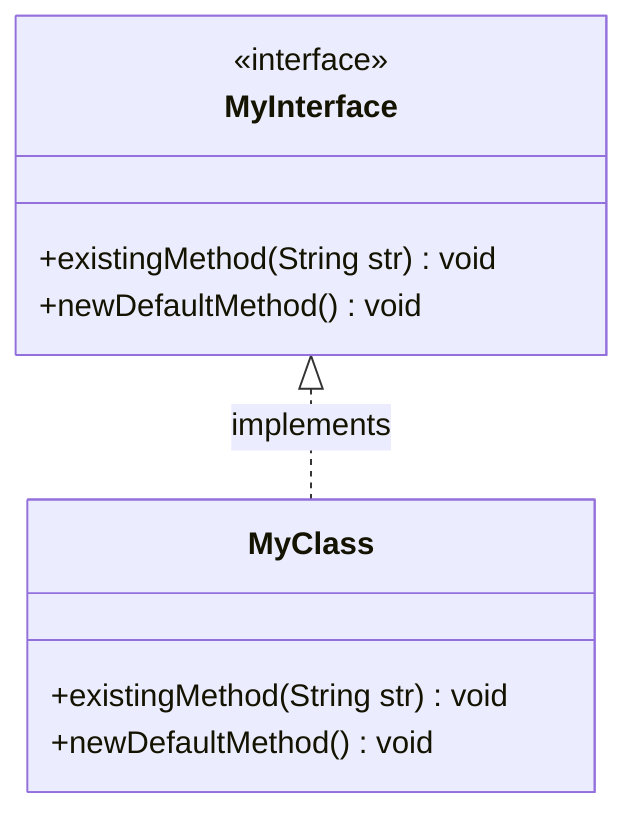
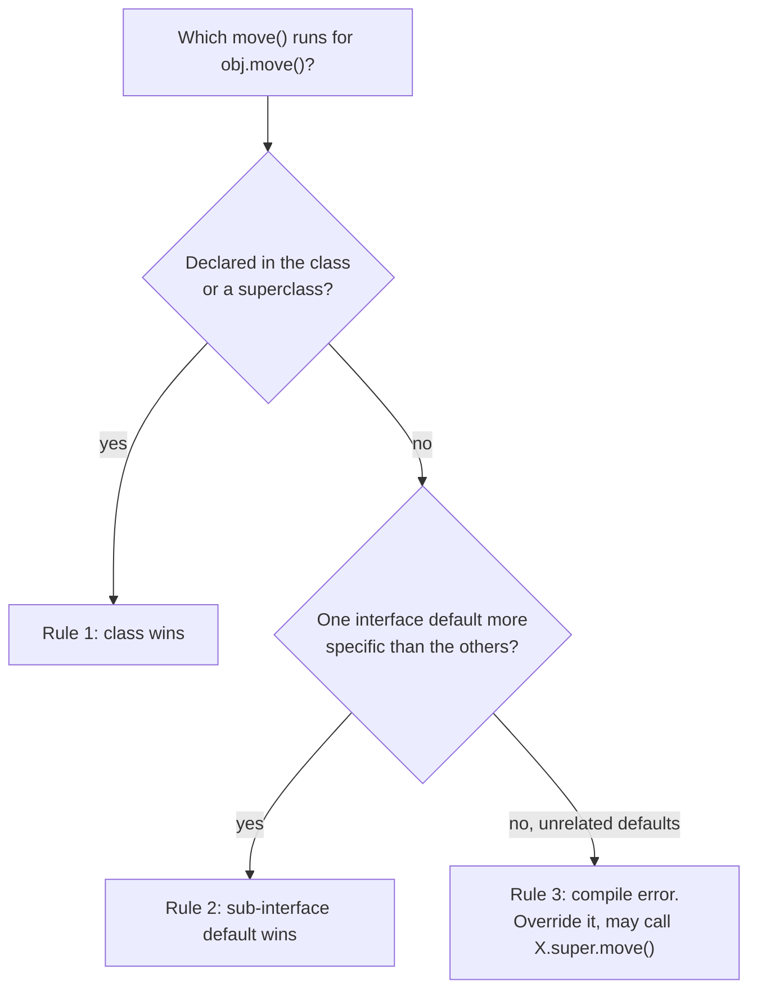
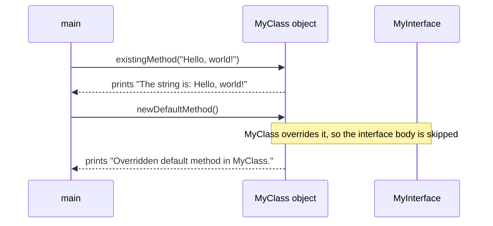

## In One Line
A **default method** (Java 8) is an interface method **with a body**, marked `default`: every implementing class inherits it automatically and may override it — which lets an interface **gain new methods without breaking the classes that already implement it**.

## Mental Model
Think of a **phone operating system update**.

- Millions of apps (implementing classes) were written against version 1 of the OS interface.
- Version 2 adds a new feature, "share to…". If every app were *required* to implement it before it could run again (a new **abstract** method), every existing app would break overnight.
- Instead the OS ships a **standard implementation** of "share to…" (the **default method**). Old apps get it for free, unchanged. Apps that want something better **override** it with their own share screen.
- If an app installs two plug-ins that *both* provide a "share to…" behaviour, the OS refuses to guess — the app must say which one it wants (**`PluginA.super.share()`**), or write its own.
- And if the app's own code already has a "share to…" method, the app's version always wins over the OS default ("**class wins**").

In the code: the OS interface is `MyInterface`, the old feature is the abstract `existingMethod`, the update is `default void newDefaultMethod()`, and `MyClass` is an app that chose to override it.

## Concept
### Why default methods exist
Before Java 8 an interface could contain only abstract methods and constants. Adding a method to a published interface broke every implementation:
- **Source incompatibility:** implementing classes no longer compile (*X is not abstract and does not override abstract method ...*).
- **Binary incompatibility:** already-compiled classes still load, but calling the new method on them throws `AbstractMethodError` at runtime.

Java 8 needed to add lambda-friendly methods to the Collections API — `Iterable.forEach`, `Collection.stream`, `Collection.removeIf`, `List.sort`, `Map.getOrDefault`, `Map.computeIfAbsent`, `Map.merge` — and could not break every `List` and `Map` ever written. The answer was **default methods** (also called *defender methods* or *virtual extension methods* during their design). Adding a default method is binary compatible **and** usually source compatible: existing classes simply inherit it.

### Syntax and rules
```java
interface Shape {
    double area();                                  // abstract (implicitly public abstract)

    default String describe() {                     // default: implicitly public, has a body
        return getClass().getSimpleName() + " with area " + area();
    }
}
```
- The `default` keyword is required; the method is implicitly **`public`** (writing `public default` is allowed but redundant).
- The body can call the interface's other methods — abstract, default, static and (Java 9+) private. `this` is the implementing object, so `area()` dispatches to the class's implementation. This makes defaults a natural home for the **Template Method** idea: the interface defines the algorithm, implementers supply the steps.
- **No instance state.** Interfaces cannot declare instance fields (every field is implicitly `public static final`), so a default method can only work through other methods.
- **Not allowed** on a default method: `final`, `synchronized`, `static`, `abstract`, `private`, `protected` (*modifier ... not allowed here*). A default is by definition overridable, and there is no object monitor for an interface to own.
- A default method **cannot override `equals`, `hashCode` or `toString`** (or any public `Object` method): *default method toString in interface Named overrides a member of java.lang.Object*. Because every class inherits these from `Object` and "class wins", such a default could never be called — so the language forbids it.

### What an implementing class (or sub-interface) can do with a default
| Choice | How | Effect |
|---|---|---|
| **Inherit** it | do nothing | the interface body runs |
| **Override** it | declare the same signature in the class (use `@Override`) | the class version runs; it may still call `MyInterface.super.method()` |
| **Re-abstract** it | an abstract class or sub-interface redeclares it without a body | concrete subclasses must implement it again |
| **Replace** it in a sub-interface | `interface B extends A { @Override default void m() {...} }` | implementers of `B` get `B`'s version |

### Resolving conflicts: the three rules
A class can implement several interfaces, so it can inherit several method bodies with the same signature — the "diamond problem". Java resolves it with three rules, applied in order:

1. **Class wins.** A method declared in the class or any superclass (concrete or abstract) beats every interface default. `class Penguin extends Animal implements Swimmer` uses `Animal.move()`.
2. **The more specific interface wins.** If `FastSwimmer extends Swimmer` and both provide `move()`, the sub-interface's default is chosen, even if the class lists both.
3. **Otherwise the class must decide.** Two unrelated defaults with the same signature are a compile error — *types Flyer and Swimmer are incompatible; class Duck inherits unrelated defaults for move() from types Flyer and Swimmer*. Override the method; inside, you may delegate with **`Flyer.super.move()`** / **`Swimmer.super.move()`**.

Related cases:
- **Default + abstract with the same signature** from unrelated interfaces: the default does **not** silently satisfy the abstract one — *Bird is not abstract and does not override abstract method move() in Mover*. Implement it.
- **`X.super.m()` works only for a direct superinterface** that is not redundant. From a class that implements only `FastSwimmer`, `Swimmer.super.move()` is an error (*not an enclosing class: Swimmer*); if it lists both, it is *bad type qualifier Swimmer in default super call: redundant interface Swimmer is extended by FastSwimmer*.
- Plain `super.m()` in a class always refers to the **superclass**, never to an interface.

The same three rules, with the abstract-class comparison, are summarised in [Abstract class vs interface](lesson:a01-oop/06-abstract-vs-interface).

### Default methods vs abstract classes
| | Interface with default methods | Abstract class |
|---|---|---|
| Instance fields (state) | no — only constants | yes |
| Constructors | no | yes |
| Method access modifiers | `public` (plus `private` helpers since Java 9) | any |
| `final` / `synchronized` methods | not on defaults | yes |
| Override `equals`/`hashCode`/`toString` | no | yes |
| Multiple inheritance | a class can implement many interfaces | only one superclass |
| Purpose | a capability/contract plus convenience behaviour | a partial implementation with shared state |

Rule of thumb: **defaults give multiple inheritance of *behaviour*, never of *state***. If the shared code needs fields or constructors, you want an abstract class (often a "skeletal implementation" like `AbstractList` next to the `List` interface).

### Private interface methods (Java 9)
Two defaults that share logic can use a `private` (or `private static`) interface method as a helper. It is not part of the API, is not inherited, and cannot be called by implementers:
```java
interface Logger {
    void write(String line);
    default void info(String msg)  { log("INFO", msg); }
    default void error(String msg) { log("ERROR", msg); }
    private void log(String level, String msg) { write("[" + level + "] " + msg); }
}
```

### Functional interfaces keep working
A functional interface needs exactly **one abstract** method; default methods do not count. That is how `Predicate` (`and`, `or`, `negate`), `Function` (`andThen`, `compose`) and `Comparator` (`reversed`, `thenComparing`, ...) offer composition while still being lambda targets. See [Functional interfaces](lesson:a05-java8/01-functional-interfaces).

### Default methods in the JDK (a few to name in interviews)
| Interface | Default methods (Java 8 unless noted) |
|---|---|
| `Iterable` | `forEach`, `spliterator` |
| `Iterator` | `remove` (throws `UnsupportedOperationException`), `forEachRemaining` |
| `Collection` | `stream`, `parallelStream`, `removeIf`, `spliterator`; `toArray(IntFunction)` (Java 11) |
| `List` | `sort`, `replaceAll`; `getFirst`, `getLast`, `reversed`, ... (Java 21) |
| `Map` | `getOrDefault`, `forEach`, `putIfAbsent`, `computeIfAbsent`, `computeIfPresent`, `compute`, `merge`, `replaceAll`, `remove(k, v)`, `replace` |
| `Comparator` | `reversed`, `thenComparing`, `thenComparingInt`, ... |
| `Predicate`, `Function`, `Consumer`, `BiFunction` | `and`/`or`/`negate`, `andThen`/`compose`, `andThen` |

`Iterator.remove` shows a second use: a default that throws `UnsupportedOperationException` marks an **optional operation**, so implementers no longer need boilerplate for it.

### How the JVM handles them
A default method's body is compiled into the **interface's** class file. Calls through an interface reference use `invokeinterface`; calls through a class reference use `invokevirtual`; either way the JVM looks up the implementation at runtime, choosing the class's own method first and otherwise the maximally specific default (the same rules as the compiler). `Flyer.super.move()` compiles to `invokespecial` on the interface method. Reflection can tell them apart: `Method.isDefault()`.

### When adding a default is still risky
Defaults are *usually* safe to add, but not always:
- **Compile clash:** an existing class already has a method with the same signature but an incompatible return type — *id() in Order cannot implement id() in Entity; return type int is not compatible with String*.
- **New diamond:** an existing class implements two interfaces that now both have a default with that signature — it stops compiling.
- **Broken invariants:** the default knows nothing about the implementation. When Java 8 added `Collection.removeIf`, third-party *synchronized* collection wrappers that did not override it suddenly had an unsynchronized method (Effective Java, Item 21: "Design interfaces for posterity"). The JDK's own `Collections.synchronizedCollection` wrappers override the new defaults to take the lock.
- **Silent "class wins":** if an implementation already had a method with the same signature but a different meaning, callers of the new interface method get the class's behaviour.

## Diagram

The example: `existingMethod` is abstract and must be implemented; `newDefaultMethod` has a body in the interface, and `MyClass` chooses to override it.


The compiler (and the JVM) apply these checks in order; only rule 3 needs the programmer to act.


Both calls are dispatched to the object; the default body in `MyInterface` would only run if `MyClass` did not override it.

## Code
@example Java8Features/DefaultandStaticMethodsInterfaces/DefaultMethodsExample.java

The example never lets the default body run. Here is an interface where one class inherits the default and another overrides it, a default that calls an abstract method, reflection, and some JDK defaults:
```java
import java.util.*;

public class Evolve {
    interface Shape {
        double area();                                   // abstract: every shape must implement it

        default String describe() {                      // default: added later, callers get it for free
            return getClass().getSimpleName() + " with area " + String.format("%.2f", area());
        }

        default boolean isBiggerThan(Shape other) {      // defaults can call abstract methods (this = the object)
            return this.area() > other.area();
        }
    }

    static class Circle implements Shape {               // does NOT override describe()
        private final double r;
        Circle(double r) { this.r = r; }
        public double area() { return Math.PI * r * r; }
    }

    static class Square implements Shape {               // overrides describe()
        private final double side;
        Square(double side) { this.side = side; }
        public double area() { return side * side; }
        @Override public String describe() { return "Square " + side + "x" + side; }
    }

    public static void main(String[] args) throws Exception {
        Shape c = new Circle(1);
        Shape s = new Square(2);
        System.out.println(c.describe());
        System.out.println(s.describe());
        System.out.println(s.isBiggerThan(c) + " " + c.isBiggerThan(s));

        System.out.println(Shape.class.getMethod("describe").isDefault() + " "
                + Shape.class.getMethod("area").isDefault());

        // JDK default methods added in Java 8
        List<String> names = new ArrayList<>(List.of("zoe", "amy", "bob"));
        names.removeIf(n -> n.startsWith("b"));          // Collection.removeIf
        names.sort(Comparator.naturalOrder());           // List.sort
        StringJoiner out = new StringJoiner(" ");
        names.forEach(out::add);                         // Iterable.forEach
        System.out.println(out);
        Map<String, Integer> ages = new HashMap<>();
        System.out.println(ages.getOrDefault("amy", -1) + " " + ages.computeIfAbsent("amy", k -> 30) + " " + ages);
    }
}
```
```output
Circle with area 3.14
Square 2.0x2.0
true false
true false
amy zoe
-1 30 {amy=30}
```

The conflict-resolution rules in action:
```java
public class Rules {
    interface Flyer   { default String move() { return "fly"; } }
    interface Swimmer { default String move() { return "swim"; } }

    // Rule 3: two unrelated defaults -> the class MUST override; it may pick one with X.super.m()
    static class Duck implements Flyer, Swimmer {
        @Override public String move() { return Flyer.super.move() + " and " + Swimmer.super.move(); }
    }

    // Rule 1: class wins - a superclass method beats any interface default
    static class Animal { public String move() { return "walk"; } }
    static class Penguin extends Animal implements Swimmer { }

    // Rule 2: the more specific interface wins
    interface FastSwimmer extends Swimmer { @Override default String move() { return "swim fast"; } }
    static class Dolphin implements Swimmer, FastSwimmer { }

    // A sub-interface can re-abstract a default
    interface Grounded extends Flyer { @Override String move(); }
    static class Ostrich implements Grounded { public String move() { return "run"; } }

    public static void main(String[] args) {
        System.out.println("Duck:    " + new Duck().move());
        System.out.println("Penguin: " + new Penguin().move());
        System.out.println("Dolphin: " + new Dolphin().move());
        System.out.println("Ostrich: " + new Ostrich().move());
    }
}
```
```output
Duck:    fly and swim
Penguin: walk
Dolphin: swim fast
Ostrich: run
```

What the compiler says when the rules are broken (each block is a separate file):
```java
interface Flyer   { default String move() { return "fly"; } }
interface Swimmer { default String move() { return "swim"; } }
class Duck implements Flyer, Swimmer { }                      // no override

interface Mover { String move(); }
class Bird implements Flyer, Mover { }                        // default + abstract

interface Named { String name(); default String toString() { return "Named " + name(); } }

interface A { final default void f() { } }                    // also: synchronized, protected
```
```text
error: types Flyer and Swimmer are incompatible;
  class Duck inherits unrelated defaults for move() from types Flyer and Swimmer
error: Bird is not abstract and does not override abstract method move() in Mover
error: default method toString in interface Named overrides a member of java.lang.Object
error: modifier final not allowed here
```

Why defaults exist — binary compatibility, proven with separate compilation. `OldImpl` is compiled against version 1 of `Greeter` (only `greet`); then only `Greeter` (now with a new method) and `Main` are recompiled:
```java
// version 2 of the interface
public interface Greeter {
    String greet(String name);
    default String greetAll(String... names) {
        StringBuilder sb = new StringBuilder();
        for (String n : names) sb.append(greet(n)).append("; ");
        return sb.toString().trim();
    }
}
// Main
Greeter g = new OldImpl();              // OldImpl.class was compiled against version 1
System.out.println(g.greetAll("Ana", "Raj"));
```
```output
Hi Ana; Hi Raj;
```
With `String greetAll(String... names);` declared **abstract** instead, the same old class file fails at runtime:
```text
Exception in thread "main" java.lang.AbstractMethodError: Receiver class OldImpl does not define or inherit an implementation of the resolved method 'abstract java.lang.String greetAll(java.lang.String[])' of interface Greeter.
```

Defaults in a functional interface, and a Java 9 private helper:
```java
interface Logger {
    void write(String line);                                   // the only abstract method
    default void info(String msg)  { log("INFO", msg); }
    default void error(String msg) { log("ERROR", msg); }
    private void log(String level, String msg) {               // Java 9: shared helper, not part of the API
        write("[" + level + "] " + msg);
    }
}

@FunctionalInterface
interface Validator<T> {
    boolean validate(T t);                                     // single abstract method
    default Validator<T> and(Validator<T> other) {             // defaults don't break "functional"
        return t -> validate(t) && other.validate(t);
    }
    default Validator<T> negate() { return t -> !validate(t); }
}

Logger console = System.out::println;                          // a lambda gets the defaults for free
console.info("started");
console.error("disk full");

Validator<String> notEmpty = s -> !s.isEmpty();
Validator<String> shortText = s -> s.length() <= 5;
Validator<String> ok = notEmpty.and(shortText);
System.out.println(ok.validate("java") + " " + ok.validate("") + " " + ok.validate("interfaces") + " " + ok.negate().validate(""));
```
```output
[INFO] started
[ERROR] disk full
true false false true
```

## Walkthrough
- `package Java8Features.DefaultandStaticMethodsInterfaces;` — one package holds this example and the [static interface methods](lesson:a05-java8/11-static-interface-methods) example, which is why the two files use different type names (`MyInterface`/`MyClass` vs `MyStaticInterface`/`MyStaticClass`) — two top-level `MyClass` types in one package would clash.
- `interface MyInterface { ... }` — a **package-private** top-level interface in the same file as the public class `DefaultMethodsExample`. A source file may hold many top-level types but only one `public` one, named like the file.
- `void existingMethod(String str);` — an abstract method (implicitly `public abstract`). The comment is right: every non-abstract implementing class must implement it. The name tells the story — this method "existed" in version 1 of the interface.
- `default void newDefaultMethod() { System.out.println("This is a default method in the interface."); }` — the method "added later". It has a body and is implicitly `public`. As the comment says, implementing it is **optional**.
- `class MyClass implements MyInterface` — a package-private class.
- `public void existingMethod(String str)` — implements the abstract method. It **must** be `public`: interface methods are public, and an implementation cannot reduce visibility (*attempting to assign weaker access privileges; was public*). It prints `The string is: Hello, world!` for the argument used in `main`. It works without `@Override`, but adding it is good practice.
- `@Override public void newDefaultMethod()` — "Optionally override the default method". `@Override` is valid on overrides of default methods and makes the compiler check the signature. From now on `MyClass` objects never run the interface body.
- `MyClass obj = new MyClass();` — the reference type is the class; calls compile to `invokevirtual MyClass...`, and dynamic dispatch picks the implementation at runtime.
- `obj.existingMethod("Hello, world!");` → prints `The string is: Hello, world!`.
- `obj.newDefaultMethod();` → the overridden version: `Overridden default method in MyClass.` The same would happen with `MyInterface obj = new MyClass();` — overriding a default is ordinary [polymorphism](lesson:a01-oop/04-polymorphism).
- The line `This is a default method in the interface.` is **never printed** by this program. All `// Output:` comments match the recorded run.

## Traps
> [!NOTE] The example is correct and its `// Output:` comments match the recorded run, but it never shows the default body running — `MyClass` overrides it, so `"This is a default method in the interface."` is never printed. Delete the override in `MyClass` (or add a second class that does not override) to see the inherited default; the `Evolve` snippet above shows both cases. Also, `existingMethod` is implemented without `@Override` while `newDefaultMethod` has it — add it to both for consistency.

- **Two unrelated defaults with the same signature** do not compile until the class overrides the method (`X.super.m()` to reuse one).
- **Class wins — even silently.** A superclass method with the same signature hides every default, so adding a default does nothing for classes that already have such a method.
- **A default does not satisfy an abstract method from another interface** with the same signature; the class must implement it.
- **`X.super.m()` only names a direct, non-redundant superinterface.** It cannot skip a level (`Swimmer.super` from a class that implements only `FastSwimmer`).
- **No `default toString()/equals()/hashCode()`** — compile error; put them in the class (or a record).
- **No `final`, `synchronized`, `protected` or `private` defaults.** If you need locking, lock inside the body on an explicit object; if you need a helper, use a `private` (non-default) method (Java 9).
- **Default methods have no state** — trying to "remember" something in an interface leads to `static` fields shared by all implementers, which is almost always a bug.
- **Implementing methods must be `public`.** Forgetting `public` on the class's implementation is a very common compile error.
- **Adding a default can break subclasses' invariants** (the synchronized-wrapper `removeIf` problem) or clash with existing methods; review implementations before adding one to a widely used interface.

## Tips & Tricks
- **Why they exist, in one phrase:** "**evolve** interfaces without breaking implementers" — say "backward compatibility" and name `Iterable.forEach`, `Collection.stream`, `List.sort`, `Map.getOrDefault`.
- **Conflict rules — "Class, Child, Choose":** the **class** wins, else the more specific **child** interface wins, else you must **choose** by overriding (and calling `X.super.m()`).
- **`X.super.m()` = "call interface X's default"; `super.m()` = "call my superclass".**
- **Defaults = behaviour, not state.** Need fields or constructors? Use an abstract class (or pair the interface with a skeletal `AbstractX` class).
- **Keep defaults built on the abstract methods** (template style): `describe()` uses `area()`. That keeps them correct for any implementation.
- **Use a default that throws `UnsupportedOperationException`** for optional operations, like `Iterator.remove`.
- **Always write `@Override`** on methods that override defaults — a typo otherwise creates a new method and the default keeps running.

## Interview Q&A
### [Basic] What is a default method and why was it introduced in Java 8?
A default method is an interface method with a body, declared with the `default` keyword. Implementing classes inherit it automatically and can override it. It was introduced so that interfaces can **evolve**: before Java 8, adding a method to an interface broke every implementing class (compile errors, or `AbstractMethodError` for already-compiled classes). Java 8 needed to add methods such as `Iterable.forEach`, `Collection.stream`, `Collection.removeIf`, `List.sort` and `Map.getOrDefault` to interfaces with millions of implementations; default methods made that backward compatible. They also let functional interfaces offer composition methods like `Predicate.and` and `Comparator.thenComparing`.

**Follow-up:** *Is adding a default method always backward compatible?* — Binary-compatible, yes; source-compatible usually, but not if an implementing class already has a same-signature method with an incompatible return type, or if it creates a conflict between two interfaces the class implements.

### [Basic] Does an implementing class have to override a default method? What are its options?
No. It can (1) **inherit** it unchanged, (2) **override** it with its own implementation (optionally calling `MyInterface.super.method()` inside), or (3) if it is an abstract class, **re-declare it abstract**, forcing concrete subclasses to implement it. A sub-interface can likewise override the default with its own default or re-abstract it. In the course example, `MyClass` chooses option 2, so `obj.newDefaultMethod()` prints `Overridden default method in MyClass.`

**Follow-up:** *What access modifier must the overriding method have?* — `public`, because interface methods are implicitly public and an override cannot reduce visibility.

### [Intermediate] How does Java resolve the diamond problem with default methods?
Three rules in order. (1) **Class wins**: a method declared in the class or any superclass takes priority over interface defaults. (2) **The most specific interface wins**: if `B extends A` and both provide the method, `B`'s default is used. (3) Otherwise, if two unrelated interfaces provide the same default, the class **must override** it — the compiler reports *class C inherits unrelated defaults for m() from types A and B*. Inside the override it can call `A.super.m()` or `B.super.m()` or combine them.
```java
class Duck implements Flyer, Swimmer {
    @Override public String move() { return Flyer.super.move() + " and " + Swimmer.super.move(); }
}
```
**Follow-up:** *What if one interface has a default and the other declares the same method abstract?* — Still a conflict: the class must implement the method (*Bird is not abstract and does not override abstract method move() in Mover*).

### [Intermediate] Can a default method override `equals`, `hashCode` or `toString`?
No — it is a compile error: *default method toString in interface Named overrides a member of java.lang.Object*. Every class inherits these methods from `Object`, and by the "class wins" rule a class method always beats an interface default, so such a default could never be invoked. Allowing it would only create confusion. If objects of an interface type need a particular `toString`, implement it in the classes (or use records, which generate them).

**Follow-up:** *Can an interface declare `boolean equals(Object o);` abstractly?* — Yes, it is legal (as `Comparator` does) to document the contract; it does not count as the functional interface's abstract method because every class already implements it via `Object`.

### [Intermediate] Which modifiers can a default method have, and why can't it be `final` or `synchronized`?
Only `public` (implicit) plus `default`, and it can be generic, throw exceptions, etc. `final`, `synchronized`, `static`, `abstract`, `private` and `protected` are rejected (*modifier ... not allowed here*). `final` would contradict the purpose — a default is a fallback that implementers must be free to replace, and it would also make adding interfaces to existing classes fragile. `synchronized` was rejected because locking is an implementation-state concern, interfaces have no state, and a default cannot know the locking policy of its implementers (Brian Goetz's explanation: it would give a false sense of safety). Since Java 9 an interface can have `private` methods, but those are helpers, not defaults.

**Follow-up:** *Can a default method be `static`?* — No; `static` interface methods are a separate feature and are not inherited or overridable. See [Static interface methods](lesson:a05-java8/11-static-interface-methods).

### [Intermediate] After Java 8, what is the difference between an interface with default methods and an abstract class?
Interfaces still cannot hold **instance state** (fields are `public static final` constants) and have no **constructors**; their methods are `public` (or `private` helpers). Abstract classes can have fields, constructors, any access modifiers, `final`/`synchronized` methods, and can override `Object` methods. A class can implement **many** interfaces but extend **one** class. So defaults provide multiple inheritance of **behaviour**, not state. Use an interface for a capability/contract (with convenience defaults) and an abstract class when shared state or constructor logic is needed — often both together, like `List` and `AbstractList`.

**Follow-up:** *Does the diamond problem exist for state?* — No, because interfaces have no instance fields; only method bodies can conflict, and the three rules resolve those.

### [Intermediate] Do default methods affect whether an interface is a functional interface?
No. A functional interface must have exactly **one abstract** method; any number of default (and static, and private) methods are allowed. `Comparator` has one abstract method `compare` and many defaults (`reversed`, `thenComparing`, ...), and is used with lambdas all the time. A lambda assigned to such an interface implements the abstract method and inherits all the defaults — e.g. `Logger console = System.out::println; console.info("started");` works because `info` is a default built on `write`.

**Follow-up:** *Does `@FunctionalInterface` allow default methods?* — Yes; it only checks that there is exactly one abstract method (ignoring public `Object` methods).

### [Advanced] Why is adding a default method to a widely used interface still considered risky?
Because the default is written without knowledge of the implementations. Effective Java (Item 21) uses the Java 8 `Collection.removeIf` default: third-party synchronized collection wrappers (Apache Commons `SynchronizedCollection`) did not override it, so `removeIf` ran **without** taking the wrapper's lock, silently breaking their thread-safety guarantee. The JDK had to override the new defaults in its own `Collections.synchronizedCollection` wrappers. Other risks: compile errors in classes with a same-signature method of a different return type, new unrelated-default conflicts, and the "class wins" rule silently giving callers a pre-existing method with different semantics. Defaults are best designed into an interface from the start.

**Follow-up:** *What does this mean for API design?* — Design interfaces carefully up front, test them with several implementations before release, and treat adding defaults later as a compatibility-sensitive change.

### [Advanced] How are default methods compiled and dispatched by the JVM?
The default method's bytecode lives in the **interface's** class file, marked as a non-abstract public method. Call sites are ordinary virtual calls: `invokeinterface` if the static type is the interface, `invokevirtual` if it is a class. During method selection the JVM first looks in the receiver's class hierarchy; only if no class declares the method does it pick the maximally specific default among the superinterfaces — the runtime mirror of the compiler's rules. `Flyer.super.move()` compiles to `invokespecial` on the interface method (allowed for direct superinterfaces since Java 8). This is why an old class file compiled before the default existed still works: the JVM finds the default at link time. Reflection exposes it via `Method.isDefault()`.

**Follow-up:** *What if the rules are ambiguous at runtime (e.g. an interface changed after the class was compiled)?* — Calling the method throws `IncompatibleClassChangeError` (for conflicting defaults) or `AbstractMethodError` (for no implementation).

## Quiz
### What does the original example print as its second line?
- [ ] This is a default method in the interface.
- [x] Overridden default method in MyClass.
- [ ] Both default and overridden messages
- [ ] Nothing — default methods must be called as `MyInterface.newDefaultMethod()`
> `MyClass` overrides `newDefaultMethod()`, and instance methods are dispatched to the object's class, so the class version runs and the interface body never does. Calling a default through the interface name is not possible — that syntax is for static methods.

### What does this print?
```java
interface Swimmer { default String move() { return "swim"; } }
class Animal { public String move() { return "walk"; } }
class Penguin extends Animal implements Swimmer { }

System.out.println(new Penguin().move());
```
- [x] walk
- [ ] swim
- [ ] walk swim
- [ ] Compile error: conflicting move() methods
> Rule 1, "class wins": a method inherited from a superclass beats any interface default, so there is no conflict and `Animal.move()` runs.

### What does this print?
```java
interface Swimmer { default String move() { return "swim"; } }
interface FastSwimmer extends Swimmer { default String move() { return "swim fast"; } }
class Dolphin implements Swimmer, FastSwimmer { }

System.out.println(new Dolphin().move());
```
- [ ] swim
- [x] swim fast
- [ ] Compile error: Dolphin inherits unrelated defaults
- [ ] Runtime error
> Rule 2: `FastSwimmer` is more specific than `Swimmer` (it extends it), so its default wins. The "unrelated defaults" error only appears when neither interface extends the other.

### Why does this not compile?
```java
interface Flyer   { default String move() { return "fly"; } }
interface Swimmer { default String move() { return "swim"; } }
class Duck implements Flyer, Swimmer { }
```
- [ ] A class cannot implement two interfaces with default methods
- [x] `Duck` inherits two unrelated defaults for `move()` and must override it
- [ ] Default methods must be declared `public default`
- [ ] `Duck` must be declared abstract
> Neither interface is more specific and no class declares `move()`, so the compiler cannot choose. Fix: override `move()` in `Duck`, optionally returning `Flyer.super.move()`. Declaring `Duck` abstract does not help — the conflict error is reported for abstract classes too.

### Which of these interface members compiles?
- [ ] `final default void f() { }`
- [ ] `default String toString() { return "x"; }`
- [ ] `synchronized default void g() { }`
- [x] `private void helper() { }` (Java 9+)
> Since Java 9, private (non-default) interface methods are allowed as helpers. `final` and `synchronized` are not allowed on defaults, and a default may not override an `Object` method such as `toString`.

### Spot the bug: this class implements only `FastSwimmer`. Why does it not compile?
```java
interface Swimmer { default String move() { return "swim"; } }
interface FastSwimmer extends Swimmer { default String move() { return "swim fast"; } }
class Dolphin implements FastSwimmer {
    public String move() { return Swimmer.super.move(); }
}
```
- [ ] `move()` must be annotated with `@Override`
- [x] `X.super.m()` can only name a direct superinterface, and `Swimmer` is not one of `Dolphin`'s
- [ ] Default methods cannot be called from an override
- [ ] `super` cannot be used inside a class that implements an interface
> The compiler reports *not an enclosing class: Swimmer*. `Dolphin` can call `FastSwimmer.super.move()`; reaching past it to `Swimmer`'s default is not allowed. `@Override` is optional here.

### An old class compiled against version 1 of an interface is used with version 2, which adds a new method. Calling the new method on it...
- [ ] fails to load the class with `NoClassDefFoundError`
- [x] works if the new method is a default method, and throws `AbstractMethodError` if it is abstract
- [ ] always throws `AbstractMethodError`
- [ ] always works, because the JVM generates an empty body
> With a default, the JVM finds the interface's body at link time — that is the binary-compatibility guarantee defaults were designed for (the lesson's run printed `Hi Ana; Hi Raj;`). An abstract method has no implementation anywhere, so the call fails at runtime.

## Takeaways
- A default method (Java 8) is an interface method with a body, marked `default` and implicitly `public`; implementers inherit it and may override it.
- It exists to evolve interfaces without breaking implementers — binary and (usually) source compatible — e.g. `Iterable.forEach`, `Collection.stream`/`removeIf`, `List.sort`, `Map.getOrDefault`.
- Conflict rules: class wins; then the more specific interface wins; otherwise the class must override and may call `X.super.m()` (direct superinterfaces only).
- Defaults cannot be `final`, `synchronized`, `protected` or `private`, and cannot override `equals`/`hashCode`/`toString`; Java 9 adds `private` helper methods.
- Interfaces still have no instance state or constructors: defaults give multiple inheritance of behaviour, not state — use an abstract class for shared state.
- Default methods do not change functional-interface status (one abstract method); `Predicate`, `Function` and `Comparator` compose through defaults.
- Adding a default to a widely used interface can still clash with existing methods or break implementers' invariants (the synchronized-wrapper `removeIf` story).
