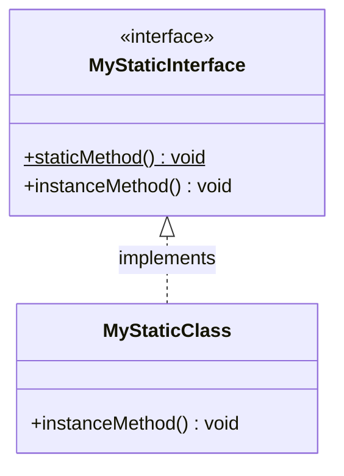
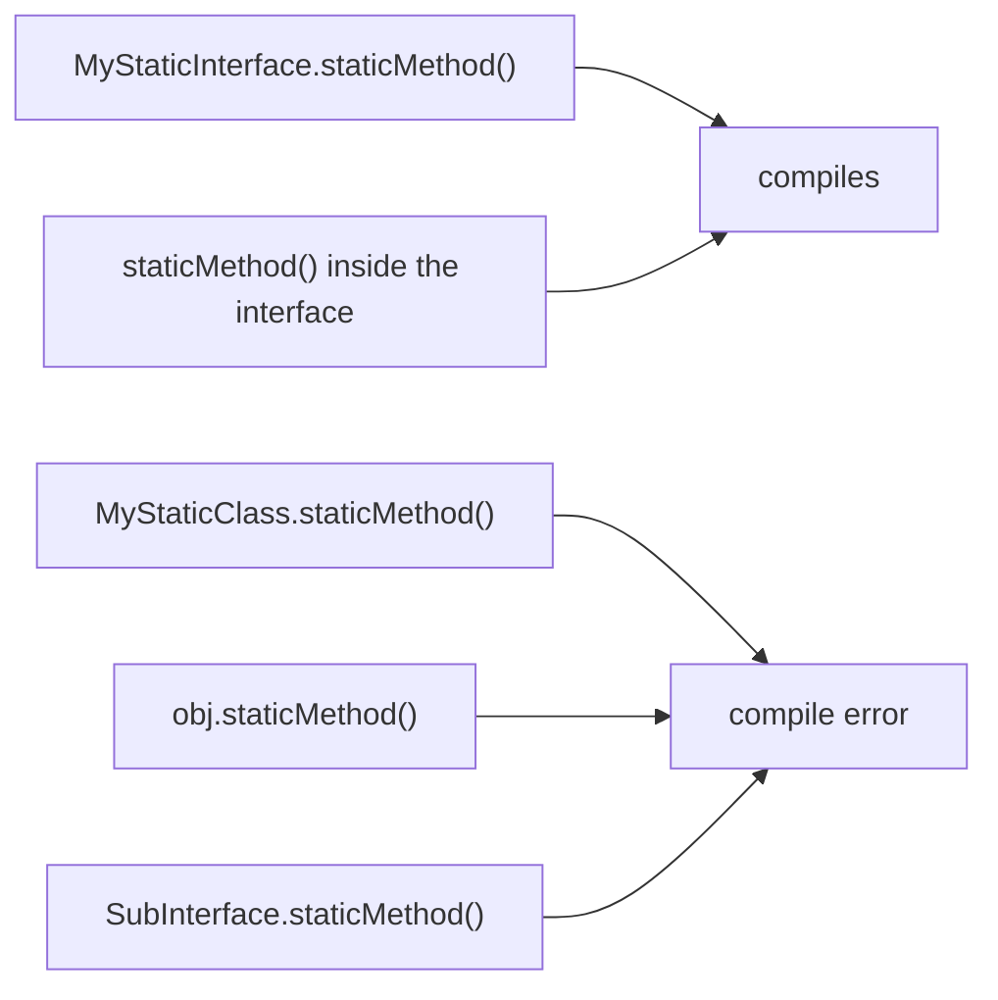
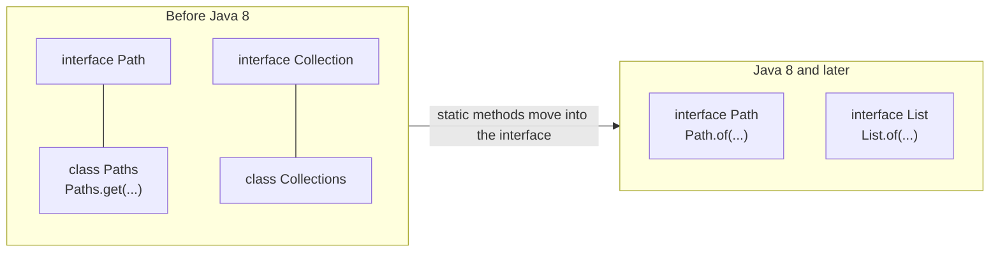

## In One Line
Since Java 8 an interface can contain **`static` methods with a body**; they belong to the **interface itself**, are called only as **`InterfaceName.method()`**, are **not inherited** by implementing classes or sub-interfaces, and are the natural home for factories and helpers of that type — `Comparator.comparing`, `Function.identity`, `List.of`, `Path.of`.

## Mental Model
Think of a **brand's head-office hotline** printed on every product manual.

- The brand (the interface) defines what every product must do (abstract methods) — and also runs a **hotline** (the static method) that anybody can call **by the brand's name**: "Call *Shape* support" → `Shape.circle(1)`.
- The shops that sell the brand's products (implementing classes) do **not** own the hotline. You cannot walk into a shop and say "connect me to *your* hotline" — `MyStaticClass.staticMethod()` does not compile.
- You also cannot ask a single product (an object) to dial it — `obj.staticMethod()` does not compile.
- If a shop sells two brands with hotlines of the same name, there is no confusion: you always say *which* brand you are calling (`Clock.name()` vs `Timer.name()`).

In the code: the brand is `MyStaticInterface`, the hotline is `static void staticMethod()`, and the shop is `MyStaticClass`, which only provides the product behaviour `instanceMethod()`.

## Concept
### Why static methods were allowed in interfaces
Before Java 8, an interface could not contain any method body, so helpers and factories for an interface type had to live in a separate **companion utility class**:

| Interface | Pre-Java 8 companion class | Static methods in the interface itself |
|---|---|---|
| `Collection`, `List`, `Set`, `Map` | `Collections` | `List.of`, `Set.of`, `Map.of`, `Map.entry`, `Map.ofEntries` (Java 9), `List.copyOf` (Java 10) |
| `Path` | `Paths.get` (Java 7) | `Path.of` (Java 11) — the Javadoc now recommends it over `Paths.get` |
| `Comparator` | — | `comparing`, `comparingInt`, `naturalOrder`, `reverseOrder`, `nullsFirst`, `nullsLast` (Java 8) |
| `Function`, `UnaryOperator` | — | `identity()` |
| `BinaryOperator` | — | `minBy`, `maxBy` |
| `Predicate` | — | `isEqual` (Java 8), `not` (Java 11) |
| `Stream`, `IntStream` | `StreamSupport` | `Stream.of`, `empty`, `iterate`, `generate`, `concat`, `ofNullable` (Java 9); `IntStream.range`, `rangeClosed` |
| `Map.Entry` | — | `comparingByKey`, `comparingByValue` |
| `CharSequence` | — | `compare` (Java 11) |

Keeping the factory **next to the type it creates** improves cohesion and discoverability: type `Comparator.` in an IDE and you see every way to build a comparator. It also lets an API expose only an interface and hide the implementation classes behind static factories (`List.of` returns instances of internal classes such as `ImmutableCollections.ListN`).

### Syntax and rules
```java
interface MyStaticInterface {
    static void staticMethod() {              // implicitly public; must have a body
        System.out.println("This is a static method in the interface.");
    }
    void instanceMethod();                    // abstract
}
```
- A static interface method **must have a body** (*missing method body, or declare abstract*).
- It is implicitly **`public`**. Since **Java 9** it may be **`private static`** — a helper usable only inside the interface.
- Not allowed: `abstract` (*illegal combination of modifiers: abstract and static*), `default` (*illegal combination of modifiers: static and default*), `final`, `synchronized`, `protected` (*modifier ... not allowed here*).
- Like any static method it has **no `this`**: it cannot call the interface's abstract or default methods except on an object it is given. It can use the interface's constants and its other static methods.
- Inside the interface (in default, static or private methods) it can be called **unqualified**: `describe()` may call `format(area())` directly.
- It can be generic, overloaded, throw exceptions, and be the target of a method reference: `Supplier<String> s = Clock::name;`.
- An interface may even declare `static void main(String[] args)` — `java Hello.java` runs it.

### Calling it: only through the interface name
| Call | Compiles? | Compiler message |
|---|---|---|
| `MyStaticInterface.staticMethod()` | **yes** | — |
| `MyStaticClass.staticMethod()` (implementing class) | no | *cannot find symbol ... location: class MyStaticClass* |
| `obj.staticMethod()` where `obj` is a `MyStaticClass` | no | *cannot find symbol ... location: variable obj of type MyStaticClass* |
| `ref.staticMethod()` where `ref` is a `MyStaticInterface` | no | *illegal static interface method call — the receiver expression should be replaced with the type qualifier 'MyStaticInterface'* |
| `SubInterface.staticMethod()` (a sub-interface) | no | *cannot find symbol ... location: interface SubInterface* |
| `staticMethod()` unqualified inside `MyStaticClass` | no | *cannot find symbol ... location: class MyStaticClass* |
| `staticMethod()` unqualified inside the interface | **yes** | — |

### Not inherited — and why
The JLS says a class does **not** inherit static methods from its superinterfaces, and neither does a sub-interface. Contrast with classes:

| | Static method in a **class** | Static method in an **interface** |
|---|---|---|
| Inherited by subclasses / implementers? | **yes** — `Child.hi()` works | **no** |
| Call through an instance? | legal (bad style): `new Child().hi()` | compile error |
| Same signature in a subtype | *hides* the parent's method | an unrelated, independent method |
| Bytecode | `invokestatic` (Methodref) | `invokestatic` (InterfaceMethodref, class files version 52 = Java 8+) |

Reasons for the design:
1. **No diamond problem.** A class may implement many interfaces. If static methods were inherited, `class Stopwatch implements Clock, Timer` with `Clock.name()` and `Timer.name()` would have an ambiguous `Stopwatch.name()`. Requiring the interface name removes the ambiguity entirely — the class can even declare its own unrelated `name()`.
2. **Safe evolution.** Adding a static method to an interface can never clash with, or change the meaning of, code in existing implementing classes.
3. **Clarity.** `Comparator.naturalOrder()` reads as "a comparator factory"; `myComparator.naturalOrder()` would wrongly suggest it depends on `myComparator`.

Because they are not inherited, static interface methods **cannot be overridden**. A method with the same signature in an implementing class is simply another method — putting `@Override` on it fails with *method does not override or implement a method from a supertype*.

### Static vs default vs abstract interface methods
| | Abstract | [Default](lesson:a05-java8/10-default-methods) | Static |
|---|---|---|---|
| Body | no | yes | yes |
| Belongs to | each implementing object | each implementing object | the interface itself |
| Called as | `obj.m()` | `obj.m()` | `Interface.m()` only |
| Inherited | yes (must be implemented) | yes | **no** |
| Overridable | must be implemented | yes | no |
| `this` available | — | yes | no |
| Counts toward "one abstract method" of a functional interface | yes | no | no |
| Typical use | the contract | evolving the API, convenience built on the contract | factories, helpers, `identity()`, `comparing(...)` |

### Design guidance
- Put a static method in an interface when it **creates or operates on that interface type**: factories (`Shape.circle(r)`), combinators (`Comparator.comparing`), constants-like singletons (`Function.identity()`).
- Keep **general-purpose** utilities that span many types in a final utility class with a private constructor (`Objects`, `Math`, `Arrays`).
- Hide implementation classes behind static factories (Effective Java, Item 1) — in Java 8 the helpers had to be `public`; since Java 9 use `private static` methods for internals.
- Static interface methods do not affect functional-interface status, so a functional interface can carry its own factories (`Comparator` has one abstract method and many static factories).

## Diagram

`MyStaticClass` implements only the abstract `instanceMethod()`. The underlined (`$`) static method stays in the interface — it is not a member of `MyStaticClass`.


Only the interface's own name (or an unqualified call from inside the interface) reaches a static interface method.


Companion utility classes were a workaround; static interface methods let the type carry its own factories.

## Code
@example Java8Features/DefaultandStaticMethodsInterfaces/StaticMethodsInInterfaceExample.java

Factories, a Java 9 `private static` helper, a default calling a static, no conflict between two interfaces' statics, method references, and JDK static interface methods:
```java
import java.util.*;
import java.util.function.*;
import java.util.stream.*;

public class StaticTour {
    interface Shape {
        double area();

        static Shape circle(double r) { return () -> Math.PI * r * r; }        // factory
        static Shape square(double side) { return () -> side * side; }
        static Shape largest(List<Shape> shapes) {                              // helper about the type
            return shapes.stream().max(Comparator.comparingDouble(Shape::area)).orElseThrow();
        }
        static String format(double value) { return round2(value) + " sq units"; }

        private static double round2(double v) { return Math.round(v * 100) / 100.0; }   // Java 9 private static helper

        default String describe() { return "shape of " + format(area()); }    // default calls static, unqualified
    }

    interface Clock {
        static String name() { return "Clock"; }
    }
    interface Timer {
        static String name() { return "Timer"; }
    }
    static class Stopwatch implements Clock, Timer {                          // no conflict: statics are not inherited
        String name() { return "Stopwatch"; }                                 // unrelated instance method, same signature
    }

    public static void main(String[] args) {
        Shape c = Shape.circle(1);
        Shape s = Shape.square(2);
        System.out.println(c.describe() + " | " + s.describe());
        System.out.println(Shape.largest(List.of(c, s)) == s);

        Supplier<String> ref = Clock::name;                                     // method reference to a static interface method
        System.out.println(ref.get() + " " + Timer.name() + " " + new Stopwatch().name());

        // static interface methods in the JDK
        List<String> names = List.of("bob", "Amy", "carl");                     // List.of (Java 9)
        System.out.println(names.stream().sorted(Comparator.comparing(String::toLowerCase)).toList());
        System.out.println(names.stream().sorted(Comparator.reverseOrder()).toList());
        System.out.println(names.stream().filter(Predicate.not(n -> n.startsWith("c"))).toList());   // Java 11
        System.out.println(Stream.of(1, 2, 3).map(Function.identity()).toList() + " " + Map.entry("k", 1)
                + " " + IntStream.range(0, 4).sum() + " " + Stream.concat(Stream.of("a"), Stream.of("b")).toList());
    }
}
```
```output
shape of 3.14 sq units | shape of 4.0 sq units
true
Clock Timer Stopwatch
[Amy, bob, carl]
[carl, bob, Amy]
[bob, Amy]
[1, 2, 3] k=1 6 [a, b]
```
`Shape.circle` returns a lambda: `Shape` has one abstract method, so it is a functional interface and a factory can build instances without any named class.

Every wrong way to call it — one file, five compile errors:
```java
interface MyStaticInterface {
    static void staticMethod() { System.out.println("static"); }
    void instanceMethod();
}
interface SubInterface extends MyStaticInterface { }
class MyStaticClass implements MyStaticInterface {
    public void instanceMethod() { staticMethod(); }            // unqualified call from implementer
}
// in main:
MyStaticClass obj = new MyStaticClass();
obj.staticMethod();                                          // through an object
MyStaticClass.staticMethod();                                // through the implementing class
SubInterface.staticMethod();                                 // through a sub-interface
MyStaticInterface ref = obj;
ref.staticMethod();                                          // through an interface-typed reference
```
```text
error: cannot find symbol   symbol: method staticMethod()   location: class MyStaticClass
error: cannot find symbol   symbol: method staticMethod()   location: variable obj of type MyStaticClass
error: cannot find symbol   symbol: method staticMethod()   location: class MyStaticClass
error: cannot find symbol   symbol: method staticMethod()   location: interface SubInterface
error: illegal static interface method call
  the receiver expression should be replaced with the type qualifier 'MyStaticInterface'
```
The fix for all five is the same: `MyStaticInterface.staticMethod();`.

Class statics vs interface statics:
```java
public class Contrast {
    static class Parent { static String hi() { return "Parent.hi"; } }
    static class Child extends Parent { }

    interface Greeter { static String hi() { return "Greeter.hi"; } }
    static class Impl implements Greeter { }

    public static void main(String[] args) {
        System.out.println(Child.hi());           // class statics ARE inherited
        System.out.println(new Child().hi());     // legal (but bad style) through an instance
        System.out.println(Greeter.hi());         // interface statics: only via the interface name
        // Impl.hi() or new Impl().hi() would not compile
    }
}
```
```output
Parent.hi
Parent.hi
Greeter.hi
```

An interface can hold the program's entry point (`java Hello.java`):
```java
interface Hello {
    static void main(String[] args) {                 // implicitly public
        System.out.println("main can live in an interface");
    }
}
```
```output
main can live in an interface
```

## Walkthrough
- `package Java8Features.DefaultandStaticMethodsInterfaces;` — the same package as the [default methods](lesson:a05-java8/10-default-methods) example, so these types are named `MyStaticInterface`/`MyStaticClass` to avoid clashing with `MyInterface`/`MyClass`.
- `interface MyStaticInterface { ... }` — a package-private top-level interface in the same file as the public class.
- `static void staticMethod() { System.out.println(...); }` — a static interface method: implicitly `public`, has a body, belongs to the interface. The `// Output:` comment on its `println` is correct for the call in `main`.
- `void instanceMethod();` — an ordinary abstract method (implicitly `public abstract`). As its comment says, every concrete implementing class must implement it. It is also the interface's only abstract method, so `MyStaticInterface` happens to be a functional interface: `MyStaticInterface m = () -> System.out.println("lambda");` would compile.
- `class MyStaticClass implements MyStaticInterface` — implements only `instanceMethod()`, and must declare it `public` (an implementation cannot reduce the interface method's public access). `staticMethod()` is **not** a member of `MyStaticClass`.
- `MyStaticInterface.staticMethod();` — the one legal way to call it from outside the interface; compiles to `invokestatic` on the interface. Prints `This is a static method in the interface.` No object exists yet at this point — static methods need none.
- `MyStaticClass obj = new MyStaticClass(); obj.instanceMethod();` — normal instance call, prints `This is an instance method in MyStaticClass.`
- Both lines of the recorded output match the `// Output:` comments.

## Traps
> [!ERRATA] The comment `// Static method (can be called without an instance of the interface)` is misleading in two ways. An interface never has instances of its own (objects are instances of *implementing classes*), and "can be called without an instance" suggests calling through an instance is also an option — it is not: `obj.staticMethod()` and `ref.staticMethod()` are compile errors. Accurate wording: `// Static method: belongs to the interface; call it only as MyStaticInterface.staticMethod()`. The code itself is correct, and both `// Output:` comments match the recorded run.

- **Only `Interface.method()` works.** Calling through an object, the implementing class, a sub-interface or an interface-typed variable does not compile (see the Code section for the exact messages).
- **Not inherited, so not overridable.** A same-signature method in the implementing class is a separate method; `@Override` on it is an error. `Impl.hi()` calls the class's method, `Greeter.hi()` the interface's.
- **Unqualified calls work only inside the interface.** Inside an implementing class, `staticMethod()` is *cannot find symbol*; write `MyStaticInterface.staticMethod()`.
- **Different from class statics**, which *are* inherited (`Child.hi()` compiles). Do not transfer the class rules to interfaces in an interview answer.
- **No `abstract`, `default`, `final`, `synchronized`, `protected`** on a static interface method, and it always needs a body. Before Java 9 it could not be `private` either.
- **No `this`** — a static interface method cannot call `instanceMethod()` or a default method without an object.
- **Java 8 bytecode requirement:** interface static methods need class-file version 52 (Java 8) or later, so an interface that declares them cannot be loaded by a Java 7 JVM — relevant only for very old runtimes.

## Tips & Tricks
- **Memory hook — "Static = Stays in the interface":** it is never copied into implementers, so you must go to the interface to call it.
- **Name it or lose it:** always `InterfaceName.method()` — the compiler even suggests it (*should be replaced with the type qualifier*).
- **Factory rule of thumb:** "if it *creates* or *combines* instances of the interface, make it a static method of the interface" — `Shape.circle(r)`, `Comparator.comparing(...)`, `Predicate.not(p)`.
- **Prefer `Path.of` over `Paths.get`, and `List.of`/`Map.of` over `Collections.unmodifiable...` wrappers** for small fixed data (Java 9+/11+).
- **Hide internals with `private static`** helpers (Java 9) instead of adding a public utility method nobody should call.
- **Static vs default in one line:** default = "every object gets this behaviour", static = "the type offers this tool".

## Interview Q&A
### [Basic] What are static methods in interfaces and how are they called?
Since Java 8 an interface may declare `static` methods with a body. They belong to the interface itself, not to implementing objects, and are called only with the interface name: `MyStaticInterface.staticMethod()`. They are implicitly `public` (Java 9 also allows `private static` helpers), cannot be abstract or default, have no `this`, and are not inherited by implementing classes or sub-interfaces. Typical examples: `Comparator.comparing`, `Function.identity`, `List.of`, `Stream.of`, `Path.of`.

**Follow-up:** *Can you call it through an object of the implementing class?* — No. `obj.staticMethod()` does not compile (*cannot find symbol*, or *illegal static interface method call* through an interface-typed variable).

### [Basic] Why were static methods added to interfaces in Java 8?
To let an interface carry its own **helpers and factories** instead of needing a separate companion utility class like `Collections` for `Collection` or `Paths` for `Path`. Keeping them in the interface improves cohesion and discoverability, and lets APIs expose only interfaces while hiding implementations behind factories. Java 8 needed this for the new functional APIs: `Comparator.comparing`, `Comparator.naturalOrder`, `Function.identity`, `Predicate.isEqual`, `Stream.of`. Later versions continued: `List.of`/`Map.of` (9), `Predicate.not` and `Path.of` (11).

**Follow-up:** *Does `Collections` still matter?* — Yes, it has many algorithms (`sort`, `shuffle`, `synchronizedList`, `unmodifiableList`), but new factories are added to the interfaces instead.

### [Intermediate] Are static interface methods inherited? Why did Java choose that?
No — neither by implementing classes nor by sub-interfaces. `MyStaticClass.staticMethod()` and `SubInterface.staticMethod()` do not compile. The main reason is multiple inheritance: a class can implement many interfaces, and if static methods were inherited, two interfaces with the same static method would make `Impl.method()` ambiguous. Forcing the interface name removes that problem, and it also makes adding a static method to an interface completely safe for existing implementers. This differs from class static methods, which *are* inherited (`Child.hi()` works) and can be hidden.

**Follow-up:** *A class implements `Clock` and `Timer`, both with `static String name()`. Is that a conflict?* — No; the class inherits neither. It can even declare its own `name()`. Callers use `Clock.name()` or `Timer.name()`.

### [Intermediate] What is the difference between static and default methods in an interface?
A **default** method is an instance method with a body: every implementing object inherits it, may override it, calls it as `obj.m()`, and inside it `this` is the object. A **static** method belongs to the interface: it is not inherited, cannot be overridden, is called as `Interface.m()`, and has no `this`. Defaults exist to evolve interfaces and provide behaviour built on the abstract methods (`Iterable.forEach`); statics exist for factories and utilities related to the type (`Comparator.comparing`). Neither counts toward the single abstract method of a functional interface.

**Follow-up:** *Can a method be both `static` and `default`?* — No: *illegal combination of modifiers: static and default*.

### [Intermediate] Can an implementing class override a static interface method?
No. Since the static method is not inherited, there is nothing to override. The class may declare a method with the same signature — static or instance — but it is an unrelated method; `@Override` on it fails with *method does not override or implement a method from a supertype*. `Impl.hi()` then calls the class's method and `Greeter.hi()` the interface's. There is not even hiding, which is what happens between a superclass and subclass static method.

**Follow-up:** *So which one runs for `Greeter g = new Impl(); ...`?* — You cannot call a static interface method through `g` at all; the only call form is `Greeter.hi()`, which always runs the interface's method.

### [Intermediate] Name some static interface methods from the JDK and what they do.
`Comparator.comparing(keyExtractor)`, `comparingInt`, `naturalOrder()`, `reverseOrder()`, `nullsFirst(cmp)` build comparators; `Function.identity()` and `UnaryOperator.identity()` return `x -> x`; `BinaryOperator.minBy/maxBy` turn a comparator into an operator; `Predicate.isEqual(x)` and `Predicate.not(p)` (Java 11); `Stream.of`, `empty`, `iterate`, `generate`, `concat`, `ofNullable` (Java 9); `IntStream.range/rangeClosed`; `List.of`, `Set.of`, `Map.of`, `Map.entry`, `Map.ofEntries` (Java 9), `List.copyOf` (Java 10); `Map.Entry.comparingByKey/comparingByValue`; `Path.of` (Java 11); `CharSequence.compare` (Java 11).

**Follow-up:** *Why is `Path.of` preferred to `Paths.get`?* — Same behaviour, but it lives on the type itself; the `Paths` Javadoc notes it may be deprecated in a future release and recommends `Path.of`.

### [Advanced] Why is `ref.staticMethod()` a compile error for interfaces when `obj.staticMethod()` is merely bad style for classes?
For classes, calling a static method through an instance is legal for historical reasons — the compiler ignores the expression's value and uses its static type, which misleads readers (the object's runtime type has no effect). When Java 8 added interface static methods, the language designers did not repeat that mistake: the JLS makes it a compile-time error to invoke a static interface method through an expression (*illegal static interface method call*), and because the method is not inherited, it is not even a member of the implementing class (*cannot find symbol*). Only `InterfaceName.method()` is allowed, which always states clearly which method is meant.

**Follow-up:** *Is `super.staticMethod()` or `MyStaticInterface.super.staticMethod()` possible?* — No; the `X.super.m()` form is for calling default methods. Static interface methods are always called as `X.m()`.

### [Advanced] How do private static interface methods (Java 9) relate to static interface methods?
In Java 8 every interface method with a body had to be `public`, so shared logic between static factories either had to be exposed as a public method or moved to a separate class. Java 9 allows `private` and `private static` interface methods: `private static` helpers can be called from static, default and private methods of the same interface, while plain `private` (instance) helpers can be called only from default and private instance methods, because they need `this`. Neither kind is inherited or visible to implementers, so the helper does not become part of the API.
```java
static String format(double value) { return round2(value) + " sq units"; }
private static double round2(double v) { return Math.round(v * 100) / 100.0; }
```
**Follow-up:** *Can a static interface method call a private (non-static) interface method?* — Not without an object: static methods have no `this`.

### [Advanced] How do static interface methods help hide implementation classes?
A static factory on an interface can return any implementation, including non-public or anonymous ones, so clients depend only on the interface (Effective Java, Item 1: "Consider static factory methods instead of constructors"). `List.of(...)` returns instances of internal classes from `java.util.ImmutableCollections`; the JDK can change them freely. Factories can also choose the implementation by argument (`List.of` returns a `List12` for one or two elements and a `ListN` for zero or three and more), cache instances, and have descriptive names (`Shape.circle(r)` vs `new Circle(r)`). In the lesson, `Shape.circle` even returns a lambda, since `Shape` has one abstract method.

**Follow-up:** *Any downside?* — Implementations without public constructors cannot be subclassed, and factories are harder to spot in docs than constructors — naming conventions like `of`, `from`, `valueOf`, `copyOf`, `newInstance` help.

## Quiz
### What does the original example print first?
- [x] This is a static method in the interface.
- [ ] This is an instance method in MyStaticClass.
- [ ] Nothing — static interface methods need an object first
- [ ] A compile error, because the object is created after the static call
> `main` calls `MyStaticInterface.staticMethod()` before creating any object; static methods belong to the type and need no instance. The instance method line comes second.

### Given `MyStaticClass obj = new MyStaticClass();`, which call compiles?
- [ ] `obj.staticMethod();`
- [ ] `MyStaticClass.staticMethod();`
- [x] `MyStaticInterface.staticMethod();`
- [ ] `((MyStaticInterface) obj).staticMethod();`
> Static interface methods are not inherited and cannot be called through any expression. The first two give *cannot find symbol*; the cast gives *illegal static interface method call*. Only the interface name works.

### What does this print?
```java
class Parent { static String hi() { return "Parent.hi"; } }
class Child extends Parent { }
System.out.println(Child.hi());
```
- [x] Parent.hi
- [ ] Compile error: static methods are not inherited
- [ ] null
- [ ] Child.hi
> Static methods of a **class** are inherited, so `Child.hi()` resolves to `Parent.hi()`. The "not inherited" rule applies only to static methods of **interfaces** — that is the tempting wrong answer.

### What does this print?
```java
interface Clock { static String name() { return "Clock"; } }
interface Timer { static String name() { return "Timer"; } }
class Stopwatch implements Clock, Timer { String name() { return "Stopwatch"; } }

System.out.println(Clock.name() + " " + Timer.name() + " " + new Stopwatch().name());
```
- [ ] Compile error: Stopwatch inherits two name() methods
- [ ] Compile error: an instance method cannot have the same signature as a static one
- [x] Clock Timer Stopwatch
- [ ] Stopwatch Stopwatch Stopwatch
> Neither static method is inherited, so there is no conflict and `Stopwatch.name()` is just its own method. With **default** methods of the same signature, the class would have to resolve the conflict — static methods never create one.

### Spot the bug.
```java
interface Validator {
    boolean validate(String s);
    static Validator notEmpty() { return s -> !s.isEmpty(); }
}
class Form implements Validator {
    public boolean validate(String s) { return notEmpty().validate(s); }
}
```
- [ ] A static method cannot return a lambda
- [ ] `Validator` is not a functional interface because it has a static method
- [x] `notEmpty()` is not inherited by `Form`; it must be called as `Validator.notEmpty()`
- [ ] `validate` must be declared `default`
> Unqualified calls to a static interface method work only inside the interface itself; in the implementing class the compiler reports *cannot find symbol*. Static methods do not affect functional-interface status, and returning a lambda from a factory is fine.

### Which interface member declaration is legal (Java 17)?
- [ ] `static void f();`
- [ ] `default static void g() { }`
- [ ] `final static void h() { }`
- [x] `private static void helper() { }`
> Since Java 9, `private static` helpers are allowed. A static interface method must have a body (`f`), cannot be combined with `default` (`g`), and `final` is not allowed on interface methods (`h`).

### Can an interface contain `static void main(String[] args)` that the `java` launcher runs?
- [x] Yes — it is implicitly `public`, and `java Hello.java` runs it
- [ ] No — `main` must be in a class
- [ ] Only if the interface is marked `@FunctionalInterface`
- [ ] Only in Java 21 with unnamed classes
> Any static method can live in an interface since Java 8, including `main`. The lesson's run printed `main can live in an interface`. Java 21's preview "unnamed classes and instance main methods" is a different feature.

## Takeaways
- Java 8 interfaces can declare `static` methods with a body; they are implicitly `public` (Java 9 adds `private static` helpers) and cannot be `abstract`, `default`, `final` or `synchronized`.
- They are called only as `InterfaceName.method()` — never through an object, an implementing class, a sub-interface, or an interface-typed variable.
- They are not inherited and cannot be overridden; a same-signature method in an implementer is unrelated (and `@Override` on it fails) — unlike class statics, which are inherited.
- Not inheriting them avoids ambiguity when a class implements several interfaces and makes adding static methods to an interface always safe.
- Static = the type's tools (factories, combinators, helpers); default = behaviour every implementing object gets; abstract = the contract.
- JDK examples: `Comparator.comparing/naturalOrder`, `Function.identity`, `Predicate.not`, `Stream.of`, `List.of`, `Map.entry`, `Path.of` — they replace companion classes like `Collections` and `Paths`.
- Static methods have no `this`, do not affect functional-interface status, and can even be `main`.
