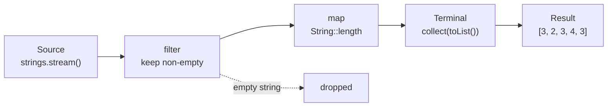
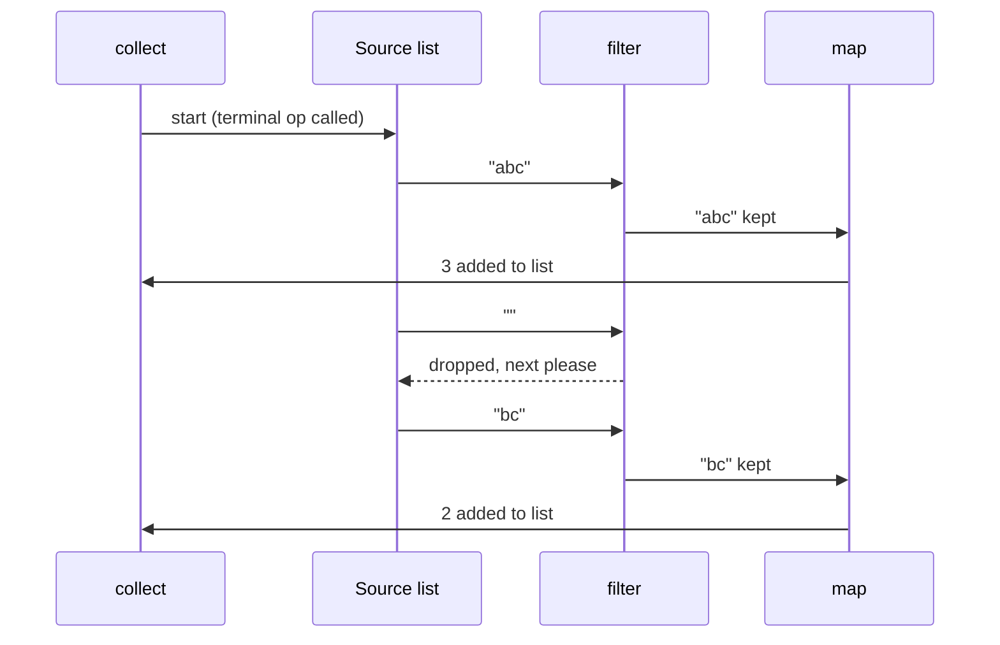

## In One Line
A **stream** is a lazy, one-time-use pipeline that pulls elements from a source (a list, an array, a range...), passes each one through a chain of **intermediate operations** (`filter`, `map`, ...) and only runs when a **terminal operation** (`collect`, `forEach`, `count`, ...) asks for a result. You describe *what* you want; the library decides *how* to loop.

## Mental Model
Think of a **factory conveyor belt**.

- The **warehouse shelf** is the source — `strings`, the list. The belt takes items *off a copy of the view*; the shelf itself is never changed.
- Each **station** on the belt is an intermediate operation. The **inspector** (`filter`) throws rejects in the bin. The **machine** (`map`) turns each item into something else — a word goes in, its length comes out.
- Nothing moves until a **customer places an order** at the end of the belt — the terminal operation `collect(...)`. Building the belt (calling `filter`, `map`) costs nothing; switching it on is what does the work.
- Items travel **one at a time through every station** before the next item leaves the shelf: `"abc"` is inspected, measured and packed, *then* `""` is inspected (and binned), *then* `"bc"`...
- After the order is filled the belt is **dismantled**. To make another order you build a new belt from the same shelf — exactly why the example calls `strings.stream()` twice.

| Conveyor belt | Stream code |
|---|---|
| Warehouse shelf | the source: `strings` |
| Building the belt | `strings.stream().filter(...).map(...)` — lazy, nothing runs |
| Inspector station | `filter(string -> !string.isEmpty())` |
| Machine station | `map(String::length)` |
| Customer order | `collect(Collectors.toList())` — terminal, starts the belt |
| Dismantled belt | a used stream throws `IllegalStateException` if touched again |

## Concept
### Why streams were added (Java 8)
Before Java 8, processing a collection meant writing the loop yourself — **external iteration**:

```java
List<Integer> lengths = new ArrayList<>();
for (String s : strings) {          // you control the loop
    if (!s.isEmpty()) {             // you write the "keep" test
        lengths.add(s.length());    // you manage the result list
    }
}
```

The same thing with a stream — **internal iteration**, the library drives the loop:

```java
List<Integer> lengths = strings.stream()
        .filter(s -> !s.isEmpty())
        .map(String::length)
        .collect(Collectors.toList());
```

Both produce `[3, 2, 3, 4, 3]`. The stream version:
- says **what** (keep non-empty, take the length, collect) instead of **how** (index, add, temporary list);
- composes: adding a step is adding a line, not restructuring a loop;
- is easy to run in parallel (`parallelStream()`), because the library owns the loop;
- lets the library optimise (fuse steps into one pass, stop early, skip work).

Streams are built on lambdas and functional interfaces (`Predicate`, `Function`, `Consumer`, `Supplier`, `BinaryOperator`) — see [Lambda Expressions](lesson:a05-java8/02-lambda-expressions) and [Predicate](lesson:a05-java8/04-predicate).

> [!NOTE] `java.util.stream.Stream` has nothing to do with `java.io.InputStream`/`OutputStream`. I/O streams move bytes; `java.util.stream` streams process elements.

### Stream vs Collection
| | Collection (`List`, `Set`...) | Stream |
|---|---|---|
| Purpose | **Stores** elements | **Computes** over elements; stores nothing |
| Evaluation | Eager — elements exist in memory | Lazy — computed on demand |
| Reuse | Iterate as often as you like | **One-shot** — consumed by its terminal operation |
| Iteration | External (`for`, `Iterator`) | Internal (the library loops) |
| Size | Finite, known | May be unknown or **infinite** (`Stream.iterate`, `Stream.generate`) |
| Modifying | `add`, `remove` change it | Never modifies the source; produces a new result |
| Parallelism | Manual (threads, locks) | `parallelStream()` / `.parallel()` |

### Anatomy of a pipeline: Source → Intermediate → Terminal
1. **Source** — where elements come from: `collection.stream()`, `Stream.of(...)`, `Arrays.stream(array)`, `IntStream.range(0, 10)`, `Files.lines(path)`, `Stream.iterate(...)`. The full list is in [Stream Operations](lesson:a05-java8/13-stream-operations).
2. **Intermediate operations** — return a **new `Stream`**, are **lazy**, and can be chained: `filter`, `map`, `flatMap`, `distinct`, `sorted`, `peek`, `limit`, `skip`, `takeWhile`, `dropWhile`, `mapToInt`...
3. **Terminal operation** — returns something that is **not a stream** (a `List`, a `long`, an `Optional`, `void`), **triggers** the whole pipeline and **closes** the stream: `collect`, `toList`, `forEach`, `count`, `reduce`, `min`/`max`, `findFirst`, `anyMatch`, `toArray`...

Rule of thumb: *returns `Stream` → intermediate; returns anything else → terminal.* A pipeline has exactly one terminal operation, at the end.

### Laziness: nothing runs until the terminal operation
Calling `filter` or `map` does **not** process anything. It only records "there will be a filter here" in a new pipeline stage object. The lambdas run only when a terminal operation pulls elements through. Why that design?
- **Loop fusion** — all stages run in **one pass** over the data, not one pass per stage. No intermediate lists are created.
- **Short-circuiting** — `findFirst()`, `anyMatch()`, `limit(n)` can stop as soon as they have their answer, so later elements are never even looked at.
- **Infinite streams** — `Stream.iterate(1, n -> n + 1).filter(...).limit(3)` works because only as many elements as needed are ever generated.
- **Optimisation** — knowing the whole pipeline in advance lets the library skip work (for example, `sorted()` on an already-sorted source does nothing).

### Vertical processing: one element at a time
For stateless operations (`filter`, `map`, `peek`...), each element travels through **all** stages before the next element starts — the pipeline is processed "vertically", not "horizontally" (not "filter everything, then map everything"). The demo in the Code section proves it. **Stateful** operations such as `sorted()` and `distinct()` are the exception: `sorted()` must see *every* element before it can emit the first one, so it acts as a **barrier** in the pipeline.

### A stream can be consumed only once
After the terminal operation the stream is spent. Any further call throws `IllegalStateException: stream has already been operated upon or closed`. Even calling a second *intermediate* operation on the **same** stream object you already chained from throws — every stage may be linked only once. To "reuse" a pipeline, keep the **source** (or a `Supplier<Stream<T>>`) and create a fresh stream each time:

```java
Supplier<Stream<String>> words = () -> Stream.of("abc", "", "bc");
System.out.println(words.get().count());                          // 3
System.out.println(words.get().filter(String::isEmpty).count());  // 1
```
```output
3
1
```

### `filter` and `map` — the two operations in the example
| | `filter(Predicate<? super T>)` | `map(Function<? super T, ? extends R>)` |
|---|---|---|
| Does | Keeps elements whose predicate returns `true`; drops the rest | Transforms **each** element into exactly one new element |
| Count | Same or fewer elements | Same number of elements |
| Type | `Stream<T>` → `Stream<T>` | `Stream<T>` → `Stream<R>` (the type may change) |
| Example | `filter(s -> !s.isEmpty())` | `map(String::length)` — `Stream<String>` → `Stream<Integer>` |

`filter` **keeps** matches — it does not "filter out" matches. Read `filter(p)` as "keep only where p".

`map(String::length)` produces a `Stream<Integer>`: every `int` length is **autoboxed** into an `Integer`. When you want to do arithmetic (sum, average), use `mapToInt(String::length)` to get an `IntStream` of primitives instead.

### Collecting the result: three ways to get a List
| Call | Since | Result | Nulls |
|---|---|---|---|
| `collect(Collectors.toList())` | 8 | Currently an `ArrayList` (mutable), but the spec gives **no guarantee** of type or mutability | Allowed |
| `collect(Collectors.toUnmodifiableList())` | 10 | Unmodifiable list | `NullPointerException` |
| `.toList()` (on `Stream`) | 16 | Unmodifiable list | Allowed |

For read-only results on Java 16+, `stream.toList()` is the shortest and clearest. If you need to add to the list afterwards, ask for it explicitly: `collect(Collectors.toCollection(ArrayList::new))`. The full story of collectors is in [Collectors](lesson:a05-java8/14-collectors).

### Rules for the lambdas you pass in
The Javadoc of `java.util.stream` asks your behavioural parameters to be:
- **Non-interfering** — do not modify the source while the pipeline runs. Adding to an `ArrayList` from inside its own stream ends in `ConcurrentModificationException`.
- **Stateless** — the result for an element must not depend on mutable state that changes during the pipeline (a counter outside the lambda, a shared `Set`...). Stateful lambdas give wrong or non-deterministic results, especially in parallel.
- **Side-effect free** where possible — do not fill an external list from `map` or `forEach`; let a collector build the result. `forEach` is for *final* effects such as printing.

### How it works inside (for the "explain the internals" question)
- `strings.stream()` is a **default method** on `Collection` (added in Java 8). It calls `StreamSupport.stream(spliterator(), false)`, which creates the head of the pipeline (`ReferencePipeline.Head`) wrapping the list's **`Spliterator`** — a "splittable iterator" that can walk the elements and split itself in halves for parallel work.
- Each intermediate call creates a **new stage object** linked to the previous one (`StatelessOp` for `filter`/`map`, `StatefulOp` for `sorted`/`distinct`) and records **stream flags**: `SIZED`, `ORDERED`, `DISTINCT`, `SORTED`. The previous stage is marked "linked", which is why it cannot be used again.
- The terminal operation walks the stages backwards and wraps them into a chain of **`Sink`s** (each sink's `accept(t)` does its work and calls the next sink's `accept`). Then it calls `spliterator.forEachRemaining(sink)` — the source *pushes* every element through the fused chain in one loop. Short-circuiting operations check `sink.cancellationRequested()` after each element and stop early.
- Flags drive optimisations: `sorted()` on a source already flagged `SORTED` (a `TreeSet`) is skipped; since Java 9, `count()` on a `SIZED` pipeline with no filtering just returns the size without running the lambdas.

### When not to use a stream
- The loop needs `break`/`continue` with complex conditions, index arithmetic, or modifies several variables at once.
- The lambda body must throw **checked exceptions** (lambdas in `Function`, `Predicate`... cannot throw them without wrapping).
- Very hot numeric loops where boxing (`Stream<Integer>`) would dominate — use `IntStream` or a plain loop.
- A three-line loop is clearer than a clever eight-step pipeline. Readability wins.

## Diagram

Intermediate stages (`filter`, `map`) only describe work; the terminal `collect` is what starts the belt and produces a new list.


Elements flow **vertically**: one element passes through every stage before the next element leaves the source.

## Code
@example Java8Features/StreamAPIandCollectors/StreamAPIExample.java

**Laziness and vertical processing, made visible.** The lambdas print when they run:
```java
List<String> strings = Arrays.asList("abc", "", "bc", "efg");

Stream<String> pipeline = strings.stream()
        .filter(s -> {
            System.out.println("  filter(" + s + ")");
            return !s.isEmpty();
        })
        .map(s -> {
            System.out.println("  map(" + s + ")");
            return s.toUpperCase();
        });

System.out.println("Pipeline built - nothing has run yet");
List<String> result = pipeline.collect(Collectors.toList());
System.out.println("Result: " + result);
```
```output
Pipeline built - nothing has run yet
  filter(abc)
  map(abc)
  filter()
  filter(bc)
  map(bc)
  filter(efg)
  map(efg)
Result: [ABC, BC, EFG]
```
Nothing prints until `collect` runs, and `filter`/`map` alternate per element — `map` never sees the empty string.

**A stream is single-use; the source is untouched:**
```java
Stream<String> s = Stream.of("x", "y");
System.out.println(s.count());
try {
    s.count();
} catch (IllegalStateException e) {
    System.out.println("IllegalStateException: " + e.getMessage());
}

List<String> src = new ArrayList<>(List.of("abc", "", "bc"));
List<String> out = src.stream().filter(x -> !x.isEmpty()).collect(Collectors.toList());
System.out.println(src + " -> " + out);
```
```output
2
IllegalStateException: stream has already been operated upon or closed
[abc, , bc] -> [abc, bc]
```

**The three ways to collect to a list behave differently:**
```java
List<String> a = Stream.of("a", "b").collect(Collectors.toList());
a.add("c");
System.out.println("Collectors.toList() is mutable here: " + a + " " + a.getClass().getSimpleName());

List<String> b = Stream.of("a", "b").toList();
try { b.add("c"); } catch (UnsupportedOperationException e) { System.out.println("Stream.toList() -> UnsupportedOperationException"); }

List<String> withNull = Stream.of("a", null).toList();
System.out.println("Stream.toList() allows null: " + withNull);
try { Stream.of("a", null).collect(Collectors.toUnmodifiableList()); }
catch (NullPointerException e) { System.out.println("toUnmodifiableList() -> NullPointerException"); }
```
```output
Collectors.toList() is mutable here: [a, b, c] ArrayList
Stream.toList() -> UnsupportedOperationException
Stream.toList() allows null: [a, null]
toUnmodifiableList() -> NullPointerException
```

**Stream flags at work** — a `TreeSet` source is already `SORTED`, so `sorted()` is skipped and elements still flow one at a time (lower case = before `sorted`, upper case = after):
```java
TreeSet<String> ts = new TreeSet<>(List.of("b", "a", "c"));
ts.stream().peek(x -> System.out.print(x)).sorted().forEach(x -> System.out.print(x.toUpperCase()));
```
```output
aAbBcC
```
With an unsorted source, `sorted()` would be a barrier and print `abc` (in source order) before any upper-case letter.

## Walkthrough
- `package Java8Features.StreamAPIandCollectors;` — the file lives in that folder of the course project. Run it from the IDE, or directly with `java StreamAPIExample.java` — single-file source launch works even with the package line.
- `import java.util.Arrays; import java.util.List;` — for `Arrays.asList` and the `List` type. `import java.util.stream.Collectors;` — the factory class of ready-made collectors (`toList`, `joining`, `groupingBy`...). Note that `Stream` itself is **never imported**: the code never names the type `Stream`; it only chains calls on the object `strings.stream()` returns.
- `List<String> strings = Arrays.asList("abc", "", "bc", "efg", "abcd", "", "jkl");` — a **fixed-size** list backed by an array, holding 7 strings, two of which are empty (`""`). You cannot `add`/`remove` on it (`UnsupportedOperationException`), but streams never need to.
- `strings.stream()` — the `Collection.stream()` default method creates a **sequential**, **ordered** stream over the list. Nothing is read yet.
- `.filter(string -> !string.isEmpty())` — an intermediate operation. The lambda implements `Predicate<String>`: it returns `true` for non-empty strings, and `filter` **keeps** exactly those. The parameter is named `string`; any name works.
- `.collect(Collectors.toList())` — the terminal operation. It starts the pipeline, pushes each of the 7 elements through `filter`, and accumulates the 5 survivors into a new list. `filtered` is a separate list; `strings` still has 7 elements.
- `System.out.println("Filtered List: " + filtered);` — string concatenation calls `filtered.toString()`, giving `Filtered List: [abc, bc, efg, abcd, jkl]`. The order matches the source because a `List` source is **ordered** and `toList` respects encounter order.
- `// Map function example` — a **new** pipeline, created by calling `strings.stream()` again. It must be new: the first stream was consumed by its `collect`.
- `.filter(string -> !string.isEmpty())` — same filter as before, so the two empty strings are removed first.
- `.map(String::length)` — a **method reference**, short for `s -> s.length()`. It is a `Function<String, Integer>`: each `String` becomes its length. `length()` returns `int`, so each value is **autoboxed** to `Integer`, and the stream type changes from `Stream<String>` to `Stream<Integer>`.
- `.collect(Collectors.toList())` → `List<Integer> lengths` = `[3, 2, 3, 4, 3]` (lengths of `abc`, `bc`, `efg`, `abcd`, `jkl`).
- Both `// Output:` comments match the recorded output exactly. The output is deterministic: sequential stream, ordered source, no threads, no hashing.

## Traps
> [!ERRATA] The comment `// Filter empty strings` (line 11) reads as if the empty strings are *kept*. The code does the opposite: `filter` **keeps** elements for which the predicate is `true`, and the predicate is `!string.isEmpty()`, so it **removes** empty strings. A precise comment is `// Remove empty strings (keep non-empty ones)`.

> [!NOTE] `collect(Collectors.toList())` is correct and still very common, but since Java 16 `.toList()` is the idiomatic way to get a read-only list. The two are not interchangeable: `Collectors.toList()` happens to return a mutable `ArrayList`, while `.toList()` returns an unmodifiable list.

- **No terminal operation = nothing happens.** `strings.stream().filter(...).map(...);` compiles, but no lambda ever runs and no result exists. IDEs warn "result of `map` is ignored".
- **Reusing a stream** throws `IllegalStateException: stream has already been operated upon or closed`. Store the source or a `Supplier<Stream<T>>`, not the stream.
- **Streams do not modify their source.** `names.stream().map(String::toUpperCase).toList()` returns a *new* list; `names` is unchanged. To change a list in place, use `names.replaceAll(String::toUpperCase)`.
- **Modifying the source inside the pipeline** (e.g. `list.stream().forEach(x -> list.add(...))`) throws `ConcurrentModificationException`.
- **Mutating the result of `.toList()`** (`add`, `set`, `Collections.sort`) throws `UnsupportedOperationException`.
- **Assuming `Collectors.toList()` is an `ArrayList`.** It is today, but the Javadoc promises nothing; use `toCollection(ArrayList::new)` when it matters.
- **Boxing surprise:** `map(String::length)` gives `Stream<Integer>`, not `IntStream`, so there is no `.sum()` on it. Use `mapToInt(String::length).sum()`.
- **Side effects in `map`/`filter`** (adding to a shared list, incrementing a counter) are fragile: they depend on laziness and evaluation order and break in parallel streams. Let collectors build results.

> [!WARNING] `peek` is a debugging aid. Do not put business logic in it: some terminal operations (for example `count()` on a sized source, Java 9+) may skip the pipeline entirely, and `peek`'s lambda then never runs.

## Tips & Tricks
- **"S-I-T": Source, Intermediate(s), Terminal.** Every pipeline has exactly one S and one T, and any number of I's.
- **"No terminal, no party."** If nothing asks for a result, nothing is computed.
- **Return type test:** returns `Stream` → intermediate (lazy); returns anything else → terminal (eager, closes the stream).
- **Read the pipeline aloud:** "from `strings`, keep the non-empty ones, map each to its length, collect into a list." If it reads well, it is well written.
- **One operation per line**, dots aligned — easier to read, and stack traces point at the right line.
- **Prefer method references** when they read clearly: `map(String::length)`, `filter(Predicate.not(String::isEmpty))` (Java 11).
- **Filter early, map late:** put cheap filters before expensive maps so fewer elements reach them.
- **Debug with `peek(System.out::println)`** between stages to see the vertical flow; remove it afterwards.
- On Java 16+: `.toList()` for read-only results, `Collectors.toCollection(ArrayList::new)` when you need to modify the result.

## Interview Q&A
### [Basic] What is a Stream in Java 8, and how is it different from a Collection?
A stream is a sequence of elements that supports a pipeline of aggregate operations — filter, map, reduce, collect — over a source such as a collection, array or generator. The key differences from a collection:
- A collection **stores** data; a stream **stores nothing** — it computes over the source's elements.
- A stream is **lazy**: intermediate operations run only when a terminal operation asks for a result.
- A stream is **single-use**: once a terminal operation has run it cannot be reused.
- A stream uses **internal iteration**: the library runs the loop, so it can fuse steps, stop early and parallelise.
- A stream **never modifies its source**; it produces a new result.
- A stream can be **infinite** (`Stream.iterate`, `Stream.generate`), a collection cannot.

**Follow-up:** *Does `list.stream()` copy the list?* — No. It wraps the list's `Spliterator`; elements are read from the list lazily when the terminal operation runs.

### [Basic] What are intermediate and terminal operations? Give examples.
**Intermediate** operations return a new `Stream`, are lazy and can be chained: `filter`, `map`, `flatMap`, `distinct`, `sorted`, `peek`, `limit`, `skip`, `takeWhile`, `dropWhile`, `mapToInt`, `boxed`. **Terminal** operations return a non-stream result or perform a side effect, trigger execution and close the stream: `collect`, `toList`, `forEach`, `forEachOrdered`, `reduce`, `count`, `min`, `max`, `findFirst`, `findAny`, `anyMatch`, `allMatch`, `noneMatch`, `toArray`. A pipeline has any number of intermediate operations and exactly one terminal operation.

**Follow-up:** *How can you tell them apart from the signature?* — Intermediate operations return `Stream<...>` (or `IntStream`, etc.); terminal ones return anything else, including `void`.

### [Basic] What does "streams are lazy" mean, and why is it useful?
Calling `filter` or `map` only builds a description of the pipeline; no element is processed until a terminal operation runs. Benefits: (1) all stages run in **one fused pass** with no intermediate collections; (2) **short-circuiting** — `findFirst`, `anyMatch`, `limit` stop as soon as they have their answer; (3) **infinite streams** become usable; (4) the library can **optimise** the whole pipeline (skip `sorted` on sorted data, skip the pipeline for `count()` on a sized source).
```java
Stream.of("a", "b", "c").peek(System.out::print).map(String::toUpperCase);  // prints nothing
```
**Follow-up:** *So what does this print — `Stream.of(1,2,3).peek(System.out::println);`?* — Nothing. There is no terminal operation.

### [Intermediate] Can you reuse a stream? What happens if you try?
No. A stream can be traversed only once. After the terminal operation (or after you have chained an intermediate operation from it), any further use throws `IllegalStateException: stream has already been operated upon or closed`. The fix is to keep the **source** and call `.stream()` again, or to keep a `Supplier<Stream<T>>` and call `get()` for each pipeline. This is by design: many sources (an `Iterator`, a file, a generator) cannot be replayed, and single use keeps the model simple.

**Follow-up:** *Why is `stream.filter(a); stream.filter(b);` also an error?* — Each stage may be linked to only one next stage; the second `filter` on the same stage object finds it already "linked or consumed".

### [Intermediate] What is the difference between internal and external iteration?
With **external iteration** (a `for` loop or an `Iterator`), your code pulls each element and controls the order, the loop variable and the result container. With **internal iteration** (streams, `Iterable.forEach`), you hand the library a description of the work (lambdas) and the library drives the loop. Internal iteration lets the library fuse operations, short-circuit, and split the work across threads with `parallel()` — impossible when you own the loop. The trade-off: less control (`break`, checked exceptions, index access are awkward).

**Follow-up:** *Is `list.forEach(...)` a stream operation?* — No. `Iterable.forEach` is a default method on the collection itself; it is internal iteration but not a stream. `list.stream().forEach(...)` is the stream terminal operation.

### [Intermediate] `Collectors.toList()` vs `Stream.toList()` vs `Collectors.toUnmodifiableList()`?
`collect(Collectors.toList())` (Java 8) returns a list with **no guarantees** on type, mutability, serializability or thread-safety — in practice an `ArrayList`. `Collectors.toUnmodifiableList()` (Java 10) returns an unmodifiable list and throws `NullPointerException` if any element is `null`. `stream.toList()` (Java 16) returns an unmodifiable list that **does allow nulls**; it is built from `toArray()`, so it can allocate the backing array once when the size is known. If you need to mutate the result, use `Collectors.toCollection(ArrayList::new)`.

**Follow-up:** *Can you blindly replace `collect(Collectors.toList())` with `.toList()` in old code?* — Only if no code modifies the returned list; otherwise you trade compile-clean code for a runtime `UnsupportedOperationException`.

### [Intermediate] Does a stream modify its source? What if the source is modified while the stream runs?
A stream never modifies its source; results are new objects. The source must also not be modified *by the pipeline's own lambdas* while it runs — the **non-interference** rule. For non-concurrent collections such as `ArrayList`, doing so throws `ConcurrentModificationException` (the list's spliterator checks `modCount`). Modifying the source *before* the terminal operation starts is allowed, because streams are late-binding: the elements are read only when the terminal operation begins.

**Follow-up:** *How would you update every element of a list in place then?* — `list.replaceAll(String::toUpperCase)` or a plain loop — not a stream.

### [Advanced] In what order are stream operations executed? Does `filter` finish all elements before `map` starts?
No. For stateless operations the pipeline is processed **vertically**: element 1 goes through `filter`, then `map`, then into the result; then element 2 starts. Internally the terminal operation builds a chain of `Sink` objects and the source pushes each element through the whole chain. With `Stream.of("one", "", "two")`, a printing `filter` and `map` produce `Fone Mone 3 F Ftwo Mtwo 3`. **Stateful** operations (`sorted`, `distinct`, and to a degree `limit`/`skip`) change this: `sorted()` has to buffer every element before emitting the first, so it is a barrier between the stages before and after it.

**Follow-up:** *Why does this matter?* — Put cheap filters first; and never rely on "all filters have run" inside a later lambda.

### [Advanced] How does the Stream API work internally?
`collection.stream()` creates a `ReferencePipeline.Head` wrapping the collection's `Spliterator`. Each intermediate operation creates a new pipeline stage (`StatelessOp`/`StatefulOp`) that links to the previous one and records stream flags (`SIZED`, `ORDERED`, `DISTINCT`, `SORTED`). Nothing runs. The terminal operation then (1) combines the flags to choose optimisations, (2) wraps the stages from last to first into a chain of `Sink`s (`begin`, `accept`, `end`, `cancellationRequested`), and (3) calls `spliterator.forEachRemaining(sink)` for sequential runs, or splits the spliterator into `ForkJoinTask`s for parallel runs. Short-circuiting ops check `cancellationRequested()` between elements.

**Follow-up:** *What is a Spliterator?* — A "splittable iterator": `tryAdvance` walks elements one by one, `trySplit` hands half of the remaining elements to another spliterator (used by parallel streams), and `characteristics()` reports flags such as `SIZED` and `ORDERED`.

### [Advanced] When would you avoid streams?
When a plain loop is clearer: complex control flow with `break`/`continue`/early `return`, index-based logic (comparing neighbours), updating several variables at once, lambdas that must throw checked exceptions, or hot numeric code where boxing to `Stream<Integer>` costs more than the work. Streams also make step-through debugging harder. Use them for declarative transformations and aggregations — filter/map/group/collect — where they are shorter and clearer.

**Follow-up:** *Are streams slower than loops?* — For small collections a stream has some setup overhead and can be a little slower; for most business code the difference is negligible. Primitive streams (`IntStream`) avoid boxing costs.

## Quiz
### What does the second pipeline of the original example print?
- [ ] `Lengths of non-empty strings: [3, 0, 2, 3, 4, 0, 3]`
- [x] `Lengths of non-empty strings: [3, 2, 3, 4, 3]`
- [ ] `Lengths of non-empty strings: [abc, bc, efg, abcd, jkl]`
- [ ] It throws `IllegalStateException` because `strings` was already streamed
> `filter` removes the two empty strings first, then `map(String::length)` turns the five survivors into their lengths. There is no `IllegalStateException`: the example calls `strings.stream()` again, creating a **new** stream — only a used *stream* cannot be reused, the list can be streamed any number of times. `[3, 0, 2, ...]` would be the answer without the filter.

### What does this print?
```java
Stream.of("a", "b", "c")
      .peek(s -> System.out.print(s))
      .map(String::toUpperCase);
System.out.println("done");
```
- [ ] `abcdone`
- [ ] `ABCdone`
- [x] `done`
- [ ] Compile error: the result of `map` is ignored
> There is no terminal operation, so the pipeline never runs and `peek` never prints. Ignoring a return value is legal Java (only an IDE warning). Streams are lazy: no terminal, no work.

### What does this print?
```java
Stream.of("one", "", "two")
      .filter(s -> { System.out.print("F" + s + " "); return !s.isEmpty(); })
      .map(s -> { System.out.print("M" + s + " "); return s.length(); })
      .forEach(n -> System.out.print(n + " "));
```
- [ ] `Fone F Ftwo Mone Mtwo 3 3 `
- [x] `Fone Mone 3 F Ftwo Mtwo 3 `
- [ ] `Fone Mone 3 F M0 0 Ftwo Mtwo 3 `
- [ ] `Mone Mtwo Fone F Ftwo 3 3 `
> Elements flow vertically: `"one"` goes through filter, map and forEach before `""` is even filtered. The empty string is dropped by `filter`, so `map` never sees it (no `M` / `0` for it). The "all filters, then all maps" answer describes horizontal processing, which streams do not do for stateless operations.

### Spot the bug
```java
Stream<String> names = List.of("ann", "bob", "cy").stream();
long longNames = names.filter(n -> n.length() > 2).count();
long shortNames = names.filter(n -> n.length() <= 2).count();
```
- [ ] `count()` returns `int`, not `long`
- [x] `names` is reused after a terminal operation, so the third line throws `IllegalStateException`
- [ ] `filter` cannot be called twice in one method
- [ ] `List.of(...).stream()` returns an unmodifiable stream that cannot be filtered
> A stream is single-use. The first `count()` consumed `names`; the second `names.filter(...)` throws `IllegalStateException: stream has already been operated upon or closed`. Keep the list (or a `Supplier<Stream<String>>`) and call `.stream()` for each pipeline. `count()` really does return `long`.

### What does this print?
```java
List<String> names = new ArrayList<>(List.of("ann", "bob"));
names.stream().map(String::toUpperCase);
names.stream().map(String::toUpperCase).collect(Collectors.toList());
System.out.println(names);
```
- [x] `[ann, bob]`
- [ ] `[ANN, BOB]`
- [ ] `[ann, bob, ANN, BOB]`
- [ ] `UnsupportedOperationException`
> Streams never modify their source. The first line does nothing at all (no terminal op); the second builds a new list `[ANN, BOB]` that is thrown away. `names` is unchanged. To change the list in place use `names.replaceAll(String::toUpperCase)`.

### Which statement about `stream.toList()` (Java 16) is true?
- [ ] It is exactly the same as `collect(Collectors.toList())`
- [ ] It throws `NullPointerException` if the stream contains `null`
- [x] It returns an unmodifiable list, and it allows `null` elements
- [ ] It returns an `ArrayList` you can sort in place
> `toList()` returns an unmodifiable list (sorting or adding throws `UnsupportedOperationException`) that accepts nulls. `Collectors.toUnmodifiableList()` is the one that rejects nulls, and `Collectors.toList()` is the one that (currently) gives a mutable `ArrayList`.

### What is the type of `strings.stream().map(String::length)` when `strings` is a `List<String>`?
- [ ] `IntStream`
- [x] `Stream<Integer>`
- [ ] `Stream<int>`
- [ ] `List<Integer>`
> `map` always returns a `Stream<R>`; `length()` returns `int`, which is boxed to `Integer`. Generics cannot hold primitives, so `Stream<int>` is impossible. To get an `IntStream` use `mapToInt(String::length)`. No list exists until a terminal operation collects one.

## Takeaways
- A stream is a lazy, single-use pipeline: **Source → intermediate operations → one terminal operation**; nothing runs until the terminal operation is called.
- Intermediate operations (`filter`, `map`, `sorted`...) return a `Stream`; terminal operations (`collect`, `forEach`, `count`...) return anything else and close the stream.
- Stateless stages process elements **vertically** (one element through all stages at a time); stateful `sorted()`/`distinct()` buffer and act as barriers.
- A stream never modifies its source and cannot be reused — reuse throws `IllegalStateException: stream has already been operated upon or closed`.
- `filter` **keeps** elements matching the predicate; `map` transforms each element 1:1 and may change the type (`map(String::length)` gives `Stream<Integer>`, use `mapToInt` for primitives).
- `Collectors.toList()` (mutable in practice, no guarantee), `toUnmodifiableList()` (no nulls) and Java 16 `stream.toList()` (unmodifiable, nulls allowed) are not interchangeable.
- Lambdas passed to streams should be non-interfering, stateless and side-effect free; use collectors, not external lists, to build results.
