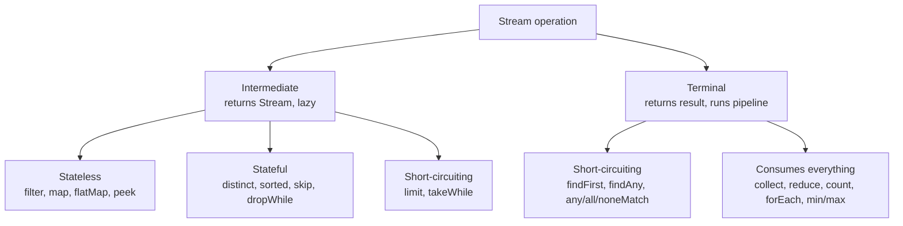
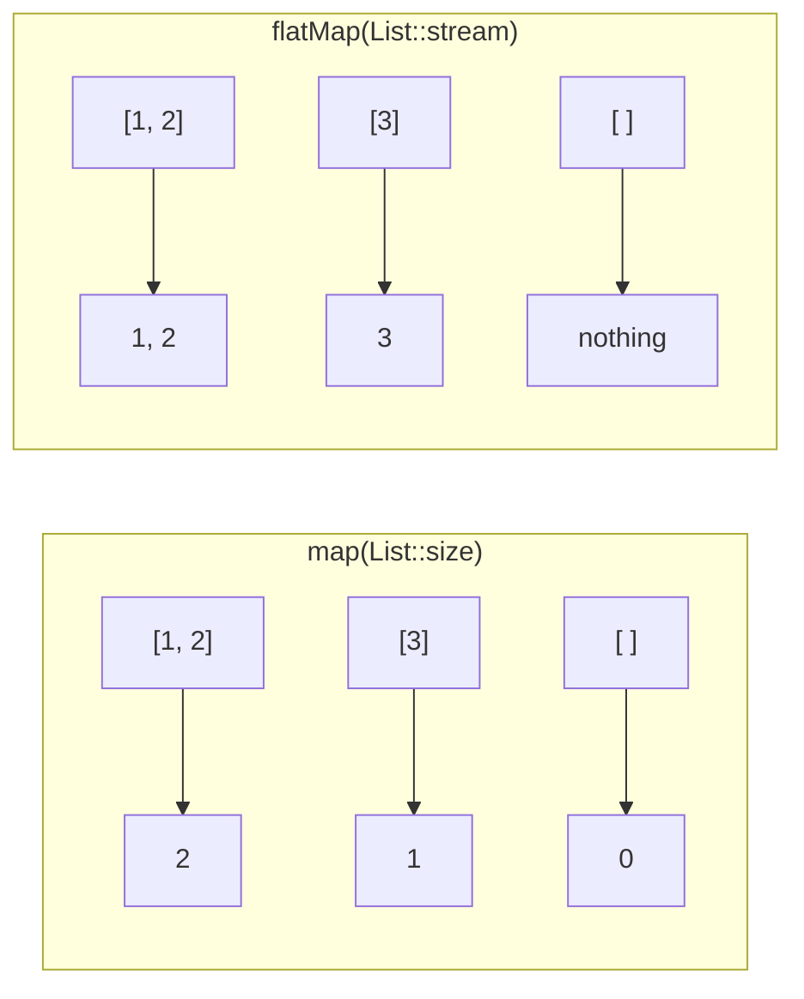

## In One Line
Every stream method belongs to one of three families — **sources** that create a stream, **intermediate operations** that lazily transform it (stateless or stateful, some short-circuiting), and **terminal operations** that produce the result — and knowing each method's family, return type and properties answers almost every stream interview question.

## Mental Model
Think of **plumbing**.

- **Taps (sources).** A tank of known size (`list.stream()`), a numbered tap that counts up forever (`Stream.iterate`), a rain barrel that never runs dry (`Stream.generate`).
- **Inline fittings (stateless intermediate ops).** A strainer (`filter`), a colour dye (`map`), a splitter that turns one pipe into several streams merged back together (`flatMap`), a glass window to look at the flow (`peek`). Water passes straight through; each drop is handled on its own.
- **Holding tanks (stateful intermediate ops).** `sorted()` must collect *all* the water before it can release it in order; `distinct()` remembers every drop it has seen. They need memory and can be a bottleneck.
- **Shut-off valves (short-circuiting ops).** `limit(3)` closes after three drops; `takeWhile` closes at the first dirty drop; `findFirst`/`anyMatch` close as soon as they have an answer — which is why a pipe from an endless tap still finishes.
- **Outlets (terminal ops).** A bucket (`collect`, `toList`), a meter (`count`, `sum`), a test strip (`anyMatch`), a single cup (`findFirst`). Until you open an outlet, no water moves at all.

## Concept
### Recap: the three stages
A pipeline is **source → zero or more intermediate operations → exactly one terminal operation**. Intermediate operations return a `Stream` and are lazy; the terminal operation returns something else, runs the pipeline and closes the stream. The basics (laziness, single use, vertical processing) are in [Stream API Basics](lesson:a05-java8/12-stream-api). This lesson is the complete catalogue.

### 1. Creating streams
| Source | Gives | Notes |
|---|---|---|
| `collection.stream()` / `parallelStream()` | `Stream<T>` | Any `Collection`; order follows the collection (a `List` is ordered, a `HashSet` is not) |
| `map.entrySet().stream()` (or `keySet()`, `values()`) | `Stream<Map.Entry<K,V>>` | `Map` itself has **no** `stream()` method |
| `Stream.of(a, b, c)` | `Stream<T>` | Varargs. `Stream.of(intArray)` gives a `Stream<int[]>` with **one** element |
| `Arrays.stream(array)` / `Arrays.stream(array, from, to)` | `Stream<T>`, or `IntStream`/`LongStream`/`DoubleStream` for primitive arrays | `to` is exclusive |
| `IntStream.range(a, b)` / `rangeClosed(a, b)` | `IntStream` (also `LongStream`) | `b` exclusive / inclusive — the stream version of a `for` loop |
| `IntStream.of(1, 2, 3)` | `IntStream` | Also `LongStream.of`, `DoubleStream.of` |
| `Stream.iterate(seed, f)` | infinite, ordered | `seed, f(seed), f(f(seed))...` — needs `limit`/`takeWhile` |
| `Stream.iterate(seed, hasNext, next)` | finite, ordered | **Java 9**; like `for (x = seed; hasNext(x); x = next(x))` |
| `Stream.generate(supplier)` | infinite, **unordered** | Each element is `supplier.get()` |
| `Stream.empty()` / `Stream.ofNullable(x)` | 0 or 1 element | `ofNullable` is **Java 9**: empty stream if `x` is null |
| `Stream.concat(s1, s2)` | lazily joined stream | Deep nesting of `concat` can overflow the stack; prefer `flatMap` for many |
| `Stream.builder().add(x).build()` | `Stream<T>` | When you add elements one by one |
| `"text".chars()` / `codePoints()` | `IntStream` | `chars()` = UTF-16 `char` values as `int`s |
| `Pattern.compile(",").splitAsStream(s)` | `Stream<String>` | Lazy split |
| `Files.lines(path)`, `bufferedReader.lines()` | `Stream<String>` | Holds a file handle: close it (try-with-resources) |
| `new Random().ints(n, lo, hi)` | `IntStream` | Random numbers |
| `optional.stream()` | 0 or 1 element | **Java 9** |

### 2. Intermediate operations (all lazy, all return a stream)
| Operation | What it does | Kind | Since |
|---|---|---|---|
| `filter(Predicate)` | Keep elements where the predicate is `true` | stateless | 8 |
| `map(Function)` | Transform each element, 1 → 1; the type may change | stateless | 8 |
| `mapToInt` / `mapToLong` / `mapToDouble` | Transform to a primitive stream | stateless | 8 |
| `mapToObj` (on primitive streams) | Primitive → object stream | stateless | 8 |
| `boxed()` | `IntStream` → `Stream<Integer>` | stateless | 8 |
| `asLongStream()` / `asDoubleStream()` | Widen a primitive stream | stateless | 8 |
| `flatMap(Function<T, Stream<R>>)` | Each element → a stream of 0..n elements, all flattened into one stream | stateless | 8 |
| `flatMapToInt` etc. | Same, into a primitive stream | stateless | 8 |
| `mapMulti(BiConsumer<T, Consumer<R>>)` | Each element **pushes** 0..n results into a sink — a cheaper `flatMap` for small fan-outs | stateless | 16 |
| `peek(Consumer)` | See each element as it passes (debugging) | stateless | 8 |
| `distinct()` | Remove duplicates using `equals`/`hashCode`; keeps the **first** occurrence | **stateful** | 8 |
| `sorted()` / `sorted(Comparator)` | Natural order / given order; **stable** for ordered streams | **stateful** (full barrier) | 8 |
| `limit(n)` | Only the first `n` elements | stateful, **short-circuiting** | 8 |
| `skip(n)` | Drop the first `n` elements | stateful | 8 |
| `takeWhile(Predicate)` | Keep elements **while** the predicate holds; stop at the first `false` | stateful, **short-circuiting** | 9 |
| `dropWhile(Predicate)` | Drop elements while the predicate holds; keep **everything** after the first `false` | stateful | 9 |
| `parallel()` / `sequential()` / `unordered()` / `onClose(Runnable)` | Change how the pipeline runs (mode, ordering constraint, close hook) | — | 8 |

**Stateless** operations handle each element on its own, with no memory of earlier elements. **Stateful** operations need to remember something about elements already seen — `distinct` keeps a set of them, `sorted` buffers all of them, `limit`/`skip` count them. Stateful operations cost memory, and in parallel streams they may need extra buffering or coordination.

### 3. `map` vs `flatMap` (the classic)
- `map`: one element in, **exactly one** element out. `Stream<List<Integer>>` mapped with `List::size` → `Stream<Integer>`.
- `flatMap`: one element in, **a stream** out; all those small streams are **flattened** into one. `Stream<List<Integer>>` flat-mapped with `List::stream` → `Stream<Integer>` holding every number.

If `map` would give you a `Stream<Stream<R>>`, `Stream<List<R>>` or `Stream<String[]>` when you wanted `Stream<R>`, you need `flatMap`. Typical uses: lines → words, orders → items, `Optional`s → present values (`flatMap(Optional::stream)`), a list of lists → one list.

### 4. Terminal operations
| Operation | Returns | Short-circuits? |
|---|---|---|
| `forEach(Consumer)` | `void` | No. In parallel, order is **not** guaranteed |
| `forEachOrdered(Consumer)` | `void` | No. Respects encounter order even in parallel |
| `collect(Collector)` | whatever the collector builds | No |
| `collect(supplier, accumulator, combiner)` | `R` — a mutable container | No |
| `toList()` | unmodifiable `List<T>` (Java 16) | No |
| `toArray()` / `toArray(Integer[]::new)` | `Object[]` / typed array | No |
| `reduce(identity, op)` | `T` | No |
| `reduce(op)` | `Optional<T>` | No |
| `reduce(identity, accumulator, combiner)` | `U` | No |
| `count()` | `long` | No — but may skip the pipeline entirely (Java 9+) |
| `min(Comparator)` / `max(Comparator)` | `Optional<T>` | No |
| `findFirst()` | `Optional<T>` | **Yes** |
| `findAny()` | `Optional<T>` | **Yes** — any element; in parallel not necessarily the first |
| `anyMatch` / `allMatch` / `noneMatch` | `boolean` | **Yes** |
| `iterator()` / `spliterator()` | escape hatch to pull elements yourself | Lazy |
| Primitive streams only: `sum()`, `average()`, `min()`, `max()`, `summaryStatistics()` | `int`/`long`/`double`, `OptionalDouble`, `OptionalInt`..., `IntSummaryStatistics` | No |

Methods that may have **nothing to return** give an `Optional`: `findFirst`, `findAny`, `min`, `max`, `reduce(op)`, and on primitive streams `average`, `min`, `max`. See [Optional](lesson:a05-java8/20-optional).

**Empty-stream results** are worth memorising: `count()` → `0`, `sum()` → `0`, `max()` → empty Optional, `anyMatch` → `false`, `allMatch` → **`true`**, `noneMatch` → `true`. `allMatch` on nothing is "vacuously true": there is no element that breaks the rule.

### 5. `reduce` in depth
`reduce` combines all elements into one value by repeatedly applying a binary operation.

| Form | Use |
|---|---|
| `T reduce(T identity, BinaryOperator<T> acc)` | Sum, product, max... with a start value. Empty stream → `identity` |
| `Optional<T> reduce(BinaryOperator<T> acc)` | No sensible start value. Empty stream → `Optional.empty()` |
| `U reduce(U identity, BiFunction<U, ? super T, U> acc, BinaryOperator<U> combiner)` | Result type differs from element type (e.g. total length of strings); `combiner` merges partial results in parallel |

Rules the library relies on (break them and parallel results go wrong):
- **Identity** must be a true identity for the operation: `identity op x == x`. `0` for `+`, `1` for `*`, `""` for concatenation. `reduce(10, Integer::sum)` is a bug: in parallel, 10 is added once per chunk.
- The operation must be **associative**: `(a op b) op c == a op (b op c)`. `+`, `*`, `max`, `min`, string concatenation are; `-` and `/` are not.
- The operation must be **stateless** and **non-interfering**.
- For the 3-argument form, the combiner must agree with the accumulator: `combiner(u, accumulator(identity, t)) == accumulator(u, t)`.

`reduce` is for combining **immutable** values (numbers, `BigDecimal`). To build a **mutable** container (a list, a map, a `StringBuilder`), use `collect` — "mutable reduction". Reducing strings with `+` is O(n²) copying; `Collectors.joining()` uses a `StringBuilder`.

### 6. Short-circuiting
A short-circuiting operation can finish **without processing every element**:
- Intermediate: `limit(n)`, `takeWhile(p)` — they turn an infinite stream into a finite one.
- Terminal: `findFirst`, `findAny`, `anyMatch`, `allMatch`, `noneMatch` — they return as soon as the answer is known (`anyMatch` at the first `true`, `allMatch` at the first `false`).

`filter` is **not** short-circuiting: `Stream.iterate(1, n -> n + 1).filter(n -> n < 10).toList()` never terminates, because `filter` cannot know that no later element will pass. Use `takeWhile(n -> n < 10)` instead.

### 7. Primitive streams: `IntStream`, `LongStream`, `DoubleStream`
Generics cannot hold primitives, so `Stream<Integer>` boxes every number into an `Integer` object. The three primitive streams avoid that and add numeric terminals.

| Conversion | Method |
|---|---|
| `Stream<T>` → `IntStream` | `mapToInt(ToIntFunction)` (e.g. `mapToInt(String::length)`, `mapToInt(Integer::intValue)`) |
| `IntStream` → `Stream<Integer>` | `boxed()` |
| `IntStream` → `Stream<R>` | `mapToObj(IntFunction)` |
| `IntStream` → `LongStream`/`DoubleStream` | `asLongStream()`, `asDoubleStream()` |

Numeric terminals: `sum()` (returns `int` for `IntStream` — **can overflow**; `LongStream.sum()` returns `long`), `average()` (always `OptionalDouble`), `min()`/`max()` (`OptionalInt`, no comparator needed), `summaryStatistics()` (count, sum, min, max, average in one pass — see [Summarizing Collectors](lesson:a05-java8/18-collectors-summarizing)).

### 8. Ordering
- **Encounter order** is the order in which the source presents elements. Ordered sources: `List`, arrays, `Stream.of`, `iterate`, `range`, `TreeSet` (sorted). Unordered: `HashSet`, `HashMap` views, `generate`.
- Most intermediate operations **preserve** encounter order; `sorted()` imposes a new one; `unordered()` explicitly drops the constraint (useful to speed up `distinct`/`limit` in parallel).
- `sorted()` is **stable** on ordered streams: equal elements keep their relative order. `distinct()` keeps the **first** of equal elements.
- `forEach` gives no ordering guarantee in parallel; `forEachOrdered` does. `findFirst` respects encounter order; `findAny` does not. `collect(toList())` keeps encounter order even in parallel.

### 9. Infinite streams
`Stream.iterate(seed, f)` and `Stream.generate(supplier)` never end on their own. They are safe as long as something **short-circuits**: `limit`, `takeWhile`, `findFirst`, `anyMatch`... Java 9's 3-argument `iterate(seed, hasNext, next)` builds a finite stream directly. A stateful full-barrier operation on an infinite stream (`sorted()`, or `distinct()` when too few distinct values exist) never finishes.

### 10. Checked exceptions inside lambdas
`Function`, `Predicate` and friends declare no checked exceptions, so `map(path -> Files.readString(path))` does not compile (`unreported exception IOException`). Options:
1. Catch inside the lambda and rethrow unchecked — for `IOException` use `UncheckedIOException`.
2. Write a small helper (`unchecked(ThrowingFunction)`) that does the wrapping once.
3. If the logic needs real error handling per element, use a plain loop.

### 11. Closing streams
`BaseStream` extends `AutoCloseable`. Streams over collections hold no resources and need no closing, but streams from I/O (`Files.lines`, `Files.list`, `Files.walk`) hold file handles: always use try-with-resources. `onClose(Runnable)` registers a hook that runs when `close()` is called.

### 12. What each Java version added
| Version | Additions |
|---|---|
| 8 | The whole API: `java.util.stream`, `Collectors` |
| 9 | `takeWhile`, `dropWhile`, `iterate(seed, hasNext, next)`, `ofNullable`, `Optional.stream()`, `Collectors.filtering`/`flatMapping`, `count()` may skip the pipeline |
| 10 | `Collectors.toUnmodifiableList/Set/Map` |
| 12 | `Collectors.teeing` |
| 16 | `Stream.toList()`, `mapMulti` |
| 24 | `gather(Gatherer)` — user-defined intermediate operations (JEP 485), with built-ins like `Gatherers.windowFixed(n)` |

Details of the post-8 additions are in [New Stream & Optional Methods](lesson:b05-modern-java/07-new-stream-and-optional-methods).

## Diagram

Two questions classify any method: does it return a `Stream` (intermediate) or not (terminal)? And does it need memory (stateful) or can it stop early (short-circuiting)?


`map` produces exactly one output per input; `flatMap` produces a whole stream per input and flattens them, so one input can give many outputs or none.

## Code
There is no course example for this lesson; every snippet below was run on JDK 21 and shows its real output.

**Creating streams**
```java
Stream<String> s1 = List.of("a", "b").stream();
Stream<String> s2 = Stream.of("a", "b", "c");
IntStream s3 = Arrays.stream(new int[]{1, 2, 3});
Stream<String> s4 = Arrays.stream(new String[]{"x", "y", "z"}, 1, 3);
IntStream s5 = IntStream.range(0, 5);          // 0..4
IntStream s6 = IntStream.rangeClosed(1, 5);    // 1..5
Stream<Integer> s7 = Stream.iterate(1, n -> n * 2).limit(5);
Stream<Integer> s8 = Stream.iterate(1, n -> n < 50, n -> n * 3);   // Java 9
Stream<Double> s9 = Stream.generate(() -> 0.5).limit(2);
IntStream s10 = "hello".chars();
Stream<String> s11 = Stream.ofNullable(null);                     // Java 9
Stream<String> s12 = Stream.concat(Stream.of("a"), Stream.of("b"));
Stream<String> s13 = java.util.regex.Pattern.compile(",").splitAsStream("p,q,r");
Stream<String> s14 = Stream.<String>builder().add("b1").add("b2").build();

System.out.println(s1.toList());
System.out.println(s2.toList());
System.out.println(Arrays.toString(s3.toArray()));
System.out.println(s4.toList());
System.out.println(Arrays.toString(s5.toArray()));
System.out.println(Arrays.toString(s6.toArray()));
System.out.println(s7.toList());
System.out.println(s8.toList());
System.out.println(s9.toList());
System.out.println(Arrays.toString(s10.toArray()));
System.out.println(s11.count());
System.out.println(s12.toList());
System.out.println(s13.toList());
System.out.println(s14.toList());
```
```output
[a, b]
[a, b, c]
[1, 2, 3]
[y, z]
[0, 1, 2, 3, 4]
[1, 2, 3, 4, 5]
[1, 2, 4, 8, 16]
[1, 3, 9, 27]
[0.5, 0.5]
[104, 101, 108, 108, 111]
0
[a, b]
[p, q, r]
[b1, b2]
```

**Intermediate operations**
```java
List<String> words = List.of("banana", "apple", "cherry", "apple", "fig", "date");

System.out.println(words.stream().filter(w -> w.length() > 4).toList());
System.out.println(words.stream().map(String::toUpperCase).toList());
System.out.println(words.stream().distinct().toList());
System.out.println(words.stream().sorted().toList());
System.out.println(words.stream()
        .sorted(Comparator.comparing(String::length).thenComparing(Comparator.reverseOrder()))
        .toList());
System.out.println(words.stream().skip(2).limit(3).toList());
System.out.println(Stream.of(1, 2, 3, 10, 4, 5).takeWhile(n -> n < 5).toList());
System.out.println(Stream.of(1, 2, 3, 10, 4, 5).dropWhile(n -> n < 5).toList());

List<List<Integer>> nested = List.of(List.of(1, 2), List.of(3), List.of());
System.out.println(nested.stream().flatMap(List::stream).toList());
System.out.println(Stream.of("hi there", "stream api")
        .flatMap(s -> Arrays.stream(s.split(" "))).toList());

System.out.println(words.stream().mapToInt(String::length).sum());
System.out.println(IntStream.rangeClosed(1, 3).mapToObj(i -> "#" + i).toList());
System.out.println(IntStream.of(3, 1, 2).boxed().toList());
System.out.println(Stream.of(1, 2, 3, 4).<String>mapMulti((n, sink) -> {
    if (n % 2 == 1) { sink.accept(n + "a"); sink.accept(n + "b"); }
}).toList());
```
```output
[banana, apple, cherry, apple]
[BANANA, APPLE, CHERRY, APPLE, FIG, DATE]
[banana, apple, cherry, fig, date]
[apple, apple, banana, cherry, date, fig]
[fig, date, apple, apple, cherry, banana]
[cherry, apple, fig]
[1, 2, 3]
[10, 4, 5]
[1, 2, 3]
[hi, there, stream, api]
29
[#1, #2, #3]
[3, 1, 2]
[1a, 1b, 3a, 3b]
```

**Terminal operations**
```java
List<Integer> nums = List.of(4, 8, 15, 16, 23, 42);

System.out.println(nums.stream().count());
System.out.println(nums.stream().anyMatch(n -> n > 40));
System.out.println(nums.stream().allMatch(n -> n % 2 == 0));
System.out.println(nums.stream().noneMatch(n -> n < 0));
System.out.println(nums.stream().filter(n -> n > 10).findFirst());
System.out.println(nums.stream().max(Comparator.naturalOrder()));
System.out.println(nums.stream().min(Integer::compare).get());
System.out.println(nums.stream().reduce(0, Integer::sum));
System.out.println(nums.stream().reduce(Integer::max));
System.out.println(nums.stream().reduce(0, (acc, n) -> acc + n * n, Integer::sum));
Integer[] arr = nums.stream().toArray(Integer[]::new);
System.out.println(Arrays.toString(arr));
System.out.println(nums.stream().mapToInt(Integer::intValue).average());
System.out.println(IntStream.empty().average());
System.out.println(Stream.<Integer>empty().allMatch(n -> n > 100));
System.out.println(Stream.<Integer>empty().anyMatch(n -> n > 100));
nums.stream().limit(2).forEach(System.out::println);
Iterator<Integer> it = nums.stream().iterator();
System.out.println(it.next());
StringBuilder sb = Stream.of("a","b","c").collect(StringBuilder::new, StringBuilder::append, StringBuilder::append);
System.out.println(sb);
```
```output
6
true
false
true
Optional[15]
Optional[42]
4
108
Optional[42]
2854
[4, 8, 15, 16, 23, 42]
OptionalDouble[18.0]
OptionalDouble.empty
true
false
4
8
4
abc
```

**Short-circuiting, barriers and the `count()` shortcut**
```java
System.out.println("--- short-circuit");
Optional<Integer> first = Stream.of(5, 12, 7, 30)
        .peek(n -> System.out.println("saw " + n))
        .filter(n -> n > 10)
        .findFirst();
System.out.println(first.get());

System.out.println("--- sorted is a barrier");
Stream.of("c", "a", "b")
        .peek(s -> System.out.println("before sort: " + s))
        .sorted()
        .forEach(s -> System.out.println("after sort:  " + s));

System.out.println("--- infinite + limit");
System.out.println(Stream.iterate(1, n -> n + 1).filter(n -> n % 7 == 0).limit(3).toList());

System.out.println("--- count() may skip the pipeline");
long c = List.of(1, 2, 3).stream().peek(n -> System.out.println("peek " + n)).count();
System.out.println("count = " + c);
long c2 = List.of(1, 2, 3).stream().filter(n -> n > 1).peek(n -> System.out.println("peek " + n)).count();
System.out.println("count = " + c2);
```
```output
--- short-circuit
saw 5
saw 12
12
--- sorted is a barrier
before sort: c
before sort: a
before sort: b
after sort:  a
after sort:  b
after sort:  c
--- infinite + limit
[7, 14, 21]
--- count() may skip the pipeline
count = 3
peek 2
peek 3
count = 2
```

**Primitive streams and the `Stream.of(int[])` trap**
```java
int[] arr = {1, 2, 3};
System.out.println(Stream.of(arr).count());          // Stream<int[]> - ONE element
System.out.println(Arrays.stream(arr).count());      // IntStream - three elements
System.out.println(IntStream.range(1, 5).sum());     // 1+2+3+4
System.out.println(IntStream.rangeClosed(1, 5).reduce(1, (a, b) -> a * b));  // 5!
System.out.println(Stream.of(1, 2, 3).mapToInt(i -> i).max());
System.out.println(IntStream.empty().average());
System.out.println(IntStream.of(5, 3, 9).summaryStatistics());
System.out.println("hello".chars().filter(ch -> ch == 'l').count());
System.out.println("abc".chars().mapToObj(ch -> (char) ch).toList());
```
```output
1
3
10
120
OptionalInt[3]
OptionalDouble.empty
IntSummaryStatistics{count=3, sum=17, min=3, average=5.666667, max=9}
2
[a, b, c]
```

**Order of `limit` and `sorted`, `takeWhile` vs `filter`**
```java
List<Integer> data = List.of(9, 2, 7, 1, 8);
System.out.println(data.stream().sorted().limit(3).toList());   // 3 smallest
System.out.println(data.stream().limit(3).sorted().toList());   // first 3, then sorted

List<Integer> t = List.of(1, 3, 5, 6, 7, 9);
System.out.println(t.stream().takeWhile(n -> n % 2 == 1).toList());
System.out.println(t.stream().filter(n -> n % 2 == 1).toList());
System.out.println(t.stream().dropWhile(n -> n % 2 == 1).toList());
```
```output
[1, 2, 7]
[2, 7, 9]
[1, 3, 5]
[1, 3, 5, 7, 9]
[6, 7, 9]
```

## Walkthrough
**Creating streams.** `List.of(...).stream()` and `Stream.of(...)` are the everyday sources. `Arrays.stream(new int[]{...})` returns an `IntStream` (not `Stream<Integer>`), and the `(array, 1, 3)` overload takes indexes 1 and 2 → `[y, z]`. `range(0, 5)` excludes 5; `rangeClosed(1, 5)` includes it. `iterate(1, n -> n * 2)` is infinite (1, 2, 4, 8...) and only `limit(5)` makes it finite. The Java 9 `iterate(1, n -> n < 50, n -> n * 3)` stops by itself when the next value (81) fails the test. `generate` calls the supplier for each element. `"hello".chars()` yields the `char` codes as `int`s (104 is `'h'`). `ofNullable(null)` is an empty stream, so `count()` is 0. `concat`, `splitAsStream` and `builder()` do what their names say.

**Intermediate operations.**
- `filter(w -> w.length() > 4)` keeps the four words longer than 4 characters — including both `apple`s.
- `map(String::toUpperCase)` produces one output per input.
- `distinct()` removes the second `apple` and keeps the first occurrence's position.
- `sorted()` uses natural (alphabetical) order. `sorted(comparing(String::length).thenComparing(reverseOrder()))` sorts by length, then breaks ties in reverse alphabetical order — hence `cherry` before `banana` (both length 6).
- `skip(2).limit(3)` is the paging idiom: skip `banana`, `apple`, then take the next three.
- `takeWhile(n -> n < 5)` stops **for good** at 10, so 4 and 5 are never taken; `dropWhile` drops 1, 2, 3 and then keeps *everything* from 10 onwards — including 4, which is `< 5`.
- `flatMap(List::stream)` flattens `[[1, 2], [3], []]` into `[1, 2, 3]`; the empty list contributes nothing. The second `flatMap` turns two sentences into four words.
- `mapToInt(String::length).sum()` → 6+5+6+5+3+4 = 29 without boxing. `mapToObj` goes back to objects; `boxed()` turns `IntStream` into `Stream<Integer>`.
- `mapMulti` lets each element push any number of results: odd numbers push two strings, even numbers push nothing. The explicit `<String>` type witness tells the compiler the output type.

**Terminal operations.** `count()` is a `long`. `anyMatch(n -> n > 40)` stops at 42; `allMatch(n -> n % 2 == 0)` stops at 15 (odd) → `false`. `findFirst()` after the filter returns `Optional[15]`. `max(Comparator.naturalOrder())` and `min(Integer::compare)` need a comparator on object streams; `.get()` unwraps the `Optional` (safe here only because the list is non-empty). `reduce(0, Integer::sum)` = 108; `reduce(Integer::max)` has no identity so it returns `Optional[42]`; the three-argument `reduce` sums squares (16+64+225+256+529+1764 = 2854) — the accumulator adds `n * n` to an `Integer` total, the combiner adds two totals. `toArray(Integer[]::new)` gives a typed array. `average()` is always an `OptionalDouble` — empty for an empty stream. On an empty stream `allMatch` is `true` and `anyMatch` is `false`. `limit(2).forEach(...)` prints 4 and 8. `iterator()` lets you pull elements manually. The 3-argument `collect` builds a `StringBuilder` (supplier, accumulator, combiner) — mutable reduction.

**Short-circuiting and barriers.** `findFirst` stops after 12: 7 and 30 are never seen. `sorted()` must receive all three elements (`before sort` ×3) before emitting any (`after sort` ×3). `iterate(...).filter(...).limit(3)` terminates because `limit` short-circuits after the third multiple of 7. For `count()`: a `List` source is `SIZED` and `peek` does not change the size, so since Java 9 `count()` answers `3` from the size **without running `peek`**. Once a `filter` is added the size is unknown, so the pipeline runs and `peek` prints.

**Primitive streams.** `Stream.of(arr)` treats the whole `int[]` as **one** object (`T` = `int[]`), so the count is 1; `Arrays.stream(arr)` gives an `IntStream` of 3 elements. `rangeClosed(1, 5).reduce(1, (a, b) -> a * b)` is 5! = 120. `max()` on an `IntStream` needs no comparator and returns `OptionalInt`. `summaryStatistics()` gives count, sum, min, average and max in one pass. `chars().filter(ch -> ch == 'l')` counts the two `l`s; `mapToObj(ch -> (char) ch)` turns the `int` codes back into `Character`s.

**Order matters.** `sorted().limit(3)` sorts everything and takes the 3 smallest; `limit(3).sorted()` takes the first 3 in source order (`9, 2, 7`) and sorts only those. `takeWhile` stops at the first even number (6); `filter` checks every element; `dropWhile` returns everything from 6 onwards.

## Traps
- **`Stream.of(intArray)` is a stream of one `int[]`.** Use `Arrays.stream(intArray)` or `IntStream.of(...)`. (Same trap as `Arrays.asList(intArray)`, which is a `List<int[]>` of size 1.)
- **Infinite stream without a short-circuit hangs.** `Stream.iterate(1, n -> n + 1).filter(n -> n < 10).toList()` never ends — `filter` cannot know no later element will pass. Use `takeWhile(n -> n < 10)` or the 3-argument `iterate`.
- **`limit` position changes the result.** `sorted().limit(3)` ≠ `limit(3).sorted()`.
- **`takeWhile` is not `filter`.** It stops at the first failure; later matching elements are lost. On an unordered source (e.g. a `HashSet`) its result is not predictable.
- **`peek` may not run.** Since Java 9, `count()` can compute the size without traversing, so `peek`/`map` lambdas are skipped. Never put required logic in `peek`.
- **`sorted()` on objects that are not `Comparable`** compiles but throws `ClassCastException` at runtime (`... cannot be cast to class java.lang.Comparable`). Pass a `Comparator`.
- **`Optional.get()` on an empty result** throws `NoSuchElementException: No value present`. Use `orElse`, `orElseThrow`, `ifPresent`.
- **`findFirst()`/`findAny()` throw `NullPointerException` if the selected element is `null`** (an `Optional` cannot hold null). Filter out nulls first: `filter(Objects::nonNull)`.
- **Wrong identity in `reduce`:** `reduce(10, Integer::sum)` works sequentially (adds 10 once) but gives a different, larger answer in parallel (10 is added per chunk).
- **Non-associative `reduce`** (subtraction, division, averaging averages) gives wrong results in parallel.
- **`IntStream.sum()` returns `int` and silently overflows.** Use `mapToLong(...)`/`asLongStream().sum()` for big totals.
- **`distinct()` relies on `equals`/`hashCode`.** Objects without them (or `StringBuilder`, which uses identity equality) are never considered duplicates.
- **Checked exceptions** do not compile inside `map`/`filter` lambdas — wrap them (`UncheckedIOException`) or use a loop.
- **`Files.lines(...)` not closed** leaks a file handle. Always `try (Stream<String> lines = Files.lines(p)) { ... }`.
- **`forEach` order in parallel is random.** Use `forEachOrdered` when order matters (and ask whether you needed parallel at all).

## Tips & Tricks
- **Return-type test:** returns `Stream`/`IntStream`... → intermediate; anything else → terminal.
- **Stateful ops "SLiDeS" (plus the While twins):** **S**orted, **Li**mit, **D**istinct, **S**kip, and `takeWhile`/`dropWhile`. Everything else in the intermediate table is stateless.
- **Short-circuiting = "find, match, limit, takeWhile"** — the only operations that can finish an infinite stream.
- **Optional returners: "might have nothing to say"** — `findFirst`, `findAny`, `min`, `max`, `reduce` without identity, and primitive `average`/`min`/`max`.
- **Empty stream: "all is true, any is false, none is true."**
- **`flatMap` = map, then flatten.** If you see `Stream<List<X>>` or `Stream<X[]>` and want `Stream<X>`, reach for `flatMap`.
- **Numbers? Go primitive.** `mapToInt(...).sum()`, `.average()`, `.summaryStatistics()` — no boxing, no comparator, built-in maths.
- **Filter first, sort last:** shrink the data before stateful, expensive steps.
- **Paging idiom:** `skip(page * size).limit(size)` (on a sorted stream).
- **Top-N idiom:** `sorted(comparator.reversed()).limit(n)`.
- **Present values of Optionals:** `stream.flatMap(Optional::stream)` (Java 9).
- **Drills:** practise the common interview pipelines in [Stream Drills — Basics](lesson:b06-coding-drills/01-stream-drills-basics).

## Interview Q&A
### [Basic] What is the difference between `map` and `flatMap`?
`map` applies a function to each element and produces **exactly one** output element per input: `Stream<T>` → `Stream<R>`. `flatMap` applies a function that returns a **stream** for each element and then **flattens** all those streams into one: each input can produce zero, one or many outputs. Use `flatMap` when `map` would leave you with nested structure (`Stream<List<R>>`, `Stream<String[]>`, `Stream<Stream<R>>`).
```java
List<List<Integer>> nested = List.of(List.of(1, 2), List.of(3), List.of());
nested.stream().map(List::size).toList();        // [2, 1, 0]
nested.stream().flatMap(List::stream).toList();  // [1, 2, 3]
```
**Follow-up:** *How do you split sentences into distinct words?* — `lines.stream().flatMap(l -> Arrays.stream(l.split(" "))).distinct().toList()`.

### [Basic] What are stateless and stateful intermediate operations?
A **stateless** operation (`filter`, `map`, `flatMap`, `peek`, `mapToInt`) processes each element independently, with no memory of other elements, so it can stream elements through one at a time and parallelises trivially. A **stateful** operation (`distinct`, `sorted`, `limit`, `skip`, `takeWhile`, `dropWhile`) needs information about previously seen elements: `distinct` keeps a set, `sorted` buffers everything before emitting anything (a full barrier), `limit`/`skip` count. Stateful operations need extra memory and can limit parallel speed-ups.

**Follow-up:** *Can `sorted()` work on an infinite stream?* — No. It must see every element before emitting the first, so it never finishes. `limit` first, then `sorted`.

### [Basic] What is the difference between `findFirst()` and `findAny()`?
Both are short-circuiting terminal operations returning an `Optional<T>`. `findFirst()` returns the first element in **encounter order**. `findAny()` may return **any** element; on a sequential stream it usually returns the first, but on a parallel stream it returns whichever element a thread finds first, which is faster because threads need not coordinate. Use `findAny()` when you only need "some match", `findFirst()` when order matters.

**Follow-up:** *What if the found element is `null`?* — Both throw `NullPointerException`, because `Optional` cannot hold `null`.

### [Intermediate] What are short-circuiting operations?
Operations that can finish without processing all elements. Intermediate: `limit(n)` and `takeWhile(p)` — they can turn an infinite stream into a finite one. Terminal: `findFirst`, `findAny`, `anyMatch` (stops at the first `true`), `allMatch` (stops at the first `false`), `noneMatch` (stops at the first match). Internally, the sink chain reports `cancellationRequested()` and the source stops pushing elements.
```java
Stream.of(3, 8, 1, 9).peek(x -> System.out.print(x + " ")).anyMatch(x -> x > 5);  // prints 3 8
```
**Follow-up:** *Is `filter` short-circuiting?* — No. It must test every element; on an infinite stream only a later short-circuit operation can stop it.

### [Intermediate] Explain the three forms of `reduce`. What rules must the arguments follow?
1. `reduce(identity, accumulator)` → `T`: starts from the identity; an empty stream returns the identity. `reduce(0, Integer::sum)`.
2. `reduce(accumulator)` → `Optional<T>`: no start value, so an empty stream gives `Optional.empty()`. `reduce(Integer::max)`.
3. `reduce(identity, accumulator, combiner)` → `U`: when the result type differs from the element type; the combiner merges partial results from parallel chunks. `reduce(0, (sum, s) -> sum + s.length(), Integer::sum)`.

Rules: the identity must satisfy `identity op x == x`; the operation must be **associative**, stateless and non-interfering; the combiner must be compatible with the accumulator. Violations show up as wrong answers in parallel streams.

**Follow-up:** *When do you use `collect` instead of `reduce`?* — When building a mutable container (list, map, `StringBuilder`). `reduce` is designed for immutable values; reducing into a list would copy it at every step.

### [Intermediate] Why do primitive streams exist? How do you convert between `Stream<Integer>` and `IntStream`?
Generics only work with objects, so `Stream<Integer>` boxes every number — allocation, memory and unboxing costs. `IntStream`, `LongStream` and `DoubleStream` work on primitives directly and add numeric terminals: `sum()`, `average()` (`OptionalDouble`), `min()`/`max()` (no comparator), `summaryStatistics()`, plus `range`/`rangeClosed`. Convert with `mapToInt(Integer::intValue)` (object → primitive), `boxed()` or `mapToObj(...)` (primitive → object), `asLongStream()`/`asDoubleStream()` (widening).

**Follow-up:** *Why is there no `CharStream`?* — To limit the number of specialisations; `String.chars()` returns an `IntStream`, and `mapToObj(c -> (char) c)` gets `Character`s back.

### [Intermediate] What is the difference between `forEach` and `forEachOrdered`?
Both are terminal operations taking a `Consumer`. `forEach` makes **no ordering promise** — in a parallel stream elements are processed by different threads in unpredictable order. `forEachOrdered` processes elements in the stream's **encounter order**, even in parallel, at the cost of some parallelism. On a sequential ordered stream both give the same order. Also: `list.forEach(...)` (from `Iterable`) is not a stream operation at all.

**Follow-up:** *Does `collect(toList())` on a parallel stream keep order?* — Yes. Collectors combine partial results in encounter order, so the list order matches the source.

### [Intermediate] What is `peek` for, and why might it not run?
`peek(Consumer)` is an intermediate operation that lets you look at each element as it flows past, mainly for **debugging** (`peek(e -> log.debug(...))`). It returns the same elements unchanged. It runs only when a terminal operation pulls elements through it — and since Java 9, `count()` may compute the answer directly from a `SIZED` source without traversing, so `peek` (and `map`) lambdas are never called. Short-circuiting also means `peek` sees only the elements actually pulled. Therefore never rely on `peek` for side effects that must happen.

**Follow-up:** *What does `List.of(1,2,3).stream().peek(System.out::print).count()` print?* — Nothing from `peek`; `count()` returns 3 from the list size.

### [Advanced] What is the difference between `limit`/`skip` and `takeWhile`/`dropWhile`?
`limit(n)`/`skip(n)` are **position-based**: first n elements / all but the first n. `takeWhile(p)`/`dropWhile(p)` (Java 9) are **condition-based on a prefix**: `takeWhile` takes elements while the predicate holds and **stops at the first failure**; `dropWhile` discards elements while the predicate holds and then keeps **all** remaining ones, even those that match. Both "While" methods are defined in terms of encounter order; on an unordered stream the result is nondeterministic. They are ideal for sorted data: `sortedPrices.stream().takeWhile(p -> p < 100)` stops scanning at the first expensive item, unlike `filter`.

**Follow-up:** *What is `Stream.of(1,2,3,10,4,5).dropWhile(n -> n < 5)`?* — `[10, 4, 5]`: once 10 fails the test, everything after it is kept.

### [Advanced] How do you create and safely use infinite streams?
`Stream.iterate(seed, f)` (ordered: seed, f(seed), ...) and `Stream.generate(supplier)` (unordered) produce infinite streams; `Random.ints()` also does. They are safe only with a **short-circuiting** operation: `limit(n)`, `takeWhile(p)`, `findFirst()`, `anyMatch(...)`. Java 9's `Stream.iterate(seed, hasNext, next)` creates a finite stream like a `for` loop. Pitfalls: `filter` does not stop an infinite stream; stateful barriers (`sorted`) never finish; and `iterate` is a poor source for parallel streams because each element depends on the previous one.
```java
Stream.iterate(1, n -> n + 1).filter(n -> n % 7 == 0).limit(3).toList();  // [7, 14, 21]
```
**Follow-up:** *Generate the first 10 Fibonacci numbers.* — `Stream.iterate(new long[]{0, 1}, f -> new long[]{f[1], f[0] + f[1]}).limit(10).map(f -> f[0]).toList()`.

### [Advanced] How do you handle checked exceptions inside stream lambdas?
Standard functional interfaces do not declare checked exceptions, so a lambda calling `Files.readString(path)` does not compile. Options: (1) catch inside the lambda and rethrow an unchecked exception (`UncheckedIOException` for `IOException`), unwrapping later if needed; (2) write a reusable wrapper, e.g. `static <T, R> Function<T, R> unchecked(ThrowingFunction<T, R> f)`; (3) turn failures into data — map each element to a result object or an `Optional` and filter; (4) use a loop when per-element error handling is complex. Avoid "sneaky throw" tricks in production code; they hide checked exceptions from callers.

**Follow-up:** *Where is the exception thrown — at `map` or at the terminal operation?* — At the terminal operation, because that is when the lambda actually runs (laziness).

### [Advanced] What does `allMatch` return for an empty stream, and why?
`true`. `allMatch` asks "is there any element that violates the predicate?" — for an empty stream there is none, so the answer is vacuously true (the same logic as "for all x in ∅" in maths). Correspondingly `noneMatch` is `true` and `anyMatch` is `false`. This matters in validation code: `items.stream().allMatch(Item::isValid)` passes for an empty list, so check emptiness separately if "no items" should be an error.

**Follow-up:** *And `count()`, `sum()`, `max()` on an empty stream?* — `0`, `0`, and an empty `Optional`/`OptionalInt`.

## Quiz
### What does this print?
```java
Stream.of("c", "a", "b")
      .peek(s -> System.out.print(s))
      .sorted()
      .forEach(s -> System.out.print(s.toUpperCase()));
```
- [ ] `cCaAbB`
- [ ] `aAbBcC`
- [x] `cabABC`
- [ ] `ABC`
> `sorted()` is a stateful barrier: it must receive all elements (`peek` prints `c`, `a`, `b` in source order) before it can emit the first sorted one (`A`, `B`, `C`). `cCaAbB` would be true without `sorted`; `aAbBcC` happens only when the source is already sorted (e.g. a `TreeSet`), where `sorted()` is skipped.

### What does this print (Java 9+)?
```java
long n = List.of(1, 2, 3).stream()
        .map(x -> { System.out.print("m" + x + " "); return x * 2; })
        .count();
System.out.println(n);
```
- [ ] `m1 m2 m3 3`
- [x] `3`
- [ ] `6`
- [ ] `m1 m2 m3 6`
> The source is `SIZED` and `map` does not change the number of elements, so `count()` returns the list size without running the pipeline — the `map` lambda never executes. `count()` counts elements; it does not sum them, so 6 is wrong in any case. On Java 8 it would print `m1 m2 m3 3`.

### What does `Stream.<Integer>empty().allMatch(n -> n > 100)` return?
- [x] `true`
- [ ] `false`
- [ ] `Optional.empty()`
- [ ] It throws `NoSuchElementException`
> No element violates the predicate, so `allMatch` is vacuously `true`. `anyMatch` would be `false`. Match operations return a plain `boolean`, never an `Optional`.

### What does this print?
```java
int[] arr = {1, 2, 3};
System.out.println(Stream.of(arr).count());
```
- [ ] `3`
- [x] `1`
- [ ] `6`
- [ ] Compile error
> `Stream.of(T... values)` is generic; `T` cannot be `int`, so `T` becomes `int[]` and the whole array is a single element. `Arrays.stream(arr)` or `IntStream.of(arr)` would give 3.

### What does this print?
```java
List<Integer> data = List.of(9, 2, 7, 1, 8);
System.out.println(data.stream().limit(3).sorted().toList());
```
- [ ] `[1, 2, 7]`
- [x] `[2, 7, 9]`
- [ ] `[9, 2, 7]`
- [ ] `[1, 2, 7, 8, 9]`
> `limit(3)` takes the first three in encounter order (`9, 2, 7`) and only those are sorted. `[1, 2, 7]` is the result of `sorted().limit(3)` — the three smallest.

### What does this print?
```java
List<Integer> t = List.of(1, 3, 5, 6, 7, 9);
System.out.println(t.stream().takeWhile(n -> n % 2 == 1).toList());
```
- [x] `[1, 3, 5]`
- [ ] `[1, 3, 5, 7, 9]`
- [ ] `[6, 7, 9]`
- [ ] `[]`
> `takeWhile` stops permanently at the first element that fails (6), so 7 and 9 are not taken. `[1, 3, 5, 7, 9]` is what `filter` would return; `[6, 7, 9]` is `dropWhile`.

### What does this print?
```java
System.out.println(Stream.of(1, 2, 3, 4).reduce(10, Integer::sum));
```
- [ ] `10`
- [x] `20`
- [ ] `50`
- [ ] `Optional[20]`
> Sequentially, the identity 10 is used once: 10+1+2+3+4 = 20. The 2-argument form returns `T`, not `Optional`. But 10 is not a real identity for `+` — on a parallel stream it would be added once per chunk (50 with four single-element chunks), which is why the identity must satisfy `identity + x == x`.

### Spot the bug
```java
List<String> firstThree = Stream.iterate(1, n -> n + 1)
        .filter(n -> n < 4)
        .map(String::valueOf)
        .toList();
```
- [ ] `iterate` needs a third argument, so it does not compile
- [ ] `map(String::valueOf)` is ambiguous for `Integer`
- [x] It never terminates: `filter` does not short-circuit, so the infinite stream is consumed forever
- [ ] It returns `[1, 2, 3]` and then throws `IllegalStateException`
> `filter` keeps testing every element of an infinite stream, and `toList()` waits for the end that never comes. Replace `filter(n -> n < 4)` with `takeWhile(n -> n < 4)` or `limit(3)`, or use `Stream.iterate(1, n -> n < 4, n -> n + 1)`. The 2-argument `iterate` is perfectly legal.

## Takeaways
- Stream methods are sources, intermediate operations (lazy, return a stream) or terminal operations (return a result, run and close the pipeline).
- Stateless ops (`filter`, `map`, `flatMap`, `peek`) handle elements independently; stateful ops (`sorted`, `distinct`, `limit`, `skip`, `takeWhile`, `dropWhile`) remember elements, and `sorted` is a full barrier.
- Short-circuiting ops — `limit`, `takeWhile`, `findFirst`, `findAny`, `anyMatch`, `allMatch`, `noneMatch` — can stop early and are the only way to finish an infinite stream; `filter` is not one of them.
- `map` is one-to-one; `flatMap` is one-to-many and flattens nested streams, lists or arrays; `mapMulti` (Java 16) is a push-style alternative.
- `reduce` needs a true identity and an associative, stateless operation; use `collect` for mutable containers and `reduce` for immutable values.
- Primitive streams (`IntStream`...) avoid boxing and add `sum`, `average` (`OptionalDouble`), `min`/`max`, `summaryStatistics`, `range`; `Stream.of(intArray)` is a one-element stream of `int[]`.
- On an empty stream: `count` 0, `sum` 0, `min`/`max`/`findFirst` empty `Optional`, `anyMatch` false, `allMatch` and `noneMatch` true.
- Encounter order is kept by most operations; `forEach` ignores it in parallel (`forEachOrdered` keeps it), `findAny` may ignore it, `sorted` is stable and `distinct` keeps the first occurrence.
