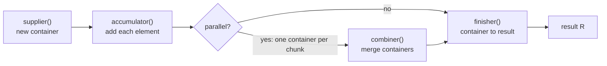
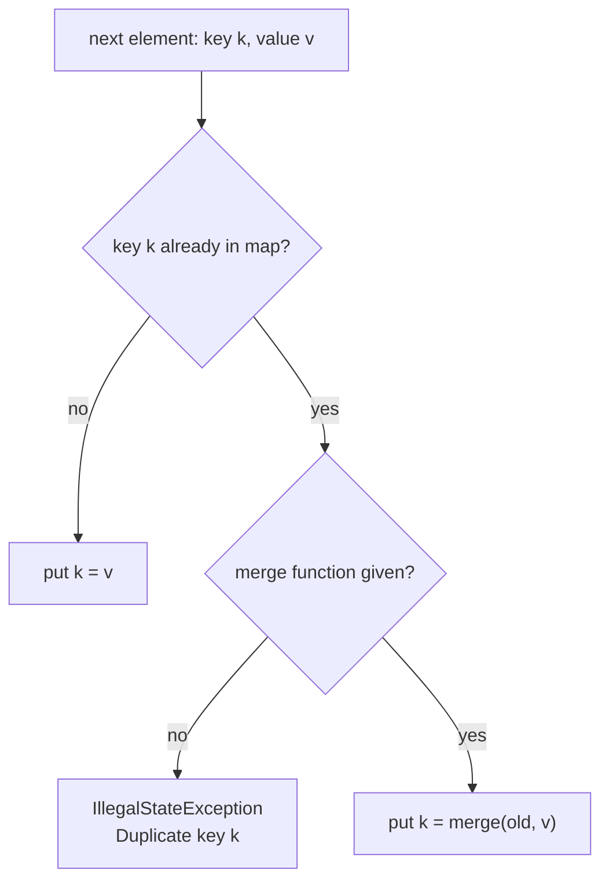

## In One Line
`collect(...)` is the terminal operation that pours a stream into a **mutable container**, and a `Collector` is the recipe for doing it — *make an empty container, add each element, merge two containers, finish* — with the `Collectors` class supplying ready-made recipes such as `toList`, `toSet`, `toMap`, `joining`, `groupingBy`, `partitioningBy`, `counting` and `teeing`.

## Mental Model
Think of a **packing station at the end of a conveyor belt**, with a card of packing instructions pinned above it. The card is the `Collector`; it has five lines:

1. **Supplier** — "take an empty box" (`new ArrayList<>()`, `new StringBuilder()`, `new HashMap<>()`).
2. **Accumulator** — "put each item that arrives into the box" (`list.add(item)`).
3. **Combiner** — "if two packers worked in parallel, tip one box into the other" (`list1.addAll(list2)`).
4. **Finisher** — "seal or gift-wrap the box before shipping" (turn the `StringBuilder` into a `String`, wrap the list as unmodifiable). If the box *is* the product, there is nothing to do.
5. **Characteristics** — stickers on the card: "order does not matter" (`UNORDERED`), "the box is the product, no wrapping" (`IDENTITY_FINISH`), "all packers may share one box" (`CONCURRENT`).

`Collectors.toList()` is one printed card; `Collectors.joining(", ")` is another. You can also write your own card with `Collector.of(...)`.

## Concept
### `collect` = mutable reduction
`reduce` combines elements into one *immutable* value by making new values (`0 + 4`, then `4 + 8`...). `collect` instead **mutates one container** per thread — add, add, add — which is far cheaper for lists, maps and strings. That is why it is called **mutable reduction**. `collect` has two overloads:

```java
<R, A> R collect(Collector<? super T, A, R> collector);                             // with a recipe
<R> R collect(Supplier<R> supplier, BiConsumer<R, ? super T> accumulator,
              BiConsumer<R, R> combiner);                                            // inline recipe
```

### The `Collector<T, A, R>` interface
| Type parameter | Meaning | For `joining(", ")` |
|---|---|---|
| `T` | type of the stream elements | `CharSequence` |
| `A` | mutable accumulation type (usually hidden as `?`) | a `StringJoiner` |
| `R` | final result type | `String` |

| Method | Returns | Job |
|---|---|---|
| `supplier()` | `Supplier<A>` | Create a new empty container |
| `accumulator()` | `BiConsumer<A, T>` | Fold one element into a container |
| `combiner()` | `BinaryOperator<A>` | Merge two partial containers (parallel streams) |
| `finisher()` | `Function<A, R>` | Transform the container into the final result |
| `characteristics()` | `Set<Characteristics>` | `IDENTITY_FINISH`, `UNORDERED`, `CONCURRENT` hints |

How `collect` uses it: **sequentially**, it calls `supplier()` once, `accumulator()` for every element, then `finisher()` (skipped if `IDENTITY_FINISH`). **In parallel**, each chunk gets its own container from `supplier()`, fills it, and the `combiner()` merges the containers pairwise — in encounter order unless the collector is `UNORDERED` — before the finisher runs. No locking is needed because each thread has its own container. A `CONCURRENT` collector (e.g. `groupingByConcurrent`) instead lets all threads share one thread-safe container.

### The `Collectors` catalogue
| Category | Collectors | Result |
|---|---|---|
| To a collection | `toList()`, `toSet()`, `toCollection(TreeSet::new)`, `toUnmodifiableList()`/`Set()` (10) | `List`, `Set`, any `Collection` |
| To a map | `toMap(...)` (3 overloads), `toUnmodifiableMap` (10), `toConcurrentMap` | `Map<K, V>` |
| Grouping | `groupingBy(...)` (3 overloads), `groupingByConcurrent`, `partitioningBy(...)` | `Map<K, List<T>>`, `Map<Boolean, ...>` — see [groupingBy](lesson:a05-java8/16-collectors-grouping-by) and [partitioningBy](lesson:a05-java8/17-collectors-partitioning-by) |
| Strings | `joining()`, `joining(delim)`, `joining(delim, prefix, suffix)` | `String` |
| Counting & maths | `counting()`, `summingInt/Long/Double`, `averagingInt/Long/Double`, `minBy`, `maxBy`, `summarizingInt/Long/Double` | `Long`, `Integer`..., `Double`, `Optional<T>`, `IntSummaryStatistics` — see [counting](lesson:a05-java8/15-collectors-counting) and [summarizing](lesson:a05-java8/18-collectors-summarizing) |
| General reduction | `reducing(op)`, `reducing(identity, op)`, `reducing(identity, mapper, op)` | `Optional<T>` / `T` / `U` |
| Adapters (wrap another collector) | `mapping`, `filtering` (9), `flatMapping` (9), `collectingAndThen`, `teeing` (12) | whatever the wrapped collector gives, adapted |

Most code writes `import static java.util.stream.Collectors.*;` so the calls read `collect(groupingBy(..., counting()))`.

### To collections
- `toList()` — no guarantee of type, mutability, serializability or thread-safety (it is an `ArrayList` today). Java 16's `stream.toList()` is the shorter unmodifiable alternative.
- `toSet()` — no guarantees either (a `HashSet` today): duplicates removed with `equals`/`hashCode`, **no order**. It is `UNORDERED`.
- `toCollection(Supplier)` — you choose the exact type: `toCollection(TreeSet::new)` (sorted, unique), `toCollection(ArrayList::new)` (guaranteed mutable), `toCollection(ArrayDeque::new)`.
- `toUnmodifiableList()`/`toUnmodifiableSet()` (Java 10) — unmodifiable, **reject `null`** with `NullPointerException`.

### `toMap` in depth (a favourite interview topic)
| Overload | Behaviour |
|---|---|
| `toMap(keyMapper, valueMapper)` | Duplicate key → `IllegalStateException: Duplicate key K (attempted merging values V1 and V2)` |
| `toMap(keyMapper, valueMapper, mergeFunction)` | On a duplicate key, `mergeFunction(oldValue, newValue)` decides the stored value |
| `toMap(keyMapper, valueMapper, mergeFunction, mapFactory)` | Also choose the map: `TreeMap::new` (sorted keys), `LinkedHashMap::new` (insertion order) |

Common merge functions:
| Goal | Merge function |
|---|---|
| Keep the first value | `(oldV, newV) -> oldV` |
| Keep the last value | `(oldV, newV) -> newV` |
| Count / sum | `Integer::sum` (with value mapper `x -> 1` or the amount) |
| Concatenate | `(a, b) -> a + "," + b` |
| Keep the max | `BinaryOperator.maxBy(comparator)` or `Math::max` |

Null rules: **values may not be `null`** — the 2-argument form checks with `Objects.requireNonNull`, the others use `Map.merge`, which also throws `NullPointerException`. A `null` **key** is fine when the map is a `HashMap`. (Before Java 9 the duplicate-key message showed the *value* instead of the key — a well-known confusing bug that was fixed.)

`toMap` vs `groupingBy`: `toMap` gives **one value per key** and needs a merge function when keys repeat; `groupingBy` gives **all elements per key** (a `List` by default, or whatever a downstream collector makes).

### `joining` in depth
- `joining()` concatenates, `joining(", ")` puts a delimiter **between** elements (not after the last), `joining(", ", "[", "]")` adds a prefix and suffix — even for an empty stream, which gives `"[]"`.
- It only accepts `CharSequence` elements (`String`, `StringBuilder`...). A `Stream<Integer>` must be mapped first: `map(String::valueOf)`.
- It uses a `StringBuilder`/`StringJoiner` internally, so it is linear time — unlike reducing with `+`.
- If you already have a `List<String>`, `String.join(", ", list)` does the same without a stream.

### Adapters and downstream collectors
Many collectors take **another collector** as a parameter — a *downstream* collector — so recipes compose like Lego:
- `mapping(mapper, downstream)` — transform each element, then hand it to `downstream`.
- `filtering(predicate, downstream)` (9) — only hand matching elements to `downstream`.
- `flatMapping(mapper, downstream)` (9) — each element becomes a stream whose elements go to `downstream`.
- `collectingAndThen(downstream, finisher)` — run `downstream`, then post-process its result (make it unmodifiable, unwrap an `Optional`, take a size).
- `teeing(c1, c2, merger)` (12) — send **every** element to **two** collectors and merge their results: sum and count → average in one pass; min and max → range.

These adapters look pointless at the top level (`mapping(f, toList())` is just `map(f).toList()`), but they are essential **inside** `groupingBy`/`partitioningBy`, where you cannot call `map` or `filter` on each group. That is covered in the grouping lessons.

### Writing your own collector
`Collector.of(supplier, accumulator, combiner, [finisher,] characteristics...)` builds a collector from four lambdas. The 3-argument `collect(supplier, accumulator, combiner)` is the same idea without a finisher. Rules: the supplier must return a **new** container each call; the combiner must correctly merge two partial results (it is only called in parallel, so bugs hide until then); declare `IDENTITY_FINISH` only if the container really is the result.

## Diagram

Every collector is these steps; for `joining(", ")` the container is a `StringJoiner` and the finisher calls `toString()`.


`toMap` only fails on duplicate keys when you did not tell it how to merge.

## Code
@example Java8Features/StreamAPIandCollectors/CollectorsExample.java

**Collections and every `toMap` overload:**
```java
List<String> fruits = List.of("banana", "apple", "cherry", "apple", "fig");

List<String> list = fruits.stream().collect(Collectors.toList());
Set<String> set = fruits.stream().collect(Collectors.toSet());
TreeSet<String> sorted = fruits.stream().collect(Collectors.toCollection(TreeSet::new));
System.out.println(list);
System.out.println(set);
System.out.println(sorted);

// toMap(keyMapper, valueMapper)
Map<String, Integer> lengths = Stream.of("banana", "apple", "fig")
        .collect(Collectors.toMap(Function.identity(), String::length));
System.out.println(lengths);

// duplicate keys without a merge function
try {
    fruits.stream().collect(Collectors.toMap(f -> f, String::length));
} catch (IllegalStateException e) {
    System.out.println("IllegalStateException: " + e.getMessage());
}

// toMap(keyMapper, valueMapper, mergeFunction)
Map<String, Integer> counts = fruits.stream()
        .collect(Collectors.toMap(f -> f, f -> 1, Integer::sum));
System.out.println(counts);

// toMap(keyMapper, valueMapper, mergeFunction, mapFactory)
Map<Character, String> byFirst = fruits.stream()
        .collect(Collectors.toMap(f -> f.charAt(0), f -> f,
                (a, b) -> a + "|" + b, TreeMap::new));
System.out.println(byFirst);

// keep first vs keep last
Map<Integer, String> keepFirst = fruits.stream()
        .collect(Collectors.toMap(String::length, f -> f, (oldV, newV) -> oldV, LinkedHashMap::new));
Map<Integer, String> keepLast = fruits.stream()
        .collect(Collectors.toMap(String::length, f -> f, (oldV, newV) -> newV, LinkedHashMap::new));
System.out.println(keepFirst);
System.out.println(keepLast);

// null values are rejected, null keys are not
try {
    Stream.of("a").collect(Collectors.toMap(k -> k, k -> (String) null));
} catch (NullPointerException e) {
    System.out.println("NullPointerException: toMap value was null");
}
Map<String, Integer> nullKey = Stream.of("a", null).collect(Collectors.toMap(k -> k, k -> 1));
System.out.println(nullKey);
```
```output
[banana, apple, cherry, apple, fig]
[banana, apple, cherry, fig]
[apple, banana, cherry, fig]
{banana=6, apple=5, fig=3}
IllegalStateException: Duplicate key apple (attempted merging values 5 and 5)
{banana=1, cherry=1, apple=2, fig=1}
{a=apple|apple, b=banana, c=cherry, f=fig}
{6=banana, 5=apple, 3=fig}
{6=cherry, 5=apple, 3=fig}
NullPointerException: toMap value was null
{null=1, a=1}
```
The `HashSet`/`HashMap` orders above come from hash codes, not from the source or the alphabet — never rely on them.

**Joining, adapters, aggregation and `teeing`:**
```java
List<String> fruits = List.of("banana", "apple", "cherry", "apple", "fig");

System.out.println(fruits.stream().collect(Collectors.joining()));
System.out.println(fruits.stream().collect(Collectors.joining(", ")));
System.out.println(fruits.stream().collect(Collectors.joining(", ", "[", "]")));
System.out.println(Stream.<String>empty().collect(Collectors.joining(", ", "[", "]")));
System.out.println(Stream.of(1, 2, 3).map(String::valueOf).collect(Collectors.joining("+", "", " = 6")));

// adapters
System.out.println(fruits.stream().collect(
        Collectors.mapping(String::toUpperCase, Collectors.joining("/"))));
System.out.println(fruits.stream().collect(
        Collectors.filtering(f -> f.length() > 5, Collectors.toList())));
List<String> readOnly = fruits.stream().collect(
        Collectors.collectingAndThen(Collectors.toList(), Collections::unmodifiableList));
System.out.println(readOnly.getClass().getSimpleName());

// aggregation
System.out.println(fruits.stream().collect(Collectors.counting()));
System.out.println(fruits.stream().collect(Collectors.maxBy(Comparator.comparing(String::length))));
System.out.println(fruits.stream().collect(Collectors.reducing(0, String::length, Integer::sum)));
System.out.println(fruits.stream().collect(Collectors.averagingInt(String::length)));

// teeing (Java 12): two collectors, one merger
double avg = Stream.of(10, 20, 30, 40).collect(Collectors.teeing(
        Collectors.summingInt(i -> i),
        Collectors.counting(),
        (sum, n) -> (double) sum / n));
System.out.println(avg);
```
```output
bananaapplecherryapplefig
banana, apple, cherry, apple, fig
[banana, apple, cherry, apple, fig]
[]
1+2+3 = 6
BANANA/APPLE/CHERRY/APPLE/FIG
[banana, cherry]
UnmodifiableRandomAccessList
5
Optional[banana]
25
5.0
25.0
```

**Your own collector, the 3-argument `collect`, and characteristics:**
```java
Collector<String, StringJoiner, String> pipeJoin = Collector.of(
        () -> new StringJoiner(" | "),      // supplier: new empty container
        StringJoiner::add,                   // accumulator: add one element
        StringJoiner::merge,                 // combiner: merge two containers (parallel)
        StringJoiner::toString);             // finisher: container -> final result
System.out.println(Stream.of("x", "y", "z").collect(pipeJoin));

ArrayList<String> al = Stream.of("p", "q")
        .collect(ArrayList::new, ArrayList::add, ArrayList::addAll);
System.out.println(al);

System.out.println(Collectors.toList().characteristics());
System.out.println(Collectors.toSet().characteristics());
System.out.println(Collectors.joining().characteristics());
System.out.println(Collectors.groupingByConcurrent(s -> s).characteristics());
```
```output
x | y | z
[p, q]
[IDENTITY_FINISH]
[UNORDERED, IDENTITY_FINISH]
[]
[CONCURRENT, UNORDERED, IDENTITY_FINISH]
```

## Walkthrough
**The original example**
- `import java.util.stream.Collectors;` — the utility class with static factory methods for collectors. `Arrays` and `List` are for building the input.
- `List<String> strings = Arrays.asList("abc", "", "bc", "efg", "abcd", "", "jkl");` — seven strings, two of them empty.
- First pipeline: `strings.stream().filter(string -> !string.isEmpty())` keeps the 5 non-empty strings; `.collect(Collectors.toList())` runs the pipeline with the `toList` recipe — supplier `ArrayList::new`, accumulator `List::add`, combiner `addAll`, identity finish. Printing gives `Filtered List: [abc, bc, efg, abcd, jkl]`.
- Second pipeline: a **new** stream (the first was consumed), the same filter, then `.collect(Collectors.joining(", "))`. `joining` appends each string to a `StringJoiner` with `", "` placed only *between* elements, and its finisher returns the `String`. Result: `Merged String: abc, bc, efg, abcd, jkl` — no trailing comma. The two empty strings were already removed; without the filter the result would be `abc, , bc, efg, abcd, , jkl`.
- Both `// Output:` comments match the recorded output. The result is deterministic: sequential stream over an ordered list.

**The extra snippets**
- `toSet()` drops the duplicate `apple` and prints in hash order; `toCollection(TreeSet::new)` sorts and de-duplicates.
- `toMap(Function.identity(), String::length)` maps each word to its length. `Function.identity()` is `x -> x`.
- `toMap(f -> f, String::length)` on a list containing `apple` twice throws `IllegalStateException` naming the key and both values.
- `toMap(f -> f, f -> 1, Integer::sum)` is a word counter: each word starts at 1 and duplicates are merged by adding.
- The 4-argument form with `TreeMap::new` sorts the keys (`a`, `b`, `c`, `f`) and merges the two `apple`s into `apple|apple`.
- Keying by length: `banana` and `cherry` both have length 6. "Keep first" stores `banana`; "keep last" stores `cherry`. `LinkedHashMap::new` keeps keys in first-insertion order (6, 5, 3).
- A `null` value blows up; a `null` key is accepted by `HashMap` and printed first (its hash is 0).
- `joining` variants: plain concatenation, delimiter only, delimiter + prefix + suffix; the empty stream still gets `[]`; numbers are mapped with `String::valueOf` first.
- `mapping(String::toUpperCase, joining("/"))` transforms then joins; `filtering(f -> f.length() > 5, toList())` keeps `banana` and `cherry`; `collectingAndThen(toList(), Collections::unmodifiableList)` wraps the list (hence `UnmodifiableRandomAccessList`).
- `counting()` → `5` (a `Long`); `maxBy(comparing(String::length))` → `Optional[banana]`: on a tie with `cherry` it keeps the **first**; `reducing(0, String::length, Integer::sum)` → total length 25; `averagingInt` → `5.0` (always a `Double`).
- `teeing` sends each number to `summingInt` (100) and `counting` (4) and merges them into 25.0.
- `Collector.of(...)` builds a working joiner from four method references. The 3-argument `collect` uses `ArrayList::addAll` as its combiner.
- Characteristics: `toList` is only `IDENTITY_FINISH` (the `ArrayList` *is* the result); `toSet` is also `UNORDERED`; `joining` has none (it needs a finisher and keeps order); `groupingByConcurrent` is `CONCURRENT` + `UNORDERED`.

## Traps
> [!NOTE] The example's comments and outputs are correct. One small improvement: the second pipeline repeats the filtering work. When you already have `filtered`, `String.join(", ", filtered)` gives the same string without a second stream.

- **`toMap` with repeating keys and no merge function** throws `IllegalStateException: Duplicate key ...`. Any time keys *might* repeat, pass a merge function.
- **`toMap` with a `null` value** throws `NullPointerException` (even though `HashMap` itself allows null values). Filter nulls out or map them to a default.
- **`toMap`/`toSet`/`groupingBy` return `HashMap`/`HashSet` today** — iteration order is by hash, not insertion or sort order. Pass `LinkedHashMap::new`, `TreeMap::new` or `toCollection(TreeSet::new)` when order matters.
- **Assuming `Collectors.toList()` is mutable** is relying on an implementation detail; `toCollection(ArrayList::new)` states the intent.
- **`toUnmodifiableList/Set/Map` reject nulls**, and `toUnmodifiableMap` also rejects duplicate keys unless you pass a merge function.
- **`joining` needs `CharSequence` elements.** `Stream<Integer>.collect(joining(","))` does not compile — map with `String::valueOf` first.
- **`maxBy`/`minBy` return `Optional`**, even when you "know" the stream is non-empty. Inside a `groupingBy` wrap with `collectingAndThen(maxBy(...), Optional::get)`.
- **`counting()` returns `Long`, `averagingX` returns `Double`, `summingInt` returns `Integer`** — the boxed types matter for map value types (`Map<String, Long>`, not `Map<String, Integer>`).
- **A custom collector's combiner** is not called in sequential streams, so a broken combiner passes all tests until someone adds `.parallel()`.
- **Using `forEach` to fill an outside list** instead of a collector: `stream.forEach(result::add)` is not thread-safe in parallel and is harder to read. Collect instead.

## Tips & Tricks
- **The five-line card: "Supply, Accumulate, Combine, Finish + Characteristics"** — mnemonic **"SACFC"**, or "*Some Apples Can Feed Children*".
- **`toMap` rule:** keys could repeat → add a merge function; order matters → add a map factory. "Merge and Map factory: the 3rd and 4th arguments."
- **Merge function cheat sheet:** keep first `(a, b) -> a`, keep last `(a, b) -> b`, count `Integer::sum`.
- **`static import`:** `import static java.util.stream.Collectors.*;` makes nested collectors readable: `groupingBy(Employee::dept, mapping(Employee::name, toList()))`.
- **`teeing` = "T-junction":** one stream, two collectors, one merged answer — average, min+max, count of two categories in a single pass.
- **Adapters exist for downstream use.** At the top level prefer `map`/`filter` + a plain collector; inside `groupingBy` reach for `mapping`/`filtering`/`flatMapping`.
- **Plain count? Use `count()`, not `collect(counting())`.** `counting()` is for downstream use.
- **Joining an existing list?** `String.join(", ", list)`.

## Interview Q&A
### [Basic] What is a Collector, and how is `collect()` different from `reduce()`?
A `Collector<T, A, R>` is a recipe for a **mutable reduction**: `supplier` creates a container, `accumulator` adds each element to it, `combiner` merges two containers from parallel chunks, `finisher` turns the container into the final result, and `characteristics` give optimisation hints. `collect()` mutates a container (efficient for lists, maps, `StringBuilder`s), whereas `reduce()` combines **immutable** values, creating a new value each step. Reducing into a list or string with `reduce` would copy data on every element.

**Follow-up:** *Where do you get collectors?* — Mostly from the `Collectors` utility class (`toList`, `toMap`, `joining`, `groupingBy`...), or build one with `Collector.of(...)`.

### [Basic] What happens with `Collectors.toMap` when two elements have the same key? How do you fix it?
The 2-argument `toMap(keyMapper, valueMapper)` throws `IllegalStateException: Duplicate key k (attempted merging values v1 and v2)`. Fix it by passing a **merge function** as the third argument that decides the value for a repeated key: `(oldV, newV) -> oldV` keeps the first, `(oldV, newV) -> newV` keeps the last, `Integer::sum` adds them.
```java
Map<String, Integer> counts = words.stream()
        .collect(Collectors.toMap(w -> w, w -> 1, Integer::sum));
```
**Follow-up:** *How do you get a sorted map?* — Use the 4-argument form with a map factory: `toMap(k, v, merge, TreeMap::new)`.

### [Basic] How do you join strings with a delimiter, prefix and suffix?
`Collectors.joining(", ", "[", "]")`. The delimiter goes only between elements, the prefix and suffix are added once — even for an empty stream, which yields `"[]"`. `joining()` with no arguments just concatenates. Elements must be `CharSequence`s, so map other types first: `nums.stream().map(String::valueOf).collect(joining(","))`. It uses a `StringJoiner` internally, so it runs in linear time.

**Follow-up:** *Alternative without streams?* — `String.join(", ", list)` or `new StringJoiner(", ", "[", "]")`.

### [Intermediate] What are the rules around `null` in `toMap`?
Values must be non-null: the 2-argument `toMap` calls `Objects.requireNonNull` on each value, and the merge-function overloads use `Map.merge`, which throws `NullPointerException` for a null value. Keys may be `null` if the target map allows it (`HashMap` does, `TreeMap` does not with natural ordering). The unmodifiable variants (`toUnmodifiableMap`) reject both null keys and values. If nulls are possible, filter them or map them to a default, or collect with `groupingBy`/a manual `HashMap` loop.

**Follow-up:** *Why is this surprising?* — Because `HashMap.put(k, null)` is legal; the restriction comes from `Map.merge`'s contract, which uses `null` to mean "remove".

### [Intermediate] `toMap` vs `groupingBy` — when do you use which?
Use `toMap` when each key should map to **one** value (id → object, word → length); if keys can repeat you must supply a merge function. Use `groupingBy` when each key should map to **all** matching elements — `Map<K, List<T>>` by default — or to an aggregate of them via a downstream collector (`counting()`, `summingInt`, `mapping`). A word count can be written either way: `toMap(w -> w, w -> 1, Integer::sum)` gives `Map<String, Integer>`; `groupingBy(w -> w, counting())` gives `Map<String, Long>`.

**Follow-up:** *Which is clearer for counting?* — `groupingBy(identity(), counting())` states the intent; `toMap` with `Integer::sum` avoids `Long` if you need `Integer`.

### [Intermediate] What are downstream collectors? Give examples.
A downstream collector is a collector passed as an argument to another collector, which applies it to a subset of the elements — typically each group of a `groupingBy`/`partitioningBy`. Examples: `counting()`, `summingInt`, `averagingDouble`, `maxBy`, `toSet()`, `joining()`, and the adapters `mapping(f, c)`, `filtering(p, c)`, `flatMapping(f, c)`, `collectingAndThen(c, finisher)`.
```java
Map<String, List<String>> namesByDept = emps.stream()
        .collect(groupingBy(Employee::dept, mapping(Employee::name, toList())));
```
**Follow-up:** *Why not just `map` before `groupingBy`?* — Because the classifier needs the original element (the `Employee`) while the group should hold something else (the name); `mapping` transforms *inside* each group.

### [Intermediate] What does `Collectors.collectingAndThen` do? When is it useful?
It wraps a collector and applies a finishing function to its result: `collectingAndThen(downstream, finisher)`. Uses: make a result unmodifiable (`collectingAndThen(toList(), Collections::unmodifiableList)`), unwrap an `Optional` from `maxBy` inside a grouping (`collectingAndThen(maxBy(cmp), Optional::get)`), convert a `Long` count to `int` (`collectingAndThen(counting(), Long::intValue)`), or take the size of a set.

**Follow-up:** *Is `Optional::get` safe there?* — Inside `groupingBy`, yes: a group exists only if at least one element was classified into it, so `maxBy` is never empty.

### [Advanced] What does `Collectors.teeing` do?
Added in Java 12, `teeing(downstream1, downstream2, merger)` sends every element to **both** collectors and then combines their two results with the `merger` BiFunction — one pass instead of two streams. Examples: average = `teeing(summingInt(x), counting(), (s, n) -> (double) s / n)`; range = `teeing(minBy(cmp), maxBy(cmp), (min, max) -> ...)`; split-and-count = `teeing(filtering(p, toList()), filtering(p.negate(), counting()), ...)`. It is useful when the source can only be traversed once or is expensive.

**Follow-up:** *How would you do it before Java 12?* — Two separate streams over the same collection, or `summaryStatistics()` for numeric cases, or a custom collector.

### [Advanced] How would you write a custom collector?
Use `Collector.of(supplier, accumulator, combiner, finisher, characteristics...)` or implement the `Collector` interface. Example: joining with a pipe separator:
```java
Collector<String, StringJoiner, String> pipeJoin = Collector.of(
        () -> new StringJoiner(" | "), StringJoiner::add, StringJoiner::merge, StringJoiner::toString);
```
Requirements: the supplier returns a **fresh** container every call; the accumulator and combiner must be associative-compatible so that sequential and parallel runs give the same result; declare `IDENTITY_FINISH` only when the container is the result (the finisher is then skipped), `UNORDERED` only if order truly does not matter, and `CONCURRENT` only if the accumulator is safe to call from many threads on one shared container.

**Follow-up:** *When is the combiner called?* — Only in parallel streams, to merge per-chunk containers — so test custom collectors with `.parallel()`.

### [Advanced] What are collector characteristics and how are they used?
`Collector.Characteristics` is an enum of hints: `IDENTITY_FINISH` — the accumulation container is the final result, so the framework skips the finisher and casts; `UNORDERED` — the result does not depend on encounter order, so parallel execution may combine chunks in any order; `CONCURRENT` — the accumulator can be called concurrently on **one** shared container, so a parallel stream can skip per-thread containers and the combiner (used only when the stream is also unordered or the collector is `UNORDERED`). `toList()` is `IDENTITY_FINISH`; `toSet()` is `UNORDERED, IDENTITY_FINISH`; `joining()` has none; `groupingByConcurrent`/`toConcurrentMap` are `CONCURRENT, UNORDERED, IDENTITY_FINISH`.

**Follow-up:** *Why is `joining` not `IDENTITY_FINISH`?* — Its container is a `StringJoiner`/`StringBuilder`, and the finisher must convert it to a `String`.

## Quiz
### What would the second pipeline of the original print with `Collectors.joining(", ", "{", "}")`?
- [ ] `{abc}, {bc}, {efg}, {abcd}, {jkl}`
- [x] `{abc, bc, efg, abcd, jkl}`
- [ ] `{abc, bc, efg, abcd, jkl, }`
- [ ] `{abc, , bc, efg, abcd, , jkl}`
> The prefix and suffix wrap the **whole** result once; the delimiter goes only **between** elements, so there is no trailing `", "`. The empty strings were removed by the filter, so they do not appear.

### What does this print?
```java
Map<Character, String> m = Stream.of("apple", "avocado", "banana")
        .collect(Collectors.toMap(s -> s.charAt(0), s -> s, (a, b) -> a));
System.out.println(m);
```
- [x] `{a=apple, b=banana}`
- [ ] `{a=avocado, b=banana}`
- [ ] `{a=apple, a=avocado, b=banana}`
- [ ] `IllegalStateException: Duplicate key a`
> `apple` and `avocado` share the key `'a'`; the merge function `(a, b) -> a` keeps the **old** (first) value. There is no exception because a merge function was supplied, and a map can never hold the same key twice.

### What happens here?
```java
List<String> fruits = List.of("apple", "fig", "apple");
Map<String, Integer> m = fruits.stream()
        .collect(Collectors.toMap(f -> f, String::length));
```
- [ ] `m` is `{apple=5, fig=3}`
- [ ] `m` is `{apple=10, fig=3}`
- [x] `IllegalStateException: Duplicate key apple (attempted merging values 5 and 5)`
- [ ] Compile error
> Without a merge function, `toMap` refuses duplicate keys — even when the values are equal. Add `(a, b) -> a` to keep one, or `Integer::sum` to add them (10).

### What does `Stream.<String>empty().collect(Collectors.joining(", ", "[", "]"))` return?
- [ ] `""` (empty string)
- [x] `"[]"`
- [ ] `null`
- [ ] It throws `NoSuchElementException`
> Prefix and suffix are always added, even with zero elements. `joining` never returns `null` and never throws on an empty stream.

### Spot the bug
```java
List<Integer> ids = List.of(1, 2, 3);
String csv = ids.stream().collect(Collectors.joining(","));
```
- [ ] It prints `1,2,3,` with a trailing comma
- [x] It does not compile: `joining` collects `CharSequence` elements, not `Integer`s
- [ ] It throws `ClassCastException` at runtime
- [ ] `joining` needs a prefix and suffix
> `joining` is a `Collector<CharSequence, ?, String>`, so a `Stream<Integer>` cannot use it — the compiler reports "no suitable method found for collect". Fix: `ids.stream().map(String::valueOf).collect(Collectors.joining(","))`.

### What does this print?
```java
int range = Stream.of(5, 1, 9).collect(Collectors.teeing(
        Collectors.minBy(Comparator.<Integer>naturalOrder()),
        Collectors.maxBy(Comparator.<Integer>naturalOrder()),
        (mn, mx) -> mx.get() - mn.get()));
System.out.println(range);
```
- [ ] `4`
- [x] `8`
- [ ] `Optional[8]`
- [ ] `-8`
> `teeing` sends every element to both collectors: `minBy` gives `Optional[1]`, `maxBy` gives `Optional[9]`; the merger unwraps them and returns 9 − 1 = 8, a plain `int`. `4` would be 9 − 5, confusing the min with the first element.

### Which characteristic lets the framework skip the finisher and use the container as the result?
- [ ] `UNORDERED`
- [ ] `CONCURRENT`
- [x] `IDENTITY_FINISH`
- [ ] `SIZED`
> `IDENTITY_FINISH` means the accumulation type is the result type (e.g. `toList()`'s `ArrayList`). `UNORDERED` and `CONCURRENT` are about ordering and shared containers; `SIZED` is a *stream/spliterator* flag, not a collector characteristic.

## Takeaways
- `collect(Collector)` performs a **mutable reduction**: supplier (new container), accumulator (add element), combiner (merge parallel containers), finisher (container → result), plus characteristics.
- `Collectors.toList()`/`toSet()` give no guarantees on type or mutability; use `toCollection(ArrayList::new / TreeSet::new)` for a specific type and `toUnmodifiableList()` or Java 16 `stream.toList()` for read-only results.
- `toMap(k, v)` throws `IllegalStateException: Duplicate key` on repeated keys; add a merge function (`(a, b) -> a`, `Integer::sum`) and optionally a map factory (`TreeMap::new`, `LinkedHashMap::new`). Null **values** throw `NullPointerException`.
- `joining(delim, prefix, suffix)` works only on `CharSequence`s, puts the delimiter between elements, and still adds prefix/suffix to an empty stream (`"[]"`).
- Downstream collectors (`counting`, `mapping`, `filtering`, `flatMapping`, `collectingAndThen`, `maxBy`...) compose inside `groupingBy`/`partitioningBy`.
- `teeing` (Java 12) feeds every element to two collectors and merges both results in one pass.
- Custom collectors come from `Collector.of(...)`; their combiner runs only in parallel, so test them in parallel.
