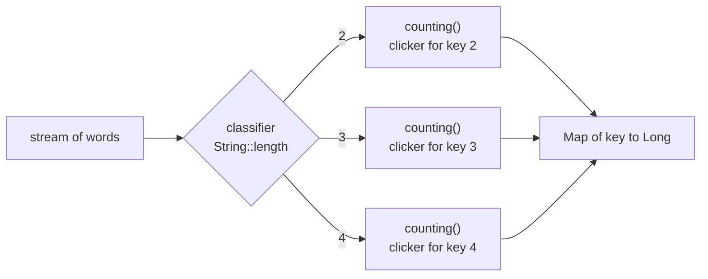
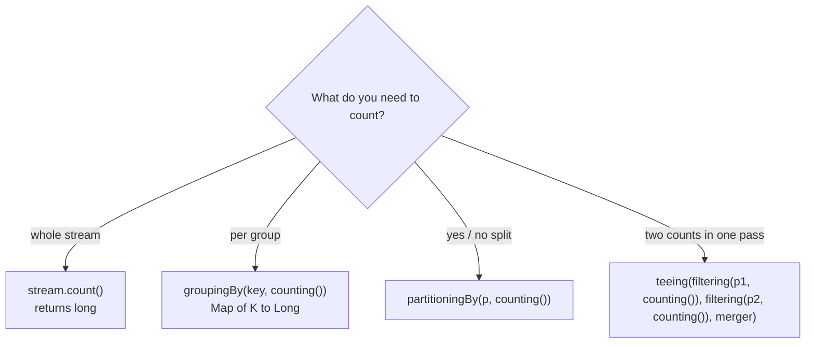

## In One Line
`Collectors.counting()` is a collector that counts the elements it receives and returns a **`Long`**; for a whole stream `stream.count()` is simpler and faster, so `counting()` earns its place as a **downstream collector** — "how many per group" — as in `groupingBy(word -> word, counting())`, the frequency-map pattern behind dozens of interview questions.

## Mental Model
Picture a **tally clicker** at a turnstile.

- One clicker at the main gate counting everyone who passes is `stream.count()` — you would never build a special counting machine just for that.
- Now put **one clicker at each of several doors** — Door "2 letters", Door "3 letters", Door "4 letters" — and send each person through the door that matches them. At closing time you read every clicker. That is `groupingBy(String::length, counting())`: the classifier picks the door, `counting()` is the clicker behind each door.
- The clicker's display holds big numbers — it is a `long`, delivered boxed as a `Long`.

## Concept
### What `counting()` is
```java
public static <T> Collector<T, ?, Long> counting()
```
- Accepts elements of **any** type `T`, ignores their values, and produces the number of elements as a `Long`.
- In the JDK it is literally `summingLong(e -> 1L)`: each element contributes 1 to a `long` sum.
- Empty input → `0L` (never `null`, never an `Optional`).
- It is a full collector (supplier/accumulator/combiner/finisher), so it works in parallel streams too.

### `count()` vs `collect(counting())`
| | `stream.count()` | `stream.collect(Collectors.counting())` |
|---|---|---|
| Kind | Terminal operation on `Stream` (and `IntStream`...) | Collector passed to `collect` |
| Returns | primitive `long` | boxed `Long` |
| Optimisation | Since Java 9 may skip the pipeline if the size is known (`SIZED` source, no `filter`) | Always traverses every element |
| Use it for | Counting the whole stream | Counting **inside** another collector: `groupingBy`, `partitioningBy`, `teeing`, `filtering`, `mapping` |

Rule: **top level → `count()`; downstream → `counting()`.** IntelliJ even flags `collect(Collectors.counting())` with "can be replaced with `count()`".

### The frequency-map pattern
Almost every "count occurrences" question has the same shape:

```java
Map<K, Long> freq = source.stream()
        .collect(Collectors.groupingBy(classifier, Collectors.counting()));
```
- **Words:** `Arrays.stream(text.split("\\s+")).collect(groupingBy(Function.identity(), counting()))`.
- **Characters:** `str.chars().mapToObj(c -> (char) c).collect(groupingBy(Function.identity(), LinkedHashMap::new, counting()))`.
- **By property:** `employees.stream().collect(groupingBy(Employee::dept, counting()))` (headcount per department).

Choose the map with the 3-argument `groupingBy`:
| Map factory | Key order | Typical use |
|---|---|---|
| (default) `HashMap` | By hash — effectively random | You only look up counts |
| `LinkedHashMap::new` | First occurrence in the input | "First non-repeated character", "first duplicate" |
| `TreeMap::new` | Sorted keys | Printing a report alphabetically |

Then post-process the map with a **second stream over `entrySet()`**:
- first unique → `filter(e -> e.getValue() == 1).map(Map.Entry::getKey).findFirst()` (with a `LinkedHashMap`);
- duplicates → `filter(e -> e.getValue() > 1)`;
- most frequent → `max(Map.Entry.comparingByValue())`;
- top N → `sorted(Map.Entry.<K, Long>comparingByValue().reversed()).limit(n)`.

### Getting `Integer` counts instead of `Long`
`counting()` always gives `Long`, so the map type is `Map<K, Long>`; declaring `Map<K, Integer>` is a compile error ("inference variable D has incompatible equality constraints Integer,Long"). If you need `Integer`:
- `summingInt(e -> 1)` — counts as an `int` sum;
- `collectingAndThen(counting(), Long::intValue)` — converts the finished count;
- `toMap(k, e -> 1, Integer::sum)` — the `toMap` style counter.

### Other ways to count
| Question | Idiom |
|---|---|
| How many elements match? | `stream.filter(p).count()` |
| How many distinct? | `stream.distinct().count()` |
| How many characters of a kind? | `str.chars().filter(ch -> "aeiou".indexOf(ch) >= 0).count()` |
| How many in each of two categories? | `partitioningBy(p, counting())` → `{false=.., true=..}` |
| Two different counts in one pass? | `teeing(filtering(p1, counting()), filtering(p2, counting()), merger)` |
| How many **distinct** values per group? | `groupingBy(k, collectingAndThen(toSet(), Set::size))` or `mapping(f, toSet())` then `size()` |
| Count and sum and min and max at once | `summarizingInt(...)` → `getCount()` — see [Summarizing Collectors](lesson:a05-java8/18-collectors-summarizing) |

## Diagram

`groupingBy` routes each element to its key's own `counting()` collector; each one adds 1L per element.


`counting()` belongs in the downstream slot; at the top level `count()` is the right tool.

## Code
@example Java8Features/StreamAPIandCollectors/CollectorsCountingExample.java

**Where `counting()` really belongs — frequency maps and their follow-ups:**
```java
List<String> strings = Arrays.asList("abc", "", "bc", "efg", "abcd", "", "jkl");

// 1. The idiomatic way for a plain count
long count = strings.stream().filter(s -> !s.isEmpty()).count();
System.out.println(count);

// 2. counting() shines as a downstream collector
Map<Integer, Long> byLength = strings.stream()
        .collect(Collectors.groupingBy(String::length, Collectors.counting()));
System.out.println(byLength);

// 3. word frequency
String text = "the cat and the hat and the bat";
Map<String, Long> freq = Arrays.stream(text.split(" "))
        .collect(Collectors.groupingBy(Function.identity(), TreeMap::new, Collectors.counting()));
System.out.println(freq);

// 4. character frequency, in first-seen order
Map<Character, Long> chars = "programming".chars()
        .mapToObj(c -> (char) c)
        .collect(Collectors.groupingBy(Function.identity(), LinkedHashMap::new, Collectors.counting()));
System.out.println(chars);

// 5. first non-repeated character
Optional<Character> firstUnique = chars.entrySet().stream()
        .filter(e -> e.getValue() == 1)
        .map(Map.Entry::getKey)
        .findFirst();
System.out.println(firstUnique.orElse('-'));

// 6. duplicates
List<Character> dups = chars.entrySet().stream()
        .filter(e -> e.getValue() > 1)
        .map(Map.Entry::getKey)
        .toList();
System.out.println(dups);

// 7. most frequent word
Map.Entry<String, Long> top = freq.entrySet().stream()
        .max(Map.Entry.comparingByValue())
        .orElseThrow();
System.out.println(top);

// 8. Integer counts instead of Long
Map<Integer, Integer> intCounts = strings.stream()
        .collect(Collectors.groupingBy(String::length, Collectors.summingInt(s -> 1)));
System.out.println(intCounts);
Map<Integer, Integer> intCounts2 = strings.stream()
        .collect(Collectors.groupingBy(String::length,
                Collectors.collectingAndThen(Collectors.counting(), Long::intValue)));
System.out.println(intCounts2);

// 9. counting on empty stream
System.out.println(Stream.empty().collect(Collectors.counting()));

// 10. sort by count desc, then key
freq.entrySet().stream()
    .sorted(Map.Entry.<String, Long>comparingByValue().reversed()
            .thenComparing(Map.Entry.comparingByKey()))
    .forEach(e -> System.out.println(e.getKey() + "=" + e.getValue()));
```
```output
5
{0=2, 2=1, 3=3, 4=1}
{and=2, bat=1, cat=1, hat=1, the=3}
{p=1, r=2, o=1, g=2, a=1, m=2, i=1, n=1}
p
[r, g, m]
the=3
{0=2, 2=1, 3=3, 4=1}
{0=2, 2=1, 3=3, 4=1}
0
the=3
and=2
bat=1
cat=1
hat=1
```

**`count()` may skip the pipeline; `counting()` never does:**
```java
List<Integer> nums = List.of(1, 2, 3);
long a = nums.stream().peek(n -> System.out.print("p" + n + " ")).count();
System.out.println("-> " + a);
long b = nums.stream().peek(n -> System.out.print("p" + n + " ")).collect(counting());
System.out.println("-> " + b);
```
```output
-> 3
p1 p2 p3 -> 3
```

**Counting in the other downstream slots:**
```java
Map<Boolean, Long> evenOdd = IntStream.rangeClosed(1, 7).boxed()
        .collect(partitioningBy(n -> n % 2 == 0, counting()));
System.out.println(evenOdd);

String r = Stream.of(3, -1, 4, -5, 9).collect(teeing(
        filtering(n -> n > 0, counting()),
        filtering(n -> n < 0, counting()),
        (pos, neg) -> pos + " positive, " + neg + " negative"));
System.out.println(r);

System.out.println(Stream.of("a", "b", "a", "c", "b").distinct().count());
System.out.println("interview".chars().filter(ch -> "aeiou".indexOf(ch) >= 0).count());
```
```output
{false=4, true=3}
3 positive, 2 negative
3
4
```
(These use `import static java.util.stream.Collectors.*;`.)

## Walkthrough
**The original example**
- `List<String> strings = Arrays.asList("abc", "", "bc", "efg", "abcd", "", "jkl");` — 7 strings, 2 empty.
- `strings.stream().filter(string -> !string.isEmpty())` — keeps the 5 non-empty strings.
- `.collect(Collectors.counting())` — each surviving element adds 1L to a running `long`; the result is a `Long`, which is **auto-unboxed** into the `long count` variable.
- `System.out.println("Count of non-empty strings: " + count);` — prints `Count of non-empty strings: 5`, matching the comment and the recorded output.
- Equivalent, and preferred: `long count = strings.stream().filter(s -> !s.isEmpty()).count();`.

**The extra snippets**
1. `count()` gives the same 5 as a primitive `long` with no boxing.
2. `groupingBy(String::length, counting())` — the two empty strings form the key `0`; lengths 2, 3, 4 have 1, 3 and 1 strings. The keys look sorted only because small `Integer` keys land in hash buckets in numeric order.
3. Word frequency with `TreeMap::new` prints words alphabetically; `the` appears 3 times, `and` twice.
4. Character frequency: `"programming".chars()` is an `IntStream`; `mapToObj(c -> (char) c)` boxes each to a `Character`; `LinkedHashMap::new` keeps the **first-seen** order `p, r, o, g, a, m, i, n`.
5. First non-repeated character: the first entry with value 1 in that ordered map is `p`. (`e.getValue() == 1` compares a `Long` with an `int` literal, which unboxes — safe.)
6. Duplicates: entries with a count above 1 → `[r, g, m]`.
7. `max(Map.Entry.comparingByValue())` finds `the=3`.
8. Both `Integer` alternatives produce the same counts as `Map<Integer, Integer>`.
9. `counting()` on an empty stream returns `0`.
10. Sorting entries by count descending, then key ascending, is the "top-k frequent words" answer: `the=3`, `and=2`, then the ties `bat`, `cat`, `hat` alphabetically. The `<String, Long>` type witness is needed because `.reversed()` breaks Java's type inference for the chained comparator.

**`count()` vs `counting()`:** the `List` source is `SIZED` and `peek` does not change the size, so `count()` returns 3 without traversing — `peek` prints nothing. `collect(counting())` always visits every element, so `peek` prints all three.

**Other slots:** `partitioningBy(even, counting())` → 3 even (2, 4, 6) and 4 odd numbers in 1..7; `teeing` counts positives and negatives in one pass; `distinct().count()` counts unique values; the vowel count uses `String.indexOf(int)` as a set-membership test (`i, e, i, e` → 4).

## Traps
> [!ERRATA] `strings.stream().filter(...).collect(Collectors.counting())` works, but it is the wrong tool for a whole-stream count: it boxes the result into a `Long` and always traverses the stream. The idiomatic line is `strings.stream().filter(s -> !s.isEmpty()).count()`. `Collectors.counting()` is designed for downstream use, e.g. `groupingBy(String::length, Collectors.counting())`.

- **`counting()` returns `Long`, not `Integer`.** `Map<String, Integer> m = ...collect(groupingBy(s -> s, counting()))` does not compile. Declare `Map<String, Long>` or use `summingInt(e -> 1)`.
- **Comparing two `Long` counts with `==`** compares references. Values between -128 and 127 are cached, so small tests pass, but two counts of 1000 compared with `==` are `false`. Use `equals`, `Long.compare`, or unbox (`longValue()`). Comparing a `Long` with a primitive literal (`e.getValue() == 1`) is safe because it unboxes.
- **Relying on `HashMap` key order** in frequency maps. Use `LinkedHashMap::new` for input order (first non-repeated character!) or `TreeMap::new` for sorted keys.
- **Case and whitespace** silently split counts: `"The"` and `"the"` are different keys, and `split(" ")` on double spaces yields empty strings. Normalise first: `toLowerCase()`, `split("\\s+")`, `filter(w -> !w.isBlank())`.
- **`chars()` gives `int`s.** `str.chars().collect(groupingBy(...))` does not compile — `IntStream` has no `collect(Collector)`. Use `mapToObj(c -> (char) c)` first.
- **Side effects in `peek` with `count()`**: since Java 9 they may never run.
- **Counting with `forEach` and a counter variable** does not compile for local variables (they must be effectively final) and is broken in parallel if you work around it with an array or a field. Use `count()` or `counting()`.

## Tips & Tricks
- **"Top level `count()`, downstream `counting()`."**
- **Frequency map template:** `groupingBy(Function.identity(), LinkedHashMap::new, counting())` — identity key, ordered map, counts.
- **Then stream the entries:** `map.entrySet().stream()` + `filter`/`max`/`sorted` on `Map.Entry.comparingByValue()` answers "first unique", "duplicates", "most frequent", "top k".
- **Need an `int`?** `summingInt(x -> 1)` or `collectingAndThen(counting(), Long::intValue)`.
- **Count distinct per group:** `collectingAndThen(toSet(), Set::size)`.
- **Two counts, one pass:** `teeing(filtering(p1, counting()), filtering(p2, counting()), ...)` (Java 12).
- More counting drills: [Stream Drills — Basics](lesson:b06-coding-drills/01-stream-drills-basics) and [String Programs](lesson:b06-coding-drills/03-string-programs).

## Interview Q&A
### [Basic] What is the difference between `stream.count()` and `Collectors.counting()`?
`count()` is a terminal operation that returns a primitive `long` for the whole stream; since Java 9 it can even return the size without running the pipeline when the size is known. `Collectors.counting()` is a collector that returns a boxed `Long`; it always traverses the elements and is meant to be used **as a downstream collector** — inside `groupingBy`, `partitioningBy`, `teeing`, `filtering` — where you cannot call `count()`. For a whole-stream count, `count()` is the idiomatic choice.

**Follow-up:** *How is `counting()` implemented?* — As `summingLong(e -> 1L)`.

### [Basic] Count the occurrences of each word in a sentence.
```java
String text = "the cat and the hat and the bat";
Map<String, Long> freq = Arrays.stream(text.split("\\s+"))
        .map(String::toLowerCase)
        .collect(Collectors.groupingBy(Function.identity(), TreeMap::new, Collectors.counting()));
// {and=2, bat=1, cat=1, hat=1, the=3}
```
Split into words, normalise case, group by the word itself, and count each group. `TreeMap::new` gives alphabetical output; drop it if order does not matter. Complexity O(n) with a `HashMap`, O(n log k) with a `TreeMap` of k distinct words.

**Follow-up:** *How do you print them by frequency, highest first?* — `freq.entrySet().stream().sorted(Map.Entry.<String, Long>comparingByValue().reversed()).forEach(...)`.

### [Intermediate] Find the first non-repeated character in a string using streams.
Build a character frequency map that **keeps input order**, then take the first entry with count 1:
```java
Map<Character, Long> counts = s.chars().mapToObj(c -> (char) c)
        .collect(Collectors.groupingBy(Function.identity(), LinkedHashMap::new, Collectors.counting()));
Optional<Character> first = counts.entrySet().stream()
        .filter(e -> e.getValue() == 1)
        .map(Map.Entry::getKey)
        .findFirst();          // "programming" -> p
```
The `LinkedHashMap` is essential: with the default `HashMap` the "first" entry would be in hash order. Two passes, O(n) time, O(k) space.

**Follow-up:** *First repeated character?* — Same map, `filter(e -> e.getValue() > 1)`, or a one-pass loop with a `HashSet` whose `add` returns `false` for a repeat.

### [Intermediate] Why does `Map<String, Integer> m = list.stream().collect(groupingBy(s -> s, counting()));` not compile?
Because `counting()` is a `Collector<T, ?, Long>`: the downstream result type `D` is `Long`, so `groupingBy` produces `Map<String, Long>`. Generics are invariant and there is no automatic conversion from `Long` to `Integer`, so inference fails ("incompatible equality constraints Integer,Long"). Fixes: declare `Map<String, Long>`; use `summingInt(s -> 1)`; or `collectingAndThen(counting(), Long::intValue)`.

**Follow-up:** *Why did the JDK choose `Long`?* — Streams can have more than `Integer.MAX_VALUE` elements (`count()` also returns `long`).

### [Intermediate] How do you find duplicate elements in a list with streams?
Count, then keep the entries with a count above 1:
```java
List<String> dups = list.stream()
        .collect(Collectors.groupingBy(Function.identity(), LinkedHashMap::new, Collectors.counting()))
        .entrySet().stream()
        .filter(e -> e.getValue() > 1)
        .map(Map.Entry::getKey)
        .toList();
```
An alternative one-pass trick is `Set<T> seen = new HashSet<>(); list.stream().filter(x -> !seen.add(x)).collect(toSet())`, but it has a stateful lambda and is unsafe in parallel — mention that caveat if you use it.

**Follow-up:** *And the unique elements (appearing exactly once)?* — The same map with `filter(e -> e.getValue() == 1)`.

### [Intermediate] Count how many elements satisfy two different conditions in a single pass.
Use `partitioningBy` if the conditions are a yes/no split: `partitioningBy(n -> n > 0, counting())` → `{false=.., true=..}`. For two independent conditions use Java 12's `teeing`:
```java
String r = Stream.of(3, -1, 4, -5, 9).collect(teeing(
        filtering(n -> n > 0, counting()),
        filtering(n -> n < 0, counting()),
        (pos, neg) -> pos + " positive, " + neg + " negative"));   // 3 positive, 2 negative
```
Before Java 12: two streams over the collection, or a `groupingBy` with a category classifier.

**Follow-up:** *What does `partitioningBy` give for an empty stream?* — `{false=0, true=0}` — both keys are always present.

### [Advanced] Find the k most frequent words, breaking ties alphabetically.
```java
List<String> topK = freq.entrySet().stream()
        .sorted(Map.Entry.<String, Long>comparingByValue().reversed()
                .thenComparing(Map.Entry.comparingByKey()))
        .limit(k)
        .map(Map.Entry::getKey)
        .toList();
```
First build `freq` with `groupingBy(identity(), counting())`. Sorting all entries costs O(m log m) for m distinct words; for very large m, a size-k min-heap (`PriorityQueue`) gives O(m log k). The explicit type witness `<String, Long>` is needed because calling `.reversed()` on `comparingByValue()` prevents the compiler from inferring the entry types.

**Follow-up:** *Why not `sorted(Collections.reverseOrder(Map.Entry.comparingByValue()))`?* — That also works; the point is to reverse only the count comparison, not the tie-breaker.

### [Advanced] Is `groupingBy(..., counting())` safe and efficient in parallel streams?
Yes, it is safe: each thread fills its own `HashMap` of counters and the combiner merges maps by adding counts, so no locking or shared state is needed. For large inputs where the merge step dominates, `groupingByConcurrent(key, counting())` lets all threads update one `ConcurrentHashMap` instead (it is `CONCURRENT` and `UNORDERED`), at the cost of any key ordering. A hand-written `forEach` that increments counts in a shared `HashMap` is **not** safe — it loses updates or corrupts the map.

**Follow-up:** *How would you count concurrently without streams?* — `ConcurrentHashMap.merge(key, 1L, Long::sum)` or a `ConcurrentHashMap<K, LongAdder>` with `computeIfAbsent(k, x -> new LongAdder()).increment()`.

## Quiz
### What does this print?
```java
List<Integer> nums = List.of(1, 2, 3);
long b = nums.stream()
        .peek(n -> System.out.print("p" + n + " "))
        .collect(Collectors.counting());
System.out.println("-> " + b);
```
- [ ] `-> 3`
- [x] `p1 p2 p3 -> 3`
- [ ] `p1 p2 p3 -> 6`
- [ ] `-> 3L`
> `collect(counting())` always traverses the stream, so `peek` prints every element. Only the terminal `count()` may skip the pipeline for a sized source (it would print just `-> 3`). `counting()` counts; it does not sum; and a `Long` prints without an `L` suffix.

### What is the type of `strings.stream().collect(Collectors.groupingBy(String::length, Collectors.counting()))`?
- [ ] `Map<Integer, Integer>`
- [x] `Map<Integer, Long>`
- [ ] `Map<Long, Integer>`
- [ ] `Map<Integer, List<Long>>`
> The key type comes from the classifier (`String::length` → `Integer`), the value type from the downstream collector (`counting()` → `Long`). Declaring `Map<Integer, Integer>` would not compile.

### What does this print?
```java
Map<Character, Long> m = Stream.of("apple", "avocado", "banana", "cherry", "blueberry")
        .collect(Collectors.groupingBy(s -> s.charAt(0), TreeMap::new, Collectors.counting()));
System.out.println(m);
```
- [x] `{a=2, b=2, c=1}`
- [ ] `{a=[apple, avocado], b=[banana, blueberry], c=[cherry]}`
- [ ] `{c=1, b=2, a=2}`
- [ ] `{a=2, b=2, c=1, total=5}`
> Grouping by first letter with `counting()` gives counts, not lists (lists would need no downstream collector). `TreeMap::new` sorts keys ascending.

### What does `Stream.empty().collect(Collectors.counting())` return?
- [x] `0`
- [ ] `null`
- [ ] `Optional.empty`
- [ ] It throws `NoSuchElementException`
> `counting()` is a sum of 1L per element, and the sum of nothing is `0`. Only collectors like `maxBy`/`minBy`/`reducing(op)` return `Optional`.

### What does this print?
```java
Map<Boolean, Long> evenOdd = IntStream.rangeClosed(1, 7).boxed()
        .collect(Collectors.partitioningBy(n -> n % 2 == 0, Collectors.counting()));
System.out.println(evenOdd);
```
- [ ] `{true=3, false=4}`
- [x] `{false=4, true=3}`
- [ ] `{false=[1, 3, 5, 7], true=[2, 4, 6]}`
- [ ] `{true=3}`
> 1..7 has 3 even and 4 odd numbers. `partitioningBy` always prints `false` first and always has both keys. With `counting()` downstream the values are counts, not lists.

### Spot the bug
```java
Map<String, Long> m = hugeListOfWords.stream()
        .collect(Collectors.groupingBy(w -> w, Collectors.counting()));
if (m.get("apple") == m.get("banana")) {
    System.out.println("same frequency");
}
```
- [ ] `groupingBy` cannot use a lambda as a classifier
- [ ] `m.get` returns `long`, so `==` is fine
- [x] `==` compares two `Long` objects by reference; it fails for counts outside the -128..127 cache
- [ ] `counting()` must be imported statically
> The values are boxed `Long`s. `==` between two `Long` references is an identity check, which happens to work for small cached values and silently fails for, say, 1000 and 1000. Use `m.get("apple").equals(m.get("banana"))` (mind `null` for missing keys) or compare `longValue()`s.

## Takeaways
- `Collectors.counting()` returns a `Long` count (implemented as `summingLong(e -> 1L)`); an empty input gives `0`.
- For a whole stream use `stream.count()` (primitive `long`, may skip the pipeline since Java 9); use `counting()` as a **downstream** collector.
- The frequency-map pattern is `groupingBy(classifier, [mapFactory,] counting())`; pick `LinkedHashMap::new` for input order and `TreeMap::new` for sorted keys.
- Post-process frequency maps by streaming `entrySet()`: `filter` on the value for uniques/duplicates, `max(comparingByValue())` for the most frequent, `sorted(...).limit(k)` for top-k.
- `counting()` makes the map value type `Long`; use `summingInt(x -> 1)` or `collectingAndThen(counting(), Long::intValue)` for `Integer`.
- Compare `Long` counts with `equals`, not `==` (the `Long` cache only covers -128..127).
