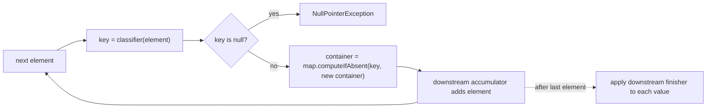
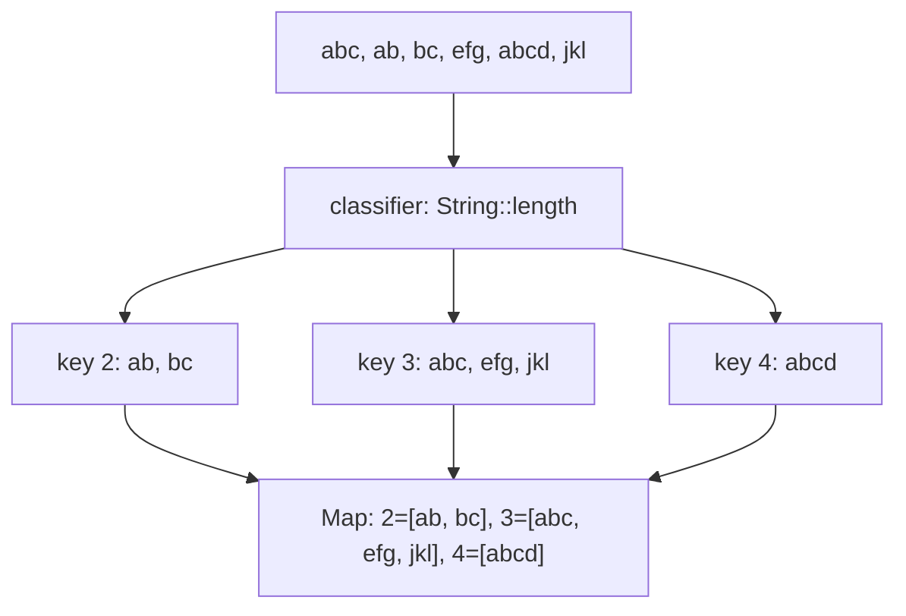

## In One Line
`Collectors.groupingBy(classifier)` is the stream version of SQL's `GROUP BY`: it runs a **classifier** function on every element to get a key and returns a `Map<K, List<T>>` of key → elements — and with a **map factory** and a **downstream collector** you control the map type and turn each group into a count, a sum, a set of names, the top element, or even another grouping.

## Mental Model
Think of a **post office sorting room**.

- Letters arrive one by one (the stream).
- The sorter reads each letter's **postcode** — that is the **classifier** (`String::length`, `Employee::dept`).
- Each postcode has a **pigeonhole**; the first letter for a postcode creates the pigeonhole, later ones drop into it. The wall of pigeonholes is the `Map`, each pigeonhole's content is a `List`.
- You can choose the **wall** (the map factory): an unlabelled jumble (`HashMap`), pigeonholes in alphabetical order (`TreeMap`), or in the order the postcodes first appeared (`LinkedHashMap`).
- You can also put a **clerk in each pigeonhole** (the downstream collector) who does not keep the letters but, say, *counts* them (`counting()`), *writes down only the sender's name* (`mapping(...)`), or *keeps only the heaviest* (`maxBy(...)`).
- There is one rule: every letter must have a postcode. A letter whose classifier gives `null` stops the whole room (`NullPointerException`).

## Concept
### The three overloads
```java
groupingBy(Function<? super T, ? extends K> classifier)
        // -> Map<K, List<T>>            (HashMap of ArrayLists, today)

groupingBy(classifier, Collector<? super T, A, D> downstream)
        // -> Map<K, D>                  (HashMap, today)

groupingBy(classifier, Supplier<M> mapFactory, Collector<? super T, A, D> downstream)
        // -> M extends Map<K, D>        (exactly the map you supply)
```
The first is shorthand for `groupingBy(classifier, toList())`, and the second for `groupingBy(classifier, HashMap::new, downstream)`. Note the argument order of the 3-argument form: **classifier, map factory, downstream**.

### How it works inside
For each element `t`:
1. `K key = classifier.apply(t)` — if `key` is `null`: `NullPointerException: element cannot be mapped to a null key`.
2. `A container = map.computeIfAbsent(key, k -> downstream.supplier().get())` — the first element of a key creates that group's container.
3. `downstream.accumulator().accept(container, t)` — the element is added to its group.

At the end, if the downstream collector has a finisher (e.g. `counting()` finishes a `long[]` holder into a `Long`), it is applied to every value with `replaceAll`. In a **parallel** stream each thread builds its own map and the combiner merges maps key by key, using the downstream combiner for keys present in both — so no locking is needed, and each group's elements stay in **encounter order**.

### What you get back
- **Keys:** only keys that actually occur. There are no empty groups (unlike `partitioningBy`, which always has `true` and `false`).
- **Map type:** "no guarantees on the type, mutability, serializability, or thread-safety" per the Javadoc; in practice a `HashMap`. Its iteration order is **hash order**, not sorted and not insertion order. Supply `TreeMap::new` or `LinkedHashMap::new` when order matters.
- **Values:** with no downstream, a `List<T>` (an `ArrayList` today) holding the group's elements in encounter order.

### Downstream collectors: what to do with each group
| Want per group | Downstream | Value type |
|---|---|---|
| The elements (default) | `toList()` | `List<T>` |
| Unique elements / sorted unique | `toSet()` / `toCollection(TreeSet::new)` | `Set<T>` |
| How many | `counting()` | `Long` |
| Sum / average of a field | `summingInt/Long/Double(f)`, `averagingInt/Long/Double(f)` | `Integer`/`Long`/`Double`, `Double` |
| All statistics | `summarizingInt/Long/Double(f)` | `IntSummaryStatistics`... |
| Max / min element | `maxBy(cmp)` / `minBy(cmp)` | `Optional<T>` |
| Max element, unwrapped | `collectingAndThen(maxBy(cmp), Optional::get)` | `T` |
| A field of each element | `mapping(f, toList())` | `List<R>` |
| A joined string of a field | `mapping(f, joining(", "))` | `String` |
| Only some elements (keep empty groups) | `filtering(p, downstream)` (Java 9) | depends |
| Elements of each element's collection | `flatMapping(e -> e.items().stream(), toSet())` (Java 9) | depends |
| A custom fold | `reducing(identity, op)` / `reducing(identity, mapper, op)` | `T` / `U` |
| A sub-grouping | `groupingBy(f2)` / `partitioningBy(p)` | `Map<K2, ...>` |

### `filtering` vs `filter` — the empty-group difference
`stream.filter(p).collect(groupingBy(k, counting()))` removes elements **before** grouping, so a key whose elements are all filtered out **disappears** from the map. `collect(groupingBy(k, filtering(p, counting())))` classifies **every** element first and filters inside each group, so every key stays, possibly with a count of 0 or an empty list. Choose based on whether "no matches" should be shown as a key with zero.

### Multi-level grouping
The downstream can itself be a `groupingBy`, giving nested maps: `groupingBy(Employee::dept, groupingBy(Employee::city, counting()))` → `Map<String, Map<String, Long>>` ("how many employees per department per city"). Use a composite key (a `record` or `List.of(dept, city)`) instead when you want a flat map.

### Choosing the key
- A **method reference** to a property: `Employee::dept`, `String::length`.
- A **computed** value: `s -> s.charAt(0)`, `n -> n % 3`, `age -> age / 10 * 10` (age bands), `w -> sortedLetters(w)` (anagrams).
- A **composite** key: `e -> new DeptCity(e.dept(), e.city())` (a record gives correct `equals`/`hashCode` for free).
- Keys must have proper `equals`/`hashCode` (or be `Comparable`/have a comparator for a `TreeMap`); mutable keys must not change after grouping.

### Related collectors
| Collector | Difference |
|---|---|
| `partitioningBy(predicate)` | Exactly two keys, `false` and `true`, always present — see [partitioningBy](lesson:a05-java8/17-collectors-partitioning-by) |
| `toMap(k, v, merge)` | One value per key (you merge), not a group of elements — see [Collectors](lesson:a05-java8/14-collectors) |
| `groupingByConcurrent(...)` | Returns a `ConcurrentMap` (`ConcurrentHashMap`); all threads of a parallel stream share one map; `CONCURRENT` + `UNORDERED`, so element order inside groups is not preserved |

## Diagram

Every element is classified, its group's container is created on first use, and the downstream collector does the per-group work.


The original example's data: each group keeps its elements in the order they appeared in the source list.

## Code
@example Java8Features/StreamAPIandCollectors/CollectorsGroupingByExample.java

**The overloads and downstream collectors on realistic data:**
```java
record Employee(String name, String dept, String city, double salary) {}

List<Employee> emps = List.of(
        new Employee("Asha",  "IT",    "Pune",   90_000),
        new Employee("Ravi",  "IT",    "Mumbai", 75_000),
        new Employee("Meera", "HR",    "Pune",   60_000),
        new Employee("John",  "Sales", "Mumbai", 55_000),
        new Employee("Zoya",  "IT",    "Pune",   82_000),
        new Employee("Kiran", "HR",    "Mumbai", 65_000));

// 1. classifier only -> Map<K, List<T>>
Map<String, List<Employee>> byDept = emps.stream()
        .collect(Collectors.groupingBy(Employee::dept));
byDept.forEach((d, list) -> System.out.println(d + " -> " + list.size()));

// 2. classifier + downstream
Map<String, Long> headcount = emps.stream()
        .collect(Collectors.groupingBy(Employee::dept, Collectors.counting()));
System.out.println(headcount);

Map<String, List<String>> names = emps.stream()
        .collect(Collectors.groupingBy(Employee::dept,
                Collectors.mapping(Employee::name, Collectors.toList())));
System.out.println(names);

Map<String, Double> avgSalary = emps.stream()
        .collect(Collectors.groupingBy(Employee::dept, Collectors.averagingDouble(Employee::salary)));
System.out.println(avgSalary);

Map<String, Double> totalSalary = emps.stream()
        .collect(Collectors.groupingBy(Employee::dept, Collectors.summingDouble(Employee::salary)));
System.out.println(totalSalary);

// 3. map factory + downstream
Map<String, Set<String>> citiesByDept = emps.stream()
        .collect(Collectors.groupingBy(Employee::dept, TreeMap::new,
                Collectors.mapping(Employee::city, Collectors.toCollection(TreeSet::new))));
System.out.println(citiesByDept);

// 4. top earner per dept
Map<String, Optional<Employee>> topOpt = emps.stream()
        .collect(Collectors.groupingBy(Employee::dept,
                Collectors.maxBy(Comparator.comparingDouble(Employee::salary))));
System.out.println(topOpt.get("HR"));

Map<String, String> topName = emps.stream()
        .collect(Collectors.groupingBy(Employee::dept, TreeMap::new,
                Collectors.collectingAndThen(
                        Collectors.maxBy(Comparator.comparingDouble(Employee::salary)),
                        o -> o.get().name())));
System.out.println(topName);

// 5. multi-level
Map<String, Map<String, Long>> deptCity = emps.stream()
        .collect(Collectors.groupingBy(Employee::dept, TreeMap::new,
                Collectors.groupingBy(Employee::city, TreeMap::new, Collectors.counting())));
System.out.println(deptCity);

// 6. filtering (Java 9) vs filter
Map<String, Long> richBefore = emps.stream()
        .filter(e -> e.salary() > 80_000)
        .collect(Collectors.groupingBy(Employee::dept, Collectors.counting()));
Map<String, Long> richDownstream = emps.stream()
        .collect(Collectors.groupingBy(Employee::dept, TreeMap::new,
                Collectors.filtering(e -> e.salary() > 80_000, Collectors.counting())));
System.out.println(richBefore);
System.out.println(richDownstream);

// 7. joining downstream
Map<String, String> namesByCity = emps.stream().collect(Collectors.groupingBy(Employee::city, TreeMap::new,
        Collectors.mapping(Employee::name, Collectors.joining(", ", "[", "]"))));
System.out.println(namesByCity);
```
```output
Sales -> 1
HR -> 2
IT -> 3
{Sales=1, HR=2, IT=3}
{Sales=[John], HR=[Meera, Kiran], IT=[Asha, Ravi, Zoya]}
{Sales=55000.0, HR=62500.0, IT=82333.33333333333}
{Sales=55000.0, HR=125000.0, IT=247000.0}
{HR=[Mumbai, Pune], IT=[Mumbai, Pune], Sales=[Mumbai]}
Optional[Employee[name=Kiran, dept=HR, city=Mumbai, salary=65000.0]]
{HR=Kiran, IT=Asha, Sales=John}
{HR={Mumbai=1, Pune=1}, IT={Mumbai=1, Pune=2}, Sales={Mumbai=1}}
{IT=2}
{HR=0, IT=2, Sales=0}
{Mumbai=[Ravi, John, Kiran], Pune=[Asha, Meera, Zoya]}
```

**Map types, ordering, null keys, anagrams, `flatMapping`, `reducing`:**
```java
List<String> strings = Arrays.asList("abc", "ab", "bc", "efg", "abcd", "jkl");

// What you actually get back (today)
Map<Integer, List<String>> g = strings.stream().collect(Collectors.groupingBy(String::length));
System.out.println(g.getClass().getSimpleName() + " of " + g.get(2).getClass().getSimpleName());

// HashMap order is not sorted order
Map<Integer, Long> hashOrder = Stream.of(100, 3, 17, 42)
        .collect(Collectors.groupingBy(n -> n, Collectors.counting()));
System.out.println(hashOrder);

// Descending keys with a custom map factory
Map<Integer, List<String>> desc = strings.stream()
        .collect(Collectors.groupingBy(String::length,
                () -> new TreeMap<>(Comparator.reverseOrder()), Collectors.toList()));
System.out.println(desc);

// A classifier must never return null
try {
    Stream.of("a", "bb").collect(Collectors.groupingBy(s -> s.length() > 1 ? null : "short"));
} catch (NullPointerException e) {
    System.out.println("NullPointerException: " + e.getMessage());
}

// Group anagrams: key = sorted letters
List<String> words = List.of("listen", "silent", "enlist", "google", "gogole", "cat", "act");
Collection<List<String>> anagrams = words.stream()
        .collect(Collectors.groupingBy(w -> {
            char[] c = w.toCharArray();
            Arrays.sort(c);
            return new String(c);
        }, LinkedHashMap::new, Collectors.toList()))
        .values();
System.out.println(anagrams);

// Boolean classifier: only keys that occur. partitioningBy: always both.
System.out.println(Stream.of(2, 4, 6).collect(Collectors.groupingBy(n -> n % 2 == 0)));
System.out.println(Stream.of(2, 4, 6).collect(Collectors.partitioningBy(n -> n % 2 == 0)));

// flatMapping (Java 9): each order contributes several items to its group
record Order(String customer, List<String> items) {}
List<Order> orders = List.of(new Order("amy", List.of("pen", "ink")),
                             new Order("bob", List.of("pad")),
                             new Order("amy", List.of("pen", "cap")));
Map<String, Set<String>> itemsByCustomer = orders.stream()
        .collect(Collectors.groupingBy(Order::customer, TreeMap::new,
                Collectors.flatMapping(o -> o.items().stream(),
                        Collectors.toCollection(TreeSet::new))));
System.out.println(itemsByCustomer);

// reducing downstream
Map<Integer, String> concat = strings.stream()
        .collect(Collectors.groupingBy(String::length, TreeMap::new,
                Collectors.reducing("", (a, b) -> a + b)));
System.out.println(concat);
```
```output
HashMap of ArrayList
{17=1, 3=1, 100=1, 42=1}
{4=[abcd], 3=[abc, efg, jkl], 2=[ab, bc]}
NullPointerException: element cannot be mapped to a null key
[[listen, silent, enlist], [google, gogole], [cat, act]]
{true=[2, 4, 6]}
{false=[], true=[2, 4, 6]}
{amy=[cap, ink, pen], bob=[pad]}
{2=abbc, 3=abcefgjkl, 4=abcd}
```

## Walkthrough
**The original example**
- `import java.util.Map;` is new compared with the earlier examples — the result of grouping is a `Map`.
- `List<String> strings = Arrays.asList("abc", "ab", "bc", "efg", "abcd", "jkl");` — six strings of lengths 3, 2, 2, 3, 4, 3 (no empty strings in this example).
- `strings.stream().collect(Collectors.groupingBy(String::length))` — the 1-argument overload. `String::length` is the classifier (`Function<String, Integer>`; the `int` is boxed to an `Integer` key). There is no downstream, so each group is a `List<String>`.
- Step by step: `"abc"` → key 3 creates list `[abc]`; `"ab"` → key 2 creates `[ab]`; `"bc"` → joins key 2; `"efg"` → key 3; `"abcd"` → key 4; `"jkl"` → key 3. Each list keeps the **source order**: `3=[abc, efg, jkl]`.
- `Map<Integer, List<String>> groupedByLength` — the declared type matches the overload: key type from the classifier, value `List<T>`.
- Printing gives `Grouped by Length: {2=[ab, bc], 3=[abc, efg, jkl], 4=[abcd]}`, exactly as the comment says. The keys *appear* sorted only because the map is a `HashMap`, `Integer.hashCode()` is the value itself, and small values 2, 3, 4 land in buckets 2, 3, 4 of the 16-bucket table, which are iterated in bucket order.

**The employee snippet**
1. `groupingBy(Employee::dept)` gives lists; `forEach((d, list) -> ...)` iterates the `HashMap` in hash order (`Sales`, `HR`, `IT`).
2. `counting()` gives headcounts; `mapping(Employee::name, toList())` keeps just the names; `averagingDouble` → IT = (90 000 + 75 000 + 82 000) / 3 = 82 333.33...; `summingDouble` → totals.
3. `TreeMap::new` sorts departments; `mapping(city, toCollection(TreeSet::new))` gives each department's sorted, unique cities.
4. `maxBy(comparingDouble(Employee::salary))` returns an `Optional<Employee>` per department (HR's top earner is Kiran); `collectingAndThen(maxBy(...), o -> o.get().name())` unwraps it — safe because a group always has at least one element.
5. Nested `groupingBy` counts employees per department per city.
6. Filtering **before** grouping leaves only `IT` (the only department with salaries above 80 000); `filtering` **inside** the group keeps `HR=0` and `Sales=0`.
7. `mapping(Employee::name, joining(", ", "[", "]"))` builds one string per city.

**The edge-case snippet**
- The result really is a `HashMap` of `ArrayList`s today — but the API does not promise it.
- Keys 100, 3, 17, 42 print as `{17=1, 3=1, 100=1, 42=1}`: buckets 17 & 15 = 1, 3, 100 & 15 = 4, 42 & 15 = 10. Hash order is not sorted order.
- A `TreeMap` built with `Comparator.reverseOrder()` gives descending keys; note the map factory is a `Supplier`, so it is written as a lambda `() -> new TreeMap<>(...)`.
- A classifier returning `null` fails with `element cannot be mapped to a null key`.
- Anagram grouping uses "sorted letters" as the key (`listen`, `silent`, `enlist` → `eilnst`); `LinkedHashMap` keeps the groups in first-seen order; `.values()` drops the keys.
- A boolean classifier with `groupingBy` only creates the keys that occur (`{true=...}`), while `partitioningBy` always has both.
- `flatMapping(o -> o.items().stream(), toCollection(TreeSet::new))` merges the items of all of a customer's orders into one sorted set (`amy` → `cap, ink, pen`).
- `reducing("", (a, b) -> a + b)` concatenates each group's strings.

## Traps
> [!WARNING] The `// Output:` comment is correct, but the sorted-looking key order `{2=..., 3=..., 4=...}` is an accident of `HashMap` hashing small `Integer`s. With keys such as 100, 3, 17, 42, or with `String` keys, the order looks random. If you need sorted keys, write `groupingBy(String::length, TreeMap::new, Collectors.toList())`.

- **Null keys:** a classifier returning `null` throws `NullPointerException: element cannot be mapped to a null key` — even though `HashMap` allows a null key. Map `null` to a sentinel (`Optional.ofNullable(x).orElse("UNKNOWN")`) or filter it out first.
- **Argument order in the 3-argument form** is classifier, **map factory**, downstream: `groupingBy(f, TreeMap::new, toList())`. Passing the downstream second and the factory third does not compile.
- **`maxBy`/`minBy` downstream values are `Optional`s**: `Map<String, Optional<Employee>>`. Unwrap with `collectingAndThen(maxBy(...), Optional::get)`.
- **`filter` before grouping removes whole groups**; `filtering` downstream keeps them with empty/zero values. Pick deliberately.
- **Relying on the result's mutability or type.** Today it is a mutable `HashMap` of `ArrayList`s, but the contract promises neither. Supply `HashMap::new`/`toCollection(ArrayList::new)` if you will modify it, or wrap it with `collectingAndThen(..., Collections::unmodifiableMap)` if you must not.
- **Keys with broken or mutable `equals`/`hashCode`** create duplicate-looking groups or lost lookups. Use records, strings, enums or boxed numbers as keys.
- **`averagingInt` of an int field returns `Double`**, and `summingInt` can overflow `Integer` silently; use `summingLong` for big totals.
- **`groupingByConcurrent` loses element order inside groups** in parallel streams (it is `UNORDERED`).
- **Grouping by a `double` key** (e.g. a computed average) can split "equal" values due to floating-point rounding. Round or use `BigDecimal` keys.

## Tips & Tricks
- **"Key, Wall, Clerk"** — the three arguments of the full form: **classifier** (the key), **map factory** (the wall of pigeonholes), **downstream** (the clerk inside each pigeonhole).
- **Read it as SQL:** `groupingBy(Employee::dept, averagingDouble(Employee::salary))` = `SELECT dept, AVG(salary) FROM emps GROUP BY dept`.
- **Want sorted keys? `TreeMap::new`. First-seen order? `LinkedHashMap::new`.**
- **`mapping` inside, `map` outside:** `map` before `collect` loses the key information; `mapping` transforms after classification.
- **Top-N per group:** `collectingAndThen(toList(), l -> l.stream().sorted(cmp).limit(n).toList())`.
- **`import static java.util.stream.Collectors.*;`** keeps nested groupings readable.
- **Group then stream the entries:** `map.entrySet().stream().max(Map.Entry.comparingByValue())` → the biggest group.
- Practise: "average salary per department", "employees per city per department", "group anagrams", "highest paid per department" — all in [Stream Drills — Advanced](lesson:b06-coding-drills/02-stream-drills-advanced).

## Interview Q&A
### [Basic] What does `Collectors.groupingBy` do? What does it return?
It classifies stream elements by a key computed by a classifier function and collects the elements of each key into a group. With one argument it returns `Map<K, List<T>>` — a `HashMap` of `ArrayList`s in practice, with no guarantees on map type, mutability or order. It is the equivalent of SQL `GROUP BY`. Only keys that occur appear in the map, and each group's list is in encounter order.
```java
Map<Integer, List<String>> byLength = strings.stream().collect(groupingBy(String::length));
```
**Follow-up:** *How do you get the keys sorted?* — Use the 3-argument overload: `groupingBy(String::length, TreeMap::new, toList())`.

### [Basic] What are the three overloads of `groupingBy`?
1. `groupingBy(classifier)` → `Map<K, List<T>>`.
2. `groupingBy(classifier, downstream)` → `Map<K, D>` where `D` is the downstream collector's result (`Long` for `counting()`, `Set<T>` for `toSet()`...).
3. `groupingBy(classifier, mapFactory, downstream)` → the map type you supply (`TreeMap`, `LinkedHashMap`, `EnumMap`...).
The first two delegate to the third with `HashMap::new` and `toList()`.

**Follow-up:** *Is there a `groupingBy(classifier, mapFactory)` overload?* — No. To choose the map you must also pass a downstream, usually `toList()`.

### [Intermediate] How do you find the average salary per department and the highest-paid employee per department?
```java
Map<String, Double> avg = emps.stream()
        .collect(groupingBy(Employee::dept, averagingDouble(Employee::salary)));

Map<String, Employee> top = emps.stream()
        .collect(groupingBy(Employee::dept,
                collectingAndThen(maxBy(comparingDouble(Employee::salary)), Optional::get)));
```
`averagingDouble` returns `Double`. `maxBy` returns `Optional<Employee>` because in general a collector may see no elements; inside a group there is always at least one element, so `Optional::get` in `collectingAndThen` is safe. An alternative for the second is `toMap(Employee::dept, identity(), BinaryOperator.maxBy(comparingDouble(Employee::salary)))`.

**Follow-up:** *And just the name of the top earner?* — Change the finisher to `o -> o.get().name()`.

### [Intermediate] What happens if the classifier returns `null`?
The collector throws `NullPointerException` with the message `element cannot be mapped to a null key` — `groupingBy` explicitly rejects null keys, even though `HashMap` could store one. Handle it by filtering out such elements or mapping `null` to a sentinel key (`"UNKNOWN"`, `Optional.empty()`).

**Follow-up:** *Does `toMap` behave the same?* — No: `toMap` accepts a `null` key (if the map allows it) but rejects `null` values.

### [Intermediate] What is the difference between `filter(...)` before `groupingBy` and `Collectors.filtering(...)` as its downstream?
`filter` removes elements before classification, so groups whose elements are all removed never get created. `filtering` (Java 9) classifies every element first and then filters within each group, so every key is present — possibly with an empty list or a zero count. Example: counting employees earning over 80 000 per department gives `{IT=2}` with `filter` but `{HR=0, IT=2, Sales=0}` with `filtering`. Use `filtering` when a report must list every category.

**Follow-up:** *What is `flatMapping` for?* — When each element contributes a *collection* of values to its group, e.g. all items of all orders per customer: `groupingBy(Order::customer, flatMapping(o -> o.items().stream(), toSet()))`.

### [Intermediate] How do you do multi-level grouping?
Pass another `groupingBy` as the downstream collector:
```java
Map<String, Map<String, Long>> byDeptThenCity = emps.stream()
        .collect(groupingBy(Employee::dept, groupingBy(Employee::city, counting())));
```
The result is a nested map. If a flat map is more convenient, group by a composite key instead — `groupingBy(e -> new DeptCity(e.dept(), e.city()), counting())` with a `record DeptCity(String dept, String city)`, which gets `equals`/`hashCode` automatically.

**Follow-up:** *Can you mix `partitioningBy` and `groupingBy`?* — Yes, either can be the other's downstream, e.g. `partitioningBy(e -> e.salary() > 70_000, groupingBy(Employee::dept))`.

### [Advanced] Group a list of words into anagram groups.
Use a canonical form as the key — the word's letters sorted:
```java
Collection<List<String>> groups = words.stream()
        .collect(groupingBy(w -> {
            char[] c = w.toCharArray();
            Arrays.sort(c);
            return new String(c);
        }, LinkedHashMap::new, toList()))
        .values();
```
`listen`, `silent`, `enlist` all map to `eilnst`. Complexity O(n · k log k) for n words of length k. For case-insensitive grouping, lower-case before sorting; for long words a letter-count signature (e.g. `Arrays.toString(int[26])`) gives O(n · k).

**Follow-up:** *Why `LinkedHashMap::new`?* — So the groups come out in the order their first word appeared, which makes output stable and testable.

### [Advanced] Is `groupingBy` thread-safe in a parallel stream? What is `groupingByConcurrent`?
Yes. In a parallel stream each thread fills its **own** `HashMap`, and the combiner merges maps pairwise (merging the groups for shared keys with the downstream combiner); no shared mutable state is involved, and each group keeps encounter order. The merge step can be costly for maps with many keys. `groupingByConcurrent` instead collects into **one** `ConcurrentHashMap` shared by all threads (it is a `CONCURRENT`, `UNORDERED` collector), avoiding the merge — but elements within a group are no longer in encounter order, and the result is a `ConcurrentMap`.

**Follow-up:** *When would you choose `groupingByConcurrent`?* — Large parallel streams where order inside groups does not matter and the map-merge cost dominates.

### [Advanced] Why did the original example print its keys in ascending order when the map is a `HashMap`?
`groupingBy` currently uses a `HashMap`. `Integer.hashCode()` returns the value itself; `HashMap` spreads the hash (`h ^ (h >>> 16)`, a no-op for small numbers) and picks bucket `hash & (capacity - 1)`. With the default 16 buckets, keys 2, 3 and 4 go to buckets 2, 3 and 4, and iteration walks buckets in index order — so they look sorted. Keys like 17 (bucket 1) and 100 (bucket 4) break the illusion: `{17=1, 3=1, 100=1, 42=1}`. Sorted output must be requested with `TreeMap::new`. See [HashMap Internals](lesson:b04-collections-internals/01-hashmap-internals).

**Follow-up:** *Would `LinkedHashMap::new` sort them?* — No, it keeps first-insertion order: for the example that is `3, 2, 4` (the order of `abc`, `ab`, `abcd`).

## Quiz
### What does this print?
```java
System.out.println(Stream.of("aa", "b", "cc").collect(Collectors.groupingBy(String::length)));
```
- [x] `{1=[b], 2=[aa, cc]}`
- [ ] `{2=[aa, cc], 1=[b]}`
- [ ] `{1=1, 2=2}`
- [ ] `{aa=2, b=1, cc=2}`
> The classifier's result (length) is the key, and without a downstream collector each value is the list of elements in encounter order. Counts would need `counting()`; `{aa=2...}` would be `toMap(s -> s, String::length)`. Key order here comes from `HashMap` buckets (1, 2).

### What does this print?
```java
Map<Character, Set<Integer>> m = Stream.of("apple", "avocado", "apricot", "banana")
        .collect(Collectors.groupingBy(s -> s.charAt(0), TreeMap::new,
                Collectors.mapping(String::length, Collectors.toCollection(TreeSet::new))));
System.out.println(m);
```
- [ ] `{a=[5, 7, 7], b=[6]}`
- [x] `{a=[5, 7], b=[6]}`
- [ ] `{a=[apple, avocado, apricot], b=[banana]}`
- [ ] `{a=3, b=1}`
> `mapping(String::length, ...)` turns each word into its length inside its group; the `TreeSet` removes the duplicate 7 (`avocado`, `apricot`) and sorts. A list downstream would keep both 7s.

### What does this print?
```java
Map<Integer, Long> f1 = Stream.of("a", "bb", "cc", "ddd")
        .filter(s -> s.length() > 1)
        .collect(Collectors.groupingBy(String::length, TreeMap::new, Collectors.counting()));
Map<Integer, Long> f2 = Stream.of("a", "bb", "cc", "ddd")
        .collect(Collectors.groupingBy(String::length, TreeMap::new,
                Collectors.filtering(s -> s.length() > 1, Collectors.counting())));
System.out.println(f1 + " " + f2);
```
- [ ] `{2=2, 3=1} {2=2, 3=1}`
- [x] `{2=2, 3=1} {1=0, 2=2, 3=1}`
- [ ] `{1=0, 2=2, 3=1} {2=2, 3=1}`
- [ ] `{1=1, 2=2, 3=1} {1=0, 2=2, 3=1}`
> `filter` removes `"a"` before grouping, so key 1 never exists. `filtering` groups `"a"` under key 1 first and then filters it out of that group, leaving a count of 0.

### What happens?
```java
Stream.of("a", "bb").collect(Collectors.groupingBy(s -> s.length() > 1 ? null : "short"));
```
- [ ] Returns `{null=[bb], short=[a]}`
- [ ] Returns `{short=[a]}` and silently drops `"bb"`
- [x] Throws `NullPointerException: element cannot be mapped to a null key`
- [ ] Compile error: the lambda may return `null`
> `groupingBy` checks every key with `Objects.requireNonNull`. The fact that `HashMap` supports a null key does not matter. Returning `null` from a lambda compiles fine.

### What is the type of `emps.stream().collect(groupingBy(Employee::dept, maxBy(comparingDouble(Employee::salary))))`?
- [ ] `Map<String, Employee>`
- [x] `Map<String, Optional<Employee>>`
- [ ] `Map<String, List<Employee>>`
- [ ] `Optional<Map<String, Employee>>`
> The value type is whatever the downstream collector produces, and `maxBy` produces an `Optional<T>`. Wrap it with `collectingAndThen(maxBy(...), Optional::get)` to get `Map<String, Employee>`.

### What does this print?
```java
Map<Boolean, Map<Integer, List<String>>> nested = Stream.of("a", "bb", "Cc", "D")
        .collect(Collectors.partitioningBy(s -> Character.isUpperCase(s.charAt(0)),
                Collectors.groupingBy(String::length)));
System.out.println(nested);
```
- [x] `{false={1=[a], 2=[bb]}, true={1=[D], 2=[Cc]}}`
- [ ] `{true={1=[D], 2=[Cc]}, false={1=[a], 2=[bb]}}`
- [ ] `{false=[a, bb], true=[Cc, D]}`
- [ ] `{1=[a, D], 2=[bb, Cc]}`
> The outer partition splits by upper-case first letter (`false` always printed first); inside each partition `groupingBy(String::length)` builds its own map. `Cc` comes before `D` in the `true` side's source order, but they end up under different length keys.

### Spot the bug
```java
Map<String, List<String>> byDept = emps.stream()
        .map(Employee::name)
        .collect(Collectors.groupingBy(Employee::dept));
```
- [ ] `groupingBy` needs a map factory
- [x] After `map(Employee::name)` the stream holds `String`s, so `Employee::dept` cannot be the classifier; use `groupingBy(Employee::dept, mapping(Employee::name, toList()))`
- [ ] `groupingBy` cannot produce `List<String>` values
- [ ] It works but the lists are in random order
> Mapping before collecting throws away the `Employee` objects that the classifier needs, so this does not compile. The `mapping` downstream collector transforms each element **after** it has been classified.

## Takeaways
- `groupingBy(classifier)` returns `Map<K, List<T>>` (a `HashMap` of `ArrayList`s in practice, no guarantees); only keys that occur are present, and each group keeps encounter order.
- Overloads: `(classifier)`, `(classifier, downstream)`, `(classifier, mapFactory, downstream)` — the map factory (`TreeMap::new`, `LinkedHashMap::new`) is the second argument of the 3-argument form.
- Downstream collectors turn groups into counts (`counting`), sums/averages, statistics, sets, mapped lists (`mapping`), joined strings, max/min (`Optional`, unwrap with `collectingAndThen`), or nested groupings.
- A `null` key throws `NullPointerException: element cannot be mapped to a null key`.
- `filter` before grouping drops empty groups; `filtering` downstream (Java 9) keeps every key with empty/zero values; `flatMapping` (Java 9) merges collections per group.
- `HashMap` key order is hash order — sorted-looking small integer keys are a coincidence; ask for `TreeMap::new` when you need sorted output.
- `groupingBy` is safe in parallel (per-thread maps merged); `groupingByConcurrent` shares one `ConcurrentHashMap` and loses in-group order.
