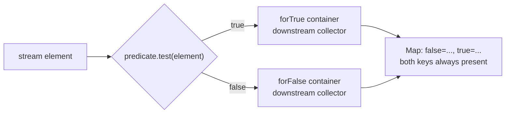
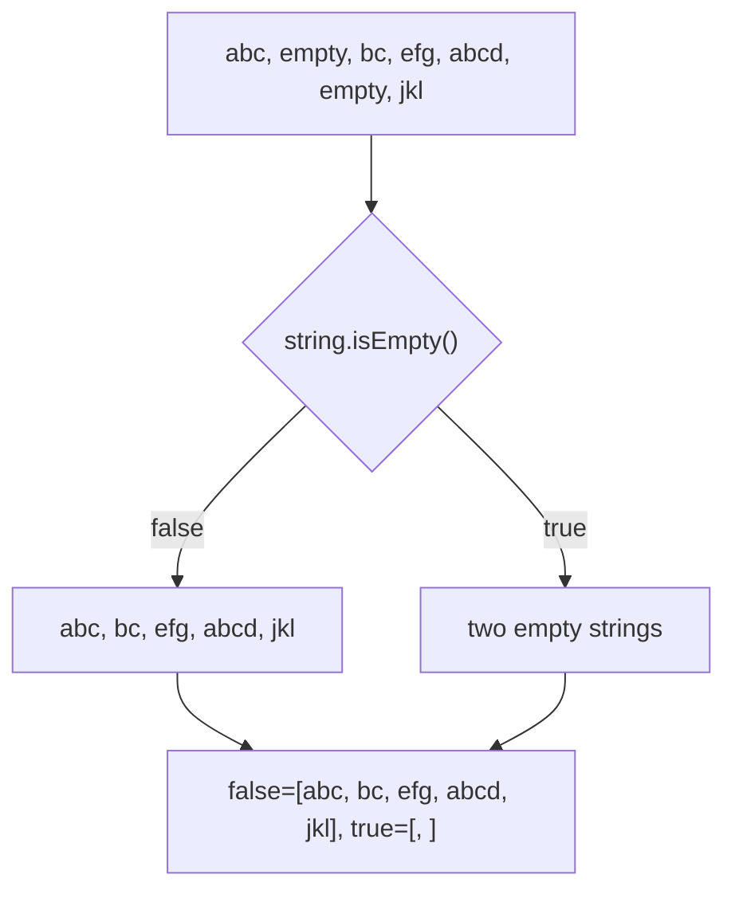

## In One Line
`Collectors.partitioningBy(predicate)` splits a stream into exactly **two** groups — elements for which the predicate is `true` and those for which it is `false` — and returns a `Map<Boolean, List<T>>` that **always has both keys**, optionally applying a downstream collector (count, sum, set...) to each side.

## Mental Model
Think of an **airport security scanner with two exit belts**: "cleared" and "needs checking".

- Every bag goes through the **same single test** (the predicate) — exactly once.
- Each bag leaves on **one of two belts**: `true` or `false`. There is no third belt and no bag is lost.
- **Both belts exist even on a quiet day.** If no bag needs checking, the "needs checking" belt is simply empty — it is not removed. That is the big difference from `groupingBy`, which only builds belts for keys it has actually seen.
- You can put a **counter or a sorter at the end of each belt** (a downstream collector): `partitioningBy(p, counting())` tells you "how many on each belt".
- The two belts are **bolted to the floor**: you cannot add a third one or remove one (`put`/`remove` throw `UnsupportedOperationException`), but you can still move bags on a belt.

## Concept
### The two overloads
```java
partitioningBy(Predicate<? super T> predicate)
        // -> Map<Boolean, List<T>>

partitioningBy(Predicate<? super T> predicate, Collector<? super T, A, D> downstream)
        // -> Map<Boolean, D>
```
The first is shorthand for `partitioningBy(predicate, toList())`. There is **no map-factory overload** — you cannot choose the map type, because the result is a special two-slot map.

### How it works inside
- The supplier creates a private `Collectors.Partition` object holding **two** downstream containers: `forTrue` and `forFalse`.
- The accumulator calls `predicate.test(t)` once per element and hands the element to the matching container.
- In parallel streams, the combiner merges the `true` sides together and the `false` sides together.
- The finisher (if the downstream has one) finishes both sides, e.g. turns both counters into `Long`s.
- `Partition` extends `AbstractMap<Boolean, T>`; its `entrySet()` always yields the `false` entry first, then the `true` entry. That is why printing always shows `{false=..., true=...}`.

### Properties of the result
| Property | Behaviour |
|---|---|
| Keys | Always exactly `false` and `true`, even for an empty stream |
| Print order | `false` first, then `true` |
| Map type | `Collectors$Partition` — not a `HashMap` |
| `put`, `remove`, `clear` | `UnsupportedOperationException` (the map's structure is fixed) |
| Values | Whatever the downstream builds — `ArrayList`s by default, which you *can* modify (not guaranteed by the spec) |
| Element order inside a side | Encounter order |

### `partitioningBy` vs `groupingBy` with a boolean classifier
| | `partitioningBy(p)` | `groupingBy(p::test)` |
|---|---|---|
| Keys present | Always both `true` and `false` | Only the keys that occur (maybe just one, or none) |
| `map.get(true)` when nothing matched | Empty list | `null` |
| Map type | Fixed two-slot `Partition` | `HashMap` (or your map factory) |
| Custom map factory | Not available | Available |
| Intent | "Split into yes/no" — self-documenting | General grouping |

Use `partitioningBy` whenever the classification is a yes/no question; it avoids `null` checks and states the intent.

### Downstream collectors on each side
Everything that works with `groupingBy` works here: `counting()`, `summingInt`, `averagingDouble`, `mapping(f, toSet())`, `maxBy`, `joining`, `collectingAndThen`, and nested `partitioningBy`/`groupingBy`. Nesting gives four-way (2 × 2) splits: `partitioningBy(isEven, partitioningBy(isBig))`.

### Common uses
- Valid vs invalid records (`partitioningBy(this::isValid)`), then process the valid ones and report the invalid ones.
- Pass/fail students by mark, adults/minors by age, in-stock/out-of-stock products.
- Primes vs composites, even vs odd, positive vs non-positive.
- Empty vs non-empty strings (the course example).

### Related: `teeing` and two predicates
`partitioningBy` gives the **same** kind of collector on both sides. When the two sides need **different** processing (a list of the positives and only a count of the negatives), or the conditions are not complements of each other, use `teeing` (Java 12):
```java
var result = Stream.of(3, -1, 4, -5, 9).collect(Collectors.teeing(
        Collectors.filtering(n -> n > 0, Collectors.toList()),
        Collectors.filtering(n -> n < 0, Collectors.counting()),
        (pos, negCount) -> pos + " / negatives=" + negCount));   // [3, 4, 9] / negatives=2
```

## Diagram

One test per element, two fixed containers, and a result map that always has both keys.


The original example: the `true` side holds two empty strings, which print as nothing between the commas — `[, ]`.

## Code
@example Java8Features/StreamAPIandCollectors/CollectorsPartitioningByExample.java

**What the result map really is:**
```java
List<String> strings = Arrays.asList("abc", "", "bc", "efg", "abcd", "", "jkl");

Map<Boolean, List<String>> p = strings.stream()
        .collect(Collectors.partitioningBy(String::isEmpty));
System.out.println(p.getClass().getName());
System.out.println("true list size = " + p.get(true).size());
// quote the elements so the empty strings become visible
System.out.println(p.get(true).stream().map(s -> "\"" + s + "\"").toList());

try { p.put(true, List.of()); } catch (UnsupportedOperationException e) { System.out.println("put -> UnsupportedOperationException"); }
try { p.remove(true); } catch (UnsupportedOperationException e) { System.out.println("remove -> UnsupportedOperationException"); }
p.get(true).add("x");      // the lists inside are ordinary ArrayLists today
System.out.println(p);
```
```output
java.util.stream.Collectors$Partition
true list size = 2
["", ""]
put -> UnsupportedOperationException
remove -> UnsupportedOperationException
{false=[abc, bc, efg, abcd, jkl], true=[, , x]}
```

**Downstream collectors, empty sides, nesting, `Predicate.not`:**
```java
List<String> strings = Arrays.asList("abc", "", "bc", "efg", "abcd", "", "jkl");

// downstream collectors
Map<Boolean, Long> counts = IntStream.rangeClosed(1, 10).boxed()
        .collect(Collectors.partitioningBy(n -> n % 2 == 0, Collectors.counting()));
System.out.println(counts);

Map<Boolean, Integer> sums = IntStream.rangeClosed(1, 10).boxed()
        .collect(Collectors.partitioningBy(n -> n % 2 == 0, Collectors.summingInt(n -> n)));
System.out.println(sums);

// both keys even when nothing matches - or when there is nothing at all
System.out.println(Stream.of(1, 3, 5).collect(Collectors.partitioningBy(n -> n % 2 == 0)));
System.out.println(Stream.<Integer>empty().collect(Collectors.partitioningBy(n -> n > 0)));

// primes vs non-primes
Map<Boolean, List<Integer>> primes = IntStream.rangeClosed(2, 20).boxed()
        .collect(Collectors.partitioningBy(n ->
                IntStream.rangeClosed(2, (int) Math.sqrt(n)).noneMatch(d -> n % d == 0)));
System.out.println(primes);

// nested partition
Map<Boolean, Map<Boolean, List<Integer>>> nested = IntStream.rangeClosed(1, 8).boxed()
        .collect(Collectors.partitioningBy(n -> n % 2 == 0,
                Collectors.partitioningBy(n -> n > 4)));
System.out.println(nested);

// Predicate.not (Java 11) flips which side is true
System.out.println(strings.stream()
        .collect(Collectors.partitioningBy(Predicate.not(String::isEmpty))));

// mapping downstream
Map<Boolean, Set<Integer>> lens = strings.stream()
        .collect(Collectors.partitioningBy(s -> s.length() >= 3,
                Collectors.mapping(String::length, Collectors.toCollection(TreeSet::new))));
System.out.println(lens);

// groupingBy with a boolean key: only keys that occur
System.out.println(Stream.of(1, 3, 5).collect(Collectors.groupingBy(n -> n % 2 == 0)));
```
```output
{false=5, true=5}
{false=25, true=30}
{false=[1, 3, 5], true=[]}
{false=[], true=[]}
{false=[4, 6, 8, 9, 10, 12, 14, 15, 16, 18, 20], true=[2, 3, 5, 7, 11, 13, 17, 19]}
{false={false=[1, 3], true=[5, 7]}, true={false=[2, 4], true=[6, 8]}}
{false=[, ], true=[abc, bc, efg, abcd, jkl]}
{false=[0, 2], true=[3, 4]}
{false=[1, 3, 5]}
```

## Walkthrough
**The original example**
- `import java.util.Map;` — the result is a `Map<Boolean, List<String>>`.
- `List<String> strings = Arrays.asList("abc", "", "bc", "efg", "abcd", "", "jkl");` — the same seven strings as the other examples, two of them empty.
- `.collect(Collectors.partitioningBy(string -> string.isEmpty()))` — the lambda is a `Predicate<String>` (it could be written `String::isEmpty`). It is called once per element:
  - `"abc"` → `false`, `""` → `true`, `"bc"` → `false`, `"efg"` → `false`, `"abcd"` → `false`, `""` → `true`, `"jkl"` → `false`.
- `Map<Boolean, List<String>> partitionedByEmpty` — key `true` = "is empty", key `false` = "is not empty". The comment "Partition strings into non-empty and empty" lists them in the same order the map prints them: `false` first.
- Output: `Partitioned by Empty: {false=[abc, bc, efg, abcd, jkl], true=[, ]}`. The `true` list contains two empty strings; `List.toString()` prints each element with nothing in it, separated by `", "` — hence `[, ]`. It is **not** a list with one blank element or a formatting error. The recorded output matches the comment.

**The first snippet** proves what the result is: the class is `Collectors$Partition`; the `true` side really has 2 elements; quoting shows `["", ""]`. `put` and `remove` throw `UnsupportedOperationException`, but the `ArrayList` inside can be modified (`add("x")` works).

**The second snippet**
- `partitioningBy(even, counting())` → 5 odd and 5 even numbers in 1..10; `summingInt` → odd sum 25, even sum 30.
- `Stream.of(1, 3, 5)` has no even number, yet `true=[]` is present; an empty stream gives `{false=[], true=[]}`.
- The prime test checks divisors from 2 to √n with `noneMatch` (short-circuits at the first divisor). For n = 2 and 3 the range is empty, and `noneMatch` on an empty stream is `true`, so they count as prime.
- Nested partitioning gives a 2 × 2 table: odd ≤ 4 `[1, 3]`, odd > 4 `[5, 7]`, even ≤ 4 `[2, 4]`, even > 4 `[6, 8]`.
- `Predicate.not(String::isEmpty)` swaps the sides compared with the original: now the non-empty strings are under `true`.
- `mapping(String::length, toCollection(TreeSet::new))` stores unique sorted lengths per side: short strings have lengths 0 and 2, long ones 3 and 4.
- The final line shows the contrast: `groupingBy` with a boolean classifier has **no** `true` key when nothing is even.

## Traps
> [!NOTE] The example is correct and its output comment matches. Two readability points: `string -> string.isEmpty()` is more idiomatic as `String::isEmpty`, and the printed `true=[, ]` is easy to misread — it is a list of **two empty strings**.

- **Reading `true`/`false` the wrong way round.** The key is the predicate's result. With `partitioningBy(String::isEmpty)`, `true` means "empty". Name the variable after the predicate (`byIsEmpty`) and use `get(true)`/`get(false)` deliberately.
- **Expecting `groupingBy`-like missing keys.** `partitioningBy` always has both keys, so `map.get(true)` is never `null` — but it may be an empty list or a zero count.
- **Expecting `groupingBy(p::test)` to behave like `partitioningBy`.** It does not create a key that no element produced, so `get(true)` can return `null`.
- **Trying to modify the map's structure.** `put`, `remove`, `clear` — and default methods such as `merge` that end up calling `put` — throw `UnsupportedOperationException` on the result. Copy it first (`new HashMap<>(result)`) if you need a mutable map.
- **No map factory.** You cannot request a `TreeMap` or `EnumMap`; there is no such overload.
- **A predicate with side effects or randomness** — it is called exactly once per element, but in a parallel stream in an unpredictable order and thread.
- **Complex multi-way splits with nested partitions** (`partitioningBy(p1, partitioningBy(p2, partitioningBy(p3)))`) become unreadable. For more than two categories, use `groupingBy` with an enum or a computed category key.
- **`maxBy`/`minBy` downstream give `Optional`s**, and here a side can really be empty, so `Optional.get()` is **not** safe — unlike inside `groupingBy`.

## Tips & Tricks
- **"Partition = two parts, always."** Both keys are guaranteed; `false` prints first.
- **Yes/no question → `partitioningBy`; many categories → `groupingBy`.**
- **Name results after the predicate:** `Map<Boolean, List<Order>> byIsPaid`, then `byIsPaid.get(true)`.
- **Flip sides with `Predicate.not(...)`** (Java 11) or `predicate.negate()`.
- **Split and process** idiom: `var parts = items.stream().collect(partitioningBy(this::isValid)); save(parts.get(true)); report(parts.get(false));` — one pass instead of two `filter` streams.
- **Different aggregation per side?** Use `teeing(filtering(p, c1), filtering(p.negate(), c2), merger)`.
- **Counting both sides:** `partitioningBy(p, counting())` → `{false=n1, true=n2}` in one pass.

## Interview Q&A
### [Basic] What does `Collectors.partitioningBy` do?
It divides the elements of a stream into two groups according to a `Predicate` and returns a `Map<Boolean, List<T>>`: key `true` holds the elements for which the predicate returned `true`, key `false` holds the rest. Both keys are always present, even if one side (or both) is empty. It is a specialised, self-documenting form of grouping for yes/no classifications.
```java
Map<Boolean, List<Integer>> evenOdd = nums.stream().collect(partitioningBy(n -> n % 2 == 0));
```
**Follow-up:** *What is the second overload?* — `partitioningBy(predicate, downstream)`, which applies a collector like `counting()` or `mapping(...)` to each side.

### [Basic] What is the difference between `partitioningBy` and `groupingBy`?
`partitioningBy` takes a `Predicate` and always produces exactly two keys, `true` and `false`, both present even when empty; its map type is fixed and there is no map-factory overload. `groupingBy` takes a `Function` classifier, produces any number of keys — **only those that occur** — and lets you choose the map type. With a boolean classifier `groupingBy` may return a map without a `true` key, so `get(true)` returns `null` where `partitioningBy` would return an empty list.

**Follow-up:** *Which is faster?* — Roughly the same; `partitioningBy` avoids hashing and map lookups, so it is marginally cheaper, but choose by intent.

### [Basic] Why does the course example print `true=[, ]`?
The predicate `String::isEmpty` is `true` for the two empty strings, so the `true` side is a list with two elements that are both `""`. `List.toString()` prints each element separated by `", "`; an empty string prints as nothing, which leaves `[` + `""` + `", "` + `""` + `]` = `[, ]`.

**Follow-up:** *How would you make the output clearer?* — Map the elements for display, e.g. `map(s -> "\"" + s + "\"")`, or print the sizes with `partitioningBy(String::isEmpty, counting())` → `{false=5, true=2}`.

### [Intermediate] What does `partitioningBy` return for an empty stream?
A map with both keys and empty downstream results: `{false=[], true=[]}` with the default `toList()`, or `{false=0, true=0}` with `counting()`. The `Partition` container creates both sides up front in its supplier, regardless of input. This makes the result safe to use without `null` checks — but downstream `Optional`s (from `maxBy`, `minBy`, `reducing(op)`) will be empty on an empty side.

**Follow-up:** *And `groupingBy` on an empty stream?* — An empty map `{}`.

### [Intermediate] Can you modify the map returned by `partitioningBy`?
Not structurally: it is a `Collectors.Partition` (an `AbstractMap` with exactly two fixed entries), so `put`, `remove` and `clear` throw `UnsupportedOperationException`. The values themselves are ordinary collections produced by the downstream collector — `ArrayList`s by default today — so `map.get(true).add(x)` works, although the spec does not guarantee that mutability. If you need a normal mutable map, copy it: `new HashMap<>(partitioned)`.

**Follow-up:** *Can you ask for a `TreeMap` or `EnumMap`?* — No; unlike `groupingBy`, `partitioningBy` has no map-factory overload.

### [Intermediate] Partition employees into high and low earners and give the names on each side, sorted.
```java
Map<Boolean, List<String>> byHighEarner = emps.stream()
        .collect(partitioningBy(e -> e.salary() > 70_000,
                collectingAndThen(mapping(Employee::name, toList()),
                        names -> names.stream().sorted().toList())));
```
`mapping` extracts the names inside each side; `collectingAndThen` sorts each finished list. A simpler alternative is `mapping(Employee::name, toCollection(TreeSet::new))` if duplicate names can be dropped.

**Follow-up:** *And the average salary on each side?* — `partitioningBy(e -> e.salary() > 70_000, averagingDouble(Employee::salary))`.

### [Advanced] How is `partitioningBy` implemented, and is it safe in parallel?
The collector's supplier creates a `Partition` holding two containers from the downstream supplier; the accumulator evaluates the predicate once per element and forwards the element to `forTrue` or `forFalse`; the combiner merges two `Partition`s side by side using the downstream combiner; the finisher applies the downstream finisher to both sides (skipped when the downstream is `IDENTITY_FINISH`). In a parallel stream each thread has its own `Partition`, so no synchronisation is needed and each side keeps encounter order.

**Follow-up:** *Why does it always print `false` first?* — `Partition.entrySet()` iterates a fixed list of the false entry followed by the true entry.

### [Advanced] When would you use `teeing` instead of `partitioningBy`?
When the two groups need **different** collectors or overlapping/independent conditions. `partitioningBy` applies one downstream collector to both complementary sides. `teeing(c1, c2, merger)` (Java 12) sends every element to two arbitrary collectors, for example "list of positives" and "count of negatives" (zero goes to neither):
```java
Stream.of(3, -1, 4, -5, 9).collect(teeing(
        filtering(n -> n > 0, toList()),
        filtering(n -> n < 0, counting()),
        (pos, negCount) -> pos + " / negatives=" + negCount));   // [3, 4, 9] / negatives=2
```
**Follow-up:** *Can one element land on both sides of a partition?* — No, the predicate is evaluated once and each element goes to exactly one side; with `teeing` an element can feed both collectors.

## Quiz
### What does this print?
```java
System.out.println(Stream.of(1, 3, 5).collect(Collectors.partitioningBy(n -> n % 2 == 0)));
```
- [ ] `{false=[1, 3, 5]}`
- [x] `{false=[1, 3, 5], true=[]}`
- [ ] `{true=[], false=[1, 3, 5]}`
- [ ] `{}`
> `partitioningBy` always contains both keys and prints `false` first. `{false=[1, 3, 5]}` is what `groupingBy(n -> n % 2 == 0)` would return, because it creates only keys that occur.

### In the original example, what does `partitionedByEmpty.get(true).size()` return?
- [ ] 0
- [ ] 1
- [x] 2
- [ ] 5
> The `true` side holds the two empty strings, printed as `[, ]`. Five is the size of the `false` side. `[, ]` is not one element — the comma separates two empty strings.

### What does this print?
```java
Map<Boolean, Long> m = Stream.<Integer>empty()
        .collect(Collectors.partitioningBy(n -> n > 0, Collectors.counting()));
System.out.println(m);
```
- [ ] `{}`
- [x] `{false=0, true=0}`
- [ ] `{false=null, true=null}`
- [ ] `NoSuchElementException`
> The `Partition` creates both downstream containers up front, and `counting()` of nothing is 0. `groupingBy` would give `{}` here.

### Spot the bug
```java
Map<Boolean, List<String>> parts = names.stream()
        .collect(Collectors.partitioningBy(n -> n.length() > 3));
parts.put(null, List.of());   // bucket for names we could not classify
```
- [ ] `partitioningBy` needs a downstream collector
- [ ] `null` keys are fine but the list must be mutable
- [x] The result map has a fixed structure; `put` throws `UnsupportedOperationException`
- [ ] `n.length() > 3` is not a valid `Predicate`
> The returned `Collectors$Partition` only supports its two entries; `put`, `remove` and `clear` throw. Copy it into a `HashMap` if you need extra keys — or better, model more than two categories with `groupingBy`.

### What does this print?
```java
List<String> strings = Arrays.asList("abc", "", "bc");
System.out.println(strings.stream()
        .collect(Collectors.partitioningBy(Predicate.not(String::isEmpty))));
```
- [ ] `{false=[abc, bc], true=[]}`
- [x] `{false=[], true=[abc, bc]}`
- [ ] `{true=[abc, bc], false=[]}`
- [ ] `{false=[abc, bc], true=[]}` followed by an exception
> `Predicate.not(String::isEmpty)` is `true` for non-empty strings, so they go under `true` and the empty string under `false`. The empty string prints as nothing inside `[]`. The map still prints `false` first.

### Which statement about `partitioningBy` is true?
- [ ] It accepts a map factory like `groupingBy(classifier, TreeMap::new, downstream)`
- [ ] It returns a `HashMap<Boolean, List<T>>`
- [x] The predicate is evaluated once per element, and the result always has keys `true` and `false`
- [ ] Keys appear in the order they are first produced
> There is no map-factory overload, the map is the special `Collectors$Partition` class, and its entries are always `false` then `true` regardless of which comes first in the data.

## Takeaways
- `partitioningBy(predicate)` returns `Map<Boolean, List<T>>`; `partitioningBy(predicate, downstream)` returns `Map<Boolean, D>`.
- Both keys `true` and `false` are **always** present (empty list or 0 when nothing matches), and `false` always prints first.
- The result is a fixed two-slot `Collectors$Partition`: `put`/`remove` throw `UnsupportedOperationException`, and there is no map-factory overload.
- `groupingBy` with a boolean classifier creates only the keys that occur — `get(true)` can be `null`.
- Downstream collectors (`counting`, `summingInt`, `mapping`, nested partitions/groupings) work on each side; `maxBy` on a possibly empty side gives an empty `Optional`.
- `true=[, ]` in the course output is a list of two empty strings.
- For different processing on the two sides, or non-complementary conditions, use `teeing` (Java 12).
