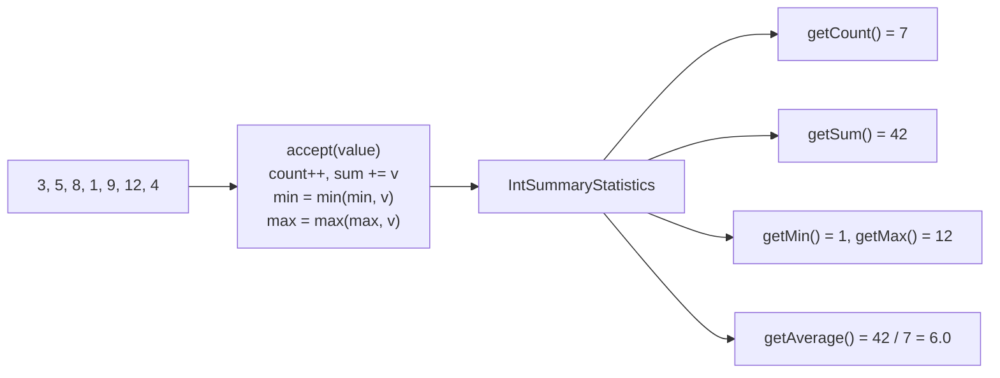
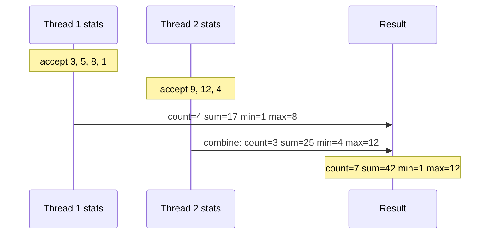

## In One Line
`Collectors.summarizingInt/Long/Double(mapper)` walks the stream **once** and returns an `IntSummaryStatistics` / `LongSummaryStatistics` / `DoubleSummaryStatistics` object holding the **count, sum, min, max and average** together — the one-pass alternative to five separate streams, and the natural downstream collector for "statistics per group".

## Mental Model
Think of a **fitness tracker** on a run.

- You do **one** run (one pass over the stream), and the tracker records everything at the same time: number of laps (**count**), total distance (**sum**), fastest and slowest lap (**min**, **max**), and average pace (**average**).
- Nobody runs five times — once for the count, once for the fastest lap... — which is exactly what calling `count()`, `sum()`, `min()`, `max()` and `average()` separately would do.
- The tracker's screen before you start shows odd defaults: 0 laps, fastest lap "∞" and slowest lap "−∞" (for an `int` tracker: `Integer.MAX_VALUE` and `Integer.MIN_VALUE`). They mean "nothing recorded yet" — so check the lap count first.
- Two friends' trackers can be **combined** into one summary (`combine`) — that is how parallel streams merge partial results.

## Concept
### The three collectors and their result classes
| Collector | Mapper type | Result class | `getSum()` type | `getMin()`/`getMax()` type |
|---|---|---|---|---|
| `summarizingInt(ToIntFunction)` | `T -> int` | `IntSummaryStatistics` | `long` | `int` |
| `summarizingLong(ToLongFunction)` | `T -> long` | `LongSummaryStatistics` | `long` | `long` |
| `summarizingDouble(ToDoubleFunction)` | `T -> double` | `DoubleSummaryStatistics` | `double` | `double` |

All three classes (in `java.util`, since Java 8) offer: `getCount()` (`long`), `getSum()`, `getMin()`, `getMax()`, `getAverage()` (`double`), `accept(value)`, `combine(other)` and `toString()`.

### What each getter returns — including for no data
| Getter | Non-empty | Empty (`count == 0`) — Int / Long / Double |
|---|---|---|
| `getCount()` | number of values | `0` |
| `getSum()` | sum (`long` for int/long values — **no int overflow**) | `0` / `0` / `0.0` |
| `getMin()` | smallest | `Integer.MAX_VALUE` / `Long.MAX_VALUE` / `Infinity` |
| `getMax()` | largest | `Integer.MIN_VALUE` / `Long.MIN_VALUE` / `-Infinity` |
| `getAverage()` | `(double) sum / count` | `0.0` |

The "empty" values are **sentinels**, not real data: always check `getCount() > 0` before trusting `min`/`max`. Compare with `IntStream.min()`, which returns an honest `OptionalInt.empty`.

### Three ways to get statistics
```java
// 1. Collector - works on Stream<T>, and as a downstream collector
IntSummaryStatistics a = numbers.stream().collect(Collectors.summarizingInt(Integer::intValue));

// 2. Primitive stream terminal operation
IntSummaryStatistics b = numbers.stream().mapToInt(Integer::intValue).summaryStatistics();

// 3. By hand: the class is an IntConsumer with accept/combine
IntSummaryStatistics c = new IntSummaryStatistics();
numbers.forEach(c::accept);
```
For a whole stream, option 2 is the most common. The **collector** form is essential when statistics are needed **per group**: `groupingBy(Employee::dept, summarizingDouble(Employee::salary))` — there is no `summaryStatistics()` you could call inside a group.

### `toString()` format
`IntSummaryStatistics{count=7, sum=42, min=1, average=6.000000, max=12}` — note the field order (average comes **before** max) and the average printed with `%f`, i.e. six decimals. `String.format` uses the **default locale**, so on a German system the average prints as `6,000000`. Use the getters, not `toString()`, for anything other than debugging.

### The single-value cousins
| Need just... | Collector | Returns | Empty stream |
|---|---|---|---|
| the sum | `summingInt/Long/Double` | `Integer` / `Long` / `Double` | `0` |
| the average | `averagingInt/Long/Double` | always `Double` | `0.0` |
| the count | `counting()` | `Long` | `0` |
| the min / max element | `minBy` / `maxBy` | `Optional<T>` | `Optional.empty` |

Watch out: `summingInt` returns an `Integer` and **overflows silently**, while `summarizingInt(...).getSum()` is a `long`. `averagingInt` returns `0.0` for no data, which is indistinguishable from a real average of zero; `IntStream.average()` returns an `OptionalDouble` instead.

### Precision details
- `IntSummaryStatistics` and `LongSummaryStatistics` keep the sum as a `long`, so summing many `int`s cannot overflow (summing `long`s still can).
- `getAverage()` is computed as `(double) getSum() / getCount()` — a floating-point division, so `1` and `2` average to `1.5`, not `1`.
- `DoubleSummaryStatistics` (and `DoubleStream.sum()`/`average()`) use **compensated (Kahan) summation**, reducing rounding error: summing ten `0.1`s gives `1.0`, while a naive loop or `reduce(0.0, Double::sum)` gives `0.9999999999999999`. It is still binary floating point — use `BigDecimal` for money.

### Thread safety
The statistics classes are **not** thread-safe. It is still safe to use `summarizingInt` on a parallel stream: each thread fills its own statistics object and the results are merged with `combine`. Never share one statistics object across threads via `forEach(stats::accept)` on a parallel stream.

### Useful extras
- Java 10 added constructors to rebuild statistics from known values: `new IntSummaryStatistics(count, min, max, sum)` (and the Long/Double equivalents).
- `LongSummaryStatistics.accept` has both `int` and `long` overloads.
- The mapper must not return a `null` `Integer` — unboxing throws `NullPointerException`.

## Diagram

One pass updates four running values; the average is derived from sum and count only when asked.


In a parallel stream each thread keeps its own statistics object; `combine` adds counts and sums and takes the min of mins and max of maxes.

## Code
@example Java8Features/StreamAPIandCollectors/CollectorsSummarizingExample.java

**Getters, alternatives, empty statistics, overflow, the Long/Double versions:**
```java
List<Integer> numbers = Arrays.asList(3, 5, 8, 1, 9, 12, 4);

IntSummaryStatistics stats = numbers.stream()
        .collect(Collectors.summarizingInt(Integer::intValue));
System.out.println(stats.getCount() + " " + stats.getSum() + " " + stats.getMin()
        + " " + stats.getMax() + " " + stats.getAverage());

// Same thing via IntStream
IntSummaryStatistics s2 = numbers.stream().mapToInt(Integer::intValue).summaryStatistics();
System.out.println(s2);

// Empty statistics
IntSummaryStatistics empty = Stream.<Integer>empty().collect(Collectors.summarizingInt(i -> i));
System.out.println(empty);
System.out.println(empty.getMin() == Integer.MAX_VALUE);

// accept / combine: build incrementally
IntSummaryStatistics manual = new IntSummaryStatistics();
manual.accept(10);
manual.accept(20);
IntSummaryStatistics other = new IntSummaryStatistics();
other.accept(30);
manual.combine(other);
System.out.println(manual);

// sum is long: no overflow
IntSummaryStatistics big = IntStream.of(Integer.MAX_VALUE, Integer.MAX_VALUE).summaryStatistics();
System.out.println(big.getSum());
System.out.println(IntStream.of(Integer.MAX_VALUE, Integer.MAX_VALUE).sum());
int overflow = Stream.of(Integer.MAX_VALUE, 1).collect(Collectors.summingInt(i -> i));
System.out.println(overflow);

// Double and Long
DoubleSummaryStatistics d = Stream.of(2.5, 3.5, 4.0).collect(Collectors.summarizingDouble(Double::doubleValue));
System.out.println(d);
LongSummaryStatistics l = Stream.of("a", "bb", "ccc").collect(Collectors.summarizingLong(String::length));
System.out.println(l);
DoubleSummaryStatistics dEmpty = DoubleStream.empty().summaryStatistics();
System.out.println(dEmpty);

// averaging / summing collectors vs OptionalDouble
System.out.println(numbers.stream().collect(Collectors.averagingInt(i -> i)));
System.out.println(Stream.<Integer>empty().collect(Collectors.averagingInt(i -> i)));
System.out.println(numbers.stream().mapToInt(i -> i).average());
System.out.println(numbers.stream().collect(Collectors.summingInt(i -> i)));

// precision
System.out.println(Stream.of(1, 2).collect(Collectors.averagingInt(i -> i)));
System.out.println(Stream.of(1, 2).mapToInt(i -> i).sum() / 2);
```
```output
7 42 1 12 6.0
IntSummaryStatistics{count=7, sum=42, min=1, average=6.000000, max=12}
IntSummaryStatistics{count=0, sum=0, min=2147483647, average=0.000000, max=-2147483648}
true
IntSummaryStatistics{count=3, sum=60, min=10, average=20.000000, max=30}
4294967294
-2
-2147483648
DoubleSummaryStatistics{count=3, sum=10.000000, min=2.500000, average=3.333333, max=4.000000}
LongSummaryStatistics{count=3, sum=6, min=1, average=2.000000, max=3}
DoubleSummaryStatistics{count=0, sum=0.000000, min=Infinity, average=0.000000, max=-Infinity}
6.0
0.0
OptionalDouble[6.0]
42
1.5
1
```

**Statistics per group — where the collector form is irreplaceable:**
```java
record Employee(String name, String dept, double salary) {}

List<Employee> emps = List.of(
        new Employee("Asha", "IT", 90_000), new Employee("Ravi", "IT", 75_000),
        new Employee("Meera", "HR", 60_000), new Employee("Kiran", "HR", 65_000),
        new Employee("Zoya", "IT", 82_000));

Map<String, DoubleSummaryStatistics> byDept = emps.stream()
        .collect(Collectors.groupingBy(Employee::dept, TreeMap::new,
                Collectors.summarizingDouble(Employee::salary)));

byDept.forEach((dept, s) -> System.out.printf("%s: count=%d min=%.0f max=%.0f avg=%.2f total=%.0f%n",
        dept, s.getCount(), s.getMin(), s.getMax(), s.getAverage(), s.getSum()));

// One pass for word-length statistics
IntSummaryStatistics len = Stream.of("stream", "api", "collectors", "java")
        .collect(Collectors.summarizingInt(String::length));
System.out.println("shortest=" + len.getMin() + " longest=" + len.getMax()
        + " mean=" + len.getAverage());
```
```output
HR: count=2 min=60000 max=65000 avg=62500.00 total=125000
IT: count=3 min=75000 max=90000 avg=82333.33 total=247000
shortest=3 longest=10 mean=5.75
```

**Locale-dependent `toString`, compensated summation, and building statistics with `collect`:**
```java
IntSummaryStatistics stats = IntStream.of(3, 5, 8, 1, 9, 12, 4).summaryStatistics();
Locale.setDefault(Locale.US);
System.out.println(stats);
Locale.setDefault(Locale.GERMANY);
System.out.println(stats);             // toString uses String.format -> default locale
Locale.setDefault(Locale.US);

// DoubleSummaryStatistics / DoubleStream.sum use compensated (Kahan) summation
double naive = 0;
for (int i = 0; i < 10; i++) naive += 0.1;
System.out.println(naive);
System.out.println(Stream.generate(() -> 0.1).limit(10).reduce(0.0, Double::sum));
System.out.println(DoubleStream.generate(() -> 0.1).limit(10).sum());
System.out.println(DoubleStream.generate(() -> 0.1).limit(10).summaryStatistics().getSum());

// Build statistics without Collectors: IntSummaryStatistics is an IntConsumer
IntSummaryStatistics viaCollect = IntStream.rangeClosed(1, 4)
        .collect(IntSummaryStatistics::new, IntSummaryStatistics::accept, IntSummaryStatistics::combine);
System.out.println(viaCollect);
```
```output
IntSummaryStatistics{count=7, sum=42, min=1, average=6.000000, max=12}
IntSummaryStatistics{count=7, sum=42, min=1, average=6,000000, max=12}
0.9999999999999999
0.9999999999999999
1.0
1.0
IntSummaryStatistics{count=4, sum=10, min=1, average=2.500000, max=4}
```

## Walkthrough
**The original example**
- `import java.util.IntSummaryStatistics;` — the result class lives in `java.util`, not in `java.util.stream`.
- `List<Integer> numbers = Arrays.asList(3, 5, 8, 1, 9, 12, 4);` — seven `Integer` objects (autoboxed from the literals).
- `numbers.stream()` — a `Stream<Integer>`, not an `IntStream`.
- `Collectors.summarizingInt(Integer::intValue)` — the mapper is a `ToIntFunction<Integer>`: `Integer::intValue` **unboxes** each element to an `int`. (`i -> i` would also work through auto-unboxing.) The collector's supplier creates one `IntSummaryStatistics`, the accumulator calls `accept(int)` for each value, and the combiner is `combine` — used only in parallel.
- Running totals as the seven values arrive: count 7; sum 3+5+8+1+9+12+4 = 42 (kept as a `long`); min 1; max 12.
- `System.out.println("Summary Statistics: " + stats);` — `toString()` formats `IntSummaryStatistics{count=7, sum=42, min=1, average=6.000000, max=12}`. The average is 42 / 7 = 6.0, printed with `%f` (six decimals). The recorded output matches the comment; it was produced with an English locale.

**The first snippet**
- The getters give plain values: `7 42 1 12 6.0` (`getAverage()` is a `double`).
- `mapToInt(Integer::intValue).summaryStatistics()` is the terminal-operation form — same result.
- Empty statistics print the sentinels `min=2147483647` and `max=-2147483648`, and `getMin() == Integer.MAX_VALUE` is `true`.
- `accept` adds values by hand; `combine` merges another statistics object: count 3, sum 60, min 10, max 30.
- Two `Integer.MAX_VALUE`s: `getSum()` is `4294967294` (a `long`), but `IntStream.sum()` returns an `int` and wraps to `-2`, and `summingInt` wraps `MAX_VALUE + 1` to `-2147483648`.
- `DoubleSummaryStatistics` prints every number with `%f`; `summarizingLong(String::length)` widens the `int` lengths to `long`s; the empty double version shows `Infinity`/`-Infinity`.
- `averagingInt` → `6.0`, and `0.0` for an empty stream; `IntStream.average()` → `OptionalDouble[6.0]`; `summingInt` → `42`.
- Averages are floating-point: `averagingInt` of 1 and 2 is `1.5`, whereas integer division `3 / 2` gives `1`.

**The second snippet** groups employees by department into a `TreeMap` and computes `DoubleSummaryStatistics` of salaries per department in one pass — IT: 3 people, 75 000 to 90 000, average 82 333.33, total 247 000. The word-length example shows statistics on a derived value (`String::length`).

**The third snippet** shows that `toString()` follows the default locale (`6,000000` for `Locale.GERMANY`), that compensated summation turns ten `0.1`s into exactly `1.0` while naive summation does not, and that the 3-argument `IntStream.collect` can build statistics directly from the class's own methods.

## Traps
> [!WARNING] The `// Output:` comment is right on an English-locale JVM, but `IntSummaryStatistics.toString()` formats the average with `String.format("%f")` using the **default locale**. On a German or French system the same program prints `average=6,000000`. Read values with `getAverage()` etc. instead of parsing or asserting on `toString()`.

- **Trusting `getMin()`/`getMax()` without checking `getCount()`.** Empty statistics report `Integer.MAX_VALUE`/`Integer.MIN_VALUE` (or `±Infinity`) — plausible-looking garbage.
- **`summingInt` and `IntStream.sum()` overflow silently** (they return `int`/`Integer`). `summarizingInt(...).getSum()` is a `long`; or use `mapToLong(...).sum()`.
- **`averagingX` returns `0.0` for no data**, which looks like a real average. Use `IntStream.average()` (`OptionalDouble`) or check the count.
- **Integer division when "averaging" by hand:** `sum / count` with two `int`s truncates. `getAverage()` does the division in `double`.
- **`Double` statistics are still floating point** — compensated summation reduces, but does not remove, rounding error. Use `BigDecimal` (e.g. `reduce(BigDecimal.ZERO, BigDecimal::add)`) for money.
- **Sharing one statistics object across threads** (`parallelStream().forEach(stats::accept)`) corrupts it — the classes are not thread-safe. Use the collector, which gives each thread its own object.
- **`null` elements:** `summarizingInt(Integer::intValue)` on a stream containing `null` throws `NullPointerException` while unboxing. Filter nulls first.
- **Field order in `toString()`** is count, sum, min, **average**, max — easy to misquote in an interview "what does this print?".

## Tips & Tricks
- **"One pass, five numbers: C-S-M-M-A"** — Count, Sum, Min, Max, Average.
- **Whole stream → `mapToInt(...).summaryStatistics()`; per group → `groupingBy(key, summarizingInt(...))`.**
- **Check `getCount() > 0` first** — empty statistics lie politely.
- **Big totals? `getSum()` is `long`** for Int/Long statistics — use it instead of `IntStream.sum()`.
- **Need only one number?** `summingX`/`averagingX`/`counting()` are shorter; need two or more, use a summary.
- **Remember the empty sentinels:** min starts at the **largest** possible value, max at the **smallest**, so the first real value always replaces them.
- **Two stats of different fields in one pass?** `teeing(summarizingInt(a), summarizingInt(b), merger)` (Java 12).

## Interview Q&A
### [Basic] What does `Collectors.summarizingInt` return, and what can you get from it?
It returns an `IntSummaryStatistics` object built in a single pass. Its getters are `getCount()` (`long`), `getSum()` (`long`), `getMin()` and `getMax()` (`int`), and `getAverage()` (`double`). There are `summarizingLong` and `summarizingDouble` counterparts returning `LongSummaryStatistics` and `DoubleSummaryStatistics`. The mapper converts each element to the primitive: `summarizingInt(Integer::intValue)`, `summarizingDouble(Employee::salary)`.

**Follow-up:** *How else can you get the same object?* — `stream.mapToInt(f).summaryStatistics()`, or manually with `new IntSummaryStatistics()` and `accept`.

### [Basic] Find the min, max, sum and average of a list of integers with streams.
```java
IntSummaryStatistics s = numbers.stream().mapToInt(Integer::intValue).summaryStatistics();
System.out.println(s.getMin() + " " + s.getMax() + " " + s.getSum() + " " + s.getAverage());
```
One pass instead of four. Calling `min()`, `max()`, `sum()`, `average()` separately would need four streams (a stream can be used only once) and four traversals.

**Follow-up:** *What if the list is empty?* — `getCount()` is 0, `getMin()` is `Integer.MAX_VALUE`, `getMax()` is `Integer.MIN_VALUE`, `getAverage()` is 0.0 — check the count first.

### [Intermediate] What do the statistics return for an empty stream, and why?
Count 0, sum 0, average 0.0, and min/max set to sentinels: `Integer.MAX_VALUE` / `Integer.MIN_VALUE` for ints, `Long.MAX_VALUE` / `Long.MIN_VALUE` for longs, `Infinity` / `-Infinity` for doubles. These are the starting values of the running min and max — chosen so that the first real value always replaces them — and they are simply never replaced when no data arrives. The API returns plain primitives, not `Optional`s, so the caller must check `getCount()`.

**Follow-up:** *Which stream methods return an `Optional` instead?* — `IntStream.min()`, `max()` (`OptionalInt`) and `average()` (`OptionalDouble`).

### [Intermediate] Why is `summarizingInt(...).getSum()` safer than `IntStream.sum()` or `summingInt`?
`IntSummaryStatistics` accumulates the sum in a `long`, so adding many `int`s cannot overflow in practice (it would take over four billion `Integer.MAX_VALUE`s). `IntStream.sum()` returns an `int` and `Collectors.summingInt` returns an `Integer`; both wrap around silently — two `Integer.MAX_VALUE`s sum to `-2`. For large totals use the statistics' `getSum()`, `mapToLong(...).sum()` or `summingLong`.

**Follow-up:** *Can `LongSummaryStatistics` overflow?* — Yes, its sum is also a `long`, so summing large `long`s can wrap; use `BigInteger`/`Math.addExact` if that is possible.

### [Intermediate] How do you compute salary statistics per department?
Use `summarizingDouble` as the downstream of `groupingBy`:
```java
Map<String, DoubleSummaryStatistics> byDept = emps.stream()
        .collect(groupingBy(Employee::dept, TreeMap::new, summarizingDouble(Employee::salary)));
byDept.forEach((d, s) -> System.out.printf("%s avg=%.2f max=%.0f%n", d, s.getAverage(), s.getMax()));
```
This is where the collector form is indispensable: inside a group you cannot call `summaryStatistics()`. Each group gets its own statistics object, filled in one pass over the employees.

**Follow-up:** *Only the average?* — `groupingBy(Employee::dept, averagingDouble(Employee::salary))`.

### [Intermediate] `averagingInt` vs `IntStream.average()` vs `summarizingInt().getAverage()`?
All compute `(double) sum / count`. `averagingInt` is a collector returning a `Double` — usable downstream — and returns `0.0` for no elements. `IntStream.average()` is a terminal operation returning `OptionalDouble`, empty for no elements — the most honest. `summarizingInt(...).getAverage()` also returns `0.0` when empty, but comes with count/sum/min/max from the same pass.

**Follow-up:** *Why is the average a `double` even for ints?* — The mean of integers is generally not an integer (1 and 2 → 1.5), so the division is done in floating point.

### [Advanced] Are the summary statistics classes thread-safe? How do parallel streams handle them?
No — `IntSummaryStatistics` has plain fields and no synchronisation. The Javadoc explicitly says it is nevertheless safe to use `Collectors.summarizingInt()` on a parallel stream, because `collect` gives each thread its own container and merges them with the combiner, here `IntSummaryStatistics::combine` (add counts and sums, min of mins, max of maxes). What is **not** safe is sharing one instance, e.g. `parallelStream().forEach(stats::accept)`.

**Follow-up:** *How would you write it with the 3-argument `collect`?* — `intStream.collect(IntSummaryStatistics::new, IntSummaryStatistics::accept, IntSummaryStatistics::combine)`.

### [Advanced] How does `DoubleSummaryStatistics` handle floating-point error?
It uses **compensated (Kahan) summation**: alongside the running sum it keeps a small compensation term that captures the low-order bits lost in each addition and feeds them back in. `DoubleStream.sum()` and `average()` use the same technique. As a result, summing ten `0.1`s gives `1.0` instead of the naive `0.9999999999999999`. It reduces error but does not make binary floating point exact; financial code should use `BigDecimal`.

**Follow-up:** *Does `Stream<Double>.reduce(0.0, Double::sum)` get the same benefit?* — No; it is a plain left-to-right sum with ordinary rounding error.

### [Advanced] Why might the course example print `average=6,000000` on another machine?
`IntSummaryStatistics.toString()` builds its text with `String.format("%s{count=%d, sum=%d, min=%d, average=%f, max=%d}", ...)`, and `String.format` without an explicit `Locale` uses the JVM's default locale. In locales that use a comma as the decimal separator (German, French...), `%f` renders 6.0 as `6,000000`. For stable output, use the getters with `String.format(Locale.ROOT, ...)`.

**Follow-up:** *How do you run a Java program with a specific locale?* — `java -Duser.language=de -Duser.country=DE ...`, or `Locale.setDefault(...)` in code.

## Quiz
### What does this print?
```java
IntSummaryStatistics s = Stream.of(4, 1, 7).collect(Collectors.summarizingInt(i -> i));
System.out.println(s.getSum() + " " + s.getAverage());
```
- [ ] `12 4`
- [x] `12 4.0`
- [ ] `124.0`
- [ ] `12 4.000000`
> `getSum()` is a `long` (12) and `getAverage()` a `double` (4.0); the `" "` in between makes the whole expression string concatenation, so the numbers are not added. `4.000000` is the `%f` format that only `toString()` uses.

### What does this print?
```java
IntSummaryStatistics e = new IntSummaryStatistics();
System.out.println(e.getMax() + " " + e.getAverage());
```
- [ ] `0 0.0`
- [x] `-2147483648 0.0`
- [ ] `2147483647 0.0`
- [ ] It throws `NoSuchElementException`
> With no data, max keeps its starting sentinel `Integer.MIN_VALUE` (min would be `Integer.MAX_VALUE`) and the average is defined as 0.0. Nothing throws — you must check `getCount()`.

### What is the type of `summarizingInt(...)`'s `getSum()`?
- [ ] `int`
- [x] `long`
- [ ] `Integer`
- [ ] `double`
> `IntSummaryStatistics` keeps the sum in a `long` precisely to avoid overflowing when many `int`s are added. `IntStream.sum()` is the one that returns `int`.

### What does this print?
```java
System.out.println(IntStream.of(Integer.MAX_VALUE, 1).summaryStatistics().getSum());
System.out.println(IntStream.of(Integer.MAX_VALUE, 1).sum());
```
- [ ] `2147483648` twice
- [x] `2147483648` then `-2147483648`
- [ ] `-2147483648` twice
- [ ] `ArithmeticException`
> The statistics sum is a `long`, so it holds 2 147 483 648. `IntStream.sum()` returns an `int`, which silently wraps to `Integer.MIN_VALUE`. Java integer arithmetic never throws on overflow (only `Math.addExact` does).

### What does this print?
```java
System.out.println(Stream.of(1, 2).collect(Collectors.averagingInt(i -> i)));
System.out.println(Stream.of(1, 2).mapToInt(i -> i).sum() / 2);
```
- [ ] `1.5` then `1.5`
- [x] `1.5` then `1`
- [ ] `1` then `1`
- [ ] `2` then `1`
> `averagingInt` divides in `double` → 1.5. The hand-written `sum() / 2` is `int / int`, which truncates to 1.

### Spot the bug
```java
IntSummaryStatistics stats = new IntSummaryStatistics();
orders.parallelStream().mapToInt(Order::quantity).forEach(stats::accept);
System.out.println(stats.getSum());
```
- [ ] `forEach` cannot take a method reference
- [ ] `getSum()` returns `int` and overflows
- [x] Many threads call `accept` on one non-thread-safe object, so counts and sums can be lost
- [ ] `IntSummaryStatistics` cannot be created with `new`
> The statistics classes are not thread-safe. Let the stream create one per thread and merge them: `orders.parallelStream().mapToInt(Order::quantity).summaryStatistics()` or `collect(summarizingInt(Order::quantity))`.

### Which statement about summarizing collectors is true?
- [ ] `summarizingDouble` returns an `Optional<DoubleSummaryStatistics>` for an empty stream
- [ ] The `toString()` output is identical on every machine
- [x] They compute count, sum, min, max and average in one pass and work as downstream collectors in `groupingBy`
- [ ] They must be used on an `IntStream`, not on a `Stream<T>`
> Summarizing collectors take a mapper and work on any `Stream<T>` (the `summaryStatistics()` terminal is the `IntStream` version). They never return `Optional`, and `toString()` depends on the default locale.

## Takeaways
- `summarizingInt/Long/Double(mapper)` returns `Int/Long/DoubleSummaryStatistics` with `getCount`, `getSum`, `getMin`, `getMax`, `getAverage` — all from one pass.
- `stream.mapToInt(...).summaryStatistics()` gives the same object for a whole stream; the collector form is needed **per group**: `groupingBy(key, summarizingDouble(...))`.
- Empty statistics return sentinels (`min = Integer.MAX_VALUE`, `max = Integer.MIN_VALUE`, `±Infinity` for doubles) and average 0.0 — check `getCount()` first.
- The Int/Long statistics sum is a `long` (no int overflow), unlike `IntStream.sum()` and `summingInt`, which wrap silently.
- `toString()` prints `{count, sum, min, average, max}` with `%f` in the **default locale** — use getters for real work.
- `DoubleSummaryStatistics` uses compensated summation; the statistics classes are not thread-safe, but the collectors are safe in parallel streams (per-thread objects merged with `combine`).
