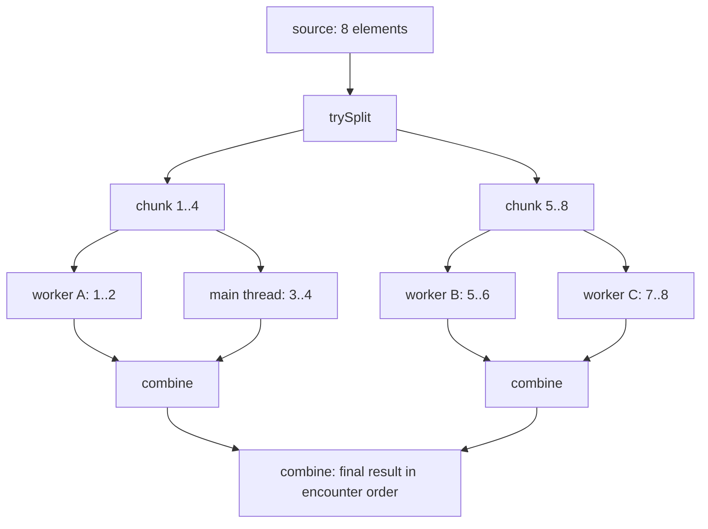
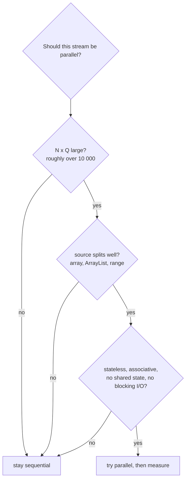

## In One Line
A **parallel stream** (`collection.parallelStream()` or `stream.parallel()`) splits its source into chunks with a `Spliterator`, processes the chunks on the shared **ForkJoinPool common pool** (plus the calling thread), and merges the partial results — which can speed up large, CPU-heavy, independent work, but makes small or I/O-bound work slower and turns any shared mutable state or non-associative logic into a bug.

## Mental Model
Think of **marking a huge pile of exam papers** with a team of teachers.

- The head teacher **splits the pile in half**, hands one half to a colleague, splits again... until each teacher has a manageable stack. That is `Spliterator.trySplit()` plus fork/join.
- Every teacher marks **their own stack** and writes subtotals on **their own sheet** (per-thread containers). At the end the sheets are **combined** pairwise into the final result (the combiner).
- A teacher who finishes early **steals** a stack from a busy colleague (work stealing).
- Splitting and combining cost time. For **7 papers**, one teacher is faster than organising a team — exactly the course example's situation.
- A pile that is a **linked chain** of papers (a `LinkedList`, `Stream.iterate`) is hard to split in half; a pile that is **indexed** (an array, `ArrayList`, `IntStream.range`) splits instantly.
- If all teachers write on **one shared sheet** at the same time (adding to a shared `ArrayList`), marks get lost or the sheet tears (`ArrayIndexOutOfBoundsException`).
- The staff room has a **fixed number of teachers** (the common pool, *CPU cores − 1*) shared by the whole school; if one job keeps them busy waiting on the phone (blocking I/O), everybody else's marking stalls.

## Concept
### How to get one
| Call | Effect |
|---|---|
| `collection.parallelStream()` | A parallel stream straight from a `Collection` (it *may* return a sequential stream, per the Javadoc) |
| `stream.parallel()` | Switches an existing pipeline to parallel |
| `stream.sequential()` | Switches it back |
| `stream.isParallel()` | Asks the current mode |

The mode is a property of the **whole pipeline**, not of individual stages: `parallel()` and `sequential()` just set a flag, and **the last call before the terminal operation wins**. You cannot run `filter` in parallel and `map` sequentially in one pipeline.

### What happens under the hood
1. The terminal operation sees the parallel flag and wraps the pipeline in a `ForkJoinTask` (e.g. `ReduceTask`, `ForEachTask`).
2. The task asks the source's **`Spliterator`** to `trySplit()` — split off a chunk — repeatedly, forking subtasks, until chunks reach a target size (roughly *size / (4 × parallelism)*).
3. Each leaf task runs the fused pipeline over its chunk sequentially, into its **own** container.
4. Results are **joined** back up the tree with the combiner (for collectors) or the reduction operator.
5. Tasks run on the **ForkJoinPool common pool**, whose idle workers **steal** queued subtasks from busy ones. The **calling thread** (e.g. `main`) also joins in and processes chunks — which is why `main` appears in thread names.

### The common pool
- Default parallelism = `Runtime.getRuntime().availableProcessors() - 1` (minimum 1), because the caller thread also works. On a 4-core machine: 3 workers + the caller.
- Change it JVM-wide with `-Djava.util.concurrent.ForkJoinPool.common.parallelism=N` (must be set before the pool is first used).
- It is **shared** by every parallel stream in the JVM and by `CompletableFuture.supplyAsync(...)` without an executor, so one slow job can starve the others.
- Worker threads are named `ForkJoinPool.commonPool-worker-N` and are daemon threads.
- Running the terminal operation *from inside* another `ForkJoinPool` (`pool.submit(() -> stream.parallel()...).get()`) makes it use that pool's workers. It works in current JDKs and is widely used to isolate work, but it is an **implementation detail**, not a documented guarantee.

### Ordering in parallel
Parallel does **not** mean "result in random order". Encounter order is preserved wherever the operation promises it:
| Operation | Parallel behaviour |
|---|---|
| `collect(toList())`, `toList()`, `toArray()`, `joining` | **Encounter order kept** — chunks are combined left to right |
| `forEach` | **No order** — whichever thread gets there first prints first |
| `forEachOrdered` | Encounter order, at the cost of some parallelism |
| `findFirst` | The first in encounter order (may need to wait for earlier chunks) |
| `findAny` | Any match — cheapest in parallel |
| `sorted`, `distinct`, `limit`, `skip` | Correct but **expensive** on ordered parallel streams (buffering, coordination); `unordered()` can make `distinct`/`limit` cheaper |
| `groupingBy` lists | Encounter order kept; `groupingByConcurrent` does **not** keep it |

### Rules for correct parallel code
1. **No shared mutable state.** Do not add to an outside `ArrayList`/`HashMap` from `forEach`/`map`; collect instead. Synchronised collections "fix" correctness but serialise the work.
2. **Associative operations.** `reduce`'s operator must satisfy `(a op b) op c == a op (b op c)` — `+`, `*`, `max`, `min`, concatenation yes; `-`, `/` no.
3. **A true identity.** `reduce(identity, op)` applies the identity once **per chunk**: `identity op x` must equal `x` (`0` for `+`, `1` for `*`).
4. **Stateless, non-interfering lambdas**, and no reliance on `ThreadLocal` or on which thread runs what.
5. **Thread-safe everything you touch** — e.g. `SimpleDateFormat` inside a parallel `map` is a classic bug.

### When parallel pays off — the NQ model
Parallelism has fixed costs: splitting, task scheduling, thread hand-offs, combining. It wins only when there is enough work to amortise them. Brian Goetz's rule of thumb: **N × Q > 10 000**, where N = number of elements and Q = cost per element (a simple addition is Q ≈ 1). Checklist:
| Favours parallel | Favours sequential |
|---|---|
| Large N (tens of thousands or more) or expensive per-element work (large Q) | Small collections (like the example's 7 strings) |
| Source that **splits well**: arrays, `ArrayList`, `IntStream.range`, `HashSet`/`HashMap`, `ConcurrentHashMap` | Sources that split badly: `LinkedList`, `Stream.iterate`, `Stream.generate`, `BufferedReader.lines()`, most `Iterator`-based sources |
| Stateless ops, cheap combine (sum, count, `toList`) | Stateful ops on ordered data (`sorted`, `distinct`, `limit`), expensive combine (merging big maps) |
| Primitive streams (`IntStream`), no boxing | Boxing-heavy pipelines — memory bandwidth, not CPU, becomes the bottleneck |
| CPU-bound work | **Blocking I/O** (HTTP calls, DB queries) — use an `ExecutorService` or virtual threads instead |
| Free cores | A server already using every core for other requests |

Always **measure** (with JMH or at least warmed-up repeated timings) before and after; "parallel" is an optimisation, not a default.

### Parallel streams vs other concurrency tools
| Tool | Best for |
|---|---|
| Parallel streams | Data parallelism: the same CPU-bound operation over a large, splittable data set |
| `ExecutorService` / `CompletableFuture` with your own pool | Independent tasks, I/O, control over threads and timeouts — see [ExecutorService](lesson:a07-executors/02-executor-service) |
| Virtual threads (Java 21) | Many concurrent **blocking** tasks — see [Virtual Threads](lesson:b03-concurrency/07-virtual-threads) |
| `Arrays.parallelSort`, `Arrays.parallelPrefix`, `ConcurrentHashMap.forEach(parallelismThreshold, ...)` | Specialised built-in parallel algorithms |

## Diagram

Fork: split the source recursively and process leaves on the common pool (the caller helps). Join: merge partial results left to right, which is why `collect(toList())` keeps the original order.


Parallel is the exception: every "no" on the way means a sequential stream is faster or safer.

## Code
@example Java8Features/StreamAPIandCollectors/ParallelStreamsExample.java

**Who does the work, and in what order?** Thread names and `forEach` order change from run to run — this is one real run on a 4-core machine:
```java
System.out.println("CPUs: " + Runtime.getRuntime().availableProcessors());
System.out.println("commonPool parallelism: " + ForkJoinPool.commonPool().getParallelism());

List<String> strings = Arrays.asList("abc", "", "bc", "efg", "abcd", "", "jkl");

System.out.println("--- forEach: any thread, any order");
strings.parallelStream()
       .filter(s -> !s.isEmpty())
       .forEach(s -> System.out.println(s + " on " + Thread.currentThread().getName()));

System.out.println("--- forEachOrdered: encounter order");
strings.parallelStream().filter(s -> !s.isEmpty()).forEachOrdered(s -> System.out.print(s + " "));
System.out.println();

System.out.println("--- collect keeps encounter order");
System.out.println(strings.parallelStream().filter(s -> !s.isEmpty()).map(String::toUpperCase).toList());
```
```output
CPUs: 4
commonPool parallelism: 3
--- forEach: any thread, any order
abcd on main
efg on main
bc on ForkJoinPool.commonPool-worker-1
abc on ForkJoinPool.commonPool-worker-2
jkl on main
--- forEachOrdered: encounter order
abc bc efg abcd jkl 
--- collect keeps encounter order
[ABC, BC, EFG, ABCD, JKL]
```
The first block varies on every run; the last two lines never do.

**Correctness traps** — the last block (shared `ArrayList`) is non-deterministic; this run shows both failure modes:
```java
System.out.println("--- identity must be a real identity");
System.out.println(Stream.of(1, 2, 3, 4).reduce(10, Integer::sum));
System.out.println(Stream.of(1, 2, 3, 4).parallel().reduce(10, Integer::sum));
System.out.println(10 + Stream.of(1, 2, 3, 4).parallel().reduce(0, Integer::sum));

System.out.println("--- operation must be associative");
System.out.println(IntStream.rangeClosed(1, 8).reduce(0, (a, b) -> a - b));
System.out.println(IntStream.rangeClosed(1, 8).parallel().reduce(0, (a, b) -> a - b));

System.out.println("--- shared mutable state");
for (int run = 0; run < 3; run++) {
    List<Integer> unsafe = new ArrayList<>();
    try {
        IntStream.range(0, 100_000).parallel().forEach(unsafe::add);
        System.out.println("size = " + unsafe.size());
    } catch (Exception e) {
        System.out.println(e.getClass().getSimpleName());
    }
}
List<Integer> safe = IntStream.range(0, 100_000).parallel().boxed().toList();
System.out.println("collected size = " + safe.size());
```
```output
--- identity must be a real identity
20
50
20
--- operation must be associative
-36
0
--- shared mutable state
size = 95445
ArrayIndexOutOfBoundsException
size = 100000
collected size = 100000
```

**`findAny`, "last call wins", and a custom pool** (the `findAny` value may differ on other machines):
```java
System.out.println("--- findFirst vs findAny");
System.out.println(IntStream.range(0, 1000).parallel().filter(n -> n % 100 == 7).findFirst().getAsInt());
System.out.println(IntStream.range(0, 1000).parallel().filter(n -> n % 100 == 7).findAny().getAsInt());

System.out.println("--- the last parallel()/sequential() call wins for the whole pipeline");
Stream<Integer> s = Stream.of(1, 2, 3).parallel().filter(n -> n > 0).sequential();
System.out.println(s.isParallel());

System.out.println("--- running inside a custom ForkJoinPool");
ForkJoinPool pool = new ForkJoinPool(2);
try {
    Set<String> threads = pool.submit(() ->
            IntStream.range(0, 1000).parallel()
                     .mapToObj(i -> Thread.currentThread().getName())
                     .collect(Collectors.toCollection(TreeSet::new))).get();
    System.out.println(threads);
} finally {
    pool.shutdown();
}
```
```output
--- findFirst vs findAny
7
707
--- the last parallel()/sequential() call wins for the whole pipeline
false
--- running inside a custom ForkJoinPool
[ForkJoinPool-1-worker-1, ForkJoinPool-1-worker-2]
```

**How well do sources split?** One `trySplit()` call on 10 000 elements:
```java
static void split(String name, Spliterator<?> right) {
    Spliterator<?> left = right.trySplit();          // left part is handed to another task
    System.out.println(name + ": left=" + (left == null ? "none" : left.estimateSize())
            + " right=" + right.estimateSize()
            + " SIZED=" + right.hasCharacteristics(Spliterator.SIZED));
}

List<Integer> data = IntStream.range(0, 10_000).boxed().toList();
split("ArrayList      ", new ArrayList<>(data).spliterator());
split("LinkedList     ", new LinkedList<>(data).spliterator());
split("IntStream.range", IntStream.range(0, 10_000).spliterator());
split("HashSet        ", new HashSet<>(data).spliterator());
```
```output
ArrayList      : left=5000 right=5000 SIZED=true
LinkedList     : left=1024 right=8976 SIZED=true
IntStream.range: left=5000 right=5000 SIZED=true
HashSet        : left=5000 right=5000 SIZED=false
```

**Is it faster?** Best of 10 warmed-up runs, in microseconds — one run on a 4-core container; your numbers will differ:
```java
static long time(Runnable r) {
    long best = Long.MAX_VALUE;
    for (int i = 0; i < 10; i++) {          // repeat: warm up the JIT, keep the best run
        long t = System.nanoTime();
        r.run();
        best = Math.min(best, System.nanoTime() - t);
    }
    return best / 1_000;                     // microseconds
}

List<String> small = Arrays.asList("abc", "", "bc", "efg", "abcd", "", "jkl");
System.out.println("7 strings, sequential: " + time(() -> small.stream().filter(s -> !s.isEmpty()).toList()) + " us");
System.out.println("7 strings, parallel:   " + time(() -> small.parallelStream().filter(s -> !s.isEmpty()).toList()) + " us");

System.out.println("20M longs, sequential: " + time(() -> LongStream.rangeClosed(1, 20_000_000).map(x -> x * x % 7).sum()) + " us");
System.out.println("20M longs, parallel:   " + time(() -> LongStream.rangeClosed(1, 20_000_000).parallel().map(x -> x * x % 7).sum()) + " us");

System.out.println("iterate 2M, parallel:  " + time(() -> Stream.iterate(1L, x -> x + 1).limit(2_000_000).parallel().reduce(0L, Long::sum)) + " us");
System.out.println("range   2M, parallel:  " + time(() -> LongStream.rangeClosed(1, 2_000_000).parallel().sum()) + " us");
```
```output
7 strings, sequential: 3 us
7 strings, parallel:   69 us
20M longs, sequential: 21256 us
20M longs, parallel:   16490 us
iterate 2M, parallel:  109728 us
range   2M, parallel:  1448 us
```

## Walkthrough
**The original example**
- `List<String> strings = Arrays.asList(...)` — the same seven strings; `Arrays.asList` is backed by an array, so its spliterator splits evenly.
- `strings.parallelStream()` — a `Collection` default method returning a parallel stream (equivalent to `strings.stream().parallel()`).
- `.filter(string -> !string.isEmpty())` — runs on several threads: the common-pool workers and the `main` thread each filter their own chunk. The lambda is stateless and touches no shared data, so this is safe.
- `.collect(Collectors.toList())` — each chunk collects into its own `ArrayList`; the combiner (`addAll`) joins the lists **in encounter order**. So the result is always `[abc, bc, efg, abcd, jkl]`, identical to the sequential version.
- `System.out.println("Filtered List (Parallel Stream): " + filtered);` — prints `Filtered List (Parallel Stream): [abc, bc, efg, abcd, jkl]`, as the comment says. The recorded output has **no `.varies` file**: although threads are involved, `toList` guarantees the order, so every run prints the same line. Only operations like `forEach` would expose the thread interleaving.

**Who does the work.** With 4 CPUs the common pool has 3 workers; `main` also processes chunks. With `forEach`, lines appear in whatever order threads finish (run it twice and the order changes); `forEachOrdered` and `toList` restore encounter order.

**Correctness traps**
- `reduce(10, Integer::sum)`: sequentially 10 is used once (10+1+2+3+4 = 20). In parallel, the four elements end up in four chunks, each starting from 10: (10+1)+(10+2)+(10+3)+(10+4) = 50. The fix is to use the real identity and add the offset outside: `10 + reduce(0, Integer::sum)` = 20.
- Subtraction is not associative. Sequentially: 0−1−2−...−8 = −36. In parallel with single-element chunks: each leaf is `0 - x = -x`, then pairs combine `(-1) - (-2) = 1`, `(-3) - (-4) = 1`, ..., then `1 - 1 = 0` at every level → `0`.
- Adding to a shared `ArrayList` from several threads: `add` is `elementData[size++] = e`, which is not atomic. Two threads can write the same slot (lost elements: `size = 95445`), or one thread can write past the array while another is resizing it (`ArrayIndexOutOfBoundsException`). Sometimes it "works" (`size = 100000`), which is what makes such bugs dangerous. `toList()` is always correct.

**`findAny`, modes and pools.** `findFirst` must return 7 — the first match in encounter order. `findAny` returned 707 here because the thread handling that chunk found a match first. `parallel()...sequential()` leaves the whole pipeline sequential (`false`). Submitting the pipeline to a `ForkJoinPool(2)` makes its two workers do all the work — no `commonPool` threads and no `main`.

**Splitting.** `ArrayList` and `IntStream.range` split exactly in half and stay `SIZED`. `LinkedList` can only walk from the head, so it copies a batch of 1024 elements into an array and hands that off — very lopsided. `HashSet` splits by bucket ranges, so the halves' sizes are only estimates (`SIZED=false` after the split).

**Timings.** For 7 strings the parallel version is about 20 times *slower* (69 µs vs 3 µs) — the example's parallelism is pure overhead. For 20 million cheap operations it is only modestly faster here, because the work is tiny per element and the container shares its cores. `Stream.iterate` splits so badly that 2 million elements take ~110 ms in parallel, while `LongStream.rangeClosed` does the same sum in ~1.4 ms.

## Traps
> [!ERRATA] The example uses `parallelStream()` on a 7-element list with a trivial filter. It prints the correct result, but it is a bad practice to copy: the split/schedule/merge overhead dwarfs the work (in the timing snippet, 69 µs parallel vs 3 µs sequential). Parallel streams pay off only for large data or expensive per-element work (N × Q > 10 000). Also, the comment `// Filter empty strings using parallel stream` reads as if the empty strings are kept; the predicate `!string.isEmpty()` **removes** them.

- **Mutating shared state** (`forEach(list::add)`, `map(x -> { counter++; ... })`, a shared `HashMap`) gives lost updates, `ArrayIndexOutOfBoundsException` or corrupted maps — intermittently. Use collectors.
- **Wrong identity or non-associative operator in `reduce`** gives different answers in parallel than sequentially — silently.
- **Expecting `forEach` to keep order** — it does not in parallel. Use `forEachOrdered` or collect first.
- **Blocking I/O inside a parallel stream** (HTTP calls, JDBC) ties up the common pool that the rest of the JVM (other parallel streams, `CompletableFuture.supplyAsync`) also depends on. Use an `ExecutorService` or virtual threads.
- **Thinking `parallel()` affects only the stages after it.** The last `parallel()`/`sequential()` call sets the mode for the entire pipeline.
- **Bad sources:** `LinkedList`, `Stream.iterate`, `Stream.generate`, `Iterator`-based streams split poorly and can be slower in parallel than sequential.
- **Stateful operations in ordered parallel pipelines** (`sorted`, `distinct`, `limit(n)`, `skip`) need buffering and coordination; `limit` on a parallel ordered stream can be much slower than sequential. Use `unordered()` if order does not matter.
- **Thread-unsafe helpers** such as `SimpleDateFormat`, `Random` shared across threads (contention), or `ThreadLocal` assumptions.
- **Nested parallel streams** (a parallel stream inside another's lambda) oversubscribe the same common pool and rarely help.
- **Measuring without warm-up**: the first run includes JIT compilation and pool start-up; benchmark with JMH or repeated runs.

> [!WARNING] Parallel streams are not a general "make it faster" switch. On a busy server every core is already serving requests; adding parallel streams only adds contention.

## Tips & Tricks
- **Default to sequential; go parallel only with evidence** — "Measure, don't guess."
- **NQ rule:** N × Q > 10 000 before parallel is even worth trying.
- **"SPLIT" checklist:** **S**ize is large, **P**er-element cost is high, **L**ambdas are stateless/associative, **I**ndexed source (array, `ArrayList`, range), **T**hreads not blocked on I/O.
- **Order cheat-sheet:** collectors and `toArray` keep order; `forEach` and `findAny` do not; `forEachOrdered` and `findFirst` do (at a cost).
- **Sum? Use primitive streams:** `IntStream.range(...).parallel().sum()` avoids boxing and splits perfectly.
- **`unordered()`** before `distinct()`/`limit()` when you do not care about order in parallel.
- **Need a separate pool?** `pool.submit(() -> list.parallelStream()...collect(...)).get()` works today (implementation detail), or use `CompletableFuture` with your own executor.
- **Remember the pool size:** common pool = cores − 1 workers + the caller thread.
- Related deep dives: [ForkJoin & thread pools](lesson:a07-executors/01-thread-pools), [ConcurrentHashMap](lesson:b03-concurrency/03-concurrenthashmap).

## Interview Q&A
### [Basic] What is a parallel stream, and how do you create one?
A parallel stream is a stream whose terminal operation splits the source into chunks and processes them concurrently on multiple threads, then combines the partial results. Create one with `collection.parallelStream()` or by calling `.parallel()` on any stream; `.sequential()` switches back and `isParallel()` reports the mode. Parallelism is transparent: the same pipeline code runs sequentially or in parallel, and for correct (stateless, associative) code the result is the same.

**Follow-up:** *Which threads run it?* — The ForkJoinPool common pool's workers (`ForkJoinPool.commonPool-worker-N`) plus the thread that called the terminal operation.

### [Basic] Does a parallel stream change the order of the result?
Not for order-respecting operations: `collect(toList())`, `toList()`, `toArray()`, `joining`, `findFirst`, `forEachOrdered`, `reduce` all respect **encounter order** — partial results are combined left to right. That is why the course example always prints `[abc, bc, efg, abcd, jkl]`. Operations that do not promise order — `forEach`, `findAny`, `groupingByConcurrent` — can expose the thread interleaving and change between runs.

**Follow-up:** *Is keeping order free?* — No. `findFirst`, `forEachOrdered`, `limit`, `sorted` and `distinct` must coordinate or buffer; `unordered()` removes the constraint when order does not matter.

### [Intermediate] How do parallel streams work internally?
The terminal operation builds a `ForkJoinTask` tree. The source's `Spliterator` is split recursively with `trySplit()` until chunks are small enough (about size / (4 × parallelism)); each split is forked as a subtask. Leaf tasks run the fused pipeline sequentially over their chunk into their own containers; results are joined back up the tree using the collector's combiner or the reduction operator. Tasks execute on the `ForkJoinPool.commonPool()`, whose workers use **work stealing** — idle threads take queued subtasks from the tails of busy threads' deques — and the calling thread also helps.

**Follow-up:** *What does a Spliterator need to split well?* — Cheap, balanced splits and a known size (`SIZED`/`SUBSIZED`): arrays, `ArrayList`, `IntStream.range`. `LinkedList` and `Stream.iterate` can only split off batches from the front.

### [Intermediate] What is the ForkJoinPool common pool, and how many threads does it have?
It is a JVM-wide, lazily created `ForkJoinPool` used by parallel streams, `CompletableFuture` async methods without an explicit executor, and `Arrays.parallelSort`. Its default parallelism is `availableProcessors() - 1` (at least 1), because the submitting thread also participates. You can change it with the system property `-Djava.util.concurrent.ForkJoinPool.common.parallelism=N`. Since it is shared, long-running or blocking tasks in one place slow down every other user of the pool.

**Follow-up:** *How do you run a parallel stream in a different pool?* — Invoke the terminal operation inside a task submitted to your own `ForkJoinPool` (`pool.submit(() -> stream.parallel()...).get()`); it works in practice but relies on unspecified behaviour.

### [Intermediate] When should you use a parallel stream — and when not?
Use it when the data set is large or the per-element work is expensive (N × Q over roughly 10 000), the source splits well (arrays, `ArrayList`, ranges), the operations are stateless and associative with cheap combining, the work is CPU-bound, and spare cores exist. Avoid it for small collections (like the 7-element example), poorly splitting sources (`LinkedList`, `iterate`, I/O lines), order-sensitive stateful operations, blocking I/O, shared mutable state, and on servers already saturated with requests. Always measure, preferably with JMH.

**Follow-up:** *Why is blocking I/O especially bad?* — It parks common-pool threads that the whole JVM shares; use an `ExecutorService` sized for I/O or virtual threads.

### [Intermediate] Why can adding to an `ArrayList` from a parallel `forEach` fail?
`ArrayList` is not thread-safe: `add` does `ensureCapacity`, then `elementData[size++] = e`. Two threads can read the same `size` and overwrite one slot (elements lost), or one can write while another replaces the backing array during growth (`ArrayIndexOutOfBoundsException`). The failure is intermittent, so tests often pass. The fix is not `Collections.synchronizedList` (correct but serialised) — it is to let the stream build the result: `collect(toList())` or `toList()`, which uses a separate list per chunk and merges them.

**Follow-up:** *Would `CopyOnWriteArrayList` be a good fix?* — It is thread-safe but copies the whole array on every add — O(n²) for n adds — and still loses encounter order.

### [Advanced] Why must `reduce`'s identity be a true identity and its operator associative?
In parallel, `reduce(identity, op)` reduces each chunk starting from `identity`, then combines chunk results with `op`. If `identity` is not neutral (`reduce(10, Integer::sum)`), it is counted once per chunk: `Stream.of(1,2,3,4).parallel().reduce(10, Integer::sum)` gives 50 instead of 20. If `op` is not associative (subtraction), the result depends on how the chunks were grouped: summing 1..8 by subtraction gives −36 sequentially but 0 in parallel. The API contract requires both properties, so sequential and parallel runs agree.

**Follow-up:** *And the 3-argument `reduce`?* — The combiner must be compatible with the accumulator: `combiner.apply(u, accumulator.apply(identity, t)) == accumulator.apply(u, t)`.

### [Advanced] What is the difference between `findFirst` and `findAny` in parallel, and what does `unordered()` do?
`findFirst` must return the first match in encounter order, so even if a later chunk finds a match first, the stream must wait for earlier chunks — extra coordination. `findAny` returns whichever match any thread finds first, which is cheaper and nondeterministic (e.g. 707 instead of 7 in the demo). `unordered()` tells the pipeline that encounter order is irrelevant, letting `distinct`, `limit`, `skip` and some collectors skip order-preserving work in parallel.

**Follow-up:** *Does `unordered()` shuffle the elements?* — No, it only removes the ordering constraint; the output may still come out in order.

### [Advanced] How do parallel streams compare with `ExecutorService`, `CompletableFuture` and virtual threads?
Parallel streams provide **data parallelism** for CPU-bound work over a splittable data set with minimal code, but offer little control (shared pool, no timeouts, no per-task error handling). `ExecutorService`/`CompletableFuture` give **task parallelism** with your own pools, timeouts, composition and error handling — right for heterogeneous or I/O-bound tasks. Virtual threads (Java 21) make it cheap to run many **blocking** tasks concurrently, but they do not add CPU capacity, so they do not replace parallel streams for CPU-bound computation. Also consider built-ins like `Arrays.parallelSort`.

**Follow-up:** *Can you run a parallel stream on virtual threads?* — Not directly; parallel streams use `ForkJoinPool` platform threads. Use virtual threads for I/O fan-out and keep parallel streams for CPU work.

## Quiz
### What does the original example print, and does it vary between runs?
- [x] `Filtered List (Parallel Stream): [abc, bc, efg, abcd, jkl]` on every run
- [ ] The same five strings, but in a different order on each run
- [ ] `Filtered List (Parallel Stream): [abc, , bc, efg, abcd, , jkl]`
- [ ] It varies because different threads filter different elements
> Several threads do the filtering, but `collect(Collectors.toList())` combines the per-chunk lists in encounter order, so the output is deterministic — no `.varies` file exists for it. Only operations such as `forEach` expose thread order.

### What does this print?
```java
Stream<Integer> s = Stream.of(1, 2, 3).parallel().filter(n -> n > 0).sequential();
System.out.println(s.isParallel());
```
- [ ] `true` — `filter` was added while the stream was parallel
- [x] `false`
- [ ] It throws `IllegalStateException`
- [ ] Compile error
> `parallel()` and `sequential()` set a flag for the whole pipeline, and the last call before the terminal operation wins. There is no per-stage mode.

### What does this print?
```java
System.out.println(IntStream.range(0, 1000).parallel().filter(n -> n % 100 == 7).findFirst().getAsInt());
```
- [x] `7`, always
- [ ] Any of 7, 107, 207 ... 907, depending on thread timing
- [ ] `907`
- [ ] It throws because `findFirst` is not allowed on parallel streams
> `findFirst` respects encounter order even in parallel, so the answer is always 7. `findAny` is the one that may return 107, 707, etc.

### What does `Stream.of(1, 2, 3, 4).parallel().reduce(0, Integer::sum)` return?
- [x] `10`, always
- [ ] `10` or a different number depending on the split
- [ ] `0`
- [ ] `Optional[10]`
> 0 is a true identity for `+` and addition is associative, so every split gives 10. With a non-identity such as `reduce(10, Integer::sum)` the parallel result would change (50 with four chunks).

### Spot the bug
```java
List<String> result = new ArrayList<>();
names.parallelStream()
     .filter(n -> n.startsWith("A"))
     .forEach(result::add);
```
- [ ] `forEach` cannot be used on a parallel stream
- [ ] `startsWith` is not thread-safe
- [x] Several threads call `add` on an unsynchronised `ArrayList`: elements can be lost or an `ArrayIndexOutOfBoundsException` thrown, and the order is random
- [ ] Nothing — `parallelStream` synchronises `forEach` automatically
> Shared mutable state breaks in parallel. Replace the last two lines with `.toList()` or `.collect(Collectors.toList())`, which build per-thread lists and merge them in order.

### Which source is the worst choice for a parallel stream?
- [ ] An `int[]` of 10 million elements
- [ ] `IntStream.rangeClosed(1, 10_000_000)`
- [x] `Stream.iterate(1, n -> n + 1).limit(10_000_000)`
- [ ] An `ArrayList` of 10 million elements
> `iterate` produces each element from the previous one and has no known size, so it can only split off batches sequentially from the front — in the timing demo it was about 75 times slower than `LongStream.rangeClosed` for the same sum. Arrays, ranges and `ArrayList`s split instantly into balanced halves.

### How many worker threads does the common pool have by default on an 8-core machine?
- [ ] 8
- [x] 7
- [ ] 16
- [ ] 1
> Default parallelism is `availableProcessors() - 1`, because the thread that calls the terminal operation also works on chunks: 7 workers plus the caller keep 8 cores busy.

## Takeaways
- `parallelStream()` / `.parallel()` split the source with a `Spliterator`, run chunks on the ForkJoinPool **common pool** (cores − 1 workers plus the calling thread) and combine the partial results.
- The last `parallel()`/`sequential()` call sets the mode for the **entire** pipeline.
- Collectors, `toList`, `toArray`, `reduce`, `findFirst` and `forEachOrdered` keep encounter order in parallel; `forEach` and `findAny` do not — so the course example's output is deterministic.
- Correct parallel code needs stateless lambdas, no shared mutable state, associative operations and a true identity for `reduce`; violations fail silently or intermittently.
- Parallel pays off only for large N × Q (roughly > 10 000), well-splitting sources (arrays, `ArrayList`, ranges), cheap combining and CPU-bound work; for 7 strings it is many times slower.
- Never block on I/O in parallel streams — the common pool is shared JVM-wide; use executors or virtual threads for I/O.
- Measure with warmed-up benchmarks (JMH) before deciding; sequential is the default.
