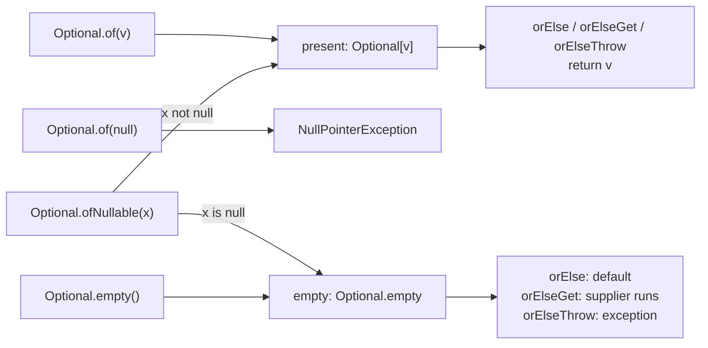
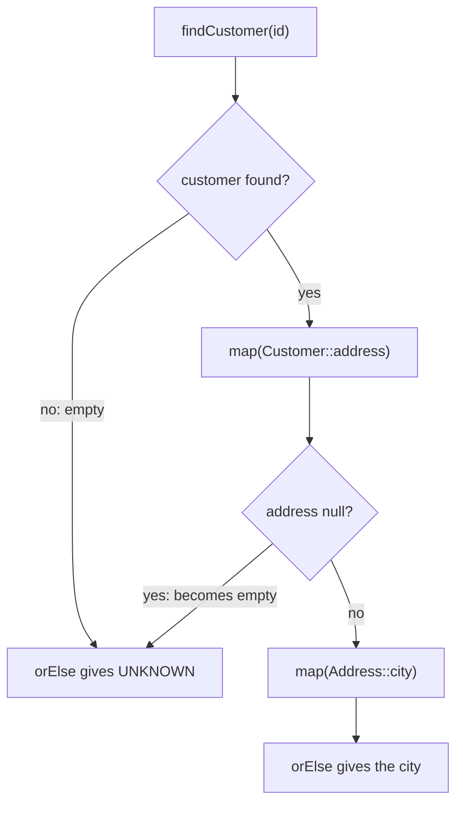

## In One Line
`Optional<T>` is a small, immutable box that holds **either one non-null value or nothing**, so a method can say in its return type "I might have no answer" and force the caller to decide what to do when the answer is missing, instead of returning `null` and hoping they remember to check.

## Mental Model
Think of a **parcel locker at a train station**. You get a locker (the `Optional`) back from the counter no matter what. The locker is either **full** (a parcel is inside) or **empty** — it is never "no locker at all".

- `Optional.of(parcel)` — the clerk puts a parcel in the locker. Handing the clerk *nothing* (`null`) is refused on the spot (`NullPointerException`).
- `Optional.ofNullable(maybeParcel)` — the clerk accepts whatever you hand over; if it is nothing, you just get an empty locker.
- `Optional.empty()` — you are given an empty locker on purpose.
- `orElse("spare")` — "open it; if it is empty, give me this spare I brought along". You carry the spare **whether or not you need it**.
- `orElseGet(() -> buySpare())` — "if it is empty, *then* go and buy a spare". You only shop when needed.
- `orElseThrow(...)` — "if it is empty, sound the alarm".
- `map(...)` — "if there is a parcel, repack it (unwrap, transform, put the result in a new locker); if not, pass the empty locker along".

The locker never pretends to be a parcel: to use what is inside you must open it, and every way of opening it makes you say what happens when it is empty. That is exactly what `null` never forced you to do.

## Concept
### Why Optional exists
Before Java 8 a method such as `findUserByEmail(email)` returned `null` when nothing matched. Nothing in the signature warned the caller, so the classic bug was:

```java
String city = findUser(email).getAddress().getCity();   // NPE if any step returns null
```

The inventor of `null`, Tony Hoare, called it his "billion-dollar mistake". Java 8 borrowed the idea of an option type from functional languages (Haskell's `Maybe`, Scala's `Option`) and from Google Guava's `Optional`, and added `java.util.Optional<T>`.

> [!INTERVIEW] The Javadoc states the intent: *"Optional is primarily intended for use as a method return type where there is a clear need to represent 'no result,' and where using null is likely to cause errors. A variable whose type is Optional should never itself be null."* It is a **return type**, not a general replacement for every `null`.

### What an Optional really is
Internally `Optional` is a `final` class with a single field, `private final T value`. An empty `Optional` is just one whose `value` is `null`, and `Optional.empty()` always returns the **same shared singleton** (`EMPTY`). Consequences:

- It is **immutable** — no setter; every operation returns a new (or the empty) `Optional`.
- It is a **value-based class** (like `LocalDate`, `Integer`): compare with `equals`, never with `==`, never `synchronized` on one. Since Java 16 `javac` warns: *"attempt to synchronize on an instance of a value-based class"*.
- It is **not `Serializable`** — on purpose, to discourage using it as a field.
- `toString()` prints `Optional[value]` or `Optional.empty`.

### Creating an Optional
| Factory | If the argument is non-null | If the argument is `null` | Use when |
|---|---|---|---|
| `Optional.of(v)` | `Optional[v]` | throws `NullPointerException` immediately | You **know** the value is not null (fail fast if you are wrong) |
| `Optional.ofNullable(v)` | `Optional[v]` | `Optional.empty` | The value **may** be null — e.g. wrapping a legacy API |
| `Optional.empty()` | — | `Optional.empty` | You want to return "no result" explicitly |

### Getting the value out
| Method | Present | Empty | Since |
|---|---|---|---|
| `get()` | returns value | `NoSuchElementException: No value present` | 8 (discouraged) |
| `orElseThrow()` | returns value | `NoSuchElementException: No value present` | **10** — the preferred name for `get()` |
| `orElseThrow(Supplier<X>)` | returns value | throws the exception the supplier builds | 8 |
| `orElse(T other)` | returns value | returns `other` — **`other` is always evaluated** | 8 |
| `orElseGet(Supplier<T>)` | returns value | calls the supplier **only now** | 8 |
| `or(Supplier<Optional<T>>)` | returns this Optional | returns the supplier's Optional (a fallback *Optional*) | 9 |

### Checking and reacting
| Method | What it does | Since |
|---|---|---|
| `isPresent()` | `true` if a value is inside | 8 |
| `isEmpty()` | `true` if nothing is inside | 11 |
| `ifPresent(Consumer)` | runs the consumer only if present, otherwise does nothing | 8 |
| `ifPresentOrElse(Consumer, Runnable)` | runs one or the other | 9 |

### Transforming — the part that makes Optional worth using
| Method | Behaviour |
|---|---|
| `map(f)` | Present: `Optional.ofNullable(f.apply(value))` — so if `f` returns `null` you get **empty**, not an exception. Empty: stays empty and `f` never runs. |
| `flatMap(f)` | For an `f` that *already returns an Optional*. Returns `f`'s Optional directly instead of wrapping it again (avoids `Optional<Optional<T>>`). If `f` returns `null` itself → `NullPointerException`. |
| `filter(p)` | Present and `p` is true → same Optional; otherwise empty. |
| `stream()` | Java 9: a `Stream` of 0 or 1 elements. Great with `flatMap(Optional::stream)` to drop empties from a stream. |

`map` is to Optional what `map` is to a Stream: a stream has 0..n elements, an Optional has 0..1. That is why the method names match.

### Replacing nested null checks
```java
// Before
String city = "UNKNOWN";
if (user != null) {
    Address a = user.getAddress();
    if (a != null && a.getCity() != null) city = a.getCity();
}

// After (findUser returns Optional<User>)
String city = findUser(id)
        .map(User::getAddress)
        .map(Address::getCity)
        .orElse("UNKNOWN");
```
Each `map` step either transforms the value or passes "empty" straight through, so the first missing link short-circuits the rest.

### Primitive Optionals
`OptionalInt`, `OptionalLong` and `OptionalDouble` hold a primitive without boxing. They are returned by primitive streams: `IntStream.max()` gives `OptionalInt`, `IntStream.average()` gives `OptionalDouble`. You read them with `getAsInt()`, `getAsLong()`, `getAsDouble()`. They have **no `map`, `flatMap`, `filter` or `or`** — only the "check and extract" methods (`isPresent`, `isEmpty`, `ifPresent`, `ifPresentOrElse`, `orElse`, `orElseGet`, `orElseThrow`, `stream`). They are not subclasses of `Optional`.

### Where Optional appears in the JDK
- Stream terminal operations: `findFirst()`, `findAny()`, `min()`, `max()`, `reduce(BinaryOperator)`.
- `Collectors.maxBy/minBy` give `Optional` values (e.g. inside `groupingBy`).
- `ProcessHandle.parent()`, `Runtime.Version.pre()`, `ServiceLoader.findFirst()`, `Class.describeConstable()` and friends.
- Spring Data `findById(id)` returns `Optional<T>`.

### When to use it — and when not to
| Do | Don't |
|---|---|
| Return `Optional<T>` from a method that may legitimately have no result (`findById`, `findFirst`) | Declare a **field** of type `Optional` (it is not Serializable and adds a wrapper per object) |
| Chain `map` / `filter` / `orElse…` | Take `Optional` as a **method parameter** — callers can still pass `null`, and overloading or a nullable parameter is clearer |
| Use `orElseThrow()` when absence is a bug | Return `Optional<List<T>>` — return an **empty list** instead |
| Use `orElseGet` when the fallback is costly | Call `isPresent()` then `get()` — that is just a `null` check with extra steps |
| Use `OptionalInt` etc. for primitives | Ever return `null` from a method whose return type is `Optional` |
| | Put `Optional` in collections or map values (`Map<K, Optional<V>>`) |

### Cost
Each non-empty `Optional` is one extra small object. In ordinary business code this is noise, and the JIT's escape analysis often removes it when the Optional does not leave the method. In a hot inner loop, or as a field in millions of objects, a plain nullable value plus a clear contract can be the better choice.

### Java version summary
| Version | Added |
|---|---|
| 8 | `Optional`, `OptionalInt/Long/Double`; `of`, `ofNullable`, `empty`, `get`, `isPresent`, `ifPresent`, `orElse`, `orElseGet`, `orElseThrow(Supplier)`, `map`, `flatMap`, `filter` |
| 9 | `ifPresentOrElse`, `or`, `stream` |
| 10 | `orElseThrow()` with no argument |
| 11 | `isEmpty` |

## Diagram

Three doors in (only `of` rejects `null`), two possible states, and every way out forces a decision for the empty state.


A `map` chain short-circuits: the first missing link turns the Optional empty, the remaining lambdas never run, and `orElse` supplies the default.

## Code
@example Java8Features/OptionalClass/OptionalClassExample.java

**`orElse` evaluates its argument even when a value is present; `orElseGet` does not:**
```java
static String loadDefault() {
    System.out.println("  loadDefault() ran");
    return "default";
}

Optional<String> name = Optional.of("Asha");
System.out.println(name.orElse(loadDefault()));          // argument evaluated first!
System.out.println(name.orElseGet(() -> loadDefault())); // supplier never called
```
```output
  loadDefault() ran
Asha
Asha
```

**A `map` chain replacing nested null checks** (records need Java 16+, `switch` expressions Java 14+):
```java
record Address(String city) {}
record Customer(String name, Address address) {}

static Optional<Customer> findCustomer(int id) {
    return switch (id) {
        case 1 -> Optional.of(new Customer("Asha", new Address("Pune")));
        case 2 -> Optional.of(new Customer("Ravi", null)); // no address on file
        default -> Optional.empty();                       // no such customer
    };
}

for (int id = 1; id <= 3; id++) {
    String city = findCustomer(id)
            .map(Customer::address)   // null address -> empty Optional
            .map(Address::city)
            .map(String::toUpperCase)
            .orElse("UNKNOWN");
    System.out.println(id + " -> " + city);
}
```
```output
1 -> PUNE
2 -> UNKNOWN
3 -> UNKNOWN
```

**The Java 9–11 additions:**
```java
Optional<String> empty = Optional.empty();
empty.ifPresentOrElse(v -> System.out.println("Got " + v),
                      () -> System.out.println("Nothing here"));  // Java 9
System.out.println(empty.or(() -> Optional.of("fallback")));     // Java 9
System.out.println(empty.isEmpty());                               // Java 11
List<String> letters = Stream.of(Optional.of("a"), Optional.<String>empty(), Optional.of("c"))
        .flatMap(Optional::stream)                                 // Java 9
        .toList();                                                 // Java 16
System.out.println(letters);
```
```output
Nothing here
Optional[fallback]
true
[a, c]
```

## Walkthrough
- `package Java8Features.OptionalClass;` and `import java.util.Optional;` — `Optional` lives in `java.util`, next to the collections, not in `java.util.function`.
- `OptionalClassExample example = new OptionalClassExample();` — an instance is created only because `getNullableValue()` is an **instance** method and `main` is `static`. The method uses no instance state, so it could just as well have been `static`.
- `Optional.of("Hello, World!")` — wraps a value that is definitely not null. Printing it calls `Optional.toString()`, which gives **`Optional[Hello, World!]`** — the brackets show you are looking at the box, not the string.
- `nonEmptyOptional.get()` — unwraps the box and prints `Value: Hello, World!`. Safe here only because the Optional was built with `of`; on an empty Optional `get()` throws `NoSuchElementException` (see Traps).
- `getNullableValue()` — returns `null` "for demonstration purposes"; it stands in for any legacy method that signals "no result" with `null`.
- `Optional.ofNullable(example.getNullableValue())` — the adapter from the null world to the Optional world. The value is `null`, so the result is the empty Optional and prints **`Optional.empty`**.
- `nullableOptional.ifPresent(value -> System.out.println("Value: " + value));` — the lambda is a `Consumer<String>` that would run only if a value were present. The Optional is empty, so **nothing is printed**. That is why the source has eight `println` calls but the real output has only seven lines.
- `Optional.empty()` — creates an empty Optional directly (the comment says "with an empty value"; strictly, an empty Optional holds *no* value at all). It prints `Optional.empty`, identical to the `ofNullable(null)` result — in fact it is the very same singleton object.
- `nullableOptional.orElse("Default Value")` — the Optional is empty, so the fallback `"Default Value"` is returned.
- `emptyOptional.orElseGet(() -> "Default Value from Supplier")` — the lambda is a `Supplier<String>`; it runs only because the Optional is empty, and its result `"Default Value from Supplier"` is returned.
- `emptyOptional.orElseThrow(() -> new IllegalArgumentException("Value is not present"))` — the Supplier builds the exception to throw when the Optional is empty. The call throws, the assignment to `value` never happens, and the `catch (IllegalArgumentException e)` block prints `Exception: Value is not present` using `e.getMessage()`.
- The output is fully deterministic — no threads, no clock — so every run prints the same seven lines, and they match the `// Output:` comments.

## Traps
> [!ERRATA] `nonEmptyOptional.get()` teaches a risky habit. `get()` throws `NoSuchElementException` on an empty Optional, and its name hides that. Since Java 10 the Javadoc says *"The preferred alternative to this method is `orElseThrow()`"* — same behaviour, honest name. Here the Optional was created with `of`, so it happens to be safe; in real code prefer `orElse…`, `map`, `ifPresent`, or `orElseThrow()`.

> [!ERRATA] The comment `// Output: Exception: Value is not present` is placed on the `orElseThrow` line, but that line prints nothing — it throws. The text is printed by the `catch` block two lines below. Also, the variable `String value` is assigned but never used (the assignment never completes); `emptyOptional.orElseThrow(...)` alone would do.

- **`Optional.of(null)` throws `NullPointerException`.** Use `ofNullable` whenever the value might be null.
- **`orElse(expensiveCall())` always runs `expensiveCall()`**, because Java evaluates method arguments before the call. Use `orElseGet(() -> expensiveCall())` for anything costly or with side effects (DB call, logging, creating objects).
- **`isPresent()` + `get()` is an anti-pattern.** It is a null check in disguise. Use `ifPresent`, `map`, `orElse…` instead.
- **A method returning `Optional` must never return `null`.** The caller will call `.isPresent()` on it and get an NPE — the worst of both worlds.
- **`map` with a function that returns `null` gives an empty Optional; `flatMap` with a function that returns `null` throws NPE.** `flatMap`'s function must return an `Optional` (possibly empty), never `null`.
- **`map` with an Optional-returning function creates `Optional<Optional<T>>`.** Use `flatMap` for those.
- **`Stream.findFirst()` throws NPE if the first element is `null`**, because it cannot put `null` into an Optional. Filter nulls out first (`filter(Objects::nonNull)`).
- **Optional does not remove NullPointerException from the language.** The `Optional` reference itself can be null, and values you put in with `of` can be null. It just makes absence visible in the API.
- **Do not compare Optionals with `==`.** `Optional.of("a") == Optional.of("a")` is `false`; use `equals`, which compares the contents.

> [!WARNING] `Optional` is not `Serializable`. A `Serializable` class with an `Optional` field fails at runtime with `java.io.NotSerializableException: java.util.Optional`. Keep the field nullable and expose an `Optional` from the getter instead: `public Optional<String> getNickname() { return Optional.ofNullable(nickname); }`.

## Tips & Tricks
- **"Else-Get is Lazy, Else is Eager."** `orElse` — the default is already baked; `orElseGet` — the supplier is only called when needed. Constant defaults (`orElse("N/A")`, `orElse(0)`) are fine with `orElse`.
- **`map` for plain functions, `flatMap` for functions that return Optional.** Same rule as streams: if you see `Optional<Optional<…>>`, you wanted `flatMap`.
- **Think "0 or 1 element stream".** Every Optional method has a stream twin: `map`, `flatMap`, `filter`, and `stream()` bridges the two.
- **Return type only.** A quick rule used by many teams: `Optional` in return types — yes; in fields, parameters and collections — no.
- **Absence that is a bug → `orElseThrow()`; absence that is normal → `orElse`/`orElseGet`; "do something only if there" → `ifPresent`; "either/or action" → `ifPresentOrElse`.**
- **Custom exceptions read well:** `repo.findById(id).orElseThrow(() -> new UserNotFoundException(id))` — the idiom used in almost every Spring service.
- **Use the primitive versions with primitive streams:** `IntStream.max()` returns `OptionalInt`; read it with `getAsInt()` or `orElse(0)`.

## Interview Q&A
### [Basic] What is Optional and why was it added in Java 8?
`java.util.Optional<T>` is a container that holds either one non-null value or nothing. It was added so that a method can make "there may be no result" part of its **type**, instead of silently returning `null`. The caller then has to handle the empty case explicitly (`orElse`, `orElseGet`, `orElseThrow`, `ifPresent`, `map`…), which prevents the classic forgotten-null-check `NullPointerException`. It also enables fluent chains like `findUser(id).map(User::getEmail).orElse("n/a")`. It was designed mainly as a **return type** for methods like `Stream.findFirst()` or a repository's `findById`.

**Follow-up:** *Does Optional eliminate NullPointerExceptions?* — No. An `Optional` variable can itself be `null`, `Optional.of(null)` throws NPE, and `get()` on an empty Optional throws `NoSuchElementException`. It reduces NPEs by making absence explicit, it does not make them impossible.

### [Basic] What is the difference between `Optional.of`, `Optional.ofNullable` and `Optional.empty`?
- `of(value)` requires a non-null value and throws `NullPointerException` immediately if it is `null` — use it when null would be a bug (fail fast).
- `ofNullable(value)` accepts anything: non-null becomes a present Optional, `null` becomes `Optional.empty()` — use it to wrap values from APIs that may return null.
- `empty()` returns the shared empty Optional singleton — use it to return "no result" explicitly.

```java
Optional.ofNullable(null);   // Optional.empty
Optional.of(null);           // NullPointerException
```
**Follow-up:** *Is `Optional.empty() == Optional.empty()` true?* — Yes, both return the same `EMPTY` singleton, but you should not rely on identity for value-based classes; use `isEmpty()` or `equals`.

### [Basic] What is the difference between `orElse`, `orElseGet` and `orElseThrow`?
All three return the value if it is present; they differ in what happens when the Optional is empty.
- `orElse(T other)` returns `other`. The argument is **evaluated eagerly**, even if the Optional has a value, because it is a normal method argument.
- `orElseGet(Supplier<T>)` calls the supplier **only if** the Optional is empty — lazy. Use it for expensive defaults or defaults with side effects.
- `orElseThrow(Supplier<X>)` throws the exception created by the supplier; the no-arg `orElseThrow()` (Java 10) throws `NoSuchElementException`.

```java
opt.orElse(createDefault());        // createDefault() ALWAYS runs
opt.orElseGet(this::createDefault); // runs only when opt is empty
```
**Follow-up:** *When is `orElse` still the right choice?* — When the default is a constant or an already-computed value (`orElse("N/A")`, `orElse(0)`); a lambda would add noise for no benefit.

### [Intermediate] What is the difference between `map` and `flatMap` on Optional?
`map(f)` applies `f` to the value and wraps the result with `Optional.ofNullable`, so `f` returns a plain value (and a `null` result becomes empty). `flatMap(f)` is for an `f` that already returns an `Optional`: it returns that Optional as-is instead of wrapping it again.
```java
Optional<Optional<User>> nested = Optional.of("ann").map(repo::findUser);     // awkward
Optional<User> flat            = Optional.of("ann").flatMap(repo::findUser); // what you want
```
Both do nothing (and never call `f`) when the Optional is empty.

**Follow-up:** *What if the function given to `flatMap` returns `null`?* — `NullPointerException`; the function must return an Optional (use `Optional.empty()` for "nothing").

### [Intermediate] Where should you NOT use Optional?
- **Fields** — `Optional` is not `Serializable`, adds one object per field, and frameworks (JPA, older Jackson setups) do not expect it. Keep the field nullable and return `Optional` from the getter.
- **Method parameters** — the caller can still pass `null`, and every caller must wrap arguments. Use overloading or a documented nullable parameter.
- **Collections** — return an empty `List`/`Map` instead of `Optional<List<T>>`; do not store `Optional` values in collections.
- **Performance-critical inner loops** — each present Optional is an allocation.
- **Just to replace a null check** — `Optional.ofNullable(x).isPresent()` is a longer `x != null`.

**Follow-up:** *So why do Spring Data repositories return `Optional<T>` from `findById`?* — That is the intended use: a return value that may legitimately be absent.

### [Intermediate] Why is `Optional.get()` discouraged, and what replaced it?
`get()` throws `NoSuchElementException` when the Optional is empty, but its name looks as harmless as a getter, so people call it without checking. Code written as `if (opt.isPresent()) { use(opt.get()); }` is just a null check with more ceremony. Java 10 added `orElseThrow()` with identical behaviour and an honest name, and the `get()` Javadoc now calls `orElseThrow()` "the preferred alternative". Better still is to avoid unwrapping: `opt.ifPresent(this::use)`, `opt.map(...).orElse(...)`.

**Follow-up:** *Is `get()` deprecated?* — No, it is not formally deprecated (as of Java 21); it is only discouraged in the documentation and by static-analysis tools such as IntelliJ inspections and Sonar.

### [Intermediate] What are `OptionalInt`, `OptionalLong` and `OptionalDouble`?
They are primitive specialisations that hold an `int`, `long` or `double` without boxing, returned by primitive streams — for example `IntStream.of(3, 9, 4).max()` returns `OptionalInt[9]` and `IntStream.empty().average()` returns `OptionalDouble.empty`. You read them with `getAsInt()`/`getAsLong()`/`getAsDouble()`, `orElse`, `orElseGet`, `orElseThrow`. They do **not** have `map`, `flatMap`, `filter` or `or`, and they are not subtypes of `Optional`.

**Follow-up:** *Why is there no `OptionalBoolean` or `OptionalChar`?* — Primitive streams exist only for `int`, `long` and `double`, so only those got Optional twins; use `Optional<Boolean>` or widen `char` to `int`.

### [Advanced] Why is Optional not Serializable, and what does "value-based class" mean for it?
The Java designers made it non-serializable deliberately, to discourage using `Optional` as a field or in data transfer objects; it was meant to live only briefly as a return value. A class with an `Optional` field throws `NotSerializableException: java.util.Optional` when serialized. **Value-based** means instances are immutable, have no identity-based behaviour you may rely on, and are equal when their contents are equal. So: use `equals`, not `==`; do not `synchronize` on them (javac warns since Java 16); and the JDK is free to share instances (the empty singleton) or, in future Project Valhalla releases, to flatten them into value objects.

**Follow-up:** *How do you expose an optional property in a serializable class?* — Store a nullable field and return `Optional.ofNullable(field)` from the getter.

### [Advanced] How does Optional work together with streams?
Streams produce Optionals from terminal operations that may have no result: `findFirst`, `findAny`, `min`, `max`, `reduce(BinaryOperator)`. In the other direction, Java 9's `Optional.stream()` turns an Optional into a 0-or-1-element stream, so a stream of Optionals can be flattened:
```java
List<User> found = ids.stream()
        .map(repo::findById)        // Stream<Optional<User>>
        .flatMap(Optional::stream)  // Stream<User>, empties dropped
        .toList();
```
Before Java 9 you wrote `.filter(Optional::isPresent).map(Optional::get)`.

**Follow-up:** *What does `Stream.of(null, "b").findFirst()` do?* — Throws `NullPointerException`, because the first element is `null` and an Optional cannot hold `null`.

### [Advanced] Refactor this null-checking code with Optional: `if (order != null && order.getCustomer() != null && order.getCustomer().getEmail() != null) send(order.getCustomer().getEmail());`
```java
Optional.ofNullable(order)
        .map(Order::getCustomer)
        .map(Customer::getEmail)
        .ifPresent(this::send);
```
Each `map` returns empty as soon as a link is `null`, so later getters never run, and `ifPresent` sends only when an email exists. If the domain methods themselves returned `Optional` (e.g. `Optional<Customer> getCustomer()`), you would use `flatMap` for those steps.

**Follow-up:** *And if you need a fallback action when the email is missing?* — Replace `ifPresent` with `ifPresentOrElse(this::send, () -> log.warn("no email"))` (Java 9).

## Quiz
### How many lines does the original example print, and why?
- [ ] 8 — one per `println` call
- [x] 7 — the `ifPresent` lambda never runs because `nullableOptional` is empty
- [ ] 6 — `orElseThrow` stops the program before its line prints
- [ ] 7 — `Optional.empty()` does not print anything
> The source has eight `println` calls, but the one inside `ifPresent(...)` runs only when a value is present, and `nullableOptional` came from `ofNullable(null)`, so it is skipped. The exception from `orElseThrow` is caught and its message **is** printed, and printing an empty Optional prints `Optional.empty`.

### What does this print?
```java
static int calls = 0;
static String fallback() { calls++; return "fb"; }

Optional<String> o = Optional.of("real");
o.orElse(fallback());
o.orElseGet(() -> fallback());
o.orElseGet(Main::fallback);
System.out.println(calls);
```
- [ ] 0
- [x] 1
- [ ] 2
- [ ] 3
> `orElse(fallback())` evaluates its argument before the call, so `fallback()` runs once even though a value is present. Both `orElseGet` calls receive a Supplier that is never invoked, because the Optional is not empty. Answering 0 means forgetting that method arguments are evaluated eagerly.

### What does this print?
```java
Optional<String> o = Optional.of("java").map(s -> null);
System.out.println(o.isPresent() + " " + o);
```
- [ ] Throws NullPointerException
- [ ] true Optional[null]
- [x] false Optional.empty
- [ ] true Optional[java]
> `map` wraps the function's result with `Optional.ofNullable`, so a `null` result simply produces an empty Optional. An Optional can never contain `null`, so `Optional[null]` is impossible. (With `flatMap`, a function returning `null` *would* throw NPE.)

### What does this print?
```java
int age = Optional.of(17)
        .filter(x -> x >= 18)
        .map(x -> x * 2)
        .orElse(-1);
System.out.println(age);
```
- [ ] 34
- [ ] 17
- [x] -1
- [ ] 0
> `filter` keeps the value only if the predicate is true; `17 >= 18` is false, so the Optional becomes empty. `map` is skipped on an empty Optional, and `orElse(-1)` supplies the default. 34 would need the filter to pass.

### With `String s = null;`, which line throws `NullPointerException`?
- [ ] `Optional.ofNullable(s)`
- [x] `Optional.of(s)`
- [ ] `Optional.ofNullable(s).orElse(null)`
- [ ] `Optional.ofNullable(s).orElseThrow()`
> `of` rejects `null` immediately. `ofNullable(s)` gives `Optional.empty`; `orElse(null)` legally returns `null`; `orElseThrow()` throws `NoSuchElementException: No value present` — an exception, but not an NPE.

### Spot the bug
```java
public Optional<User> findByEmail(String email) {
    User u = cache.get(email);
    if (u == null) return null;
    return Optional.of(u);
}
// caller:
findByEmail(e).ifPresent(this::greet);
```
- [ ] `Optional.of(u)` should be `Optional.ofNullable(u)`
- [x] Returning `null` from a method declared to return `Optional` makes the caller's `ifPresent` throw NPE
- [ ] `ifPresent` needs a lambda, not a method reference
- [ ] `Optional<User>` cannot be a return type
> A method whose return type is `Optional` must return `Optional.empty()` for "no result". Callers never null-check an Optional, so `findByEmail(e).ifPresent(...)` throws `NullPointerException` on a cache miss. The simplest fix is `return Optional.ofNullable(cache.get(email));`. `Optional.of(u)` is fine where it is, because `u` is known to be non-null on that line.

### Which method should you use when `findUser` itself returns `Optional<User>`?
```java
Optional<String> name = Optional.of("ann") /* ??? */ (this::findUser).map(User::name);
```
- [ ] `map`
- [x] `flatMap`
- [ ] `filter`
- [ ] `or`
> `map(this::findUser)` would produce `Optional<Optional<User>>`, and `.map(User::name)` would then not compile. `flatMap` takes a function that already returns an Optional and does not wrap it again, giving `Optional<User>`.

## Takeaways
- `Optional<T>` is an immutable box holding one non-null value or nothing; it is meant mainly as a **method return type** for "may have no result".
- Create with `of` (non-null, NPE otherwise), `ofNullable` (null becomes empty) or `empty()`.
- `orElse(x)` evaluates `x` eagerly; `orElseGet(supplier)` is lazy; `orElseThrow()` (Java 10) is the honest replacement for `get()`.
- `map` transforms and turns a `null` result into empty; `flatMap` is for functions that already return Optional; `filter` empties the box when the predicate fails.
- Avoid Optional as fields (not Serializable), parameters, or collection elements, and never return `null` from an Optional-returning method.
- `OptionalInt/Long/Double` avoid boxing but have no `map`/`filter`; Java 9 added `ifPresentOrElse`, `or`, `stream`, Java 11 added `isEmpty`.
- Optional is value-based: compare with `equals`, not `==`, and never synchronize on it.
