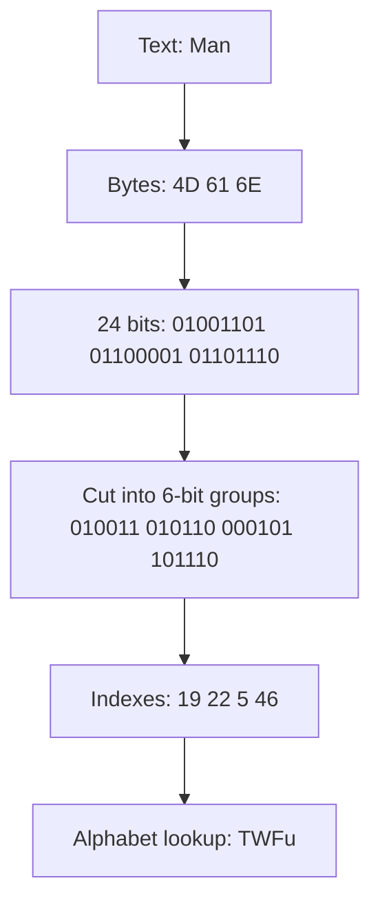
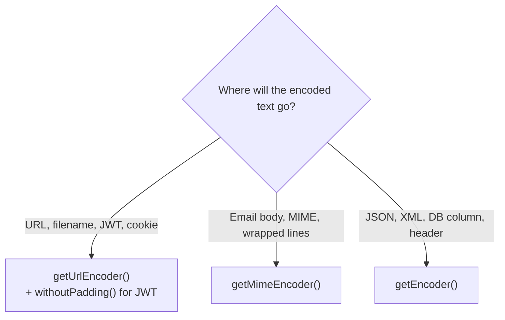

## In One Line
`java.util.Base64` (Java 8) turns **arbitrary bytes into plain ASCII text** using 64 safe characters, and back again, so binary data (images, keys, hashes, tokens) can travel through channels that only accept text — it is an **encoding, not encryption**.

## Mental Model
Think of **shipping furniture in standard boxes**. A courier (email, JSON, a URL, an HTTP header) only accepts parcels of one standard size and refuses odd shapes. So you take your furniture (raw bytes, any value 0–255), **disassemble** it into pieces that fit the standard boxes (6-bit chunks, each written as one of 64 safe characters), and ship. At the other end the receiver **reassembles** the pieces into exactly the same furniture.

- Disassembling costs space: the pieces take about **one third more room** than the assembled item (4 characters for every 3 bytes).
- If the last box is not full, you stuff it with **packing peanuts** — the `=` padding characters.
- Anyone who receives the boxes can reassemble the furniture. There is no lock — so it is **not** a security measure.
- Before disassembling a *text* message, you must first turn characters into bytes with a **charset**. If the receiver reassembles with a different charset, the furniture comes back with the wrong labels (mojibake).

## Concept
### Why Base64 exists
Many systems were built for **text**: email (SMTP was 7-bit ASCII), JSON and XML documents, URLs, HTTP headers, property files, database text columns. Raw binary bytes can contain values that these channels corrupt or forbid: control characters, `0x00`, line breaks, bytes above 127. Base64 represents any byte sequence using only `A–Z`, `a–z`, `0–9`, `+`, `/` (plus `=` for padding), which survive all of them.

Common uses you will meet:
| Where | What is Base64-encoded |
|---|---|
| HTTP Basic authentication | `Authorization: Basic base64(username:password)` |
| JWT (JSON Web Tokens) | header, payload and signature, **URL-safe, no padding** |
| Data URIs | `` |
| Email attachments | MIME encoding with 76-character lines |
| PEM files (certificates, keys) | Base64 body between `-----BEGIN CERTIFICATE-----` lines |
| JSON/XML APIs | file contents, hashes, signatures, encrypted blobs |

### How the algorithm works
Base64 takes the input **3 bytes (24 bits) at a time** and cuts those 24 bits into **4 groups of 6 bits**. A 6-bit number is 0–63, and each value is written as one character from the alphabet:

| Index | 0–25 | 26–51 | 52–61 | 62 | 63 |
|---|---|---|---|---|---|
| Basic alphabet | `A`–`Z` | `a`–`z` | `0`–`9` | `+` | `/` |
| URL-safe alphabet | `A`–`Z` | `a`–`z` | `0`–`9` | `-` | `_` |

Worked example, `"Man"`:
```text
Text      M          a          n
Bytes     0x4D       0x61       0x6E
Bits      01001101   01100001   01101110
Regroup   010011  010110  000101  101110
Index     19      22      5       46
Char      T       W       F       u        ->  "TWFu"
```

### Padding with `=`
When the input length is not a multiple of 3, the last group is incomplete:
| Bytes left over | Output characters | Padding |
|---|---|---|
| 0 | 4 per full group | none |
| 1 (8 bits) | 2 characters | `==` |
| 2 (16 bits) | 3 characters | `=` |

`"Hello, world!"` is 13 bytes = 4 full groups + 1 leftover byte, so it encodes to 16 + 4 = **20 characters ending in `==`**: `SGVsbG8sIHdvcmxkIQ==`.

**Size rule:** output length = `4 * ceil(n / 3)` characters — roughly **+33 %**. (Without padding: `ceil(4n / 3)`.) MIME adds a line separator every 76 characters on top of that.

### The three flavours in `java.util.Base64`
`Base64` is a final utility class with only static factory methods, which return nested `Base64.Encoder` and `Base64.Decoder` objects.

| Factory | Standard | Alphabet | Line breaks | Decoder is… |
|---|---|---|---|---|
| `getEncoder()` / `getDecoder()` | RFC 4648 "basic" | `+` `/` | never adds any | **strict** — any character outside the alphabet (including `\n`) is an error |
| `getUrlEncoder()` / `getUrlDecoder()` | RFC 4648 §5 "URL and filename safe" | `-` `_` | never | strict |
| `getMimeEncoder()` / `getMimeDecoder()` | RFC 2045 (MIME) | `+` `/` | `\r\n` after every 76 chars | **lenient** — ignores line separators and any other non-alphabet characters |
| `getMimeEncoder(lineLength, separator)` | MIME, custom lines | `+` `/` | your separator every `lineLength` chars (rounded down to a multiple of 4) | — |

Extra switch: `encoder.withoutPadding()` returns an encoder that omits the trailing `=`. Decoders **accept input with or without padding**.

### The Encoder and Decoder API
| Method | Input → output |
|---|---|
| `encodeToString(byte[])` | bytes → `String` (the most used) |
| `encode(byte[])` | bytes → encoded bytes (ASCII values) |
| `encode(byte[] src, byte[] dst)` | writes into `dst`, returns the number of bytes written |
| `encode(ByteBuffer)` | NIO buffer → new buffer |
| `wrap(OutputStream)` | returns an `OutputStream` that encodes while you write — for big data |
| `decode(String)` / `decode(byte[])` | encoded → original bytes; throws `IllegalArgumentException` on bad input |
| `decode(byte[] src, byte[] dst)`, `decode(ByteBuffer)` | same, buffer variants |
| `wrap(InputStream)` (on Decoder) | an `InputStream` that decodes while you read |

Encoder and Decoder instances are **immutable and thread-safe**; `getEncoder()` even returns the same shared instance every time, so there is no need to cache them yourself.

### Text needs a charset first
Base64 works on **bytes**, never on characters. To encode a `String` you first convert it to bytes (`getBytes(charset)`), and after decoding you convert bytes back with `new String(bytes, charset)`. Both sides must use the **same charset**, and it should be named explicitly — `StandardCharsets.UTF_8`. The no-argument `getBytes()` and `new String(bytes)` use the **JVM default charset**:
- up to **JDK 17** that came from the operating system (Windows-1252 on many Windows machines, the locale's charset on Linux/macOS — sometimes plain ASCII),
- from **JDK 18** (JEP 400) it is **UTF-8** everywhere unless overridden with `-Dfile.encoding`.

The Base64 *output* itself is pure ASCII, so it looks the same in every charset — only the text-to-bytes steps are risky.

### Base64 is not security
| | Base64 | Hashing (SHA-256) | Encryption (AES) |
|---|---|---|---|
| Reversible? | Yes, by anyone | No | Yes, only with the key |
| Needs a key? | No | No | Yes |
| Purpose | Transport binary as text | Fingerprint / integrity | Confidentiality |

An HTTP Basic auth header or a JWT payload can be decoded by anyone who sees it — that is why they must travel over HTTPS, and why a JWT is *signed*, not merely encoded.

### Before Java 8
| Option | Status |
|---|---|
| `sun.misc.BASE64Encoder` / `BASE64Decoder` | JDK-internal, unsupported, printed warnings; **removed in JDK 9** |
| `javax.xml.bind.DatatypeConverter.printBase64Binary` | part of JAXB; JAXB was **removed from the JDK in Java 11** (JEP 320) |
| Apache Commons Codec `Base64`, Guava `BaseEncoding.base64()` | third-party libraries, still fine |
| `java.util.Base64` | **standard since Java 8** (JEP 135), fast, no dependency — use this |

For comparison, **hex** encoding (`java.util.HexFormat`, Java 17) is simpler to read but doubles the size (+100 %), while Base64 adds only about a third.

## Diagram

Base64 sits in the middle and only ever sees bytes; the two outer arrows are where a charset is chosen, and they must match.


Three bytes in, four characters out — the reason Base64 output is always about a third larger.


Choose the flavour by destination, and decode with the matching decoder.

## Code
@example Java8Features/OptionalClass/Base64Example.java

**Padding in action** — 1, 2, 3 and 4 input bytes:
```java
for (String s : List.of("M", "Ma", "Man", "Many")) {
    String enc = Base64.getEncoder().encodeToString(s.getBytes(StandardCharsets.US_ASCII));
    System.out.println(s + " -> " + enc);
}
```
```output
M -> TQ==
Ma -> TWE=
Man -> TWFu
Many -> TWFueQ==
```

**The three flavours** — the bytes `FB FF FE` are chosen because they map to indexes 62 and 63, where the alphabets differ:
```java
byte[] data = {(byte) 0xFB, (byte) 0xFF, (byte) 0xFE};
System.out.println(Base64.getEncoder().encodeToString(data));     // basic
System.out.println(Base64.getUrlEncoder().encodeToString(data));  // URL-safe
String text = "Hello, world!";
System.out.println(Base64.getUrlEncoder().withoutPadding()
        .encodeToString(text.getBytes(StandardCharsets.UTF_8)));
System.out.println(Base64.getMimeEncoder(16, "\n".getBytes())      // 16 chars per line
        .encodeToString("Hello, world! Hello, MIME!".getBytes(StandardCharsets.UTF_8)));
```
```output
+//+
-__-
SGVsbG8sIHdvcmxkIQ
SGVsbG8sIHdvcmxk
ISBIZWxsbywgTUlN
RSE=
```

**Strict basic decoder vs lenient MIME decoder:**
```java
String wrapped = "SGVsbG8s\nIHdvcmxkIQ==";
System.out.println(new String(Base64.getMimeDecoder().decode(wrapped), StandardCharsets.UTF_8));
try {
    Base64.getDecoder().decode(wrapped);
} catch (IllegalArgumentException e) {
    System.out.println("Basic decoder: " + e.getMessage());
}
```
```output
Hello, world!
Basic decoder: Illegal base64 character a
```
`a` is the hexadecimal code of the offending character — `0x0A`, the newline.

**Why the charset matters** — the same text gives different Base64 depending on how it was turned into bytes:
```java
String s = "café";
byte[] utf8   = s.getBytes(StandardCharsets.UTF_8);      // é -> 2 bytes (C3 A9)
byte[] latin1 = s.getBytes(StandardCharsets.ISO_8859_1); // é -> 1 byte  (E9)
System.out.println(Base64.getEncoder().encodeToString(utf8));
System.out.println(Base64.getEncoder().encodeToString(latin1));

byte[] decoded = Base64.getDecoder().decode("Y2Fmw6k=");
System.out.println(new String(decoded, StandardCharsets.UTF_8));      // same charset: OK
System.out.println(new String(decoded, StandardCharsets.ISO_8859_1)); // wrong charset: mojibake
```
```output
Y2Fmw6k=
Y2Fm6Q==
café
café
```

The original's `getBytes()` with **no** charset silently depends on the JVM default. The same compiled class printing `Charset.defaultCharset()` and `Base64.getEncoder().encodeToString("café".getBytes())`, run normally on JDK 21:
```output
default charset = UTF-8
Y2Fmw6k=
```
and run with `java -Dfile.encoding=COMPAT` (the pre-JDK 18 rule: take the charset from the OS locale) on a Linux machine whose locale is plain `POSIX`:
```output
default charset = US-ASCII
Y2FmPw==
```
`Y2FmPw==` decodes to `caf?` — the `é` was destroyed before Base64 ever saw it.

**Encoding a large file as a stream** instead of loading it into one big `byte[]`:
```java
Path in = Files.writeString(Files.createTempFile("b64", ".txt"), "Hello, world!");
ByteArrayOutputStream sink = new ByteArrayOutputStream();
try (OutputStream b64 = Base64.getEncoder().wrap(sink)) {   // encodes while writing
    Files.copy(in, b64);                                    // streams, no big byte[]
}                                                           // close() writes the padding
System.out.println(sink.toString(StandardCharsets.US_ASCII));
```
```output
SGVsbG8sIHdvcmxkIQ==
```

## Walkthrough
- `package Java8Features.OptionalClass;` — the file sits in the *OptionalClass* folder of the course, although it has nothing to do with `Optional` (see Traps). `import java.util.Base64;` — Base64 lives in `java.util` since Java 8.
- `String originalInput = "Hello, world!";` — 13 ASCII characters, so 13 bytes in any common charset.
- `encodeBase64(originalInput)` — a small static helper so `main` reads like prose.
  - `Base64.Encoder encoder = Base64.getEncoder();` — gets the **basic** RFC 4648 encoder (`+` and `/`, padding on, no line breaks). `Base64.Encoder` is a static nested class; the factory returns a shared, thread-safe instance.
  - `input.getBytes()` — converts the text to bytes using the **default charset** (UTF-8 on JDK 18+). For this ASCII-only input every charset gives the same 13 bytes.
  - `encoder.encodeToString(...)` — encodes the bytes and returns the result as a `String`. 13 bytes = 4 full 3-byte groups + 1 leftover byte, so the result is 20 characters ending in `==`: **`SGVsbG8sIHdvcmxkIQ==`**. You can see the structure: `SGVs` = "Hel", `bG8s` = "lo,", `IHdv` = " wo", `cmxk` = "rld", `IQ==` = "!" plus padding.
- `System.out.println("Encoded string: " + encodedString);` — prints the first output line.
- `decodeBase64(encodedString)`:
  - `Base64.Decoder decoder = Base64.getDecoder();` — the matching **strict** basic decoder.
  - `byte[] decodedBytes = decoder.decode(encodedInput);` — reverses the process back to the original 13 bytes. On malformed input (illegal character, bad padding) it would throw `IllegalArgumentException`, which is unchecked, so the method does not declare it.
  - `return new String(decodedBytes);` — rebuilds a `String` using the default charset again.
- `System.out.println("Decoded string: " + decodedString);` — prints `Hello, world!`, proving the round trip is lossless.
- The `// Output:` comment in the source matches the recorded output exactly. The output is deterministic — Base64 has no randomness — so every run prints the same two lines.

## Traps
> [!ERRATA] `input.getBytes()` and `new String(decodedBytes)` use the **platform default charset** instead of naming one. The example only works reliably because `"Hello, world!"` is pure ASCII. With non-ASCII text on JDK 17 and older, the result depended on the operating system (and a mismatch between the encoding machine and the decoding machine corrupted text); from JDK 18 the default is UTF-8, but relying on a default is still fragile. Write `input.getBytes(StandardCharsets.UTF_8)` and `new String(decodedBytes, StandardCharsets.UTF_8)`.

> [!ERRATA] The class is in package `Java8Features.OptionalClass`, a leftover from where the file was copied. Base64 has nothing to do with `Optional`; a package such as `Java8Features.Base64` would describe it correctly.

- **Base64 is not encryption.** Never "protect" passwords, API keys or personal data with it. Anyone can decode it in one line.
- **The basic decoder rejects line breaks.** Base64 copied from an email, a PEM file or a wrapped log line contains `\n` or `\r\n`; `getDecoder()` throws `IllegalArgumentException: Illegal base64 character a`. Use `getMimeDecoder()` or strip whitespace first.
- **Mixing flavours fails.** A URL-safe string containing `-` or `_` fed to `getDecoder()` throws `Illegal base64 character 2d` (`0x2D` is `-`). Decode with the same flavour you encoded with.
- **`+` and `/` break URLs** (`+` can become a space, `/` looks like a path separator), and `=` has meaning in query strings. Use `getUrlEncoder()` for anything that goes into a URL or filename.
- **Close the stream from `encoder.wrap(...)`.** The final partial group and its padding are only written on `close()`; forgetting it truncates the output.
- **Encoded bytes are not the original bytes.** `encoder.encode(bytes)` returns the *ASCII codes* of the Base64 characters (e.g. `[83, 71, 107, 61]` for `"Hi"` → `SGk=`), not something you should ever decode as text in another charset or compare with the input.
- **Size grows by a third.** Putting large files in JSON as Base64 costs 33 % more bandwidth and memory (plus the `String` copy); for big binaries prefer multipart uploads or direct binary transfer.
- **`decode` throws an unchecked exception.** Validate or catch `IllegalArgumentException` when decoding user input.

## Tips & Tricks
- **"3 bytes in, 4 chars out."** Everything else follows: +33 % size, padding when the input is not a multiple of 3, output length always a multiple of 4.
- **Padding count trick:** `==` means the last group carried 1 byte, `=` means 2 bytes, no `=` means a full group.
- **Recognising Base64 in the wild:** only `A–Z a–z 0–9 + /`, length a multiple of 4, maybe ending in `=` or `==`. JWTs start with `eyJ` — that is what `{"` followed by a letter encodes to (`{"alg":"HS256"}` becomes `eyJhbGciOiJIUzI1NiJ9`).
- **Pick by destination:** URL/filename/JWT → `getUrlEncoder()` (`withoutPadding()` for JWT); email/MIME → `getMimeEncoder()`; everything else → `getEncoder()`.
- **Always name the charset:** `StandardCharsets.UTF_8` on both sides. It also avoids the checked `UnsupportedEncodingException` that the `String`-named overloads (`getBytes("UTF-8")`) declare.
- **Stream big data** with `encoder.wrap(OutputStream)` / `decoder.wrap(InputStream)` instead of reading whole files into memory.
- **No need to cache encoders** — `Base64.getEncoder()` already returns a shared thread-safe instance.

## Interview Q&A
### [Basic] What is Base64 and why do we need it?
Base64 is a binary-to-text encoding that represents any sequence of bytes using 64 printable ASCII characters (`A–Z`, `a–z`, `0–9`, `+`, `/`) plus `=` for padding. We need it because many channels are designed for text only — email, JSON, XML, URLs, HTTP headers — and raw bytes (control characters, zero bytes, values above 127) would be corrupted or rejected there. Typical uses: HTTP Basic auth headers, JWTs, data URIs for images, email attachments, PEM certificates, sending files or signatures inside JSON. Java provides it in `java.util.Base64` since Java 8.

**Follow-up:** *What is the overhead?* — About 33 %: every 3 bytes become 4 characters, so the output is `4 * ceil(n / 3)` characters (plus line separators for MIME).

### [Basic] Is Base64 a form of encryption?
No. Encoding changes representation; encryption provides confidentiality. Base64 uses no key and a public, fixed algorithm, so anyone can decode it instantly (`Base64.getDecoder().decode(s)`). It should never be used to hide passwords or secrets. For confidentiality use encryption (e.g. AES via `javax.crypto.Cipher`); for storing passwords use a slow salted hash (bcrypt, scrypt, Argon2, PBKDF2). Base64 is often used *together* with those, only to turn the resulting bytes into text.

**Follow-up:** *Then why is HTTP Basic auth considered acceptable?* — Only over HTTPS: TLS encrypts the whole request, and Base64 is just there to fit `user:password` safely into a header.

### [Basic] Which encoders does `java.util.Base64` provide, and how do they differ?
Three flavours, each with an encoder and a decoder:
1. **Basic** (`getEncoder`/`getDecoder`) — RFC 4648 alphabet with `+` and `/`, no line breaks; the decoder rejects any character outside the alphabet.
2. **URL and filename safe** (`getUrlEncoder`/`getUrlDecoder`) — replaces `+` with `-` and `/` with `_`, so the output can go into URLs and file names.
3. **MIME** (`getMimeEncoder`/`getMimeDecoder`) — RFC 2045, inserts `\r\n` after every 76 characters; the decoder ignores line separators and other non-alphabet characters. `getMimeEncoder(lineLength, separator)` customises the lines.

Any encoder can be switched to `withoutPadding()`.

**Follow-up:** *Which one does a JWT use?* — URL-safe **without padding** (`Base64.getUrlEncoder().withoutPadding()`), because tokens travel in URLs and headers and the `.` separates the three parts.

### [Intermediate] Explain how Base64 encoding works and why `=` appears at the end.
The encoder reads 3 bytes (24 bits) at a time and splits them into four 6-bit numbers (0–63); each number indexes the 64-character alphabet. For `"Man"` the bits `01001101 01100001 01101110` regroup to `010011 010110 000101 101110` = 19, 22, 5, 46 = `T W F u`. If the input length is not a multiple of 3, the last group is short: one leftover byte produces 2 characters plus `==`, two leftover bytes produce 3 characters plus `=`. Padding keeps the output length a multiple of 4 so decoders — and concatenated streams — know where groups end.
```java
Base64.getEncoder().encodeToString("M".getBytes());   // TQ==
Base64.getEncoder().encodeToString("Ma".getBytes());  // TWE=
```
**Follow-up:** *Can Java decode input without padding?* — Yes, the decoders accept missing padding (`decode("SGk")` gives the bytes of `"Hi"`); only a final group of a single character is invalid.

### [Intermediate] A colleague encodes a String on one server and decodes it on another, and accented characters come back garbled. Why?
Base64 itself is lossless — it round-trips bytes exactly. The damage happens in the String/byte conversions: `getBytes()` and `new String(bytes)` without a charset use the JVM's default charset. Before JDK 18 that came from the OS (e.g. Windows-1252 on Windows, UTF-8 or ASCII on Linux depending on locale), so two machines could use different charsets, and `é` encoded as UTF-8 (`C3 A9`) is read back as `é` in Latin-1. The fix is to name the charset on both sides:
```java
String enc = Base64.getEncoder().encodeToString(text.getBytes(StandardCharsets.UTF_8));
String dec = new String(Base64.getDecoder().decode(enc), StandardCharsets.UTF_8);
```
**Follow-up:** *What changed in JDK 18?* — JEP 400 made UTF-8 the default charset on all platforms; `-Dfile.encoding=COMPAT` restores the old OS-derived behaviour.

### [Intermediate] How was Base64 done before Java 8, and why should that code be migrated?
Common choices were `sun.misc.BASE64Encoder` (an internal, unsupported class, removed in JDK 9), `javax.xml.bind.DatatypeConverter.printBase64Binary` (part of JAXB, removed from the JDK in Java 11 by JEP 320), or third-party libraries such as Apache Commons Codec and Guava. Code using the first two no longer compiles or runs on modern JDKs without extra dependencies. `java.util.Base64` is standard, has no dependencies, is fast (modern JDKs even use CPU intrinsics for it) and supports all three RFC variants, so migrating is a one-line change per call site.

**Follow-up:** *Is there any output difference when migrating from `sun.misc.BASE64Encoder`?* — Yes, for inputs longer than 57 bytes: the old encoder broke its output into 76-character lines, while `getEncoder()` never inserts line breaks. Old data must therefore be decoded with `getMimeDecoder()` (the strict basic decoder would reject the newlines); `getMimeEncoder()` is the closest match if you must reproduce the old format.

### [Intermediate] What happens when you decode invalid Base64 in Java?
`decode` throws `IllegalArgumentException` (unchecked) with a message describing the problem, e.g. `Illegal base64 character a` for a newline passed to the basic decoder, `Illegal base64 character 2d` for a URL-safe `-`, `Input byte array has incorrect ending byte at 8` for data after the padding, or `Input byte[] should at least have 2 bytes for base64 bytes` for a single character. The basic and URL decoders are strict; the MIME decoder skips characters outside the alphabet. When decoding untrusted input, catch the exception and turn it into a validation error.

**Follow-up:** *Why does the message say "a" or "2d"?* — It prints the offending character's code in hexadecimal: `0x0A` is `\n`, `0x2D` is `-`.

### [Advanced] How would you Base64-encode a 2 GB file in Java?
Do not read it into a `byte[]` — that needs 2 GB for the input plus about 2.7 GB for the output, and the output is already larger than the biggest possible Java array or `String` (about 2^31 elements). Stream it: wrap the destination stream with the encoder and copy.
```java
try (InputStream in = Files.newInputStream(src);
     OutputStream out = Base64.getEncoder().wrap(Files.newOutputStream(dst))) {
    in.transferTo(out);                 // Java 9+
}
```
The wrapping stream encodes each 3-byte group as it arrives and writes the final partial group and padding when it is closed (try-with-resources guarantees that). Decoding works the same way with `Base64.getDecoder().wrap(InputStream)`.

**Follow-up:** *What goes wrong if you forget to close the wrapped stream?* — The last one or two leftover bytes and the `=` padding are never written, so the output is truncated and may not decode.

### [Advanced] Are `Base64.Encoder` and `Base64.Decoder` thread-safe? Should you cache them?
Yes, both are immutable and documented as safe for concurrent use by multiple threads. The static factories (`getEncoder()`, `getUrlDecoder()`…) already return shared singleton instances, so caching them in your own fields gives no benefit; `withoutPadding()` and `getMimeEncoder(len, sep)` build new immutable instances, which you may store in a `static final` field if you use them often. This contrasts with old APIs such as `SimpleDateFormat` or `MessageDigest`, which are stateful and must not be shared.

**Follow-up:** *Are the streams returned by `wrap(...)` thread-safe?* — No. They carry partial-group state, so each wrapped stream must be used by one thread at a time.

## Quiz
### What does `Base64.getEncoder().encodeToString("Ma".getBytes(StandardCharsets.US_ASCII))` return?
- [ ] `TWE`
- [x] `TWE=`
- [ ] `TWE==`
- [ ] `TWFu`
> Two input bytes are 16 bits, which fill 3 characters (18 bits, the last 2 bits zero-filled), and one `=` pads the group to 4 characters. `==` is for a single leftover byte (`"M"` → `TQ==`); `TWFu` is the encoding of `"Man"`.

### How long is the basic Base64 encoding of a 10-byte array?
- [ ] 13 characters
- [ ] 14 characters
- [x] 16 characters
- [ ] 20 characters
> Length = `4 * ceil(10 / 3)` = `4 * 4` = 16. Ten bytes are three full groups (12 characters) plus one leftover byte (2 characters + `==`). 14 is the unpadded length — `withoutPadding()` would give that.

### What does this print?
```java
String wrapped = "SGVsbG8s\nIHdvcmxkIQ==";
try {
    System.out.println(new String(Base64.getDecoder().decode(wrapped)));
} catch (IllegalArgumentException e) {
    System.out.println("Error: " + e.getMessage());
}
```
- [ ] Hello, world!
- [x] Error: Illegal base64 character a
- [ ] Hello,
- [ ] Error: Input byte array has incorrect ending byte
> The basic decoder is strict: the newline (`0x0A`, printed as `a`) is not in the alphabet, so it throws. `Hello, world!` would be printed by `getMimeDecoder()`, which skips line separators.

### What does this print?
```java
byte[] bytes = Base64.getDecoder().decode("SGk");
System.out.println(new String(bytes, StandardCharsets.UTF_8));
```
- [x] Hi
- [ ] Hi=
- [ ] IllegalArgumentException, because the padding is missing
- [ ] H
> Java's decoders accept input with or without padding. `SGk` is 3 characters = 18 bits, which hold 2 whole bytes: `H` and `i`. Padding is optional on decode; only a lone final character would be invalid.

### You are building a JWT. Which encoder produces a correct segment?
- [ ] `Base64.getEncoder()`
- [ ] `Base64.getMimeEncoder()`
- [x] `Base64.getUrlEncoder().withoutPadding()`
- [ ] `Base64.getUrlEncoder()`
> The JWT spec uses base64url (the `-`/`_` alphabet) and strips the `=` padding. The basic encoder can emit `+` and `/`, which are unsafe in URLs; MIME adds line breaks; the URL encoder alone would still append `=`.

### Spot the bug
```java
// Server A (JDK 11, Windows, default charset windows-1252)
String token = Base64.getEncoder().encodeToString("Grüße".getBytes());
// Server B (JDK 21, Linux)
String text = new String(Base64.getDecoder().decode(token));
```
- [ ] The basic encoder cannot encode non-ASCII characters
- [x] Both sides use the default charset, and the defaults differ (windows-1252 vs UTF-8), so the umlauts are corrupted
- [ ] `decode` must be given a `byte[]`, not a `String`
- [ ] Base64 loses the high bit of each byte
> Base64 round-trips bytes perfectly — the bytes are the problem. Server A turns `ü` and `ß` into one windows-1252 byte each; Server B reads those bytes as UTF-8, where they are invalid, and gets replacement characters. Use `StandardCharsets.UTF_8` on both sides.

### Which statement about `java.util.Base64` is true?
- [ ] `getEncoder()` creates a new encoder on every call, so it should be cached
- [ ] The MIME decoder is strict and rejects `\r\n`
- [x] Encoder and Decoder instances are immutable and thread-safe
- [ ] Base64 output uses the platform charset, so it differs between machines
> The encoders/decoders hold no mutable state and the factories return shared instances. The MIME decoder is the lenient one. The Base64 output is pure ASCII and identical everywhere — only your own `getBytes()`/`new String()` calls depend on a charset.

## Takeaways
- Base64 turns any bytes into ASCII text using 64 characters: 3 bytes become 4 characters, so output is about 33 % larger and padded with `=` to a multiple of 4.
- `java.util.Base64` (Java 8) offers basic (`+/`), URL-safe (`-_`) and MIME (76-char lines) encoders and decoders; `withoutPadding()` drops the `=`.
- Basic and URL decoders are strict (a newline throws `IllegalArgumentException`); the MIME decoder skips non-alphabet characters; all decoders accept missing padding.
- Base64 is encoding, not encryption — anyone can decode it.
- Base64 works on bytes; always convert text with an explicit charset (`StandardCharsets.UTF_8`) on both sides — the default charset was OS-dependent before JDK 18.
- Use `encoder.wrap(OutputStream)` / `decoder.wrap(InputStream)` to stream large data, and close the stream so the padding is written.
- Encoders/decoders are immutable, thread-safe shared instances; old `sun.misc.BASE64Encoder` (gone in 9) and JAXB `DatatypeConverter` (gone in 11) should be migrated to `java.util.Base64`.
