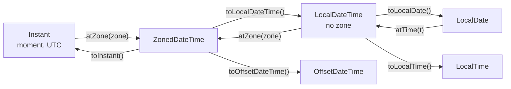
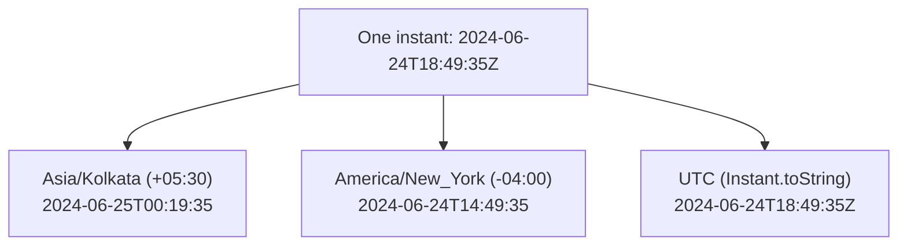
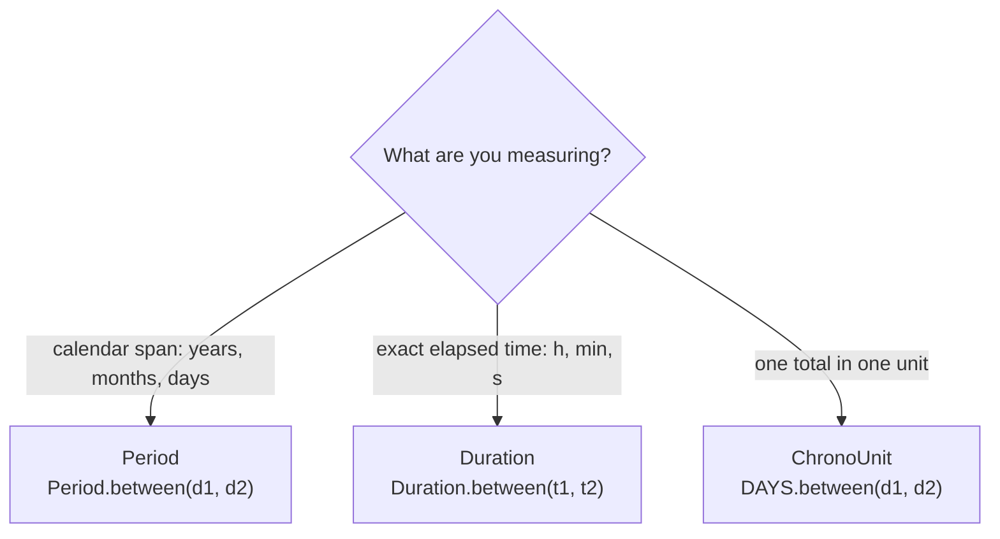

## In One Line
`java.time` (Java 8, JSR-310) replaces the broken `Date`/`Calendar`/`SimpleDateFormat` trio with **immutable, thread-safe** types that each model exactly one idea — a date (`LocalDate`), a time (`LocalTime`), a date-time without zone (`LocalDateTime`), a date-time in a zone (`ZonedDateTime`), a moment on the global timeline (`Instant`) — plus `Period` and `Duration` for amounts of time and `DateTimeFormatter` for text.

## Mental Model
Picture an **airport departures board**.

- The big **atomic clock in the control tower** ticks the same for the whole world: that is an **`Instant`** — a single point on the timeline, counted from 1970-01-01T00:00Z. It has no idea what "Tuesday" or "9 AM" means.
- Each **city clock** on the wall (London, New York, Mumbai) shows that same instant as local wall-clock time: that is a **`ZonedDateTime`** — instant + time-zone rules (including daylight saving).
- A **printed ticket** that says "Departs 25 June, 09:30" with no city on it is a **`LocalDateTime`**: human-readable, but you cannot know *when* it really happens until you add the zone.
- The **date stamp** in your passport is a **`LocalDate`**; the **opening hours** sign "Lounge opens 06:00" is a **`LocalTime`**.
- "Flight lasts 8 h 15 min" is a **`Duration`** (machine time: seconds and nanos). "Visa valid for 4 years, 5 months" is a **`Period`** (calendar time: years, months, days).
- The **board operator** who turns times into text and back is the **`DateTimeFormatter`**.

The key insight: *local* types are what a human reads off a clock; *`Instant`* is what the computer should store. You move between them only by naming a zone.

## Concept
### Why a new API — what was wrong with `Date` and `Calendar`
| Problem in `java.util.Date` / `Calendar` / `SimpleDateFormat` | How `java.time` fixes it |
|---|---|
| **Mutable** — `date.setTime(...)` changes an object other code still holds | Every class is **immutable**; `plusDays` returns a new object |
| `SimpleDateFormat` is **not thread-safe** (shared static formatters corrupt dates under load) | `DateTimeFormatter` is immutable and **thread-safe** — share it as a constant |
| Months are **0-based** (`5` = June), years are offset by 1900 (`new Date(124, 5, 25)` = 2024-06-25) | Months are 1–12 (and a `Month` enum), years are real years |
| `Date` is really an instant, yet `toString()` prints it in the JVM's default zone, so people think it holds a zone | Separate types: `Instant` (no zone), `LocalDateTime` (no zone), `ZonedDateTime` (zone) |
| No type for "a date without time" or "a time without date" | `LocalDate`, `LocalTime`, `YearMonth`, `MonthDay`, `Year` |
| `java.sql.Date` extends `java.util.Date` but forbids time fields — a broken inheritance | JDBC 4.2 maps `LocalDate`, `LocalDateTime`, `OffsetDateTime` directly |
| Weak arithmetic (`Calendar.add` with int constants) | Fluent `plusMonths`, `minus`, `with(TemporalAdjusters...)`, `Period`, `Duration`, `ChronoUnit` |

`java.time` was designed by Stephen Colebourne (author of the popular **Joda-Time** library) and Oracle as **JSR-310**, and shipped in Java 8. Joda-Time itself now tells users to migrate to `java.time`.

### The core classes
| Class | Holds | Example `toString()` | Use for |
|---|---|---|---|
| `LocalDate` | year-month-day | `2024-06-25` | birthdays, due dates, holidays |
| `LocalTime` | hour:minute:second.nanos | `17:45` | opening hours, alarms |
| `LocalDateTime` | date + time, **no zone** | `2024-06-25T00:19:35` | a meeting "at 10:00" before you know the zone; UI input |
| `ZonedDateTime` | date-time + `ZoneId` (region rules, DST) | `2024-06-24T14:49:35-04:00[America/New_York]` | scheduling in a real place; DST-aware arithmetic |
| `OffsetDateTime` | date-time + fixed `ZoneOffset` | `2024-06-25T10:00+05:30` | APIs, databases, XML/JSON timestamps |
| `Instant` | nanoseconds since 1970-01-01T00:00Z | `2024-06-24T18:49:35Z` | logs, events, "created at" columns, machine time |
| `Duration` | seconds + nanos | `PT8H15M` | elapsed time, timeouts |
| `Period` | years, months, days | `P4Y5M24D` | ages, subscriptions, calendar spans |
| `ZoneId` / `ZoneOffset` | region like `Asia/Kolkata` / fixed offset like `+05:30` | | converting between local and instant |
| `DateTimeFormatter` | a pattern or ISO format | | text ↔ date-time |
| `Clock` | a source of "now" | | testable code (inject a fixed clock) |
| `Year`, `YearMonth`, `MonthDay`, `DayOfWeek`, `Month` | partial values / enums | `--12-25` for `MonthDay` | credit-card expiry, recurring dates |
| `ChronoUnit`, `TemporalAdjusters` | units and rules | | `DAYS.between(a, b)`, `lastDayOfMonth()` |

All of them are **immutable, thread-safe and value-based** (compare with `equals`/`isBefore`/`isAfter`, not `==`).

### Creating values — the naming conventions
The API uses the same verbs everywhere; learn them once:
| Prefix | Meaning | Examples |
|---|---|---|
| `now()` | current value from the system clock (and default zone) | `LocalDate.now()`, `Instant.now()`, `LocalDateTime.now(clock)` |
| `of(...)` | build from parts | `LocalDate.of(2024, Month.JUNE, 25)`, `LocalTime.of(9, 30)` |
| `parse(...)` | from text | `LocalDate.parse("2024-06-25")`, `LocalDate.parse(s, formatter)` |
| `from(...)` | convert from another temporal | `LocalDate.from(zonedDateTime)` |
| `plusX / minusX` | arithmetic, returns a new object | `date.plusMonths(1)` |
| `withX` | copy with one field changed | `date.withDayOfMonth(1)`, `date.with(TemporalAdjusters.lastDayOfMonth())` |
| `getX` | read a field | `getYear()`, `getMonth()`, `getDayOfWeek()` |
| `toX` | convert to a narrower type | `toLocalDate()`, `toInstant()`, `toEpochMilli()` |
| `atX` | combine into a richer type | `date.atTime(9, 30)`, `dateTime.atZone(zone)`, `instant.atZone(zone)` |
| `isX` | query | `isBefore`, `isAfter`, `isLeapYear`, `isEqual` |

### `Period` vs `Duration`
| | `Period` | `Duration` |
|---|---|---|
| Measures | **calendar** amount: years, months, days | **exact** amount: seconds + nanoseconds |
| Works with | `LocalDate` (dates) | `LocalTime`, `LocalDateTime`, `Instant`, `ZonedDateTime` |
| Create | `Period.between(d1, d2)`, `Period.ofMonths(3)` | `Duration.between(t1, t2)`, `Duration.ofMinutes(90)` |
| `toString()` | `P4Y5M24D` | `PT8H15M` |
| Read parts | `getYears()`, `getMonths()`, `getDays()` | `toHours()`, `toMinutes()` (totals); `toHoursPart()`, `toMinutesPart()`, `toSecondsPart()` (Java 9+) |
| Over a DST change | "1 day" keeps the wall-clock time | "24 hours" is exactly 24 elapsed hours |

For a **single total** in one unit use `ChronoUnit`: `ChronoUnit.DAYS.between(start, end)`, `ChronoUnit.MINUTES.between(t1, t2)` — or `start.until(end, ChronoUnit.WEEKS)`.

### Time zones: `ZoneId` vs `ZoneOffset`
- `ZoneOffset` is a fixed difference from UTC, e.g. `+05:30`. It never changes.
- `ZoneId` is a **region** from the IANA time-zone database, e.g. `America/New_York`, whose offset changes with daylight saving and with law changes (−05:00 in winter, −04:00 in summer).
- `ZonedDateTime` uses a `ZoneId`, so its arithmetic follows DST rules. Around the spring-forward **gap** (02:00–03:00 does not exist) a local time in the gap is pushed forward; in the autumn **overlap** (01:00–02:00 happens twice) the earlier offset is chosen by default (`withLaterOffsetAtOverlap()` picks the other).
- Prefer region IDs (`Europe/Paris`) over three-letter abbreviations (`EST`, `IST` — ambiguous: IST is India, Ireland or Israel).

### Formatting and parsing
`DateTimeFormatter` offers predefined ISO formatters (`ISO_LOCAL_DATE`, `ISO_DATE_TIME`, `ISO_INSTANT`…), localized styles (`ofLocalizedDate(FormatStyle.LONG)`), and patterns (`ofPattern("dd-MM-yyyy")`). Every `toString()` is ISO-8601, and every `parse(String)` without a formatter expects ISO-8601.

| Letter | Meaning | Trap |
|---|---|---|
| `y` | year-of-era | fine for formatting; with `ResolverStyle.STRICT` it also needs an era (`G`), so use `u` |
| `u` | proleptic year | the safe choice for strict parsing |
| `Y` | **week-based year** | `YYYY` prints **2025** for 2024-12-30 — classic end-of-year bug |
| `M` / `MM` / `MMM` / `MMMM` | month: `6` / `06` / `Jun` / `June` | `MM` = month, `mm` = minute |
| `d` | day-of-month | `D` is day-of-**year** |
| `H` | hour 0–23 | `h` is 1–12 and needs `a` (AM/PM) |
| `m`, `s`, `S` | minute, second, fraction | |
| `E` / `EEEE` | `Tue` / `Tuesday` | text depends on the formatter's `Locale` |
| `a` | AM/PM | locale-dependent |
| `VV`, `z`, `Z`, `X`, `x` | zone ID, zone name, offset forms | |

Parsing uses a **resolver style**: `ofPattern` formatters are `SMART` by default — they silently turn `31-04-2024` into **2024-04-30**. The predefined `ISO_*` formatters are `STRICT` (they reject `2024-02-30`). Invalid text throws the unchecked `DateTimeParseException`; invalid fields in `of(...)` throw `DateTimeException`.

### Precision of `now()`
- **Java 8**: the system clock had millisecond precision, so `now()` values ended in `.123`.
- **Java 9+**: the clock uses the most precise OS source — about 100 ns steps on Windows (the original comment shows `00:19:35.462724300`, 7 real digits), microseconds or nanoseconds on Linux/macOS (the recorded run shows `07:14:32.113619833`).
- `toString()` prints only as many fraction digits as needed, in groups of 3 (`09:30`, `09:30:05`, `09:30:00.000001`).

### Bridging to legacy code
```java
Instant i          = legacyDate.toInstant();              // Date -> Instant
Date d             = Date.from(instant);                  // Instant -> Date
ZonedDateTime z    = gregorianCalendar.toZonedDateTime(); // Calendar -> java.time
LocalDate ld       = sqlDate.toLocalDate();               // java.sql.Date -> LocalDate
java.sql.Date sd   = java.sql.Date.valueOf(localDate);
Timestamp ts       = Timestamp.from(instant);
ZoneId zone        = timeZone.toZoneId();                 // TimeZone -> ZoneId
```
With a JDBC 4.2 driver you can skip `java.sql.Date/Timestamp` entirely: `rs.getObject("created", OffsetDateTime.class)`, `ps.setObject(1, localDate)`.

### Best practices
- **Store and transmit `Instant`/UTC** (or `OffsetDateTime`); convert to a `ZonedDateTime` only for display in the user's zone.
- **`LocalDateTime` is not a moment.** "2024-11-03T01:30" happens twice in New York; never use it for timestamps of events.
- **Take one snapshot of "now"** per operation and derive the rest from it.
- **Inject a `Clock`** (`LocalDate.now(clock)`) so tests can use `Clock.fixed(...)`.
- **Keep formatters as `static final` constants**; they are thread-safe.
- **Always use `Locale`-aware formatters for user-facing text** (`ofPattern("EEEE", Locale.ENGLISH)`), otherwise day and month names depend on the server's locale.

### Java version notes
| Version | Addition |
|---|---|
| 8 | the whole `java.time` package (JSR-310) |
| 9 | `Duration.toMinutesPart()`/`toHoursPart()`/`toDaysPart()`…, `Duration.dividedBy(Duration)`, `LocalDate.datesUntil`, `LocalDate.ofInstant` (on `LocalTime` too), `LocalDate.toEpochSecond`; more precise `Clock` |
| 16/17 | `DateTimeFormatter` pattern letter `B` (day periods such as "in the morning") and `InstantSource` interface (17) |

## Diagram

Only the path through a zone connects the machine world (`Instant`) with the human world (`Local*`); every arrow returns a new immutable object.


The author's `// Output:` comment shows three renderings of the same moment: their machine ran in India, where it was already 25 June while UTC and New York were still on 24 June.


`Period` for humans' calendar, `Duration` for machine time, `ChronoUnit` when you need a single number.

## Code
@example Java8Features/DateTime/DateTimeAPIExample.java

**Reproducing the author's output deterministically** — one snapshot from a fixed `Clock` set to the instant in the source comment, in the author's zone (India):
```java
Clock clock = Clock.fixed(Instant.parse("2024-06-24T18:49:35Z"), ZoneId.of("Asia/Kolkata"));
LocalDateTime now = LocalDateTime.now(clock);     // ONE snapshot, reused below
System.out.println(now.toLocalDate());
System.out.println(now.toLocalTime());
System.out.println(now);
System.out.println(ZonedDateTime.now(clock.withZone(ZoneId.of("America/New_York"))));
System.out.println(Instant.now(clock));
```
```output
2024-06-25
00:19:35
2024-06-25T00:19:35
2024-06-24T14:49:35-04:00[America/New_York]
2024-06-24T18:49:35Z
```

**Month arithmetic clamps, and the objects are immutable:**
```java
LocalDate jan31 = LocalDate.of(2024, 1, 31);
System.out.println(jan31.plusMonths(1));               // clamped to the last valid day
System.out.println(jan31.plusMonths(1).plusMonths(1)); // not March 31!
System.out.println(jan31.plusMonths(2));
jan31.plusDays(1);                                     // result thrown away
System.out.println(jan31);                             // unchanged: immutable
```
```output
2024-02-29
2024-03-29
2024-03-31
2024-01-31
```

**`Period.getDays()` is only the days *part*:**
```java
LocalDate start = LocalDate.of(2020, 1, 1), end = LocalDate.of(2024, 6, 25);
Period p = Period.between(start, end);
System.out.println(p);                                    // ISO-8601 period
System.out.println(p.getDays());                          // only the "days" part
System.out.println(ChronoUnit.DAYS.between(start, end));  // total days
System.out.println(p.toTotalMonths());
```
```output
P4Y5M24D
24
1637
53
```

**Daylight saving: "one day" is not always 24 hours** (US clocks jumped from 02:00 to 03:00 on 2024-03-10):
```java
ZoneId ny = ZoneId.of("America/New_York");
ZonedDateTime noon = ZonedDateTime.of(2024, 3, 9, 12, 0, 0, 0, ny); // DST starts next night
System.out.println(noon.plusDays(1));    // same wall-clock time next day
System.out.println(noon.plusHours(24));  // exactly 24 elapsed hours
System.out.println(ZonedDateTime.of(LocalDateTime.of(2024, 3, 10, 2, 30), ny)); // 02:30 never happened
```
```output
2024-03-10T12:00-04:00[America/New_York]
2024-03-10T13:00-04:00[America/New_York]
2024-03-10T03:30-04:00[America/New_York]
```

**Pattern-letter traps:**
```java
LocalDateTime dt = LocalDateTime.of(2024, 12, 30, 14, 5);
System.out.println(dt.format(DateTimeFormatter.ofPattern("yyyy-MM-dd HH:mm")));
System.out.println(dt.format(DateTimeFormatter.ofPattern("YYYY-MM-dd HH:mm")));  // week-based year
System.out.println(dt.format(DateTimeFormatter.ofPattern("yyyy-mm-dd hh:MM")));  // mm/MM swapped
System.out.println(LocalDate.parse("31-04-2024", DateTimeFormatter.ofPattern("dd-MM-yyyy"))); // no error!
```
```output
2024-12-30 14:05
2025-12-30 14:05
2024-05-30 02:12
2024-04-30
```
Formatting a `LocalTime` with `MM` does not even print a wrong value — it throws `UnsupportedTemporalTypeException: Unsupported field: MonthOfYear`, because a time has no month.

**`Duration` parts — the Java 8 way and the Java 9+ way, plus the overnight trap:**
```java
Duration d = Duration.between(LocalTime.of(9, 30), LocalTime.of(17, 45));
System.out.println(d);
System.out.println(d.toHours() + " h " + (d.toMinutes() % 60) + " min");  // Java 8 style
System.out.println(d.toHours() + " h " + d.toMinutesPart() + " min");     // Java 9+
System.out.println(Duration.between(LocalTime.of(22, 0), LocalTime.of(6, 0)));
```
```output
PT8H15M
8 h 15 min
8 h 15 min
PT-16H
```
A `LocalTime` has no date, so a night shift from 22:00 to 06:00 comes out as **minus 16 hours**; use `LocalDateTime` values (or add 24 h when the result is negative).

## Walkthrough
The output of this example **varies on every run**: it prints the current date and time, so the recorded output shows the moment the course outputs were generated (2026-09-24, on a machine set to UTC), while the author's `// Output:` comment shows their own run (2024-06-25, on a Windows machine in India, UTC+05:30). Only the parsed date, the period and the duration lines are fixed.

- `import java.time.*;` and `import java.time.format.DateTimeFormatter;` — the whole API lives in `java.time` and its sub-packages (`format`, `temporal`, `zone`, `chrono`).
- `LocalDate currentDate = LocalDate.now();` — reads the system clock and converts it to a date **in the JVM's default time zone**. Prints ISO format `2026-09-24`.
- `LocalTime.now()` — the current wall-clock time, e.g. `07:14:32.113619833`. The number of fraction digits depends on the OS clock precision (see Concept); Java 8 would show only milliseconds.
- `LocalDateTime.now()` — date and time together, printed with a `T` separator: `2026-09-24T07:14:32.113872989`. Notice in the recorded output that its nanoseconds differ from the `LocalTime` line: each `now()` reads the clock again.
- `DateTimeFormatter.ofPattern("dd-MM-yyyy HH:mm:ss")` — a custom pattern: day, month (`MM`, not minutes), year, 24-hour clock (`HH`), minutes (`mm`), seconds. `currentDateTime.format(formatter)` produces `24-09-2026 07:14:32` — the fraction is dropped because the pattern has no `S`.
- `LocalDate.parse("25-06-2024", DateTimeFormatter.ofPattern("dd-MM-yyyy"))` — parses text with the same kind of pattern; the resulting `LocalDate` prints in ISO form `2024-06-25`. Without the formatter, `parse` would expect `2024-06-25` and throw `DateTimeParseException`.
- `ZonedDateTime.now(ZoneId.of("America/New_York"))` — the current moment expressed in New York's zone rules. The output ends with `-04:00[America/New_York]`: offset −4 h because the run happened during US daylight saving time (in winter it would be `-05:00`).
- `LocalDate.of(2020, Month.JANUARY, 1)` and `LocalDate.of(2024, Month.JUNE, 25)` — `Month` is an enum, so there is no 0-based confusion; `LocalDate.of(2020, 1, 1)` works too.
- `Period.between(startDate, endDate)` — the calendar difference `P4Y5M24D`: 2020-01-01 + 4 years = 2024-01-01, + 5 months = 2024-06-01, + 24 days = 2024-06-25. `getYears()`, `getMonths()`, `getDays()` return **those parts**, not totals.
- `LocalTime.of(9, 30)` and `LocalTime.of(17, 45)` — times print as `09:30` and `17:45` (seconds are omitted when zero).
- `Duration.between(startTime, endTime)` — `PT8H15M`. `toHours()` returns the total whole hours (8); `toMinutesPart()` returns the minutes left after removing whole hours (15). (`toMinutes()` would give 495.)
- `Instant.now()` — the current moment on the UTC timeline; `toString()` renders it in ISO-8601 with a trailing `Z` (Zulu = UTC). An `Instant` has no date or time fields of its own — the comment "date and time in UTC" describes how it *prints*.
- The comment block at the end is the author's run. Compare it with the diagram above: their `Current date` (25 June) is later than their UTC instant (24 June, 18:49Z) because India is 5 h 30 min ahead.

## Traps
> [!ERRATA] `duration.toMinutesPart()` does not exist in Java 8 — it was added in **Java 9** — so this "Java 8 feature" example does not compile on Java 8. The Java 8 equivalent is `duration.toMinutes() % 60`.

> [!ERRATA] Calling `now()` three times (`LocalDate.now()`, `LocalTime.now()`, `LocalDateTime.now()`) reads the clock three times, so the values are not one consistent moment — the recorded output already shows different nanoseconds, and a run just before midnight could print one day's date and the next day's date-time. It also silently depends on the JVM's default time zone. Take one snapshot and derive the parts: `LocalDateTime now = LocalDateTime.now(clock); now.toLocalDate(); now.toLocalTime();`, with an injected `Clock` or explicit `ZoneId`.

- **Ignoring the result of arithmetic.** `date.plusDays(1);` on its own line does nothing — the objects are immutable. Write `date = date.plusDays(1);`.
- **`Period.getDays()` is not the total number of days.** For 2020-01-01 → 2024-06-25 it returns 24; the total is `ChronoUnit.DAYS.between(start, end)` = 1637.
- **Month-end clamping:** `2024-01-31 + 1 month = 2024-02-29`, and `+1 month` again gives `2024-03-29`, not `03-31`. Add months to the original date (`plusMonths(2)`) when stepping through month-ends.
- **`YYYY` vs `yyyy`, `MM` vs `mm`, `HH` vs `hh`, `DD` vs `dd`.** `YYYY` is the week-based year (wrong in the last days of December), `mm` is minutes, `hh` needs an `a` marker, `D` is day-of-year.
- **SMART parsing silently fixes invalid dates** (`31-04-2024` → 2024-04-30). Use `.withResolverStyle(ResolverStyle.STRICT)` together with `uuuu` for validation.
- **`LocalDateTime` is not a timestamp.** It has no zone, so it cannot identify a moment; around DST changes some local times occur twice or never.
- **`Duration.between` on `LocalTime` across midnight is negative** (`22:00 → 06:00` is `PT-16H`).
- **`Duration.between(LocalDate, LocalDate)` throws** `UnsupportedTemporalTypeException` (a date has no seconds); use `Period` or `ChronoUnit.DAYS`.
- **Three-letter zone IDs are ambiguous** (IST = India, Ireland or Israel). On JDK 21 `ZoneId.of("IST")`, `ZoneId.of("EST")` and `ZoneId.of("PST")` all throw `ZoneRulesException: Unknown time-zone ID`; they resolve only through the explicit alias map, `ZoneId.of("PST", ZoneId.SHORT_IDS)` → `America/Los_Angeles`. Use region IDs like `Asia/Kolkata`.
- **Formatting with day or month names without a `Locale`** gives server-dependent text; pass `Locale.ENGLISH` (or the user's locale) explicitly.

> [!WARNING] Never share a `SimpleDateFormat` between threads (for example as a `static` field in a web app): it keeps parse state in fields and produces wrong dates or exceptions under concurrency. `DateTimeFormatter` is the thread-safe replacement.

## Tips & Tricks
- **"Local = no zone, Zoned = zone, Instant = UTC moment."** If you cannot say where on Earth the time applies, it is `Local*`.
- **"Period is People time, Duration is Device time."** Years/months/days vs hours/minutes/seconds.
- **Verbs to remember:** `now`, `of`, `parse`, `plus`/`minus`, `with`, `get`, `to`, `at`, `is`. Guess a method name from the verb and you are usually right.
- **Store `Instant`, show `ZonedDateTime`.** Convert at the edges: `instant.atZone(userZone).format(fmt)`.
- **Pattern cheat line:** `uuuu-MM-dd HH:mm:ss` — lowercase for small units (`d` day, `m` minute, `s` second), uppercase `M` for month and `H` for 24-hour.
- **Testing trick:** give classes a `Clock` field; production passes `Clock.systemDefaultZone()`, tests pass `Clock.fixed(Instant.parse("2024-06-24T18:49:35Z"), zone)`.
- **`TemporalAdjusters` for business rules:** `date.with(TemporalAdjusters.lastDayOfMonth())`, `date.with(TemporalAdjusters.next(DayOfWeek.FRIDAY))`, `firstInMonth(DayOfWeek.MONDAY)`.
- **Age in years:** `Period.between(birthDate, today).getYears()` — correct around birthdays and leap years, unlike dividing days by 365.

## Interview Q&A
### [Basic] Why was the `java.time` API introduced in Java 8? What was wrong with `Date` and `Calendar`?
The old classes had several design flaws: they were **mutable** (a `Date` passed to another method could be changed behind your back), `SimpleDateFormat` was **not thread-safe**, months were **0-based** and `Date` years were offset by 1900, `Date` represented an instant but printed itself in the default time zone, there were no types for a date without time or a time without date, and arithmetic via `Calendar.add` was clumsy. `java.time` (JSR-310, based on Joda-Time) provides **immutable, thread-safe** classes that each model one concept — `LocalDate`, `LocalTime`, `LocalDateTime`, `ZonedDateTime`, `OffsetDateTime`, `Instant`, `Duration`, `Period` — a fluent API (`plusDays`, `with`, `isBefore`), and a thread-safe `DateTimeFormatter`.

**Follow-up:** *Is `java.util.Date` deprecated?* — The class itself is not, but most of its constructors and getters (`getYear()`, `new Date(int, int, int)`) have been deprecated since JDK 1.1; new code should use `java.time` and convert only at legacy boundaries with `Date.from(instant)` / `date.toInstant()`.

### [Basic] What is the difference between `LocalDateTime`, `ZonedDateTime`, `OffsetDateTime` and `Instant`?
- `LocalDateTime` — date and time **without any zone**; a description like "25 June 09:30", not a moment.
- `ZonedDateTime` — date-time plus a **region `ZoneId`** (`Europe/London`), so it knows DST rules; it identifies a precise moment and does DST-aware arithmetic.
- `OffsetDateTime` — date-time plus a **fixed offset** (`+05:30`); a precise moment, but no DST rules. Ideal for databases and APIs.
- `Instant` — a point on the UTC timeline (seconds + nanos since 1970-01-01T00:00Z), the machine view of time.

Store `Instant` or `OffsetDateTime`; display `ZonedDateTime` in the user's zone; use `LocalDateTime` only when the zone is genuinely unknown or irrelevant.

**Follow-up:** *How do you convert a `LocalDateTime` to an `Instant`?* — You must supply a zone or offset: `ldt.atZone(ZoneId.of("Asia/Kolkata")).toInstant()` or `ldt.toInstant(ZoneOffset.UTC)`.

### [Basic] What is the difference between `Period` and `Duration`?
`Period` is a date-based amount in **years, months and days** (`P4Y5M24D`), used with `LocalDate`; its length in real time depends on which months and years it covers. `Duration` is a time-based amount in **seconds and nanoseconds** (`PT8H15M`), used with times and instants; it is an exact amount of elapsed time. Across a DST change, `zdt.plus(Period.ofDays(1))` keeps the same wall-clock time while `zdt.plus(Duration.ofHours(24))` adds exactly 24 hours — the results differ by an hour.

**Follow-up:** *How do you get the total number of days between two dates?* — `ChronoUnit.DAYS.between(start, end)`; `Period.between(start, end).getDays()` returns only the days component.

### [Intermediate] Is `DateTimeFormatter` thread-safe? Why was `SimpleDateFormat` a problem?
`DateTimeFormatter` is immutable and thread-safe, so the idiomatic usage is a `private static final DateTimeFormatter FMT = DateTimeFormatter.ofPattern("dd-MM-uuuu");` shared by all threads. `SimpleDateFormat` keeps an internal `Calendar` field that `format`/`parse` modify during each call; two threads using one shared instance overwrite each other's state and produce wrong dates or `NumberFormatException`/`ArrayIndexOutOfBoundsException`. The old workarounds were creating a new instance per call, synchronizing, or `ThreadLocal<SimpleDateFormat>`.

**Follow-up:** *Are the `java.time` value classes thread-safe too?* — Yes, all of them are immutable, so they can be shared freely without synchronization.

### [Intermediate] What pattern-letter mistakes do you know in date formatting?
- `YYYY` is the **week-based year**; for 2024-12-30 it prints 2025. Use `yyyy` or `uuuu`.
- `MM` is month, `mm` is minute — `HH:MM` prints the month where minutes should be.
- `HH` is 0–23; `hh` is 1–12 and needs `a` for AM/PM.
- `DD` is day-of-year; `dd` is day-of-month.
- With `ResolverStyle.STRICT`, `yyyy` (year-of-era) fails without an era — use `uuuu`.
- Text fields (`MMM`, `EEEE`, `a`) depend on the formatter's `Locale`.

**Follow-up:** *Why does `LocalDate.parse("31-04-2024", ofPattern("dd-MM-yyyy"))` not fail?* — `ofPattern` formatters use the `SMART` resolver, which clamps day 31 of a 30-day month to the last valid day (2024-04-30). `STRICT` with `uuuu` rejects it.

### [Intermediate] How do you convert between `java.util.Date` and the new API?
`Date` is essentially an instant, so the bridge is `Instant`: `Instant i = date.toInstant();` and `Date d = Date.from(instant);`. To get a `LocalDate`, you must choose a zone: `date.toInstant().atZone(ZoneId.systemDefault()).toLocalDate()` (or `LocalDate.ofInstant(instant, zone)` since Java 9). `Calendar` converts with `((GregorianCalendar) cal).toZonedDateTime()`, `java.sql.Date` with `toLocalDate()`/`valueOf(localDate)`, `Timestamp` with `toInstant()`/`from(instant)`, and `TimeZone` with `toZoneId()`.

**Follow-up:** *Why is `new java.sql.Date(...).toInstant()` a trap?* — It throws `UnsupportedOperationException`, because `java.sql.Date` has no time part; use `toLocalDate()` instead.

### [Intermediate] How do you calculate someone's age, or the number of working days between two dates?
Age: `Period.between(birthDate, LocalDate.now(clock)).getYears()`; it handles leap years and "has the birthday happened yet this year" correctly, unlike `days / 365`. Working days: iterate with Java 9's `datesUntil` and filter out weekends (and a holiday set):
```java
long workDays = start.datesUntil(end)
        .filter(d -> d.getDayOfWeek() != DayOfWeek.SATURDAY
                  && d.getDayOfWeek() != DayOfWeek.SUNDAY)
        .count();
```
**Follow-up:** *Is `end` included by `datesUntil`?* — No, it is exclusive, like most `between`/`until` methods in `java.time`.

### [Advanced] How does `java.time` handle daylight saving time transitions?
`ZonedDateTime` uses the `ZoneRules` of its region. In a **gap** (spring forward, e.g. New York 2024-03-10 02:00→03:00), a local time that does not exist is shifted forward by the gap length: 02:30 becomes 03:30−04:00. In an **overlap** (fall back, 01:00–02:00 happens twice), the earlier offset is kept by default, and `withLaterOffsetAtOverlap()` / `withEarlierOffsetAtOverlap()` choose explicitly. Date-based arithmetic (`plusDays`, `Period`) works on the local timeline and keeps the wall-clock time; time-based arithmetic (`plusHours`, `Duration`) works on the instant timeline and adds exact elapsed time. `OffsetDateTime` and `Instant` have no DST rules at all.

**Follow-up:** *Where do the zone rules come from, and can they change?* — From the IANA tz database bundled with the JDK (`tzdb.dat`); governments change rules, so JDK updates ship new data, and the `tzupdater` tool can update an installed JDK.

### [Advanced] How do you make code that uses the current time testable?
Do not call `LocalDate.now()` with no arguments deep inside business logic — it reads a hidden global (system clock and default zone). Inject a `java.time.Clock` (or `InstantSource` in Java 17+) and call `LocalDate.now(clock)`, `Instant.now(clock)`. Production wiring passes `Clock.systemUTC()` or `Clock.system(zone)`; tests pass `Clock.fixed(Instant.parse("2024-06-24T18:49:35Z"), ZoneId.of("Asia/Kolkata"))` or `Clock.offset(base, Duration.ofDays(1))` to simulate "tomorrow".
```java
class TrialService {
    private final Clock clock;
    TrialService(Clock clock) { this.clock = clock; }
    boolean expired(LocalDate end) { return LocalDate.now(clock).isAfter(end); }
}
```
**Follow-up:** *Why is this better than mocking static `LocalDate.now()`?* — It needs no bytecode-manipulating mock library, makes the time dependency explicit in the constructor, and keeps "now" consistent within one operation.

### [Advanced] How should dates and times be stored in a database and sent through APIs?
For **moments** (event created, payment made): store UTC — `TIMESTAMP WITH TIME ZONE` mapped to `OffsetDateTime`/`Instant` — and send ISO-8601 strings with an offset or `Z` (`2024-06-24T18:49:35Z`). For **pure dates** (birthday, invoice date): `DATE` ↔ `LocalDate`, no zone. For **future local events** (a meeting at 09:00 in Paris next year): store the `LocalDateTime` **plus** the `ZoneId`, because the zone's rules may change before then and you want to keep 09:00 local. JDBC 4.2 drivers support `setObject`/`getObject` with these types directly; Jackson needs the `jackson-datatype-jsr310` module (`JavaTimeModule`).

**Follow-up:** *Why not store `LocalDateTime` for timestamps?* — It has no zone or offset, so the same value means different instants for users in different zones, and local times in DST overlaps are ambiguous.

## Quiz
### Why does the recorded output differ from the `// Output:` comment in the source?
- [ ] The Date-Time API behaves differently in Java 21
- [x] The program prints the current time, and the author ran it on another day in another time zone (India, UTC+05:30)
- [ ] `LocalDate.now()` always returns UTC
- [ ] The formatter pattern is wrong
> Every `now()` line depends on when and where the program runs. The author's comment shows 2024-06-25 00:19 local time with a UTC instant of 2024-06-24T18:49Z — a +05:30 offset. The recorded run was on a UTC machine in 2026. The parsed date, period and duration lines are identical in both, because they use fixed values.

### What does this print?
```java
LocalDate d = LocalDate.of(2024, 1, 31);
d.plusDays(1);
System.out.println(d.plusMonths(1));
```
- [ ] 2024-03-01
- [ ] 2024-03-02
- [x] 2024-02-29
- [ ] DateTimeException: Invalid date 'FEBRUARY 31'
> `d.plusDays(1)` returns a new object that is thrown away — `d` is still 2024-01-31. `plusMonths(1)` clamps the day to the last valid day of February 2024, a leap year: 29. No exception is thrown, and 2024-03-01 would require the discarded `plusDays` to have changed `d`.

### For start 2020-01-01 and end 2024-06-25, what is `Period.between(start, end).getDays()`?
- [x] 24
- [ ] 1637
- [ ] 176
- [ ] 5
> The period is `P4Y5M24D`; `getDays()` returns only the days component, 24. The total number of days, 1637, comes from `ChronoUnit.DAYS.between(start, end)`. 5 is `getMonths()`.

### What does this print?
```java
LocalDateTime dt = LocalDateTime.of(2024, 12, 30, 14, 5);
System.out.println(dt.format(DateTimeFormatter.ofPattern("YYYY-MM-dd")));
```
- [ ] 2024-12-30
- [x] 2025-12-30
- [ ] 2024-12-30 14:05
- [ ] Compile error: unknown pattern letter Y
> `Y` is the **week-based year**. Monday 30 December 2024 belongs to week 1 of 2025, so `YYYY` prints 2025 while month and day stay 12-30. `yyyy` or `uuuu` would print 2024. `Y` is a valid letter, so there is no error — which is exactly why the bug slips through testing.

### What does this print?
```java
ZoneId ny = ZoneId.of("America/New_York");
ZonedDateTime noon = ZonedDateTime.of(2024, 3, 9, 12, 0, 0, 0, ny);
System.out.println(noon.plusHours(24).getHour());
```
- [ ] 12
- [x] 13
- [ ] 11
- [ ] It depends on the machine's time zone
> Clocks in New York jumped from 02:00 to 03:00 on 2024-03-10, so that day had only 23 hours. Adding exactly 24 elapsed hours lands at 13:00 local time. `plusDays(1)` would have given 12:00. The machine's zone does not matter, because the `ZonedDateTime` carries its own zone.

### Spot the bug
```java
private static final SimpleDateFormat FMT = new SimpleDateFormat("dd-MM-yyyy");

public String render(Date d) {   // called by many request threads
    return FMT.format(d);
}
```
- [ ] The pattern should be `DD-MM-YYYY`
- [ ] `format` cannot be called on a `static` field
- [x] `SimpleDateFormat` is not thread-safe, so sharing one instance across threads corrupts results
- [ ] `Date` cannot be formatted, only `Calendar`
> `SimpleDateFormat` stores intermediate state in an internal `Calendar`, so concurrent calls interfere. Replace it with `private static final DateTimeFormatter FMT = DateTimeFormatter.ofPattern("dd-MM-uuuu");` and format `java.time` values. `DD-MM-YYYY` would introduce two new bugs (day-of-year and week-based year).

### Which type should you use for the "created at" column of an audit log shared by servers in several countries?
- [ ] `LocalDateTime`
- [ ] `LocalDate`
- [x] `Instant` (or `OffsetDateTime` in UTC)
- [ ] `ZonedDateTime` with the server's default zone
> An audit entry must identify one unambiguous moment, independent of the server's location, so store the UTC instant and convert for display. `LocalDateTime` has no zone and is ambiguous across servers and DST overlaps; tying data to each server's default zone makes values incomparable.

### Which line of the original example prevents it from compiling on Java 8?
- [ ] `ZonedDateTime.now(ZoneId.of("America/New_York"))`
- [ ] `Period.between(startDate, endDate)`
- [x] `duration.toMinutesPart()`
- [ ] `DateTimeFormatter.ofPattern("dd-MM-yyyy HH:mm:ss")`
> `Duration.toMinutesPart()` was added in Java 9. Everything else in the example exists since Java 8. The Java 8 equivalent is `duration.toMinutes() % 60`.

## Takeaways
- `java.time` (Java 8, JSR-310) replaces mutable, thread-unsafe `Date`/`Calendar`/`SimpleDateFormat` with immutable, thread-safe value types.
- `LocalDate`/`LocalTime`/`LocalDateTime` have no zone; `ZonedDateTime` has region rules (DST), `OffsetDateTime` a fixed offset, and `Instant` is a UTC moment — store `Instant`, display `ZonedDateTime`.
- `Period` = calendar amount (years/months/days, `P4Y5M24D`); `Duration` = exact time (`PT8H15M`); `ChronoUnit.X.between` gives one total. `Period.getDays()` is only a part.
- Every operation returns a new object — `date.plusDays(1);` alone does nothing; month arithmetic clamps to the month's last day.
- `DateTimeFormatter` is thread-safe; watch pattern letters (`yyyy`/`uuuu` vs `YYYY`, `MM` vs `mm`, `HH` vs `hh`) and the SMART resolver that turns 31 April into 30 April.
- `now()` reads a hidden clock and default zone: take one snapshot and inject a `Clock` for testable code.
- `Duration.toMinutesPart()` and friends are Java 9+; Java 8 code uses `toMinutes() % 60`.
