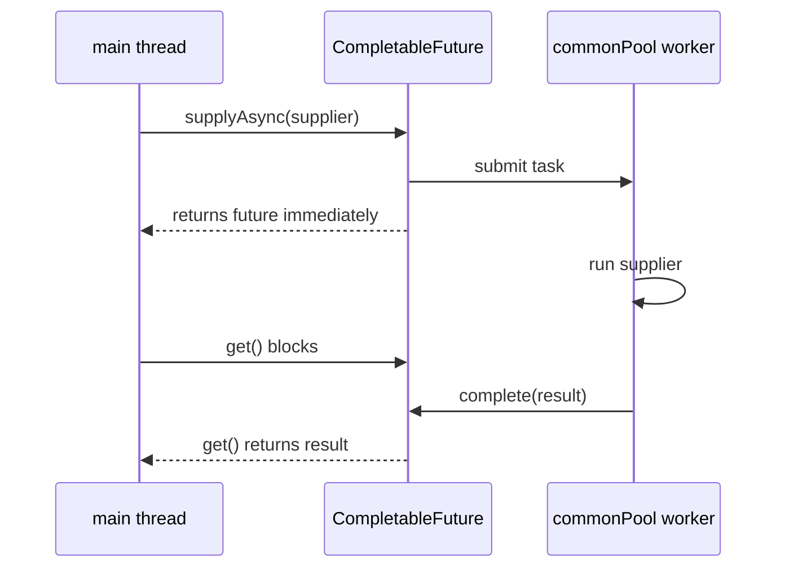
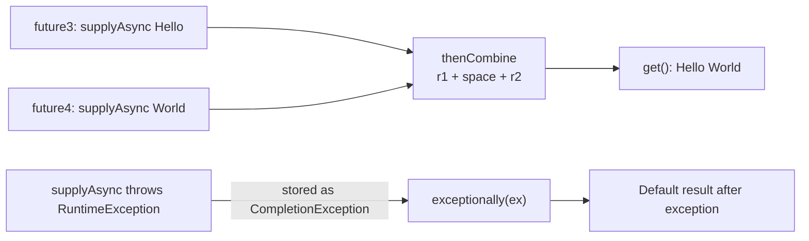
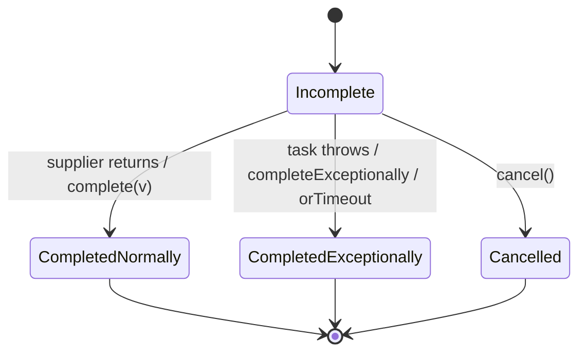

## In One Line
`CompletableFuture<T>` (Java 8) is a `Future` you can **chain, combine and recover from without blocking**: you describe "run this in the background, then transform the result, then combine it with that other result, and if anything fails use this fallback", and the pipeline runs itself as each step completes.

## Mental Model
Think of ordering at a **food court with a buzzer**.

- `supplyAsync(() -> cookBurger())` — you place an order; the kitchen (a thread pool) starts cooking and you get a **buzzer** (the `CompletableFuture`) straight away. You are free to do other things.
- `get()` / `join()` — you stand at the counter **staring at the buzzer until it rings**. That is blocking; sometimes necessary, but it wastes your time.
- `thenApply(burger -> addCheese(burger))` — you leave an instruction: "when it is ready, add cheese". Nobody waits; the step runs when the burger is done.
- `thenCombine(friesFuture, (burger, fries) -> meal(burger, fries))` — two counters cook in parallel; when **both** buzzers ring, the meal is assembled.
- `thenCompose(burger -> orderDrinkFor(burger))` — the next step is *itself another order with its own buzzer*; `thenCompose` gives you one buzzer for the whole thing instead of a buzzer inside a buzzer.
- `exceptionally(ex -> "free sandwich")` — "if the kitchen burns the order, give me this instead".
- `complete("burger")` — the manager can **complete an order by hand**. That hand-completion is where the name *Completable* comes from.

## Concept
### Why `Future` was not enough
Java 5's `Future<T>` (from `ExecutorService.submit`) represents a pending result, but it can only be **polled** (`isDone()`) or **blocked on** (`get()`):
| Need | `Future` (Java 5) | `CompletableFuture` (Java 8) |
|---|---|---|
| Run a callback when the result arrives | no — you must block or poll | `thenApply`, `thenAccept`, `thenRun` |
| Chain dependent async steps | no | `thenCompose` |
| Combine two or many results | no | `thenCombine`, `allOf`, `anyOf` |
| Handle errors in the pipeline | only `ExecutionException` from `get()` | `exceptionally`, `handle`, `whenComplete` |
| Complete it manually | no | `complete(value)`, `completeExceptionally(ex)` |
| Timeouts without blocking | no (`get(timeout)` blocks) | `orTimeout`, `completeOnTimeout` (Java 9) |

`CompletableFuture<T>` implements both `Future<T>` (so old code can still `get()` it) and **`CompletionStage<T>`**, the interface with the ~40 chaining methods.

### Starting an async computation
| Method | Takes | Returns | Use |
|---|---|---|---|
| `runAsync(Runnable)` | no input, no result | `CompletableFuture<Void>` | fire a background action |
| `supplyAsync(Supplier<T>)` | no input, returns `T` | `CompletableFuture<T>` | compute a value in the background |
| `runAsync(r, executor)` / `supplyAsync(s, executor)` | + your `Executor` | same | run on **your** pool instead of the common pool |
| `completedFuture(v)` / `failedFuture(ex)` (Java 9) | a value / an exception | already-completed future | tests, caches, short-circuits |
| `new CompletableFuture<>()` + `complete(v)` | — | a future you complete yourself | adapting callback APIs |

Without an executor argument, async tasks run on **`ForkJoinPool.commonPool()`**, a JVM-wide shared pool with `availableProcessors() - 1` threads (3 on a 4-core machine). Its threads are **daemon** threads, so they do not keep the JVM alive. If the common pool's parallelism is below 2 (a 1–2 CPU container), `CompletableFuture` instead starts a **new thread for every task**.

### The chaining methods — learn them by the functional interface they take
| Method | Callback type | Input → output | Stream analogy |
|---|---|---|---|
| `thenApply(fn)` | `Function<T,U>` | T → U | `map` |
| `thenAccept(consumer)` | `Consumer<T>` | T → nothing (`Void`) | `forEach` |
| `thenRun(runnable)` | `Runnable` | nothing → nothing | — |
| `thenCompose(fn)` | `Function<T, CompletionStage<U>>` | T → another future, **flattened** | `flatMap` |
| `thenCombine(other, bifn)` | `BiFunction<T,U,V>` | both results → V | `zip` |
| `thenAcceptBoth(other, biConsumer)`, `runAfterBoth(other, r)` | | wait for both | |
| `applyToEither(other, fn)`, `acceptEither`, `runAfterEither` | | whichever finishes first | |
| `allOf(cf...)` | static | `CompletableFuture<Void>` done when **all** are done | |
| `anyOf(cf...)` | static | `CompletableFuture<Object>` done when **any** is done | |

Every method has three forms: `thenApply(fn)`, `thenApplyAsync(fn)` and `thenApplyAsync(fn, executor)`.
- **Non-async** (`thenApply`): runs on the thread that completes the previous stage — or, if the stage is *already* complete when you attach the callback, **immediately on your calling thread**.
- **Async** (`thenApplyAsync`): always submitted to the common pool (or the given executor).

### Error handling
When a stage throws, the exception is stored in the future and **every dependent stage is skipped** until a handler is reached — like a `try` block around the rest of the chain.

| Method | Called when | Can change the result? | Analogy |
|---|---|---|---|
| `exceptionally(ex -> fallback)` | only on failure | yes — replaces the exception with a value | `catch` |
| `handle((value, ex) -> result)` | always (one of the two is `null`) | yes — maps success *or* failure | `catch` + normal path |
| `whenComplete((value, ex) -> ...)` | always | **no** — the original result/exception passes through | `finally` |
| `exceptionallyCompose(ex -> otherFuture)` (Java 12) | on failure | yes, with another async call | retry / fallback service |

**Exception wrapping** — the most-asked detail:
- An exception thrown inside `supplyAsync`/`thenApply` is stored wrapped in a **`CompletionException`**, so the `ex` you receive in `exceptionally`/`handle` is usually `CompletionException` whose `getCause()` is your real exception. That is why the example prints `Exception: java.lang.RuntimeException: Exception in asynchronous task` — `CompletionException`'s message is its cause's `toString()`.
- An exception passed to `completeExceptionally(ex)` on the future you are handling is delivered **unwrapped**.
- Robust handlers unwrap: `Throwable cause = (ex instanceof CompletionException && ex.getCause() != null) ? ex.getCause() : ex;`

### Getting the result out
| Method | Blocks? | On failure throws | Checked? |
|---|---|---|---|
| `get()` | yes | `ExecutionException` (cause = real exception), `InterruptedException` | **checked** — needs try/catch |
| `get(timeout, unit)` | up to timeout | + `TimeoutException` | checked |
| `join()` | yes | `CompletionException` (cause = real exception) | unchecked — usable in lambdas and streams |
| `getNow(valueIfAbsent)` | no | `CompletionException` | unchecked |
| `resultNow()` / `exceptionNow()` / `state()` (Java 19, on `Future`) | no | `IllegalStateException` if not in the right state | unchecked |

Cancellation (`cancel(true)`) completes the future with a `CancellationException`; the `mayInterruptIfRunning` flag is **ignored** — the running task is not interrupted.

### Lifecycle
A `CompletableFuture` starts **incomplete** and is completed **at most once**: normally (a value), exceptionally (an exception), or by cancellation (a special exceptional completion). Later `complete(...)` calls return `false` and change nothing (only `obtrudeValue`/`obtrudeException` can force-overwrite, and they exist for error recovery only).

### Choosing the executor
- The common pool is shared by **parallel streams and every `CompletableFuture` in the JVM**. Blocking I/O (HTTP, JDBC, file reads) in it starves everyone else.
- For I/O, pass a dedicated executor: `supplyAsync(() -> callApi(), ioPool)`; shut it down when done.
- **Java 21:** virtual threads make blocking cheap — `try (var ex = Executors.newVirtualThreadPerTaskExecutor()) { CompletableFuture.supplyAsync(task, ex)... }`. With virtual threads, plain blocking code is often simpler than long async chains; `CompletableFuture` remains ideal for **combining** and **fan-out/fan-in** of results.

### Java version notes
| Version | Additions |
|---|---|
| 8 | `CompletableFuture`, `CompletionStage` |
| 9 | `orTimeout`, `completeOnTimeout`, `completeAsync`, `failedFuture`, `completedStage`, `failedStage`, `delayedExecutor`, `newIncompleteFuture`, `copy`, `minimalCompletionStage`, `defaultExecutor` |
| 12 | `exceptionallyAsync`, `exceptionallyCompose`, `exceptionallyComposeAsync` |
| 19 | `Future.resultNow()`, `exceptionNow()`, `state()` |

## Diagram

`supplyAsync` hands the work to a pool thread and returns at once; only `get()`/`join()` makes the caller wait.


Top: two independent tasks run in parallel and are merged when both finish. Bottom: the failure skips to `exceptionally`, which turns it into a normal value.


A future is completed exactly once; the first completion wins and later `complete` calls return `false`.

## Code
@example Java8Features/FunctionalInterfaces/CompletableFutureExample.java

**A non-blocking pipeline on your own executor** — transform, chain another async call, merge with a parallel task, and block only once at the end:
```java
ExecutorService pool = Executors.newFixedThreadPool(2);
CompletableFuture<String> order = CompletableFuture
        .supplyAsync(() -> "order-42", pool)                 // async step 1
        .thenApply(String::toUpperCase)                      // transform the result
        .thenCompose(id -> CompletableFuture.supplyAsync(() -> id + " paid", pool)) // chain another async call
        .thenCombine(CompletableFuture.supplyAsync(() -> "shipped", pool),         // run in parallel, then merge
                     (paid, shipped) -> paid + ", " + shipped);
System.out.println(order.join());
pool.shutdown();
```
```output
ORDER-42 paid, shipped
```

**How the exception is wrapped** — by `exceptionally`, `get()` and `join()`:
```java
CompletableFuture<String> failed = CompletableFuture.supplyAsync(() -> {
    throw new IllegalStateException("boom");       // a lambda may just throw
});
failed.exceptionally(ex -> { System.out.println("exceptionally: " + ex); return null; }).join();
try {
    failed.get();
} catch (ExecutionException e) {
    System.out.println("get():  " + e.getClass().getSimpleName() + " caused by " + e.getCause());
}
try {
    failed.join();
} catch (CompletionException e) {
    System.out.println("join(): " + e.getClass().getSimpleName() + " caused by " + e.getCause());
}
```
```output
exceptionally: java.util.concurrent.CompletionException: java.lang.IllegalStateException: boom
get():  ExecutionException caused by java.lang.IllegalStateException: boom
join(): CompletionException caused by java.lang.IllegalStateException: boom
```
(`main` declares `throws InterruptedException` for `get()`.)

**`exceptionally` vs `handle` vs `whenComplete`:**
```java
Supplier<Integer> risky = () -> 10 / 0;
System.out.println(CompletableFuture.supplyAsync(risky).exceptionally(ex -> -1).join());
System.out.println(CompletableFuture.supplyAsync(risky).handle((v, ex) -> ex == null ? v : -2).join());
try {
    CompletableFuture.supplyAsync(risky)
            .whenComplete((v, ex) -> System.out.println("whenComplete saw: " + ex.getCause()))
            .join();
} catch (CompletionException e) {
    System.out.println("still failed: " + e.getCause());
}
```
```output
-1
-2
whenComplete saw: java.lang.ArithmeticException: / by zero
still failed: java.lang.ArithmeticException: / by zero
```
`whenComplete` observes the failure but cannot fix it — the exception passes through, like a `finally` block.

**Fan-out / fan-in with `allOf`, and a Java 9 timeout:**
```java
List<CompletableFuture<Integer>> futures = IntStream.rangeClosed(1, 5)
        .mapToObj(i -> CompletableFuture.supplyAsync(() -> i * i))
        .toList();
CompletableFuture.allOf(futures.toArray(new CompletableFuture[0])).join(); // wait for all
List<Integer> squares = futures.stream().map(CompletableFuture::join).toList(); // no blocking now
System.out.println(squares);

CompletableFuture<String> slow = CompletableFuture.supplyAsync(() -> { sleep(2000); return "slow"; });
System.out.println(slow.completeOnTimeout("fallback", 100, TimeUnit.MILLISECONDS).join()); // Java 9
```
```output
[1, 4, 9, 16, 25]
fallback
```
`allOf` returns `CompletableFuture<Void>` — it only signals "all done"; you collect the values from the original futures afterwards. (`sleep` is a small helper that wraps `Thread.sleep`.)

**Which thread runs a callback:**
```java
CompletableFuture.completedFuture("x")
        .thenRun(() -> System.out.println("thenRun on " + Thread.currentThread().getName()));
CompletableFuture.completedFuture("x")
        .thenRunAsync(() -> System.out.println("thenRunAsync on " + Thread.currentThread().getName()))
        .join();
```
```output
thenRun on main
thenRunAsync on ForkJoinPool.commonPool-worker-1
```
The future is already complete, so the non-async `thenRun` executes right away on the calling thread. The worker number in the second line can differ between runs and machines.

**Common-pool threads are daemons** — without a `join()`, `main` can finish first and the JVM exits:
```java
CompletableFuture.runAsync(() -> {
    try { Thread.sleep(100); } catch (InterruptedException e) { }
    System.out.println("async work finished");   // runs on a daemon thread
});
System.out.println("main ends");
```
```output
main ends
```

## Walkthrough
- `package Java8Features.FunctionalInterfaces;` — the file sits in the course's *functional interfaces* folder, although `CompletableFuture` is a class, not a functional interface (see Traps). It does, however, take functional interfaces everywhere: `Runnable`, `Supplier`, `BiFunction`, `Function`.
- `import java.util.concurrent.CompletableFuture;` and `ExecutionException` — both live in `java.util.concurrent`.
- **Block 1 — `runAsync`:** `CompletableFuture.runAsync(() -> System.out.println("Running an asynchronous task..."))` submits a `Runnable` to `ForkJoinPool.commonPool()` and immediately returns a `CompletableFuture<Void>` (there is no result value). `future1.get()` makes `main` wait until the task has printed; it returns `null`. `get()` declares the checked `InterruptedException` (the waiting thread was interrupted) and `ExecutionException` (the task failed), hence the multi-catch with `e.printStackTrace()`.
- **Block 2 — `supplyAsync`:** the lambda is a `Supplier<String>` returning `"Result from asynchronous task"`. `future2.get()` blocks until the value exists and returns it, and `main` prints it.
- **Block 3 — `thenCombine`:** `future3` and `future4` are started one after the other and run **in parallel** on pool threads. `future3.thenCombine(future4, (result1, result2) -> result1 + " " + result2)` creates a third future that completes when *both* are done, applying the `BiFunction` to their results. `combinedFuture.get()` prints `Hello World`. The order of the words is fixed by the argument order, not by which task finished first.
- **Block 4 — failure and `exceptionally`:** the supplier throws `RuntimeException("Exception in asynchronous task")`. The `if (true) { throw ...; }` wrapper exists only to satisfy the compiler: a plain `throw` followed by `return "This will not be returned";` would be an *unreachable statement* compile error (a lambda that only throws, with no `return`, would also compile). `supplyAsync` catches the exception and stores it wrapped in a `CompletionException`. `exceptionally(ex -> ...)` receives that wrapper: `ex.getMessage()` of a `CompletionException` is the cause's `toString()`, so it prints **`Exception: java.lang.RuntimeException: Exception in asynchronous task`** — class name included — and returns the fallback `"Default result after exception"`. `futureWithException` is the future returned by `exceptionally`, so it completes *normally* and `get()` prints the fallback without throwing.
- The five output lines always appear in the same order: each block calls `get()` before the next block starts, and the `exceptionally` callback prints before its future completes. The `// Output:` comment matches the recorded output exactly.
- Which thread printed what: lines 1 and 4 are printed by pool threads (`ForkJoinPool.commonPool-worker-N`) — line 4 could also run on `main` if the task had already failed before `exceptionally` was attached; the others are printed by `main`.
- The JVM exits normally at the end because common-pool threads are daemon threads, and nothing is left running anyway.

## Traps
> [!ERRATA] The class is in package `Java8Features.FunctionalInterfaces`, but `CompletableFuture` is not a functional interface — it is a concurrency class from `java.util.concurrent`. It belongs with the executor/`Future` examples (for example a `Java8Features.CompletableFuture` package).

> [!ERRATA] The example calls `get()` right after every `runAsync`/`supplyAsync`, so `main` blocks at each step and the program is effectively sequential — asynchronous in name only. Real code chains the steps (`thenApply`, `thenCombine`, `thenAccept`) and blocks at most once at the very end, or not at all (e.g. a web framework that accepts a `CompletableFuture` as the response). Also, `e.printStackTrace()` swallows the failure and lets the program continue with no result; production code should log and propagate or recover.

- **`ex` in `exceptionally`/`handle` is usually a `CompletionException`.** `ex.getMessage()` then includes the original class name, and `ex instanceof MyBusinessException` is `false`. Unwrap with `ex.getCause()`.
- **`get()` wraps in `ExecutionException` (checked); `join()` wraps in `CompletionException` (unchecked).** Same failure, different wrapper — catch the right one.
- **Forgetting to wait:** common-pool threads are daemons. If `main` returns before the task finishes, the JVM exits and the task's output or side effects are lost (see the last Code snippet).
- **Blocking I/O in the common pool** — every `supplyAsync` without an executor, and every parallel stream, shares the same few threads. Long HTTP/DB calls starve the whole JVM. Pass your own executor for I/O, and shut it down.
- **`thenApply` with a function that returns a future gives `CompletableFuture<CompletableFuture<T>>`.** Use `thenCompose` to flatten it.
- **`whenComplete` does not recover.** Returning from it does not replace the exception; use `exceptionally` or `handle`.
- **`cancel(true)` does not interrupt the running task.** The future is marked cancelled, but the computation keeps running on its thread.
- **Exceptions in a chain without any handler are silent** unless someone calls `join()`/`get()`. A fire-and-forget `runAsync(...)` whose task throws leaves no trace. Always attach `exceptionally`/`whenComplete` for logging.
- **`allOf` returns `CompletableFuture<Void>`** — `allOf(a, b).join()` returns `null`; read the values from `a` and `b`.
- **Non-async callbacks may run on the caller thread** (if the stage is already complete) — a heavy `thenApply` can unexpectedly run on your UI or request thread.

> [!WARNING] `CompletableFuture.supplyAsync(() -> jdbcCall())` in a web application silently runs the query on the JVM-wide common pool (only `cores - 1` threads). Under load, requests queue behind each other. Use `supplyAsync(() -> jdbcCall(), dbExecutor)`.

## Tips & Tricks
- **Map the names to streams:** `thenApply` = `map`, `thenCompose` = `flatMap`, `thenAccept` = `forEach`, `thenCombine` = zip two results.
- **"Apply returns, Accept consumes, Run ignores."** `thenApply` → value, `thenAccept` → `Void` (uses the value), `thenRun` → `Void` (does not even see the value).
- **Error trio as try/catch/finally:** `exceptionally` = catch, `handle` = catch + normal path, `whenComplete` = finally.
- **"Async suffix = new task."** `xxxAsync` always hands the callback to a pool; the plain form runs on whichever thread completes the previous stage (or on you, if it is already complete).
- **Block once, at the edge.** Build the whole chain, then `join()` in `main`, a test, or a batch job; in servers, return the future to a framework that supports it (Spring MVC/WebFlux, JAX-RS async).
- **Prefer `join()` inside lambdas and streams** (`futures.stream().map(CompletableFuture::join)`) — it throws an unchecked exception, so no try/catch clutter.
- **Always pass an executor for I/O**, and give its threads meaningful names so thread dumps are readable.
- **Timeouts (Java 9+):** `orTimeout(2, SECONDS)` fails with `TimeoutException`; `completeOnTimeout(fallback, 2, SECONDS)` substitutes a default.

## Interview Q&A
### [Basic] What is CompletableFuture and how is it different from Future?
`CompletableFuture<T>` is a Java 8 class that implements both `Future<T>` and `CompletionStage<T>`. A plain `Future` can only be checked with `isDone()` or blocked on with `get()`. `CompletableFuture` adds non-blocking callbacks (`thenApply`, `thenAccept`), chaining of dependent async steps (`thenCompose`), combining results (`thenCombine`, `allOf`, `anyOf`), declarative error handling (`exceptionally`, `handle`, `whenComplete`), manual completion (`complete`, `completeExceptionally`) and, since Java 9, timeouts (`orTimeout`, `completeOnTimeout`). It lets you write asynchronous code as a pipeline instead of blocking threads.

**Follow-up:** *Why is it called "Completable"?* — Because anyone holding it can complete it explicitly with `complete(value)` or `completeExceptionally(ex)`, which makes it easy to adapt callback-based APIs.

### [Basic] What is the difference between `runAsync` and `supplyAsync`, and which thread pool do they use?
`runAsync` takes a `Runnable` and returns `CompletableFuture<Void>` — for background actions with no result. `supplyAsync` takes a `Supplier<T>` and returns `CompletableFuture<T>` — for computing a value. Without an executor argument, both run on `ForkJoinPool.commonPool()`, whose size is `availableProcessors() - 1` and whose threads are daemon threads; if that parallelism is less than 2, a new thread is created per task. Both have overloads taking an `Executor`, which you should use for blocking I/O.

**Follow-up:** *Why does a program sometimes exit before the async task prints anything?* — Common-pool threads are daemons, so the JVM does not wait for them; `main` must `join()` (or `get()`) the future.

### [Intermediate] What is the difference between `thenApply`, `thenAccept`, `thenRun` and `thenCompose`?
- `thenApply(Function<T,U>)` transforms the result: `CompletableFuture<U>`.
- `thenAccept(Consumer<T>)` consumes the result and returns `CompletableFuture<Void>`.
- `thenRun(Runnable)` runs an action after completion without seeing the result.
- `thenCompose(Function<T, CompletionStage<U>>)` is for a next step that is itself asynchronous; it flattens the result to `CompletableFuture<U>` instead of `CompletableFuture<CompletableFuture<U>>`.
```java
CompletableFuture<User>  user   = findUserAsync(id);
CompletableFuture<Order> orders = user.thenCompose(u -> findOrdersAsync(u)); // not thenApply
```
**Follow-up:** *What is the stream analogy?* — `thenApply` is `map`, `thenCompose` is `flatMap`.

### [Intermediate] How do you combine the results of multiple CompletableFutures?
For two results use `thenCombine(other, (a, b) -> ...)` — both run in parallel and the `BiFunction` runs when both finish. For many, use `CompletableFuture.allOf(f1, f2, ...)`, which returns a `CompletableFuture<Void>` that completes when all complete; then read each value with `join()`, which no longer blocks. For "first one wins", use `anyOf(...)` (returns `CompletableFuture<Object>`) or `applyToEither`.
```java
CompletableFuture.allOf(futures.toArray(new CompletableFuture[0]))
        .thenApply(v -> futures.stream().map(CompletableFuture::join).toList());
```
**Follow-up:** *What happens to `allOf` if one future fails?* — The combined future completes exceptionally (with a `CompletionException` wrapping that failure) after all futures have completed; the successful results are still available individually.

### [Intermediate] Explain `exceptionally`, `handle` and `whenComplete`.
- `exceptionally(Function<Throwable, T>)` runs only on failure and supplies a replacement value — like `catch`.
- `handle(BiFunction<T, Throwable, U>)` runs always, receiving either the value or the exception (the other is `null`), and returns a new result — can map both paths.
- `whenComplete(BiConsumer<T, Throwable>)` runs always but **cannot change** the outcome; the original value or exception propagates — like `finally`, good for logging or metrics.

When a stage fails, all dependent `thenApply`/`thenAccept` stages are skipped until one of these handlers is reached.

**Follow-up:** *In the example, why does it print `Exception: java.lang.RuntimeException: Exception in asynchronous task` rather than just the message?* — Because `ex` is a `CompletionException` wrapping the original exception, and a `CompletionException` built from a cause uses `cause.toString()` as its message.

### [Intermediate] What is the difference between `get()` and `join()`?
Both block until the future completes and return the value. `get()` comes from `Future`, throws the **checked** `InterruptedException` and `ExecutionException` (cause = original exception), and has a timeout overload. `join()` throws the **unchecked** `CompletionException` (or `CancellationException`) and is not interruptible, so it fits into lambdas and streams without try/catch. Neither should be called on a request thread if you can return the future instead.

**Follow-up:** *Is there a non-blocking way to peek at the value?* — `getNow(defaultValue)` returns the value if done or the default otherwise; Java 19 adds `resultNow()` and `state()`.

### [Advanced] On which thread do the callbacks run? What is the difference between `thenApply` and `thenApplyAsync`?
`thenApplyAsync(fn)` always submits `fn` to the default executor (common pool) or to the executor you pass. `thenApply(fn)` runs `fn` synchronously: if the previous stage is still running, the thread that completes it runs `fn` right after; if the stage is already complete when `thenApply` is called, `fn` runs **immediately on the calling thread**. This means a non-async callback might run on a pool thread or on `main`/your request thread, depending on timing. Use the `Async` variants with an executor when the callback is heavy or blocking, or when you need predictable threading.

**Follow-up:** *Why not always use the `Async` variants?* — Each one is an extra task submission and thread hop; for cheap transformations the synchronous form is faster.

### [Advanced] Why is using the common pool for I/O a problem, and how do virtual threads change the picture?
The common pool has only `cores - 1` threads and is shared by all `CompletableFuture`s without an executor and all parallel streams in the JVM. Blocking I/O in it parks those few threads, so unrelated work queues up and throughput collapses. The fix is a dedicated, bounded `ExecutorService` for I/O, passed to `supplyAsync(task, executor)` and shut down on exit. In Java 21, `Executors.newVirtualThreadPerTaskExecutor()` gives each task a cheap virtual thread, so blocking no longer wastes platform threads; many services can then use straightforward blocking code, keeping `CompletableFuture` for composing and combining results.

**Follow-up:** *Can you use a virtual-thread executor with CompletableFuture?* — Yes: `CompletableFuture.supplyAsync(task, virtualExecutor)`; since Java 19 `ExecutorService` is `AutoCloseable`, so try-with-resources waits for tasks and closes it.

### [Advanced] How would you add a timeout and a fallback to a slow remote call?
Java 9 added two non-blocking timeouts. `orTimeout(2, TimeUnit.SECONDS)` completes the future exceptionally with `TimeoutException` if it is not done in time; `completeOnTimeout(fallback, 2, TimeUnit.SECONDS)` completes it with a default value instead.
```java
CompletableFuture<Price> price = CompletableFuture
        .supplyAsync(() -> pricingClient.fetch(sku), ioPool)
        .orTimeout(2, TimeUnit.SECONDS)
        .exceptionally(ex -> Price.cached(sku));   // timeout or any other failure
```
In Java 8 you had to use `get(timeout, unit)` (blocking) or schedule `completeExceptionally` yourself with a `ScheduledExecutorService`.

**Follow-up:** *Does the timeout stop the slow task?* — No. The future is completed, but the underlying task keeps running; cancellation does not interrupt it. The remote client needs its own timeouts.

### [Advanced] How do you turn a callback-based API into a CompletableFuture?
Create an incomplete future and complete it from the callbacks:
```java
CompletableFuture<Response> fetch(Request req) {
    CompletableFuture<Response> cf = new CompletableFuture<>();
    client.send(req, new Callback() {
        public void onSuccess(Response r) { cf.complete(r); }
        public void onError(Throwable t)  { cf.completeExceptionally(t); }
    });
    return cf;
}
```
Only the first completion counts; later `complete` calls return `false`. Callers can now chain `thenApply`, combine with other calls, and add timeouts.

**Follow-up:** *Will `exceptionally` see a `CompletionException` here?* — Not on `cf` itself: an exception passed to `completeExceptionally` is delivered as-is. Dependent stages created later with `thenApply` will see it wrapped in a `CompletionException`.

## Quiz
### Why does the example print `Exception: java.lang.RuntimeException: Exception in asynchronous task` instead of `Exception: Exception in asynchronous task`?
- [ ] `exceptionally` always prepends the class name to messages
- [x] `ex` is a `CompletionException` wrapping the `RuntimeException`, and its message is the cause's `toString()`
- [ ] `RuntimeException.getMessage()` includes the class name
- [ ] The output comment is wrong
> `supplyAsync` catches the thrown exception and stores it wrapped in a `CompletionException`. A `CompletionException` created from a cause gets `cause.toString()` as its message — `"java.lang.RuntimeException: Exception in asynchronous task"`. `ex.getCause().getMessage()` would give the bare message. The recorded output matches the comment.

### What does this print?
```java
CompletableFuture<Integer> f = CompletableFuture.supplyAsync(() -> 5)
        .thenApply(x -> x * 2)
        .thenApply(x -> x / 0)
        .thenApply(x -> x + 1)
        .exceptionally(ex -> -1);
System.out.println(f.join());
```
- [ ] 11
- [ ] 10
- [x] -1
- [ ] Throws CompletionException
> The second `thenApply` throws `ArithmeticException`; the stage fails and the next `thenApply(x -> x + 1)` is skipped. `exceptionally` turns the failure into `-1`, so `f` completes normally and `join()` returns it without throwing.

### What does this print?
```java
String r = CompletableFuture.supplyAsync(() -> "a")
        .thenCombine(CompletableFuture.supplyAsync(() -> "b"), (x, y) -> y + x)
        .thenApply(String::toUpperCase)
        .join();
System.out.println(r);
```
- [ ] AB
- [x] BA
- [ ] ab or ba, depending on which task finishes first
- [ ] ba
> In `thenCombine`, `x` is always this future's result (`"a"`) and `y` is the other one's (`"b"`), whatever order they finish in. The function returns `y + x` = `"ba"`, then `toUpperCase` gives `BA`. The result is deterministic.

### What does this program print?
```java
public static void main(String[] args) {
    CompletableFuture.runAsync(() -> {
        try { Thread.sleep(100); } catch (InterruptedException e) { }
        System.out.println("async work finished");
    });
    System.out.println("main ends");
}
```
- [ ] async work finished, then main ends
- [ ] main ends, then async work finished
- [x] main ends — and usually nothing else
- [ ] It never terminates
> `runAsync` returns immediately, so `main ends` is printed first. The task runs on a common-pool thread, which is a daemon; when `main` returns, the JVM exits without waiting, so the second line is (almost always) lost. Adding `.join()` fixes it.

### You have `CompletableFuture<User> findUser(id)` and `CompletableFuture<List<Order>> findOrders(User u)`. Which gives `CompletableFuture<List<Order>>`?
- [ ] `findUser(id).thenApply(this::findOrders)`
- [x] `findUser(id).thenCompose(this::findOrders)`
- [ ] `findUser(id).thenAccept(this::findOrders)`
- [ ] `findUser(id).thenCombine(this::findOrders)`
> `findOrders` itself returns a future, so `thenApply` would produce `CompletableFuture<CompletableFuture<List<Order>>>`. `thenCompose` flattens it — the `flatMap` of futures. `thenAccept` returns `CompletableFuture<Void>`, and `thenCombine` needs a second future plus a `BiFunction`.

### Spot the bug
```java
CompletableFuture<String> cf = CompletableFuture
        .supplyAsync(() -> loadConfig())             // may throw
        .whenComplete((cfg, ex) -> {
            if (ex != null) log.warn("using default config");
        });
String config = cf.join();   // expects the default on failure
```
- [ ] `whenComplete` is not called on failure
- [x] `whenComplete` cannot replace the exception, so `join()` still throws; use `exceptionally` or `handle` to return a default
- [ ] `supplyAsync` cannot call methods that throw
- [ ] `join()` must be replaced by `get()` to see the default
> `whenComplete` behaves like `finally`: it sees the outcome but passes the original result or exception through unchanged. On failure `cf.join()` throws `CompletionException`. `.exceptionally(ex -> defaultConfig())` or `.handle((cfg, ex) -> ex == null ? cfg : defaultConfig())` return a replacement value.

### Which statement about `get()` and `join()` is correct?
- [ ] `join()` does not block
- [ ] `get()` throws `CompletionException`
- [x] `get()` throws the checked `ExecutionException`; `join()` throws the unchecked `CompletionException`
- [ ] `join()` returns `null` when the task fails
> Both block until completion. On failure `get()` wraps the cause in `ExecutionException` (checked, plus `InterruptedException`), while `join()` wraps it in `CompletionException` (unchecked), which is why `join()` is convenient in lambdas and streams.

## Takeaways
- `CompletableFuture` = `Future` + `CompletionStage`: start work with `runAsync`/`supplyAsync`, then chain callbacks instead of blocking.
- Default async work runs on `ForkJoinPool.commonPool()` (`cores - 1` daemon threads); pass your own `Executor` for blocking I/O, and join before `main` ends.
- `thenApply` = map, `thenCompose` = flatMap, `thenAccept`/`thenRun` = side effects, `thenCombine`/`allOf`/`anyOf` = combine results.
- A failure skips dependent stages until `exceptionally` (catch), `handle` (catch + normal) or `whenComplete` (finally, cannot recover).
- Exceptions from tasks arrive wrapped in `CompletionException`; `get()` throws checked `ExecutionException`, `join()` throws unchecked `CompletionException` — unwrap with `getCause()`.
- Non-async callbacks run on the completing thread or, if already complete, on the caller; `xxxAsync` always uses a pool.
- Java 9 added `orTimeout`/`completeOnTimeout`/`failedFuture`; Java 12 `exceptionallyCompose`; on Java 21 virtual threads make plain blocking code cheap, and `CompletableFuture` shines for composing results.
