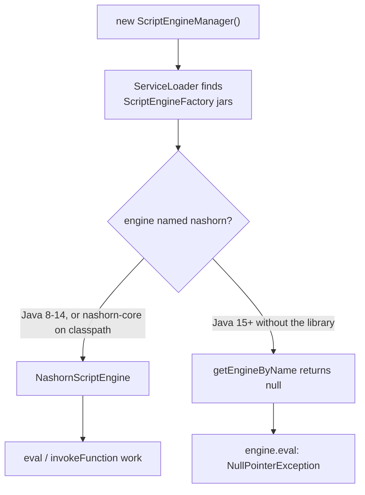
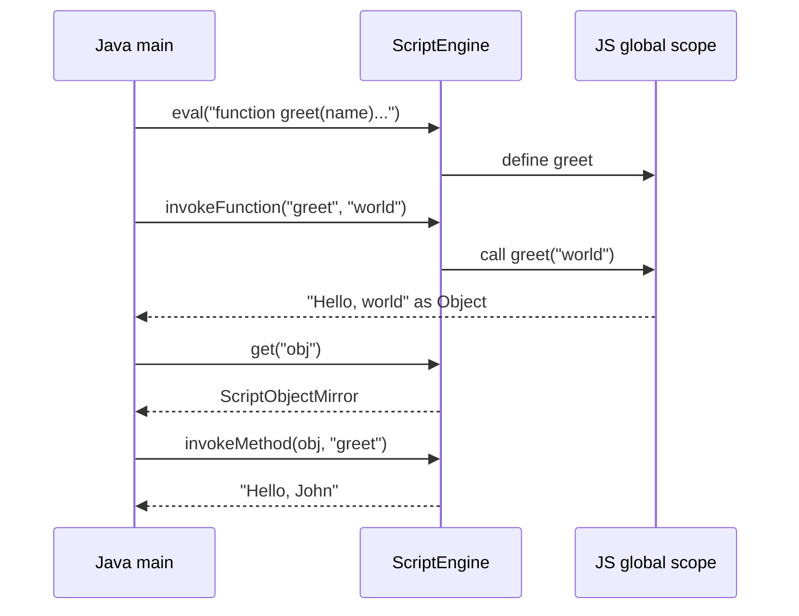
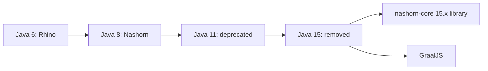

## In One Line
Nashorn was the **JavaScript engine bundled with Java 8–14**: through the standard `javax.script` API (JSR 223) a Java program could evaluate JavaScript, call JS functions and read JS objects — but it was deprecated in JDK 11 and **removed in JDK 15**, so today you need the standalone `nashorn-core` library or, better, **GraalJS**.

## Mental Model
Think of a **power-socket adapter** when you travel.

- Your laptop (the Java program) has one plug shape: the **`javax.script` API** — `ScriptEngineManager`, `ScriptEngine`, `eval`, `Invocable`.
- The adapter you plug into (the **script engine**) decides which country's electricity you get: Rhino in Java 6/7, **Nashorn** in Java 8–14, GraalJS today.
- `ScriptEngineManager.getEngineByName("nashorn")` is asking the hotel desk: "do you have a Nashorn adapter?". If they have one, you get it. If not, they hand you **nothing** (`null`) — and if you plug your laptop into "nothing", it fails (`NullPointerException`).
- In JDK 15 the hotel **stopped stocking** that adapter. Your laptop is unchanged; you just have to bring your own adapter (add the `nashorn-core` dependency) or switch to a newer one (GraalJS).

## Concept
### JSR 223 — the scripting API that outlived Nashorn
`javax.script` (module `java.scripting`, since **Java 6**) is a small, engine-neutral API for running scripting languages inside the JVM. It is still in the JDK today; only the bundled *engine* disappeared.

| Type | Role |
|---|---|
| `ScriptEngineManager` | Discovers installed engines with `ServiceLoader` (every jar that declares a `javax.script.ScriptEngineFactory` service). `getEngineByName`, `getEngineByExtension("js")`, `getEngineByMimeType(...)`, `getEngineFactories()`. Returns **`null`** when nothing matches. |
| `ScriptEngineFactory` | Describes an engine: names, language, version, and `getParameter("THREADING")` (thread-safety level). |
| `ScriptEngine` | Runs code: `eval(String)`, `eval(Reader)`, `put(name, value)`, `get(name)`, `createBindings()`. |
| `Invocable` | Optional interface an engine may implement: `invokeFunction(name, args...)`, `invokeMethod(obj, name, args...)`, `getInterface(Class)`. |
| `Compilable` / `CompiledScript` | Optional: parse once, `eval` many times. |
| `Bindings` / `ScriptContext` | Name→value maps that act as the script's variables; `ENGINE_SCOPE` (per engine) and `GLOBAL_SCOPE` (shared by engines from one manager). |
| `ScriptException` | Checked exception for syntax and runtime errors in the script, with line and column. |

### A short history of JavaScript on the JVM
| Version | What happened |
|---|---|
| Java 6 (2006) | JSR 223 added; the JDK bundles **Mozilla Rhino** as the JavaScript engine (an interpreter). |
| **Java 8** (2014) | **Nashorn** replaces Rhino (JEP 174). It compiles JavaScript to JVM bytecode and uses `invokedynamic` (JSR 292) for dynamic calls — far faster than Rhino. Implements **ECMAScript 5.1**. Ships the `jjs` command-line shell. |
| Java 8u40, 9 | Some ECMAScript 6 features behind the `--language=es6` option. |
| Java 11 | Nashorn **deprecated for removal** (JEP 335); using it prints a warning (suppress with `-Dnashorn.args=--no-deprecation-warning`). |
| **Java 15** (2020) | Nashorn and `jjs` **removed** (JEP 372), together with the `jdk.scripting.nashorn` module. |
| Since 2020 | OpenJDK maintains **standalone Nashorn** as a library: `org.openjdk.nashorn:nashorn-core:15.x`, for Java 11+. Its packages moved from `jdk.nashorn.*` to `org.openjdk.nashorn.*`. |
| Today | **GraalJS** (GraalVM's JavaScript engine) is the recommended replacement: modern ECMAScript, runs on a stock JDK as a Maven dependency. |

**Why it was removed:** ECMAScript started evolving yearly (ES2015, ES2016…), and keeping a JS engine up to date inside the JDK was a large maintenance burden for a small team; GraalJS already offered a modern, compliant engine.

### Nashorn specifics you meet in old code
- Engine names: `nashorn`, `Nashorn`, `js`, `JS`, `JavaScript`, `javascript`, `ECMAScript`, `ecmascript`.
- **Nashorn-only globals** — not standard JavaScript: `print(...)` writes to `System.out`; `Java.type("java.util.ArrayList")` imports a Java class; `Java.from`/`Java.to` convert arrays; `load("file.js")`. There is **no `console`** object (`console.log` → `ReferenceError`).
- **Type mapping back to Java:** JS strings → `String`; JS numbers → `Integer` *or* `Double` depending on how the engine computed them (`[10, 20, 30].length` gives `Integer`, but `price * qty` gives `Double 750.0`) — always treat them as `Number`; JS objects and arrays → `ScriptObjectMirror`, which implements `Map<String, Object>` and `Bindings`; `undefined` → `null`.
- Java objects passed with `engine.put` are usable from JS, including calling their methods.
- **ES5.1 by default:** `let`, `const`, template literals and arrow functions are syntax errors unless the engine is created with `--language=es6`; even then, ES6 `class` is "not yet implemented".

### Security and threads
- `eval` runs arbitrary code with the full power of your JVM: a Nashorn script can do `Java.type('java.lang.System').exit(1)` or read files. **Never evaluate untrusted input.** Nashorn could be restricted with a `ClassFilter` (`new NashornScriptEngineFactory().getScriptEngine(className -> false)`); GraalJS denies host access by default.
- Nashorn's factory reports `THREADING = null`, meaning **not thread-safe**: do not share one engine between threads without synchronization; use one engine per thread, or separate `Bindings` with a compiled script.
- Creating an engine is expensive (it bootstraps a JS runtime). Reuse engines and use `Compilable` for scripts you run repeatedly.

### GraalJS — the modern replacement
Two ways to use it:
1. **GraalVM Polyglot API** (recommended): `org.graalvm.polyglot:polyglot` + `org.graalvm.polyglot:js-community`. You create a `Context`, evaluate code, and get `Value` objects; sandboxing and resource limits are built in.
2. **JSR 223 bridge**: the `org.graalvm.js:js-scriptengine` artifact registers a `ScriptEngine` (names such as `js` and `Graal.js`), so code like the example can switch with minimal changes; a `js.nashorn-compat` option emulates some Nashorn-specific features.

On a regular OpenJDK (not a GraalVM JDK) GraalJS runs **interpreter-only** and prints a performance warning at start-up; GraalVM, or enabling JVMCI (`-XX:+EnableJVMCI`) with the Truffle runtime, gives it JIT compilation.

| | Nashorn | GraalJS |
|---|---|---|
| Language level | ECMAScript 5.1 (partial ES6 with a flag) | ECMAScript 2023+ (modules, classes, async/await) |
| In the JDK | Java 8–14 only | Never — added as dependencies |
| API | JSR 223 (`javax.script`) | Polyglot `Context`/`Value`, plus optional JSR 223 bridge |
| Host (Java) access | open by default | **denied by default**, opt-in with `allowHostAccess` |
| Status | maintenance only (standalone 15.x) | actively developed |

### When would you embed a script engine at all?
Rules or formulas that business users change without a redeploy, plug-in systems, templating, running the same validation code in the browser and on the server. Alternatives worth naming in an interview: an expression language (Spring SpEL, MVEL, JEXL), a rules engine (Drools), or a JVM scripting language such as Groovy (it has its own JSR 223 engine).

## Diagram

`getEngineByName` never throws when an engine is missing — it returns `null`, and the failure surfaces one line later as an NPE.


Scripts define things in the engine's global scope; `Invocable` lets Java call back into them, and JS objects come back wrapped as `ScriptObjectMirror`.


The `javax.script` API stayed constant; only the engine behind it changed.

## Code
@example Java8Features/NashornJavaScriptEngine/NashornJavaScriptExample.java

The recorded output above was produced on JDK 21 with the standalone library `org.openjdk.nashorn:nashorn-core:15.4` (and its ASM dependencies) on the classpath. Compiled with debug info (as Maven and IDEs do) and run on JDK 21 **without** that library, the same program prints:
```output
Exception in thread "main" java.lang.NullPointerException: Cannot invoke "javax.script.ScriptEngine.eval(String)" because "engine" is null
	at Java8Features.NashornJavaScriptEngine.NashornJavaScriptExample.main(NashornJavaScriptExample.java:16)
```
To run it on a modern JDK with Maven, add:
```text
<dependency>
    <groupId>org.openjdk.nashorn</groupId>
    <artifactId>nashorn-core</artifactId>
    <version>15.4</version>
</dependency>
```

**Defensive lookup, and passing values between Java and JS:**
```java
ScriptEngine engine = new ScriptEngineManager().getEngineByName("nashorn");
if (engine == null) {
    System.out.println("No JavaScript engine available - add a JS engine dependency");
    return;
}
engine.put("price", 250);                        // Java -> JS variable
engine.put("qty", 3);
Object total = engine.eval("price * qty");       // JS -> Java value
System.out.println(total + " (" + total.getClass().getSimpleName() + ")");
Object count = engine.eval("[10, 20, 30].length");
System.out.println(count + " (" + count.getClass().getSimpleName() + ")");
```
With `nashorn-core` on the classpath:
```output
750.0 (Double)
3 (Integer)
```
Without it (plain JDK 21):
```output
No JavaScript engine available - add a JS engine dependency
```
Two whole numbers multiplied in JavaScript came back as a `Double` — JS has a single number type, so cast results to `Number` and convert explicitly.

**More JSR 223 tools — `getInterface`, `ScriptObjectMirror` as a `Map`, and `Compilable`** (with `nashorn-core`):
```java
public interface Greeter { String greet(String name); }

ScriptEngine engine = new ScriptEngineManager().getEngineByName("nashorn");
engine.eval("function greet(name) { return 'Hello, ' + name; }");
Greeter g = ((Invocable) engine).getInterface(Greeter.class);   // JS function as a Java interface
System.out.println(g.greet("interface"));

engine.eval("var obj = { name: 'John', age: 30 };");
Map<?, ?> obj = (Map<?, ?>) engine.get("obj");                  // ScriptObjectMirror implements Map
System.out.println(obj.get("name") + " is " + obj.get("age"));

CompiledScript square = ((Compilable) engine).compile("x * x"); // parse once
Bindings vars = engine.createBindings();
for (int x = 1; x <= 3; x++) {
    vars.put("x", x);
    System.out.print(square.eval(vars) + " ");                   // run many times
}
```
```output
Hello, interface
John is 30
1.0 4.0 9.0 
```

**The same ideas with GraalJS** (dependencies `org.graalvm.polyglot:polyglot:24.1.1` and `org.graalvm.polyglot:js-community:24.1.1`, type `pom`):
```java
import org.graalvm.polyglot.Context;
import org.graalvm.polyglot.Value;

try (Context context = Context.create("js")) {                 // one JS "world"
    context.eval("js", "function greet(name) { return 'Hello, ' + name; }");
    Value greet = context.getBindings("js").getMember("greet");
    System.out.println(greet.execute("world").asString());   // call JS from Java

    Value obj = context.eval("js",
            "({ name: 'John', age: 30, greet() { return `Hello, ${this.name}`; } })");
    System.out.println(obj.invokeMember("greet").asString()); // modern JS syntax works
    System.out.println(obj.getMember("age").asInt());
}
```
Run on JDK 21 with `-Dpolyglot.engine.WarnInterpreterOnly=false`:
```output
Hello, world
Hello, John
30
```
Without that flag, a stock OpenJDK first prints a multi-line `[engine] WARNING: The polyglot engine uses a fallback runtime that does not support runtime compilation to native code.` — the code still works, only without JIT compilation of the JavaScript.

## Walkthrough
- `import javax.script.Invocable; ScriptEngine; ScriptEngineManager; ScriptException;` — only standard JSR 223 types are used; nothing in the code mentions Nashorn classes. That is why the same file compiles on every JDK: the engine is looked up **by name at runtime**.
- `new ScriptEngineManager()` — scans the classpath/module path with `ServiceLoader` for `ScriptEngineFactory` implementations.
- `manager.getEngineByName("nashorn")` — asks for the engine whose names include `"nashorn"`. On Java 8–14 the JDK's own Nashorn answers; on Java 15+ only the `nashorn-core` library can, otherwise the result is **`null`** (no exception).
- `engine.eval("print('Hello from Nashorn!');")` — evaluates a script. `print` is a Nashorn built-in that writes to `System.out`, giving **`Hello from Nashorn!`**. `eval` declares the checked `ScriptException` (syntax or runtime error in the script), hence the `try/catch`. On JDK 21 without the library this is line 16, where the `NullPointerException` occurs — and the `catch (ScriptException e)` does not catch it, so the program dies.
- `String script = "function greet(name) { return 'Hello, ' + name; }"; engine.eval(script);` — defines a JS function in the engine's global scope; evaluating a function declaration prints nothing.
- `Invocable invocable = (Invocable) engine;` — `Invocable` is an optional capability; Nashorn implements it. (Checking `engine instanceof Invocable` first would be more robust for unknown engines.)
- `invocable.invokeFunction("greet", "world")` — calls the global JS function with a Java `String` argument and returns an `Object`, here the Java `String` **`Hello, world`**. `NoSuchMethodException` (checked) is thrown if no such function exists — hence the multi-catch `ScriptException | NoSuchMethodException`.
- `String jsObjectScript = "var obj = { " + ... + "};"` — builds a JS object literal with two properties and a method; inside `greet`, `this.name` refers to the object's own `name`.
- `engine.eval(jsObjectScript)` defines the global `obj`; `engine.get("obj")` reads the global variable back into Java — as a `ScriptObjectMirror` (an `Object` for this code).
- `invocable.invokeMethod(jsObject, "greet")` — calls a method *on a JS object*, with `this` bound to that object, returning **`Hello, John`**.
- `e.printStackTrace()` in each catch — prints any script error and lets the program continue with the next block.
- The recorded output (three lines) matches both `// Output:` comments, and it is deterministic. Note the Nashorn line is printed by the script's `print`, not by a Java `println`.

## Traps
> [!ERRATA] The example uses an **API removed from the JDK**: Nashorn was deprecated in Java 11 and removed in Java 15. On Java 17/21 without the `org.openjdk.nashorn:nashorn-core` dependency, `getEngineByName("nashorn")` returns `null` and line 16 throws `NullPointerException: Cannot invoke "javax.script.ScriptEngine.eval(String)" because "engine" is null`. Add the standalone library to run it, or migrate to GraalJS.

> [!ERRATA] The code never checks the result of `getEngineByName` for `null`, although the Javadoc says it returns `null` when no engine matches — and the `catch (ScriptException e)` blocks cannot catch the resulting `NullPointerException`. Check the engine first and fail with a clear message: `if (engine == null) throw new IllegalStateException("No JavaScript engine found");`.

- **`print` is not standard JavaScript.** It is a Nashorn (and shell) global; browsers and Node use `console.log`, which does not exist in Nashorn. Scripts written for Nashorn may not run elsewhere, and vice versa.
- **ES5.1 only by default.** `let`, `const`, arrow functions and template literals fail with `ScriptException` unless you create the engine with `--language=es6`; `class` never works.
- **Numbers come back as `Integer` or `Double` unpredictably.** `(Integer) engine.eval("price * qty")` throws `ClassCastException` (it is a `Double`). Use `((Number) result).intValue()`.
- **Code injection:** `engine.eval("var total = " + userInput)` lets a user run any Java code in your JVM via `Java.type`. Pass data with `engine.put`/`Bindings`, never by concatenating it into the script, and never evaluate untrusted scripts without a sandbox.
- **Not thread-safe:** sharing one Nashorn engine between request threads leads to variables leaking between requests. Use per-thread engines or `CompiledScript` + separate `Bindings`.
- **Casting to `Invocable`/`Compilable` blindly** — other JSR 223 engines may not implement them; check with `instanceof`.
- **Standalone Nashorn package names changed.** Old imports such as `jdk.nashorn.api.scripting.ScriptObjectMirror` become `org.openjdk.nashorn.api.scripting.ScriptObjectMirror` with `nashorn-core`.

> [!WARNING] Upgrading an application from Java 11 to 17 is a classic place where this breaks: the code compiles (only `javax.script` types are used), tests that never touch the script path pass, and production fails at runtime with an NPE. Search the codebase for `getEngineByName("nashorn")`, `"javascript"` and `jdk.nashorn` before upgrading.

## Tips & Tricks
- **Dates to remember: "8 in, 11 warned, 15 gone."** Nashorn arrived in Java 8, was deprecated in 11 and removed in 15.
- **"The API stayed, the engine left."** `javax.script` is still in the JDK; only the engine behind `getEngineByName("nashorn")` disappeared.
- **`getEngineByName` returns null, it never throws** — always null-check it, like `Map.get`.
- **Engine → Invocable → call:** `eval` to define, cast to `Invocable`, then `invokeFunction` (global function) or `invokeMethod` (method on a JS object) or `getInterface` (make JS implement a Java interface).
- **Pass data, do not build code:** `engine.put("x", value)` beats string concatenation for safety and speed (the script can be compiled once).
- **Interview answer for "what replaced Nashorn?"**: "GraalJS, via the GraalVM Polyglot API or its JSR 223 bridge; or the standalone `nashorn-core` library for legacy code."
- **Rhino → Nashorn → GraalJS**: interpreter → bytecode with `invokedynamic` → Truffle-based engine with modern ECMAScript.

## Interview Q&A
### [Basic] What was Nashorn?
Nashorn was the JavaScript engine shipped with the JDK from **Java 8 to Java 14** (JEP 174). It replaced Mozilla Rhino, implemented ECMAScript 5.1, and compiled JavaScript directly to JVM bytecode, using `invokedynamic` for dynamic calls, which made it much faster than Rhino. Java code used it through the standard JSR 223 API (`ScriptEngineManager.getEngineByName("nashorn")`), and it also came with the `jjs` command-line tool. Scripts could use Java classes through `Java.type(...)`.

**Follow-up:** *What does "Nashorn" mean?* — It is German for "rhinoceros", a nod to its predecessor Rhino.

### [Basic] What is JSR 223 and which classes does it provide?
JSR 223, "Scripting for the Java Platform", added the `javax.script` package in Java 6: an engine-independent API for running scripting languages inside Java. `ScriptEngineManager` discovers engines via `ServiceLoader`; `ScriptEngine` evaluates code (`eval`), and exposes variables (`put`/`get`); `Bindings` and `ScriptContext` hold variable scopes; the optional `Invocable` interface calls script functions (`invokeFunction`, `invokeMethod`, `getInterface`); the optional `Compilable` interface precompiles scripts; `ScriptException` reports script errors. Any language with a JSR 223 engine (JavaScript, Groovy, Python via Jython, Kotlin script) can be plugged in without code changes.

**Follow-up:** *Is `javax.script` also removed in Java 15?* — No, only the Nashorn engine was removed; the `java.scripting` module remains.

### [Basic] Why does this example throw `NullPointerException` on Java 17 or 21, and how do you fix it?
Since Java 15 the JDK contains no JavaScript engine, so `getEngineByName("nashorn")` returns `null` (it does not throw), and the first `engine.eval(...)` dereferences `null`. The `catch (ScriptException e)` does not catch an NPE, so the program terminates. Fixes: (1) add `org.openjdk.nashorn:nashorn-core` (Java 11+) to the classpath — no code change; (2) migrate to GraalJS, either through its JSR 223 engine or the Polyglot API; (3) in any case, null-check the engine and fail with a clear message.

**Follow-up:** *Why did it compile fine on Java 21?* — The code only references `javax.script` types, which still exist; the engine is resolved by name at runtime.

### [Intermediate] How do you call a JavaScript function from Java, and Java from JavaScript?
Java → JS: evaluate the script, cast the engine to `Invocable`, then call `invokeFunction("greet", "world")` for a global function, `invokeMethod(jsObject, "greet")` for a method on a JS object, or `getInterface(Greeter.class)` to get a Java interface implemented by the script's functions. Values can also be passed with `engine.put("name", value)` and read with `engine.get("name")`. JS → Java in Nashorn: objects passed via `put` expose their public methods, and `Java.type("java.util.ArrayList")` imports any Java class, so the script can instantiate and call it.

**Follow-up:** *What type does `engine.get("obj")` return for a JS object?* — A `ScriptObjectMirror`, which implements `Map<String, Object>`, so you can read properties with `get("name")`.

### [Intermediate] Why was Nashorn removed from the JDK?
JEP 335 (deprecation, Java 11) and JEP 372 (removal, Java 15) cite the maintenance cost: ECMAScript had begun evolving rapidly with yearly editions, and keeping a compliant engine inside the JDK was hard for the small team. GraalVM's JavaScript engine (GraalJS) already offered modern ECMAScript support and could be used as a library, so the JDK did not need its own engine. OpenJDK then released Nashorn separately as `nashorn-core` for those who still depend on it.

**Follow-up:** *What else was removed with it?* — The `jjs` shell and the `jdk.scripting.nashorn` / `jdk.scripting.nashorn.shell` modules.

### [Intermediate] What are the performance best practices when embedding a script engine?
Create engines once and reuse them — bootstrapping a JS runtime is expensive. Use `Compilable.compile(...)` for scripts you run repeatedly, and pass changing data through `Bindings` rather than building new script strings (which also prevents injection). Avoid crossing the Java/JS boundary in tight loops; each call converts arguments and results. For concurrency, respect the engine's `THREADING` parameter: Nashorn reports `null` (not thread-safe), so use one engine per thread or per-thread `Bindings` with a shared compiled script.

**Follow-up:** *How do you read the thread-safety level?* — `factory.getParameter("THREADING")`: `null` = not thread-safe, `"MULTITHREADED"`, `"THREAD-ISOLATED"` or `"STATELESS"` for increasingly safe engines.

### [Advanced] What are the security risks of `ScriptEngine.eval`, and how do you mitigate them?
`eval` executes arbitrary code inside your JVM with your application's permissions. In Nashorn, a script can reach any Java class with `Java.type` — exit the JVM, read files, open sockets. If user input is concatenated into a script, that is remote code execution. Mitigations: never evaluate untrusted scripts; pass data via `Bindings`; in Nashorn use a `ClassFilter` (`new NashornScriptEngineFactory().getScriptEngine(className -> false)` blocks all Java classes); in GraalJS rely on the default `Context`, which denies host access, and grant only what is needed with `HostAccess` and resource limits; run untrusted code in a separate process if the stakes are high. (The `SecurityManager` that was once used for this is deprecated for removal since Java 17.)

**Follow-up:** *Does GraalJS let scripts call Java by default?* — No. `Context.create("js")` denies host class lookup and host access; you opt in with `Context.newBuilder("js").allowHostAccess(...)`.

### [Advanced] How would you migrate a Nashorn-based application to a current JDK?
1. Inventory usages: `getEngineByName("nashorn"/"js"/"javascript")`, `jdk.nashorn.*` imports, `jjs` scripts, Nashorn extensions (`Java.type`, `print`, `load`, `__noSuchProperty__`).
2. Quick path: add `org.openjdk.nashorn:nashorn-core:15.x`, rename `jdk.nashorn.*` imports to `org.openjdk.nashorn.*`, run the tests.
3. Strategic path: move to GraalJS — first via its JSR 223 engine (`js-scriptengine`, optionally with `js.nashorn-compat` for Nashorn extensions), then to the Polyglot `Context`/`Value` API for sandboxing and better performance.
4. Review host access (GraalJS is locked down by default), number/type conversions, and performance (on a stock JDK GraalJS runs interpreter-only unless JVMCI/GraalVM is used).
5. Consider whether a script engine is still needed — SpEL, a rules engine or plain Java may be simpler.

**Follow-up:** *Which JDK versions can use standalone Nashorn?* — `nashorn-core` 15.x requires Java 11 or newer; on Java 8 you already have the built-in engine.

### [Advanced] How did Nashorn achieve better performance than Rhino?
Rhino (as bundled) interpreted JavaScript, or compiled it to bytecode with a heavy runtime layer. Nashorn compiled JavaScript to JVM bytecode on the fly and used **`invokedynamic`** call sites (JSR 292, Java 7) for property access and function calls. Because JS is dynamically typed, each call site is linked at runtime to a method handle specialised for the types seen, and relinked when they change; the JVM's JIT can then inline and optimise those call sites like normal Java code. GraalJS goes further with the Truffle framework: an AST interpreter that the Graal compiler partially evaluates into optimised machine code.

**Follow-up:** *Why did `invokedynamic` matter here?* — It lets a language define its own linkage rules for dynamic calls while still letting the JIT optimise them, which is exactly what a dynamic language like JavaScript needs on the JVM.

## Quiz
### What happens when the original example runs on JDK 21 without any extra dependency?
- [ ] It prints the same three lines, because Nashorn is still part of the JDK
- [ ] It fails to compile because `javax.script` was removed
- [x] It compiles, then `engine.eval` throws `NullPointerException` because `getEngineByName` returned `null`
- [ ] It prints the stack trace of a `ScriptException` and continues
> Only the engine was removed in JDK 15; `javax.script` still exists, so the code compiles. `getEngineByName("nashorn")` returns `null`, and calling `eval` on `null` throws an NPE, which the `catch (ScriptException e)` blocks cannot catch — the program terminates at line 16.

### In which Java version was Nashorn removed from the JDK?
- [ ] Java 9
- [ ] Java 11
- [x] Java 15
- [ ] Java 17
> Nashorn was introduced in Java 8, deprecated for removal in Java 11 (JEP 335) and removed in Java 15 (JEP 372). Java 11 is the tempting answer — that is when the deprecation warning started.

### With `nashorn-core` on the classpath, what does this print?
```java
engine.put("price", 250);
engine.put("qty", 3);
Object total = engine.eval("price * qty");
System.out.println(total);
```
- [ ] 750
- [x] 750.0
- [ ] 2503
- [ ] ClassCastException
> JavaScript has a single number type, and Nashorn returns the product as a `java.lang.Double`, so it prints `750.0`. It is not string concatenation (`*` is numeric), and printing does not cast, so there is no exception — but `(Integer) total` would throw `ClassCastException`.

### Which interface lets Java call a function defined in a script?
- [ ] `Compilable`
- [ ] `Bindings`
- [x] `Invocable`
- [ ] `ScriptEngineFactory`
> `Invocable` provides `invokeFunction`, `invokeMethod` and `getInterface`. `Compilable` precompiles scripts, `Bindings` holds variables, and `ScriptEngineFactory` describes an engine.

### What does `invocable.invokeMethod(jsObject, "greet")` return in the example, and why?
- [ ] `Hello, undefined`, because `this` is the global object
- [x] `Hello, John`, because `invokeMethod` binds `this` to `jsObject`
- [ ] `Hello, world`, left over from the previous `greet` function
- [ ] It throws `NoSuchMethodException`, because `greet` is a global function
> `invokeMethod` calls a method on the given JS object with `this` set to that object, so `this.name` is `'John'`. The earlier global `greet(name)` function is a different function, and the object has its own `greet` property, so no exception occurs.

### Spot the bug
```java
String formula = request.getParameter("formula");   // e.g. "price * 1.18"
ScriptEngine engine = new ScriptEngineManager().getEngineByName("nashorn");
engine.put("price", price);
Object result = engine.eval(formula);
```
- [ ] `engine.put` must be called after `eval`
- [x] Evaluating user-supplied text lets anyone run arbitrary code in the JVM (for example via `Java.type`)
- [ ] `eval` cannot return numbers
- [ ] `getEngineByName` needs the name `"javascript"`
> This is a code-injection hole: a user could submit `Java.type('java.lang.System').exit(0)` or read files. Never `eval` untrusted input; use a restricted expression language, a `ClassFilter`/sandboxed GraalJS context, or whitelisted formulas. (It also lacks the `null` check for the engine.)

### What is the recommended modern replacement for Nashorn?
- [ ] Mozilla Rhino
- [ ] The `jjs` tool
- [x] GraalJS (GraalVM's JavaScript engine)
- [ ] `javax.script.JavaScriptEngine` in `java.base`
> GraalJS supports modern ECMAScript and can be used from a stock JDK via Maven dependencies, through the Polyglot API or a JSR 223 bridge. Rhino is the older engine Nashorn replaced, `jjs` was removed with Nashorn, and no JavaScript engine exists in `java.base`.

## Takeaways
- Nashorn was the JDK's JavaScript engine in Java 8–14 (ECMAScript 5.1, bytecode + `invokedynamic`); deprecated in 11, removed in 15 together with `jjs`.
- The JSR 223 API (`javax.script`: `ScriptEngineManager`, `ScriptEngine`, `Invocable`, `Compilable`, `Bindings`) is still in the JDK; only the bundled engine is gone.
- `getEngineByName` returns `null` for a missing engine — on Java 15+ the example throws `NullPointerException` at the first `eval`; always null-check.
- Run legacy code with `org.openjdk.nashorn:nashorn-core` (Java 11+, packages `org.openjdk.nashorn.*`); migrate to GraalJS for modern JavaScript.
- `Invocable.invokeFunction` calls global JS functions, `invokeMethod` calls methods with `this` bound, `getInterface` makes JS implement a Java interface; JS objects return as `ScriptObjectMirror` (a `Map`).
- JS numbers come back as `Integer` or `Double` — treat them as `Number`; `print` and `Java.type` are Nashorn-only extras.
- Never `eval` untrusted input; Nashorn engines are not thread-safe — reuse engines, compile repeated scripts, and pass data via `Bindings`.
