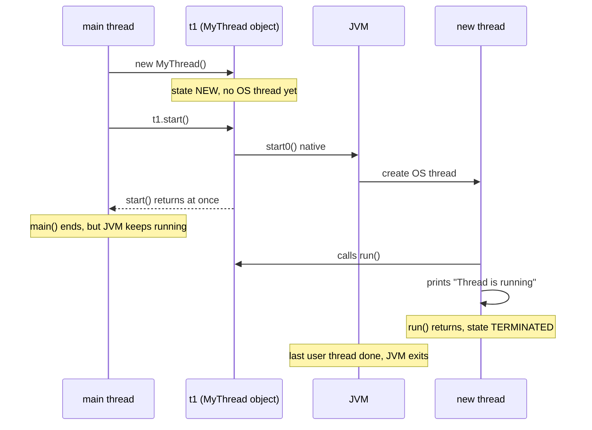
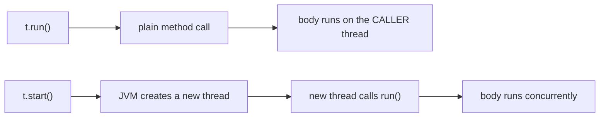

## In One Line
A thread is an independent path of execution inside your program; the classic way to make one is to **extend `java.lang.Thread`, override `run()` with the work, and call `start()`** — which asks the JVM for a brand-new thread that then runs your `run()` alongside `main`.

## Mental Model
Think of a **restaurant kitchen**.

- The **head chef** is the `main` thread — the JVM hires them automatically when the program starts.
- A **`Thread` object** is a *signed contract for a new cook*. Signing it (`new MyThread()`) does not put anyone in the kitchen yet.
- **`run()`** is the *recipe* written on the contract.
- **`start()`** is the moment the new cook *clocks in at their own station* and starts cooking the recipe — while the head chef keeps doing their own work at the same time.
- If the head chef calls **`run()`** directly, they are just *reading the recipe and cooking it themselves*. No new cook, nothing in parallel.
- The restaurant only **closes** when every regular cook has gone home — not when the head chef leaves. (Cleaners hired as *daemons* are sent home the moment the last regular cook leaves.)

Mapping: contract = `Thread` object, recipe = `run()`, clocking in = `start()`, restaurant closing = JVM exit, cleaners = daemon threads.

## Concept
### Process vs thread
| | Process | Thread |
|---|---|---|
| What it is | A running program with its own address space | A path of execution *inside* a process |
| Memory | Own heap, own code, own OS resources | **Shares** the heap, static fields, open files with other threads of the process |
| Private to it | Everything | Its own **call stack** (local variables, method frames) and program counter |
| Cost to create / switch | Expensive | Much cheaper (but a platform thread still costs ~1 MB of reserved stack and a kernel thread) |
| Communication | Pipes, sockets, files (IPC) | Just read/write shared objects — fast, but needs **synchronization** |
| A crash | Usually isolated | An uncaught exception kills only that thread; but memory corruption of shared data affects all |

Every Java program already has several threads: the **`main` thread** that runs `main(String[])`, plus JVM housekeeping threads (garbage collector, JIT compiler, `Reference Handler`, `Finalizer`, `Signal Dispatcher`...). The `main` thread is named `main`, has priority 5, belongs to thread group `main`, and is **not** a daemon.

### A `Thread` object is not a thread (yet)
`java.lang.Thread` is an ordinary Java object that *describes* a thread: its name, priority, daemon flag and the code to run. Creating it with `new` only allocates that object (state **NEW**). The real operating-system thread is created only when you call `start()`.

Since Java 21 there are two kinds of thread objects:
- **Platform threads** — the classic kind; each wraps exactly one OS (kernel) thread for its whole life. `new Thread(...)` and `extends Thread` create platform threads.
- **Virtual threads** — lightweight threads scheduled by the JVM onto a small pool of carrier platform threads (see [Virtual Threads](lesson:b03-concurrency/07-virtual-threads)).

### Ways to create a thread
| Way | Code | Notes |
|---|---|---|
| 1. Extend `Thread` | `class MyThread extends Thread { public void run() {...} }` then `new MyThread().start()` | This lesson. Uses up your one `extends`. |
| 2. Implement `Runnable` | `new Thread(new MyRunnable()).start()` | Preferred. See [Runnable](lesson:a06-threads/02-runnable). |
| 3. Lambda / method reference | `new Thread(() -> work()).start()` | Just a short `Runnable`. |
| 4. `Callable` + executor | `executor.submit(() -> 42)` | Returns a value via `Future`. See [Callable & Future](lesson:a07-executors/04-callable-and-future). |
| 5. Java 21 builders | `Thread.ofPlatform().name("w-", 1).start(r)`, `Thread.ofVirtual().start(r)`, `Thread.startVirtualThread(r)` | Fluent API; the only way to create virtual threads. |

Interview answer: *"There are really two ways to define the task — extend `Thread` or implement `Runnable` (or `Callable` for a result) — and one way to start a thread: `Thread.start()`, either directly or via an executor."*

### `start()` vs `run()` — the most asked question
| | `t.start()` | `t.run()` |
|---|---|---|
| New thread? | **Yes** — the JVM creates an OS thread | **No** — plain method call |
| Who executes `run()`'s body | The new thread | The *calling* thread (e.g. `main`) |
| Returns | Immediately, while the new thread runs concurrently | After the whole body has finished |
| Call twice? | Second call throws `IllegalThreadStateException` | As many times as you like |
| State change | NEW → RUNNABLE → ... → TERMINATED | Thread stays NEW |

### What `start()` does internally
1. Checks the thread is still **NEW**; otherwise throws `IllegalThreadStateException` (a thread can run only once — there is no "restart").
2. Registers the thread with its thread group / container.
3. Calls the private native method `start0()`. HotSpot creates a native thread (on Linux via `pthread_create`) with its own stack (size from `-Xss`, default 1 MB on 64-bit Linux, or from the `stackSize` constructor argument).
4. The new native thread attaches to the JVM and invokes `Thread.run()` on the Java object.
5. `start()` returns to the caller **without waiting**. There is no guarantee *when* the new thread gets CPU time.

When `run()` returns (or throws), the thread becomes **TERMINATED** and its OS thread is released. The `Thread` object stays on the heap as long as it is referenced; you can still read its name and state.

### Overriding `run()` — the rules
- Signature is fixed: `public void run()` — no parameters, no return value, **no checked exceptions** (you must catch `InterruptedException` etc. inside).
- Put `@Override` on it so typos like `public void Run()` become compile errors instead of silently running `Thread`'s empty `run()`.
- If you neither override `run()` nor pass a `Runnable`, `Thread.run()` does nothing and the thread ends immediately.
- Pass data in through the constructor or fields; read results out through fields after `join()` (or use `Callable`).

### When does the program end?
The JVM exits when **all non-daemon (user) threads have finished** — or when someone calls `System.exit()` / `Runtime.halt()`, or the process is killed. `main()` returning is *not* enough: if you started a user thread, the JVM waits for it. That is why the course example needs no `join()` to see its output.

| | User thread (default) | Daemon thread |
|---|---|---|
| Keeps the JVM alive | Yes | No |
| Set with | default (inherits from creator) | `t.setDaemon(true)` **before** `start()` |
| At JVM exit | JVM waits for it | Killed abruptly — `finally` blocks do **not** run |
| Typical use | Real work | Background helpers: GC, cache cleaners, heartbeat |

A new thread inherits the daemon flag and the priority of the thread that creates it.

### Naming and identifying threads
- Default names are `Thread-0`, `Thread-1`, ... from a global counter used only by threads that get an auto-generated name.
- Set a name with the constructor (`new Thread(r, "worker")`, or `super(name)` in a subclass) or `setName(...)`. Good names make thread dumps and logs readable.
- `Thread.currentThread()` returns the thread executing the current line — the way code inside `run()` finds out who it is.
- `threadId()` (Java 19+) returns the unique id; the older `getId()` is deprecated since Java 19.
- `toString()` prints `Thread[#id,name,priority,group]` since Java 19 (before that: `Thread[name,priority,group]`).

### Exceptions inside a thread
An exception that escapes `run()` terminates **only that thread**. The JVM passes it to the thread's `UncaughtExceptionHandler`; the default one prints `Exception in thread "name" ...` to `System.err`. Other threads, including `main`, carry on. You cannot catch another thread's exception with a `try` around `start()` — `start()` has already returned. Use `setUncaughtExceptionHandler`, or run the task through an `ExecutorService` and read the exception from the `Future`.

### Why extending `Thread` is usually not the best choice
- Java has single inheritance — `MyThread extends Thread` cannot extend anything else.
- It mixes **what to do** (the task) with **how it runs** (the thread). A `Runnable` task can run on a plain thread, a thread pool, a virtual thread or a scheduler without changes.
- A `Thread` object can be started only once, so a "task" written as a `Thread` subclass is single-use.
- Extending is appropriate only when you really customise the *thread itself* (rare).

### Dead APIs you should know about
`stop()`, `suspend()` and `resume()` are deprecated for removal because they are unsafe: `stop()` releases locks mid-update and leaves objects corrupted; `suspend()` keeps locks while frozen and invites deadlock. Since JDK 20 they simply throw `UnsupportedOperationException`. The correct way to stop a thread is **cooperative**: set a `volatile` flag or call `interrupt()`, and let the thread finish cleanly (see [Thread Lifecycle](lesson:a06-threads/03-thread-lifecycle)).

## Diagram

`start()` returns immediately; the printing happens later on a different thread, possibly after `main()` has already returned.


Only `start()` creates concurrency; `run()` is just the code the new thread will execute.

## Code
@example Multithreading/BasicThreadOperations/ThreadExample.java

`start()` versus `run()` — who actually executes the body:
```java
public class StartVsRun {
    public static void main(String[] args) throws InterruptedException {
        Thread t = new Thread(() ->
            System.out.println("run() executed by: " + Thread.currentThread().getName()));

        t.run();    // ordinary method call - runs on the CALLING thread
        t.start();  // asks the JVM for a NEW thread, which then calls run()
        t.join();   // wait for it so the output order is fixed
    }
}
```
```output
run() executed by: main
run() executed by: Thread-0
```

A thread can be started only once:
```java
public class StartTwice {
    public static void main(String[] args) throws InterruptedException {
        Thread t = new Thread(() -> System.out.println("working"));
        t.start();
        t.join();
        try {
            t.start();                       // second start on the same Thread object
        } catch (IllegalThreadStateException e) {
            System.out.println("Caught: " + e);
        }
    }
}
```
```output
working
Caught: java.lang.IllegalThreadStateException
```

`main()` returning does not end the program — a user thread keeps the JVM alive:
```java
public class MainEndsFirst {
    public static void main(String[] args) {
        Thread worker = new Thread(() -> {
            try { Thread.sleep(200); } catch (InterruptedException e) { return; }
            System.out.println("worker: finished after main");
        });
        worker.start();
        System.out.println("main: leaving main()");
    }
}
```
```output
main: leaving main()
worker: finished after main
```

...but a daemon thread does not:
```java
public class DaemonDies {
    public static void main(String[] args) {
        Thread daemon = new Thread(() -> {
            try { Thread.sleep(200); } catch (InterruptedException e) { return; }
            System.out.println("daemon: you will never see this");
        });
        daemon.setDaemon(true);   // must be called BEFORE start()
        daemon.start();
        System.out.println("main: leaving main(), daemon is " + daemon.isDaemon());
    }
}
```
```output
main: leaving main(), daemon is true
```

Thread names and `Thread.toString()` (the `#` ids depend on how many JVM-internal threads exist, so they differ between setups):
```java
public class Names {
    public static void main(String[] args) throws InterruptedException {
        Runnable who = () -> System.out.println(Thread.currentThread());
        System.out.println(Thread.currentThread());      // the main thread
        Thread a = new Thread(who);                      // default name Thread-0
        Thread b = new Thread(who, "worker");            // name given in the constructor
        a.start(); a.join();
        b.start(); b.join();
    }
}
```
```output
Thread[#1,main,5,main]
Thread[#19,Thread-0,5,main]
Thread[#20,worker,5,main]
```

An uncaught exception kills only its own thread:
```java
public class Uncaught {
    public static void main(String[] args) throws InterruptedException {
        Thread t = new Thread(() -> { throw new IllegalStateException("boom"); }, "worker");
        t.start();
        t.join();
        System.out.println("main still alive, worker state = " + t.getState());
    }
}
```
```output
Exception in thread "worker" java.lang.IllegalStateException: boom
	at Uncaught.lambda$main$0(Uncaught.java:3)
	at java.base/java.lang.Thread.run(Thread.java:1583)
main still alive, worker state = TERMINATED
```

Java 21 thread builders:
```java
public class Java21Builders {
    public static void main(String[] args) throws InterruptedException {
        Runnable task = () -> System.out.println("hello from " + Thread.currentThread().getName()
                + " (virtual=" + Thread.currentThread().isVirtual() + ")");

        Thread p = Thread.ofPlatform().name("worker-", 1).start(task);   // named worker-1
        p.join();

        Thread v = Thread.ofVirtual().name("virt").start(task);           // Java 21 virtual thread
        v.join();

        Thread u = Thread.ofPlatform().daemon(true).unstarted(task);      // built but not started
        System.out.println(u.getState());
    }
}
```
```output
hello from worker-1 (virtual=false)
hello from virt (virtual=true)
NEW
```

## Walkthrough
- `package Multithreading.BasicThreadOperations;` — the example lives in the course's `BasicThreadOperations` package, together with the Runnable, lifecycle and priority examples. All four files declare package-private helper classes (`MyThread`, `MyRunnable`, ...) in this package, so each helper needs a unique name.
- `class MyThread extends Thread` — defines a **new kind of thread**. `MyThread` *is-a* `Thread`, so it inherits `start()`, `getName()`, `join()` and everything else.
- `public void run()` — overrides `Thread.run()`. This is the code the new thread will execute: its "main method". It must be `public` (it overrides a public method), return `void`, and cannot declare checked exceptions. The original omits `@Override`; it still works, but the annotation is best practice.
- `System.out.println("Thread is running");` — the task. It runs on the new thread (named `Thread-0` by default). `System.out.println` is internally synchronized, so lines from different threads never get mixed *within* a line — only the *order* of lines can vary.
- `MyThread t1 = new MyThread();` — creates the `Thread` object only. The thread is in state **NEW**; no OS thread exists yet.
- `t1.start();` — the JVM creates a native thread and that thread calls `t1.run()`. `start()` returns immediately, so `main()` reaches its closing brace and returns — very likely *before* the new thread has printed anything.
- Why the output still appears: `t1` is a user (non-daemon) thread, so the JVM waits for it before exiting. The recorded output is the single line `Thread is running`, and it is the same on every run because there is only one printing thread.

## Traps
> [!ERRATA] The comment `// Output: Thread is running` sits on the `t1.start();` line, which suggests `start()` itself prints the text. It does not: `start()` only launches the thread and returns at once. The *new* thread prints the line later, typically after `main()` has already returned. It would be more accurate as a comment inside `run()`, or after a `t1.join()`.

> [!ERRATA] `run()` is overridden without `@Override`. Not a bug here, but if the method were misspelled (`public void Run()`), the code would still compile and the thread would silently run `Thread`'s empty `run()`. Always write `@Override public void run()`.

- **Calling `run()` instead of `start()`** compiles, runs and prints the same text — but on the `main` thread, with zero concurrency. This is the number-one beginner bug and a favourite interview question.
- **Starting twice** — `t1.start(); t1.start();` throws `IllegalThreadStateException`. Create a new `Thread` object for each run (or use a pool).
- **`setDaemon(true)` after `start()`** throws `IllegalThreadStateException`.
- **Daemon threads die without cleanup** — their `finally` blocks do not run at JVM exit. Never do I/O that must complete (writing files, committing transactions) in a daemon thread.
- **Checked exceptions cannot leave `run()`** — `public void run() throws InterruptedException` does not compile. Catch and handle inside.
- **An exception in a thread does not reach `main`** — wrapping `t.start()` in `try/catch` catches nothing from `run()`.
- **Overriding `start()`** without calling `super.start()` means no thread is ever created. Never override `start()`.
- **Output order is not program order** — as soon as two threads print, the order of their lines can change between runs (see [Thread Priority](lesson:a06-threads/04-thread-priority)).

> [!WARNING] `Thread.stop()`, `suspend()` and `resume()` throw `UnsupportedOperationException` on JDK 20+. Old tutorials that use them no longer work — use interruption or a `volatile` flag.

## Tips & Tricks
- **"`start()` STARTs a thread; `run()` just RUNs code."** If you do not see `start()`, there is no new thread.
- **One `Thread` object = one life.** NEW → ... → TERMINATED, never back.
- **"JVM leaves with the last *user* thread"** — daemons do not count.
- **Name your threads** (`new Thread(r, "order-sync")`, or `Thread.ofPlatform().name("worker-", 0)`). Thread dumps full of `Thread-17` are painful to debug.
- **Prefer `Runnable`/lambdas + executors** in real code; use `extends Thread` only to understand the basics or when you truly customise the thread.
- **Always `@Override`** `run()`.
- To make output deterministic in demos, call `join()` before printing results that depend on another thread.

## Interview Q&A
### [Basic] What is a thread, and how is it different from a process?
A thread is the smallest unit of execution the OS schedules; a process is a running program with its own memory space. A process can contain many threads. Threads of the same process **share** the heap, static data and open resources, but each has its **own stack** and program counter. That makes threads cheap to create and fast to communicate (they just share objects), but it also means shared data must be protected with synchronization. Processes are isolated and communicate through IPC (pipes, sockets, files).

**Follow-up:** *What does each Java thread own privately?* — Its call stack (local variables and partial results of each method frame), its program counter, and its `ThreadLocal` values. Objects are always on the shared heap.

### [Basic] What are the ways to create a thread in Java?
1. Extend `Thread` and override `run()`, then call `start()`.
2. Implement `Runnable` (a class, lambda or method reference) and pass it to `new Thread(runnable)`.
3. Implement `Callable<V>` and submit it to an `ExecutorService` (gets a result through a `Future`), or wrap it in a `FutureTask` for a plain `Thread`.
4. Java 21: `Thread.ofPlatform()` / `Thread.ofVirtual()` builders, `Thread.startVirtualThread(r)`, or `Executors.newVirtualThreadPerTaskExecutor()`.

Strictly speaking, there is only one way to *start* a thread — `Thread.start()` (executors call it for you); the options differ in how you *define the task*.

**Follow-up:** *Which do you prefer?* — `Runnable`/`Callable` submitted to an executor: it keeps the task separate from the threading mechanism, does not waste the single `extends`, and reuses threads.

### [Basic] What is the difference between `start()` and `run()`?
`start()` asks the JVM to create a new thread of execution; that new thread then calls `run()`. `start()` returns immediately, so the caller and the new thread run concurrently. Calling `run()` directly is just a normal method call: the body executes on the *current* thread, synchronously, and no new thread is created. `start()` can be called only once per `Thread` object; `run()` any number of times.
```java
Thread t = new Thread(() -> System.out.println(Thread.currentThread().getName()));
t.run();    // prints main
t.start();  // prints Thread-0
```
**Follow-up:** *Would the course example print the same text if you called `t1.run()`?* — Yes, `Thread is running` — but from the `main` thread. The output hides the bug; only the thread name reveals it.

### [Basic] Can you start the same thread twice?
No. The second `start()` throws `IllegalThreadStateException`, whether the first run has finished or not. A thread's life is one-way: NEW → RUNNABLE → ... → TERMINATED, and only a NEW thread can be started. To run the task again, create a new `Thread` (or submit the `Runnable` to an executor again).

**Follow-up:** *Is it a checked exception?* — No, `IllegalThreadStateException` extends `IllegalArgumentException`, a `RuntimeException`.

### [Intermediate] Does a Java program end when `main()` returns?
Not necessarily. The JVM exits when all **non-daemon** threads have terminated (or on `System.exit`, `Runtime.halt`, or a fatal signal). If `main` starts a user thread and returns, the JVM keeps running until that thread finishes — which is why the course example still prints its line. **Daemon** threads (`setDaemon(true)` before `start()`) do not keep the JVM alive; at exit they are stopped abruptly and their `finally` blocks are not executed.

**Follow-up:** *Is a thread created by a daemon thread also a daemon?* — Yes by default; a new thread inherits the daemon status (and priority) of its creator.

### [Intermediate] What happens if a thread throws an uncaught exception?
The exception propagates out of `run()`, the thread terminates, and the JVM calls the thread's `UncaughtExceptionHandler` (per-thread handler, else the thread group, else the default handler, which prints `Exception in thread "name"` and the stack trace to `System.err`). Other threads are unaffected, and the JVM does not exit unless no user threads remain. The starting code cannot catch it because `start()` already returned.
```java
Thread t = new Thread(task, "worker");
t.setUncaughtExceptionHandler((th, ex) -> log.error("{} died", th.getName(), ex));
```
**Follow-up:** *How do you get the exception back in the caller?* — Submit a `Callable`/`Runnable` to an `ExecutorService`; `future.get()` throws `ExecutionException` wrapping the original.

### [Intermediate] What happens if a `Thread` subclass does not override `run()`?
`Thread.run()` runs the `Runnable` target passed to the constructor, if any; otherwise it does nothing. So `new Thread().start()` creates a thread that ends immediately without any output. That is also what happens when you misspell `run` — which is why `@Override` matters.

**Follow-up:** *Can you override `start()`?* — Technically yes, but unless you call `super.start()` no thread is created. There is no good reason to do it.

### [Intermediate] Why should you prefer implementing `Runnable` over extending `Thread`?
Because extending `Thread` uses up Java's single inheritance, couples the task to one specific execution mechanism, and makes the task single-use (a `Thread` can be started once). A `Runnable` is a plain task: it can run on a new thread, a thread pool, a scheduled executor or a virtual thread, and one instance can be shared by many threads. Composition over inheritance.

**Follow-up:** *When would you extend `Thread`?* — Only to change thread behaviour itself (e.g. a custom thread class used by a `ThreadFactory`), not to describe a task.

### [Advanced] What does `start()` do internally?
It checks the thread status is NEW (otherwise `IllegalThreadStateException`), registers the thread with its group/container, and calls the native `start0()`. HotSpot then creates a native OS thread (via `pthread_create` on Linux) with its own stack (`-Xss`, default 1 MB on 64-bit Linux), attaches it to the JVM, and that native thread invokes the Java `run()` method. `start()` returns without waiting. The OS scheduler decides when each thread actually gets a CPU. When `run()` completes, the JVM detaches and destroys the native thread and marks the `Thread` object TERMINATED.

**Follow-up:** *Is a Java platform thread the same as an OS thread?* — Yes, 1:1 for platform threads. Virtual threads (Java 21) are M:N — many virtual threads are multiplexed onto a few carrier platform threads by the JVM.

### [Advanced] Why were `stop()`, `suspend()` and `resume()` deprecated, and how do you stop a thread correctly?
`stop()` throws `ThreadDeath` at an arbitrary point, releasing all monitors while an object may be half-updated, so other threads see corrupted state. `suspend()` freezes a thread while it still holds its locks — any thread needing them deadlocks — and `resume()` exists only to pair with it. Since JDK 20 all three throw `UnsupportedOperationException`. The correct way is cooperative cancellation: call `t.interrupt()` (blocking calls like `sleep`/`wait`/`join` throw `InterruptedException`; loops check `Thread.currentThread().isInterrupted()`), or use a `volatile boolean running` flag, and let the thread clean up and return. Executors do the same with `shutdownNow()` / `future.cancel(true)`.

**Follow-up:** *Why must the flag be `volatile`?* — Without it, the worker may never see the update (the JIT can hoist the read out of the loop). See [Synchronization](lesson:a06-threads/05-synchronization).

## Quiz
### When is "Thread is running" printed in the original example?
- [ ] Synchronously inside `t1.start()`, before `start()` returns
- [x] Later, by the new thread — possibly after `main()` has returned
- [ ] Never, because `main()` ends before the thread can run
- [ ] Only if `main` calls `t1.join()`
> `start()` returns immediately and the new thread prints on its own schedule. The line always appears because the JVM waits for all user threads, so no `join()` is needed. The comment on the `start()` line makes it look synchronous, but it is not.

### What does this print?
```java
Thread t = new Thread(() ->
    System.out.println("run() executed by: " + Thread.currentThread().getName()));
t.run();
t.start();
t.join();
```
- [ ] `run() executed by: Thread-0` twice
- [x] `run() executed by: main` then `run() executed by: Thread-0`
- [ ] `run() executed by: main` twice
- [ ] `IllegalThreadStateException`, because `run()` already ran
> `t.run()` is an ordinary call executed by `main`. `t.start()` then creates the real thread `Thread-0`. Calling `run()` does not change the thread's state, so `start()` is still allowed.

### What happens here?
```java
Thread t = new Thread(() -> System.out.println("working"));
t.start();
t.join();
t.start();
```
- [ ] Prints `working` twice
- [ ] Prints `working` once; the second `start()` is ignored
- [x] Prints `working`, then throws `IllegalThreadStateException`
- [ ] Compile error
> Only a NEW thread can be started. After it has run, it is TERMINATED forever, so the second `start()` throws. It is a runtime exception — the compiler does not complain.

### What does this print?
```java
Thread daemon = new Thread(() -> {
    try { Thread.sleep(200); } catch (InterruptedException e) { return; }
    System.out.println("daemon: you will never see this");
});
daemon.setDaemon(true);
daemon.start();
System.out.println("main: leaving main(), daemon is " + daemon.isDaemon());
```
- [x] Only `main: leaving main(), daemon is true`
- [ ] Both lines, main's first
- [ ] Both lines, daemon's first
- [ ] Nothing — `setDaemon` before `start` throws
> When `main` returns, no user threads are left, so the JVM exits and kills the sleeping daemon. If the thread were a normal user thread, the JVM would wait and print both lines.

### Spot the bug: the three "workers" take three times as long as expected.
```java
for (int i = 0; i < 3; i++) {
    Thread t = new Thread(() -> slowDownload());
    t.run();
}
```
- [ ] The lambda must be a `Runnable` class
- [x] `run()` is called instead of `start()`, so the downloads run one after another on `main`
- [ ] Threads must be named before they run
- [ ] A loop cannot create threads
> `run()` is a plain method call — no new thread. Running it prints `main` three times if you print the thread name. `t.start()` would run the three downloads concurrently.

### What does this print?
```java
Thread plain = new Thread();
plain.start();
plain.join();
System.out.println("plain thread did nothing and ended: " + plain.getState());
```
- [ ] Compile error: a Thread needs a Runnable
- [ ] `NullPointerException` because there is no task
- [x] `plain thread did nothing and ended: TERMINATED`
- [ ] It hangs forever
> `Thread.run()` runs the target `Runnable` only if one was given; otherwise it simply returns. The thread starts, does nothing, and terminates.

### Which statement about daemon threads is TRUE?
- [ ] A daemon thread keeps the JVM alive until it finishes
- [ ] You can call `setDaemon(true)` at any time
- [x] A thread created by a daemon thread is a daemon by default
- [ ] Daemon threads always run their `finally` blocks at JVM exit
> Daemon status (like priority) is inherited from the creating thread. The JVM does not wait for daemons, `setDaemon` after `start()` throws `IllegalThreadStateException`, and daemons are stopped abruptly, skipping `finally`.

## Takeaways
- A `Thread` object is only a description until `start()` is called; `start()` creates a new OS thread that runs `run()` concurrently and returns immediately.
- Calling `run()` directly is a normal method call on the current thread — no concurrency; calling `start()` twice throws `IllegalThreadStateException`.
- Override `public void run()` with `@Override`; it cannot throw checked exceptions and an uncaught exception kills only that thread.
- The JVM exits when the last non-daemon thread ends, not when `main()` returns; daemon threads are killed abruptly without running `finally`.
- Prefer `Runnable`/`Callable` with executors over `extends Thread`; name your threads for readable logs and dumps.
- `stop()`/`suspend()`/`resume()` throw `UnsupportedOperationException` on JDK 20+; stop threads cooperatively with `interrupt()` or a `volatile` flag.
- Java 21 adds `Thread.ofPlatform()`/`Thread.ofVirtual()` builders and virtual threads; `threadId()` replaces the deprecated `getId()`.
