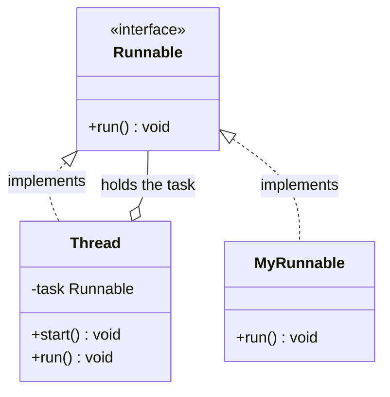
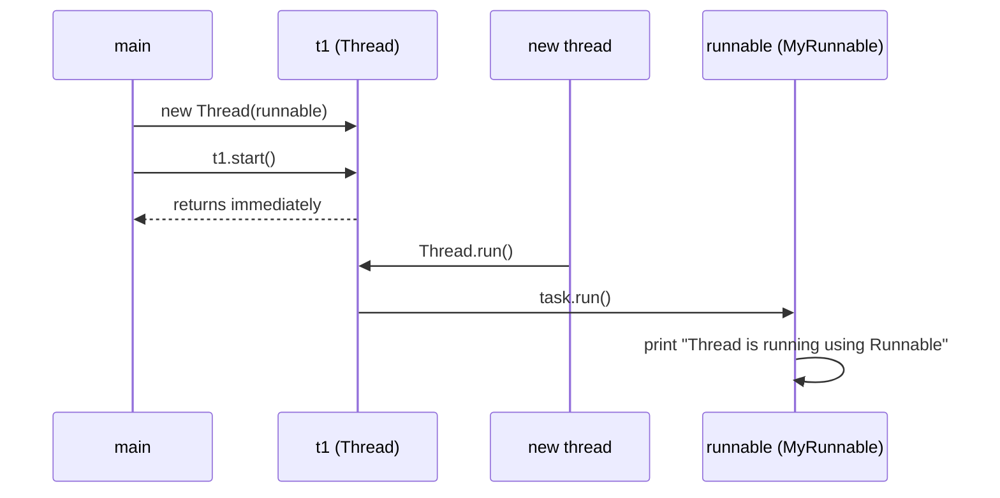

## In One Line
`Runnable` is a one-method interface (`void run()`) that describes a **task**; you hand it to a `Thread` (or an executor), and the thread is the **worker** that executes it — keeping "what to do" separate from "who does it".

## Mental Model
Think of a **delivery job slip** and a **delivery driver**.

- The **slip** (`Runnable`) says what must be done: "take parcel 42 to Main Street". It knows nothing about who will do it.
- The **driver** (`Thread`) is the one who actually moves. You give the driver a slip: `new Thread(slip)`.
- **`start()`** = the driver sets off. The driver's standard procedure (`Thread.run()`) is simply "do whatever the slip says" (`slip.run()`).
- The same slip can be handed to a *courier company* instead (an `ExecutorService` with a pool of drivers), or photocopied to several drivers (one `Runnable` shared by many threads) — the slip does not change.

With `extends Thread` (previous lesson) the job description is tattooed on the driver: that driver can only ever do that one job, once.

## Concept
### The interface
```java
package java.lang;

@FunctionalInterface
public interface Runnable {
    void run();          // no arguments, no result, no checked exceptions
}
```
- In `java.lang` since JDK 1.0, so no import is needed.
- Marked `@FunctionalInterface` since Java 8, so a **lambda** or **method reference** can implement it.
- `run()` is implicitly `public abstract`; an implementing class must declare it `public`.
- `java.lang.Thread` itself **implements `Runnable`**.

### How `Thread` uses your `Runnable`
`new Thread(runnable)` stores the task inside the `Thread` object (a field named `target` in older JDKs; in JDK 21 it lives in an internal `holder.task`). `Thread`'s own `run()` is essentially:
```java
public void run() {
    if (task != null) task.run();   // delegate to the Runnable you passed
}
```
So `start()` → new thread → `Thread.run()` → **your** `run()`. If a subclass overrides `Thread.run()`, that override replaces the delegation and the passed `Runnable` is ignored.

### Useful `Thread` constructors that take a `Runnable`
| Constructor | Use |
|---|---|
| `Thread(Runnable task)` | The common one. Name defaults to `Thread-N`. |
| `Thread(Runnable task, String name)` | Name the thread for logs and dumps. |
| `Thread(ThreadGroup g, Runnable task, String name)` | Put it in a specific group (legacy). |
| `Thread(ThreadGroup g, Runnable task, String name, long stackSize)` | Request a stack size (a hint; may be ignored). |
| `Thread.ofPlatform().name(..).start(task)` / `Thread.ofVirtual().start(task)` | Java 21 builders. |

### Four ways to write a `Runnable`
| Style | Code | Use when |
|---|---|---|
| Named class | `class MyRunnable implements Runnable { public void run() {...} }` | Task has state, fields, constructor, reused in many places (the course example). |
| Anonymous class | `new Runnable() { public void run() {...} }` | Pre-Java 8 code; needs its own fields or `this`. |
| Lambda | `() -> System.out.println("hi")` | Short tasks. The modern default. |
| Method reference | `this::refreshCache`, `Worker::process` | The task is an existing method. |

Lambda rules that matter for threads:
- Captured local variables must be **effectively final**. In a loop, copy the loop variable: `int id = i; new Thread(() -> use(id))`.
- Inside a lambda, `this` means the **enclosing object**; inside an anonymous class, `this` is the anonymous object.
- A lambda does not create a new `.class` file per lambda at compile time (it uses `invokedynamic`); an anonymous class does (`Outer$1.class`).

### `Runnable` vs extending `Thread`
| | `implements Runnable` | `extends Thread` |
|---|---|---|
| Inheritance | Class can still extend something else | Uses up the single `extends` |
| Design | Task separated from execution mechanism | Task and thread fused |
| Reuse | Same instance can run on many threads, pools, schedulers, virtual threads | One object = one thread = one run |
| Sharing state | One `Runnable` object passed to several threads shares its fields | Each `Thread` subclass object has its own fields |
| Lambdas | Yes | No (you must subclass) |
| Access to thread methods | Via `Thread.currentThread()` | Directly (`getName()`, `isInterrupted()`) |
| Verdict | **Preferred** | Only when customising the thread itself |

### `Runnable` vs `Callable`
| | `Runnable` | `Callable<V>` |
|---|---|---|
| Package / since | `java.lang`, JDK 1.0 | `java.util.concurrent`, Java 5 |
| Method | `void run()` | `V call() throws Exception` |
| Result | None | Returns a value |
| Checked exceptions | Must be caught inside | Can be thrown; surfaced as `ExecutionException` from `Future.get()` |
| Accepted by `new Thread(...)` | Yes | No — wrap it in a `FutureTask` (which *is* a `Runnable`) |
| Accepted by executors | `execute(r)`, `submit(r)` (the `Future<?>` yields `null`) | `submit(c)`, `invokeAll`, `invokeAny` |

Details in [Callable & Future](lesson:a07-executors/04-callable-and-future).

### Sharing one `Runnable` between threads
`new Thread(task)` does **not** copy `task`. Two threads built from the same `Runnable` instance run the *same object*, so they share its fields. That is handy for splitting work, but those fields are now shared mutable state and must be thread-safe (`synchronized`, atomics — see [Synchronization](lesson:a06-threads/05-synchronization)). Local variables inside `run()` are always private to each thread because each thread has its own stack.

### Where else `Runnable` shows up
`ExecutorService.execute/submit`, `ScheduledExecutorService.schedule`, `CompletableFuture.runAsync`, `SwingUtilities.invokeLater` / `Platform.runLater` (JavaFX), `Thread.Builder.start`, `Executors.callable(Runnable)` adapter, and `Runtime.addShutdownHook(Thread)` (a `Thread`, which is a `Runnable`). Learn it once; you will use it everywhere.

## Diagram

`Thread` both *is* a `Runnable` and *has* a `Runnable`: its own `run()` just calls the task you gave it.


The new thread runs `Thread.run()`, which delegates to your `Runnable`.

## Code
@example Multithreading/BasicThreadOperations/RunnableExample.java

All four ways of writing the task (joined one by one so the order is fixed):
```java
public class FourWays {
    static class Task implements Runnable {                 // 1. named class
        public void run() { System.out.println("1 named class"); }
    }
    static void work() { System.out.println("4 method reference"); }

    public static void main(String[] args) throws InterruptedException {
        Runnable anon = new Runnable() {                    // 2. anonymous class
            @Override public void run() { System.out.println("2 anonymous class"); }
        };
        Runnable lambda = () -> System.out.println("3 lambda");   // 3. lambda
        Runnable ref = FourWays::work;                             // 4. method reference

        for (Runnable r : new Runnable[] { new Task(), anon, lambda, ref }) {
            Thread t = new Thread(r);
            t.start();
            t.join();                                       // one at a time, so the order is fixed
        }
    }
}
```
```output
1 named class
2 anonymous class
3 lambda
4 method reference
```

One `Runnable` object shared by two threads — they share its fields:
```java
import java.util.concurrent.atomic.AtomicInteger;

public class SharedTask {
    static class Ticket implements Runnable {
        private final AtomicInteger sold = new AtomicInteger();
        public void run() {
            for (int i = 0; i < 1000; i++) sold.incrementAndGet();
        }
    }
    public static void main(String[] args) throws InterruptedException {
        Ticket task = new Ticket();                // ONE task object ...
        Thread a = new Thread(task, "counter-A");  // ... shared by two threads
        Thread b = new Thread(task, "counter-B");
        a.start(); b.start();
        a.join();  b.join();
        System.out.println("Tickets sold: " + task.sold.get());
    }
}
```
```output
Tickets sold: 2000
```

Subclass `run()` beats the `Runnable` (classic trick question):
```java
public class WhichRun {
    public static void main(String[] args) throws InterruptedException {
        Thread t = new Thread(() -> System.out.println("Runnable's run")) {
            @Override public void run() { System.out.println("Thread subclass's run"); }
        };
        t.start();
        t.join();
    }
}
```
```output
Thread subclass's run
```

Getting a result: `Callable` via `FutureTask` or an executor:
```java
import java.util.concurrent.*;

public class CallableVsRunnable {
    public static void main(String[] args) throws Exception {
        Callable<Integer> job = () -> 6 * 7;            // returns a value, may throw checked exceptions

        // Option A: wrap it in a FutureTask (which IS a Runnable) and give it to a Thread
        FutureTask<Integer> future = new FutureTask<>(job);
        new Thread(future).start();
        System.out.println("FutureTask result: " + future.get());

        // Option B: submit it to an ExecutorService (the usual way)
        try (ExecutorService pool = Executors.newFixedThreadPool(2)) {   // AutoCloseable since Java 19
            Future<Integer> f = pool.submit(job);
            System.out.println("ExecutorService result: " + f.get());
        }
    }
}
```
```output
FutureTask result: 42
ExecutorService result: 42
```

Lambdas capture only effectively final variables — copy the loop variable:
```java
public class LoopCaptureFixed {
    public static void main(String[] args) throws InterruptedException {
        for (int i = 0; i < 3; i++) {
            int id = i;                                   // a fresh effectively-final copy per iteration
            Thread t = new Thread(() -> System.out.println("task " + id));
            t.start();
            t.join();
        }
    }
}
```
```output
task 0
task 1
task 2
```
Using `i` directly in the lambda fails to compile: `local variables referenced from a lambda expression must be final or effectively final`.

## Walkthrough
- `package Multithreading.BasicThreadOperations;` — same package as the `extends Thread` example, so the helper class needs its own name (`MyRunnable`, not `MyThread`).
- `class MyRunnable implements Runnable` — a **task** class. It is not a thread and has no `start()` method; it only promises a `run()` method.
- `public void run()` — implements `Runnable.run()`. It must be `public` because interface methods are public. The comment says "Override the run method"; strictly it *implements* an abstract method, but `@Override` is still allowed and recommended (the original leaves it out).
- `System.out.println("Thread is running using Runnable");` — the work. It will be executed by the new thread (`Thread-0`), not by `main`.
- `MyRunnable runnable = new MyRunnable();` — creates the task object. Nothing runs yet.
- `Thread t1 = new Thread(runnable);` — creates the worker and gives it the task. The `Thread` stores a reference to the same `runnable` object (no copy). State: NEW.
- `t1.start();` — the JVM creates a new OS thread; that thread calls `Thread.run()`, which calls `runnable.run()`, which prints the line. `start()` returns immediately; `main` then ends, and the JVM waits for `t1` because it is a user thread.
- Output: `Thread is running using Runnable` — one line, identical on every run, because only one thread prints.

The two-step `new MyRunnable()` + `new Thread(runnable)` is the long form of the modern one-liner:
```java
new Thread(() -> System.out.println("Thread is running using Runnable")).start();
```

## Traps
> [!ERRATA] As in the `ThreadExample`, the comment `// Output: Thread is running using Runnable` is attached to `t1.start()`, implying `start()` prints it. `start()` only launches the thread and returns; the new thread prints the line afterwards (usually after `main()` has finished). Also, `run()` is written without `@Override` even though the comment says "Override the run method" — add the annotation so the compiler checks the signature.

- **`runnable.run()` is not concurrency.** Calling the `Runnable` directly executes it on the current thread. Only `new Thread(runnable).start()` (or an executor) runs it on another thread.
- **Passing a `Runnable` to a `Thread` subclass that overrides `run()`** — the subclass's `run()` wins and the `Runnable` is silently ignored (see `WhichRun`).
- **A shared `Runnable` means shared fields.** Two threads built from one instance mutate the same fields; use thread-safe types or locks. If you want separate state, create one `Runnable` per thread.
- **Loop variables in lambdas** — `() -> use(i)` inside `for (int i...)` does not compile; copy to a local first.
- **`Runnable` cannot return a value or throw checked exceptions.** Do not "return" results through `static` fields read without `join()`; use `Callable` + `Future`.
- **`submit(runnable)` swallows exceptions** — an exception thrown by a `Runnable` submitted with `submit()` is stored in the returned `Future` and never printed unless you call `get()`. With `execute()` it goes to the uncaught-exception handler.
- **Passing a `Thread` as a `Runnable`** (`new Thread(otherThread)`) compiles because `Thread implements Runnable`, but it only calls `otherThread.run()` on the new thread — `otherThread` itself is never started and stays NEW.

## Tips & Tricks
- **"Runnable = the job; Thread = the worker."** Jobs can be given to any worker or to a whole team (executor).
- **Composition over inheritance:** a class *has* a task and *gives* it to a thread, instead of *being* a thread.
- **Need a result or a checked exception? Think "Callable".** *Runnable runs; Callable calls back with an answer.*
- Default in modern code: a lambda `Runnable` submitted to an `ExecutorService` (or a virtual-thread executor in Java 21).
- Name the thread in the constructor: `new Thread(task, "email-sender")`.
- Inside a `Runnable`, get the current worker with `Thread.currentThread()` — you do not have `this.getName()` like a `Thread` subclass.

## Interview Q&A
### [Basic] What is the `Runnable` interface?
`Runnable` is a functional interface in `java.lang` with a single method `void run()`. It represents a task that can be executed by a thread. You implement it (as a class, anonymous class, lambda or method reference) and pass it to `new Thread(runnable)` or an executor; when the thread starts, it calls your `run()`.
```java
Runnable task = () -> System.out.println("working on " + Thread.currentThread().getName());
new Thread(task, "worker-1").start();
```
**Follow-up:** *Why can a lambda be used for it?* — Because it has exactly one abstract method, so it is a functional interface (annotated `@FunctionalInterface` since Java 8).

### [Basic] Which is better: implementing `Runnable` or extending `Thread`?
Implementing `Runnable`. It leaves the class free to extend another class, separates the task from the threading mechanism so the same task can run on a thread, a pool, a scheduler or a virtual thread, lets one task instance be shared by several threads, and works with lambdas. Extending `Thread` is only justified when you customise the thread itself.

**Follow-up:** *Is there anything `extends Thread` gives you that `Runnable` does not?* — Direct access to `Thread` methods like `getName()` or `isInterrupted()` via `this`; with `Runnable` you call `Thread.currentThread()`.

### [Basic] How do you create and start a thread using a lambda?
```java
Thread t = new Thread(() -> System.out.println("Hello from " + Thread.currentThread().getName()), "greeter");
t.start();
```
The lambda is converted to a `Runnable` because the `Thread(Runnable, String)` constructor expects one. In Java 21 you can also write `Thread.ofPlatform().name("greeter").start(() -> ...)` or `Thread.startVirtualThread(() -> ...)`.

**Follow-up:** *What can the lambda capture?* — Fields freely, but local variables only if they are final or effectively final.

### [Intermediate] What is the difference between `Runnable` and `Callable`?
`Runnable.run()` returns `void` and cannot throw checked exceptions; `Callable<V>.call()` returns a `V` and is declared `throws Exception`. `Runnable` exists since JDK 1.0 and can be given directly to `Thread`; `Callable` came with `java.util.concurrent` in Java 5 and is run through an `ExecutorService` (`submit` returns a `Future<V>`) or wrapped in a `FutureTask` for a plain thread. Exceptions from `call()` come back as `ExecutionException` when you call `Future.get()`.

**Follow-up:** *Can you submit a `Runnable` to `submit()`?* — Yes; you get a `Future<?>` whose `get()` returns `null` when the task completes (or `submit(runnable, result)` to supply a fixed result).

### [Intermediate] A `Thread` subclass overrides `run()` and is also constructed with a `Runnable`. Which `run()` executes?
The subclass's `run()`. `Thread.run()` is the method that delegates to the `Runnable`; overriding it replaces that delegation, so the `Runnable` is never called (unless the override calls `super.run()`).
```java
new Thread(() -> System.out.println("Runnable's run")) {
    @Override public void run() { System.out.println("Thread subclass's run"); }
}.start();   // prints "Thread subclass's run"
```
**Follow-up:** *How would you make both run?* — Call `super.run()` inside the override.

### [Intermediate] Can one `Runnable` instance be used by multiple threads? What must you watch out for?
Yes — `new Thread(task)` stores a reference, not a copy, so `new Thread(task).start()` twice runs the same object on two threads. Local variables in `run()` are per-thread (each thread has its own stack), but the object's **fields are shared**, so any mutable field needs synchronization or an atomic/concurrent type. This is a common source of race conditions in interview code.

**Follow-up:** *How do you give each thread its own state then?* — Create one `Runnable` per thread, keep state in locals, or use `ThreadLocal`.

### [Intermediate] Why can't `run()` throw a checked exception, and how do you deal with that?
Because `Runnable.run()` is declared without a `throws` clause, and an overriding/implementing method cannot add checked exceptions. Also, there is no caller to catch it — the thread's stack starts at `run()`. You either catch and handle inside `run()` (for `InterruptedException`, restore the flag with `Thread.currentThread().interrupt()`), wrap it in an unchecked exception (it will reach the uncaught-exception handler), or use a `Callable` so the exception is delivered through the `Future`.

**Follow-up:** *What happens to a `RuntimeException` thrown from `run()`?* — The thread dies and the uncaught-exception handler prints it; other threads continue.

### [Advanced] How does `Thread` execute the `Runnable` internally?
The constructor stores the `Runnable` (historically the `target` field; in JDK 21 inside an internal `FieldHolder` as `task`). `start()` makes the JVM create a native thread, which calls the `Thread` object's `run()`. The default `Thread.run()` checks whether a task was supplied and, if so, calls `task.run()`. `Thread` itself implements `Runnable`, which is why a `Thread` can even be passed to another `Thread`'s constructor — the outer thread would then just call the inner object's `run()` method, and the inner `Thread` would stay NEW.

**Follow-up:** *What happens when you call `t.run()` directly on a `Thread` built with a `Runnable`?* — The task runs synchronously on the caller's thread; no new thread is created.

### [Advanced] Lambda vs anonymous class for a `Runnable` — are they the same?
Mostly interchangeable, with differences: in a lambda `this` refers to the enclosing instance, in an anonymous class to the anonymous object itself; an anonymous class can have its own fields and state, a lambda cannot; an anonymous class is compiled to a separate `Outer$1.class`, while a lambda is linked at runtime through `invokedynamic` and `LambdaMetafactory`; and an anonymous class can shadow variables of the enclosing scope, a lambda cannot redeclare them. Both can capture only effectively final locals.

**Follow-up:** *Which one should you use for a thread task?* — A lambda for short stateless tasks; a named class when the task has state, constructor parameters, or is reused.

## Quiz
### In the original example, which thread executes `MyRunnable.run()`?
- [ ] `main`, because `main` created the `MyRunnable`
- [x] The new thread started by `t1.start()` (named `Thread-0`)
- [ ] Both `main` and `Thread-0`
- [ ] No thread — a `Runnable` cannot run without an executor
> Creating the task object on `main` does not make `main` run it. `t1.start()` creates a new thread, whose `Thread.run()` calls `runnable.run()`. `main` would run it only if it called `runnable.run()` or `t1.run()` directly.

### What does this print?
```java
Thread t = new Thread(() -> System.out.println("Runnable's run")) {
    @Override public void run() { System.out.println("Thread subclass's run"); }
};
t.start();
t.join();
```
- [ ] `Runnable's run`
- [x] `Thread subclass's run`
- [ ] Both lines
- [ ] Compile error: cannot pass a Runnable to an anonymous subclass
> The anonymous subclass overrides `Thread.run()`, which is the only place that would have called the `Runnable`. Without `super.run()`, the `Runnable` is ignored.

### What does this print?
```java
Thread inner = new Thread(() ->
    System.out.println("executed by " + Thread.currentThread().getName()), "inner");
Thread outer = new Thread(inner, "outer");
outer.start();
outer.join();
System.out.println("inner state: " + inner.getState());
```
- [ ] `executed by inner` / `inner state: TERMINATED`
- [x] `executed by outer` / `inner state: NEW`
- [ ] `executed by outer` / `inner state: TERMINATED`
- [ ] Compile error: a Thread is not a Runnable
> `Thread implements Runnable`, so `inner` is just a task for `outer`. `outer` calls `inner.run()` as an ordinary method on its own thread, so the name is `outer`, and `inner` was never started — it stays NEW.

### Two threads share one `Ticket` task that does `sold.incrementAndGet()` 1000 times with an `AtomicInteger`. What is printed after both are joined?
- [ ] 1000, because each thread gets its own copy of the task
- [x] 2000
- [ ] Anything between 1000 and 2000
- [ ] 0, because the threads were not synchronized
> `new Thread(task)` shares the same object, so both threads increment the same `AtomicInteger`; atomic increments never lose updates, so the result is exactly 2000. With a plain `int` and `count++` it could be lower.

### Spot the bug.
```java
for (int i = 0; i < 3; i++) {
    new Thread(() -> System.out.println("task " + i)).start();
}
```
- [ ] It prints `task 3` three times
- [x] It does not compile: `i` is not effectively final
- [ ] The threads print in random order, which is the bug
- [ ] `start()` cannot be chained after `new Thread(...)`
> Lambdas may capture only final or effectively final locals, and `i` changes on every iteration. Fix: `int id = i;` inside the loop and capture `id`. (Random print order would be expected behaviour, not a compile problem.)

### Which statement about `Runnable` and `Callable` is TRUE?
- [ ] Both can be passed directly to `new Thread(...)`
- [ ] `Runnable.run()` can declare `throws Exception`
- [x] `Callable.call()` returns a value and may throw checked exceptions
- [ ] `Callable` is in `java.lang`
> `Callable<V>` (in `java.util.concurrent`) returns `V` and declares `throws Exception`. `Runnable.run()` returns `void` with no `throws` clause. A `Callable` must be run through an executor or wrapped in a `FutureTask` for a plain `Thread`.

## Takeaways
- `Runnable` is a `java.lang` functional interface with one method, `void run()`; it describes a task, not a thread.
- `new Thread(runnable).start()` creates a thread whose `Thread.run()` delegates to your `runnable.run()`; `Thread` itself implements `Runnable`.
- Prefer `Runnable` over `extends Thread`: free inheritance, task separated from execution, reusable with executors and virtual threads, lambda-friendly.
- A subclass that overrides `Thread.run()` ignores any `Runnable` passed to the constructor.
- One `Runnable` shared by several threads shares its fields — make that state thread-safe.
- `Runnable` cannot return a value or throw checked exceptions — use `Callable` + `Future` (or `FutureTask`) for that.
- Lambdas capture only effectively final locals; copy loop variables before capturing.
