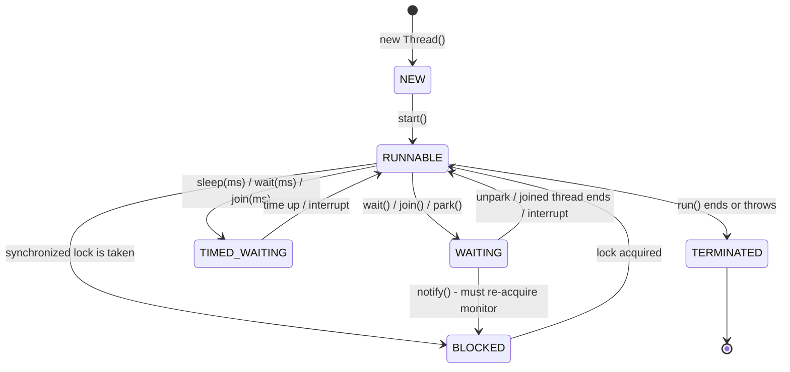
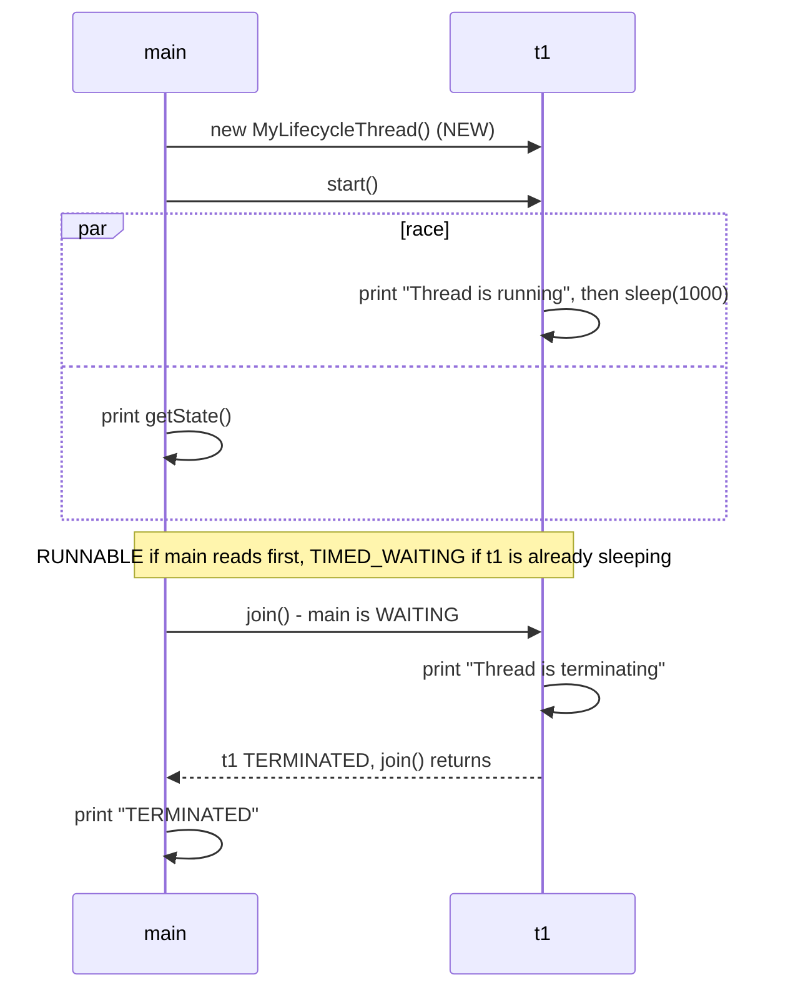

## In One Line
Every Java thread moves through the states of the `Thread.State` enum — **NEW → RUNNABLE ⇄ (BLOCKED / WAITING / TIMED_WAITING) → TERMINATED** — driven by `start()`, locks, `sleep()`, `wait()`, `join()` and the end of `run()`, and you can observe the current state with `getState()`.

## Mental Model
Think of a **patient in a hospital**.

- **NEW** — the patient is registered at reception but has not gone in yet (`new Thread()`).
- **RUNNABLE** — the patient is in the treatment area: either being treated right now *or* sitting in the queue ready to be treated. Java does not distinguish "being treated" (running on a CPU) from "ready" — both are RUNNABLE.
- **BLOCKED** — the patient wants to enter the one operating room (a `synchronized` lock), but another patient is inside. They stand at the door.
- **WAITING** — the patient is told "wait here until the doctor calls your name" — no time limit (`wait()`, `join()`).
- **TIMED_WAITING** — "take this pill and wait 30 minutes" (`sleep(1000)`, `wait(500)`, `join(300)`) — they will come back by themselves when the time is up.
- **TERMINATED** — discharged. A discharged patient never comes back as the same case; a new visit needs a new registration (a new `Thread` object).

## Concept
### The six states (`java.lang.Thread.State`)
| State | Meaning | How a thread gets there |
|---|---|---|
| `NEW` | Created, not started | `new Thread(...)` |
| `RUNNABLE` | Executing in the JVM: running on a CPU **or** ready and waiting for the OS scheduler — also while blocked in native I/O (e.g. `socket.accept()`) | `start()`; returning from any waiting state |
| `BLOCKED` | Waiting to acquire an **intrinsic lock (monitor)** | Entering a `synchronized` block/method another thread holds; re-entering the monitor after `wait()` is woken |
| `WAITING` | Waiting indefinitely for another thread to act | `Object.wait()`, `Thread.join()`, `LockSupport.park()` (so also `ReentrantLock.lock()` under contention, `Condition.await()`, `BlockingQueue.take()`...) |
| `TIMED_WAITING` | Waiting with a time limit | `Thread.sleep(ms)`, `wait(ms)`, `join(ms)`, `LockSupport.parkNanos/parkUntil`, `tryLock(time, unit)`, `poll(time, unit)` |
| `TERMINATED` | Finished | `run()` returned normally or threw an exception |

`getState()` returns a **snapshot** for monitoring and debugging — the thread may change state a nanosecond later. Never use it to coordinate threads (use `join()`, locks, latches).

### Java states vs the "textbook" five-state model
Operating-system books (and many interviewers) describe **New, Runnable (ready), Running, Blocked/Waiting, Dead**. Java's enum differs:

| Textbook | Java `Thread.State` |
|---|---|
| New | `NEW` |
| Runnable (ready) + Running | both are `RUNNABLE` — the JVM does not know whether the OS is running the thread at this instant |
| Blocked / Waiting / Sleeping | split into `BLOCKED` (monitor), `WAITING` (no timeout), `TIMED_WAITING` (timeout) |
| Dead | `TERMINATED` |

> [!INTERVIEW] "Java has six thread states; there is no separate RUNNING state — a thread on the CPU and a thread waiting for the CPU are both RUNNABLE."

### The methods that move a thread between states
| Method | Who calls it / what it does | State of the affected thread |
|---|---|---|
| `start()` | Launches a NEW thread (once only) | NEW → RUNNABLE |
| `Thread.sleep(ms)` | **Static** — pauses the *current* thread; keeps any locks it holds; throws `InterruptedException` | TIMED_WAITING |
| `t.join()` | Current thread waits until `t` terminates | caller: WAITING |
| `t.join(ms)` | Waits at most `ms` milliseconds; returns anyway (check `isAlive()`) | caller: TIMED_WAITING |
| `Thread.yield()` | Hint that the current thread is willing to give up the CPU; may be ignored | stays RUNNABLE |
| `obj.wait()` / `notify()` | Release the monitor and wait / wake a waiter — see [wait & notify](lesson:a06-threads/06-wait-notify) | WAITING → BLOCKED → RUNNABLE |
| `t.interrupt()` | Sets `t`'s interrupt flag; if `t` is in `sleep`/`wait`/`join`, it wakes with `InterruptedException` | → RUNNABLE (to handle the exception) |
| `t.isAlive()` | `true` from `start()` until termination | read-only |
| `t.getState()` | Snapshot of the state | read-only |

Java 19 added `Thread.sleep(Duration)` and `boolean join(Duration)` (returns whether the thread terminated).

### `join()` in more detail
- `t.join()` blocks the calling thread until `t` is TERMINATED. If `t` never started, `join()` returns immediately (a NEW thread is not alive).
- It creates a **happens-before** edge: everything `t` wrote is visible to the caller after `join()` returns. That is why the course examples can safely read results after joining.
- For platform threads it is implemented with `wait()` on the `Thread` object itself (`while (isAlive()) wait(0);`), and the JVM calls `notifyAll()` on it when the thread dies. Consequence: never use `Thread` objects as your own locks or wait/notify targets.
- `join()` throws `InterruptedException` if the *waiting* thread is interrupted.

### Interruption — the polite way to stop a thread
- `t.interrupt()` sets a boolean **interrupt flag** on `t`. It does not kill anything.
- If `t` is (or later enters) `sleep`, `wait` or `join`, that call throws `InterruptedException` and **clears the flag**.
- Code that loops should check `Thread.currentThread().isInterrupted()`.
- `isInterrupted()` reads the flag; the static `Thread.interrupted()` reads **and clears** the current thread's flag.
- When you catch `InterruptedException` and cannot rethrow it, **restore the flag** with `Thread.currentThread().interrupt()` so code further up still knows a stop was requested. Swallowing it is a classic bug.
- A thread blocked on a monitor (BLOCKED) or on classic blocking I/O does not respond to `interrupt()` (interruptible NIO channels close instead).

### Reading states in production
A thread dump (`jstack <pid>`, `jcmd <pid> Thread.print`, or Ctrl+Break / `kill -3`) prints each thread's state with the reason, for example (real JDK 21 output):
```text
"sleeper" #19 [3622] prio=5 os_prio=0 ... waiting on condition
   java.lang.Thread.State: TIMED_WAITING (sleeping)
"waiter" #20 [3623] prio=5 os_prio=0 ... in Object.wait()
   java.lang.Thread.State: WAITING (on object monitor)
"blocked" #21 [3626] prio=5 os_prio=0 ... waiting for monitor entry
   java.lang.Thread.State: BLOCKED (on object monitor)
	- waiting to lock <0x0000000737619420> (a java.lang.Object)
```
Programmatically: `ThreadMXBean.getThreadInfo(...)`, `Thread.getAllStackTraces()`, or Java Flight Recorder.

## Diagram

RUNNABLE is the hub: every waiting state returns through it, and TERMINATED is final. A woken `wait()` goes through BLOCKED because it must re-acquire the monitor first.


The first two lines of the example race each other; everything after `join()` is ordered.

## Code
@example Multithreading/BasicThreadOperations/ThreadLifecycleExample.java

All six states, each observed deterministically (the helper polls until the thread reaches the state):
```java
public class AllSixStates {
    static final Object lock = new Object();
    static volatile boolean spin = true;

    // Poll until the thread reaches the state we want to show (avoids timing luck)
    static void show(Thread t, Thread.State wanted) throws InterruptedException {
        while (t.getState() != wanted) Thread.sleep(1);
        System.out.println(t.getName() + " -> " + t.getState());
    }

    public static void main(String[] args) throws InterruptedException {
        Thread busy = new Thread(() -> { while (spin) { } }, "busy");
        System.out.println(busy.getName() + " -> " + busy.getState());       // NEW
        busy.start();
        show(busy, Thread.State.RUNNABLE);                                    // RUNNABLE
        spin = false;

        Thread sleeper = new Thread(() -> {
            try { Thread.sleep(5_000); } catch (InterruptedException e) { }
        }, "sleeper");
        sleeper.start();
        show(sleeper, Thread.State.TIMED_WAITING);                            // TIMED_WAITING
        sleeper.interrupt();

        Thread waiter = new Thread(() -> {
            synchronized (lock) {
                try { lock.wait(); } catch (InterruptedException e) { }
            }
        }, "waiter");
        waiter.start();
        show(waiter, Thread.State.WAITING);                                   // WAITING

        Thread blocked;
        synchronized (lock) {                        // main holds the monitor ...
            blocked = new Thread(() -> { synchronized (lock) { } }, "blocked");
            blocked.start();
            show(blocked, Thread.State.BLOCKED);                              // BLOCKED
            lock.notifyAll();                        // also wakes 'waiter'
        }                                            // ... and releases it here
        blocked.join();
        waiter.join();
        show(blocked, Thread.State.TERMINATED);                               // TERMINATED
    }
}
```
```output
busy -> NEW
busy -> RUNNABLE
sleeper -> TIMED_WAITING
waiter -> WAITING
blocked -> BLOCKED
blocked -> TERMINATED
```

The course example made deterministic — `main` sleeps briefly so it looks while the thread is sleeping:
```java
public class LifecycleFixed {
    public static void main(String[] args) throws InterruptedException {
        Thread t = new Thread(() -> {
            System.out.println("Thread is running");
            try { Thread.sleep(1000); } catch (InterruptedException e) { }
            System.out.println("Thread is terminating");
        });
        System.out.println("Before start: " + t.getState());
        t.start();
        Thread.sleep(100);                              // give the new thread time to reach sleep()
        System.out.println("While it sleeps: " + t.getState() + ", alive=" + t.isAlive());
        t.join();
        System.out.println("After join: " + t.getState() + ", alive=" + t.isAlive());
    }
}
```
```output
Before start: NEW
Thread is running
While it sleeps: TIMED_WAITING, alive=true
Thread is terminating
After join: TERMINATED, alive=false
```

Interrupting a sleeping thread — the flag is cleared when the exception is thrown, so restore it:
```java
public class InterruptSleeper {
    public static void main(String[] args) throws InterruptedException {
        Thread t = new Thread(() -> {
            try {
                Thread.sleep(10_000);
                System.out.println("woke up normally");
            } catch (InterruptedException e) {
                System.out.println("interrupted! flag now = " + Thread.currentThread().isInterrupted());
                Thread.currentThread().interrupt();                 // restore the flag
                System.out.println("flag restored = " + Thread.currentThread().isInterrupted());
            }
        });
        t.start();
        Thread.sleep(100);
        t.interrupt();                                              // politely ask it to stop
        t.join();
        System.out.println("state: " + t.getState());
    }
}
```
```output
interrupted! flag now = false
flag restored = true
state: TERMINATED
```

`join(timeout)` gives up waiting but does not stop the other thread:
```java
public class JoinTimeout {
    public static void main(String[] args) throws InterruptedException {
        Thread slow = new Thread(() -> {
            try { Thread.sleep(2_000); } catch (InterruptedException e) { }
        });
        slow.start();
        slow.join(300);                                   // wait at most 300 ms
        System.out.println("after join(300): alive=" + slow.isAlive() + ", state=" + slow.getState());
        slow.interrupt();
        slow.join();
        System.out.println("after join(): alive=" + slow.isAlive() + ", state=" + slow.getState());
    }
}
```
```output
after join(300): alive=true, state=TIMED_WAITING
after join(): alive=false, state=TERMINATED
```

States that surprise people — `ReentrantLock` waits are WAITING (not BLOCKED), and the caller of `join()` is WAITING:
```java
import java.util.concurrent.locks.ReentrantLock;

public class SurprisingStates {
    public static void main(String[] args) throws Exception {
        ReentrantLock lock = new ReentrantLock();
        lock.lock();
        Thread locker = new Thread(lock::lock, "locker");
        locker.setDaemon(true);
        locker.start();
        Thread.sleep(300);
        System.out.println("ReentrantLock.lock()   -> " + locker.getState());

        Thread main = Thread.currentThread();
        Thread watcher = new Thread(() -> {
            try { Thread.sleep(300); } catch (InterruptedException e) { }
            System.out.println("main inside join()     -> " + main.getState());
        });
        watcher.start();
        watcher.join();
    }
}
```
```output
ReentrantLock.lock()   -> WAITING
main inside join()     -> WAITING
```

A thread blocked in native I/O is still RUNNABLE:
```java
import java.net.ServerSocket;

public class IoState {
    public static void main(String[] args) throws Exception {
        ServerSocket server = new ServerSocket(0);           // any free port
        Thread acceptor = new Thread(() -> {
            try { server.accept(); } catch (Exception e) { }
        }, "acceptor");
        acceptor.start();
        Thread.sleep(300);
        System.out.println("blocked in accept() -> " + acceptor.getState());
        server.close();                                      // makes accept() throw, so the thread ends
        acceptor.join();
    }
}
```
```output
blocked in accept() -> RUNNABLE
```

## Walkthrough
- `class MyLifecycleThread extends Thread` with `run()`:
  - `System.out.println("Thread is running");` — first thing the new thread does.
  - `Thread.sleep(1000);` — the **static** `sleep` always pauses the *current* thread (here `t1`) for about one second. During this second `t1` is **TIMED_WAITING**. `sleep` declares the checked `InterruptedException`, and `run()` cannot throw checked exceptions, so it must be caught.
  - `catch (InterruptedException e) { System.out.println("Thread was interrupted"); }` — would run only if some thread called `t1.interrupt()` during the sleep. Nothing does, so this line never prints.
  - `System.out.println("Thread is terminating");` — last statement; after it `run()` returns and the thread becomes **TERMINATED**.
- `MyLifecycleThread t1 = new MyLifecycleThread();` — state **NEW** (the comment says so, but the example never prints it; `LifecycleFixed` above does).
- `t1.start();` — NEW → **RUNNABLE**. The comment `// Output: Thread is running` refers to the new thread's first print, which happens at some point after this line.
- `System.out.println("Thread state after start: " + t1.getState());` — `main` reads a snapshot of `t1`'s state. This **races** with `t1`:
  - if `main` reads before `t1` reaches `sleep`, the state is `RUNNABLE` (running, or started but not yet scheduled);
  - if `t1` is already inside `sleep(1000)`, the state is `TIMED_WAITING`.
  In our runs on JDK 21, 28 of 30 runs printed `RUNNABLE` and 2 printed `TIMED_WAITING`; under CPU load, "Thread state after start" was sometimes even printed *before* "Thread is running". The recorded output shows the common case.
- `t1.join();` inside `try/catch (InterruptedException e)` — `main` enters **WAITING** until `t1` terminates (about one second). `join` throws `InterruptedException` if `main` is interrupted while waiting; the example just prints the stack trace.
- `// Output: Thread is terminating` — printed by `t1` while `main` is blocked in `join()`, so it always appears before the final line.
- `System.out.println("Thread state after completion: " + t1.getState());` — after `join()` returns, `t1` is guaranteed to be **TERMINATED**, so this line is deterministic. `join()` also guarantees that everything `t1` did is visible to `main`.

## Traps
> [!ERRATA] The comment `// Output: Thread state after start: RUNNABLE` presents a race as a fact. `getState()` right after `start()` can return `RUNNABLE` **or** `TIMED_WAITING` (if the new thread has already reached `Thread.sleep(1000)`) — we observed `TIMED_WAITING` in 2 of 30 runs. The order of the first two output lines is not guaranteed either: under load, `Thread state after start: ...` can print before `Thread is running`. Only the lines after `join()` are guaranteed.

> [!ERRATA] The `catch` in `run()` prints "Thread was interrupted" and then carries on as if nothing happened, and `main` uses `e.printStackTrace()`. Neither restores the interrupt flag. In real code, either propagate `InterruptedException` or call `Thread.currentThread().interrupt()` and stop the work.

- **There is no RUNNING state** in `Thread.State`. Answering "RUNNING" in an interview is a red flag.
- **BLOCKED is only for `synchronized` monitors.** Waiting for a `ReentrantLock`, a `Semaphore`, a `BlockingQueue` or a `CountDownLatch` shows as WAITING or TIMED_WAITING (they use `LockSupport.park`).
- **Blocking I/O is RUNNABLE**, not BLOCKED — a thread stuck in `socket.read()` looks busy in a thread dump.
- **`sleep()` keeps locks.** Sleeping inside `synchronized` blocks every other thread that needs that lock.
- **`t.sleep(1000)` sleeps the *current* thread, not `t`** — `sleep` is static; calling it through an instance is legal but misleading.
- **`join(timeout)` does not stop the other thread** — it only stops *waiting*. Check `isAlive()` afterwards.
- **Swallowing `InterruptedException`** in a loop that checks `isInterrupted()` creates an unstoppable thread, because catching the exception has already cleared the flag.
- **`getState()` is for monitoring, not synchronization** — by the time you act on the answer, it may be stale.
- **A TERMINATED thread cannot be restarted** — `start()` throws `IllegalThreadStateException`.

## Tips & Tricks
- **Mnemonic "New Runners Block, Wait, Time-wait, Terminate"** — the enum order: `NEW, RUNNABLE, BLOCKED, WAITING, TIMED_WAITING, TERMINATED`.
- **"BLOCKED = at the door of a `synchronized` room. WAITING = sitting in the waiting room until called. TIMED_WAITING = waiting room with an alarm clock."**
- **"Has a timeout? → TIMED_WAITING."** `sleep(ms)`, `wait(ms)`, `join(ms)`, `tryLock(t)`, `poll(t)` all do.
- **"sleep holds, wait releases"** — the lock, that is.
- **Interrupt etiquette:** catch `InterruptedException` → either rethrow, or `Thread.currentThread().interrupt()` and exit. Never an empty `catch`.
- In a production incident, take **three thread dumps a few seconds apart**: threads stuck in the same BLOCKED/WAITING frame across dumps point to contention or deadlock.
- Use `join()` (or latches/futures) to make demo output deterministic; never `sleep()` and hope.

## Interview Q&A
### [Basic] What are the states of a thread in Java?
Six, defined in the `Thread.State` enum: `NEW` (created, not started), `RUNNABLE` (running or ready to run, including native I/O), `BLOCKED` (waiting to enter a `synchronized` monitor), `WAITING` (waiting indefinitely — `wait()`, `join()`, `park()`), `TIMED_WAITING` (waiting with a timeout — `sleep`, `wait(ms)`, `join(ms)`), and `TERMINATED` (finished). You read the current one with `thread.getState()`.

**Follow-up:** *Is there a RUNNING state?* — No. Running on a CPU and waiting in the OS ready queue are both `RUNNABLE`; the JVM leaves that distinction to the OS scheduler.

### [Basic] What is the difference between BLOCKED and WAITING?
BLOCKED means the thread wants to enter a `synchronized` block or method (or re-enter after `wait()`) and another thread holds that monitor; it becomes RUNNABLE automatically as soon as the lock is free. WAITING means the thread has voluntarily suspended itself until **another thread takes an action** — `notify()`/`notifyAll()` for `wait()`, termination of the target for `join()`, `unpark()` for `park()`. A BLOCKED thread is competing for a lock; a WAITING thread is waiting for a signal.

**Follow-up:** *What state is a thread in when it waits for a `ReentrantLock`?* — WAITING (or TIMED_WAITING with `tryLock(timeout)`), because `java.util.concurrent` locks park the thread instead of using a monitor.

### [Basic] What does `join()` do?
`t.join()` makes the calling thread wait until thread `t` terminates. The caller is in WAITING (or TIMED_WAITING for `join(ms)`) meanwhile. It is used to wait for results, e.g. start workers, join them all, then combine. `join()` also guarantees visibility: all writes made by `t` are visible to the caller after `join()` returns. It throws `InterruptedException` if the waiting thread is interrupted.

**Follow-up:** *What if you call `join()` on a thread that was never started?* — It returns immediately because the thread is not alive.

### [Intermediate] In the course example, why is "RUNNABLE" after `start()` not guaranteed?
Because `main` and `t1` run concurrently. `start()` returns immediately, and by the time `main` calls `getState()`, `t1` may still be starting (RUNNABLE), printing (RUNNABLE), or already inside `Thread.sleep(1000)` (TIMED_WAITING). Which one you see depends on OS scheduling. We saw `TIMED_WAITING` in about 1 run in 15. `getState()` is a snapshot, not a synchronization tool; to get a deterministic result you need a happens-before relationship, e.g. `join()`, or a latch the thread counts down at a known point.

**Follow-up:** *Can it ever print NEW after `start()`?* — No. `start()` changes the status before returning, so the calling thread never sees NEW afterwards.

### [Intermediate] Compare `sleep()`, `yield()`, `join()` and `wait()`.
| | `Thread.sleep(ms)` | `Thread.yield()` | `t.join()` | `obj.wait()` |
|---|---|---|---|---|
| Kind | static | static | instance (on `Thread`) | instance (on any `Object`) |
| Purpose | pause current thread for a time | hint: let others run | wait for `t` to die | wait for a condition signal |
| Needs a lock | no | no | no | **yes**, must hold `obj`'s monitor |
| Releases locks | no | no | only the `t` monitor it uses internally | releases `obj`'s monitor |
| State | TIMED_WAITING | stays RUNNABLE | WAITING / TIMED_WAITING | WAITING / TIMED_WAITING |
| Interruptible | yes | n/a | yes | yes |

**Follow-up:** *Is `yield()` useful in real code?* — Rarely; it is only a hint and may be a no-op. For spin loops use `Thread.onSpinWait()` (Java 9).

### [Intermediate] How does `interrupt()` work?
It sets the target thread's interrupt flag. It does not stop the thread by force. If the thread is blocked in `sleep`, `wait` or `join` (or enters one later), that method throws `InterruptedException` and clears the flag. Otherwise the running code must poll `Thread.currentThread().isInterrupted()`. `isInterrupted()` only reads the flag; the static `Thread.interrupted()` reads and clears it. When catching `InterruptedException` without rethrowing, call `Thread.currentThread().interrupt()` to restore the flag.
```java
while (!Thread.currentThread().isInterrupted()) {
    try { doWork(); Thread.sleep(100); }
    catch (InterruptedException e) { Thread.currentThread().interrupt(); }   // loop sees it and exits
}
```
**Follow-up:** *Does interrupt wake a thread that is BLOCKED on `synchronized`?* — No. It sets the flag, but the thread stays BLOCKED until it gets the monitor. `ReentrantLock.lockInterruptibly()` exists for that reason.

### [Intermediate] A thread is waiting for data on a socket. What state does a thread dump show?
RUNNABLE. From the JVM's point of view the thread is executing a native method; the kernel is the one blocking it. This regularly misleads people reading thread dumps: a pile of RUNNABLE threads in `socketRead0` / `accept` are actually idle, waiting for the network.

**Follow-up:** *And a virtual thread blocked on socket I/O?* — It is parked (WAITING) and unmounted from its carrier, which is exactly how virtual threads scale.

### [Advanced] After `notify()`, does a waiting thread go straight to RUNNABLE?
No. A thread in `wait()` has released the monitor. When notified (or timed out, or interrupted), it must **re-acquire the same monitor** before `wait()` can return. The notifier still holds the monitor until it leaves its `synchronized` block, so the woken thread moves WAITING → BLOCKED → RUNNABLE. This is also why the `InterruptedException` from `wait()` is only thrown after the lock has been re-acquired.

**Follow-up:** *What is a spurious wakeup?* — A return from `wait()` without any notify; the spec allows it, which is why `wait()` must be called in a `while (!condition)` loop.

### [Advanced] What visibility guarantees do `start()` and `join()` give?
The Java Memory Model defines two happens-before rules: **everything the starting thread did before `t.start()` is visible to `t`**, and **everything `t` did is visible to any thread that successfully returns from `t.join()`** (or sees `t.isAlive()` return false). That is why the course examples can pass data through a constructor and read results after `join()` without `volatile` or locks. Reading shared data *while* the thread is still running has no such guarantee.

**Follow-up:** *What about `getState()`?* — It gives no happens-before guarantee for your data; only `join()`, `isAlive() == false`, locks, `volatile` and `java.util.concurrent` tools do.

### [Advanced] How do you diagnose threads that are stuck in production?
Take thread dumps with `jstack <pid>` or `jcmd <pid> Thread.print` (several, a few seconds apart). Each thread shows its `java.lang.Thread.State` plus the reason — `TIMED_WAITING (sleeping)`, `WAITING (on object monitor)`, `BLOCKED (on object monitor)` with `waiting to lock <0x...>` — and its stack. Look for many threads BLOCKED on the same lock (contention), threads WAITING forever on a condition nobody signals, and the "Found one Java-level deadlock" section. `ThreadMXBean` exposes the same data in code; JFR records lock-contention events over time.

**Follow-up:** *Does `jstack` show `ReentrantLock` owners?* — Yes with `jstack -l`, which lists "Locked ownable synchronizers".

## Quiz
### Right after `t1.start()`, which values can `t1.getState()` return in the original example?
- [ ] Only `RUNNABLE`
- [ ] `NEW` or `RUNNABLE`
- [x] `RUNNABLE` or `TIMED_WAITING`
- [ ] `RUNNABLE` or `BLOCKED`
> After `start()` the thread is no longer NEW. If `main` looks before `t1` reaches `sleep(1000)`, it sees RUNNABLE; if `t1` is already sleeping, TIMED_WAITING. There is no lock in the example, so BLOCKED is impossible.

### What does this print?
```java
Thread.currentThread().interrupt();
System.out.println(Thread.currentThread().isInterrupted());
System.out.println(Thread.interrupted());
System.out.println(Thread.interrupted());
```
- [ ] `true true true`
- [x] `true true false`
- [ ] `true false false`
- [ ] `false true false`
> `isInterrupted()` only reads the flag (still set). The static `Thread.interrupted()` reads it (`true`) **and clears it**, so the second call returns `false`.

### What does the first line print?
```java
Thread slow = new Thread(() -> {
    try { Thread.sleep(2_000); } catch (InterruptedException e) { }
});
slow.start();
slow.join(300);
System.out.println("alive=" + slow.isAlive() + ", state=" + slow.getState());
```
- [ ] `alive=false, state=TERMINATED`
- [x] `alive=true, state=TIMED_WAITING`
- [ ] `alive=true, state=WAITING`
- [ ] `alive=true, state=RUNNABLE`
> `join(300)` gives up after 300 ms but does not stop `slow`, which is still inside `sleep(2000)` — a timed wait, so TIMED_WAITING, and it is alive.

### A thread is waiting to acquire a `ReentrantLock` held by another thread. What does `getState()` return?
- [ ] BLOCKED
- [x] WAITING
- [ ] RUNNABLE
- [ ] TIMED_WAITING
> BLOCKED is reserved for `synchronized` monitors. `ReentrantLock` parks waiting threads with `LockSupport.park()`, which shows as WAITING (TIMED_WAITING only for `tryLock` with a timeout).

### What does this print?
```java
Thread t = new Thread(() -> {
    try {
        Thread.sleep(10_000);
    } catch (InterruptedException e) {
        System.out.println("flag = " + Thread.currentThread().isInterrupted());
    }
});
t.start();
Thread.sleep(100);
t.interrupt();
t.join();
```
- [ ] `flag = true`
- [x] `flag = false`
- [ ] Nothing — `interrupt()` kills the thread silently
- [ ] It waits 10 seconds, then prints `flag = true`
> `interrupt()` wakes the sleeping thread with `InterruptedException`, and throwing that exception clears the interrupt flag, so it reads `false`. That is exactly why you restore it with `Thread.currentThread().interrupt()`.

### Spot the bug: why does this thread never stop after `poller.interrupt()`?
```java
Thread poller = new Thread(() -> {
    while (!Thread.currentThread().isInterrupted()) {
        try { Thread.sleep(100); } catch (InterruptedException e) { /* ignored */ }
    }
    System.out.println("poller stopped");
});
```
- [ ] `isInterrupted()` must be replaced by `Thread.interrupted()`
- [x] Catching `InterruptedException` cleared the flag, and the empty `catch` never restores it
- [ ] `interrupt()` cannot wake a sleeping thread
- [ ] The loop needs a `volatile` variable
> The interrupt almost always arrives during `sleep`, which throws and clears the flag; the empty `catch` swallows it and the loop condition sees `false` forever. We ran it: the thread was still alive a second after the interrupt. Adding `Thread.currentThread().interrupt();` in the `catch` makes it print `poller stopped`.

### Which state does a thread NEVER return to?
- [ ] RUNNABLE
- [ ] BLOCKED
- [x] NEW
- [ ] TIMED_WAITING
> NEW exists only between construction and `start()`. RUNNABLE, BLOCKED and the waiting states can be entered many times; TERMINATED is final too, but once there it never *leaves*, and a thread can never go back to NEW.

## Takeaways
- `Thread.State` has six states: NEW, RUNNABLE, BLOCKED, WAITING, TIMED_WAITING, TERMINATED — there is no RUNNING state.
- RUNNABLE covers running, ready-to-run and blocked in native I/O; BLOCKED is only for waiting on a `synchronized` monitor.
- `wait()`/`join()`/`park()` → WAITING; `sleep(ms)`/`wait(ms)`/`join(ms)` → TIMED_WAITING; `java.util.concurrent` locks show WAITING, not BLOCKED.
- `getState()` is a racy snapshot for monitoring — right after `start()` it may be RUNNABLE or already TIMED_WAITING.
- `join()` waits for termination and guarantees the joined thread's writes are visible; `join(ms)` only stops waiting.
- `interrupt()` sets a flag and wakes `sleep`/`wait`/`join` with `InterruptedException`, which clears the flag — restore it with `Thread.currentThread().interrupt()`.
- `sleep()` keeps locks, `wait()` releases the monitor; a notified waiter goes WAITING → BLOCKED → RUNNABLE.
