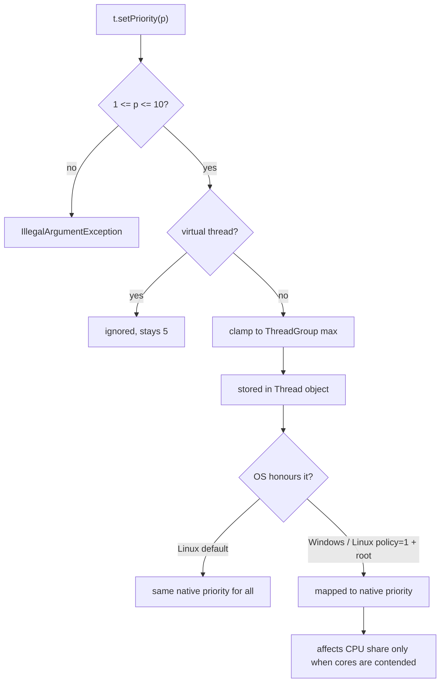
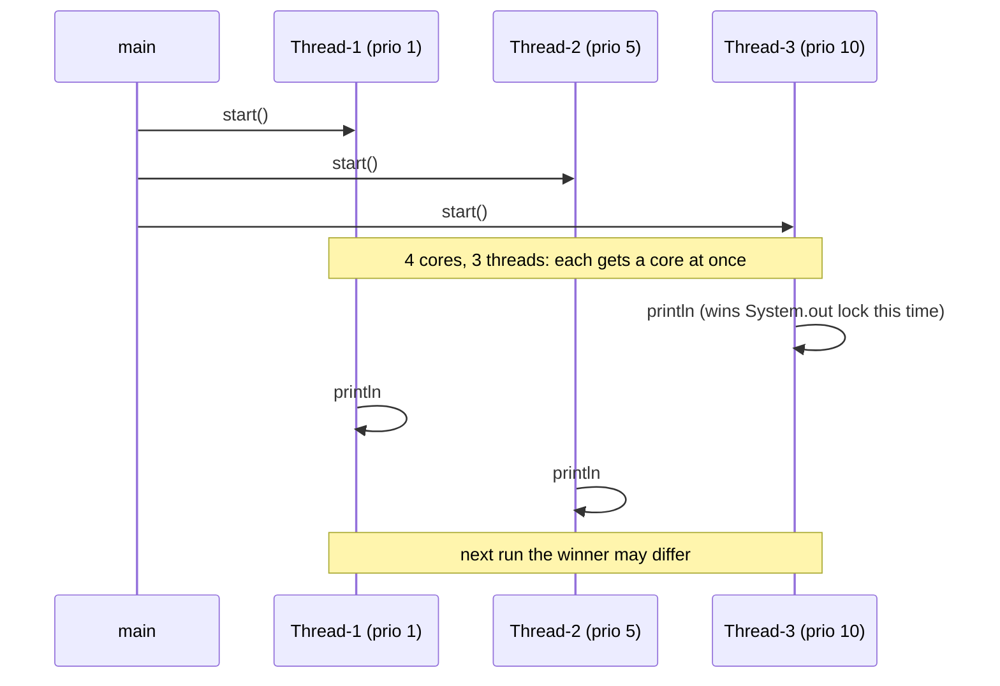

## In One Line
Every thread has a priority from **1 (`MIN_PRIORITY`) to 10 (`MAX_PRIORITY`)**, default **5 (`NORM_PRIORITY`)**, but it is only a **hint** to the operating-system scheduler — it does not control the order in which threads run, and on Linux the JVM ignores it by default.

## Mental Model
Think of **boarding groups at an airport gate**.

- The airline prints "Priority 10" on some tickets and "Priority 1" on others (`setPriority`).
- When the gate is **crowded and there is only one door** (more runnable threads than CPU cores), the gate agent *may* let priority passengers through first — if the airline's policy honours the tickets at all.
- When there are **several open doors and hardly anyone waiting** (more cores than threads), everyone walks straight through, and who reaches the plane first depends on who was closer to the door — not on the ticket.
- Some airports (Linux with default JVM settings) **ignore the printed priority entirely**.
- Relying on boarding groups to guarantee that *your luggage* gets on before *mine* (program correctness) is a mistake — for that you need a real rule (synchronization, `join()`, a latch).

## Concept
### The API
| Member | Meaning |
|---|---|
| `Thread.MIN_PRIORITY` | `1` |
| `Thread.NORM_PRIORITY` | `5` — the priority of `main` and the default |
| `Thread.MAX_PRIORITY` | `10` |
| `t.setPriority(int p)` | Request a priority. Throws `IllegalArgumentException` if `p < 1` or `p > 10`. Can be called before or after `start()`. |
| `t.getPriority()` | The priority stored in the `Thread` object |
| `ThreadGroup.setMaxPriority(int)` | Upper limit for threads in that group; `setPriority` silently clamps to it |

### Rules you must know
1. **Inherited** — a new thread starts with the priority of the thread that *creates* it (like the daemon flag). Threads created by `main` therefore get 5.
2. **Range-checked** — values outside 1..10 throw `IllegalArgumentException`.
3. **Clamped by the thread group** — if the group's max priority is 3, `setPriority(10)` quietly sets 3.
4. **Ignored for virtual threads** (Java 21) — they always report `NORM_PRIORITY` and `setPriority` has no effect.
5. **Only a hint** — the Java specification does not define how the scheduler uses priorities. It explicitly allows them to be ignored.

### How the JVM maps priorities to the OS
Java platform threads are real OS threads, so the **OS scheduler** decides who runs. HotSpot translates the Java priority to a native one:

| Platform | Default behaviour |
|---|---|
| **Linux** | **Ignored.** Normal (non-root) processes use the `SCHED_OTHER` policy, which has no static priorities, so all Java threads get the same native priority. With `-XX:ThreadPriorityPolicy=1` *and* root privileges (or `CAP_SYS_NICE`), HotSpot maps Java priorities to nice values (roughly +4 for priority 1 down to -5 for priority 10). |
| **Windows** | Mapped onto the Windows thread priority levels (pairs of Java priorities share a level, e.g. 9 and 10 both map to `THREAD_PRIORITY_HIGHEST`). Honoured, but the OS also boosts and decays priorities dynamically. |
| **macOS** | Mapped to Mach thread priorities; effect is weak and workload-dependent. |

The flags `-XX:+UseThreadPriorities` (default `true`) and `-XX:ThreadPriorityPolicy` (default `0`) control this. Our measurement (below) on JDK 21 / Linux / 4 cores: with default settings MAX-priority threads did *not* get more CPU than MIN-priority ones; with `-XX:ThreadPriorityPolicy=1` as root they got 2.4–7.4 times more.

### When can priority matter at all?
Only when **CPU is contended** — more runnable threads than cores. With 3 short threads on a 4-core machine (the course example), every thread gets its own core immediately, so priority cannot change anything even on an OS that honours it. The order of output lines then depends on thread start-up latency, JIT/class-loading work and which thread wins the `System.out` lock first.

### The thread scheduler in one paragraph
Modern JVMs use **native threads** with **preemptive, time-sliced** scheduling done by the OS (very old JVMs used "green threads" scheduled by the JVM itself). The OS can interrupt a running thread at any instruction to run another one; a thread also gives up the CPU when it blocks, sleeps or waits. Java makes **no guarantees** about fairness, time-slice length or the order of execution between threads — which is why every multithreaded program must be correct under *any* interleaving.

### Dangers of priorities
- **Non-portable** — behaviour differs per OS and JVM flags; code that "works" on Windows may behave differently on Linux.
- **Starvation** — where priorities are honoured, low-priority threads can be starved of CPU by busy high-priority ones.
- **Priority inversion** — a low-priority thread holds a lock that a high-priority thread needs, while medium-priority threads keep the low one off the CPU; the high-priority thread effectively runs at low priority. (Famous case: the Mars Pathfinder resets in 1997.)
- **False sense of ordering** — setting priorities never replaces `join()`, locks, `CountDownLatch` or other coordination.

### Good uses
Almost none in application code. Occasionally: give background housekeeping threads `MIN_PRIORITY` via a custom `ThreadFactory` so they are less likely to disturb latency-sensitive work on platforms that honour it. Otherwise, control *how much work runs at once* with thread-pool sizes, not with priorities.
```java
ThreadFactory lowPriority = Thread.ofPlatform().name("cleanup-", 0).priority(Thread.MIN_PRIORITY).factory();
ExecutorService cleaners = Executors.newFixedThreadPool(2, lowPriority);
```

## Diagram

The value you set goes through several filters, and even at the end it only influences CPU share under contention.


Start order and priority do not decide print order; whichever thread reaches `println` first wins, and that changes run to run.

## Code
@example Multithreading/BasicThreadOperations/ThreadPriorityExample.java

The priority rules — inheritance, range check, thread-group cap, virtual threads:
```java
public class PriorityRules {
    public static void main(String[] args) throws InterruptedException {
        System.out.println("MIN=" + Thread.MIN_PRIORITY + " NORM=" + Thread.NORM_PRIORITY
                + " MAX=" + Thread.MAX_PRIORITY);
        System.out.println("main priority: " + Thread.currentThread().getPriority());

        // 1. A new thread inherits the priority of the thread that creates it
        Thread parent = new Thread(() -> {
            Thread child = new Thread(() -> {});
            System.out.println("child created by a priority-7 thread: " + child.getPriority());
        });
        parent.setPriority(7);
        parent.start();
        parent.join();

        // 2. Out-of-range values are rejected
        try {
            new Thread(() -> {}).setPriority(11);
        } catch (IllegalArgumentException e) {
            System.out.println("setPriority(11): " + e);
        }

        // 3. A thread group caps the priority silently
        ThreadGroup group = new ThreadGroup("capped");
        group.setMaxPriority(3);
        Thread inGroup = new Thread(group, () -> {}, "g-1");
        inGroup.setPriority(Thread.MAX_PRIORITY);
        System.out.println("asked for 10 inside a max-3 group, got: " + inGroup.getPriority());

        // 4. Virtual threads ignore priority
        Thread v = Thread.ofVirtual().unstarted(() -> {});
        v.setPriority(Thread.MAX_PRIORITY);
        System.out.println("virtual thread priority: " + v.getPriority());
    }
}
```
```output
MIN=1 NORM=5 MAX=10
main priority: 5
child created by a priority-7 thread: 7
setPriority(11): java.lang.IllegalArgumentException
asked for 10 inside a max-3 group, got: 3
virtual thread priority: 5
```

Does priority buy CPU time? Twice as many busy threads as cores, half MIN and half MAX, counting for one second:
```java
import java.util.concurrent.atomic.AtomicBoolean;

public class PriorityRace {
    public static void main(String[] args) throws InterruptedException {
        int perLevel = Runtime.getRuntime().availableProcessors();   // 2x oversubscribe the CPUs
        long[] counts = new long[perLevel * 2];
        AtomicBoolean stop = new AtomicBoolean();
        Thread[] threads = new Thread[counts.length];
        for (int i = 0; i < threads.length; i++) {
            final int id = i;
            threads[i] = new Thread(() -> {
                long c = 0;
                while (!stop.get()) c++;
                counts[id] = c;
            });
            threads[i].setPriority(i < perLevel ? Thread.MIN_PRIORITY : Thread.MAX_PRIORITY);
        }
        for (Thread t : threads) t.start();
        Thread.sleep(1_000);
        stop.set(true);
        for (Thread t : threads) t.join();

        long low = 0, high = 0;
        for (int i = 0; i < counts.length; i++) { if (i < perLevel) low += counts[i]; else high += counts[i]; }
        System.out.printf("MIN_PRIORITY threads counted %,d%n", low);
        System.out.printf("MAX_PRIORITY threads counted %,d%n", high);
        System.out.printf("high/low ratio: %.2f%n", (double) high / low);
    }
}
```
One run with default settings on Linux (the numbers change every run; the ratio stayed between 0.6 and 1.1 — priority made no difference):
```output
MIN_PRIORITY threads counted 1,323,533,156
MAX_PRIORITY threads counted 1,130,500,368
high/low ratio: 0.85
```
The same program run as root with `java -XX:ThreadPriorityPolicy=1 PriorityRace.java` (ratios between 2.4 and 7.4 over three runs):
```output
MIN_PRIORITY threads counted 587,382,204
MAX_PRIORITY threads counted 1,515,173,514
high/low ratio: 2.58
```

Renaming threads to `Thread-1..3` clashes with the automatic names:
```java
public class DuplicateNames {
    public static void main(String[] args) {
        Thread t1 = new Thread(() -> {}), t2 = new Thread(() -> {}), t3 = new Thread(() -> {});
        System.out.println("defaults: " + t1.getName() + ", " + t2.getName() + ", " + t3.getName());
        t1.setName("Thread-1"); t2.setName("Thread-2"); t3.setName("Thread-3");
        Thread t4 = new Thread(() -> {});                  // gets the next default name
        System.out.println("t3 = " + t3.getName() + ", t4 = " + t4.getName());
    }
}
```
```output
defaults: Thread-0, Thread-1, Thread-2
t3 = Thread-3, t4 = Thread-3
```

## Walkthrough
- `class MyPriorityThread extends Thread` — every instance prints its own name and priority when run.
- `Thread.currentThread().getName()` / `.getPriority()` — asks the *thread executing this line* for its name and priority. Inside a `Thread` subclass you could also call `getName()` directly (it is `this`), but `this` and `Thread.currentThread()` are the same only when `run()` was invoked by `start()`; if someone called `t.run()` directly, `Thread.currentThread()` would be `main`.
- `new MyPriorityThread()` ×3 — three NEW threads. Their automatic names are `Thread-0`, `Thread-1`, `Thread-2`, and each inherits priority 5 from `main`.
- `t1.setName("Thread-1")` etc. — renames them to `Thread-1..3`. Names are labels only; they need not be unique (see `DuplicateNames`).
- `t1.setPriority(Thread.MIN_PRIORITY); // Priority 1`, `t2 ... NORM_PRIORITY // Priority 5`, `t3 ... MAX_PRIORITY // Priority 10` — these comments are correct: the constants are 1, 5 and 10. Setting priority before `start()` is typical but not required.
- `t1.start(); t2.start(); t3.start();` — starts them in order 1, 2, 3. Start order is not run order: each `start()` returns immediately, the three threads run in parallel on different cores, and the first to reach `System.out.println` prints first. `println` itself is synchronized, so lines never interleave character by character.
- Output: the recorded run printed `Thread-1 (1)`, `Thread-3 (10)`, `Thread-2 (5)`. This output **varies**: in 30 runs on JDK 21 we saw all six possible orders (the MAX-priority thread printed first in 9 of them, the MIN-priority one in 7). The priorities printed are always 1, 5 and 10, because each thread reads its own stored value.
- `main` does not `join()`; the JVM stays alive until the three user threads have printed.

## Traps
> [!ERRATA] The `// Output:` comment lists one particular order (`Thread-2`, `Thread-1`, `Thread-3`). It is just one of the six possible orders; the recorded run shows `Thread-1`, `Thread-3`, `Thread-2`, and repeated runs produce all six. Nothing in the example — neither start order nor priority — fixes the order. A comment should say "order varies between runs".

> [!ERRATA] Renaming `t1` to `Thread-1` (its automatic name was `Thread-0`) clashes with Java's default naming scheme: the next unnamed thread the program creates will also be called `Thread-3`, so logs and thread dumps would show two threads with the same name. Use descriptive names such as `low-prio`, `norm-prio`, `high-prio`.

- **Priority is not an ordering tool.** `MAX_PRIORITY` does not mean "runs first" or "finishes first". If you need order, use `join()`, a `CountDownLatch`, or run the work sequentially.
- **On Linux, priorities are ignored by default** — the measurement above shows MAX-priority threads getting no more CPU than MIN-priority ones.
- **`setPriority(0)` or `setPriority(11)`** throws `IllegalArgumentException` at runtime.
- **Thread-group cap is silent** — `setPriority(10)` in a group with max 3 gives 3 without any error.
- **Virtual threads ignore `setPriority`.**
- **Priorities can cause starvation and priority inversion** on systems that honour them.
- **Priority is inherited** — a thread created by a MAX-priority thread is also MAX priority unless changed.

## Tips & Tricks
- **"Priority is a Polite request, not a Promise."**
- **Numbers to remember: 1 – 5 – 10** (MIN – NORM – MAX). `main` is 5.
- **Inherits like DNA:** priority and daemon status come from the creating thread.
- **"More cores than threads → priority is meaningless."** Priority can only matter when threads compete for CPUs.
- In interviews, say: *"I never rely on thread priorities for correctness; they are platform-dependent hints. I use proper synchronization and control concurrency with pool sizes."*
- Give threads **descriptive names**, not `Thread-N` look-alikes.

## Interview Q&A
### [Basic] What is thread priority in Java and what is its range?
Each thread has an integer priority from 1 to 10 that hints to the scheduler how important it is. `Thread.MIN_PRIORITY` = 1, `Thread.NORM_PRIORITY` = 5 (the default and the priority of `main`), `Thread.MAX_PRIORITY` = 10. You set it with `setPriority(int)` and read it with `getPriority()`. A value outside 1..10 throws `IllegalArgumentException`.

**Follow-up:** *What priority does a new thread get?* — The priority of the thread that created it, capped by its thread group's maximum.

### [Basic] Does a higher-priority thread always run before a lower-priority one?
No. Priority is only a hint to the OS scheduler, which may ignore it. On a multi-core machine with fewer runnable threads than cores, every thread runs immediately anyway. On Linux, HotSpot ignores Java priorities unless started with `-XX:ThreadPriorityPolicy=1` and sufficient privileges. The course example proves it: repeated runs print all six orders of the three threads.

**Follow-up:** *So how do you guarantee order?* — With coordination: `join()`, `CountDownLatch`, `CompletableFuture` chains, or by not using threads for work that must be sequential.

### [Intermediate] How does the JVM implement thread priorities?
Java platform threads are native OS threads, so the JVM maps each Java priority to a native priority and the OS scheduler does the rest. On Windows, the 10 Java levels map onto the Windows thread priority levels, two Java levels per Windows level. On Linux, the default `SCHED_OTHER` policy has no static priorities for normal users, so with the default `ThreadPriorityPolicy=0` HotSpot does not change native priorities at all; with `ThreadPriorityPolicy=1` (root or `CAP_SYS_NICE`) it maps priorities to nice values. `-XX:-UseThreadPriorities` disables the mapping everywhere.

**Follow-up:** *And virtual threads?* — They are scheduled by the JVM's `ForkJoinPool`-based scheduler, which has no priorities; `getPriority()` always returns 5.

### [Intermediate] What are starvation and priority inversion?
**Starvation**: a thread never gets the resources it needs (CPU, a lock) because others always win — e.g. low-priority threads on a busy system that honours priorities, or an unfair lock that keeps being grabbed by the same threads. **Priority inversion**: a high-priority thread waits for a lock held by a low-priority thread, and medium-priority threads keep pre-empting the low-priority one, so the high-priority thread is effectively blocked by the medium ones. OSes fix it with *priority inheritance* (temporarily raising the lock holder's priority). The Mars Pathfinder resets in 1997 were caused by priority inversion.

**Follow-up:** *How do you avoid starvation in Java?* — Avoid relying on priorities, keep lock hold times short, and use fair locks (`new ReentrantLock(true)`) or fair semaphores where fairness matters.

### [Intermediate] What is the relationship between `ThreadGroup` and priority?
A `ThreadGroup` has a maximum priority (`setMaxPriority`). A thread's priority can never exceed its group's maximum: `setPriority` silently clamps the value. Threads belong to their creator's group by default (`main` for application threads). Thread groups are legacy — since Java 19 they are "degraded" (no `destroy`, `stop`, `suspend`), and executors/`ThreadFactory` are the modern way to manage groups of threads.

**Follow-up:** *Can a group's max priority be raised above its parent group's?* — No, it is capped by the parent's maximum.

### [Intermediate] Explain the output of the course's priority example.
Three threads with priorities 1, 5 and 10 are started in order and each prints its name and priority. The *content* of each line is deterministic, but the *order* is not: `start()` returns immediately, each thread runs on its own core, and the first to reach `System.out.println` prints first. Thread start-up latency and OS scheduling decide that, not priority — especially on Linux where priorities are ignored by default. Hence all six orders appear across runs, and the `// Output:` comment is just one sample.

**Follow-up:** *Would adding `t1.join()` after `t1.start()` fix the order?* — Yes, `start(); join();` for each thread in turn forces order — but then the threads run one after another and you lose all concurrency.

### [Advanced] Should you use thread priorities in production code?
Generally no. They are platform-dependent (ignored on Linux by default, coarse on Windows), can cause starvation and priority inversion, and have no effect on virtual threads. To control resource usage, size your thread pools, use bounded queues, rate limiters or separate executors for latency-critical and background work. If you must, set priorities through a `ThreadFactory` (`Thread.ofPlatform().priority(Thread.MIN_PRIORITY).factory()`) for background pools and measure the effect on the target OS.

**Follow-up:** *Does `Thread.yield()` help instead?* — No, it is also just a hint and may be a no-op; it is not a scheduling control.

### [Advanced] Why can a correct multithreaded program never depend on scheduling order?
Because the Java specification does not define a scheduling order, time-slice length or fairness, and the OS can pre-empt a thread at any instruction. Different machines, core counts, load, JIT warm-up and JVM flags produce different interleavings. A program is correct only if it is correct under **every** possible interleaving — which is guaranteed with synchronization (locks, `volatile`, atomics, concurrent collections) and explicit coordination, not with priorities, `sleep()` or start order.

**Follow-up:** *How do you test for interleaving bugs?* — Stress tests with many iterations and threads, tools like jcstress, and code review for shared mutable state.

## Quiz
### What is certain about the original example's output?
- [ ] `Thread-3` (priority 10) always prints first
- [ ] The lines appear in start order: 1, 2, 3
- [x] Each of the three lines appears exactly once, in an order that can change between runs
- [ ] `Thread-1` never prints, because MIN priority threads starve
> Each thread prints its own name and priority once. Order depends on scheduling; we observed all six orders. Priority does not guarantee first place, and on a 4-core machine three threads never starve.

### What does this print?
```java
Thread parent = new Thread(() -> {
    Thread child = new Thread(() -> {});
    System.out.println(child.getPriority());
});
parent.setPriority(7);
parent.start();
parent.join();
```
- [ ] 5
- [x] 7
- [ ] 1
- [ ] 10
> A new thread inherits the priority of the thread that creates it. The child is created inside `parent`, whose priority is 7. (A thread created by `main` would get 5.)

### What happens?
```java
ThreadGroup group = new ThreadGroup("capped");
group.setMaxPriority(3);
Thread t = new Thread(group, () -> {}, "g-1");
t.setPriority(Thread.MAX_PRIORITY);
System.out.println(t.getPriority());
```
- [ ] Prints 10
- [x] Prints 3
- [ ] Throws `IllegalArgumentException`
- [ ] Throws `SecurityException`
> `setPriority` silently clamps the value to the thread group's maximum. `IllegalArgumentException` is only for values outside 1..10.

### Which call throws an exception?
- [ ] `t.setPriority(Thread.NORM_PRIORITY)` after `t.start()`
- [x] `t.setPriority(0)`
- [ ] `virtualThread.setPriority(10)`
- [ ] `t.setPriority(1)` before `t.start()`
> Only values outside 1..10 are rejected with `IllegalArgumentException`. Changing priority after `start()` is allowed, and on a virtual thread the call is simply ignored.

### On Linux with default JVM settings, what does `setPriority(Thread.MAX_PRIORITY)` change?
- [ ] The thread gets a larger CPU share whenever CPUs are contended
- [ ] The thread always runs before lower-priority threads
- [x] Only the value returned by `getPriority()` — native scheduling is unaffected
- [ ] It makes the thread a real-time thread
> With `ThreadPriorityPolicy=0` (default), HotSpot on Linux does not change the native priority. Our measurement confirmed MAX threads got no more CPU than MIN threads. Only with `-XX:ThreadPriorityPolicy=1` and root privileges does it map to nice values.

### Spot the bug: a developer wants `loader` to finish before `reporter` starts reading.
```java
loader.setPriority(Thread.MAX_PRIORITY);
reporter.setPriority(Thread.MIN_PRIORITY);
loader.start();
reporter.start();
```
- [ ] Priorities must be set after `start()`
- [x] Priorities do not order execution; `reporter` can run while `loader` is still loading — use `loader.join()` or a latch
- [ ] `MIN_PRIORITY` threads never run
- [ ] Both threads need the same priority
> Priority is only a scheduling hint and is often ignored. Correct ordering needs a happens-before relationship: start `reporter` after `loader.join()`, or have `reporter` wait on a `CountDownLatch` that `loader` counts down.

## Takeaways
- Thread priority is an int from 1 (`MIN_PRIORITY`) to 10 (`MAX_PRIORITY`); default 5 (`NORM_PRIORITY`), inherited from the creating thread.
- `setPriority` throws `IllegalArgumentException` outside 1..10, silently clamps to the `ThreadGroup` maximum, and is ignored for virtual threads.
- Priority is only a hint to the OS scheduler: HotSpot on Linux ignores it by default (`-XX:ThreadPriorityPolicy=1` + root changes that).
- Priority can only influence CPU share when there are more runnable threads than cores; it never guarantees execution order.
- The course example's output order varies between runs — start order and priority do not fix it.
- Never use priorities for correctness; use `join()`, latches, locks, and control load with pool sizes. Beware starvation and priority inversion.
