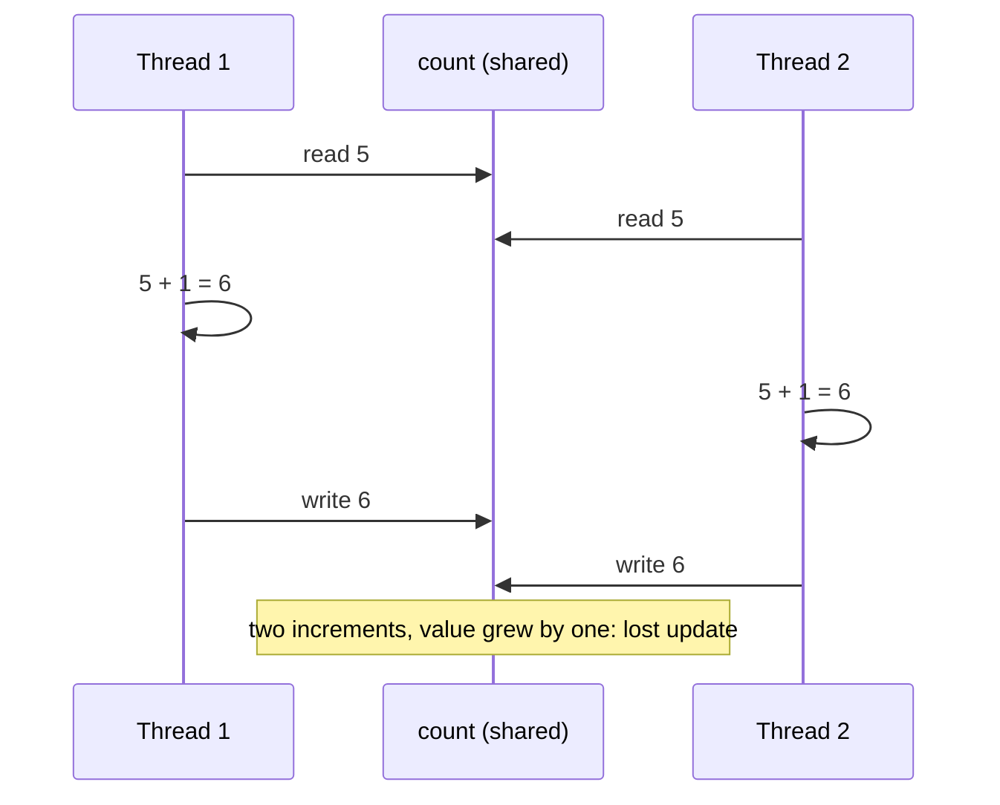
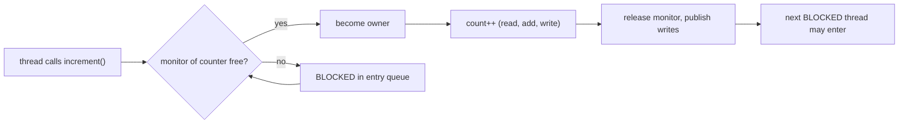

## In One Line
When several threads read and write the same data, `synchronized` makes a block of code **mutually exclusive** — only one thread at a time can hold an object's lock (monitor) — and it also makes each thread's changes **visible** to the next thread that takes the same lock.

## Mental Model
Think of a **single-occupancy bathroom with one key** hanging at the door.

- The **bathroom** is the critical section — the code that touches shared data (`count++`).
- The **key** is the object's **monitor lock**. Every Java object has exactly one.
- `synchronized` = "take the key before entering, hang it back when leaving". Whoever arrives while the key is gone waits at the door (**BLOCKED**).
- The key is always returned, even if you leave in a hurry (an exception).
- If you already hold the key and need to go in again (one synchronized method calling another), you do not wait for yourself — the lock is **reentrant**.
- Two different bathrooms have two different keys. If two threads lock *different* objects, they do not exclude each other at all — a very common bug.
- Bonus: the bathroom has a **notice board**. Whatever the previous occupant wrote on it before hanging up the key is guaranteed to be readable by the next one who takes the key (visibility / happens-before).

## Concept
### The problem: race conditions
A **race condition** happens when the result depends on the timing of threads that access shared mutable data without coordination. The classic case is `count++`, which looks like one operation but is three:

```text
getfield count     // 1. read the current value into a register
iconst_1; iadd     // 2. add one
putfield count     // 3. write it back
```
If two threads both read `5`, both add one and both write `6`, one increment is **lost** (a *lost update*). With enough iterations the final count ends up below the expected total — and differs every run.

Concurrency bugs come in three flavours, and `synchronized` fixes all three for code guarded by the same lock:
| Problem | What goes wrong | Example |
|---|---|---|
| **Atomicity** | A multi-step action is interleaved with another thread's steps | `count++`, check-then-act (`if (!map.containsKey(k)) map.put(k, v)`) |
| **Visibility** | One thread's write is not seen by another (cached in a register/CPU cache, or the JIT hoisted a read out of a loop) | A worker spinning on a non-`volatile` `running` flag forever |
| **Ordering** | Compiler/CPU reorder independent instructions | Another thread sees a reference to an object before its fields are initialised |

### Monitors (intrinsic locks)
Every object (and every `Class` object) has an associated **monitor**. `synchronized` acquires it on entry and releases it on exit:
- Only **one thread can own** a monitor at a time; others trying to enter any code synchronized on the same object wait in state **BLOCKED**.
- The monitor is released on normal exit **and** when an exception escapes — you cannot forget to unlock (unlike `ReentrantLock`).
- It is **reentrant**: the owner can enter again; the JVM keeps a hold count and releases the lock when the count drops to zero.
- A monitor also has a **wait set** used by `wait()`/`notify()` (next lessons).

### Three ways to write it
| Form | Lock used | Example |
|---|---|---|
| Synchronized instance method | `this` (the object the method is called on) | `public synchronized void increment()` |
| Synchronized static method | The `Class` object, e.g. `Counter.class` | `public static synchronized void log(...)` |
| Synchronized block | Any object you name | `synchronized (lock) { count++; }` |

A synchronized method is exactly equivalent to wrapping its whole body in `synchronized (this) { ... }` (or `synchronized (Counter.class)` for static). In bytecode, a synchronized method just carries the `ACC_SYNCHRONIZED` flag; a block compiles to `monitorenter` / `monitorexit`, plus a hidden exception handler that runs `monitorexit` again if the body throws.

### Object lock vs class lock
- Instance `synchronized` methods of the **same object** exclude each other. Different objects → different locks → no exclusion.
- `static synchronized` methods lock the `Class` object, which is **independent** of every instance lock. A thread in a static synchronized method and a thread in an instance synchronized method **can run at the same time**.
- Non-synchronized methods ignore the lock completely — they can run while another thread holds it.

### Synchronized blocks are usually better
- **Smaller critical section** → less time holding the lock → less contention. Do expensive work (formatting, I/O, computation) outside, touch shared state inside.
- **Private lock object** — `private final Object lock = new Object();` cannot be locked by outside code, so nobody can accidentally (or maliciously) hold your lock. With `synchronized` methods, any code that has a reference to your object can `synchronized (yourObject)` and block you.
- **Several independent locks** in one class (e.g. one for reads statistics, one for a cache) when data is independent — but beware of deadlock when threads take more than one (see [Deadlock](lesson:a06-threads/09-deadlock)).

### What to lock on — and what not to
| Lock object | Verdict |
|---|---|
| `private final Object lock = new Object()` | Best: private, never changes |
| `this` / synchronized methods | OK for simple classes; exposed to outside code |
| `SomeClass.class` | For static shared state |
| `getClass()` | Risky: in a subclass it is a different `Class` object, so parent and child lock differently |
| A **non-final** field that gets reassigned | Bug: threads may lock different objects |
| String literals (`"LOCK"`) | Bug: interned, shared JVM-wide with unrelated code |
| Boxed values (`Integer`, `Boolean`) | Bug: cached instances are shared; `count++` on an `Integer` creates a new object |
| A `Thread` object | Avoid: `join()` uses its monitor internally |

### Visibility and happens-before
The Java Memory Model guarantees: **an unlock of a monitor happens-before every subsequent lock of that same monitor.** Everything a thread wrote before releasing the lock is visible to the next thread that acquires it. This works only if **both** the writer and the reader synchronize on the **same** lock. A getter that is not synchronized may see a stale value while other threads are still writing.

`volatile` gives visibility and ordering for a single variable (every read sees the latest write) but **not atomicity**: `volatileCount++` is still a lost-update race. See [Java Memory Model & volatile](lesson:b03-concurrency/01-java-memory-model-and-volatile).

### Rules and restrictions
- Constructors cannot be `synchronized` (compile error: `modifier synchronized not allowed here`) — the object is not shared yet during construction.
- `synchronized` is **not inherited**: an overriding method is synchronized only if it says so itself.
- Interface methods and `abstract` methods cannot be `synchronized` (it is an implementation detail).
- Variables/fields cannot be `synchronized`; only methods and blocks.
- `synchronized (null)` throws `NullPointerException`.

### Alternatives
| Tool | Use when |
|---|---|
| `AtomicInteger` / `AtomicLong` / `LongAdder` | A single counter or value; lock-free CAS, often faster ([Atomics & CAS](lesson:b03-concurrency/02-atomics-and-cas)) |
| `ReentrantLock` | You need `tryLock`, timeouts, interruptible locking, fairness or multiple conditions ([ReentrantLock](lesson:a06-threads/10-reentrantlock)) |
| `ReadWriteLock` / `StampedLock` | Many readers, few writers |
| `ConcurrentHashMap`, `CopyOnWriteArrayList`, `BlockingQueue` | Shared collections |
| Immutability, thread confinement, `ThreadLocal` | Avoid sharing mutable state at all — the best fix |

### How the JVM implements it (HotSpot)
- Each object header contains a **mark word**. An uncontended lock is taken with a single CAS on it (**thin / lightweight locking**).
- Under contention the lock is **inflated** into a heavyweight `ObjectMonitor` with an entry queue (BLOCKED threads) and a wait set (threads in `wait()`); blocked threads eventually park in the OS.
- **Biased locking** (a cheaper path for single-thread use) was disabled and deprecated in JDK 15 and removed in JDK 18.
- The JIT can **elide** locks on objects that never escape a thread and **coarsen** adjacent lock/unlock pairs.
- JDK 21 note: a **virtual thread** that blocks inside `synchronized` *pins* its carrier thread; JDK 24 (JEP 491) removed that limitation.

## Diagram

Without a lock, the read-add-write steps of two threads interleave and one update disappears.


`synchronized` turns the three steps into one indivisible unit and publishes the result to whoever takes the lock next.

## Code
@example Multithreading/SynchronizationandCommunication/ThreadSynchronizationExample.java

Remove `synchronized` and make the race easier to hit (one million increments per thread). The result changes every run — sometimes it is even correct, which is what makes races so dangerous:
```java
public class RaceCondition {
    static class Counter {
        private int count = 0;
        void increment() { count++; }                 // NOT synchronized
        int getCount() { return count; }
    }
    public static void main(String[] args) throws InterruptedException {
        Counter counter = new Counter();
        Runnable job = () -> { for (int i = 0; i < 1_000_000; i++) counter.increment(); };
        Thread t1 = new Thread(job), t2 = new Thread(job);
        t1.start(); t2.start();
        t1.join();  t2.join();
        System.out.println("Expected 2000000, got " + counter.getCount());
    }
}
```
One run (others printed 1958794, 1980944, and sometimes 2000000):
```output
Expected 2000000, got 1932427
```

Synchronizing on the **wrong** lock — each thread locks itself, so nothing is excluded:
```java
public class WrongLock {
    static int total = 0;                          // ONE shared static field ...

    static class Adder extends Thread {
        synchronized void add() { total++; }       // ... but each thread locks ITSELF
        public void run() { for (int i = 0; i < 1_000_000; i++) add(); }
    }
    public static void main(String[] args) throws InterruptedException {
        Adder a = new Adder(), b = new Adder();
        a.start(); b.start();
        a.join();  b.join();
        System.out.println("Expected 2000000, got " + total);
    }
}
```
One run (varies):
```output
Expected 2000000, got 1814392
```
Fix: make `add()` `static synchronized` (locks `Adder.class`) or synchronize on one shared lock object.

Reentrancy — a synchronized method can call another one on the same object:
```java
public class Reentrant {
    synchronized void outer() {
        System.out.println("outer holds lock: " + Thread.holdsLock(this));
        inner();                                  // needs the SAME lock again
    }
    synchronized void inner() {
        System.out.println("inner entered - no self-deadlock");
    }
    public static void main(String[] args) {
        Reentrant r = new Reentrant();
        r.outer();
        System.out.println("after outer, main holds lock: " + Thread.holdsLock(r));
    }
}
```
```output
outer holds lock: true
inner entered - no self-deadlock
after outer, main holds lock: false
```

Class lock and object lock are independent — both methods run at the same time:
```java
public class ClassVsObjectLock {
    static synchronized void staticWork() {           // locks ClassVsObjectLock.class
        System.out.println("static: class lock held = " + Thread.holdsLock(ClassVsObjectLock.class));
        pause();
        System.out.println("static: done");
    }
    synchronized void instanceWork() {                // locks 'this'
        System.out.println("instance: class lock held = " + Thread.holdsLock(ClassVsObjectLock.class)
                + ", this lock held = " + Thread.holdsLock(this));
        pause();
        System.out.println("instance: done");
    }
    static void pause() { try { Thread.sleep(300); } catch (InterruptedException e) { } }

    public static void main(String[] args) throws InterruptedException {
        ClassVsObjectLock obj = new ClassVsObjectLock();
        Thread a = new Thread(ClassVsObjectLock::staticWork);
        Thread b = new Thread(obj::instanceWork);
        long start = System.nanoTime();
        a.start(); b.start();
        a.join();  b.join();
        long ms = (System.nanoTime() - start) / 1_000_000;
        System.out.println("ran in parallel: " + (ms < 550));   // two different locks -> no waiting
    }
}
```
```output
static: class lock held = true
instance: class lock held = false, this lock held = true
static: done
instance: done
ran in parallel: true
```
(The two threads run concurrently, so the order of the first four lines may differ between runs.)

A synchronized block on a private lock — only the shared part is locked:
```java
import java.util.ArrayList;
import java.util.List;

public class BlockVsMethod {
    private final Object lock = new Object();         // private lock: outsiders cannot grab it
    private final List<String> log = new ArrayList<>();

    void record(String event) {
        String line = event.toUpperCase() + " @" + Thread.currentThread().getName();  // no lock needed
        synchronized (lock) {                          // lock only the shared part
            log.add(line);
        }
    }
    public static void main(String[] args) throws InterruptedException {
        BlockVsMethod b = new BlockVsMethod();
        Thread t1 = new Thread(() -> { for (int i = 0; i < 1000; i++) b.record("a"); }, "T1");
        Thread t2 = new Thread(() -> { for (int i = 0; i < 1000; i++) b.record("b"); }, "T2");
        t1.start(); t2.start();
        t1.join();  t2.join();
        System.out.println("entries: " + b.log.size());
    }
}
```
```output
entries: 2000
```

An exception releases the monitor automatically:
```java
public class ExceptionReleases {
    static final Object lock = new Object();
    public static void main(String[] args) throws InterruptedException {
        Thread crasher = new Thread(() -> {
            synchronized (lock) {
                throw new RuntimeException("crash while holding the lock");
            }
        }, "crasher");
        crasher.setUncaughtExceptionHandler((t, e) -> System.out.println(t.getName() + " died: " + e.getMessage()));
        crasher.start();
        crasher.join();
        synchronized (lock) {
            System.out.println("main got the lock - the monitor was released on the exception");
        }
    }
}
```
```output
crasher died: crash while holding the lock
main got the lock - the monitor was released on the exception
```

Visibility: without `volatile` (or a lock), a spinning thread may never see the update:
```java
public class Visibility {
    static boolean running = true;              // try adding 'volatile' here

    public static void main(String[] args) throws InterruptedException {
        Thread spinner = new Thread(() -> {
            while (running) { }                 // JIT may read 'running' once and never again
            System.out.println("spinner stopped");
        });
        spinner.setDaemon(true);                // so the JVM can still exit
        spinner.start();
        Thread.sleep(1000);
        running = false;
        System.out.println("main set running=false");
        spinner.join(2000);
        System.out.println("spinner still alive? " + spinner.isAlive());
    }
}
```
```output
main set running=false
spinner still alive? true
```
With `static volatile boolean running` the same program prints `main set running=false`, `spinner stopped`, `spinner still alive? false` (both results reproduced on every one of our runs on JDK 21, but the non-volatile behaviour is not guaranteed either way — that is the point: it is undefined).

A lock-free alternative for a simple counter:
```java
import java.util.concurrent.atomic.AtomicInteger;

public class AtomicCounter {
    public static void main(String[] args) throws InterruptedException {
        AtomicInteger count = new AtomicInteger();
        Runnable job = () -> { for (int i = 0; i < 100_000; i++) count.incrementAndGet(); };
        Thread t1 = new Thread(job), t2 = new Thread(job);
        t1.start(); t2.start();
        t1.join();  t2.join();
        System.out.println("AtomicInteger: " + count.get());
    }
}
```
```output
AtomicInteger: 200000
```

## Walkthrough
- `class Counter` with `private int count = 0;` — the **shared mutable state**. `private` means only `Counter`'s methods can touch it, so guarding those methods guards the field (encapsulation is the first step of thread safety).
- `public synchronized void increment() { count++; }` — the comment "Synchronized method to increment the counter" is accurate. Before running the body, the calling thread must own the monitor of **this `Counter` object**; the other thread waits (BLOCKED) meanwhile. So the read-add-write of `count++` can no longer interleave. In bytecode the method carries the `ACC_SYNCHRONIZED` flag.
- `public int getCount()` — **not** synchronized. It is safe *in this program* only because `main` calls it after `t1.join()` and `t2.join()`, and `join()` guarantees that all writes of the joined threads are visible. Called while the threads were still running, it could return a stale value.
- `class CounterThread extends Thread` — each worker keeps a reference to the **same** `Counter` passed through its constructor (`this.counter = counter`). Sharing one object is what creates both the race and the need for synchronization.
- `run()` — calls `counter.increment()` 1000 times.
- `main`: `new Counter()` → one shared object; `new CounterThread(counter)` twice → two threads sharing it; `t1.start(); t2.start();` → both increment concurrently; `t1.join(); t2.join();` inside `try/catch (InterruptedException)` → `main` waits (WAITING) until both are TERMINATED.
- `System.out.println("Counter value: " + counter.getCount());` — prints `Counter value: 2000` every time: 2 × 1000 increments, none lost, because every increment held the same lock and `join()` made the final value visible.

## Traps
> [!ERRATA] The example cannot actually demonstrate that `synchronized` is needed. With only 1000 increments per thread, the first thread often finishes before the second even starts: we removed `synchronized` and ran it 40 times — 35 runs still printed `Counter value: 2000` (the others printed 1428 to 1980). A correct result does not prove correct code; use a million iterations (see `RaceCondition`) to see the race.

> [!ERRATA] `getCount()` is not synchronized. It is correct here only because it is called after `join()`. As a general-purpose thread-safe counter the class is broken: a reader running concurrently may see a stale value. Make it `synchronized` too (or use `AtomicInteger`) — *both* reads and writes of shared state must use the same lock.

- **Locking different objects** protects nothing — `WrongLock` shows each thread locking itself while sharing one static field.
- **`static synchronized` and instance `synchronized` do not exclude each other** — different locks.
- **Synchronizing only the writer** — readers must take the same lock (or the field must be `volatile` for single reads).
- **`volatile` is not atomic** — `volatile int count; count++` still loses updates.
- **Check-then-act on synchronized collections** — `if (!list.contains(x)) list.add(x)` on a `Collections.synchronizedList` is still a race; lock around the pair.
- **Locking on strings, boxed numbers or a reassigned field** — shared or changing lock objects.
- **Calling unknown code (callbacks, listeners) while holding a lock** — invites deadlock and long hold times.
- **`Thread.sleep()` inside `synchronized`** keeps the lock the whole time.
- **Too coarse locks** kill parallelism; too fine locks invite deadlock. Keep critical sections small but complete.

## Tips & Tricks
- **"Same data → same lock, every access (reads too)."** That one sentence prevents most bugs.
- **Mnemonic "AVO"** — synchronized gives **A**tomicity, **V**isibility, **O**rdering; `volatile` gives only V and O.
- **"One key per object; static methods use the key of the Class."**
- **Prefer a `private final Object lock`** in library code; `synchronized` methods are fine for small, private classes.
- **Shrink the critical section**: compute outside, mutate inside.
- **Best synchronization is none**: immutable objects, thread confinement, or concurrent collections and atomics.
- `Thread.holdsLock(obj)` is handy in `assert` statements to document "must be called with the lock held".
- When a test passes, run it a million times in a loop before trusting it.

## Interview Q&A
### [Basic] What is synchronization in Java and why is it needed?
Synchronization controls access by multiple threads to shared mutable data. Without it, threads interleave their reads and writes, causing race conditions (lost updates, inconsistent state), and one thread's writes may not even become visible to another. The `synchronized` keyword gives **mutual exclusion** — only one thread at a time can hold an object's monitor — and **visibility** — releasing the monitor publishes all writes to the next thread that acquires it.

**Follow-up:** *Is synchronization needed if threads only read shared data?* — Not if the data is effectively immutable and was safely published (e.g. set before `start()`, or in `final` fields); reads of immutable data never race.

### [Basic] What is a race condition? Why is `count++` not thread-safe?
A race condition is when the correctness of a result depends on the relative timing of threads. `count++` is a read-modify-write sequence (`getfield`, `iadd`, `putfield`); two threads can both read the same old value and both write old+1, losing one increment. Making the method `synchronized`, using `AtomicInteger.incrementAndGet()`, or a `LongAdder` fixes it.

**Follow-up:** *Would declaring `count` as `volatile` fix it?* — No. `volatile` makes each read and write visible, but the three steps can still interleave.

### [Basic] What is the difference between a synchronized method and a synchronized block?
A synchronized instance method locks `this` for the whole method (a static one locks the `Class` object). A synchronized block locks any object you choose and only for the statements inside it. Blocks are preferred because you can lock a private object that outside code cannot touch, keep the critical section small, and use different locks for independent data. Semantically, `synchronized void m() { body }` equals `void m() { synchronized (this) { body } }`; in bytecode, the method uses the `ACC_SYNCHRONIZED` flag and the block uses `monitorenter`/`monitorexit`.

**Follow-up:** *Can a synchronized block lock `null`?* — No, `synchronized (null)` throws `NullPointerException`.

### [Intermediate] What is the difference between an object-level lock and a class-level lock?
An object-level lock is the monitor of a particular instance, taken by instance synchronized methods or `synchronized (this)`. A class-level lock is the monitor of the `Class` object, taken by `static synchronized` methods or `synchronized (MyClass.class)`; it protects static data. They are independent: one thread can be inside a static synchronized method while another is inside an instance synchronized method of the same class. Each instance has its own object lock, so threads working on different instances do not block each other.

**Follow-up:** *How do you protect a static counter incremented from instance methods?* — Lock the class (`synchronized (MyClass.class)`) or a `static final` lock object, or use a `static AtomicInteger`.

### [Intermediate] What does "`synchronized` is reentrant" mean?
A thread that already owns a monitor can acquire it again without blocking. The JVM counts holds and releases the lock when the count returns to zero. Without reentrancy, a synchronized method calling another synchronized method on the same object — or a subclass's synchronized override calling `super.method()` — would deadlock on itself.

**Follow-up:** *Is `ReentrantLock` reentrant too?* — Yes (hence the name); `getHoldCount()` shows the count and you must call `unlock()` once per `lock()`.

### [Intermediate] Is the course's `Counter` class thread-safe?
Only partially. `increment()` is synchronized, but `getCount()` is not, so a thread reading while others increment has no visibility guarantee and could see a stale value. The example gets away with it because it reads after `join()`, which establishes happens-before. A properly thread-safe version synchronizes `getCount()` as well, or uses `AtomicInteger` and needs no locks at all.

**Follow-up:** *Is it a problem for `long` counters specifically?* — Yes: without synchronization or `volatile`, a 64-bit `long`/`double` write may even be split into two 32-bit halves on some JVMs (word tearing, JLS 17.7).

### [Intermediate] If a thread is inside one synchronized method of an object, can another thread call a different method of the same object?
It cannot enter **any other synchronized instance method** of that same object — they all need the same monitor — so it blocks. It **can** call non-synchronized methods and static synchronized methods (different lock), and it can call synchronized methods on a *different* instance.

**Follow-up:** *Why is it dangerous to have some methods synchronized and others not, all touching the same field?* — The unsynchronized ones break atomicity and visibility for everybody; every access to shared state must use the lock.

### [Intermediate] What is the difference between `volatile` and `synchronized`?
| | `volatile` | `synchronized` |
|---|---|---|
| Applies to | A variable | A method or block |
| Mutual exclusion | No | Yes |
| Atomicity of compound actions | No (`v++` races) | Yes |
| Visibility / ordering | Yes, for that variable | Yes, for everything written inside the block |
| Blocking | Never | Threads may block |
| Typical use | Flags, published references, double-checked locking | Compound updates, invariants across several fields |

**Follow-up:** *When is `volatile` enough?* — When writes do not depend on the current value (e.g. `running = false`) and the variable is not part of an invariant with other variables.

### [Advanced] How does the JVM implement `synchronized`?
Each object header has a mark word. HotSpot takes an uncontended monitor with a CAS on the mark word (lightweight/thin locking) and records the owner. On contention, it **inflates** the lock into an `ObjectMonitor` structure with an owner, a recursion count, an entry list of BLOCKED threads and a wait set for `wait()`; waiting threads spin briefly, then park in the OS. Synchronized methods are marked `ACC_SYNCHRONIZED`; blocks compile to `monitorenter`/`monitorexit` with an exception-table entry that guarantees release on exceptions. Biased locking was deprecated and disabled in JDK 15 and removed in JDK 18. The JIT can remove locks on non-escaping objects (lock elision) and merge adjacent ones (lock coarsening).

**Follow-up:** *Any issue with `synchronized` and virtual threads?* — In JDK 21–23, blocking inside `synchronized` pins the virtual thread to its carrier; JDK 24 (JEP 491) fixed this. On 21, prefer `ReentrantLock` around blocking I/O in virtual threads.

### [Advanced] Why should you not synchronize on a `String` literal, a boxed `Integer`, or `this` in library code?
String literals are interned — every class in the JVM that uses `"LOCK"` shares that same object, so unrelated code can contend with or deadlock yours. Small `Integer`/`Boolean` values come from shared caches, and "updating" a boxed field creates a new object, so threads end up locking different objects. Locking `this` (or synchronized methods) exposes your lock: any caller holding a reference can `synchronized (obj)` and block you. A `private final Object lock = new Object()` avoids all three problems.

**Follow-up:** *And `synchronized (getClass())`?* — In a subclass `getClass()` returns the subclass's `Class`, so base-class code locks a different object than intended; use `Base.class` explicitly.

### [Advanced] When would you choose `AtomicInteger` over `synchronized`?
For a single variable with simple updates (increment, add, compare-and-set) — atomics use lock-free CAS instructions, never block, and scale well at moderate contention; `LongAdder` scales even better for hot counters that are rarely read. Choose `synchronized` (or a `Lock`) when an update involves **several variables** that must change together, or a compound action (check-then-act on a collection), because separate atomics cannot make multiple operations atomic as a group.

**Follow-up:** *What is CAS?* — Compare-and-swap: a CPU instruction that sets a value only if it still equals the expected old value; on failure the atomic class retries in a loop.

## Quiz
### If you remove `synchronized` from `increment()` in the original example, what is printed?
- [ ] Always `Counter value: 2000`
- [ ] Always less than 2000
- [x] Usually 2000, but sometimes less — it varies between runs
- [ ] It throws `ConcurrentModificationException`
> With only 1000 iterations the threads often do not overlap, so the race usually does not show (35 of our 40 runs printed 2000; the others 1428–1980). "Usually right" is the most dangerous kind of bug. Nothing throws — lost updates are silent.

### Spot the bug.
```java
static int total = 0;
static class Adder extends Thread {
    synchronized void add() { total++; }
    public void run() { for (int i = 0; i < 1_000_000; i++) add(); }
}
// two Adder threads started and joined, then total printed
```
- [ ] `total` must be `final`
- [x] Each `Adder` locks its own object, so the two threads never exclude each other on the shared static field
- [ ] `synchronized` cannot be used in a `Thread` subclass
- [ ] `add()` must be `public`
> An instance synchronized method locks `this`, and each thread is a different `Adder`. The shared static `total` needs a shared lock: `static synchronized void add()` (locks `Adder.class`), a common lock object, or an `AtomicInteger`. Our run printed 1814392 instead of 2000000.

### Thread A is inside `static synchronized void a()` of class `X`. Thread B calls `synchronized void b()` on an instance of `X`. What happens?
- [x] B runs immediately — the two methods use different locks
- [ ] B blocks until A leaves `a()`
- [ ] A deadlock occurs
- [ ] Compile error: a class cannot mix static and instance synchronized methods
> `a()` locks `X.class`; `b()` locks the instance. Different monitors, so no exclusion. Our `ClassVsObjectLock` demo finished in about 300 ms instead of 600 ms.

### What does this print?
```java
synchronized void outer() {
    System.out.println("outer holds lock: " + Thread.holdsLock(this));
    inner();
}
synchronized void inner() { System.out.println("inner entered"); }
// main: new Reentrant().outer();
```
- [x] `outer holds lock: true` then `inner entered`
- [ ] `outer holds lock: true` then the program hangs
- [ ] `outer holds lock: false` then `inner entered`
- [ ] `IllegalMonitorStateException`
> Intrinsic locks are reentrant: the thread already owns the monitor, so entering `inner()` just increases the hold count. No self-deadlock.

### Which of these compiles?
- [ ] `public synchronized Counter() { }`
- [ ] `interface Shop { synchronized void buy(); }`
- [ ] `private synchronized int count;`
- [x] `public static synchronized void log(String s) { }`
> Constructors, interface methods and fields cannot be `synchronized` (the constructor gives `modifier synchronized not allowed here`). Static methods can — they lock the `Class` object.

### A thread throws a `RuntimeException` inside `synchronized (lock) { ... }`. What happens to the lock?
- [ ] It stays locked until the JVM exits
- [x] It is released automatically as the exception leaves the block
- [ ] It is released only if there is a `finally` block
- [ ] The other threads waiting for it get the same exception
> The compiler adds an exception handler that executes `monitorexit` before rethrowing, so the monitor is always released. That is an advantage over `ReentrantLock`, where you must `unlock()` in `finally` yourself.

### A thread loops `while (running) { }` on a plain (non-volatile) static field. Another thread sets `running = false`. What does the Java Memory Model guarantee?
- [ ] The loop stops within a few milliseconds
- [ ] The loop stops, but only after the next garbage collection
- [x] Nothing — the loop may never see the change; `volatile` or synchronization is needed
- [ ] The compiler rejects the code
> Without a happens-before relationship, the reader is not guaranteed to see the write; the JIT may hoist the read out of the loop. In our runs the spinner was still alive two seconds later. Declaring the field `volatile` made it stop every time.

## Takeaways
- A race condition happens when threads access shared mutable data without coordination; `count++` is read-modify-write and loses updates.
- `synchronized` uses an object's monitor: one owner at a time, others BLOCKED; released on normal exit and on exceptions; reentrant.
- Instance synchronized methods lock `this`, static ones lock the `Class` object, blocks lock any object you name — different locks never exclude each other.
- Unlocking a monitor happens-before the next lock of the same monitor, so every access to shared state — reads included — must use the same lock.
- `volatile` gives visibility and ordering but not atomicity; atomics (`AtomicInteger`, `LongAdder`) are lock-free alternatives for single variables.
- Prefer small synchronized blocks on a `private final` lock object; never lock on string literals, boxed values or reassigned fields.
- A correct output (like the example's `2000`) does not prove thread safety — stress-test with many iterations.
