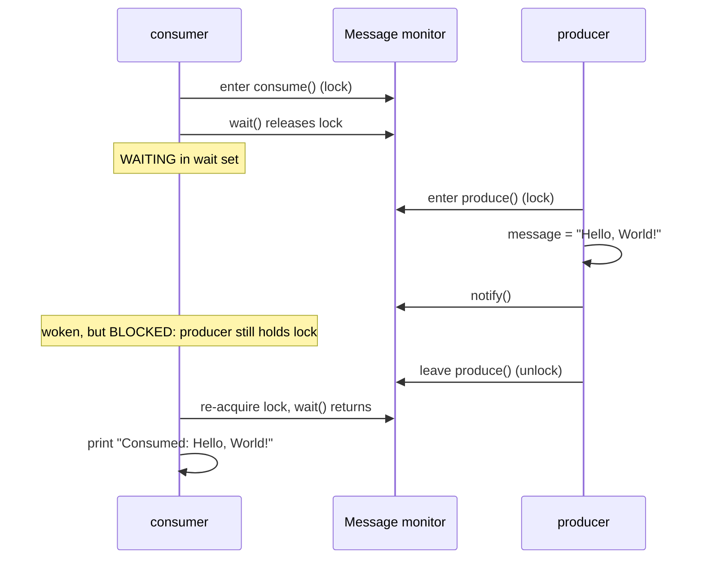
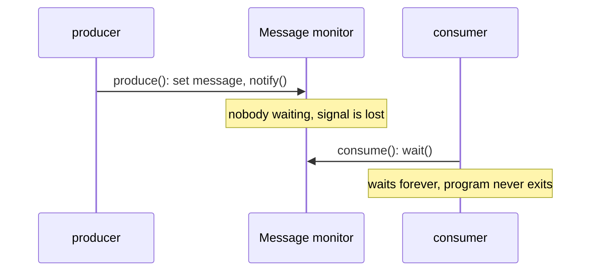

## In One Line
`wait()` lets a thread that holds an object's lock **release it and sleep until signalled**, and `notify()` wakes **one** thread waiting on that same object — the built-in way for threads to say "I am waiting for a condition" and "the condition may have changed", always used inside `synchronized` and always with a **condition checked in a `while` loop**.

## Mental Model
Think of a **restaurant pickup counter with a buzzer**.

- The **counter** is the shared object; only one person may stand at it at a time (its monitor lock).
- A customer (consumer) steps up, sees no food yet, takes a **buzzer**, and goes to sit in the **waiting area** — leaving the counter free for others. That is `wait()`: release the lock and sleep.
- The cook (producer) steps up to the counter, puts the food down, and **presses one buzzer** — `notify()`. The cook is still standing at the counter until they walk away (the lock is released only when the producer leaves `synchronized`).
- The buzzed customer must **walk back and wait for the counter to be free** (re-acquire the lock) and then **look again** whether the food is really there (re-check the condition in a `while` loop — somebody else might have taken it, or the buzzer went off by itself: a spurious wakeup).
- **The buzzer has no memory**: if the cook presses it *before* anyone took one, nothing happens — the next customer will wait forever unless there is a sign on the counter saying "food is ready" (a condition flag). That is exactly the bug in the course example.

## Concept
### Why wait/notify exists
A thread that must wait for another thread's work could **busy-wait**: `while (!ready) { }` — burning a whole CPU core and, without `volatile`, possibly never even seeing the change. `wait()`/`notify()` let the waiting thread **sleep without using CPU** and be woken exactly when something changes.

### The three methods (all `final` methods of `java.lang.Object`)
| Method | What it does |
|---|---|
| `wait()` | Releases this object's monitor, puts the thread into the object's **wait set** (state WAITING), and, once woken, **re-acquires the monitor** before returning. |
| `wait(long ms)` / `wait(long ms, int nanos)` | Same, but also wakes after the timeout (state TIMED_WAITING). `wait(0)` means wait forever. It does not tell you whether it timed out. |
| `notify()` | Wakes **one** thread from this object's wait set — which one is unspecified. Does **not** release the lock. If nobody is waiting, the signal is simply **lost**. |
| `notifyAll()` | Wakes **all** threads in the wait set; they then compete for the monitor one by one — see [notifyAll()](lesson:a06-threads/07-notify-all). |

### Rule 1: you must own the monitor
`obj.wait()`, `obj.notify()` and `obj.notifyAll()` may only be called by a thread that holds `obj`'s monitor — inside `synchronized (obj)` or a synchronized method of `obj`. Otherwise they throw `IllegalMonitorStateException: current thread is not owner`. Holding a *different* object's lock does not count.

Why the rule? Checking the condition and going to sleep must be **one atomic step** with respect to the producer. If the consumer could check `!ready`, get pre-empted, the producer set `ready = true` and `notify()`, and only then the consumer called `wait()` — the signal would be lost. Requiring the lock makes that interleaving impossible.

### Rule 2: always wait in a `while` loop on a condition
The **guarded wait** idiom — memorise it:
```java
// Waiting side
synchronized (lock) {
    while (!condition) {        // WHILE, not if
        lock.wait();
    }
    // condition is true AND we hold the lock: act on it
}

// Signalling side
synchronized (lock) {
    condition = true;           // 1. change the shared state
    lock.notify();              // 2. then signal (or notifyAll)
}
```
Why a condition variable (like `ready`/`available`) at all? Because notifications are not stored. The **state** remembers that something happened; the notification only says "go and look again".

Why `while` and not `if`? When `wait()` returns, the condition may still be false:
- **Spurious wakeups** — the JVM specification allows `wait()` to return without any notify, interrupt or timeout.
- **Stolen wakeups** — between being notified and re-acquiring the lock, another thread may have entered and consumed the item.
- **`notifyAll()`** wakes threads whose condition is not satisfied.
- **Several conditions share one monitor** (e.g. "not full" and "not empty"), so a wake-up may be for someone else's condition.

### What happens step by step
1. Consumer enters `synchronized`, finds the condition false, calls `wait()`.
2. The JVM atomically **releases the monitor** and parks the consumer in the **wait set** (WAITING).
3. Producer enters `synchronized` (the lock is free now), changes the state, calls `notify()`. The consumer is moved out of the wait set — but the producer still holds the lock, so the consumer is now **BLOCKED**.
4. Producer leaves `synchronized` → monitor released.
5. Consumer re-acquires the monitor, `wait()` returns, the `while` re-checks the condition, and the consumer proceeds.

### `wait()` vs `sleep()`
| | `obj.wait()` | `Thread.sleep(ms)` |
|---|---|---|
| Defined in | `Object` (instance method) | `Thread` (static method) |
| Must hold a lock | Yes, `obj`'s monitor | No |
| Releases the lock | **Yes**, `obj`'s monitor (only that one) | **No**, keeps every lock |
| Wakes up when | `notify`/`notifyAll`, interrupt, timeout, or spuriously | Time elapses or interrupt |
| Purpose | Inter-thread communication: wait for a condition | Pause for a while |
| State | WAITING / TIMED_WAITING | TIMED_WAITING |

### Interrupting a waiting thread
`t.interrupt()` on a thread in `wait()` wakes it; it first **re-acquires the monitor**, then `wait()` throws `InterruptedException` (with the interrupt flag cleared). The `catch` block therefore runs *with the lock held*. Handle it: stop waiting, restore the flag with `Thread.currentThread().interrupt()` or propagate the exception — do not just log and continue as if the condition were met.

### `wait()` releases only one lock
If a thread holds locks `A` and `B` and calls `b.wait()`, it releases only `B` and keeps `A`. A notifier that needs `A` first can then never reach `b.notify()` — the **nested monitor lockout**. Never call `wait()` while holding other locks.

### Modern alternatives
`wait`/`notify` is low-level and easy to get wrong. Prefer:
| Need | Use |
|---|---|
| Hand items from producers to consumers | `BlockingQueue` (`put` / `take`) |
| Wait until N things have happened | `CountDownLatch` |
| One-off result from another thread | `CompletableFuture` / `Future` |
| Explicit lock with several conditions | `ReentrantLock` + `Condition.await()/signal()` |
| Hand one object between two threads | `SynchronousQueue` or `Exchanger` |

Understanding `wait`/`notify` still matters: interviews ask about it, and all the classes above are built on the same "check condition in a loop, sleep, get signalled" idea.

## Diagram

The happy path the example relies on: the consumer must already be waiting when `notify()` is called.


If the producer happens to run first, the notification disappears and the consumer (a non-daemon thread) hangs the program.

## Code
@example Multithreading/SynchronizationandCommunication/WaitNotifyExample.java

The same `Message` class, but the producer happens to run first — the lost notification:
```java
public class LostNotify {
    static class Message {                      // same as the course example
        private String message;
        public synchronized void produce(String message) {
            this.message = message;
            System.out.println("Produced: " + message);
            notify();
        }
        public synchronized void consume() {
            try { wait(); } catch (InterruptedException e) { return; }
            System.out.println("Consumed: " + message);
        }
    }
    public static void main(String[] args) throws InterruptedException {
        Message msg = new Message();
        Thread producer = new Thread(() -> msg.produce("Hello, World!"));
        Thread consumer = new Thread(msg::consume);
        consumer.setDaemon(true);               // so this demo can exit

        producer.start();                       // the producer happens to run first ...
        producer.join();
        consumer.start();                       // ... the consumer arrives too late
        consumer.join(1000);
        System.out.println("consumer after 1s: " + consumer.getState());
    }
}
```
```output
Produced: Hello, World!
consumer after 1s: WAITING
```

The fix — a condition flag and a guarded `while` loop. Now the order of the threads does not matter:
```java
public class GuardedMessage {
    static class Message {
        private String message;
        private boolean available = false;      // the CONDITION, stored in the object

        public synchronized void produce(String m) {
            message = m;
            available = true;                   // change the condition ...
            System.out.println("Produced: " + m);
            notify();                           // ... then signal
        }
        public synchronized String consume() throws InterruptedException {
            while (!available) {                // check the condition, in a loop
                wait();
            }
            available = false;
            System.out.println("Consumed: " + message);
            return message;
        }
    }
    public static void main(String[] args) throws InterruptedException {
        Message msg = new Message();
        Thread producer = new Thread(() -> msg.produce("Hello, World!"));
        Thread consumer = new Thread(() -> {
            try { msg.consume(); } catch (InterruptedException e) { Thread.currentThread().interrupt(); }
        });
        producer.start();                       // producer first again - no problem now
        producer.join();
        consumer.start();
        consumer.join();
        System.out.println("consumer: " + consumer.getState());
    }
}
```
```output
Produced: Hello, World!
Consumed: Hello, World!
consumer: TERMINATED
```

Calling `wait`/`notify` without owning the monitor:
```java
public class NoLock {
    public static void main(String[] args) throws InterruptedException {
        Object lock = new Object();
        try {
            lock.wait();                        // not inside synchronized(lock)
        } catch (IllegalMonitorStateException e) {
            System.out.println("wait(): " + e);
        }
        try {
            lock.notify();
        } catch (IllegalMonitorStateException e) {
            System.out.println("notify(): " + e);
        }
        Object other = new Object();
        synchronized (other) {
            try {
                lock.notify();                  // holding the WRONG monitor
            } catch (IllegalMonitorStateException e) {
                System.out.println("wrong lock: " + e.getClass().getSimpleName());
            }
        }
    }
}
```
```output
wait(): java.lang.IllegalMonitorStateException: current thread is not owner
notify(): java.lang.IllegalMonitorStateException: current thread is not owner
wrong lock: IllegalMonitorStateException
```

`notify()` does not release the lock — the woken thread is BLOCKED until the notifier leaves `synchronized`:
```java
public class NotifyKeepsLock {
    static final Object lock = new Object();
    static boolean ready = false;

    public static void main(String[] args) throws InterruptedException {
        Thread waiter = new Thread(() -> {
            synchronized (lock) {
                while (!ready) {
                    try { lock.wait(); } catch (InterruptedException e) { return; }
                }
                System.out.println("3. waiter woke up and re-acquired the lock");
            }
        });
        waiter.start();
        Thread.sleep(100);                                  // let it start waiting

        synchronized (lock) {
            ready = true;
            lock.notify();
            System.out.println("1. notify() called - but main still holds the lock");
            Thread.sleep(500);                              // waiter is woken but BLOCKED here
            System.out.println("2. waiter state while main holds lock: " + waiter.getState());
        }                                                   // lock released here
        waiter.join();
    }
}
```
```output
1. notify() called - but main still holds the lock
2. waiter state while main holds lock: BLOCKED
3. waiter woke up and re-acquired the lock
```

`wait()` releases the lock, `sleep()` keeps it:
```java
public class WaitVsSleep {
    static final Object lock = new Object();

    static boolean hadToWait() {
        long start = System.nanoTime();
        synchronized (lock) { }                                  // try to get the lock
        return (System.nanoTime() - start) / 1_000_000 > 500;    // blocked for more than 0.5 s?
    }
    public static void main(String[] args) throws InterruptedException {
        Thread sleeper = new Thread(() -> {
            synchronized (lock) {
                try { Thread.sleep(1000); } catch (InterruptedException e) { }   // keeps the lock
            }
        });
        sleeper.start();
        Thread.sleep(100);
        System.out.println("other thread in sleep(): main blocked? " + hadToWait());
        sleeper.join();

        Thread waiter = new Thread(() -> {
            synchronized (lock) {
                try { lock.wait(1000); } catch (InterruptedException e) { }      // releases the lock
            }
        });
        waiter.start();
        Thread.sleep(100);
        System.out.println("other thread in wait():  main blocked? " + hadToWait());
        waiter.join();
    }
}
```
```output
other thread in sleep(): main blocked? true
other thread in wait():  main blocked? false
```

An interrupted waiter gets the lock back before the exception is thrown:
```java
public class InterruptWaiter {
    public static void main(String[] args) throws InterruptedException {
        Object lock = new Object();
        Thread t = new Thread(() -> {
            synchronized (lock) {
                try {
                    lock.wait();
                } catch (InterruptedException e) {
                    System.out.println("InterruptedException - still holds lock? " + Thread.holdsLock(lock));
                }
            }
        });
        t.start();
        Thread.sleep(100);
        t.interrupt();
        t.join();
    }
}
```
```output
InterruptedException - still holds lock? true
```

## Walkthrough
- `class Message { private String message; ... }` — the shared object. Its monitor is used both as the lock and as the place threads wait.
- `public synchronized void produce(String message)`:
  - `this.message = message;` — stores the data (the parameter shadows the field, hence `this.`).
  - `System.out.println("Produced: " + message);`
  - `notify();` — short for `this.notify()`: wakes one thread waiting on this `Message`, if there is one. Legal because the method is `synchronized`, so the producer owns the monitor. The lock is released only when `produce` returns.
- `public synchronized void consume()`:
  - `wait();` — short for `this.wait()`: releases the `Message` monitor and waits. There is **no condition check**: the consumer always waits, even if the message was already produced.
  - `catch (InterruptedException e) { e.printStackTrace(); }` — if interrupted, prints a stack trace and then carries on to print the message anyway.
  - `System.out.println("Consumed: " + message);` — runs after `wait()` returns with the lock re-acquired, so it sees the producer's write.
- `main`: creates one `Message`; the producer thread is a lambda calling `msg.produce("Hello, World!")`, the consumer a lambda calling `msg.consume()`.
- `consumer.start(); producer.start();` — the consumer is started **first**, hoping it reaches `wait()` before the producer calls `notify()`. Starting first does not guarantee running first — it just makes it likely.
- Output (recorded, and in all 30 of our runs): `Produced: Hello, World!` then `Consumed: Hello, World!`. The order is fixed *when it works*, because the consumer cannot print before it is notified. When the timing goes the other way (see `LostNotify`), the program prints only `Produced: Hello, World!` and **never terminates**, because the consumer is a non-daemon thread waiting forever.

## Traps
> [!ERRATA] The example has a **lost-notification (missed-signal) bug**. `consume()` calls `wait()` unconditionally, and `produce()` calls `notify()` without the consumer being guaranteed to wait yet. Starting the consumer first only makes the good order *likely*. If the producer runs first, its `notify()` wakes nobody, the consumer then waits forever and the JVM never exits (reproduced deterministically in `LostNotify`). Fix: store a condition (`boolean available`) in `Message`, set it before `notify()`, and have the consumer `while (!available) wait();` — see `GuardedMessage`.

> [!ERRATA] `wait()` is not called in a loop. A spurious wakeup — which the Java specification explicitly allows — would print `Consumed: null`. Likewise an interrupt is caught with `e.printStackTrace()` and then the code prints the message as if it had arrived. Always re-check the condition in a `while` loop and stop (or re-interrupt) on `InterruptedException`.

- **`IllegalMonitorStateException`** — calling `wait`/`notify` outside `synchronized`, or synchronized on a different object than the one you call `wait`/`notify` on.
- **`if` instead of `while`** around `wait()` — spurious and stolen wakeups break it.
- **Notifying without changing state** — the waiter wakes, re-checks, and waits again; or worse, with no state at all, the signal is lost.
- **Expecting `notify()` to hand over the lock immediately** — the woken thread runs only after the notifier leaves `synchronized`.
- **`notify()` wakes an arbitrary thread** — possibly one waiting for a different condition, so the right thread never wakes (see [Thread Communication](lesson:a06-threads/08-thread-communication)).
- **Calling `wait()` while holding other locks** — only the waited-on monitor is released (nested monitor lockout).
- **Waiting on a `Thread` object** — `join()` uses the same monitor and the JVM calls `notifyAll()` on it when the thread ends.
- **Using `sleep()` to "wait for" another thread** — wastes time or is too short; use a condition, `join()`, or a latch.

## Tips & Tricks
- **The golden idiom: `synchronized` → `while (!condition) wait();` → act.** On the other side: `synchronized` → change state → `notify`/`notifyAll`.
- **"The state remembers, the signal reminds."** A notification without shared state is a message thrown into the void.
- **"wait Releases, sleep Retains"** (the lock).
- **Same object for everything:** lock it, wait on it, notify on it.
- **"When in doubt, `notifyAll()`."** It is slower but never leaves the right thread sleeping (next lesson).
- In new code reach for `BlockingQueue`, `CountDownLatch` or `CompletableFuture` first; write raw `wait`/`notify` only when asked (interviews!) or when building your own synchronizer.

## Interview Q&A
### [Basic] What do `wait()`, `notify()` and `notifyAll()` do?
They let threads coordinate on a condition using an object's monitor. `wait()` releases the monitor and suspends the thread until another thread calls `notify()`/`notifyAll()` on the same object (or it is interrupted, times out, or wakes spuriously); it then re-acquires the monitor before returning. `notify()` wakes one arbitrary waiting thread; `notifyAll()` wakes all of them. All three must be called while holding the object's monitor.

**Follow-up:** *Does `notify()` release the lock?* — No. The notifier keeps the lock until it exits the synchronized block; the woken thread is BLOCKED until then.

### [Basic] Why are `wait()`, `notify()` and `notifyAll()` defined in `Object` and not in `Thread`?
Because they operate on a **monitor**, and every object has one. Threads wait for a condition on *shared data* (a queue, a buffer, a message), and that data is what they lock and wait on — not on a specific thread. Putting the methods in `Object` lets any object serve as the lock and the waiting place. A thread does not need to know which other thread will signal it; it only needs the shared object.

**Follow-up:** *Can you call them on a `Class` object?* — Yes, inside `synchronized (MyClass.class)` or a `static synchronized` method: `MyClass.class.wait()`.

### [Basic] Why must `wait()` be called from a synchronized context?
To avoid lost wake-ups. The waiter must check the condition and go to sleep atomically with respect to the signaller. Holding the monitor guarantees that no producer can change the condition and call `notify()` between the consumer's check and its `wait()`. `wait()` then releases the monitor atomically as it starts waiting. The JVM enforces this: calling it without owning the monitor throws `IllegalMonitorStateException`.

**Follow-up:** *Is it a compile-time error?* — No, it is a runtime `IllegalMonitorStateException`; the compiler cannot know which locks are held.

### [Intermediate] What is the difference between `wait()` and `sleep()`?
`wait()` is an instance method of `Object`, must be called holding that object's monitor, **releases** that monitor, and returns when notified (or interrupted, timed out, spuriously) — it is for waiting on a condition. `Thread.sleep()` is a static method, needs no lock, **keeps** every lock it holds, and returns after the time elapses or on interrupt — it is for pausing. Both throw `InterruptedException`.

**Follow-up:** *Which one should you use to wait for another thread to finish?* — Neither directly: use `join()`, a latch or a future.

### [Intermediate] Why should `wait()` always be called in a loop?
Because returning from `wait()` does not prove the condition is true: spurious wakeups are allowed by the specification; another thread may have taken the item between the notification and the re-acquisition of the lock; `notifyAll()` wakes threads whose condition is not met; and several conditions may share one monitor. The loop re-checks the condition every time and waits again if needed.
```java
while (!available) wait();   // correct
if (!available) wait();      // bug
```
**Follow-up:** *What is a spurious wakeup?* — A return from `wait()` without notify, interrupt or timeout, permitted so that JVMs can be built on OS primitives (like POSIX condition variables) that have the same behaviour.

### [Intermediate] What is a lost notification? Does the course example have one?
A lost notification happens when `notify()` is called while no thread is waiting: the signal is not stored, so a thread that starts waiting afterwards sleeps forever. The course example has exactly this bug: `consume()` waits unconditionally, so if the producer thread happens to run `notify()` before the consumer reaches `wait()`, the consumer hangs and the program never exits. The fix is a condition flag set before `notify()` and checked by the consumer in `while (!available) wait();` — the flag remembers what the signal cannot.

**Follow-up:** *Why does the example usually work?* — Because `consumer.start()` is called before `producer.start()`, so the consumer usually wins the race. Usually is not always.

### [Intermediate] Walk through what happens to a thread from `wait()` until it continues.
Inside `synchronized (obj)`, the thread calls `obj.wait()`: it releases `obj`'s monitor and joins `obj`'s wait set (WAITING). When another thread calls `obj.notify()` and picks it, it leaves the wait set and must re-acquire the monitor — it is BLOCKED while the notifier still holds it. After the notifier exits the synchronized block, the thread competes for the monitor like any other thread; once it owns it, `wait()` returns and the thread re-checks its condition.

**Follow-up:** *Is the woken thread guaranteed to get the lock next?* — No. Other threads trying to enter the synchronized block can win; that is one reason for the `while` loop.

### [Advanced] What happens when a thread blocked in `wait()` is interrupted?
It is removed from the wait set, re-acquires the monitor (so it may first be BLOCKED), and then `wait()` throws `InterruptedException`, clearing the interrupt flag. The catch block runs with the lock held. Correct handling is to stop waiting and either propagate the exception or restore the flag with `Thread.currentThread().interrupt()` and return. The course example's `e.printStackTrace()` followed by continuing as normal is the anti-pattern.

**Follow-up:** *What if notify and interrupt arrive at the same time?* — The JVM either returns normally (and the interrupt flag stays set) or throws `InterruptedException`; it will not silently lose the notification — another waiter would be notified if the interrupted thread throws.

### [Advanced] Does `wait()` release all locks held by the thread?
No — only the monitor of the object it is called on. If the thread holds other monitors (nested `synchronized` blocks), it keeps them while waiting. If the thread that should call `notify()` needs one of those locks, neither thread can progress — a **nested monitor lockout**. Therefore call `wait()` only while holding exactly the one lock that guards the condition.

**Follow-up:** *Does `Condition.await()` behave the same?* — It releases only its associated `Lock`, so the same rule applies.

### [Advanced] How would you implement the same producer/consumer handoff with `java.util.concurrent`?
With a `BlockingQueue` (e.g. `ArrayBlockingQueue` or `SynchronousQueue`): the producer calls `queue.put(msg)` and the consumer `queue.take()`; the queue handles locking, waiting and signalling internally (with `ReentrantLock` and two `Condition`s, "notFull" and "notEmpty"). With explicit locks you write `lock.lock(); try { while (!available) notEmpty.await(); ... } finally { lock.unlock(); }` and `notEmpty.signal()`. Both avoid the lost-notification and wrong-thread-woken problems of hand-written `wait`/`notify`.

**Follow-up:** *Advantage of `Condition` over `wait/notify`?* — Several conditions per lock, so you can signal exactly the kind of waiter you want; plus timed and uninterruptible variants.

## Quiz
### Can the original `WaitNotifyExample` hang forever?
- [ ] No — the consumer is started first, so it always waits before the producer notifies
- [x] Yes — if the producer's `notify()` runs before the consumer's `wait()`, the consumer waits forever
- [ ] No — `notify()` is remembered until someone waits
- [ ] Yes, but only if `main` calls `join()`
> Start order does not guarantee run order. A notification with no waiter is lost, and `consume()` waits without checking any condition. The non-daemon consumer then keeps the JVM alive forever — `LostNotify` reproduces it.

### What does this print?
```java
Object lock = new Object();
try {
    lock.wait();
} catch (IllegalMonitorStateException e) {
    System.out.println("wait(): " + e);
}
```
- [ ] Nothing — `main` waits forever
- [x] `wait(): java.lang.IllegalMonitorStateException: current thread is not owner`
- [ ] A compile error: `wait()` must be in a synchronized block
- [ ] `wait(): java.lang.InterruptedException`
> `wait()` requires owning `lock`'s monitor, which is checked at runtime. The compiler does not enforce it (the method just declares `InterruptedException`).

### Right after `lock.notify()`, while the notifier is still inside `synchronized (lock)`, what state is the woken thread in?
- [ ] RUNNABLE
- [ ] WAITING
- [x] BLOCKED
- [ ] TERMINATED
> `notify()` moves the thread out of the wait set, but it must re-acquire the monitor that the notifier still holds, so it is BLOCKED. `NotifyKeepsLock` printed exactly that.

### Thread A holds `lock` and calls `Thread.sleep(1000)`. Thread B holds `lock` and calls `lock.wait(1000)`. In which case can `main` enter `synchronized (lock)` during that second?
- [ ] Only during A's `sleep`
- [x] Only during B's `wait`
- [ ] In both cases
- [ ] In neither case
> `wait()` releases the monitor it is called on; `sleep()` releases nothing. Our run printed `main blocked? true` for `sleep` and `false` for `wait`.

### Spot the bug.
```java
public synchronized String take() throws InterruptedException {
    if (item == null) {
        wait();
    }
    String result = item;
    item = null;
    return result;
}
```
- [ ] `wait()` must be `this.wait()`
- [ ] `take()` must not be synchronized when calling `wait()`
- [x] `if` must be `while` — after a spurious or stolen wakeup `item` can still be `null`
- [ ] `InterruptedException` cannot be declared
> If another taker grabs the item first, or `wait()` returns spuriously, `take()` returns `null`. `while (item == null) wait();` re-checks the condition after every wake-up.

### What does this print?
```java
Thread t = new Thread(() -> {
    synchronized (lock) {
        try { lock.wait(); }
        catch (InterruptedException e) {
            System.out.println("still holds lock? " + Thread.holdsLock(lock));
        }
    }
});
t.start(); Thread.sleep(100); t.interrupt(); t.join();
```
- [x] `still holds lock? true`
- [ ] `still holds lock? false`
- [ ] Nothing — `wait()` cannot be interrupted
- [ ] `IllegalMonitorStateException`
> An interrupted waiter re-acquires the monitor before `wait()` throws `InterruptedException`, so the catch block runs with the lock held.

### Why is the condition flag (`available`) the real fix for lost notifications?
- [ ] It makes `notify()` wake all threads
- [x] It records that the event already happened, so a late consumer sees `available == true` and never waits
- [ ] It makes the producer wait for the consumer
- [ ] It turns `wait()` into a busy loop
> Notifications are not stored, but state is. The consumer checks the flag under the lock before waiting; if the producer already ran, it skips `wait()` entirely (as `GuardedMessage` shows with the producer started first).

## Takeaways
- `wait()`, `notify()` and `notifyAll()` are `Object` methods that work on the object's monitor and must be called while holding it, or they throw `IllegalMonitorStateException`.
- `wait()` releases that monitor, sleeps in the wait set, and re-acquires the monitor before returning; `notify()` wakes one arbitrary waiter and keeps the lock until the notifier leaves `synchronized`.
- Always use the guarded idiom: shared condition + `while (!condition) wait();` — `if` fails on spurious and stolen wakeups.
- Notifications are not remembered: `notify()` with no waiter is lost — the course example hangs if the producer runs first.
- `wait()` releases the lock, `sleep()` keeps it; an interrupted waiter re-acquires the lock, then gets `InterruptedException`.
- `wait()` releases only one monitor — never wait while holding other locks.
- Prefer `BlockingQueue`, `CountDownLatch`, `CompletableFuture` or `Lock`/`Condition` in new code.
