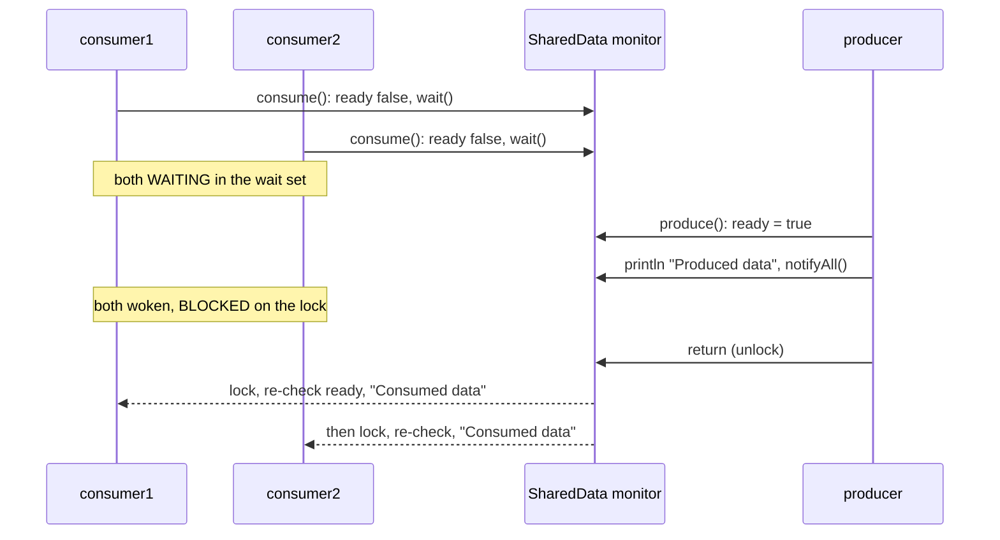
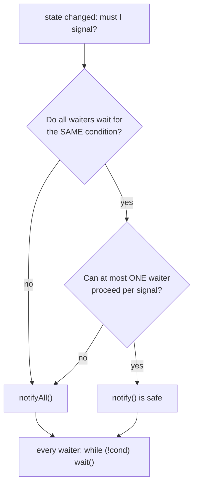

## In One Line
`notifyAll()` wakes **every** thread waiting on an object's monitor (where `notify()` wakes just one). The woken threads then take the lock **one at a time**, and each re-checks its condition in a `while` loop. Use it when a state change matters to several waiters, or when you cannot be sure that waking one arbitrary thread wakes the right one.

## Mental Model
Picture a **doctor's waiting room** with one consulting-room door.

- The **waiting room** is the object's **wait set**. Patients who called `wait()` sit there and are not trying to get in.
- The **consulting-room door** is the monitor lock: one person inside at a time.
- `notify()` = the nurse calls **one name at random**. If she happens to call someone who is not ready, or you needed two people, the others keep sitting there, possibly for ever.
- `notifyAll()` = the nurse announces to the **whole room**: "the doctor is back". Everyone stands up and queues at the door. They still go in **one by one** (the lock), and each one checks again whether it is really their turn (the `while` loop). Anyone for whom nothing has changed sits back down (`wait()` again).
- The announcement is not written on any board. A patient who arrives after it has heard nothing, so the **state** ("doctor is back" = `ready = true`) must be stored somewhere the newcomer can check before sitting down.

In the course example the nurse is the **producer**, the two patients are the **two consumers**, and "the doctor is back" is `ready = true`. Both consumers are waiting for the same news, so it must be announced to the whole room.

## Concept
### `notify()` vs `notifyAll()`
Both are `public final native` methods of `java.lang.Object`. Both need the caller to own the object's monitor, and neither releases it (see [wait() and notify()](lesson:a06-threads/06-wait-notify) for the basics).

| | `notify()` | `notifyAll()` |
|---|---|---|
| Wakes | **One** thread from the wait set; which one is unspecified | **All** threads currently in the wait set |
| Nobody waiting | Signal lost (not stored) | Signal lost (not stored) |
| After waking | That thread competes for the monitor | All of them compete; they get it **one at a time** |
| Risk | The *wrong* thread may wake, and the right one sleeps for ever | Unneeded wake-ups (wasted CPU, context switches) |
| Correctness | Only safe under strict conditions (below) | Always safe **if** every waiter uses a `while` loop |
| `java.util.concurrent` twin | `Condition.signal()` | `Condition.signalAll()` |

### What happens, step by step
1. Consumers 1 and 2 each enter `consume()`, see `ready == false`, and call `wait()`. Each **releases the monitor** and parks in the wait set (state WAITING).
2. The producer enters `produce()` (the lock is free now), sets `ready = true`, prints, and calls `notifyAll()`.
3. **Both** consumers leave the wait set. They must now re-acquire the monitor, which the producer still holds, so they are **BLOCKED**.
4. The producer returns from `produce()` and the monitor is released.
5. One consumer gets the monitor, returns from `wait()`, re-checks `while (!ready)` (false now), prints `Consumed data`, and leaves. Only then can the other one get the monitor and do the same.

`notifyAll()` does **not** mean "they all run in parallel". It means "they are all allowed to try again". The monitor still serialises them.

> [!NOTE] HotSpot detail: `notifyAll()` does not unpark every waiter at once. It moves them from the wait set to the monitor's entry queue, and they are woken one after another as the monitor is released. The Java specification only promises that they are all "awakened" and compete for the lock. Which one gets it first is unspecified.

### Why the course example needs `notifyAll()`
There are **two** consumers waiting for **one** event. Each consumer needs a wake-up. `notify()` would wake exactly one of them. The other would stay in the wait set for ever, because nobody calls `notify` again, and the JVM would never exit because consumers are non-daemon threads. We replaced `notifyAll()` with `notify()` in the original and ran it 20 times with a 3-second timeout: **18 runs hung**. The other two finished only because one consumer had not reached `wait()` yet when the producer ran, and so it saw `ready == true` and never waited.

### When is `notify()` enough?
Brian Goetz (*Java Concurrency in Practice*) gives two conditions, and **both** must hold:
1. **Uniform waiters.** Every waiting thread waits for the **same condition** and does the **same thing** when it wakes. Any of them is as good as another.
2. **One-in, one-out.** Each notification lets **at most one** thread proceed (for example, one item was added and one taker can have it).

The course example breaks rule 2: one `ready = true` lets **every** consumer proceed. A bounded buffer where producers wait for "not full" and consumers wait for "not empty" on the **same** monitor breaks rule 1 (see [Thread Communication](lesson:a06-threads/08-thread-communication)). When either rule fails, or you are not sure, use `notifyAll()`.

> [!INTERVIEW] "`notify()` is an optimisation. `notifyAll()` is the safe default. Use `notify()` only when the waiters are uniform and each signal lets one thread through."

### The price: the thundering herd
With `notifyAll()`, every waiter wakes, takes the lock in turn, re-checks, and most go straight back to `wait()`. With 5 waiters and 1 item, you get 5 wake-ups and 4 futile ones (`HerdDemo` below). With hundreds of waiters this "thundering herd" costs real CPU time and context switches. Ways to reduce it:
- **Separate conditions.** `ReentrantLock` with one `Condition` per kind of waiter (`notFull`, `notEmpty`), so you can `signal()` exactly the right group. See [ReentrantLock](lesson:a06-threads/10-reentrantlock).
- **Ready-made synchronizers.** `BlockingQueue`, `Semaphore` and `CountDownLatch` wake only the threads that can proceed.
- Keep the `while` loop in every case. Fewer wake-ups do not mean *no* spurious ones.

### Typical uses of a broadcast
| Situation | Why everyone must wake |
|---|---|
| A one-shot event: "data ready", "initialisation finished", "gate open" (the course example) | Every waiter can proceed |
| Shutdown or cancellation flag | Every waiter must notice and exit |
| Several conditions share one monitor (bounded buffer with wait/notify) | The right *kind* of waiter must be among the woken |
| A change can enable a varying number of waiters (e.g. "5 permits released") | `notify()` would wake too few |

The JVM itself broadcasts too: when a platform thread terminates, the JVM calls `notifyAll()` on the `Thread` object. That is how `join()` (which waits on that object) wakes up. It is also why you should never use a `Thread` object as your own lock.

### Modern equivalents
| Raw monitor | `java.util.concurrent` |
|---|---|
| `ready = true; notifyAll();` for a one-shot event | `CountDownLatch(1)`: `countDown()` opens the gate, `await()` waits (see [CountDownLatch](lesson:a06-threads/12-countdownlatch)) |
| `notifyAll()` on a monitor with several conditions | `ReentrantLock` + several `Condition`s, each with `signal()`/`signalAll()` |
| Many threads waiting for one computed value | `CompletableFuture.complete(value)` wakes every `join()`/`get()` caller |

```java
// Condition version of SharedData (same behaviour as the course example)
private final ReentrantLock lock = new ReentrantLock();
private final Condition readyCond = lock.newCondition();
private boolean ready;

void produce() { lock.lock(); try { ready = true; readyCond.signalAll(); } finally { lock.unlock(); } }
void consume() throws InterruptedException {
    lock.lock();
    try { while (!ready) readyCond.await(); } finally { lock.unlock(); }
}
```

### Virtual threads (Java 21+)
On JDK 21, a virtual thread that blocks in `Object.wait()` **pins** its carrier platform thread (the JVM temporarily adds a carrier to compensate). JDK 24 (JEP 491) removed this limitation for `synchronized` and `Object.wait()`. For large numbers of virtual threads on JDK 21, prefer `ReentrantLock`/`Condition` or `java.util.concurrent` classes.

## Diagram

`notifyAll()` empties the wait set, but the woken consumers still pass through the lock one at a time and re-check `ready`. Which one goes first is unspecified.


The decision rule for `notify()` versus `notifyAll()`. When in doubt, take the `notifyAll()` branch. The `while` loop is needed on both branches.

## Code
@example Multithreading/SynchronizationandCommunication/NotifyAllExample.java

`notify()` versus `notifyAll()` with both consumers already waiting. The consumers are daemon threads here so the demo can exit even when one of them is stuck:
```java
public class NotifyVsNotifyAll {
    static class SharedData {                       // same idea as the course example
        private boolean ready = false;
        private final boolean wakeAll;
        SharedData(boolean wakeAll) { this.wakeAll = wakeAll; }

        public synchronized void produce() {
            ready = true;
            if (wakeAll) notifyAll(); else notify();
        }
        public synchronized void consume() {
            while (!ready) {
                try { wait(); } catch (InterruptedException e) { return; }
            }
        }
    }

    static void demo(boolean wakeAll) throws InterruptedException {
        SharedData data = new SharedData(wakeAll);
        Thread c1 = new Thread(data::consume, "consumer1");
        Thread c2 = new Thread(data::consume, "consumer2");
        c1.setDaemon(true);                         // so the demo can exit even if one hangs
        c2.setDaemon(true);
        c1.start();
        c2.start();
        while (c1.getState() != Thread.State.WAITING || c2.getState() != Thread.State.WAITING) {
            Thread.sleep(10);                       // make sure BOTH are in wait() first
        }
        data.produce();
        c1.join(1000);
        c2.join(1000);
        int stuck = (c1.isAlive() ? 1 : 0) + (c2.isAlive() ? 1 : 0);
        System.out.println((wakeAll ? "notifyAll()" : "notify()   ")
                + " -> consumers still waiting after 1 s: " + stuck);
    }

    public static void main(String[] args) throws InterruptedException {
        demo(false);
        demo(true);
    }
}
```
```output
notify()    -> consumers still waiting after 1 s: 1
notifyAll() -> consumers still waiting after 1 s: 0
```

The thundering herd. There are five waiters and **one** real item (taking it sets the count back to 0). `notifyAll()` wakes all five, but only one gets the item and the other four go back to `wait()`:
```java
import java.util.ArrayList;
import java.util.List;

public class HerdDemo {
    static final Object lock = new Object();
    static int items = 0;          // a REAL item count: taking one makes it 0 again
    static int wakeUps = 0;        // how often a waiter returned from wait()
    static int taken = 0;

    static void take() throws InterruptedException {
        synchronized (lock) {
            while (items == 0) {
                lock.wait();
                wakeUps++;                        // woken, and we hold the lock again here
            }
            items--;
            taken++;
        }
    }

    public static void main(String[] args) throws InterruptedException {
        List<Thread> takers = new ArrayList<>();
        for (int i = 1; i <= 5; i++) {
            Thread t = new Thread(() -> {
                try { take(); } catch (InterruptedException e) { /* demo: just stop */ }
            }, "taker" + i);
            t.setDaemon(true);
            takers.add(t);
            t.start();
        }
        for (Thread t : takers) {
            while (t.getState() != Thread.State.WAITING) Thread.sleep(10);
        }
        synchronized (lock) {
            items = 1;                            // ONE item for FIVE waiters
            lock.notifyAll();
        }
        Thread.sleep(500);
        synchronized (lock) {
            long waiting = takers.stream().filter(t -> t.getState() == Thread.State.WAITING).count();
            System.out.println("wake-ups: " + wakeUps + ", items taken: " + taken
                    + ", back in wait(): " + waiting);
        }
    }
}
```
```output
wake-ups: 5, items taken: 1, back in wait(): 4
```
Here `notify()` would have been correct *and* cheaper: the waiters are uniform and one item lets exactly one taker through. That is the "one-in, one-out" case.

The course example's `consume()` swallows interrupts, so a consumer cannot be cancelled:
```java
public class SwallowInterrupt {
    static class SharedData {                       // copied from the course example
        private boolean ready = false;
        public synchronized void produce() {
            ready = true;
            System.out.println("Produced data");
            notifyAll();
        }
        public synchronized void consume() {
            while (!ready) {
                try {
                    wait();
                } catch (InterruptedException e) {
                    System.out.println("caught " + e.getClass().getSimpleName() + " - looping back to wait()");
                }
            }
            System.out.println("Consumed data");
        }
    }
    public static void main(String[] args) throws InterruptedException {
        SharedData data = new SharedData();
        Thread consumer = new Thread(data::consume);
        consumer.start();
        Thread.sleep(200);
        consumer.interrupt();                       // try to cancel the consumer
        Thread.sleep(200);
        System.out.println("after interrupt: " + consumer.getState()
                + ", interrupted flag = " + consumer.isInterrupted());
        data.produce();
        consumer.join();
    }
}
```
```output
caught InterruptedException - looping back to wait()
after interrupt: WAITING, interrupted flag = false
Produced data
Consumed data
```

The example is really a one-shot "gate", which is exactly what `CountDownLatch(1)` is. Same output, no hand-written monitor code:
```java
import java.util.concurrent.CountDownLatch;

public class LatchGate {
    public static void main(String[] args) {
        CountDownLatch ready = new CountDownLatch(1);   // a one-shot gate, closed

        Runnable consume = () -> {
            try {
                ready.await();                          // wait until the gate opens
                System.out.println("Consumed data");
            } catch (InterruptedException e) {
                Thread.currentThread().interrupt();     // restore the flag and stop
            }
        };
        Thread consumer1 = new Thread(consume);
        Thread consumer2 = new Thread(consume);
        Thread producer = new Thread(() -> {
            System.out.println("Produced data");
            ready.countDown();                          // open the gate for ALL waiters
        });

        consumer1.start();
        consumer2.start();
        producer.start();
    }
}
```
```output
Produced data
Consumed data
Consumed data
```

## Walkthrough
- `package Multithreading.SynchronizationandCommunication;` shares a package with the other wait/notify examples. Because `SharedData` is a package-private top-level class, its name must be unique in that package (the next lesson uses `SharedResource`).
- `class SharedData { private boolean ready = false; ... }` is the shared object. Its **monitor** is used both as the lock and as the waiting place. `ready` is the **condition**, the part that *remembers* the event. It needs no `volatile`, because it is only read and written while holding the monitor.
- `public synchronized void produce()`:
  - `ready = true;` changes the state **first**.
  - `System.out.println("Produced data");` runs **while still holding the lock**. That is why this line always comes first: no consumer can print before the producer has left `produce()`.
  - `notifyAll();` is short for `this.notifyAll()`. It wakes every thread in this `SharedData`'s wait set. It is legal because the method is `synchronized` (the producer owns the monitor). The lock is released only when `produce()` returns.
- `public synchronized void consume()`:
  - `while (!ready) { ... wait(); ... }` is the **guarded wait**. If the producer already ran, `ready` is `true` and the consumer never waits. Otherwise `wait()` releases the monitor, sleeps, re-acquires the monitor when woken, and the loop re-checks `ready`.
  - `catch (InterruptedException e) { e.printStackTrace(); }` prints the trace and loops back into `wait()`. The interrupt is swallowed (see Traps).
  - `System.out.println("Consumed data");` runs only once `ready` is `true`, with the lock held.
- `SharedData data = new SharedData();` creates **one** object shared by all three threads. That matters, because wait/notify only connects threads that use the same object.
- `new Thread(data::consume)` uses a **bound method reference** as the `Runnable`: `run()` calls `data.consume()`. Two consumer threads share one `SharedData`. The threads are unnamed, so they get the default names `Thread-0`, `Thread-1` and `Thread-2`.
- `consumer1.start(); consumer2.start(); producer.start();` The consumers are started first, so they usually reach `wait()` before the producer runs. Start order is not run order, though, and the code does not depend on it.
- `main` returns straight away. The JVM stays alive until the three non-daemon threads finish.
- **Output.** It is always `Produced data`, `Consumed data`, `Consumed data` (the recorded runs never varied). Three reasons:
  1. The consumers print only after seeing `ready == true`, and the producer prints `Produced data` inside the same synchronized method that sets `ready`. So the producer's line always comes first.
  2. The two `Consumed data` lines come from different threads in an unspecified order, but they are identical text, so you cannot see the difference.
  3. Whether a consumer waited at all varies from run to run, but the flag makes the result the same either way.
- The `// Output:` comment in the source matches the real output.

## Traps
> [!ERRATA] The names `produce`/`consume` suggest a producer–consumer handoff, but nothing is consumed: `consume()` never resets `ready`, so both consumers "consume" the **same single** piece of data. The example is really a **one-shot broadcast** (a gate or latch), and that is exactly the case where `notifyAll()` is required. If `consume()` did take the item (`ready = false`), `notifyAll()` would still wake both consumers, but the second would find `ready == false`, wait again and hang the program for ever. A real handoff needs one item per consumer (a counter or a queue), and it is covered in [Thread Communication](lesson:a06-threads/08-thread-communication).

> [!ERRATA] `catch (InterruptedException e) { e.printStackTrace(); }` inside `while (!ready)` **swallows interrupts**. The exception clears the thread's interrupt flag, the loop calls `wait()` again, and the consumer can never be cancelled. `SwallowInterrupt` shows the state back at `WAITING` with the flag `false`. Fix: let `consume()` declare `throws InterruptedException`, or restore the flag with `Thread.currentThread().interrupt()` and `return`.

- **Replacing `notifyAll()` with `notify()` here hangs the program** most of the time (18 of our 20 runs). One consumer wakes, and the other waits for a signal that never comes.
- **`notifyAll()` is not a replacement for the flag.** It only wakes threads that are *already* waiting. A consumer that arrives later is saved only because it checks `ready` first.
- **`notifyAll()` with `if` instead of `while`** lets every woken thread proceed, even if only one should (the `IfBug` quiz below ends with `items = -1`).
- **Expecting parallel execution after `notifyAll()`.** The woken threads re-acquire the monitor one at a time.
- **Expecting an order.** No FIFO or priority order is specified for who re-acquires the lock first.
- **Calling it without the lock.** `lock.notifyAll()` outside `synchronized (lock)` throws `IllegalMonitorStateException: current thread is not owner`.
- **Notifying a different object.** `wait()` on `this` but `notifyAll()` on `lock` wakes nobody.
- **Treating `notifyAll()` as free.** With many waiters each broadcast costs many context switches. Use targeted `Condition`s or `java.util.concurrent` classes.

## Tips & Tricks
- **"notify = tap one shoulder, notifyAll = ring the bell."** The bell wakes the room, and the door (the lock) still lets people in one at a time.
- **"Same wait, one gate → notify; otherwise notifyAll."** Uniform waiters plus one-in, one-out is the only time `notify()` is safe.
- **"When in doubt, notifyAll."** A spare wake-up only costs time. A missing one can hang the program.
- **"The flag remembers, the bell reminds."** Always change the shared state *before* calling `notifyAll()`, inside the same synchronized block.
- **Every waiter loops**: `while (!condition) wait();`. `notifyAll()` makes the loop mandatory, because most woken threads will find their condition still false.
- **A one-shot "everyone may go now" is a latch.** In new code, `CountDownLatch(1)` or `CompletableFuture` does it in one line.
- Name your threads (`new Thread(r, "consumer1")`) when you experiment. Unnamed threads make wake-up order invisible in the output.

## Interview Q&A
### [Basic] What is the difference between `notify()` and `notifyAll()`?
Both wake threads that are waiting on the object's monitor, and both must be called while holding that monitor. `notify()` wakes **one** arbitrary waiting thread. `notifyAll()` wakes **all** of them. In both cases the woken threads must re-acquire the monitor before `wait()` returns, so with `notifyAll()` they proceed one at a time, and each should re-check its condition in a `while` loop. Neither method releases the lock, and neither has any effect if no thread is waiting.

**Follow-up:** *Which one should you use by default?* `notifyAll()`. It is always correct with a `while` loop. `notify()` is an optimisation that is only safe in specific situations.

### [Basic] After `notifyAll()`, do all the woken threads run at the same time?
No. They all leave the wait set, but they all need the same monitor, and the notifier still holds it until it leaves its synchronized block. They are BLOCKED until then, and afterwards they get the lock one after another. Each one returns from `wait()` holding the lock, re-checks the condition, and either proceeds or waits again. Everything guarded by the lock is still executed by one thread at a time.

**Follow-up:** *In which order do they get the lock?* It is unspecified. Don't rely on FIFO or on thread priority.

### [Intermediate] When is it safe to use `notify()` instead of `notifyAll()`?
Only when **both** hold. (1) The waiters are **uniform**: they all wait for the same condition and do the same thing afterwards, so waking any one of them is fine. (2) Each notification lets **at most one** thread proceed (one-in, one-out). A pool of identical workers taking single items from a queue fits. A broadcast event such as "initialisation finished" does not, because several threads can proceed. Nor does a buffer where producers and consumers wait on the same monitor for different conditions, because `notify()` could wake a producer when a consumer was needed.

**Follow-up:** *What goes wrong if you use `notify()` when rule 1 fails?* A thread of the wrong kind wakes up, finds its condition false and waits again. The signal is used up, the thread that could have proceeded sleeps on, and eventually every thread can be waiting (a lost wake-up).

### [Intermediate] Why does the course example use `notifyAll()`? What happens with `notify()`?
Two consumers wait for one event, `ready = true`, and **both** should proceed. With `notify()`, only one is woken. The other stays in the wait set for ever, since nothing notifies again, and because the consumers are non-daemon threads the JVM never exits. It "works" only when a consumer is late enough to see `ready == true` before calling `wait()`. When we tried it, 18 of 20 runs hung.

**Follow-up:** *Would adding a second `notify()` call fix it?* Only by accident. The code would then depend on the exact number of waiters. `notifyAll()` (or a `CountDownLatch`) states the intent: everyone may go.

### [Intermediate] If `notifyAll()` wakes everyone, why do we still need a `while` loop?
Because being woken does not mean your condition is true. With `notifyAll()`, several threads wake for one change, and the first one may use it up (take the only item) before the others get the lock. Several conditions may also share the monitor, so the broadcast might have been meant for another kind of waiter. And spurious wake-ups are always allowed. The loop re-checks the condition under the lock and sends the thread back to `wait()` if needed.

**Follow-up:** *What happens with `if`?* Every woken thread proceeds. With one item and two waiters the count goes negative, as the `IfBug` quiz shows (`items = -1`).

### [Intermediate] What is the "thundering herd" problem?
When many threads wait on one monitor and `notifyAll()` wakes all of them for a change that only one can use, every thread is scheduled, takes the lock in turn, finds nothing to do and waits again. The cost is O(n) context switches and lock hand-offs per event. It is a performance problem, not a correctness one. The remedies are `notify()` when the waiters are uniform, separate `Condition` objects per kind of waiter (`notFull.signal()` / `notEmpty.signal()`), or classes such as `BlockingQueue` and `Semaphore` that wake only threads that can proceed.

**Follow-up:** *Does HotSpot wake them all at once?* No. It moves the waiters from the wait set to the monitor's entry queue and wakes them one at a time as the monitor is released, but each of them still runs through the lock and the loop.

### [Advanced] What is the `java.util.concurrent` equivalent of `notifyAll()`?
For a lock-based design it is `Condition.signalAll()` on a condition from `ReentrantLock.newCondition()`, with `Condition.await()` inside `while` as the counterpart of `wait()`. The advantage is that one lock can have **several** conditions, so you can broadcast to just the relevant group. For a one-shot event, use `CountDownLatch(1)` (`countDown()` releases all current and future `await()`ers, because a latch stays open) or `CompletableFuture.complete(v)`. For a reusable meeting point, use `CyclicBarrier` or `Phaser`.

**Follow-up:** *Why is a latch better than `notifyAll()` for a one-shot event?* Its state is built in, so late arrivals pass straight through. No flag is needed, there is no `while` loop, no lost signal, and interrupts are handled properly.

### [Advanced] Can a thread miss a `notifyAll()`?
Yes, if it was not in the wait set at the moment of the call. `notifyAll()` wakes only threads that are waiting **right then**, and the signal is not stored. A thread that calls `wait()` a moment later sleeps until the next notification. That is why the waiter checks shared state under the same lock before waiting: the state records the event even though the signal is lost. In the course example, a consumer that starts after `produce()` sees `ready == true` and never waits.

**Follow-up:** *Does holding the lock while checking matter?* Yes. The check and the `wait()` must be atomic with respect to the notifier, or the notification could slip in between them. That is why `wait()` requires owning the monitor.

### [Advanced] Where does the JDK itself call `notifyAll()`?
When a platform thread terminates, the JVM calls `notifyAll()` on its `Thread` object. For platform threads, `Thread.join()` is implemented (in JDK 21) as `synchronized (this) { while (isAlive()) wait(0); }`, so this broadcast is what wakes the joiners. Consequence: never use a `Thread` instance as a lock or condition object for your own wait/notify, because you would get wake-ups from the JVM, and your own `notifyAll()` would disturb `join()` callers.

**Follow-up:** *Is it the same for virtual threads?* No. Since JDK 21, `join()` on a virtual thread uses a separate internal mechanism rather than the monitor of the `Thread` object. The guarded-wait loop on `isAlive()` is still the pattern for platform threads.

## Quiz
### What does the original `NotifyAllExample` print?
- [x] `Produced data`, `Consumed data`, `Consumed data`, always in that order
- [ ] `Produced data`, `Consumed data`, because only one consumer is woken
- [ ] The two `Consumed data` lines may come before `Produced data`
- [ ] Nothing: the consumers wait for ever
> `notifyAll()` wakes both consumers, and even a consumer that arrives late sees `ready == true`. `Produced data` is printed inside `produce()` while it holds the lock, before any consumer can pass its `while` check, so it is always first. Printing only one `Consumed data` is what `notify()` would typically do.

### Replace `notifyAll()` with `notify()` and make sure both consumers are already in `wait()` before `produce()` runs. What happens?
- [ ] Both consumers still print, because `notify()` wakes all threads of the same class
- [x] One consumer prints; the other waits for ever and the JVM never exits
- [ ] `IllegalMonitorStateException`
- [ ] Both consumers wake, but neither prints
> `notify()` wakes exactly one thread. The second stays in the wait set with nobody to wake it, and as a non-daemon thread it keeps the JVM alive. `NotifyVsNotifyAll` printed `still waiting after 1 s: 1` for `notify()` and `0` for `notifyAll()`.

### What does `HerdDemo` print? (5 waiters, `items = 1`, `notifyAll()`, every taker uses `while (items == 0) wait();`)
- [ ] `wake-ups: 1, items taken: 1, back in wait(): 4`
- [x] `wake-ups: 5, items taken: 1, back in wait(): 4`
- [ ] `wake-ups: 5, items taken: 5, back in wait(): 0`
- [ ] `wake-ups: 5, items taken: 1, back in wait(): 0`
> `notifyAll()` wakes all five, so there are 5 returns from `wait()`. The first to get the lock takes the item. The other four re-check `items == 0` and wait again. Only `notify()` would give 1 wake-up, and no thread proceeds without an item thanks to the `while` loop.

### Spot the bug. What does it print when two takers are waiting and `main` runs `items = 1; lock.notifyAll();`?
```java
static void take() throws InterruptedException {
    synchronized (lock) {
        if (items == 0) {
            lock.wait();
        }
        items--;
    }
}
// ... later: System.out.println("items = " + items);
```
- [ ] `items = 0`
- [x] `items = -1`
- [ ] It deadlocks
- [ ] `IllegalMonitorStateException`
> Both takers are woken. The first decrements to 0. The second returns from `wait()` and, with `if`, does not re-check, so it decrements to `-1` (we ran it: `items = -1`). With `while` it would see `items == 0` and wait again.

### What does this print?
```java
Object lock = new Object();
try {
    lock.notifyAll();
    System.out.println("notified");
} catch (IllegalMonitorStateException e) {
    System.out.println(e.getMessage());
}
```
- [ ] `notified`
- [x] `current thread is not owner`
- [ ] A compile error: `notifyAll()` must be inside `synchronized`
- [ ] Nothing: nobody is waiting, so the call is ignored
> `notifyAll()` checks at runtime that the caller owns the monitor, even when nobody is waiting. The compiler cannot check which locks are held. "Ignored when nobody waits" is true only once you own the lock.

### Which situation is safe for `notify()`?
- [ ] A shutdown flag that every worker waits on
- [ ] A bounded buffer where producers wait for "not full" and consumers wait for "not empty" on the same monitor
- [x] Identical worker threads that each wait for one item, and each `notify()` follows adding exactly one item
- [ ] The course example with two consumers waiting for `ready`
> Only the third case has uniform waiters and one-in, one-out. A shutdown flag and the course example must reach every waiter. The shared-monitor buffer has two kinds of waiters, so `notify()` might wake the wrong kind.

### Thread A calls `lock.notifyAll()` and then keeps working inside `synchronized (lock)` for 2 seconds. What are the woken threads doing during those 2 seconds?
- [ ] Running the code after `wait()` in parallel
- [ ] Still WAITING, because `notifyAll()` takes effect only when A exits
- [x] BLOCKED, trying to re-acquire `lock`
- [ ] TERMINATED
> They have left the wait set, so they are no longer WAITING, but `wait()` cannot return until they own the monitor, which A still holds. They are BLOCKED until A leaves the synchronized block, and then they go one at a time.

## Takeaways
- `notifyAll()` wakes every thread in the object's wait set; `notify()` wakes one unspecified thread. Both need the monitor, neither releases it, and neither is remembered if nobody waits.
- The woken threads re-acquire the monitor one at a time, in no specified order, and each must re-check its condition with `while (!condition) wait();`.
- `notify()` is safe only with uniform waiters and one-in, one-out signals. Otherwise, or when unsure, use `notifyAll()`.
- The course example needs `notifyAll()` because one event (`ready = true`) must release two consumers. With `notify()` one consumer hangs for ever (18 of 20 runs).
- The example's output never varies: `Produced data` is printed under the lock before any consumer can pass its check, and the two `Consumed data` lines are identical.
- `notifyAll()` costs a "thundering herd" of futile wake-ups when only one waiter can proceed. Targeted `Condition.signal()`, `BlockingQueue` or `Semaphore` avoid it.
- A one-shot "everyone may go" event is a latch: prefer `CountDownLatch(1)`, `CompletableFuture` or `Condition.signalAll()` in new code, and never swallow `InterruptedException` in the wait loop.
