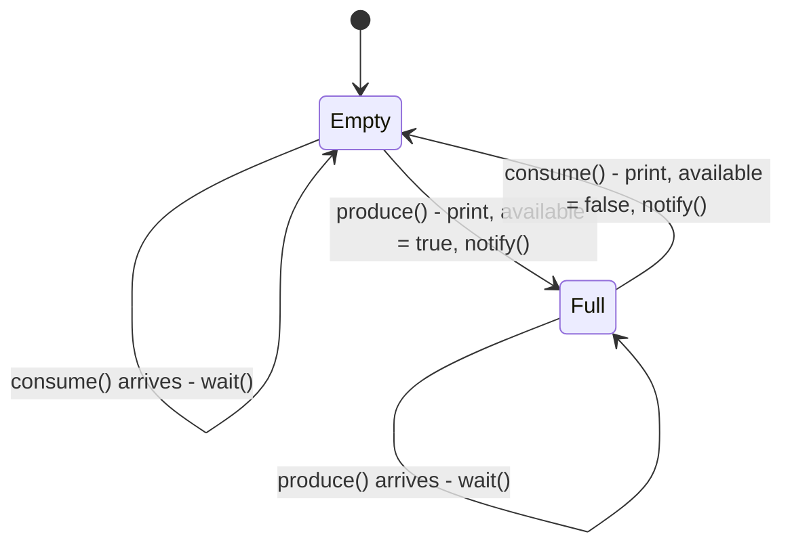
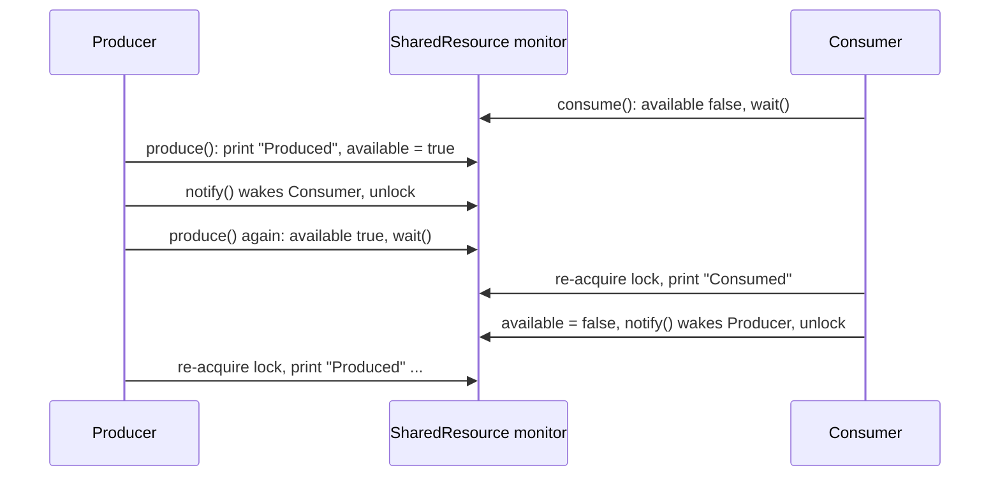
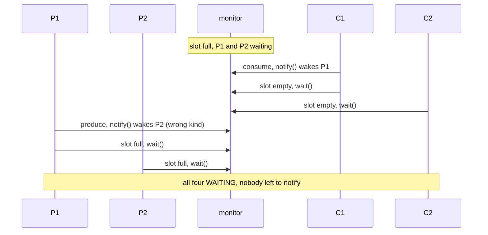

## In One Line
Threads communicate by **sharing an object** and **signalling each other about its state**. In the classic **producer–consumer** handoff, the producer waits while the slot is full and the consumer waits while it is empty, and each one `notify()`s the other after changing the state. The result is a strict `Produced` / `Consumed` ping-pong.

## Mental Model
Picture a **single-plate serving hatch** between a kitchen and a dining room.

- The **hatch** holds exactly one plate. It is the `SharedResource`, and `available` says whether a plate is on it.
- The **cook** (producer) may only put a plate down when the hatch is empty. If a plate is still there, the cook waits (`while (available) wait();`).
- The **waiter** (consumer) may only pick a plate up when there is one. If the hatch is empty, the waiter waits (`while (!available) wait();`).
- After putting a plate down, the cook **rings the bell** (`notify()`) so the waiter comes. After taking it, the waiter **rings back** so the cook knows the hatch is free.
- Only one person can reach into the hatch at a time (the monitor lock).

With one cook and one waiter, a single bell is enough: whoever rings can only be calling the other person. With two cooks and two waiters and one bell that wakes a random person, a cook can wake the *other cook* while the plate is still sitting there. Then everyone ends up waiting for a bell that never rings, which is exactly what happens in code.

## Concept
### What "thread communication" means in Java
Java threads share one heap, so they communicate through **shared objects**. Sharing data is not enough, though. A thread also needs to know **when** the data is ready and when it may continue. That is the *signalling* half. The tools, from low level to high level:

| Mechanism | Communicates | Typical use |
|---|---|---|
| `wait()` / `notify()` / `notifyAll()` on a monitor | "the state changed, look again" | Hand-written guarded blocks (this lesson) |
| `Lock` + `Condition.await()` / `signal()` | Same, with several named conditions per lock | Bounded buffers, custom synchronizers |
| `BlockingQueue` (`put` / `take`) | Data **and** signal together | Producer–consumer in real code |
| `SynchronousQueue`, `Exchanger` | Direct handoff between two threads | Rendezvous, double buffering ([Exchanger](lesson:a06-threads/15-exchanger)) |
| `CountDownLatch`, `CyclicBarrier`, `Phaser` | "N things happened" / "everyone arrived" | Start and finish gates |
| `Thread.join()` | "that thread has finished" | Waiting for a worker |
| `Future` / `CompletableFuture` | One result, once | Asynchronous results ([Callable & Future](lesson:a07-executors/04-callable-and-future)) |
| A `volatile` flag | A single value, polled | Stop flags |
| `interrupt()` | "please stop what you are doing" | Cancellation |
| `PipedInputStream` / `PipedOutputStream` | A byte stream between two threads | Legacy; rarely used today |

### The producer–consumer problem
A producer creates items and a consumer processes them, at different speeds. A **buffer** in between decouples them. It gives two rules:
1. A producer must **wait while the buffer is full**, which gives natural back-pressure.
2. A consumer must **wait while the buffer is empty**.

The course example is the smallest possible version: a buffer of **one slot** with no data in it, just the `available` flag. With capacity 1, the two rules force a strict alternation: produce, consume, produce, consume, and so on.

### Both sides use the guarded-wait idiom
```java
// producer side                          // consumer side
while (available) wait();                 while (!available) wait();
/* produce */                              /* consume */
available = true;                          available = false;
notify();                                  notify();
```
Each side waits **in a `while` loop** for its own condition, changes the **shared state**, then signals. The state (`available`) is what stops the lost-notification bug of [wait() and notify()](lesson:a06-threads/06-wait-notify). If the consumer arrives late, it sees `available == true` and does not wait at all.

### Why `notify()` is enough here, and when it is not
There are two kinds of waiter on **one** monitor: producers waiting for "not full" and consumers waiting for "not empty". With **one producer and one consumer**, at most one thread is ever in the wait set, and it is always the one that the change enables, so `notify()` wakes the right thread.

With **two producers and two consumers**, `notify()` can wake a thread of the **wrong kind**:
1. The slot is full. P1 and P2 both `wait()`.
2. C1 consumes, calls `notify()` and wakes P1. C1 loops, finds the slot empty and waits. C2 also finds it empty and waits.
3. P1 produces and calls `notify()`. The wait set holds P2, C1 and C2, and `notify()` may pick **P2**.
4. P1 loops, finds the slot full and waits. P2 wakes, finds it full and waits too.
5. All four threads are WAITING. Nobody will ever call `notify()` again, so the program hangs.

This is not a deadlock in the lock sense (nobody holds a lock), but it is just as fatal. Our `TwoAndTwo` run hit it every time. The fixes:
- `notifyAll()`: always correct, but wakes everyone (see [notifyAll()](lesson:a06-threads/07-notify-all)).
- `ReentrantLock` with **two `Condition`s**, `notFull` and `notEmpty`, so a producer only ever signals consumers and vice versa. This is how `ArrayBlockingQueue` is built.
- Better still, use a `BlockingQueue` and write no signalling code at all.

### `BlockingQueue`: producer–consumer in one line per side
| Operation | Throws | Returns a special value | **Blocks** | Times out |
|---|---|---|---|---|
| Insert | `add(e)` | `offer(e)` → `false` | **`put(e)`** | `offer(e, time, unit)` |
| Remove | `remove()` | `poll()` → `null` | **`take()`** | `poll(time, unit)` |
| Examine | `element()` | `peek()` | — | — |

| Implementation | Bounded? | Notes |
|---|---|---|
| `ArrayBlockingQueue` | Yes (fixed) | Circular array, **one** `ReentrantLock`, conditions `notEmpty`/`notFull`, optional fairness |
| `LinkedBlockingQueue` | Optional (default `Integer.MAX_VALUE`) | Linked nodes, **two** locks (put and take), so producers and consumers do not contend |
| `SynchronousQueue` | Capacity 0 | Every `put` waits for a `take`: a pure handoff (used by `newCachedThreadPool`) |
| `LinkedTransferQueue` | No | `transfer(e)` waits until a consumer has received the item |
| `PriorityBlockingQueue` | No | Ordered by priority, `take` blocks only when empty |
| `DelayQueue` | No | Elements become available after their delay |

`BlockingQueue` does not allow `null` elements (`null` is what `poll()` returns for "nothing").

### Stopping a consumer
A consumer blocked in `take()` or `wait()` needs a way to stop:
- **Poison pill**: the producer puts a special "no more items" value, and the consumer exits when it takes it (`QueueHandoff` below). Use one pill per consumer.
- **Interrupt**: `consumer.interrupt()` makes `take()`/`wait()` throw `InterruptedException`. The consumer must *stop* when that happens, not swallow it as the course example does.
- **A fixed count** as in the course example (5 and 5). This is fragile: if the counts differ, a thread hangs (see the Quiz).

### Turn-taking: the same pattern with a "whose turn" flag
Printing odd and even numbers from two threads alternately is a favourite interview program, and it is this lesson's pattern again. The shared state is `next`, a thread waits while it is not its turn, prints, advances `next`, and notifies (`OddEven` below; more drills in [Multithreading programs](lesson:b06-coding-drills/06-multithreading-programs)).

### Visibility comes free with the lock
Everything the producer wrote before leaving the synchronized method (the item, `available = true`) is visible to the consumer after it re-acquires the same monitor. An unlock *happens-before* the next lock of the same monitor. That is why `available` needs no `volatile`: it is only accessed inside `synchronized` methods. `BlockingQueue` gives the same guarantee: actions before `put` happen-before actions after the matching `take`.

### Why not busy-wait?
`while (!available) { }` on a `volatile` flag also "works", but it burns a whole CPU core while waiting, and without `volatile` it may never see the change at all. Spinning is only reasonable for waits of a few microseconds (then add `Thread.onSpinWait()`, Java 9+). For anything longer, block with `wait`, `await` or `take`.

## Diagram

The one-slot buffer has only two states. A producer can only leave `Empty` and a consumer can only leave `Full`, which forces the strict alternation in the output.


One round of the ping-pong. Each side waits for the other side's state change, and its `notify()` is always received by the opposite thread, because it is the only other thread.


With two producers and two consumers, `notify()` can hand the signal to a thread of the same kind. The signal is used up and every thread ends up waiting.

## Code
@example Multithreading/SynchronizationandCommunication/ThreadCommunicationExample.java

The same class with 2 producers and 2 consumers (100,000 items each), once with `notify()` and once with `notifyAll()`. The threads are daemons so the demo can exit:
```java
import java.util.List;

public class TwoAndTwo {
    static class SharedResource {                  // the course class, plus a switch
        private boolean available = false;
        private final boolean wakeAll;
        SharedResource(boolean wakeAll) { this.wakeAll = wakeAll; }

        public synchronized void produce() throws InterruptedException {
            while (available) wait();
            available = true;
            if (wakeAll) notifyAll(); else notify();
        }
        public synchronized void consume() throws InterruptedException {
            while (!available) wait();
            available = false;
            if (wakeAll) notifyAll(); else notify();
        }
    }

    static void demo(boolean wakeAll) throws InterruptedException {
        SharedResource r = new SharedResource(wakeAll);
        int rounds = 100_000;                      // items per thread
        Runnable producer = () -> {
            try { for (int i = 0; i < rounds; i++) r.produce(); } catch (InterruptedException e) { }
        };
        Runnable consumer = () -> {
            try { for (int i = 0; i < rounds; i++) r.consume(); } catch (InterruptedException e) { }
        };
        List<Thread> threads = List.of(new Thread(producer, "P1"), new Thread(producer, "P2"),
                                       new Thread(consumer, "C1"), new Thread(consumer, "C2"));
        for (Thread t : threads) { t.setDaemon(true); t.start(); }
        for (Thread t : threads) t.join(5_000);

        long alive = threads.stream().filter(Thread::isAlive).count();
        long waiting = threads.stream().filter(t -> t.getState() == Thread.State.WAITING).count();
        System.out.println((wakeAll ? "notifyAll(): " : "notify():    ")
                + "threads still alive = " + alive + ", of them WAITING = " + waiting);
    }

    public static void main(String[] args) throws InterruptedException {
        demo(false);
        demo(true);
    }
}
```
Identical in all 10 of our runs. The hang is a race, so a run *could* get lucky, but with 400,000 handoffs it never did:
```output
notify():    threads still alive = 4, of them WAITING = 4
notifyAll(): threads still alive = 0, of them WAITING = 0
```

The one-slot buffer carrying real data. The prints happen inside the lock, so the order is fixed:
```java
public class ValueSlot {
    static class Slot {
        private int value;                         // the data being handed over
        private boolean available = false;         // the condition: is the slot full?

        public synchronized void put(int v) throws InterruptedException {
            while (available) wait();              // slot full: wait until it is emptied
            value = v;
            available = true;
            System.out.println("Produced " + v);
            notify();                              // wake the consumer
        }
        public synchronized int take() throws InterruptedException {
            while (!available) wait();             // slot empty: wait until it is filled
            available = false;
            System.out.println("Consumed " + value);
            notify();                              // wake the producer
            return value;
        }
    }

    public static void main(String[] args) throws InterruptedException {
        Slot slot = new Slot();
        Thread producer = new Thread(() -> {
            try { for (int i = 1; i <= 3; i++) slot.put(i * 10); }
            catch (InterruptedException e) { Thread.currentThread().interrupt(); }
        });
        Thread consumer = new Thread(() -> {
            try { int sum = 0; for (int i = 1; i <= 3; i++) sum += slot.take(); System.out.println("sum = " + sum); }
            catch (InterruptedException e) { Thread.currentThread().interrupt(); }
        });
        consumer.start();
        producer.start();
        producer.join();
        consumer.join();
    }
}
```
```output
Produced 10
Consumed 10
Produced 20
Consumed 20
Produced 30
Consumed 30
sum = 60
```

A bounded buffer (capacity 3) for many producers and consumers, done the way `ArrayBlockingQueue` does it: one lock and **two conditions**, so `signal()` always wakes the right kind of thread:
```java
import java.util.ArrayDeque;
import java.util.Queue;
import java.util.concurrent.atomic.AtomicLong;
import java.util.concurrent.locks.Condition;
import java.util.concurrent.locks.ReentrantLock;

public class BoundedBufferDemo {
    static class BoundedBuffer<T> {
        private final Queue<T> items = new ArrayDeque<>();
        private final int capacity;
        private final ReentrantLock lock = new ReentrantLock();
        private final Condition notFull  = lock.newCondition();   // producers wait here
        private final Condition notEmpty = lock.newCondition();   // consumers wait here
        private int maxSeen = 0;

        BoundedBuffer(int capacity) { this.capacity = capacity; }

        void put(T item) throws InterruptedException {
            lock.lock();
            try {
                while (items.size() == capacity) notFull.await();
                items.add(item);
                maxSeen = Math.max(maxSeen, items.size());
                notEmpty.signal();                 // wake ONE consumer, never a producer
            } finally {
                lock.unlock();
            }
        }
        T take() throws InterruptedException {
            lock.lock();
            try {
                while (items.isEmpty()) notEmpty.await();
                T item = items.remove();
                notFull.signal();                  // wake ONE producer, never a consumer
                return item;
            } finally {
                lock.unlock();
            }
        }
        int maxSeen() { lock.lock(); try { return maxSeen; } finally { lock.unlock(); } }
    }

    public static void main(String[] args) throws InterruptedException {
        BoundedBuffer<Integer> buffer = new BoundedBuffer<>(3);
        AtomicLong sum = new AtomicLong();
        Runnable producer = () -> {
            try { for (int i = 1; i <= 100_000; i++) buffer.put(i); }
            catch (InterruptedException e) { Thread.currentThread().interrupt(); }
        };
        Runnable consumer = () -> {
            try { for (int i = 1; i <= 100_000; i++) sum.addAndGet(buffer.take()); }
            catch (InterruptedException e) { Thread.currentThread().interrupt(); }
        };
        Thread[] threads = { new Thread(producer), new Thread(producer),
                             new Thread(consumer), new Thread(consumer) };
        for (Thread t : threads) t.start();
        for (Thread t : threads) t.join();
        System.out.println("sum = " + sum.get() + " (expected " + 2L * 100_000 * 100_001 / 2 + ")");
        System.out.println("largest buffer size seen = " + buffer.maxSeen());
    }
}
```
```output
sum = 10000100000 (expected 10000100000)
largest buffer size seen = 3
```

What you would write in real code: a `BlockingQueue` with a poison pill to stop the consumer. There is no `synchronized`, `wait` or `notify` anywhere:
```java
import java.util.concurrent.ArrayBlockingQueue;
import java.util.concurrent.BlockingQueue;

public class QueueHandoff {
    private static final int POISON = -1;          // "no more items" marker

    public static void main(String[] args) throws InterruptedException {
        BlockingQueue<Integer> slot = new ArrayBlockingQueue<>(1);   // one slot, like the course example

        Thread producer = new Thread(() -> {
            try {
                for (int i = 1; i <= 5; i++) slot.put(i);             // blocks while the slot is full
                slot.put(POISON);                                      // tell the consumer to stop
            } catch (InterruptedException e) {
                Thread.currentThread().interrupt();
            }
        }, "producer");

        Thread consumer = new Thread(() -> {
            try {
                int sum = 0;
                while (true) {
                    int item = slot.take();                            // blocks while the slot is empty
                    if (item == POISON) break;
                    System.out.println("Consumed " + item);
                    sum += item;
                }
                System.out.println("sum = " + sum);
            } catch (InterruptedException e) {
                Thread.currentThread().interrupt();
            }
        }, "consumer");

        producer.start();
        consumer.start();
        producer.join();
        consumer.join();
    }
}
```
```output
Consumed 1
Consumed 2
Consumed 3
Consumed 4
Consumed 5
sum = 15
```
Only the consumer prints. A producer printing *after* `put()` returns would race with the consumer's prints, because `put`/`take` hold the queue's lock only inside those calls. Printing inside the lock is why the course example's output is so tidy.

Turn-taking with a shared "whose turn" counter, the classic odd/even interview program:
```java
public class OddEven {
    private int next = 1;                         // the shared state: whose turn it is
    private final int max;
    OddEven(int max) { this.max = max; }

    void print(boolean odd) {
        synchronized (this) {
            while (true) {
                while (next <= max && (next % 2 == 1) != odd) {   // not my turn yet
                    try { wait(); } catch (InterruptedException e) { return; }
                }
                if (next > max) { notifyAll(); return; }         // done: let the other one exit too
                System.out.println(Thread.currentThread().getName() + ": " + next);
                next++;
                notifyAll();                                     // your turn
            }
        }
    }

    public static void main(String[] args) throws InterruptedException {
        OddEven printer = new OddEven(6);
        Thread odd = new Thread(() -> printer.print(true), "odd");
        Thread even = new Thread(() -> printer.print(false), "even");
        even.start();                             // start order does not matter
        odd.start();
        odd.join();
        even.join();
        System.out.println("done");
    }
}
```
```output
odd: 1
even: 2
odd: 3
even: 4
odd: 5
even: 6
done
```

## Walkthrough
- `class SharedResource { private boolean available = false; ... }` is the one-slot buffer. `available` is the **condition**: `false` means the slot is empty, `true` means it is full. It starts empty, so the consumer must wait first. No data travels. "Produced" and "Consumed" are just printed while the flag flips (`ValueSlot` adds a real value).
- `public synchronized void produce()` locks the `SharedResource` monitor:
  - `while (available) { try { wait(); } catch (InterruptedException e) { e.printStackTrace(); } }` makes the producer wait **while the slot is full**. `wait()` releases the monitor so the consumer can get in.
  - `System.out.println("Produced");` then `available = true;` fills the slot. Both happen inside the lock, so no consumer can print in between.
  - `notify();` wakes the one waiting thread, if any. With one producer and one consumer, that can only be the consumer.
- `public synchronized void consume()` is the mirror image: it waits `while (!available)` (slot empty), prints `Consumed`, empties the slot with `available = false`, and calls `notify()` to wake the producer.
- `class Producer extends Thread` keeps a reference to the shared resource (passed in the constructor, so both threads use the **same** object) and in `run()` calls `resource.produce()` 5 times. `class Consumer extends Thread` calls `resource.consume()` 5 times. `run()` overrides `Thread.run()` (without `@Override`).
- `main` creates one `SharedResource`, one `Producer` and one `Consumer`, starts both, and returns. The JVM exits after both threads have finished their 5 iterations.
- **Output.** `Produced` / `Consumed` alternate 5 times, 10 lines in total, and the recorded runs never varied. The timing does vary: sometimes the consumer waits first, sometimes the producer finishes a `produce()` before the consumer has even started. The **state machine** does not allow any other order:
  1. The slot starts empty, so a consumer cannot print first.
  2. The producer cannot print twice in a row, because it waits while the slot is full.
  3. The consumer cannot print twice in a row, because it waits while the slot is empty.
  4. Both prints happen inside the lock, so console lines cannot interleave out of order.
- After the 5th `consume()`, the consumer's `notify()` finds nobody waiting (the producer has already finished its loop). That is harmless, and both threads end.
- The `// Output:` comment matches the real output (the missing space after `//` on most lines is only cosmetic).

## Traps
> [!ERRATA] `catch (InterruptedException e) { e.printStackTrace(); }` inside both `while` loops **swallows interrupts**. `wait()` clears the interrupt flag when it throws, the loop calls `wait()` again, and neither thread can be cancelled. Declare `throws InterruptedException` (as `TwoAndTwo` and `ValueSlot` do), or restore the flag with `Thread.currentThread().interrupt()` and stop. The same bug is shown running in [notifyAll()](lesson:a06-threads/07-notify-all).

> [!WARNING] `SharedResource` is correct **only** for one producer and one consumer. Its `notify()` can wake a thread of the wrong kind once there are more of either. With two producers and two consumers, all four threads ended up WAITING in every one of our runs (`TwoAndTwo`). Nothing in the class warns about this. Use `notifyAll()`, two `Condition`s, or a `BlockingQueue`.

- **Mismatched loop counts hang the program.** The example stops only because both loops run exactly 5 times. If the consumer loops 6 times, its 6th `consume()` waits for ever and the JVM never exits. If the producer loops 6 times, its 6th item is produced and simply never consumed. Real code uses a poison pill or interruption.
- **Forgetting one of the two `notify()` calls.** If `consume()` does not notify, the producer that is waiting for "not full" sleeps for ever. Both directions need a signal.
- **Different objects.** Producer and consumer must lock, wait and notify on the **same** instance. Two `new SharedResource()` objects never talk to each other.
- **`if` instead of `while`.** It breaks as soon as there are several threads of one kind, or on a spurious wake-up.
- **Printing outside the lock** (for example after `queue.put(x)`). The lines then race with the other thread's prints, and the console order no longer shows the real handoff order.
- **Style.** `Producer` and `Consumer` extend `Thread` instead of implementing `Runnable` (see [Runnable Interface](lesson:a06-threads/02-runnable)). Their `resource` fields could be `final`, and `run()` lacks `@Override`.
- **Unbounded queues hide back-pressure.** `new LinkedBlockingQueue<>()` never blocks producers, so a fast producer can fill the heap. Give it a capacity.
- **`BlockingQueue` rejects `null`.** `put(null)` throws `NullPointerException`. Use a real poison-pill object instead.

## Tips & Tricks
- **"Full? Producer waits. Empty? Consumer waits."** Each side waits for the *other* side's state change.
- **The four-step dance on each side:** lock → `while (!myCondition) wait()` → change state → notify. Write it the same way every time.
- **"One bell per kind of waiter."** Two kinds of waiter on one monitor means `notifyAll()`, or better, one `Condition` for each kind.
- **"1P + 1C → notify is fine; more of either → notifyAll or Conditions."**
- **Reach for `BlockingQueue` first.** `put` and `take` replace all the hand-written `wait`/`notify` code. Use `ArrayBlockingQueue` for a bounded buffer and `SynchronousQueue` for a direct handoff.
- **Stop consumers deliberately**: a poison pill (one per consumer), or `interrupt()` plus correct handling of `InterruptedException`.
- **Turn-taking puzzles** (odd/even, ping-pong, printing ABC with three threads) are all this pattern: a shared "whose turn" variable, `while (!myTurn) wait();`, act, advance, `notifyAll()`.

## Interview Q&A
### [Basic] What is inter-thread communication in Java?
It is how threads coordinate their work: one thread tells another that some shared state has changed, so the other can continue. In Java, threads share memory, so communication means **shared objects plus synchronization and signalling**. The built-in low-level tools are `wait()`, `notify()` and `notifyAll()` on an object's monitor, always used inside `synchronized` with a condition checked in a `while` loop. `java.util.concurrent` adds higher-level ones: `Lock`/`Condition`, `BlockingQueue`, `CountDownLatch`, `CyclicBarrier`, `Semaphore`, `Exchanger`, `Future` and `CompletableFuture`.

**Follow-up:** *Why do we need signalling at all? Can't the consumer just check a flag?* It could busy-wait, but that burns a CPU core and, without `volatile` or a lock, it may never see the update. `wait()` sleeps without using CPU and is woken exactly when the state changes.

### [Basic] Explain the producer–consumer problem and how the course example solves it.
Producers create items and consumers use them, at independent speeds, through a shared buffer. The buffer must never overflow or underflow: producers wait when it is full and consumers wait when it is empty, and each side wakes the other after changing it. The course example uses a buffer of one slot represented by `boolean available`. `produce()` waits `while (available)`, then sets `available = true` and calls `notify()`. `consume()` waits `while (!available)`, then sets `available = false` and calls `notify()`. Both methods are `synchronized` on the same object, so checking and changing the flag is atomic and visible.

**Follow-up:** *Why is the output always strictly alternating?* A one-slot buffer allows only empty → full → empty. Neither side can act twice in a row, and the prints happen inside the lock.

### [Intermediate] The course example uses `notify()`. Is that correct? What if there are two producers and two consumers?
It is correct for exactly one producer and one consumer. At most one thread waits at a time, and it is always the one the change enables. With several of each, producers ("not full") and consumers ("not empty") wait on the same monitor, and `notify()` wakes an arbitrary one. A producer can wake another producer while the slot is still full. That thread re-checks and waits again, the signal is used up, and all threads can end up waiting with nobody left to notify. In our 2+2 test all four threads were stuck in `WAITING` every time. The fix is `notifyAll()`, or a `ReentrantLock` with separate `notFull` and `notEmpty` conditions, or a `BlockingQueue`.

**Follow-up:** *Is that a deadlock?* Not in the classic sense, because no thread holds a lock another one needs. It is a lost wake-up. All threads are WAITING rather than BLOCKED, but the program hangs just the same.

### [Intermediate] Implement producer–consumer with a `BlockingQueue`. How does the consumer know when to stop?
```java
BlockingQueue<Integer> q = new ArrayBlockingQueue<>(10);
// producer
for (int i = 1; i <= 5; i++) q.put(i);    // blocks when full
q.put(POISON);                             // one pill per consumer
// consumer
for (int x; (x = q.take()) != POISON; ) process(x);   // blocks when empty
```
`put` blocks while the queue is full and `take` blocks while it is empty. The queue does all the locking and signalling internally. To stop consumers, send a **poison pill** (a sentinel value, one per consumer), or interrupt them. `take()` throws `InterruptedException`, and the consumer should exit (and restore the flag if it cannot rethrow). In an executor, `shutdownNow()` interrupts the workers.

**Follow-up:** *Why not use `null` as the poison pill?* `BlockingQueue` implementations reject `null` with `NullPointerException`, because `poll()` uses `null` to mean "empty".

### [Intermediate] How do you print odd and even numbers alternately using two threads?
Share one object with a counter `next`. Each thread, inside `synchronized`, waits `while` it is not its turn (`next % 2` does not match its parity), prints `next`, increments it, and calls `notifyAll()`. When `next` passes the limit, it calls `notifyAll()` once more so the other thread can also exit. Start order does not matter: in `OddEven` the even thread is started first, and the output still begins with `odd: 1`. The same design works for N threads printing in rotation (use `next % N`). Alternatives are two `Semaphore`s that hand a permit back and forth, or a `ReentrantLock` with one `Condition` per thread.

**Follow-up:** *Why `notifyAll()` there and not `notify()`?* With two threads, `notify()` would work too, since only the other thread can be waiting. With three or more threads in rotation, `notify()` may wake a thread whose turn it is not, so use `notifyAll()` or one condition per thread.

### [Advanced] How does `ArrayBlockingQueue` implement `put` and `take`?
It stores items in a circular array (`items`, `putIndex`, `takeIndex`, `count`) guarded by **one** `ReentrantLock`, which is non-fair unless requested, with two `Condition`s. `put(e)` takes the lock interruptibly and runs `while (count == items.length) notFull.await();`, then enqueues and calls `notEmpty.signal()`. `take()` runs `while (count == 0) notEmpty.await();`, then dequeues and calls `notFull.signal()`. It is `BoundedBufferDemo`, made production-grade. Because producers and consumers wait on different conditions, `signal()` (the equivalent of `notify()`) is safe: it always wakes a thread of the right kind. `LinkedBlockingQueue` goes further and uses two separate locks (`putLock`, `takeLock`), so a producer and a consumer can work at the same time.

**Follow-up:** *Why is a single `signal()` enough after each `put`?* Each `put` adds one item, and one item can satisfy only one taker. That is the "one-in, one-out" rule that makes a single wake-up safe.

### [Advanced] Is the data written by the producer guaranteed to be visible to the consumer?
Yes, if both sides use the same lock. Leaving a `synchronized` block (unlock) *happens-before* every later entry (lock) on the same monitor. So everything the producer wrote before leaving `produce()`, both the item and `available = true`, is visible to the consumer once it re-acquires the monitor after `wait()`. That is why `available` does not need to be `volatile`. For `BlockingQueue`, the documentation guarantees that actions before `put(x)` happen-before actions after the `take()` that receives `x`. The guarantee fails if one side reads the fields without the lock.

**Follow-up:** *Would making `available` volatile let us drop `synchronized`?* No. `wait()`/`notify()` require the monitor, and the check followed by the update must be atomic. `volatile` gives visibility only.

### [Advanced] How would you stop a producer–consumer pipeline cleanly?
Decide who owns the shutdown. Common designs: (1) the producer sends a **poison pill** per consumer after its last item, so consumers finish the backlog and exit; (2) a shutdown flag plus `interrupt()` for immediate stop, where consumers catch `InterruptedException`, clean up and exit; (3) run the consumers in an `ExecutorService` and call `shutdown()`/`shutdownNow()` with `awaitTermination`. Whatever the design, never swallow `InterruptedException` inside the wait loop as the course example does. The consumer would ignore the stop request and wait again.

**Follow-up:** *What if there are several producers?* Consumers cannot know when all producers are done, so count the finished producers (with a `CountDownLatch` or a counter) and let the last one send the pills.

## Quiz
### What does the original `ThreadCommunicationExample` print?
- [ ] 5 × `Produced` followed by 5 × `Consumed`
- [x] `Produced`, `Consumed` alternating 5 times, always in that order
- [ ] Alternating lines, but sometimes starting with `Consumed`
- [ ] It varies between runs
> The one-slot state machine allows only empty → full → empty. The slot starts empty, so `Consumed` cannot come first. Neither side can act twice in a row, and the prints happen under the lock, so the order is fixed even though the timing varies.

### In the original, the `Consumer` loop is changed to run 6 times (the `Producer` still runs 5). What happens?
- [ ] 12 lines are printed and the program exits
- [x] The 10 usual lines are printed, then the program never exits
- [ ] `IllegalMonitorStateException` on the 6th `consume()`
- [ ] The consumer's 6th call returns immediately because `available` is still `true`
> After the 5th handoff, `available` is `false`. The 6th `consume()` waits for a producer that has already finished, and the consumer is a non-daemon thread, so the JVM stays alive for ever. We ran it: 10 lines, then it was killed by the timeout. (With the counts the other way round, 6 producer calls, the program prints an 11th `Produced` and exits.)

### With 2 producers and 2 consumers sharing the course's `SharedResource` (which uses `notify()`), what can happen?
- [ ] Nothing bad: `while` loops make it safe with any number of threads
- [x] All four threads can end up WAITING for ever, because `notify()` woke a thread of the wrong kind
- [ ] A classic deadlock with all threads BLOCKED on the monitor
- [ ] `ConcurrentModificationException`
> The `while` loop stops a wrongly woken thread from acting, but the signal is still used up. Producers waiting for "not full" and consumers waiting for "not empty" share one wait set. `TwoAndTwo` ended with `threads still alive = 4, of them WAITING = 4` every time. They are WAITING, not BLOCKED, because nobody holds the lock.

### Spot the bug. `consume()` no longer calls `notify()`. What is the usual result?
```java
public synchronized void consume() {
    while (!available) {
        try { wait(); } catch (InterruptedException e) { e.printStackTrace(); }
    }
    System.out.println("Consumed");
    available = false;
    // notify() removed
}
```
- [ ] The output is unchanged, because the producer re-checks `available` in its loop
- [x] `Produced`, `Consumed`, then the program hangs
- [ ] `IllegalMonitorStateException`
- [ ] 5 × `Produced`, then 5 × `Consumed`
> Usually the producer is already waiting in its second `produce()` (slot full) when the consumer empties the slot. Nobody wakes it, and the consumer's second `consume()` then waits too. All our runs printed exactly two lines and hung. The `while` loop only re-checks when the thread is woken; it is not woken at all.

### Which `BlockingQueue` method blocks the producer while the queue is full?
- [ ] `add(e)`
- [ ] `offer(e)`
- [x] `put(e)`
- [ ] `peek()`
> `put` blocks until space is free. `add` throws `IllegalStateException` when full, `offer(e)` returns `false` at once (`offer(e, timeout, unit)` waits up to a limit), and `peek` only looks at the head.

### What does `OddEven` print when the `even` thread is started **before** the `odd` thread?
- [ ] `even: 2` first, because it started first
- [x] `odd: 1`, `even: 2`, `odd: 3`, `even: 4`, `odd: 5`, `even: 6`, `done`
- [ ] The order varies between runs
- [ ] It deadlocks, because `even` waits for ever
> `next` starts at 1. Whichever thread arrives first, `even` finds that it is not its turn and waits. The shared state decides the order, not the start order.

### Why can `ArrayBlockingQueue` safely use `signal()` (like `notify()`) instead of `signalAll()`?
- [ ] Because it uses a fair lock
- [x] Producers and consumers wait on different `Condition`s, and each operation enables exactly one waiter of the other kind
- [ ] Because `signal()` wakes all threads anyway
- [ ] Because it never has more than one waiting thread
> With separate `notFull` and `notEmpty` conditions, the waiters of each condition are uniform, and one `put` or `take` enables one waiter. That meets both rules for a single wake-up. A single monitor with `notify()` breaks the "uniform waiters" rule, which is the 2+2 bug.

## Takeaways
- Threads communicate through shared objects plus signalling. The classic low-level form is the guarded block: `synchronized` → `while (!condition) wait();` → change state → `notify`/`notifyAll`.
- Producer–consumer: producers wait while the buffer is full, consumers wait while it is empty, and each side signals the other after changing the state.
- The course example is a one-slot buffer (`available`). Its output always alternates `Produced`/`Consumed` because only empty ↔ full transitions are possible and the prints happen under the lock.
- `notify()` is safe there only because there is one producer and one consumer. With 2+2 threads it can wake the wrong kind, and all four threads ended up WAITING in every run.
- Fix multi-thread buffers with `notifyAll()`, or better with `ReentrantLock` and separate `notFull`/`notEmpty` conditions, which is exactly how `ArrayBlockingQueue` works.
- In real code use a `BlockingQueue` (`put`/`take`). Stop consumers with a poison pill or `interrupt()`, and never swallow `InterruptedException` inside a wait loop.
- Turn-taking puzzles (odd/even, ping-pong) use the same pattern with a "whose turn" variable.
