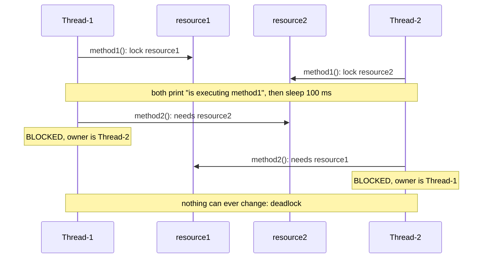
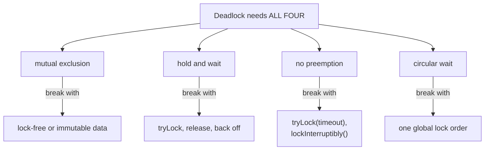

## In One Line
A **deadlock** is when two or more threads each **hold a lock and wait for a lock another one holds**, in a cycle, so none of them can ever continue. In the course example, `Thread-1` holds `resource1` and wants `resource2` while `Thread-2` holds `resource2` and wants `resource1`. Both freeze, and the program never ends.

## Mental Model
Two cars meet on a **one-lane bridge** from opposite ends. Each has driven halfway onto the bridge (**holds** its half), and each needs the other half to get across (**waits**). Neither will reverse (**no preemption**). Car A waits for car B and car B waits for car A (**circular wait**). They will sit there for ever.

| Bridge | Code |
|---|---|
| Each half of the bridge | The monitor of `resource1` and of `resource2` |
| Car A drives onto its half | `Thread-1` enters `resource1.method1(...)` and owns `resource1`'s lock |
| Car B drives onto the other half | `Thread-2` enters `resource2.method1(...)` and owns `resource2`'s lock |
| Stopping for a photo | `Thread.sleep(100)`, which makes sure both are on the bridge before either goes on |
| Trying to drive onto the other half | `resource.method2(this)` needs the *other* object's lock |
| Neither car can reverse | A thread waiting for a `synchronized` lock cannot give up, time out or be interrupted |

The fixes follow directly: agree which end of the bridge is entered first (**lock ordering**), or let a car reverse after a while (**`tryLock` with a timeout**).

## Concept
### What happens in the course example
Every `synchronized` instance method locks `this`. So calling `other.method2(this)` from inside `method1` means **taking a second lock while holding the first**: a nested lock acquisition.

| Time | Thread-1: `resource1.method1(resource2)` | Thread-2: `resource2.method1(resource1)` |
|---|---|---|
| 0 ms | locks **resource1**, prints "Thread-1 is executing method1" | locks **resource2**, prints "Thread-2 is executing method1" |
| 0–100 ms | sleeps, **still holding resource1** | sleeps, **still holding resource2** |
| 100 ms | calls `resource2.method2(resource1)`: needs resource2 → **BLOCKED** | calls `resource1.method2(resource2)`: needs resource1 → **BLOCKED** |
| for ever | waits for Thread-2 | waits for Thread-1 |

Both threads run the **same code**, but with the arguments swapped, so they take the same two locks in **opposite order**. Goetz calls this a *dynamic lock-order deadlock*: you cannot see the order in the source, because it depends on the arguments. The classic real-world version is `transfer(from, to)`, where one thread transfers A→B while another transfers B→A.

### The four Coffman conditions
A deadlock can only happen if **all four** hold at once (Coffman et al., 1971). Break **any one** and deadlock is impossible.

| Condition | Meaning | In the example | How to break it in Java |
|---|---|---|---|
| Mutual exclusion | A resource can be held by one thread only | A monitor has one owner | Use lock-free or immutable data, `ConcurrentHashMap`, atomics; hard to avoid in general |
| Hold and wait | A thread holds one resource while waiting for another | Holds `this`, waits for `other` | Acquire all locks at once, or release what you hold before waiting (`tryLock` and back off) |
| No preemption | A held resource cannot be taken away | `synchronized` cannot be revoked, timed out or interrupted | `tryLock(timeout)`, `lockInterruptibly()` |
| Circular wait | T1 waits for T2 … waits for T1 | T1 → resource2 → T2 → resource1 → T1 | **A global lock order** (the most common fix) |

> [!INTERVIEW] "Deadlock needs mutual exclusion, hold-and-wait, no preemption and circular wait. In practice I break circular wait with a consistent lock order, or hold-and-wait with `tryLock` and back-off."

### Prevention strategies
1. **Lock ordering.** Always take multiple locks in one global order, for example by a unique, immutable id: "lower id first". The course example could lock `min(id)` then `max(id)`. If objects have no natural key, order by `System.identityHashCode`, plus a global tie-breaker lock for the rare equal hash codes.
2. **Timed or try locks.** `ReentrantLock.tryLock(timeout)`: if the second lock cannot be had, **release the first**, back off for a random time (so the two threads do not retry in lock-step, which would be a livelock) and retry (`TryLockTransfer` below; more in [ReentrantLock](lesson:a06-threads/10-reentrantlock)).
3. **Avoid nested locks.** Hold at most one lock at a time. Often one coarser lock (one lock for both accounts, or the whole bank) is simpler and fast enough.
4. **Open calls.** Never call "alien" code while holding a lock: callbacks, listeners, overridable methods, or methods of *other* objects that may lock (the course example's `resource.method2(this)` is such a call). Copy what you need inside the lock, release it, then make the call.
5. **Shrink critical sections.** No `sleep`, I/O, remote calls or `future.get()` inside a lock.
6. **Use higher-level tools.** Queues, `ConcurrentHashMap.compute`, actors and immutable messages reduce the number of locks you manage by hand.
7. **Bound every wait.** `tryLock(timeout)`, `future.get(timeout)`, `latch.await(timeout)`, `poll(timeout)`. A timeout turns a silent hang into an error you can log and handle.

### Detecting a deadlock
| Tool | How |
|---|---|
| `jstack <pid>` or `jcmd <pid> Thread.print` | Thread dump. It ends with **"Found one Java-level deadlock"** listing who waits for which lock held by whom |
| JConsole, VisualVM, JDK Mission Control | "Detect Deadlock" button, thread views |
| `ThreadMXBean.findDeadlockedThreads()` | In code: ids of threads deadlocked on monitors **or** `java.util.concurrent` locks (`null` if none). `findMonitorDeadlockedThreads()` covers monitors only |
| `kill -3 <pid>` (Unix) / Ctrl+Break (Windows) | Prints a thread dump to the process's stdout |
| Virtual threads (JDK 21) | `jcmd <pid> Thread.dump_to_file <file>`, because `Thread.print` lists platform threads |

What deadlocked threads look like:

| Blocked on | Thread state in a dump |
|---|---|
| `synchronized` (monitor) | `BLOCKED (on object monitor)`, "waiting to lock <0x...>" |
| `ReentrantLock` / other AQS locks | `WAITING (parking)`, "parking to wait for <0x...> (a ...ReentrantLock$NonfairSync)" |
| Class initialisation of each other's classes | `RUNNABLE`, and **not** reported as a deadlock (`ClassInitDeadlock` below) |

Automatic detection only finds cycles of **lock ownership**. It cannot see threads waiting in `wait()`, `join()`, `CountDownLatch.await()` or `Future.get()` for something that will never happen, nor waits on external resources (database rows, connection pools). The JVM **never resolves** a deadlock on its own. Unlike a database, it does not pick a victim to abort.

### Other liveness failures to know
| Problem | What happens | Threads | Example |
|---|---|---|---|
| **Deadlock** | Cycle of threads waiting for each other's locks | Blocked, 0% CPU | The course example |
| **Livelock** | Threads keep reacting to each other and retrying, but no one progresses | Running, high CPU | Two `tryLock` loops that back off for the **same** fixed time and collide for ever; two people stepping aside in a corridor in sync |
| **Starvation** | One thread never gets the resource because others always win | The victim waits, others run | Unfair locks under heavy contention, a low-priority thread, readers starving a writer |
| **Lost wake-up** | A waiter sleeps for ever because the signal was missed or went to the wrong thread | WAITING | [notify with 2 producers and 2 consumers](lesson:a06-threads/08-thread-communication) |
| **Thread-starvation deadlock** | Pool tasks wait for other tasks that are stuck in the queue because all threads are busy | WAITING | A single-thread executor whose task calls `submit(...).get()` on the same pool ([ExecutorService](lesson:a07-executors/02-executor-service)) |
| **Self-deadlock** | A thread waits for a lock it already holds | WAITING | Non-reentrant locks: `Semaphore(1)`, `StampedLock`, read → write upgrade in [ReadWriteLock](lesson:a06-threads/11-readwritelock) |

`synchronized` and `ReentrantLock` are **reentrant**, so a thread never deadlocks on a lock it already owns (see [Synchronization](lesson:a06-threads/05-synchronization)).

### Can a deadlocked program recover?
Not if the locks are `synchronized`. A thread BLOCKED on a monitor ignores `interrupt()` (the flag is set, but the thread keeps waiting), and there is no timeout. You must restart the JVM, and then fix the lock order. With `ReentrantLock`, `lockInterruptibly()` lets another thread break the cycle by interrupting one participant (`InterruptibleDeadlock` below), and `tryLock(timeout)` lets the thread back out on its own.

## Diagram

The wait-for graph of the course example. A **cycle** in this graph is a deadlock; `jstack` and `findDeadlockedThreads()` look for exactly this.


The sleeps make sure each thread holds its first lock before either asks for the second, which is why the example deadlocks on every run.


Remove any one condition and the deadlock cannot happen. Lock ordering (circular wait) is the usual first choice.

## Code
@example Multithreading/SynchronizationandCommunication/DeadlockExample.java

A thread dump of the running original (`jcmd <pid> Thread.print`, JDK 21). The end of the dump shows the cycle:
```text
Found one Java-level deadlock:
=============================
"Thread-1":
  waiting to lock monitor 0x00007f59c4003110 (object 0x000000073761b0c0, a Multithreading.SynchronizationandCommunication.Resource),
  which is held by "Thread-2"

"Thread-2":
  waiting to lock monitor 0x00007f59b8004180 (object 0x000000073761b0b0, a Multithreading.SynchronizationandCommunication.Resource),
  which is held by "Thread-1"

Java stack information for the threads listed above:
===================================================
"Thread-1":
	at Multithreading.SynchronizationandCommunication.Resource.method2(DeadlockExample.java:17)
	- waiting to lock <0x000000073761b0c0> (a Multithreading.SynchronizationandCommunication.Resource)
	at Multithreading.SynchronizationandCommunication.Resource.method1(DeadlockExample.java:13)
	- locked <0x000000073761b0b0> (a Multithreading.SynchronizationandCommunication.Resource)
	...
Found 1 deadlock.
```
Read it as: Thread-1 has **locked** `...b0b0` (resource1) in `method1` and is **waiting to lock** `...b0c0` (resource2) in `method2`. Thread-2 has it the other way round. Each thread's entry in the thread list also shows `java.lang.Thread.State: BLOCKED (on object monitor)`.

Detecting the deadlock from inside the program with `ThreadMXBean`, then trying to break it with `interrupt()`:
```java
import java.lang.management.ManagementFactory;
import java.lang.management.ThreadInfo;
import java.lang.management.ThreadMXBean;
import java.util.Arrays;
import java.util.Comparator;

public class DetectDeadlock {
    static class Resource {                         // same as the course example
        public synchronized void method1(Resource other) {
            sleep(100);
            other.method2(this);
        }
        public synchronized void method2(Resource other) {
            sleep(100);
            other.method1(this);
        }
        private static void sleep(long ms) {
            try { Thread.sleep(ms); } catch (InterruptedException e) { Thread.currentThread().interrupt(); }
        }
    }

    public static void main(String[] args) throws InterruptedException {
        Resource r1 = new Resource(), r2 = new Resource();
        Thread t1 = new Thread(() -> r1.method1(r2), "Thread-1");
        Thread t2 = new Thread(() -> r2.method1(r1), "Thread-2");
        t1.setDaemon(true);                         // daemon: lets this demo exit
        t2.setDaemon(true);
        t1.start();
        t2.start();
        Thread.sleep(1000);

        ThreadMXBean mx = ManagementFactory.getThreadMXBean();
        long[] ids = mx.findDeadlockedThreads();    // null when there is no deadlock
        System.out.println("deadlocked threads: " + (ids == null ? 0 : ids.length));
        ThreadInfo[] infos = mx.getThreadInfo(ids);
        Arrays.sort(infos, Comparator.comparing(ThreadInfo::getThreadName));
        for (ThreadInfo info : infos) {
            System.out.println(info.getThreadName() + " is " + info.getThreadState()
                    + ", waiting for a lock held by " + info.getLockOwnerName());
        }
        t1.interrupt();                             // does interrupt() break it?
        t2.interrupt();
        Thread.sleep(200);
        System.out.println("after interrupt(): " + t1.getState() + " / " + t2.getState());
    }
}
```
```output
deadlocked threads: 2
Thread-1 is BLOCKED, waiting for a lock held by Thread-2
Thread-2 is BLOCKED, waiting for a lock held by Thread-1
after interrupt(): BLOCKED / BLOCKED
```
Interrupting does nothing: a thread waiting to enter `synchronized` cannot be interrupted.

The same bug in its classic form, a bank transfer, and the fix by **lock ordering** (lower id first):
```java
import java.util.concurrent.atomic.AtomicInteger;

public class TransferDemo {
    static class Account {
        private static final AtomicInteger SEQ = new AtomicInteger();
        final int id = SEQ.incrementAndGet();      // unique, never changes: the ordering key
        int balance = 1_000;
    }

    // Naive: lock order depends on the ARGUMENT order -> a->b and b->a can deadlock
    static void transferNaive(Account from, Account to, int amount) {
        synchronized (from) {
            synchronized (to) {
                from.balance -= amount;
                to.balance += amount;
            }
        }
    }

    // Fixed: always lock the account with the smaller id first
    static void transferOrdered(Account from, Account to, int amount) {
        Account first  = from.id < to.id ? from : to;
        Account second = from.id < to.id ? to : from;
        synchronized (first) {
            synchronized (second) {
                from.balance -= amount;
                to.balance += amount;
            }
        }
    }

    interface Transfer { void run(Account from, Account to, int amount); }

    static void demo(String name, Transfer transfer) throws InterruptedException {
        Account a = new Account(), b = new Account();
        Thread t1 = new Thread(() -> { for (int i = 0; i < 1_000_000; i++) transfer.run(a, b, 1); });
        Thread t2 = new Thread(() -> { for (int i = 0; i < 1_000_000; i++) transfer.run(b, a, 1); });
        t1.setDaemon(true);
        t2.setDaemon(true);
        t1.start(); t2.start();
        t1.join(3_000); t2.join(3_000);
        if (t1.isAlive() || t2.isAlive()) {
            System.out.println(name + ": stuck, threads are " + t1.getState() + " / " + t2.getState());
        } else {
            synchronized (a) { synchronized (b) {
                System.out.println(name + ": finished, total = " + (a.balance + b.balance));
            } }
        }
    }

    public static void main(String[] args) throws InterruptedException {
        demo("naive  ", TransferDemo::transferNaive);
        demo("ordered", TransferDemo::transferOrdered);
    }
}
```
There is no `sleep()` here, so the naive version only deadlocks when the two threads interleave just wrong. With a million transfers each, it happened in all 8 of our runs:
```output
naive  : stuck, threads are BLOCKED / BLOCKED
ordered: finished, total = 2000
```

Breaking a deadlock from outside: with `ReentrantLock.lockInterruptibly()`, an interrupt makes one thread give up and release its lock, and the other thread completes:
```java
import java.util.concurrent.CountDownLatch;
import java.util.concurrent.locks.ReentrantLock;

public class InterruptibleDeadlock {
    static final ReentrantLock lockA = new ReentrantLock();
    static final ReentrantLock lockB = new ReentrantLock();
    static final CountDownLatch bothHoldFirstLock = new CountDownLatch(2);

    static String work(ReentrantLock first, ReentrantLock second) {
        try {
            first.lockInterruptibly();
            try {
                bothHoldFirstLock.countDown();
                bothHoldFirstLock.await();            // make the deadlock certain
                second.lockInterruptibly();           // waits for the other thread ...
                try {
                    return "got both locks";
                } finally {
                    second.unlock();
                }
            } finally {
                first.unlock();                       // ... and is released on interrupt, too
            }
        } catch (InterruptedException e) {
            return "interrupted, gave up and released its lock";
        }
    }

    public static void main(String[] args) throws InterruptedException {
        String[] outcome = new String[2];
        Thread t1 = new Thread(() -> outcome[0] = work(lockA, lockB), "t1");
        Thread t2 = new Thread(() -> outcome[1] = work(lockB, lockA), "t2");
        t1.start();
        t2.start();
        Thread.sleep(500);
        System.out.println("deadlocked: " + t1.getState() + " / " + t2.getState());
        t1.interrupt();                               // break the cycle
        t1.join();
        t2.join();
        System.out.println("t1: " + outcome[0]);
        System.out.println("t2: " + outcome[1]);
    }
}
```
```output
deadlocked: WAITING / WAITING
t1: interrupted, gave up and released its lock
t2: got both locks
```
Note the state: threads waiting for a `ReentrantLock` are `WAITING` (parked), not `BLOCKED`.

Avoiding the deadlock without any ordering: `tryLock` with a timeout. If the second lock is not free, release the first and retry after a **random** back-off:
```java
import java.util.concurrent.ThreadLocalRandom;
import java.util.concurrent.TimeUnit;
import java.util.concurrent.locks.ReentrantLock;

public class TryLockTransfer {
    static class Account {
        final ReentrantLock lock = new ReentrantLock();
        int balance = 1_000;
    }

    static void transfer(Account from, Account to, int amount) throws InterruptedException {
        while (true) {
            if (from.lock.tryLock(1, TimeUnit.MILLISECONDS)) {
                try {
                    if (to.lock.tryLock(1, TimeUnit.MILLISECONDS)) {
                        try {
                            from.balance -= amount;
                            to.balance += amount;
                            return;
                        } finally {
                            to.lock.unlock();
                        }
                    }
                } finally {
                    from.lock.unlock();              // never wait while holding a lock
                }
            }
            Thread.sleep(0, ThreadLocalRandom.current().nextInt(1000));   // random back-off
        }
    }

    public static void main(String[] args) throws InterruptedException {
        Account a = new Account(), b = new Account();
        Runnable ab = () -> { try { for (int i = 0; i < 100_000; i++) transfer(a, b, 1); } catch (InterruptedException e) { } };
        Runnable ba = () -> { try { for (int i = 0; i < 100_000; i++) transfer(b, a, 1); } catch (InterruptedException e) { } };
        Thread t1 = new Thread(ab), t2 = new Thread(ba);
        t1.start(); t2.start();
        t1.join(); t2.join();
        System.out.println("finished, total = " + (a.balance + b.balance));
    }
}
```
```output
finished, total = 2000
```

The example has a second problem: `method1` and `method2` call each other **for ever**. With only one thread there is no deadlock (monitors are reentrant), but the thread never finishes. This version prints only the first 4 calls and sleeps 10 ms instead of 100:
```java
import java.util.concurrent.atomic.AtomicInteger;

public class OneThreadOnly {
    static final AtomicInteger calls = new AtomicInteger();

    static class Resource {                         // the course class, printing only the first 4 calls
        public synchronized void method1(Resource other) {
            log("method1");
            pause();
            other.method2(this);
        }
        public synchronized void method2(Resource other) {
            log("method2");
            pause();
            other.method1(this);
        }
        private static void log(String m) {
            if (calls.incrementAndGet() <= 4)
                System.out.println(Thread.currentThread().getName() + " is executing " + m);
        }
        private static void pause() {
            try { Thread.sleep(10); } catch (InterruptedException e) { Thread.currentThread().interrupt(); }
        }
    }

    public static void main(String[] args) throws InterruptedException {
        Resource r1 = new Resource(), r2 = new Resource();
        Thread t1 = new Thread(() -> r1.method1(r2), "Thread-1");   // NO second thread
        t1.setDaemon(true);
        t1.start();
        Thread.sleep(1000);
        System.out.println("after 1 s: alive = " + t1.isAlive()
                + ", more than 20 nested calls = " + (calls.get() > 20));
    }
}
```
```output
Thread-1 is executing method1
Thread-1 is executing method2
Thread-1 is executing method1
Thread-1 is executing method2
after 1 s: alive = true, more than 20 nested calls = true
```
With `sleep(0)` the same program dies within a moment with `Exception in thread "Thread-1" java.lang.StackOverflowError`.

A deadlock the tools do **not** report: two threads initialising two classes whose static initialisers need each other:
```java
import java.lang.management.ManagementFactory;

public class ClassInitDeadlock {
    static class A { static final int X; static { pause(); X = B.Y + 1; } }
    static class B { static final int Y; static { pause(); Y = A.X + 1; } }
    static void pause() { try { Thread.sleep(200); } catch (InterruptedException e) { } }

    public static void main(String[] args) throws InterruptedException {
        Thread t1 = new Thread(() -> System.out.println(A.X), "init-A");
        Thread t2 = new Thread(() -> System.out.println(B.Y), "init-B");
        t1.setDaemon(true); t2.setDaemon(true);
        t1.start(); t2.start();
        Thread.sleep(1500);
        long[] ids = ManagementFactory.getThreadMXBean().findDeadlockedThreads();
        System.out.println("states: " + t1.getState() + " / " + t2.getState()
                + ", findDeadlockedThreads: " + (ids == null ? "null" : ids.length));
    }
}
```
```output
states: RUNNABLE / RUNNABLE, findDeadlockedThreads: null
```
Both threads are stuck for ever, yet they show as `RUNNABLE` and nothing reports a deadlock. Keep static initialisers free of cross-class dependencies.

## Walkthrough
- `class Resource` has two `synchronized` instance methods. Each one locks **the object it is called on** (`this`) for its whole body.
- `public synchronized void method1(Resource resource)`:
  - `System.out.println(Thread.currentThread().getName() + " is executing method1");` shows which thread entered, and therefore which lock it now holds.
  - `Thread.sleep(100);` pauses **while still holding the lock**. `sleep` never releases locks. This is deliberate: it gives the other thread time to take its own first lock, which turns a rare race into a certain deadlock. The `catch (InterruptedException e) { e.printStackTrace(); }` is never reached here.
  - `resource.method2(this);` calls a synchronized method on the **other** object. The thread must now acquire the second lock while holding the first.
- `public synchronized void method2(Resource resource)` is identical, except that it ends with `resource.method1(this)`, calling back into the first object.
- `main` creates two resources and two threads with **explicit names** ("Thread-1", "Thread-2"; the default names would be `Thread-0` and `Thread-1`):
  - `t1` runs `resource1.method1(resource2)`, so its lock order is resource1 → resource2.
  - `t2` runs `resource2.method1(resource1)`, so its lock order is resource2 → resource1. The **opposite** order.
- `t1.start(); t2.start();` Both threads enter `method1` on *different* objects, so both succeed at once and both print. After 100 ms each calls `method2` on the object the other thread holds, and both become **BLOCKED** for ever.
- `main` returns, but the two non-daemon threads never finish, so **the program never exits**. The recorded output was captured by a runner that kills each example after 20 seconds.
- **Output.** There are exactly two lines, `Thread-1 is executing method1` and `Thread-2 is executing method1`, in **varying order**. This example is marked as varying: the two threads start nearly together and print independently, so the scheduler decides who prints first. In 8 of our runs, `Thread-2` came first 5 times and `Thread-1` 3 times. `is executing method2` is **never** printed: each thread blocks while *entering* `method2`, before its first line runs.

## Traps
> [!ERRATA] The `// Output:` comment shows `Thread-2` first. That is one possible order, not *the* output: the order of the two lines varies from run to run (start order is not run order). The comment also does not say that the program **never terminates**. After those two lines both threads stay BLOCKED for ever, and the JVM must be killed.

> [!ERRATA] Even without the deadlock the code could never finish. `method1` always calls `method2`, which always calls `method1`, with no base case: **unbounded mutual recursion**. With a single thread (`OneThreadOnly`), the reentrant monitors let it continue for ever, alternating "method1"/"method2" while holding both locks, until it eventually dies with `StackOverflowError`. A cleaner demo takes two locks once, for example `synchronized (a) { sleep; synchronized (b) { ... } }` in one thread and the reverse in the other.

- **`sleep()` inside a lock is a demo trick, not a pattern.** In real code, holding a lock while sleeping, doing I/O or calling another object makes deadlocks likely and slows every other thread down.
- **"It worked in testing."** Without the sleeps, a lock-order deadlock may appear only under production load. It is still there, as `TransferDemo` shows.
- **`interrupt()` cannot rescue `synchronized`.** BLOCKED threads ignore it. Only `lockInterruptibly()`/`tryLock` can back out.
- **Ordering by a mutable or non-unique key** (balance, name, `hashCode()` that can collide) does not give a consistent order. Use an immutable unique id, or `identityHashCode` plus a tie-breaker lock.
- **Deadlocks outside monitors are invisible to tools**: `wait()` with nobody to notify, two threads `join()`ing each other, pool tasks waiting on tasks in the same pool, class-initialisation cycles, database locks.
- **Calling alien code under a lock** (listeners, callbacks, `equals`/`hashCode` of foreign objects, logging frameworks that lock) can close a cycle you never see in your own code.
- **Nested locks on `this` hide the order.** A synchronized method calling another object's synchronized method is a nested lock acquisition, even though the word `synchronized` appears only once in each method.

## Tips & Tricks
- **The four conditions: "My Horse Never Cries"** = **M**utual exclusion, **H**old and wait, **N**o preemption, **C**ircular wait. Break one and there is no deadlock.
- **"Same locks, same order, every time."** Write the order down (lower id first) and enforce it in one helper method.
- **"Never hold a lock while you wait for something else"**: a lock, I/O, a future or a sleep.
- **"`synchronized` can't back out; `tryLock` can."** Use `ReentrantLock` when you must take several locks and cannot guarantee an order.
- **First response to a hang: take 3 thread dumps a few seconds apart** (`jcmd <pid> Thread.print`) and search for "Found one Java-level deadlock". Look for threads BLOCKED or parked in the same frames in every dump.
- **Back off randomly.** Fixed retry delays turn deadlock into livelock.
- For monitoring, a scheduled task calling `ThreadMXBean.findDeadlockedThreads()` can log and alert. It will not fix anything, but you will know.

## Interview Q&A
### [Basic] What is a deadlock? Give an example.
A deadlock is a state in which a set of threads are all blocked for ever, each waiting for a resource held by another thread in the set. The classic case: thread 1 locks A and then tries to lock B, while thread 2 locks B and then tries to lock A. Each holds what the other needs, and neither will release, so both wait for ever.
```java
// Thread 1                 // Thread 2
synchronized (a) {          synchronized (b) {
    synchronized (b) { }        synchronized (a) { }
}                           }
```
In Java, threads deadlocked on `synchronized` are in state BLOCKED, use no CPU, and cannot be interrupted. The program just stops making progress.

**Follow-up:** *Will the JVM detect and resolve it?* It can **detect** it (thread dump, `ThreadMXBean.findDeadlockedThreads()`), but it never **resolves** it. You must restart the JVM and fix the code.

### [Basic] Why does the course's `DeadlockExample` deadlock?
Each synchronized method locks its own object. `t1` calls `resource1.method1(resource2)`: it locks resource1, sleeps, then calls `resource2.method2(...)`, which needs resource2's lock. `t2` does the mirror image: it locks resource2, then needs resource1. The 100 ms sleep guarantees that each thread holds its first lock before either asks for the second. Each then waits for the lock the other holds, a circular wait. Both print "is executing method1", neither ever prints "method2", and the program never exits.

**Follow-up:** *How would you fix it?* Make both threads take the two locks in the same order, for example always the resource with the smaller id first, or use `ReentrantLock.tryLock` with a timeout and back off.

### [Intermediate] What are the four necessary conditions for a deadlock?
The Coffman conditions: **mutual exclusion** (a resource has one owner at a time), **hold and wait** (a thread holds resources while requesting more), **no preemption** (resources cannot be forcibly taken away; they are released only voluntarily), and **circular wait** (a cycle of threads, each waiting for the next one's resource). All four are necessary, so preventing any one prevents deadlock. In Java the practical levers are circular wait (a global lock order), hold and wait (`tryLock`, release and retry; or take one coarse lock), and no preemption (`tryLock(timeout)` and `lockInterruptibly()` let a thread give up).

**Follow-up:** *Which one does lock ordering break?* Circular wait. If every thread takes locks in the same global order, no cycle can form.

### [Intermediate] How do you prevent deadlocks in Java code?
- **Consistent lock ordering** for nested locks, based on an immutable unique key.
- **Avoid nested locks** where possible; one coarser lock is often fine.
- **Timed locks**: `tryLock(timeout)`, releasing what you hold on failure and backing off randomly.
- **Open calls**: don't call other objects' methods, callbacks or listeners while holding a lock.
- **Short critical sections**: no I/O, `sleep` or blocking waits inside locks.
- **Higher-level concurrency**: concurrent collections, queues, immutable objects, single-threaded ownership.
- **Timeouts on every blocking call** so a hang becomes a visible error.

**Follow-up:** *What if the objects have no natural ordering key?* Order by `System.identityHashCode(obj)`, and if two hash codes are equal, first take a global "tie" lock. That is Goetz's solution in *Java Concurrency in Practice*.

### [Intermediate] How do you detect a deadlock in a running application?
Take a thread dump with `jstack <pid>`, `jcmd <pid> Thread.print`, `kill -3`, or JConsole/VisualVM/JMC. HotSpot analyses it and prints "Found one Java-level deadlock", listing each thread, the lock it waits for and who holds it, followed by the stacks. Threads stuck on monitors show `BLOCKED (on object monitor)` with "waiting to lock" and "locked" lines; threads stuck on `ReentrantLock` show `WAITING (parking)`. Programmatically, `ManagementFactory.getThreadMXBean().findDeadlockedThreads()` returns the ids of deadlocked threads (monitors and ownable synchronizers), and `getThreadInfo(ids)` gives the lock names and owners.

**Follow-up:** *What does it not detect?* Hangs without a lock cycle: `wait()` with no notifier, `join` cycles, latches never counted down, pool starvation, class-initialisation cycles (the threads even show as RUNNABLE), and database or other external locks.

### [Intermediate] What is the difference between deadlock, livelock and starvation?
In a **deadlock**, threads are blocked waiting for each other in a cycle. They use no CPU and make no progress. In a **livelock**, threads are active and keep changing state in response to each other (for example, both release and retry at the same moment, again and again), using CPU but making no progress. In **starvation**, the system makes progress, but one thread never gets the resource, because other threads keep winning (unfair locks, priorities, a stream of readers blocking a writer).

**Follow-up:** *How do you avoid livelock with `tryLock`?* Back off for a **random** time before retrying, so the two threads stop colliding in lock-step.

### [Advanced] Implement a deadlock-free `transfer(from, to, amount)` with `synchronized`.
```java
private static final Object tieLock = new Object();

void transfer(Account from, Account to, int amount) {
    int h1 = System.identityHashCode(from), h2 = System.identityHashCode(to);
    if (h1 < h2)      { synchronized (from) { synchronized (to)   { move(from, to, amount); } } }
    else if (h1 > h2) { synchronized (to)   { synchronized (from) { move(from, to, amount); } } }
    else synchronized (tieLock) { synchronized (from) { synchronized (to) { move(from, to, amount); } } }
}
```
Every thread takes the two account locks in the same global order (by identity hash), so no cycle is possible. The rare case of equal hash codes is serialised by a global tie lock. If accounts have a unique immutable id, compare ids instead and the tie lock disappears (`TransferDemo`'s `transferOrdered`).

**Follow-up:** *Why not order by `hashCode()`?* It can be overridden, can change if fields change, and collides more easily. `identityHashCode` is stable for the object's lifetime.

### [Advanced] Can you recover from a deadlock without restarting the JVM?
Not with `synchronized`. A thread waiting to enter a monitor cannot be interrupted, cannot time out, and cannot be forced to release its locks. `Thread.stop()` was the only brute-force option and it throws `UnsupportedOperationException` since JDK 20. With explicit locks you can design for recovery: `lockInterruptibly()` lets a watchdog interrupt one participant, which then releases its lock in `finally` so the others proceed (`InterruptibleDeadlock`), and `tryLock(timeout)` lets threads back out on their own. In practice, prevent deadlocks by design and make them visible with timeouts and monitoring.

**Follow-up:** *What does a watchdog use to find the victims?* `ThreadMXBean.findDeadlockedThreads()`, then `interrupt()` on one of them. This only helps if the code uses interruptible lock acquisition.

### [Advanced] What is an "open call" and why does it prevent deadlocks?
An open call is a call to another object's method made **without holding any lock**. Deadlocks between cooperating objects often come from a synchronized method of A calling a synchronized method of B while B's synchronized method calls back into A, as `method1`/`method2` do in the course example. Restructure so that each method holds its lock only while reading or updating its own state, then releases it and makes the outgoing call. With no nested locks there can be no lock-order cycle, and the locking behaviour is easier to analyse.

**Follow-up:** *What is the cost?* The outgoing call no longer happens atomically with the state update, so you must design for that: work on a copied snapshot, or use a state flag to stop two threads from doing the same work.

### [Advanced] What is a thread-starvation deadlock in a thread pool?
Tasks in a bounded pool block while waiting for the results of other tasks submitted to the **same** pool, and those other tasks cannot start because every thread is occupied by a waiting task. The classic case is a single-thread executor whose task does `executor.submit(inner).get()`: the inner task sits in the queue for ever. No lock cycle exists, so `findDeadlockedThreads()` reports nothing, and the threads are WAITING in `FutureTask.get`. Fixes: don't block on tasks in the same pool, use separate pools for dependent stages, size the pool for the maximum dependency depth, or compose asynchronously (`CompletableFuture.thenCompose`) instead of blocking.

**Follow-up:** *Does `ForkJoinPool` have the same problem?* Less so: `join()` inside a fork/join task lets the waiting worker run other queued tasks (work-stealing), which is why recursive decomposition works there.

## Quiz
### What happens when you run the original `DeadlockExample`?
- [ ] It prints four lines (method1 and method2 for each thread) and exits
- [x] It prints `... is executing method1` for both threads, in varying order, then hangs for ever
- [ ] It prints the two lines in the order shown in the comment, then exits
- [ ] It throws `IllegalMonitorStateException`
> Each thread holds its own resource and blocks while entering `method2` on the other one, so "method2" is never printed and the non-daemon threads keep the JVM alive. The order of the two lines is decided by the scheduler; the comment shows only one possibility.

### In a thread dump of the running example, what state are `Thread-1` and `Thread-2` in?
- [ ] WAITING
- [ ] TIMED_WAITING
- [x] BLOCKED
- [ ] RUNNABLE
> Waiting to enter a `synchronized` method is BLOCKED ("waiting for monitor entry"). WAITING would be `wait()`, `join()` or a `ReentrantLock`, and TIMED_WAITING is only during the 100 ms sleep before the deadlock.

### `DetectDeadlock` calls `t1.interrupt()` and `t2.interrupt()` on the deadlocked threads. What does it print afterwards?
- [ ] `after interrupt(): TERMINATED / TERMINATED`
- [x] `after interrupt(): BLOCKED / BLOCKED`
- [ ] `after interrupt(): RUNNABLE / BLOCKED`, because one thread wins
- [ ] An `InterruptedException` stack trace from each thread
> Monitor acquisition is not interruptible. The interrupt flag is set, but the threads keep waiting for the monitors. Only `Lock.lockInterruptibly()` or `tryLock` can back out of a lock wait.

### Which change reliably fixes the course example's deadlock?
- [ ] Start `t2` a few milliseconds after `t1`
- [ ] Increase the sleep to 1000 ms
- [x] Make both threads acquire the two resources' locks in the same global order (for example by id)
- [ ] Make `t1` and `t2` daemon threads
> A consistent order breaks the circular-wait condition. Delaying `t2` only makes the deadlock less likely, never impossible, and a longer sleep makes it *more* certain. Daemon threads only hide the problem: the JVM exits when `main` ends, but the two threads are still deadlocked until then and their work is never done.

### Spot the bug.
```java
void transfer(Account from, Account to, int amount) {
    synchronized (from) {
        synchronized (to) {
            from.balance -= amount;
            to.balance += amount;
        }
    }
}
// thread 1: transfer(a, b, 1) in a loop;  thread 2: transfer(b, a, 1) in a loop
```
- [ ] `balance` must be `volatile`
- [ ] Nested `synchronized` blocks are not allowed
- [x] The lock order depends on the argument order, so the two threads can lock `a`/`b` in opposite orders and deadlock
- [ ] Nothing: `synchronized` is reentrant, so it cannot deadlock
> This is the dynamic lock-order deadlock. `TransferDemo`'s naive version got stuck with both threads BLOCKED in every run. Reentrancy only helps a thread re-acquire a lock *it* already holds, not a lock held by another thread.

### Only `t1` is started in the course example (`t2` is removed). What happens?
- [ ] It prints "method1", then "method2", and exits
- [ ] It deadlocks on itself when `method2` calls `method1` on `resource1` again
- [x] It never finishes: it keeps alternating method1/method2 every 100 ms until it eventually dies with `StackOverflowError`
- [ ] It deadlocks exactly as before
> Monitors are reentrant, so one thread can re-enter `resource1`'s lock while holding it, and there is no self-deadlock. But `method1` and `method2` call each other with no end, so the recursion never stops. `OneThreadOnly` was still alive after 1 s, and without the sleep it hit `StackOverflowError` almost at once.

### In `ClassInitDeadlock`, two threads initialise classes `A` and `B`, whose static initialisers read each other's fields. What did the program print?
- [ ] `states: BLOCKED / BLOCKED, findDeadlockedThreads: 2`
- [x] `states: RUNNABLE / RUNNABLE, findDeadlockedThreads: null`
- [ ] `2` and `1` (the initialised values)
- [ ] `ExceptionInInitializerError`
> Each thread waits for the other to finish initialising a class, which is a real deadlock, but class-initialisation waits are not monitor or `Lock` ownership, so the threads report `RUNNABLE` and `findDeadlockedThreads()` returns `null`. Automatic detection covers only lock cycles.

## Takeaways
- A deadlock is a cycle of threads, each holding a lock and waiting for one held by the next. With `synchronized` they stay BLOCKED for ever, and the JVM never resolves it.
- The course example takes two locks in opposite orders (`resource1 → resource2` versus `resource2 → resource1`) through nested synchronized calls. The sleeps make the deadlock certain, and "method2" is never printed.
- Its output varies (which "method1" line comes first depends on the scheduler), and the program never exits. The code also recurses without end, even with one thread.
- Four conditions must all hold: mutual exclusion, hold and wait, no preemption, circular wait. Break one: a global lock order, `tryLock` with a random back-off, or no nested locks.
- Detect deadlocks with thread dumps ("Found one Java-level deadlock"), JConsole/VisualVM, or `ThreadMXBean.findDeadlockedThreads()`. These only see lock cycles, not lost wake-ups, pool starvation or class-initialisation cycles.
- `interrupt()` cannot break a `synchronized` deadlock. `lockInterruptibly()` and `tryLock(timeout)` can.
- Prevention habits: open calls (no alien calls under a lock), short critical sections, no sleeping or blocking while holding a lock, and timeouts on every wait.
