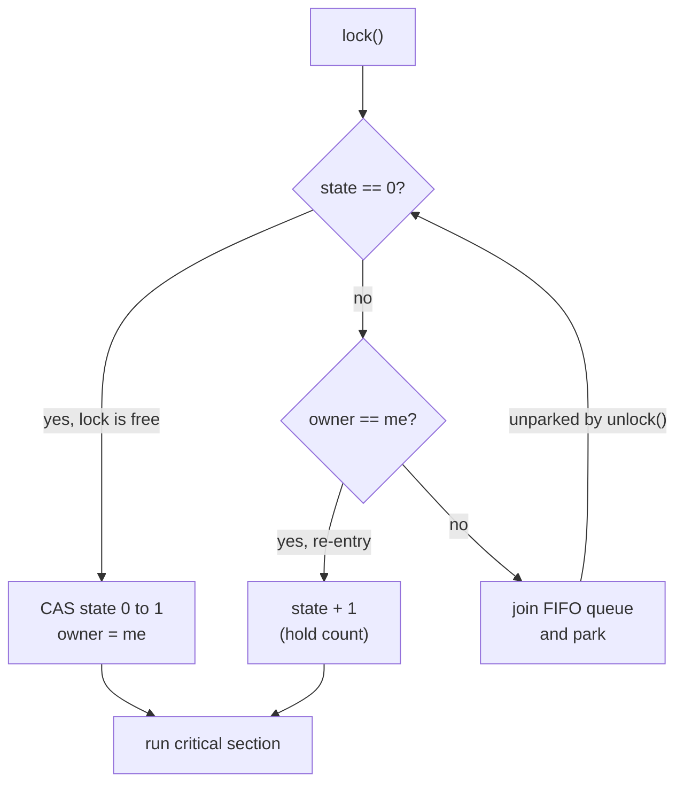
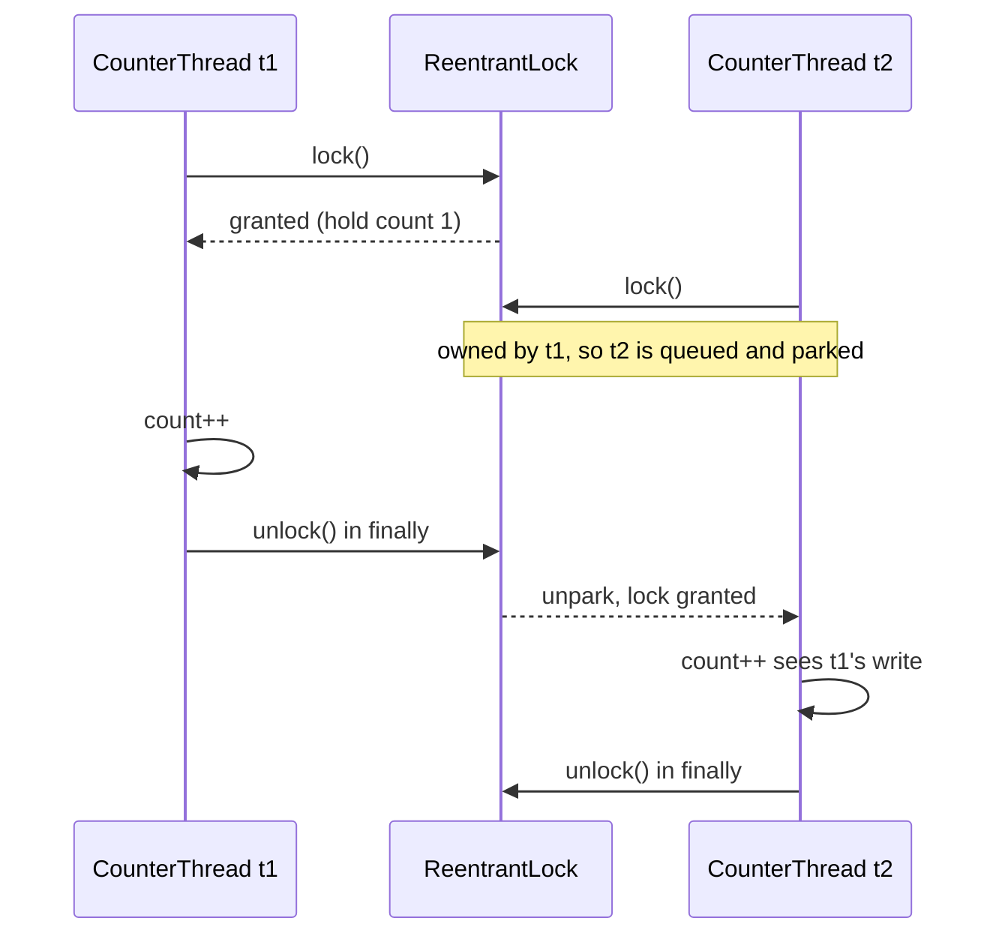

## In One Line
`ReentrantLock` is an explicit lock object from `java.util.concurrent.locks`. It gives the same mutual exclusion and memory visibility as `synchronized`, and adds `tryLock`, timeouts, interruptible waiting, fairness and several `Condition`s. You must call `unlock()` yourself, always in a `finally` block.

## Mental Model
Think of a **single-occupancy meeting room with a key on a hook** by the door.

- `lock()` = take the key from the hook. If the key is gone, you **stand in a queue** by the door.
- `unlock()` = put the key back. The person at the front of the queue is woken up and takes it.
- **Reentrant** = if you already hold the key and need to step into the same room again (a method that calls another method guarded by the same lock), you don't queue behind yourself. The receptionist just makes a tally mark (**hold count**). You must remove every tally mark (`unlock()` once per `lock()`) before the key goes back on the hook.
- `tryLock()` = glance at the hook. If the key is gone, walk away and do something else instead of queueing.
- `tryLock(2, SECONDS)` = queue, but leave if you haven't got the key within 2 seconds.
- `lockInterruptibly()` = queue, but leave if your manager phones you (the thread is **interrupted**).
- **Fair lock** = a strict queue. **Non-fair lock** (the default) = someone who arrives just as the key is returned may grab it before the person who was queueing wakes up.
- **Condition** = separate waiting benches inside the room ("waiting for space", "waiting for items"). You put the key back while sitting on a bench, and you take it again when you are called.

`synchronized` is the same room, except the key is handed over **automatically** when you leave, and it has none of the extra options.

## Concept
### Why explicit locks exist
Java 5 (JSR 166) added `java.util.concurrent.locks` because `synchronized` has hard limits:

| Limitation of `synchronized` | Explicit `Lock` answer |
|---|---|
| A thread blocked on a monitor waits forever and cannot be interrupted | `lockInterruptibly()` |
| No way to "try" or give up after a timeout | `tryLock()`, `tryLock(time, unit)` |
| No fairness option | `new ReentrantLock(true)` |
| Only one wait set per monitor (`wait`/`notify`) | Any number of `Condition`s per lock |
| Lock and unlock must be in the same block (block-structured) | Lock in one method, unlock in another (hand-over-hand locking) |
| Nothing to inspect | `isLocked()`, `getHoldCount()`, `getQueueLength()`, ... |

### The `Lock` interface (six methods)
| Method | What it does |
|---|---|
| `void lock()` | Acquire. Blocks until the lock is free. **Ignores interrupts** while waiting (the interrupt flag stays set). |
| `void lockInterruptibly() throws InterruptedException` | Acquire, but abort with `InterruptedException` if the thread is interrupted while waiting. |
| `boolean tryLock()` | Acquire only if free **right now**. Returns immediately with `true` or `false`. |
| `boolean tryLock(long time, TimeUnit unit) throws InterruptedException` | Wait up to `time`. `true` if acquired, `false` on timeout. Interruptible. |
| `void unlock()` | Release. Throws `IllegalMonitorStateException` if the calling thread does not hold the lock. |
| `Condition newCondition()` | Create a wait set bound to this lock (see below). |

`ReentrantLock` is the main implementation. `ReentrantReadWriteLock.ReadLock`/`WriteLock` also implement `Lock` (see [ReadWriteLock](lesson:a06-threads/11-readwritelock)).

### The canonical idiom — memorise it
```java
private final ReentrantLock lock = new ReentrantLock();

public void increment() {
    lock.lock();            // 1. BEFORE try
    try {
        count++;            // 2. critical section
    } finally {
        lock.unlock();      // 3. ALWAYS in finally
    }
}
```
- `unlock()` goes in `finally`. Nothing releases the lock for you. If the critical section throws and you skipped `finally`, the lock stays held for ever, **even after the owner thread has died**.
- `lock()` goes **before** `try`. If acquiring fails (for example `lockInterruptibly()` throws `InterruptedException`) you don't own the lock, and a `finally { unlock(); }` would throw `IllegalMonitorStateException`.
- Make the lock field `private final`. If the field could be reassigned, two threads could end up locking two different lock objects.

### What "reentrant" means
A thread that already owns the lock can call `lock()` again without blocking. The lock keeps an **owner thread** and a **hold count**:

- `lock()` by the owner → hold count + 1.
- `unlock()` → hold count − 1. The lock is released only when the count reaches **0**.

Without reentrancy, a guarded method calling another guarded method on the same object (or a recursive method) would deadlock on itself. `synchronized` is reentrant too. The maximum hold count is 2,147,483,647. Going past it throws `Error("Maximum lock count exceeded")`.

Handy inspection methods: `getHoldCount()` (holds by the current thread), `isHeldByCurrentThread()` (good for `assert`s), `isLocked()` (held by anyone), `isFair()`, `hasQueuedThreads()`, `hasQueuedThread(t)`, `getQueueLength()` (an estimate), `hasWaiters(cond)`, `getWaitQueueLength(cond)`. The lock's `toString()` adds `[Unlocked]` or `[Locked by thread main]` to the usual `Class@hash` text. These methods are for monitoring and tests, not for synchronization logic.

### Fair vs non-fair
| | Non-fair (default, `new ReentrantLock()`) | Fair (`new ReentrantLock(true)`) |
|---|---|---|
| Who gets a free lock | Whoever grabs it first. A newly arriving thread can **barge** ahead of queued threads | The longest-waiting thread (FIFO) |
| Throughput | **Higher**. Waking a parked thread takes microseconds, and a running thread can use the lock during that gap | Lower. Every hand-off pays for a context switch |
| Starvation | Possible in theory | Prevented (for lock acquisition) |
| `tryLock()` | Barges | **Still barges.** Untimed `tryLock()` ignores fairness. Use `tryLock(0, SECONDS)` to respect it |

Fairness only concerns the lock. It does not make the OS scheduler fair. Use a fair lock only when you actually see starvation.

### How it works inside (AQS)
`ReentrantLock` delegates to an inner `Sync` class that extends **`AbstractQueuedSynchronizer` (AQS)**. AQS is the engine behind most of `java.util.concurrent`: `Semaphore`, `CountDownLatch`, `ReentrantReadWriteLock` and `ThreadPoolExecutor`'s workers all use it.

- AQS keeps an `int state` (volatile, updated with **CAS**) plus a FIFO **wait queue** of parked threads (a variant of the CLH queue).
- For `ReentrantLock`, `state` **is the hold count**, and `exclusiveOwnerThread` records the owner.
- `lock()`: if `state == 0`, CAS it from 0 to 1 and set the owner. If the current thread is already the owner, increment `state`. Otherwise enqueue and **park** (`LockSupport.park`).
- `unlock()`: decrement `state`. When it reaches 0, clear the owner and **unpark** the first queued thread.
- A **fair** lock also checks `hasQueuedPredecessors()` before trying the CAS, so it never jumps the queue.

With no contention, an acquire is just one CAS: no system call and no context switch.

### Memory visibility
A successful `lock()` has the same memory effect as entering a `synchronized` block, and `unlock()` the same as leaving it. Everything a thread wrote before `unlock()` **happens-before** everything another thread does after its next successful `lock()` of the same lock. The same guarantee covers `tryLock()` when it succeeds. So variables guarded by the lock don't need `volatile`, **as long as every read and every write happens under the lock**.

### Conditions: `await`/`signal` instead of `wait`/`notify`
`lock.newCondition()` gives a `Condition`, which works like a monitor's wait set:

| `Object` monitor | `Condition` |
|---|---|
| `wait()` | `await()` (also `awaitNanos`, `await(time, unit)`, `awaitUntil(date)`, `awaitUninterruptibly()`) |
| `notify()` | `signal()` |
| `notifyAll()` | `signalAll()` |
| One wait set per object | **Many** conditions per lock, e.g. `notFull` and `notEmpty` |

The rules match `wait`/`notify`. You must hold the lock (otherwise `IllegalMonitorStateException`). `await()` atomically releases the lock and re-acquires it before returning. And spurious wakeups can happen, so always wait in a **`while` loop** that re-checks the condition. Separate conditions let you wake **only** the threads that can make progress: a producer signals `notEmpty`, and only consumers wake. With a monitor you would need `notifyAll()` and wake everybody.

### `ReentrantLock` vs `synchronized`
| | `synchronized` | `ReentrantLock` |
|---|---|---|
| Kind | Keyword, built into the JVM (monitor) | Library class (AQS) |
| Release | **Automatic**, even on exceptions | **Manual** `unlock()` in `finally` |
| Reentrant | Yes | Yes (`getHoldCount()` shows it) |
| Try / timeout | No | `tryLock()`, `tryLock(t, unit)` |
| Interruptible wait | No | `lockInterruptibly()` |
| Fairness | No | Optional |
| Conditions | 1 wait set | Many `Condition`s |
| Non-block-structured | No | Yes |
| Virtual threads, JDK 21–23 | Blocking inside **pins** the carrier thread | Does not pin |
| Performance | Similar. Heavily optimised by the JIT (lock elision, coarsening) | Similar |

Rule of thumb: use `synchronized` for simple critical sections, because it is shorter and impossible to forget to release. Use `ReentrantLock` when you need one of its extra features. The full comparison has its own lesson: [synchronized vs ReentrantLock](lesson:b03-concurrency/06-synchronized-vs-reentrantlock).

> [!NOTE] **Java versions.** Locks arrived in Java 5. Java 6 made `synchronized` much faster, so the old "ReentrantLock is faster" advice is out of date. In **JDK 21**, a virtual thread that blocks inside `synchronized` is *pinned* to its carrier OS thread, so libraries switched hot paths to `ReentrantLock`. **JDK 24 (JEP 491)** removed that pinning for `synchronized`.

### When the lock is not the right tool
- A single counter → `AtomicInteger`/`LongAdder` (lock-free CAS, see [Atomics & CAS](lesson:b03-concurrency/02-atomics-and-cas)).
- Mostly reads → `ReentrantReadWriteLock` or `StampedLock`.
- Producer/consumer → a `BlockingQueue` already has the lock and conditions inside.

## Diagram

Re-entry never blocks. Only a *different* thread goes to the queue. A fair lock adds one check before the CAS: "is anyone already queued?"


Only one thread is ever inside `count++`. Each unlock-to-lock hand-off also publishes the previous thread's writes, so no increment is lost.

## Code
@example Multithreading/ConcurrencyUtilities/ReentrantLockExample.java

**Reentrancy in action.** The original never locks twice, so here the same thread re-enters:
```java
import java.util.concurrent.locks.ReentrantLock;

public class Reentrancy {
    static final ReentrantLock lock = new ReentrantLock();

    public static void main(String[] args) {
        outer();
        System.out.println("after: held=" + lock.isHeldByCurrentThread()
                + ", holdCount=" + lock.getHoldCount());
    }

    static void outer() {
        lock.lock();
        try {
            System.out.println("outer: holdCount=" + lock.getHoldCount());
            inner();                              // same thread locks again
            System.out.println("back in outer: holdCount=" + lock.getHoldCount());
        } finally {
            lock.unlock();
        }
    }

    static void inner() {
        lock.lock();                              // does NOT block: we already own it
        try {
            System.out.println("inner: holdCount=" + lock.getHoldCount());
        } finally {
            lock.unlock();
        }
    }
}
```
```output
outer: holdCount=1
inner: holdCount=2
back in outer: holdCount=1
after: held=false, holdCount=0
```

**`tryLock` without and with a timeout.** A helper thread holds the lock for 1 second:
```java
import java.util.concurrent.TimeUnit;
import java.util.concurrent.locks.ReentrantLock;

public class TryLockDemo {
    public static void main(String[] args) throws Exception {
        ReentrantLock lock = new ReentrantLock();
        Thread holder = new Thread(() -> {
            lock.lock();
            try {
                sleep(1000);                      // hold the lock for 1 s
            } finally {
                lock.unlock();
            }
        });
        holder.start();
        Thread.sleep(100);                        // let holder grab it first

        System.out.println("tryLock(): " + lock.tryLock());          // no waiting
        if (lock.tryLock(200, TimeUnit.MILLISECONDS)) {              // wait up to 200 ms
            try { System.out.println("got it"); } finally { lock.unlock(); }
        } else {
            System.out.println("gave up after 200 ms, doing something else");
        }
        if (lock.tryLock(2, TimeUnit.SECONDS)) {                     // wait up to 2 s
            try { System.out.println("got it on the second try"); } finally { lock.unlock(); }
        }
    }

    static void sleep(long ms) {
        try { Thread.sleep(ms); } catch (InterruptedException e) { Thread.currentThread().interrupt(); }
    }
}
```
```output
tryLock(): false
gave up after 200 ms, doing something else
got it on the second try
```

**`lockInterruptibly()` lets a waiting thread be cancelled.** A thread blocked in plain `lock()` would ignore the interrupt:
```java
import java.util.concurrent.locks.ReentrantLock;

public class Interruptible {
    public static void main(String[] args) throws Exception {
        ReentrantLock lock = new ReentrantLock();
        lock.lock();                                   // main holds the lock and never lets go

        Thread waiter = new Thread(() -> {
            try {
                lock.lockInterruptibly();              // blocks, but can be interrupted
                try { System.out.println("never printed"); } finally { lock.unlock(); }
            } catch (InterruptedException e) {
                System.out.println("waiter: interrupted while waiting, giving up");
            }
        });
        waiter.start();
        Thread.sleep(200);
        System.out.println("queued threads: " + lock.getQueueLength());
        waiter.interrupt();
        waiter.join();
        System.out.println("queued threads: " + lock.getQueueLength());
        lock.unlock();
    }
}
```
```output
queued threads: 1
waiter: interrupted while waiting, giving up
queued threads: 0
```

**Two `Condition`s on one lock: a bounded buffer.** This is the classic interview implementation, and it is essentially how `ArrayBlockingQueue` works:
```java
import java.util.concurrent.locks.Condition;
import java.util.concurrent.locks.ReentrantLock;

public class BoundedBufferDemo {
    public static void main(String[] args) throws InterruptedException {
        BoundedBuffer<Integer> buffer = new BoundedBuffer<>(2);
        Thread producer = new Thread(() -> {
            try {
                for (int i = 1; i <= 6; i++) buffer.put(i);     // blocks whenever 2 items are waiting
            } catch (InterruptedException e) {
                Thread.currentThread().interrupt();
            }
        });
        producer.start();
        for (int i = 1; i <= 6; i++) System.out.print("took " + buffer.take() + "  ");
        System.out.println();
        producer.join();
    }
}

class BoundedBuffer<T> {
    private final Object[] items;
    private int putIdx, takeIdx, count;
    private final ReentrantLock lock = new ReentrantLock();
    private final Condition notFull  = lock.newCondition();   // producers wait here
    private final Condition notEmpty = lock.newCondition();   // consumers wait here

    BoundedBuffer(int capacity) { items = new Object[capacity]; }

    public void put(T x) throws InterruptedException {
        lock.lock();
        try {
            while (count == items.length) notFull.await();     // releases the lock while waiting
            items[putIdx] = x;
            putIdx = (putIdx + 1) % items.length;
            count++;
            notEmpty.signal();                                  // wake one consumer only
        } finally {
            lock.unlock();
        }
    }

    @SuppressWarnings("unchecked")
    public T take() throws InterruptedException {
        lock.lock();
        try {
            while (count == 0) notEmpty.await();
            T x = (T) items[takeIdx];
            items[takeIdx] = null;
            takeIdx = (takeIdx + 1) % items.length;
            count--;
            notFull.signal();                                   // wake one producer only
            return x;
        } finally {
            lock.unlock();
        }
    }
}
```
```output
took 1  took 2  took 3  took 4  took 5  took 6  
```

**Fair vs non-fair, measured.** Two threads each take the lock 10 times and hold it for 1 ms, appending their name each time. One real run (the non-fair line is different every run):
```java
StringBuffer order = new StringBuffer();
CountDownLatch go = new CountDownLatch(1);
Runnable r = () -> {
    try { go.await(); } catch (InterruptedException e) { return; }
    for (int i = 0; i < 10; i++) {
        lock.lock();
        try { order.append(Thread.currentThread().getName()); sleep(1); }
        finally { lock.unlock(); }
    }
};
// threads named "A" and "B", run once with new ReentrantLock(false), once with (true)
```
```output
non-fair: BAABABBABABBABABABAA
fair:     ABABABABABABABABABAB
```
With the fair lock, the thread that just unlocked must queue behind the waiting thread, so the names strictly alternate. With the non-fair lock, the thread that just unlocked often grabs the lock again before the parked thread wakes up (barging).

## Walkthrough
**Header**
- `package Multithreading.ConcurrencyUtilities;` puts every class of this file in that package. By convention package names are lowercase (`multithreading.concurrencyutilities`); the course uses capitalised folder names.
- `// ReentrantLockExample.java` is just the file name as a comment.
- `import java.util.concurrent.locks.ReentrantLock;` — the lock classes live in the `locks` sub-package: `Lock`, `ReentrantLock`, `ReadWriteLock`, `ReentrantReadWriteLock`, `StampedLock`, `Condition`, `LockSupport` and `AbstractQueuedSynchronizer`.

**`class SharedCounter`: the shared resource**
- `private int count = 0;` — the shared, mutable state. `count++` is really three steps (read, add 1, write back), so two threads can interleave and lose an update. It is not `volatile` and doesn't need to be, because every write happens under the lock.
- `private ReentrantLock lock = new ReentrantLock();` — one lock **per counter object**, non-fair (the default constructor). Both threads share one `SharedCounter`, so they share this one lock. (It should be `final`; see Traps.)
- `increment()` follows the canonical idiom exactly: `lock.lock()` before `try`, the critical section `count++` inside, and `lock.unlock()` in `finally`. At most one thread at a time executes `count++`, and each unlock publishes the new value to the next locker.
- `getCount()` returns `count` **without** locking. It is correct in this program only because `main` calls it after `join()` (see Traps).

**`class CounterThread extends Thread`: the workers**
- The constructor stores the **shared** `SharedCounter`. Both threads get the same instance, which is the whole point.
- `run()` calls `counter.increment()` 1000 times. `run()` is what the new thread executes after `start()`.

**`main`**
- One `SharedCounter`, two `CounterThread`s wrapping it.
- `t1.start(); t2.start();` — both threads now run concurrently and compete for the lock.
- `t1.join(); t2.join();` — `main` waits for both to finish. `join()` throws the checked `InterruptedException`, hence the `try/catch` (which only prints the stack trace; see Traps).
- `System.out.println("Counter value: " + counter.getCount());` prints **`Counter value: 2000`**, and the comment `// Output: Counter value: 2000` is correct. The output is deterministic, which is why this example has no "varies" marker. Mutual exclusion guarantees no lost updates. `join()` guarantees that `main` sees the final value: everything a thread does happens-before another thread returns from `join()` on it.

**How to run it.** With JDK 21, `java ReentrantLockExample.java` fails with *"can't find main(String[]) method in class: Multithreading.ConcurrencyUtilities.SharedCounter"*. The single-file launcher runs the **first** class in the file, and here that is `SharedCounter`. Compile with `javac -d out Multithreading/ConcurrencyUtilities/ReentrantLockExample.java` and run `java -cp out Multithreading.ConcurrencyUtilities.ReentrantLockExample`, or use the IDE.

> [!WARNING] **2000 does not prove the lock works.** I removed the lock from this exact program and ran it 20 times: it printed `Counter value: 2000` **19 times** and `1998` once. With only 1000 increments, the first thread often finishes before the second one even starts. To *see* the race, use far more iterations. With 1,000,000 per thread and no lock, a real run printed:
> ```output
> Counter value: 1975282 (expected 2000000)
> ```
> Every run gives a different number, and occasionally the right one. Concurrency bugs hide in small tests.

## Traps
> [!ERRATA] `getCount()` reads `count` **without the lock**. It works here only because `main` calls it after `t1.join()` and `t2.join()`, and `join()` creates the happens-before edge that makes the final value visible. Called while the threads are still running, a reader could see a stale value, because the JMM gives no visibility guarantee for an unsynchronised read of a non-`volatile` field. Guard reads too: `lock.lock(); try { return count; } finally { lock.unlock(); }`. For a simple counter, an `AtomicInteger` is better anyway.

> [!ERRATA] The fields `lock` and `counter` should be `private final`. A lock field that can be reassigned is a classic bug: two threads can end up locking **different** lock objects, and then nothing is protected. `final` also guarantees safe publication of the field to other threads. The example also never demonstrates *reentrancy*, the feature the class is named after. See the `Reentrancy` snippet above.

- **`unlock()` not in `finally`.** One exception in the critical section and the lock is never released. Unlike `synchronized`, nothing releases it when the owner thread dies:
  ```java
  Thread t = new Thread(() -> {
      lock.lock();
      throw new RuntimeException("boom");      // no finally, no unlock
  });
  t.start(); t.join();
  System.out.println("owner thread alive? " + t.isAlive());
  System.out.println("lock still locked?  " + lock.isLocked());
  System.out.println("main tryLock():     " + lock.tryLock());
  ```
  ```output
  owner thread alive? false
  lock still locked?  true
  main tryLock():     false
  ```
  (The thread's `RuntimeException: boom` stack trace is also printed to stderr.)
- **`lock()` inside `try`.** If acquiring throws (`lockInterruptibly()` interrupted), the `finally` still calls `unlock()` on a lock you don't own, and the real error is replaced by `IllegalMonitorStateException`:
  ```java
  try {
      lock.lockInterruptibly();         // WRONG place: inside try
      System.out.println("working");
  } catch (InterruptedException e) {
      System.out.println("interrupted before getting the lock");
  } finally {
      lock.unlock();                    // runs although we never got the lock
  }
  ```
  ```output
  interrupted before getting the lock
  Exception in thread "Thread-0" java.lang.IllegalMonitorStateException
  ```
  (Stack trace trimmed. It points at `ReentrantLock.unlock`.)
- **Unlocking more times than you locked**, or unlocking from a different thread, throws `IllegalMonitorStateException`. A lock has an **owner** (a `Semaphore` does not).
- **Calling `await()`/`signal()` without holding the lock** throws `IllegalMonitorStateException`, the same rule as `wait`/`notify`.
- **`if` instead of `while` around `await()`.** Spurious wakeups, and other threads that change the state before you re-acquire the lock, mean you must re-check the condition.
- **Mixing up `Condition.await()` with `Object.wait()`.** A `Condition` is also an `Object`, so `cond.wait()` compiles. But it waits on the Condition object's *monitor* and throws `IllegalMonitorStateException` because you don't hold that monitor.
- **`lock()` ignores interrupts.** A thread stuck in `lock()` cannot be cancelled. If cancellation matters (thread pools, shutdown), use `lockInterruptibly()` or `tryLock(timeout)`.
- **`tryLock()` on a fair lock barges.** The untimed `tryLock()` ignores fairness by design. `tryLock(0, TimeUnit.SECONDS)` respects it.
- **Swallowing `InterruptedException`** with `e.printStackTrace()` (as the original's `main` does) loses the interrupt. Either rethrow it or restore the flag with `Thread.currentThread().interrupt()`.

## Tips & Tricks
- **The idiom as a chant: "lock, try, work, finally unlock."** Or remember **L-T-F**: **L**ock above the **T**ry, unlock in the **F**inally.
- **Reentrant = hold count.** Every `lock()` adds one, every `unlock()` removes one, and the lock is free only at **0**. Balance them like brackets.
- **Pick with the "TIFC" test.** Use `ReentrantLock` only if you need **T**ry/timeout, **I**nterruptible waiting, **F**airness or multiple **C**onditions. Otherwise use `synchronized`, because it cannot leak.
- `lock.isHeldByCurrentThread()` is ideal in `assert` statements that check "the caller must hold the lock".
- Deadlock avoidance: take several locks with `tryLock(timeout)`. If any attempt fails, release what you have, back off a random time and retry. Or always acquire locks in a **global order** (see [Deadlock](lesson:a06-threads/09-deadlock)).
- Keep critical sections short: no I/O, no `Thread.sleep`, no calls to unknown code (callbacks) while holding a lock.
- In JDK 21 virtual-thread code, prefer `ReentrantLock` over `synchronized` around blocking I/O to avoid pinning. From JDK 24 this no longer matters.

## Interview Q&A
### [Basic] What is ReentrantLock and why is it called "reentrant"?
`ReentrantLock` is an implementation of the `java.util.concurrent.locks.Lock` interface. It is a mutual-exclusion lock with the same basic behaviour and memory semantics as `synchronized`, plus extra features: `tryLock`, timed and interruptible acquisition, fairness, multiple `Condition`s and monitoring methods. "Reentrant" means the thread that owns the lock can acquire it again without blocking. The lock tracks an owner and a **hold count**: every `lock()` by the owner increments it, every `unlock()` decrements it, and the lock is released only when the count is back to 0. That lets a guarded method call another guarded method, or itself recursively, without deadlocking on itself.

**Follow-up:** *Is `synchronized` reentrant too?* Yes. A thread can enter any `synchronized` block on a monitor it already holds. Both are reentrant. Non-reentrant examples are `StampedLock` and a `Semaphore(1)` used as a mutex.

### [Basic] Why must unlock() go in a finally block, and why is lock() written before try?
`unlock()` goes in `finally` because nothing else releases an explicit lock. If the critical section throws and the lock is not released, it stays held for ever, even after the owning thread dies, and every other thread blocks on it. `lock()` goes **before** `try` because if the acquisition itself fails (for example `lockInterruptibly()` throws `InterruptedException`), you don't own the lock. A `finally { unlock(); }` would then throw `IllegalMonitorStateException` and hide the original exception.
```java
lock.lock();
try { /* critical section */ } finally { lock.unlock(); }
```
**Follow-up:** *What happens if a thread calls `unlock()` on a lock it does not hold?* It throws `IllegalMonitorStateException`. A lock has an owner, and only the owner may release it.

### [Intermediate] Compare ReentrantLock with synchronized. When would you choose each?
Both give mutual exclusion, reentrancy and the same happens-before guarantees. `synchronized` is a JVM keyword with **automatic** release (even on exceptions), one wait set (`wait`/`notify`), and no way to try, time out, be interrupted or be fair. `ReentrantLock` is a library class built on AQS. It needs a manual `unlock()` in `finally`, but it offers `tryLock()`, `tryLock(timeout)`, `lockInterruptibly()`, an optional fair policy, many `Condition`s per lock, non-block-structured locking (acquire in one method and release in another), and inspection methods. Performance is comparable on modern JVMs. I choose `synchronized` by default for simplicity and safety, and `ReentrantLock` when I need one of those features. On JDK 21–23 I also choose it for blocking code on virtual threads, because `synchronized` pins the carrier thread there (fixed by JEP 491 in JDK 24).

**Follow-up:** *Is ReentrantLock faster?* Not meaningfully since Java 6. Measure before choosing on performance. Choose on features.

### [Intermediate] What is the difference between a fair and a non-fair lock? Why is non-fair the default?
A **fair** lock (`new ReentrantLock(true)`) grants the lock to the longest-waiting thread in FIFO order. A **non-fair** lock lets a thread that arrives while the lock happens to be free take it immediately (barging), even if others are queued. Non-fair is the default because it has much higher throughput. Waking a parked thread takes time, and during that gap a running thread can acquire, use and release the lock. Fair locks pay a context switch on every hand-off. The cost of non-fair is possible starvation, which is rare in practice.

**Follow-up:** *Does a fair lock guarantee fair thread scheduling?* No. It only orders lock acquisition. Also, the untimed `tryLock()` barges even on a fair lock.

### [Intermediate] Explain lock(), lockInterruptibly(), tryLock() and tryLock(timeout).
- `lock()` blocks until acquired and ignores interrupts while waiting (the flag stays set).
- `lockInterruptibly()` blocks, but throws `InterruptedException` if the thread is interrupted while waiting. Useful for cancellable tasks.
- `tryLock()` never blocks. It returns `true` if it got the lock right now, `false` otherwise, and it ignores fairness.
- `tryLock(time, unit)` waits up to the timeout, returns `true` or `false`, and is interruptible.

Only when a `tryLock` returns `true` do you own the lock and must unlock it:
```java
if (lock.tryLock(1, TimeUnit.SECONDS)) {
    try { work(); } finally { lock.unlock(); }
} else {
    fallback();
}
```
**Follow-up:** *How does tryLock help against deadlock?* When a thread needs two locks, it can `tryLock` the second. If that fails, it releases the first, backs off and retries. It never waits for ever while holding a lock, so the circular wait cannot form.

### [Intermediate] What is a Condition and how is it better than wait/notify?
A `Condition` (from `lock.newCondition()`) is a wait set bound to a `Lock`. `await()` atomically releases the lock and suspends the thread; `signal()` and `signalAll()` wake waiters, which re-acquire the lock before `await()` returns. It is the `Lock` equivalent of `wait`/`notify`/`notifyAll`, with the same rules: you must hold the lock, and you must wait in a `while` loop because of spurious wakeups. The advantage is that one lock can have **several** conditions. In a bounded buffer, producers wait on `notFull` and consumers on `notEmpty`, so `signal()` wakes only a thread that can make progress, instead of `notifyAll()` waking everyone. Conditions also offer timed waits (`awaitNanos`, `awaitUntil`) and `awaitUninterruptibly()`.

**Follow-up:** *What happens if you call `await()` without holding the lock?* It throws `IllegalMonitorStateException`.

### [Advanced] How is ReentrantLock implemented internally?
It delegates to an inner `Sync` class that extends `AbstractQueuedSynchronizer`. AQS keeps a volatile `int state`, changed with CAS, and a FIFO queue of waiting threads (a CLH-queue variant), parked with `LockSupport.park()`. For `ReentrantLock`, `state` is the hold count and `exclusiveOwnerThread` is the owner. `lock()` tries CAS 0→1; if the owner re-enters it just increments `state`; otherwise the thread is enqueued and parked. `unlock()` decrements `state`, and at 0 it clears the owner and unparks the successor. `NonfairSync` tries the CAS immediately (barging). `FairSync` first checks `hasQueuedPredecessors()`. An uncontended lock or unlock is just a CAS: no kernel call.

**Follow-up:** *Which other classes use AQS?* `Semaphore` and `CountDownLatch` (shared mode), `ReentrantReadWriteLock` (state split into read and write halves), and the workers in `ThreadPoolExecutor`.

### [Advanced] What memory visibility guarantees does a Lock give? Does the guarded field need volatile?
A successful lock acquisition has the same memory-synchronization effect as entering a `synchronized` block, and `unlock()` the same as exiting it. Writes made before `unlock()` happen-before reads after the next successful `lock()` of the same lock. So a field that is **always** read and written under the lock does not need `volatile`. The guarantee disappears for any access made without the lock. In this lesson's example, `getCount()` is only safe because it runs after `join()`.

**Follow-up:** *Does `tryLock()` give the same guarantee?* Yes, when it returns `true`. A failed `tryLock()` gives no guarantee.

### [Advanced] What happens if a thread dies while holding a ReentrantLock? And with synchronized?
With `synchronized`, the monitor is released automatically when the block exits, whether normally or by exception, so a dying thread releases it. A `ReentrantLock` is released only by `unlock()`. If the owner throws without a `finally` and terminates, the lock stays locked for ever: `isLocked()` stays `true`, `tryLock()` in other threads returns `false`, and `lock()` blocks for ever. That is why the `finally` is non-negotiable.

**Follow-up:** *How would you detect this in production?* A thread dump (`jstack`, `jcmd <pid> Thread.print`) lists threads parked on `ReentrantLock$NonfairSync`. With `-XX:+PrintConcurrentLocks` or `jstack -l` it also shows the owned synchronizers. A lock owned by a thread that no longer exists points to a missing `finally`.

### [Advanced] Why did ReentrantLock matter for virtual threads in Java 21?
In JDK 21 a virtual thread that blocks (sleep, I/O, waiting for a lock) while inside a `synchronized` block or method is **pinned**: it cannot unmount, so its carrier OS thread is blocked too. With few carriers, the application can stall. `ReentrantLock` is built on `LockSupport.park`, which virtual threads handle by unmounting, so it does not pin. The JDK and many libraries replaced `synchronized` with `ReentrantLock` on blocking paths, and `-Djdk.tracePinnedThreads` helps you find pinning. JDK 24 (JEP 491) reworked monitors so `synchronized` no longer pins, except in a few cases such as native frames. See [Virtual threads](lesson:b03-concurrency/07-virtual-threads).

**Follow-up:** *Should you pool virtual threads to limit concurrency?* No. Create one per task and limit access to scarce resources with a `Semaphore`.

## Quiz
### What does the original ReentrantLockExample print?
- [x] Always `Counter value: 2000`
- [ ] A value between 1000 and 2000 that varies between runs
- [ ] `Counter value: 1000`
- [ ] It hangs, because `lock()` is called 2000 times
> Every `count++` happens under the lock, so no update is lost, and `join()` makes the final value visible to `main`. It prints 2000 every time, which is why this example has no "varies" marker. Varying values happen only **without** the lock. The lock is unlocked after every increment, so it never "fills up".

### What does this print?
```java
ReentrantLock lock = new ReentrantLock();
lock.lock();
lock.lock();
lock.unlock();
System.out.println(lock.isLocked() + " " + lock.getHoldCount());
```
- [ ] false 0
- [x] true 1
- [ ] true 2
- [ ] It deadlocks on the second lock()
> The same thread may re-acquire a reentrant lock, and the hold count goes to 2. One `unlock()` lowers it to 1, so the lock is **still held**. It needs a second `unlock()` to become free. It would only deadlock if the lock were not reentrant.

### What does this print?
```java
ReentrantLock lock = new ReentrantLock(true);   // fair
lock.lock();
Thread t = new Thread(() -> System.out.println(lock.tryLock()));
t.start();
t.join();
System.out.println(lock.isHeldByCurrentThread());
```
- [ ] true, then true
- [x] false, then true
- [ ] false, then false
- [ ] The new thread blocks for ever
> `main` owns the lock. The other thread's `tryLock()` does not wait: the lock is taken, so it returns `false` at once. `main` still holds the lock, so `isHeldByCurrentThread()` is `true`. It does not block, because `tryLock()` never waits (only `lock()` does).

### Spot the bug.
```java
public void transfer() {
    try {
        lock.lockInterruptibly();
        moveMoney();
    } catch (InterruptedException e) {
        Thread.currentThread().interrupt();
    } finally {
        lock.unlock();
    }
}
```
- [ ] `lockInterruptibly()` cannot be used inside a method
- [x] If the thread is interrupted while waiting, `finally` calls `unlock()` on a lock it never got and throws `IllegalMonitorStateException`
- [ ] `unlock()` must be called before `moveMoney()`
- [ ] Nothing, this is the recommended idiom
> Acquisition must happen **before** the `try` whose `finally` unlocks. Here, an interrupt during `lockInterruptibly()` jumps to `finally` without owning the lock, so `unlock()` throws. The fix: `lock.lockInterruptibly();` above `try { moveMoney(); } finally { lock.unlock(); }`, and handle or propagate `InterruptedException` outside it. "Nothing wrong" is tempting because `unlock()` *is* in `finally`, but the position of the acquire matters just as much.

### Which ReentrantLock feature has NO equivalent in `synchronized`?
- [ ] Reentrancy
- [ ] Mutual exclusion
- [x] Giving up after a timeout with `tryLock(time, unit)`
- [ ] Happens-before visibility between unlock and the next lock
> `synchronized` is also reentrant, also mutually exclusive, and gives the same visibility guarantee. What it cannot do is try, time out, be interrupted while waiting, be fair, or have several wait sets.

### What does this code do?
```java
ReentrantLock lock = new ReentrantLock();
Condition c = lock.newCondition();
c.signal();
```
- [ ] Nothing, because nobody is waiting
- [ ] Wakes up one random thread in the JVM
- [x] Throws `IllegalMonitorStateException`
- [ ] Compile error: `signal()` needs an argument
> Like `notify()`, `signal()` requires the calling thread to hold the associated lock. A real run throws `java.lang.IllegalMonitorStateException`. "Nothing" is tempting because nobody is waiting, but the ownership check happens first.

### Why is `new ReentrantLock()` non-fair by default?
- [ ] Fair locks are not reentrant
- [x] Barging gives much higher throughput. A running thread can use the lock while a queued thread is still waking up
- [ ] Fair locks do not work with `Condition`
- [ ] Non-fair locks prevent deadlock
> Waking a parked thread is slow. A non-fair lock lets a running thread grab the lock during that gap, so the lock is less often idle. Fair locks are reentrant and support Conditions too. Neither policy prevents deadlock.

## Takeaways
- `ReentrantLock` (Java 5, `java.util.concurrent.locks`) = `synchronized` semantics + `tryLock`, timeouts, `lockInterruptibly()`, optional fairness, multiple `Condition`s and inspection methods.
- Idiom: `lock.lock(); try { ... } finally { lock.unlock(); }`. Acquire before `try`, release in `finally`, make the lock `private final`.
- Reentrant = owner + hold count. Each `lock()` must be matched by one `unlock()`, and unlocking a lock you don't hold throws `IllegalMonitorStateException`.
- An explicit lock is never released automatically, not even when its owner thread dies.
- Non-fair (default) = higher throughput through barging. Fair = FIFO hand-off, slower. Untimed `tryLock()` always barges.
- `Condition.await/signal` replace `wait/notify`. Hold the lock, loop on the condition, and use separate conditions to wake only the right threads.
- Built on AQS: `state` = hold count, a FIFO queue of parked threads, and one CAS when uncontended. `unlock()` happens-before the next `lock()`.
- Default to `synchronized` for simple cases. Choose `ReentrantLock` for its extra features, and on JDK 21–23 to avoid pinning virtual threads.
