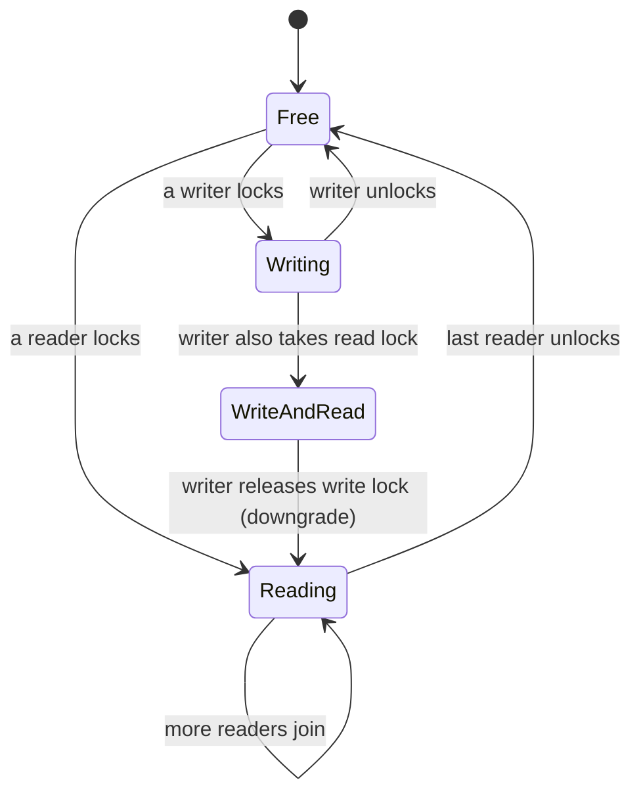
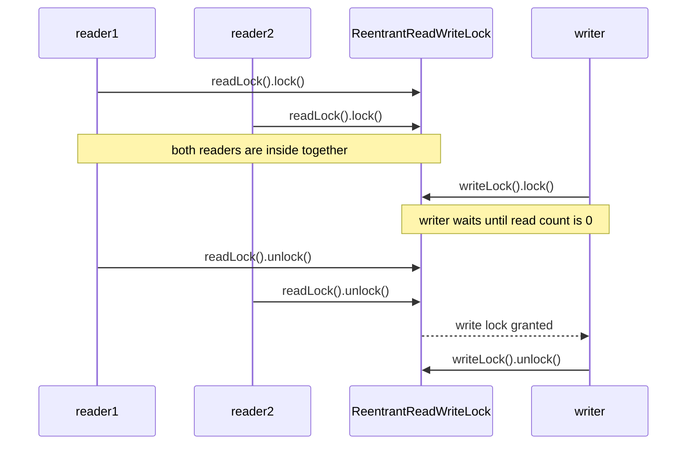
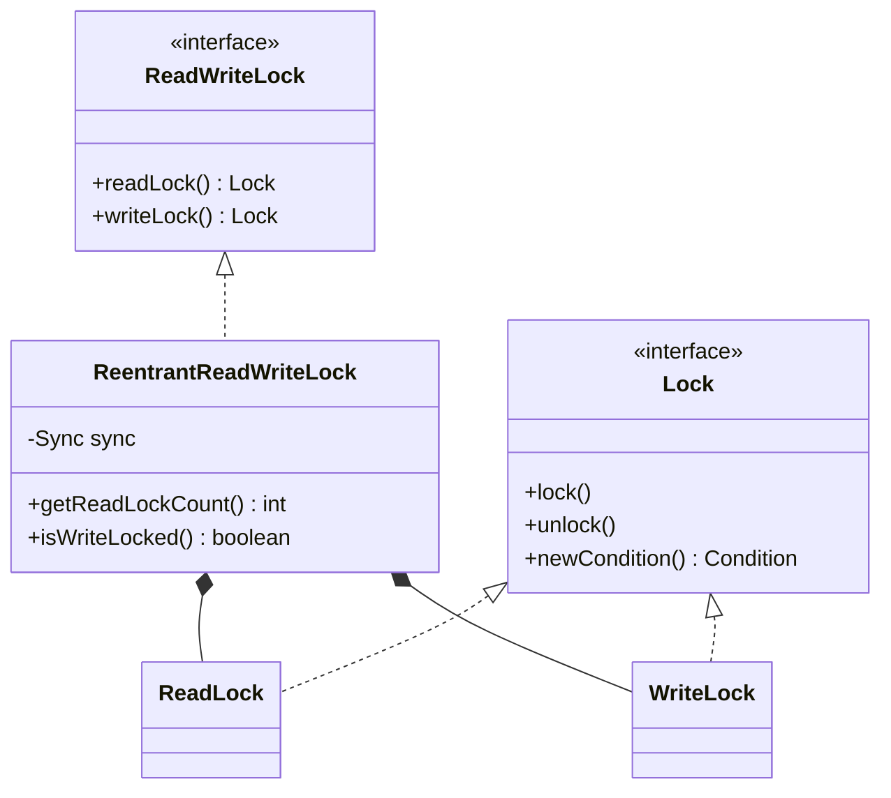

## In One Line
A `ReadWriteLock` is a pair of locks. The **read lock** can be held by **many readers at once**, and the **write lock** by **one writer, with no readers**. Read-mostly data can then be read in parallel and still be updated safely. `ReentrantReadWriteLock` is the standard implementation.

## Mental Model
Think of a **museum painting**.

- **Visitors (readers)** can stand in front of it together, dozens at a time. Looking doesn't disturb anyone. That's the **read lock**: shared.
- The **restorer (writer)** needs the room empty. While restoring, nobody may enter, not even to look, because they might see half-painted work. That's the **write lock**: exclusive.
- A restorer who arrives while visitors are inside **waits at the door** until the last visitor leaves. New visitors who arrive while the restorer waits are held back too, so the restorer isn't kept waiting for ever (**no writer starvation**).
- The restorer may finish and **stay on as a visitor** without leaving the room (**downgrade**: write to read). A visitor can't pick up a brush while other visitors could still be looking. Two visitors who both try it wait for each other for ever (**upgrade = deadlock**).

In the code, `readLock().lock()` means "enter as a visitor" and `writeLock().lock()` means "enter as the restorer".

## Concept
### Why a plain lock is wasteful for read-mostly data
With `synchronized` or `ReentrantLock`, two threads that only **read** still exclude each other, although reads cannot corrupt anything. Concurrent reads are safe. The danger is only **read–write** and **write–write** overlap. A read-write lock encodes exactly that rule:

| Already held by other threads ↓ / Requested → | Read lock | Write lock |
|---|---|---|
| Nothing | Granted | Granted |
| Read lock (one or more readers) | **Granted** (shared) | Waits until all readers leave |
| Write lock | Waits | Waits |

### The API
```java
public interface ReadWriteLock {      // java.util.concurrent.locks, Java 5
    Lock readLock();
    Lock writeLock();
}
```
Both views are ordinary `Lock`s, so the idiom is the same as for `ReentrantLock`:
```java
rw.readLock().lock();
try { return data; } finally { rw.readLock().unlock(); }
```
`ReentrantReadWriteLock` (RRWL) adds:

| Method | Meaning |
|---|---|
| `new ReentrantReadWriteLock()` / `(true)` | Non-fair (default) / fair |
| `getReadLockCount()` | Total read holds, all threads |
| `getReadHoldCount()` | Read holds of the **current** thread (Java 6+) |
| `getWriteHoldCount()` | Write holds of the current thread |
| `isWriteLocked()`, `isWriteLockedByCurrentThread()` | Is a writer inside? |
| `hasQueuedThreads()`, `getQueueLength()` | Monitoring (estimates) |
| `writeLock().newCondition()` | Supported, like `ReentrantLock` |
| `readLock().newCondition()` | Throws **`UnsupportedOperationException`** |

The read lock has no conditions because readers don't have exclusive access. Waiting for a state change while other readers are still inside makes no sense.

### Rules of ReentrantReadWriteLock
1. **Reentrancy.** A reader can re-acquire the read lock, and a writer can re-acquire the write lock *and* also take the read lock.
2. **Downgrading is allowed:** take the write lock, take the read lock, release the write lock. You end up reading the data you just wrote, and no other writer can slip in between.
3. **Upgrading is NOT allowed.** A thread holding the read lock that calls `writeLock().lock()` blocks **for ever**. The write lock waits for all readers to leave, and one of them is itself. With `tryLock()` you see it fail (`false`) instead of hanging. To "upgrade", release the read lock, take the write lock, and **re-check** the state, because someone else may have changed it in between.
4. **Limits:** at most 65,535 recursive write holds and 65,535 read holds. Exceeding them throws an `Error`.
5. **Ownership:** only the thread that holds a lock may release it (`IllegalMonitorStateException` otherwise).

### Fairness and writer starvation
- **Non-fair (default).** The order of entry is unspecified. RRWL still uses a heuristic: a thread asking for the read lock (not re-entrantly) **blocks if the first queued thread is a writer**. Without it, a steady stream of overlapping readers could keep the write lock away for ever (writer starvation). The demo in Code shows reader 2 waiting behind a queued writer.
- **Fair (`true`).** Roughly arrival order. When the lock is released, it goes either to the longest-waiting writer, or to a group of readers who have waited longer than any writer.
- As with `ReentrantLock`, the untimed `tryLock()` of either view **barges** and ignores fairness.

### How it works inside
RRWL uses one AQS instance for both views and splits the 32-bit `state`:

```text
state = [ upper 16 bits: shared (read) holds | lower 16 bits: exclusive (write) holds ]
```
That split is where the 65,535 limits come from. The per-thread read hold counts, needed for reentrancy and for `getReadHoldCount()`, live in a `ThreadLocal`, with a fast-path cache for the first reader. Every read-lock acquire and release is a CAS on that **shared** `state` word. With many cores and very short reads, that single cache line becomes a bottleneck.

### When it pays off, and when it doesn't
Use it when **all** of these are true:
- reads greatly outnumber writes,
- read critical sections are long enough to matter (a lookup in a big structure, a computation), and
- several threads really read at the same time.

Otherwise it is often **slower** than a plain `ReentrantLock`: more bookkeeping, and the CAS contention described above. Alternatives worth naming in interviews:

| Need | Better tool |
|---|---|
| Concurrent map | `ConcurrentHashMap` (lock-free reads) |
| List read constantly, written rarely | `CopyOnWriteArrayList` |
| Whole state replaced at once | Immutable object in a `volatile` field or `AtomicReference` |
| Very hot reads, short critical sections | `StampedLock` optimistic reads |

### `StampedLock` (Java 8): the faster, less friendly cousin
`StampedLock` has three modes: `writeLock()`, `readLock()` and **optimistic reading** with `tryOptimisticRead()`. An optimistic read takes **no lock at all**. It returns a stamp, you read the fields into locals, then `validate(stamp)` tells you whether a writer got in meanwhile. If so, you fall back to a real `readLock()`.

| | `ReentrantReadWriteLock` | `StampedLock` |
|---|---|---|
| Reentrant | Yes | **No.** Locking twice from one thread deadlocks |
| Conditions | Write lock only | None |
| Optimistic reads | No | Yes (`tryOptimisticRead` / `validate`) |
| Upgrade | Not allowed | `tryConvertToWriteLock(stamp)` |
| Unlock | Owner thread | Anyone holding the right **stamp** (`unlockRead(stamp)`, `unlockWrite(stamp)`) |
| As a `Lock` | Directly | Views: `asReadLock()`, `asWriteLock()`, `asReadWriteLock()` |

Use `StampedLock` only inside a small, well-reviewed class. Its non-reentrancy and stamp handling make mistakes easy.

## Diagram

There is an arrow from `Writing` down to `Reading` (downgrade), but **no** arrow from `Reading` up to `Writing`: an upgrade is not allowed.


Readers overlap with each other but never with the writer. This is what happens in the example on each 100 ms "tick".


One `ReentrantReadWriteLock` owns two `Lock` views, and both share the same internal `Sync` (AQS) state.

## Code
@example Multithreading/ConcurrencyUtilities/ReadWriteLockExample.java

**Proof that readers share and writers exclude.** Two readers park inside the read lock, then `main` inspects the lock:
```java
import java.util.concurrent.CountDownLatch;
import java.util.concurrent.locks.ReentrantReadWriteLock;

public class SharedReaders {
    public static void main(String[] args) throws InterruptedException {
        ReentrantReadWriteLock rw = new ReentrantReadWriteLock();
        CountDownLatch bothInside = new CountDownLatch(2);
        CountDownLatch leave = new CountDownLatch(1);

        Runnable reader = () -> {
            rw.readLock().lock();
            try {
                bothInside.countDown();
                leave.await();                     // stay inside the read lock
            } catch (InterruptedException e) {
                Thread.currentThread().interrupt();
            } finally {
                rw.readLock().unlock();
            }
        };
        Thread r1 = new Thread(reader), r2 = new Thread(reader);
        r1.start(); r2.start();
        bothInside.await();                        // both readers now hold the read lock

        System.out.println("read locks held: " + rw.getReadLockCount());
        System.out.println("write-locked?    " + rw.isWriteLocked());
        System.out.println("writer tryLock:  " + rw.writeLock().tryLock());   // readers inside -> false

        leave.countDown();
        r1.join(); r2.join();
        System.out.println("read locks held: " + rw.getReadLockCount());
        System.out.println("writer tryLock:  " + rw.writeLock().tryLock());   // now free -> true
    }
}
```
```output
read locks held: 2
write-locked?    false
writer tryLock:  false
read locks held: 0
writer tryLock:  true
```

**Reads really run in parallel.** Three reads that each take 300 ms, first under a `ReentrantLock`, then under the read lock (elapsed time rounded to 100 ms; the second number is occasionally 400 on a cold JVM):
```java
static long time(Lock lock) throws InterruptedException {
    Runnable slowRead = () -> {
        lock.lock();
        try { Thread.sleep(300); }             // pretend reading takes 300 ms
        catch (InterruptedException e) { Thread.currentThread().interrupt(); }
        finally { lock.unlock(); }
    };
    long start = System.nanoTime();
    Thread[] ts = { new Thread(slowRead), new Thread(slowRead), new Thread(slowRead) };
    for (Thread t : ts) t.start();
    for (Thread t : ts) t.join();
    long ms = (System.nanoTime() - start) / 1_000_000;
    return Math.round(ms / 100.0) * 100;
}
// time(new ReentrantLock())  vs  time(new ReentrantReadWriteLock().readLock())
```
```output
3 slow reads, ReentrantLock:          ~900 ms
3 slow reads, ReadWriteLock.readLock: ~300 ms
```

**Upgrade fails, downgrade works, and the read lock has no conditions:**
```java
import java.util.concurrent.TimeUnit;
import java.util.concurrent.locks.ReentrantReadWriteLock;

public class UpgradeDowngrade {
    public static void main(String[] args) throws InterruptedException {
        ReentrantReadWriteLock rw = new ReentrantReadWriteLock();

        // Upgrade (read -> write): NOT allowed. writeLock().lock() here would hang forever.
        rw.readLock().lock();
        boolean upgraded = rw.writeLock().tryLock(1, TimeUnit.SECONDS);
        System.out.println("upgrade read->write succeeded? " + upgraded);
        rw.readLock().unlock();

        // Downgrade (write -> read): allowed.
        rw.writeLock().lock();
        rw.readLock().lock();                      // take the read lock while still writing
        rw.writeLock().unlock();                   // now only the read lock is held
        System.out.println("after downgrade: write-locked=" + rw.isWriteLocked()
                + ", my read holds=" + rw.getReadHoldCount());
        rw.readLock().unlock();

        // Reentrancy: both locks can be taken again by the same thread.
        rw.writeLock().lock(); rw.writeLock().lock();
        System.out.println("write hold count: " + rw.getWriteHoldCount());
        rw.writeLock().unlock(); rw.writeLock().unlock();

        try {
            rw.readLock().newCondition();
        } catch (UnsupportedOperationException e) {
            System.out.println("readLock().newCondition() -> " + e.getClass().getSimpleName());
        }
    }
}
```
```output
upgrade read->write succeeded? false
after downgrade: write-locked=false, my read holds=1
write hold count: 2
readLock().newCondition() -> UnsupportedOperationException
```

**A queued writer holds back new readers (non-fair mode).** This is the writer-starvation heuristic:
```java
import java.util.concurrent.locks.ReentrantReadWriteLock;

public class WriterPreference {
    public static void main(String[] args) throws InterruptedException {
        ReentrantReadWriteLock rw = new ReentrantReadWriteLock();   // non-fair
        rw.readLock().lock();                                        // reader 1 (main) is inside

        Thread writer = new Thread(() -> {
            rw.writeLock().lock();                                   // must wait for reader 1
            try { System.out.println("writer: writing"); } finally { rw.writeLock().unlock(); }
        });
        writer.start();
        Thread.sleep(200);                                           // writer is now queued

        Thread reader2 = new Thread(() -> {
            rw.readLock().lock();                                    // arrives AFTER the writer
            try { System.out.println("reader 2: reading"); } finally { rw.readLock().unlock(); }
        });
        reader2.start();
        Thread.sleep(200);
        System.out.println("reader 2 still waiting? " + reader2.isAlive()
                + " (queued threads: " + rw.getQueueLength() + ")");

        System.out.println("reader 1: releasing");
        rw.readLock().unlock();
        writer.join(); reader2.join();
    }
}
```
```output
reader 2 still waiting? true (queued threads: 2)
reader 1: releasing
writer: writing
reader 2: reading
```
Reader 2 could have shared the lock with reader 1, but it queues behind the writer.

**A read-mostly cache, the typical real use:**
```java
import java.util.HashMap;
import java.util.Map;
import java.util.concurrent.locks.Lock;
import java.util.concurrent.locks.ReentrantReadWriteLock;

public class CachedDictionary {
    private final Map<String, String> map = new HashMap<>();
    private final ReentrantReadWriteLock rw = new ReentrantReadWriteLock();
    private final Lock r = rw.readLock();
    private final Lock w = rw.writeLock();

    public String get(String key) {
        r.lock();
        try { return map.get(key); } finally { r.unlock(); }
    }

    public String put(String key, String value) {
        w.lock();
        try { return map.put(key, value); } finally { w.unlock(); }
    }

    public static void main(String[] args) {
        CachedDictionary d = new CachedDictionary();
        d.put("java", "coffee");
        System.out.println(d.get("java") + " " + d.get("kotlin"));
    }
}
```
```output
coffee null
```

**`StampedLock` optimistic read:**
```java
import java.util.concurrent.locks.StampedLock;

public class StampedPoint {
    private double x, y;
    private final StampedLock sl = new StampedLock();

    void move(double dx, double dy) {
        long stamp = sl.writeLock();
        try { x += dx; y += dy; } finally { sl.unlockWrite(stamp); }
    }

    double distanceFromOrigin() {
        long stamp = sl.tryOptimisticRead();       // no lock taken at all
        double cx = x, cy = y;                     // copy fields to locals
        if (!sl.validate(stamp)) {                 // a writer got in meanwhile?
            stamp = sl.readLock();                 // fall back to a real read lock
            try { cx = x; cy = y; } finally { sl.unlockRead(stamp); }
        }
        return Math.sqrt(cx * cx + cy * cy);
    }

    public static void main(String[] args) {
        StampedPoint p = new StampedPoint();
        p.move(3, 4);
        System.out.println("distance = " + p.distanceFromOrigin());

        StampedLock lock = new StampedLock();
        long s = lock.tryOptimisticRead();
        System.out.println("valid before write? " + lock.validate(s));
        long w = lock.writeLock();
        lock.unlockWrite(w);
        System.out.println("valid after write?  " + lock.validate(s));
    }
}
```
```output
distance = 5.0
valid before write? true
valid after write?  false
```

## Walkthrough
**Header.** `package Multithreading.ConcurrencyUtilities;` and the file-name comment, then `import java.util.concurrent.locks.ReentrantReadWriteLock;`, the only import needed. The code calls `readLock()`/`writeLock()` directly and never names the `ReadWriteLock` interface.

**`class SharedData`: the protected resource**
- `private int data = 0;` — the shared value. It starts at 0, and that matters for the output (see below).
- `private ReentrantReadWriteLock lock = new ReentrantReadWriteLock();` — one non-fair RW lock guarding `data`. It should be `final`.
- `// Method to write data with write lock` / `writeData(int data)`: `lock.writeLock().lock()` before `try`, then `this.data = data;`. The parameter has the same name as the field, so `this.` is required to reach the field. Then it prints `"Written data: " + data` (the **parameter**, which equals the new field value), and `writeLock().unlock()` runs in `finally`. While this runs, no reader and no other writer can be inside.
- `// Method to read data with read lock` / `readData()`: `lock.readLock().lock()`, print `"Read data: " + data`, `return data;`, and `readLock().unlock()` in `finally`. The `return` inside `try` is fine: the value is computed first, then `finally` unlocks, then the method returns. Both readers can be inside `readData()` at the same time.

**`class ReaderThread extends Thread`:** stores the shared `SharedData`. `run()` reads 5 times, sleeping 100 ms after each read. `Thread.sleep` throws the checked `InterruptedException`, caught with `e.printStackTrace()`.

**`class WriterThread extends Thread`:** the same shape, but calls `writeData(i)` for `i = 0..4`, so it writes 0, 1, 2, 3, 4, one every ~100 ms.

**`main`:** creates one `SharedData`, two readers and one writer sharing it. It starts them in the order reader1, reader2, writer and `join()`s all three, so `main` ends only after the 15 lines are printed. The `// Output:` comment sits after `main`, at class level, which is legal: comments can go anywhere.

**Why the output differs between runs (this example is marked "varies").** Three threads loop at roughly the same pace: do one operation, sleep ~100 ms, repeat. So about every 100 ms, all three wake up at nearly the same instant and race for the lock. Whether a reader gets in **just before** the writer (and prints the old value) or **just after** (and prints the new one) depends on:
- **Scheduling.** `start()` only makes a thread runnable. The OS decides when each one really runs, on which of the CPU cores, and a thread started first is not guaranteed to run first.
- **Sleep drift.** `sleep(100)` means "at least 100 ms". Timer granularity, wake-up latency and the time spent printing make each thread drift slightly differently, so their relative order shifts as the run goes on.
- **Lock hand-off.** When the write lock is released, the waiting readers and a returning writer race again.

Twelve test runs of the original produced **7 different outputs**. The recorded run starts `Read data: 0`, `Read data: 0`, `Written data: 0`, `Read data: 0`, `Read data: 0`, `Written data: 1`, ..., and in some runs the last line is `Written data: 4` (both readers finished first) instead of `Read data: 4`.

**What is guaranteed in every run:**
- Exactly **15 lines**: 10 `Read data` (2 readers × 5) and 5 `Written data` (0 to 4, in increasing order, because there is one writer).
- **Every `Read data: n` line shows the value of the nearest `Written data` line above it** (or 0 if no write has happened yet). The `println` calls happen *inside* the locks, and a reader and the writer are never inside together, so the printed order matches the lock order. You will never see `Written data: 2` followed by `Read data: 1`.
- The first write is `0`, which doesn't change anything (the field was already 0). That's why there are often four `Read data: 0` lines: reads before and after `Written data: 0` look the same.

**How to run it.** On JDK 21, `java ReadWriteLockExample.java` fails ("can't find main(String[]) method in class ...SharedData"). The single-file launcher runs the first class in the file. Compile with `javac` and run `Multithreading.ConcurrencyUtilities.ReadWriteLockExample`, or use the IDE.

> [!NOTE] The example shows the *API* but not the *benefit*: each read is a single `println`, and `System.out` serialises all printing anyway. The `ReadersInParallel` snippet above (900 ms vs 300 ms) shows what the read lock actually buys.

## Traps
> [!ERRATA] The `// Output:` comment presents one particular interleaving as *the* output. For example, it shows `Written data: 0` directly followed by `Written data: 1`, and three `Read data: 1` lines. That is a possible run, but the recorded run (and most test runs) look different. Only the invariants above are guaranteed: 10 reads, 5 writes in order, and every read showing the latest write. Never write an exact expected output for a multi-threaded program.

> [!ERRATA] Minor code-quality issues. The `lock` and `sharedData` fields should be `private final`. `writeData(int data)` shadows the field `data`, so `this.data = data` is correct but easy to break (drop the `this.` and the method silently assigns the parameter to itself). And `catch (InterruptedException e) { e.printStackTrace(); }` swallows the interrupt: the loop keeps going as if nothing happened. Restore it with `Thread.currentThread().interrupt()` and stop the loop.

- **Upgrading deadlocks.** Holding the read lock and calling `writeLock().lock()` blocks for ever: the writer waits for all readers to leave, including itself. Release the read lock first, then take the write lock and **re-check**, because another writer may have acted in the gap.
- **Writing under the read lock.** The read lock is shared, so mutating (`map.put`, `count++`) under it is a data race. The compiler can't catch this. Only reads go under `readLock()`.
- **`HashMap.get` is a read, but `LinkedHashMap` in access order is not.** With `accessOrder = true` (an LRU cache), `get()` **modifies** the internal linked list, so it must take the **write** lock.
- **`readLock().newCondition()`** throws `UnsupportedOperationException`. Only the write lock supports conditions.
- **Assuming it is always faster.** For tiny critical sections or write-heavy loads, the extra bookkeeping and the CAS contention on the shared state make a RW lock slower than `ReentrantLock`. Measure first.
- **Assuming readers always get in while other readers are inside.** A queued writer blocks **new** readers (a thread re-entering a read lock it already holds still passes). That creates a subtle deadlock: thread A holds the read lock and waits for thread B (for example `future.get()`), B needs the read lock, and a writer queued in between. B waits for the writer, the writer waits for A, and A waits for B. Never block on another thread while holding a lock.
- **`StampedLock` is not reentrant.** Calling `writeLock()` twice in the same thread deadlocks. And after an optimistic read, don't use the values (or dereference fields that may be `null`) until `validate` has returned `true`.

## Tips & Tricks
- **"Many readers OR one writer."** That single sentence is the whole contract.
- **"Down is allowed, up is a deadlock."** Write → read (downgrade) is fine; read → write (upgrade) hangs. Picture it: you can step off a ladder, but you can't climb one someone else is standing under.
- **Downgrade recipe:** write lock → read lock → unlock write → (read safely) → unlock read.
- **Check the ratio.** A RW lock pays off at roughly "many reads per write, and the reads do real work". Otherwise use `ReentrantLock`, `ConcurrentHashMap` or an immutable snapshot.
- Keep the two `Lock` views in `final` fields (`r` and `w`) instead of calling `rw.readLock()` each time. It reads better and is what the JDK docs do.
- In interviews, mention `StampedLock` optimistic reads as the "next step", along with its caveats (not reentrant, no conditions).

## Interview Q&A
### [Basic] What is a ReadWriteLock and when would you use it?
A `ReadWriteLock` (Java 5) is a pair of associated locks. The read lock is **shared**: any number of threads can hold it at once, as long as nobody holds the write lock. The write lock is **exclusive**: one thread, and no readers. It improves concurrency for data that is read far more often than written, because readers no longer block each other the way they would with `synchronized` or a plain `ReentrantLock`. The standard implementation is `ReentrantReadWriteLock`. Typical uses are in-memory caches, configuration and lookup tables.

**Follow-up:** *When would a plain lock be better?* When reads are very short or writes are frequent. Then the RW lock's overhead and the contention on its internal state cost more than it saves.

### [Basic] Which combinations of locks can be held at the same time?
- Many threads with the read lock: **yes**.
- Read lock in one thread and write lock in another: **no**.
- Write lock in two threads: **no**.
- Write lock and read lock in the **same** thread: yes. A writer may also acquire the read lock (that is how a downgrade starts).
- Read lock and write lock in the same thread when the read was taken first: the write request **never** succeeds (no upgrade).

**Follow-up:** *Is ReentrantReadWriteLock reentrant for both locks?* Yes. A reader can re-acquire the read lock, and a writer can re-acquire the write lock, up to 65,535 holds each.

### [Intermediate] What are lock upgrading and downgrading? Which does ReentrantReadWriteLock support?
**Downgrading** means going from the write lock to the read lock without letting another writer in: acquire the read lock while holding the write lock, then release the write lock. RRWL supports it. **Upgrading** means going from the read lock to the write lock. RRWL does **not** support it: the write lock waits for all read holds to be released, including the caller's own, so it blocks for ever. And if two readers tried it at once they would deadlock each other. The safe pattern:
```java
rw.readLock().lock();
if (!cacheValid) {
    rw.readLock().unlock();        // cannot upgrade, so release first
    rw.writeLock().lock();
    try {
        if (!cacheValid) {         // re-check: another writer may have loaded it
            data = load();
            cacheValid = true;
        }
        rw.readLock().lock();      // downgrade: take read before releasing write
    } finally {
        rw.writeLock().unlock();
    }
}
try { use(data); } finally { rw.readLock().unlock(); }
```
**Follow-up:** *Which lock supports conversion?* `StampedLock.tryConvertToWriteLock(stamp)`, which succeeds only when it can do so safely (for example, when the caller is the only reader).

### [Intermediate] Can writers starve with ReentrantReadWriteLock? How does it handle this?
With a naive RW lock, yes. If readers keep overlapping, the read count never drops to zero, and a writer waits for ever. RRWL prevents this in both modes. In **fair** mode, entry follows approximate arrival order: a new reader blocks if a writer is waiting. In **non-fair** mode, a heuristic makes a new, non-reentrant reader block if the **first queued thread is a writer**. So once a writer is waiting, no new readers get in, current readers drain, and the writer gets its turn.

**Follow-up:** *Can readers starve?* In non-fair mode, a series of writers can keep readers waiting for a while. Fair mode bounds the wait of both sides.

### [Intermediate] Why doesn't the read lock support Condition?
`readLock().newCondition()` throws `UnsupportedOperationException`. A condition wait means "release my exclusive access, sleep until someone changes the state, then re-acquire". Readers never have exclusive access, and they are not allowed to change the state, so nobody under a read lock could make the condition true for them. The **write** lock supports `newCondition()` exactly like `ReentrantLock`.

**Follow-up:** *What would you use to wait for data under a RW lock?* Wait on a condition of the write lock, or use a higher-level tool such as a `BlockingQueue` or `CountDownLatch`.

### [Intermediate] Is a ReadWriteLock always faster than ReentrantLock for read-heavy code?
No. Every read acquire and release does a CAS on a single shared `state` word and updates per-thread hold counts (thread-local bookkeeping). With very short read sections, many cores and many readers, that shared word bounces between CPU caches, and a RW lock can be *slower* than a simple mutex. It shines when reads take long enough that running them in parallel outweighs that overhead. Always benchmark (JMH). Often `ConcurrentHashMap`, `CopyOnWriteArrayList` or an immutable snapshot in a `volatile` field beats both locks.

**Follow-up:** *What's the lock-free option for read-mostly state?* Publish a new immutable object through a `volatile` field or `AtomicReference` on each write, and readers just read the reference (copy-on-write).

### [Advanced] How does ReentrantReadWriteLock track read and write holds internally?
It uses one `AbstractQueuedSynchronizer`. The 32-bit `state` is split: the **upper 16 bits** count shared (read) holds and the **lower 16 bits** count exclusive (write) re-entries, hence the 65,535 limits. A write acquire succeeds only if `state == 0`, or if the caller already owns the write lock. A read acquire CASes the upper half up, unless another thread holds the write lock or the fairness or writer-preference rule says to block. Per-thread read counts, needed for reentrancy and `getReadHoldCount()`, are kept in a `ThreadLocal` `HoldCounter`, with a fast-path cache for the first reader and the last reader.

**Follow-up:** *What happens at 65,536 read holds?* The locking method throws `Error("Maximum lock count exceeded")`.

### [Advanced] What is StampedLock and how is an optimistic read done correctly?
`StampedLock` (Java 8) is a capability-based lock. Each acquire returns a `long` **stamp** that you pass back to unlock. Besides `writeLock()` and `readLock()`, it offers **optimistic reading**: `tryOptimisticRead()` returns a stamp without locking. You copy the fields you need into **local variables**, then call `validate(stamp)`. If no write happened in between, the copies are consistent and you used no lock at all. If validation fails, you retry under a real `readLock()`. Rules: read into locals, validate before *using* them, and never do anything irreversible or throw-prone (like following a possibly-null reference) before validating. `StampedLock` is **not reentrant**, has no conditions and has no owner, so keep its use small and well encapsulated.

**Follow-up:** *Why is optimistic reading fast?* A successful optimistic read performs no write to shared memory, so there is no CAS and no cache-line contention. It is just two volatile reads of the state.

### [Advanced] Design a thread-safe cache for a read-heavy service.
If a map is all I need, I'd start with `ConcurrentHashMap` and `computeIfAbsent`: lock-free reads and per-bin locking on writes. If the cache has compound invariants (several structures that must change together), I'd wrap them in a class with a `ReentrantReadWriteLock`: `get` under `readLock()`, `put`/`invalidate` under `writeLock()`, both views in `final` fields, and unlocks always in `finally`. For lazy loading, use the release-read, take-write, re-check, downgrade pattern. For an LRU cache built on `LinkedHashMap(accessOrder = true)`, even `get` mutates the list, so it would need the write lock, and a simple `synchronized` wrapper or Caffeine is better. For extremely hot reads of small state, an immutable snapshot swapped through a `volatile` field.

**Follow-up:** *What if loading a value is slow?* Don't hold the write lock during I/O. Use a per-key future (`ConcurrentHashMap<K, CompletableFuture<V>>`) so only callers of that key wait.

## Quiz
### Which statement about the original example's output is true in EVERY run?
- [ ] The first two lines are always `Read data: 0`
- [ ] `Read data: n` always appears exactly twice between two writes
- [x] Every `Read data: n` line shows the value of the nearest `Written data` line above it (or 0 before any write)
- [ ] The last line is always `Read data: 4`
> The prints happen inside the locks, and readers never overlap the writer, so the output order follows the lock order and each read shows the latest write. Everything else depends on thread timing: in some runs the writer gets in before a reader, sometimes one or three reads fall between writes, and sometimes the last line is `Written data: 4`.

### What does this print?
```java
ReentrantReadWriteLock rw = new ReentrantReadWriteLock();
rw.readLock().lock();
rw.readLock().lock();
System.out.println(rw.getReadLockCount() + " " + rw.getReadHoldCount() + " " + rw.writeLock().tryLock());
```
- [ ] 1 1 true
- [ ] 2 2 true
- [x] 2 2 false
- [ ] It hangs
> The read lock is reentrant, so one thread holds it twice: 2 total holds, 2 by this thread. The write lock can't be granted while any read hold exists, even the caller's own, so `tryLock()` returns `false`. It doesn't hang, because `tryLock()` never waits. `writeLock().lock()` would hang for ever.

### What does this print?
```java
ReentrantReadWriteLock rw = new ReentrantReadWriteLock();
rw.writeLock().lock();
rw.readLock().lock();
System.out.print(rw.isWriteLocked() + " ");
rw.writeLock().unlock();
System.out.println(rw.isWriteLocked() + " " + rw.getReadLockCount());
```
- [x] true false 1
- [ ] true true 1
- [ ] It deadlocks at `readLock().lock()`
- [ ] true false 0
> A writer may take the read lock too. That's the first half of a **downgrade**. After releasing the write lock, only the read hold remains: not write-locked, 1 read hold. The deadlock case is the opposite order (read first, then write).

### Spot the bug.
```java
public void incrementIfPositive() {
    rw.readLock().lock();
    try {
        if (value > 0) {
            rw.writeLock().lock();
            try { value++; } finally { rw.writeLock().unlock(); }
        }
    } finally {
        rw.readLock().unlock();
    }
}
```
- [ ] `value` must be `volatile`
- [x] It tries to upgrade read to write, so `writeLock().lock()` blocks for ever
- [ ] The read lock must be released inside the inner `finally`
- [ ] Nothing, a thread may hold both locks
> ReentrantReadWriteLock does not support upgrading. The write lock waits until the read count is 0, but the calling thread's own read hold never goes away, so it hangs. Fix: release the read lock, take the write lock, re-check `value > 0`, then increment. "A thread may hold both" is only true in the other order (write first, then read).

### When is `ReentrantReadWriteLock` most likely to beat a plain `ReentrantLock`?
- [ ] Frequent writes and tiny reads
- [x] Many concurrent readers, rare writes, and reads that do real work
- [ ] A single thread doing both reads and writes
- [ ] Whenever there is more than one thread
> The gain comes from running reads in parallel. That needs several simultaneous readers, few writers, and read sections long enough to be worth sharing. With tiny reads or frequent writes, the RW lock's extra bookkeeping and CAS contention can make it slower.

### Which is true about `StampedLock`?
- [ ] It is reentrant like `ReentrantReadWriteLock`
- [ ] Its read mode supports `Condition`s
- [x] An optimistic read takes no lock and must be checked with `validate(stamp)`
- [ ] `unlockWrite()` needs no argument
> `tryOptimisticRead()` returns a stamp without locking. After copying the fields to locals, `validate(stamp)` tells you whether a writer interfered. `StampedLock` is **not** reentrant, has no conditions, and every unlock takes the stamp from the matching lock call.

## Takeaways
- `ReadWriteLock` = a shared **read lock** (many readers) + an exclusive **write lock** (one writer, no readers). `ReentrantReadWriteLock` is the standard implementation.
- Use the same idiom as any `Lock`: `rw.readLock().lock(); try { read } finally { rw.readLock().unlock(); }`. Only reads may happen under the read lock.
- Downgrade (write → read) is allowed. Upgrade (read → write) blocks for ever: release the read lock, take the write lock, then re-check.
- Only the write lock supports `Condition`s. `readLock().newCondition()` throws `UnsupportedOperationException`.
- Writer starvation is prevented: in non-fair mode, new readers queue behind a waiting writer, and fair mode uses arrival order.
- Internally, one AQS `state` is split 16/16 bits between read holds and write holds (65,535 max each).
- It pays off only for read-heavy loads with non-trivial reads. Otherwise consider `ReentrantLock`, `ConcurrentHashMap`, copy-on-write, or `StampedLock` optimistic reads.
- Output of multi-threaded examples varies. Reason from the guarantees the lock gives, not from one printed run.
