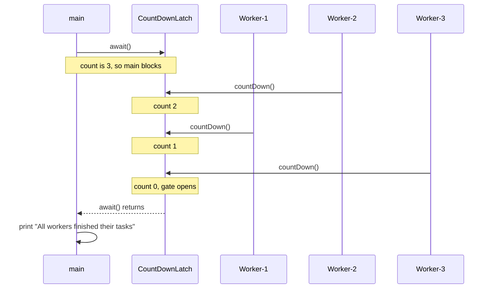
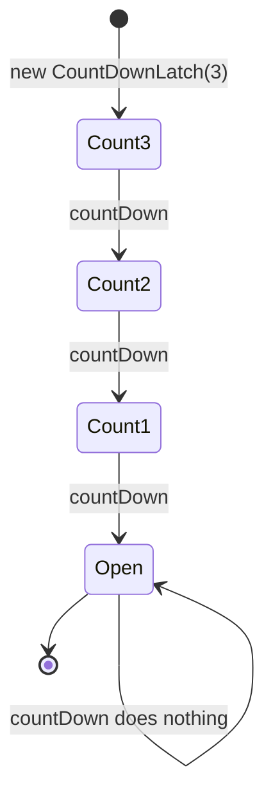
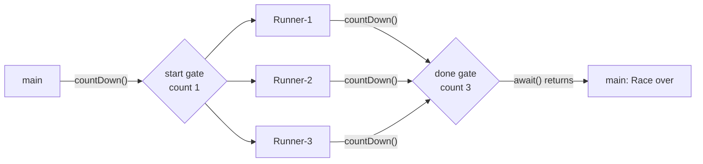

## In One Line
A `CountDownLatch` is a **one-shot gate** that starts at a count N. Threads call `await()` to wait at the gate, other threads call `countDown()` to lower the count, and the gate opens for good when the count reaches **0**.

## Mental Model
Think of a **rocket launch countdown**, or a **tour bus that leaves only when all 3 missing passengers are back**.

- The guide says "we're waiting for 3 people". That's `new CountDownLatch(3)`.
- The driver sits and waits. That's `latch.await()`.
- Each passenger who gets back taps the counter once: 3 → 2 → 1 → 0. That's `countDown()`. Passengers don't wait for each other or for the bus; they tap and carry on.
- At 0 the doors close and the bus leaves. Every waiting thread is released at once.
- Tomorrow needs a **new** counter. A latch can't be wound back up (that is what [CyclicBarrier](lesson:a06-threads/13-cyclicbarrier) is for).

The passengers are the `Worker` threads, the driver is `main`, and "the bus leaves" is `All workers finished their tasks`.

## Concept
### What it solves
Very often one thread must wait until **N things have happened** in other threads: N tasks finished, N services started, N files loaded. `Thread.join()` only works if you own the threads and each "thing" is "a thread ended". A latch counts **events**, not threads:
- the events can come from any threads, including pool threads that never terminate,
- one thread can count down several times,
- many threads can wait on the same latch.

### API (java.util.concurrent, Java 5)
| Member | Behaviour |
|---|---|
| `new CountDownLatch(int count)` | Sets the count. `count < 0` → `IllegalArgumentException("count < 0")`. `0` = already open |
| `void await() throws InterruptedException` | Blocks until the count is 0. Returns **immediately** if it already is. Throws `InterruptedException` if interrupted while waiting |
| `boolean await(long timeout, TimeUnit unit)` | Like `await()` but gives up: `true` = count reached 0, `false` = timed out |
| `void countDown()` | Decrements the count. **Never blocks.** When it reaches 0, all waiters are released. At 0 already, it does nothing |
| `long getCount()` | Current count (for logging and tests, not for control flow) |
| `toString()` | `java.util.concurrent.CountDownLatch@6c9f5c0d[Count = 2]` (the hash part varies) |

Key properties:
- **One-shot.** There is no `reset()`. Once open, it stays open, and every later `await()` returns immediately.
- **No owner.** Any thread may call `countDown()`. The latch doesn't care who, or how many times each thread calls it.
- The count can't go below 0, and there is no `countUp()`.

### Memory-consistency guarantee
Everything a thread does **before** calling `countDown()` *happens-before* everything a thread does **after** a successful return from `await()`. So workers can write results into plain (non-volatile) fields or arrays, and the awaiting thread safely reads them after `await()`, as long as each write happens before that worker's `countDown()`.

### The two classic patterns
1. **Done gate ("wait for N").** `new CountDownLatch(N)`. Each worker calls `countDown()` in a `finally` block, and the coordinator calls `await()`. The original example uses this.
2. **Start gate ("release N at once").** `new CountDownLatch(1)`. Every worker calls `await()` first, and the coordinator calls `countDown()` once to let them all go together. Used in concurrency tests and benchmarks to maximise contention, and to make sure no worker starts before setup is complete.

They are often combined, as in the `RaceStart` snippet below.

### How it works inside
`CountDownLatch` wraps a private `Sync extends AbstractQueuedSynchronizer` used in **shared mode**:
- AQS `state` **is the count**.
- `await()` → `acquireSharedInterruptibly(1)`. `tryAcquireShared` returns "success" only when `state == 0`. Otherwise the thread is queued and parked.
- `countDown()` → `releaseShared(1)`. `tryReleaseShared` decrements `state` with a CAS loop and returns `true` only on the transition **1 → 0**. AQS then wakes the first queued waiter, and in shared mode the wake-up **propagates** to all of them.

It is the same engine as `ReentrantLock` and `Semaphore`, used differently.

### CountDownLatch vs the alternatives
| Tool | Reusable? | Who waits | Counts | Best for |
|---|---|---|---|---|
| `Thread.join()` | n/a | Caller waits for **one thread to die** | Thread termination | Threads you created yourself |
| **`CountDownLatch`** | **No** | Waiters wait; count-downers **don't wait** | Events | "Wait until N things happened"; start gates |
| `CyclicBarrier` | Yes | **All parties wait for each other** | Arriving threads | Threads meeting at a point, again and again |
| `Phaser` (Java 7) | Yes | Flexible | Registered parties, dynamic | Barriers with a changing number of parties or phases |
| `ExecutorService.invokeAll` | n/a | Caller | Tasks | Run a batch and get all `Future`s |
| `CompletableFuture.allOf(...)` | n/a | Non-blocking (`join()` if needed) | Futures | Async pipelines (see [CompletableFuture](lesson:a05-java8/23-completablefuture)) |

## Diagram

The workers never wait: `countDown()` returns at once. Only `main` waits, and it is released by whichever `countDown()` takes the count to 0.


The count only goes down. `Open` has no way back, so a latch is single-use.


Two latches: one releases all runners together, the other tells `main` when all have finished.

## Code
@example Multithreading/ConcurrencyUtilities/CountDownLatchExample.java

**Start gate + done gate.** Runners wait for "go", then `main` waits for all of them:
```java
import java.util.concurrent.CountDownLatch;

public class RaceStart {
    public static void main(String[] args) throws InterruptedException {
        CountDownLatch startSignal = new CountDownLatch(1);   // start gate: one "go"
        CountDownLatch doneSignal  = new CountDownLatch(3);   // finish line: three runners

        for (int i = 1; i <= 3; i++) {
            String name = "Runner-" + i;
            new Thread(() -> {
                try {
                    startSignal.await();                      // everybody waits for "go"
                    System.out.println(name + " running");
                } catch (InterruptedException e) {
                    Thread.currentThread().interrupt();
                } finally {
                    doneSignal.countDown();                   // always count down
                }
            }).start();
        }

        System.out.println("Ready... go!");
        startSignal.countDown();                              // 1 -> 0 releases all runners at once
        doneSignal.await();                                   // wait for all three
        System.out.println("Race over, count = " + doneSignal.getCount());
    }
}
```
One real run. The three `running` lines come in a different order on different runs, but `Ready... go!` is always first and `Race over` always last:
```output
Ready... go!
Runner-3 running
Runner-1 running
Runner-2 running
Race over, count = 0
```

**The rest of the API: timed await, extra countDown, zero and negative counts:**
```java
import java.util.concurrent.CountDownLatch;
import java.util.concurrent.TimeUnit;

public class LatchApi {
    public static void main(String[] args) throws InterruptedException {
        CountDownLatch latch = new CountDownLatch(2);
        latch.countDown();
        System.out.println("count = " + latch.getCount());

        boolean opened = latch.await(300, TimeUnit.MILLISECONDS);   // nobody counts down again
        System.out.println("opened within 300 ms? " + opened);

        latch.countDown();                                          // 1 -> 0: open
        System.out.println("opened now? " + latch.await(300, TimeUnit.MILLISECONDS));

        latch.countDown();                                          // already 0: no effect
        System.out.println("count = " + latch.getCount());

        CountDownLatch zero = new CountDownLatch(0);
        zero.await();                                               // returns immediately
        System.out.println("await on a zero latch returns at once");

        try {
            new CountDownLatch(-1);
        } catch (IllegalArgumentException e) {
            System.out.println("new CountDownLatch(-1) -> " + e);
        }
    }
}
```
```output
count = 1
opened within 300 ms? false
opened now? true
count = 0
await on a zero latch returns at once
new CountDownLatch(-1) -> java.lang.IllegalArgumentException: count < 0
```

**With a thread pool: 5 tasks, 2 threads, one task fails.** `join()` is useless here, because pool threads never end. The latch still works because `countDown()` is in `finally`:
```java
import java.util.concurrent.CountDownLatch;
import java.util.concurrent.ExecutorService;
import java.util.concurrent.Executors;
import java.util.concurrent.TimeUnit;

public class LatchWithPool {
    public static void main(String[] args) throws InterruptedException {
        int tasks = 5;
        CountDownLatch done = new CountDownLatch(tasks);
        ExecutorService pool = Executors.newFixedThreadPool(2);     // 5 tasks, only 2 threads

        for (int i = 1; i <= tasks; i++) {
            int id = i;
            pool.submit(() -> {
                try {
                    if (id == 3) throw new IllegalStateException("task 3 failed");
                } finally {
                    done.countDown();                               // counts down even on failure
                }
            });
        }

        boolean allDone = done.await(2, TimeUnit.SECONDS);
        System.out.println("all tasks finished? " + allDone + ", count = " + done.getCount());
        pool.shutdown();
    }
}
```
```output
all tasks finished? true, count = 0
```
Nothing about task 3's exception is printed. `submit()` stores it inside the returned `Future`, and nobody calls `get()`. That's a separate trap: see [ExecutorService](lesson:a07-executors/02-executor-service).

## Walkthrough
**Header.** The `package` line, the file-name comment, and `import java.util.concurrent.CountDownLatch;`. The latch lives directly in `java.util.concurrent`, not in `.locks`.

**`class Worker extends Thread`**
- `private CountDownLatch latch;` — the **shared** latch. All three workers receive the same object.
- `Worker(CountDownLatch latch, String name)` — `super(name)` passes the name to `Thread(String name)`, so `getName()` returns `"Worker-1"` and so on. Then it stores the latch.
- `run()`:
  1. prints `<name> is working`,
  2. `Thread.sleep(1000)` simulates one second of work (the checked `InterruptedException` is caught and printed),
  3. prints `<name> finished work`,
  4. `latch.countDown()` reports "one more done". It returns immediately, and the worker thread then ends.

**`CountDownLatchExample.main`**
- `new CountDownLatch(3)` — the gate needs three events.
- Three `Worker`s share the latch and are started one after another.
- `latch.await()` — `main` blocks here until the third `countDown()`. It is wrapped in `try/catch (InterruptedException e)` because `await()` can be interrupted.
- `System.out.println("All workers finished their tasks");` runs only after the count reached 0.
- The `// Output:` comment shows one possible run.

**Why the output varies (this example is marked "varies").** Twelve test runs of the original gave **11 different outputs**:
- **Start order ≠ run order.** `start()` only makes a thread *runnable*. The OS scheduler decides when each one actually runs, on which core. `Worker-1` is started first but often prints `is working` second or third. The recorded run begins with `Worker-3 is working`.
- **Wake-up order after `sleep(1000)` is random too.** The three sleeps end within microseconds of each other. Which thread is woken and scheduled first, and which one wins `System.out`'s internal lock, changes from run to run. So the `finished work` lines come in any order, independent of the `is working` order.

**What is guaranteed every run:**
- **`All workers finished their tasks` is always the last line.** Each worker prints `finished work` *before* its `countDown()`, `main` can only pass `await()` after the third `countDown()`, and `countDown()` happens-before the return from `await()`.
- Each worker's `is working` line comes before its own `finished work` line (program order within one thread).
- In practice all three `is working` lines come before any `finished work` line, because of the 1-second sleep. That is timing, not a guarantee: a thread that didn't get a CPU for a whole second would break it.

**How to run it.** On JDK 21, `java CountDownLatchExample.java` fails ("can't find main(String[]) method in class ...Worker"). The single-file launcher runs the first class, `Worker`. Compile with `javac` and run `Multithreading.ConcurrencyUtilities.CountDownLatchExample`, or use the IDE.

## Traps
> [!ERRATA] `latch.countDown()` is **not in a `finally` block**. If anything in `run()` throws before it (a bug, a `RuntimeException`), that worker never counts down, and `main` waits in `await()` **for ever**. Always write `try { work } finally { latch.countDown(); }`, and consider `await(timeout, unit)` in the coordinator. Demonstration: a latch of 2 where one worker throws first:
> ```java
> Runnable ok  = () -> done.countDown();
> Runnable bad = () -> {
>     Integer.parseInt("oops");            // throws before countDown()
>     done.countDown();
> };
> // start both, then:
> boolean opened = done.await(1, TimeUnit.SECONDS);
> System.out.println("opened? " + opened + ", count stuck at " + done.getCount());
> ```
> ```output
> opened? false, count stuck at 1
> ```
> (The `NumberFormatException` stack trace of the failing thread is printed to stderr too.) With a plain `await()`, this program would never end.

> [!ERRATA] The worker's `catch (InterruptedException e) { e.printStackTrace(); }` **swallows the interrupt** and then prints `finished work`, although the work was cut short. Interruption is a request to stop. Restore it with `Thread.currentThread().interrupt()`, and don't report success. Also, the `// Output:` comment presents one ordering as *the* output: the recorded run starts with `Worker-3`, and only the last line's position is fixed. The `latch` field should also be `final`.

- **Expecting a reset.** There is no `reset()`. For repeated rounds, create a new latch each round, or use `CyclicBarrier` or `Phaser`.
- **Count ≠ number of countDown callers.** If the count is larger than the number of `countDown()` calls that will ever happen, `await()` blocks for ever. If it is smaller, `main` continues while some tasks are still running.
- **Using `getCount()` for control flow** (`while (latch.getCount() > 0) {}`). That is a busy-wait and a race. Use `await()`.
- **Forgetting that `await()` is interruptible.** Handle `InterruptedException`: restore the flag or propagate it.
- **`countDown()` is not a wait.** Workers don't block on the latch. If workers must wait for *each other*, you want a `CyclicBarrier`.
- **Exceptions in pool tasks disappear.** With `submit()`, a thrown exception is stored in the `Future`. The latch opens (thanks to `finally`), but you won't know a task failed unless you check the futures.

## Tips & Tricks
- **"Latch = one-shot gate; Barrier = reusable meeting point."** Latch: *others wait for events*. Barrier: *threads wait for each other*.
- **"Count down in finally, await with a timeout."** Two habits that prevent every classic latch hang.
- **Start gate = latch(1), done gate = latch(N).** Use both for fair concurrency tests.
- A latch is the right tool when the waiting side and the counting side are **different roles**. When all threads are peers that must meet, use a barrier.
- In modern code, prefer `invokeAll`, `CompletableFuture.allOf(...).join()`, or structured concurrency (`StructuredTaskScope`, a **preview** API in JDK 21) when you also need results or error propagation. Keep the latch for signalling.
- Results written by workers before `countDown()` are visible after `await()`. No `volatile` or `synchronized` is needed for that hand-off.

## Interview Q&A
### [Basic] What is a CountDownLatch and when would you use it?
A `CountDownLatch` (Java 5, `java.util.concurrent`) is a synchronizer initialised with a count. Threads that call `await()` block until other threads have called `countDown()` enough times to bring the count to zero. Then all waiters are released, and the latch stays open for good. I use it when one or more threads must wait for N events: the main thread waiting for N worker tasks, an application waiting for N services to initialise, or a test waiting for callbacks. I also use it as a **start gate** with count 1 to release many threads at the same moment.

**Follow-up:** *Does `countDown()` block?* No. It just decrements and returns. Only `await()` blocks.

### [Basic] Can a CountDownLatch be reused or reset?
No. It is one-shot: the count only goes down, there is no `reset()` method, and once it reaches zero every `await()` returns immediately. For repeated rounds, create a new latch per round, or use a `CyclicBarrier` (automatically resets after each trip) or a `Phaser` (multiple phases, dynamic parties).

**Follow-up:** *What happens if you call `countDown()` when the count is already 0?* Nothing. It is a no-op, and the count never goes negative.

### [Intermediate] How is CountDownLatch different from Thread.join()?
`join()` waits for **one specific thread to terminate**, so you need a reference to every thread and each unit of work must be a whole thread. A latch waits for **N events**, independent of threads. Events can be signalled by pool threads that never terminate, by one thread several times, or at a point partway through a thread's work ("initialised" rather than "finished"). Many threads can wait on one latch, and `await(timeout)` lets you give up. With an `ExecutorService`, `join()` is not even possible, because you don't own the threads.

**Follow-up:** *Do both give a visibility guarantee?* Yes. Everything a thread did happens-before `join()` returns, and everything before `countDown()` happens-before `await()` returns.

### [Intermediate] What is the difference between CountDownLatch and CyclicBarrier?
| | CountDownLatch | CyclicBarrier |
|---|---|---|
| Who waits | The awaiting thread(s) wait for **events** from others | The **parties wait for each other** |
| Callers of the "arrive" method | `countDown()` doesn't block | `await()` blocks until all parties arrive |
| Reuse | One-shot | Reusable (resets after each trip) |
| Count means | Events | Number of threads |
| Extra | Timed `await` | Barrier action, broken-barrier handling, `reset()` |

Rule: "main waits for workers" → latch. "Workers wait for each other, round after round" → barrier.

**Follow-up:** *Can you implement a latch with a Semaphore?* Yes: `new Semaphore(1 - N)`. Each event calls `release()`, and the waiter's `acquire()` succeeds after N releases. But a latch states the intent more clearly and releases **all** waiters, while the semaphore lets only one through.

### [Intermediate] A worker throws an exception. What happens to the thread waiting on the latch, and how do you prevent problems?
If the worker never reaches `countDown()`, the count never hits zero, and a plain `await()` blocks **for ever**. That is the bug in this lesson's example. Prevention: call `countDown()` in a `finally` block, so every path counts down. Use `await(timeout, unit)` and handle `false`. And propagate the failure itself separately, for example through `Future.get()`, a shared error flag, or by using `CompletableFuture`/`invokeAll`, because the latch only says "done", not "succeeded".

**Follow-up:** *How would you cancel waiting workers if one fails?* Use an `ExecutorService` and `shutdownNow()` (it interrupts them), or structured concurrency (`StructuredTaskScope.ShutdownOnFailure`, preview in JDK 21), which cancels sibling subtasks automatically.

### [Intermediate] How do you make several threads start at exactly the same moment?
Use a start gate: `CountDownLatch start = new CountDownLatch(1)`. Every worker calls `start.await()` as its first step. After starting them all, the coordinator calls `start.countDown()`, and all waiters are released together. Add a second latch of N (a done gate) to know when they have finished. This pattern maximises contention in concurrency tests.
```java
CountDownLatch start = new CountDownLatch(1), done = new CountDownLatch(n);
// worker: start.await(); try { work(); } finally { done.countDown(); }
start.countDown();   // go!
done.await();
```
**Follow-up:** *Is "exactly the same moment" really guaranteed?* No. They are all made runnable together, but the OS still schedules them onto cores one by one. It is as close as Java gets.

### [Advanced] How is CountDownLatch implemented internally?
It has an inner `Sync` class extending `AbstractQueuedSynchronizer` in **shared** mode, with AQS `state` holding the count. `await()` calls `acquireSharedInterruptibly(1)`. The latch's `tryAcquireShared` returns 1 if `state == 0` (proceed) and -1 otherwise (enqueue and park). `countDown()` calls `releaseShared(1)`. `tryReleaseShared` loops on CAS to decrement, returns `false` if the state is already 0, and returns `true` only when the decrement reaches 0. AQS then unparks the head waiter, and because the acquire is shared, each woken waiter propagates the wake-up to the next. All waiters run.

**Follow-up:** *Why shared mode and not exclusive?* Because when the latch opens, **all** waiters must proceed together. Exclusive mode would release one thread at a time, like a lock.

### [Advanced] Can the main thread read results written by workers into a plain array without volatile?
Yes, provided each worker writes its result **before** calling `countDown()`, and `main` reads **after** `await()` returns. The latch guarantees that actions before `countDown()` happen-before actions after a successful `await()`. With a timed `await` that returned `false`, there is no such guarantee for the workers that haven't counted down, so don't read their slots.
```java
int[] results = new int[n];
// worker i: results[i] = compute(i); latch.countDown();
latch.await();
int sum = Arrays.stream(results).sum();   // safe
```
**Follow-up:** *What if a worker writes after its `countDown()`?* That write is not covered. It's a data race, and `main` may or may not see it.

### [Advanced] What would you use instead of CountDownLatch in modern Java?
It depends on what you need back. For results and exceptions: `ExecutorService.invokeAll` (blocking) or `CompletableFuture.allOf(f1, f2, f3)` (non-blocking composition, errors propagate). For fork/join-style subtasks with automatic cancellation: `StructuredTaskScope` (preview in JDK 21), usually with virtual threads. For repeated phases or a changing number of parties: `Phaser`. The latch remains ideal for pure **signalling**: start gates, "service is ready", or tests that wait for callbacks. It works fine with virtual threads, because it is AQS-based and doesn't pin.

**Follow-up:** *What does `CompletableFuture.allOf` return?* A `CompletableFuture<Void>` that completes when all inputs complete. You then read each future's result individually.

## Quiz
### Which line of the original is guaranteed to be printed LAST in every run?
- [ ] `Worker-3 finished work`
- [ ] `Worker-1 finished work`
- [x] `All workers finished their tasks`
- [ ] None, the whole output order is random
> Each worker prints `finished work` before calling `countDown()`, and `main` can only pass `await()` after the third `countDown()`, so `All workers finished their tasks` is always last. The order of the worker lines is what varies. Worker-1 is started first, but that doesn't make it finish first.

### What does this print?
```java
CountDownLatch latch = new CountDownLatch(2);
latch.countDown();
latch.countDown();
latch.countDown();
System.out.println(latch.getCount() + " " + latch.await(0, TimeUnit.SECONDS));
```
- [ ] -1 true
- [x] 0 true
- [ ] 0 false
- [ ] IllegalStateException on the third countDown()
> The count stops at 0. An extra `countDown()` is a silent no-op, not an error. The latch is open, so a timed `await` returns `true` immediately, even with a 0 timeout.

### What does this print?
```java
CountDownLatch latch = new CountDownLatch(3);
for (int i = 0; i < 2; i++) new Thread(latch::countDown).start();
boolean ok = latch.await(500, TimeUnit.MILLISECONDS);
System.out.println(ok + " " + latch.getCount());
```
- [ ] true 0
- [x] false 1
- [ ] false 3
- [ ] It blocks for ever
> Only two of the three required `countDown()` calls happen, so the count stops at 1 and the timed `await` returns `false` after 500 ms. It doesn't block for ever because the timeout is set. A plain `await()` would.

### Spot the bug in this worker.
```java
public void run() {
    loadConfig();          // may throw RuntimeException
    latch.countDown();
}
```
- [ ] `countDown()` must be called before `loadConfig()`
- [x] If `loadConfig()` throws, `countDown()` is skipped and the awaiting thread may wait for ever
- [ ] `countDown()` blocks until all workers finish, so this deadlocks
- [ ] `run()` must declare `throws InterruptedException`
> This is the same flaw as the original example. Put `countDown()` in `finally` so every path counts down, and let the coordinator use `await(timeout, unit)`. `countDown()` never blocks. Counting down *before* the work would open the gate too early.

### You need 4 threads to meet at a point 10 times in a row. Which is the best choice?
- [ ] One `CountDownLatch(4)`
- [ ] One `CountDownLatch(40)`
- [x] A `CyclicBarrier(4)`
- [ ] `Thread.join()`
> A latch is one-shot, and its count-downers don't wait for each other. A `CyclicBarrier` makes the 4 parties wait for one another and resets automatically after every trip, so the same object works 10 times. `CountDownLatch(40)` would open only once, at the very end.

### Why is a CountDownLatch better than `join()` when tasks run in an `ExecutorService`?
- [ ] `join()` is deprecated
- [x] Pool threads don't terminate after a task, so there is no thread end to `join()` on. The latch counts task completions instead
- [ ] A latch is faster than `join()`
- [ ] `join()` has no visibility guarantees
> `join()` waits for a thread to die, but pool threads live on and run more tasks. A latch counts events, independent of which thread signals them. `join()` is not deprecated and does give a happens-before guarantee. The reason is purely that the model doesn't fit.

## Takeaways
- `CountDownLatch(N)` is a one-shot gate: `countDown()` decrements and never blocks, and `await()` blocks until the count reaches 0, then all waiters go.
- It can't be reset. Extra `countDown()` calls at 0 do nothing, and a negative initial count throws `IllegalArgumentException`.
- Always call `countDown()` in `finally`, and prefer `await(timeout, unit)`. Otherwise one failing worker hangs the waiter for ever (the bug in the original).
- Two patterns: done gate (`latch(N)`, wait for N events) and start gate (`latch(1)`, release N threads together).
- Writes made before `countDown()` are visible after `await()` returns (happens-before), so results can be handed over without `volatile`.
- Latch vs barrier: a latch counts events and only the waiters wait. A barrier makes threads wait for each other, and it is reusable.
- Internally: AQS shared mode with `state` = count. The 1 → 0 transition wakes every waiter.
- Output of the example varies (start and wake-up order depend on the scheduler), but `All workers finished their tasks` is always last.
