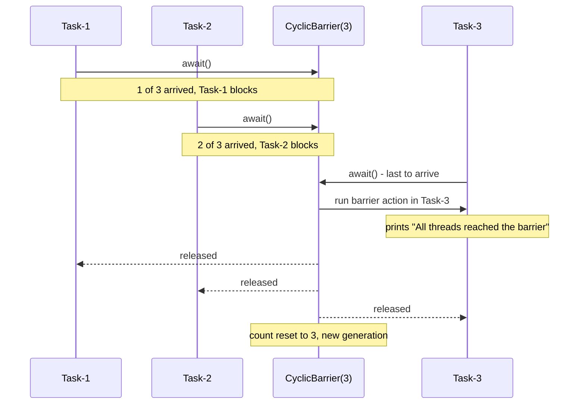
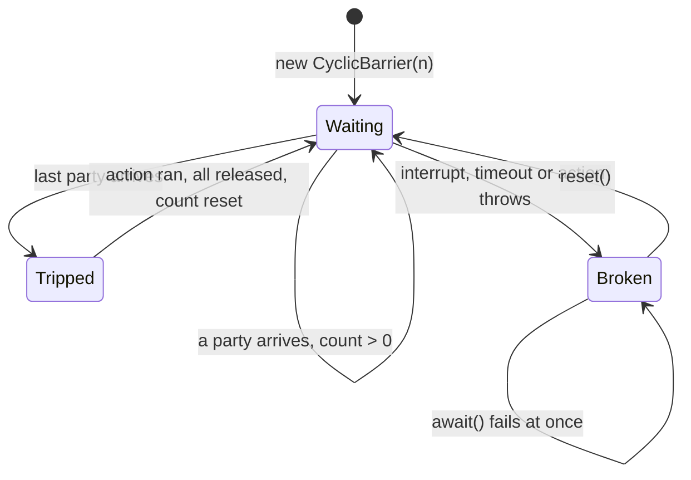

## In One Line
A `CyclicBarrier` is a **reusable meeting point** for a fixed number of threads. Each thread calls `await()` and blocks until **all** parties have arrived. Then an optional *barrier action* runs once, everyone is released together, and the barrier resets for the next round.

## Mental Model
Think of **friends on a group hike who regroup at every trail junction**.

- The group size is fixed: 3 hikers → `new CyclicBarrier(3, action)`.
- Whoever reaches a junction first sits down and waits. That's `barrier.await()`.
- When the **last** hiker arrives, *that* hiker takes the group photo (the **barrier action**) before anyone moves on. Then all three set off together.
- At the next junction the same rule applies, with no need for a new agreement. The barrier is **cyclic** (it resets itself).
- If one hiker quits, twists an ankle or gets called home (interrupt or timeout), the others must not wait for ever. The whole group is told "the meeting is off". That is a **broken barrier**, and everyone waiting gets `BrokenBarrierException`.

In the example, the hikers are `Task-1..3`, and the photo is `All threads reached the barrier, let's proceed`.

## Concept
### What it solves
Some algorithms proceed in **steps**, where every thread must finish step *k* before any thread may start step *k+1*. Examples: a physics simulation split into regions, parallel matrix iterations, game rounds, or a batch where partial results are merged after each round. Threads here are **peers** that wait for **each other**, unlike a `CountDownLatch`, where one side waits for events from the other.

### API (java.util.concurrent, Java 5)
| Member | Behaviour |
|---|---|
| `new CyclicBarrier(int parties)` | Number of threads that must call `await()` to trip the barrier. `parties < 1` → `IllegalArgumentException` |
| `new CyclicBarrier(int parties, Runnable barrierAction)` | The action runs **once per trip**, in the **last thread to arrive**, **before** the others are released |
| `int await()` | Blocks until all parties arrive. Returns the **arrival index**: `parties - 1` for the first to arrive, `0` for the last. Throws `InterruptedException` or `BrokenBarrierException` |
| `int await(long timeout, TimeUnit unit)` | Also throws `TimeoutException`, and **breaks the barrier** for everyone |
| `boolean isBroken()` | `true` after an interrupt, timeout, failed action or `reset()` during a wait |
| `void reset()` | Breaks the current generation (waiters get `BrokenBarrierException`) and returns to the initial state |
| `int getParties()` / `int getNumberWaiting()` | Configured parties / how many are currently waiting |

### The barrier action
- Runs exactly **once per trip**, in whichever thread arrived **last**. That is a different thread from run to run.
- Runs **before** any waiting thread is released. So it is the perfect place to merge the partial results of the round, check "should we continue?", or log.
- If it throws, the exception propagates out of the last thread's `await()`, and the barrier is **broken**: every other party gets `BrokenBarrierException`.
- Memory guarantee: actions before each `await()` happen-before the barrier action, which happens-before everything after `await()` returns in every party. Threads can write their part of the result into plain arrays, and the action and the next round see it.

### The "all-or-none" breakage model
A barrier is useful only if everyone arrives. If one party leaves early, the others would wait for ever, so CyclicBarrier **breaks**:

| What happens | That thread gets | Everyone else waiting gets | Barrier afterwards |
|---|---|---|---|
| A waiting thread is interrupted | `InterruptedException` | `BrokenBarrierException` | Broken |
| A timed `await` expires | `TimeoutException` | `BrokenBarrierException` | Broken |
| The barrier action throws | That exception | `BrokenBarrierException` | Broken |
| `reset()` while threads wait | (caller continues) | `BrokenBarrierException` | Reset, usable |
| `await()` on a broken barrier | `BrokenBarrierException` immediately | n/a | Still broken |

A broken barrier stays broken until `reset()`. The Javadoc advises that after a breakage it is often simpler to create a **new** barrier, because coordinating a correct reset among running threads is hard.

### How it works inside
Unlike the latch and the semaphore, `CyclicBarrier` is **not** an AQS subclass. It is built on a `ReentrantLock` plus one `Condition` called `trip`:
- A `count` field holds the parties still missing, and a small `Generation` object (with a `broken` flag) identifies the current round.
- `await()` locks, decrements `count`, and gets `index = count`.
  - If `index == 0` (the last to arrive), it runs the barrier action, then `nextGeneration()`: `trip.signalAll()`, `count = parties`, and a new `Generation`. Then it returns 0.
  - Otherwise it loops on `trip.await()`. When woken, it checks whether its generation broke (→ `BrokenBarrierException`) or advanced (→ return `index`).
- Interrupt or timeout → `breakBarrier()`: mark the generation broken, reset `count`, `signalAll()`.

The `Generation` object is what makes reuse safe. A thread woken late still knows which round it belonged to.

### CyclicBarrier vs CountDownLatch vs Phaser
| | CountDownLatch | CyclicBarrier | Phaser (Java 7) |
|---|---|---|---|
| Who waits | Waiters wait for events from others | Parties wait for **each other** | Either style |
| Reusable | No | **Yes**, auto-reset | Yes, numbered phases |
| Number of parties | Fixed count of events | Fixed at construction | **Dynamic**: `register()` / `arriveAndDeregister()` |
| Action per round | None | `barrierAction` | Override `onAdvance(phase, parties)` |
| Failure handling | None (a missing `countDown` = hang) | Broken-barrier model | Termination |
| Arrive without waiting | `countDown()` | Not possible | `arrive()` |

Rule: **fixed team, repeated rounds** → `CyclicBarrier`. **Team size changes** → `Phaser`. **One-off "wait for N events"** → `CountDownLatch`. See [CountDownLatch](lesson:a06-threads/12-countdownlatch).

## Diagram

The last thread to arrive runs the action while the others are still blocked. Only then is everybody released, and the barrier is immediately ready for the next round. Which task arrives last changes from run to run.


The normal cycle is Waiting → Tripped → Waiting. A single failure moves it to Broken, and only `reset()` gets it out.

## Code
@example Multithreading/ConcurrencyUtilities/CyclicBarrierExample.java

**The "cyclic" part: one barrier reused for 3 rounds.** The original trips its barrier only once:
```java
import java.util.concurrent.BrokenBarrierException;
import java.util.concurrent.CyclicBarrier;
import java.util.concurrent.atomic.AtomicInteger;

public class Rounds {
    public static void main(String[] args) {
        AtomicInteger round = new AtomicInteger(1);
        CyclicBarrier barrier = new CyclicBarrier(3,
                () -> System.out.println("--- round " + round.getAndIncrement() + " complete ---"));

        for (int i = 1; i <= 3; i++) {
            String name = "P" + i;
            new Thread(() -> {
                try {
                    for (int r = 1; r <= 3; r++) {
                        System.out.println(name + " finished round " + r);
                        barrier.await();                   // same barrier reused every round
                    }
                } catch (InterruptedException | BrokenBarrierException e) {
                    System.out.println(name + " stopped: " + e);
                }
            }).start();
        }
    }
}
```
One real run. The order *inside* each round varies, but no thread ever starts round *k+1* before the round *k* line:
```output
P3 finished round 1
P2 finished round 1
P1 finished round 1
--- round 1 complete ---
P2 finished round 2
P1 finished round 2
P3 finished round 2
--- round 2 complete ---
P2 finished round 3
P3 finished round 3
P1 finished round 3
--- round 3 complete ---
```

**Arrival index, and which thread runs the action.** The threads arrive 200 ms apart (A, then B, then C):
```java
import java.util.concurrent.CyclicBarrier;
import java.util.concurrent.ConcurrentHashMap;
import java.util.Map;
import java.util.TreeMap;

public class ArrivalIndex {
    public static void main(String[] args) throws Exception {
        Map<String, Integer> index = new ConcurrentHashMap<>();
        CyclicBarrier barrier = new CyclicBarrier(3,
                () -> System.out.println("barrier action runs in: " + Thread.currentThread().getName()));

        Thread[] ts = new Thread[3];
        for (int i = 0; i < 3; i++) {
            int delay = i * 200;                              // A arrives first, C last
            ts[i] = new Thread(() -> {
                try {
                    Thread.sleep(delay);
                    index.put(Thread.currentThread().getName(), barrier.await());
                } catch (Exception e) {
                    throw new RuntimeException(e);
                }
            }, String.valueOf((char) ('A' + i)));
            ts[i].start();
        }
        for (Thread t : ts) t.join();
        System.out.println("await() returned: " + new TreeMap<>(index));
    }
}
```
```output
barrier action runs in: C
await() returned: {A=2, B=1, C=0}
```
The first to arrive gets `parties - 1`, and the last gets `0` and runs the action. `if (barrier.await() == 0) { ... }` is a handy way to pick one thread for a job.

**Breaking a barrier with a timeout, then `reset()`.** Three parties are configured, but only two threads come:
```java
import java.util.concurrent.BrokenBarrierException;
import java.util.concurrent.CyclicBarrier;
import java.util.concurrent.TimeUnit;
import java.util.concurrent.TimeoutException;

public class Broken {
    public static void main(String[] args) throws Exception {
        CyclicBarrier barrier = new CyclicBarrier(3);       // 3 parties, but only 2 threads come

        Thread patient = new Thread(() -> {
            try {
                barrier.await();                            // would wait forever...
            } catch (BrokenBarrierException e) {
                System.out.println("patient: " + e.getClass().getSimpleName());
            } catch (InterruptedException e) {
                Thread.currentThread().interrupt();
            }
        });
        patient.start();
        Thread.sleep(100);
        System.out.println("waiting at barrier: " + barrier.getNumberWaiting() + " of " + barrier.getParties());

        try {
            barrier.await(500, TimeUnit.MILLISECONDS);      // main gives up after 500 ms
        } catch (TimeoutException e) {
            System.out.println("main: " + e.getClass().getSimpleName());
        }
        patient.join();
        System.out.println("isBroken? " + barrier.isBroken());

        try {
            barrier.await();                                // a broken barrier fails at once
        } catch (BrokenBarrierException e) {
            System.out.println("late arrival: " + e.getClass().getSimpleName());
        }

        barrier.reset();
        System.out.println("after reset, isBroken? " + barrier.isBroken());
    }
}
```
```output
waiting at barrier: 1 of 3
main: TimeoutException
patient: BrokenBarrierException
isBroken? true
late arrival: BrokenBarrierException
after reset, isBroken? false
```
Lines 2 and 3 can appear in either order: both threads are released from the barrier at about the same time.

**A barrier action that throws** breaks the barrier. The last thread gets the exception, and the others get `BrokenBarrierException`:
```java
CyclicBarrier barrier = new CyclicBarrier(2, () -> { throw new IllegalStateException("action failed"); });
// "other" thread: barrier.await() -> catches BrokenBarrierException
// main arrives last (after a sleep), so main runs the action:
try {
    barrier.await();
} catch (IllegalStateException e) {
    System.out.println("main (ran the action): " + e.getMessage());
}
// after other.join():
System.out.println("isBroken? " + barrier.isBroken());
```
```output
other thread: BrokenBarrierException
main (ran the action): action failed
isBroken? true
```
The first two lines can swap between runs.

## Walkthrough
**Header.** The `package` line and file-name comment, then two imports: `BrokenBarrierException` (a checked exception thrown by `await()`) and `CyclicBarrier`.

**`class Task extends Thread`**
- `private CyclicBarrier barrier;` — the shared barrier. All three tasks get the same object.
- `Task(CyclicBarrier barrier, String name)` — `super(name)` names the thread, so `getName()` returns `Task-1` and so on.
- `run()`:
  1. prints `<name> is waiting at the barrier`, **before** arriving,
  2. `barrier.await()` blocks until all 3 have arrived (its `int` return value, the arrival index, is ignored here),
  3. prints `<name> crossed the barrier`.
- `catch (InterruptedException | BrokenBarrierException e)` is a Java 7 **multi-catch**: one handler for both checked exceptions that `await()` declares. Here it just prints the stack trace.

**`main`**
- `new CyclicBarrier(3, () -> System.out.println("All threads reached the barrier, let's proceed"))` — 3 parties, plus a **barrier action** written as a lambda (`Runnable`). It runs once, when the third task arrives.
- It creates and starts `Task-1`, `Task-2`, `Task-3`.
- There is **no `join()`**. `main` returns right after starting the threads, but the JVM keeps running until all non-daemon threads (the three tasks) finish, so the output is complete.

**Why the output varies (this example is marked "varies").** Twelve test runs gave **11 different outputs**:
- The three `is waiting` lines come in scheduler order. `start()` only makes a thread runnable, and a later-started thread can run first. The recorded run shows `Task-1`, `Task-3`, `Task-2`.
- When the barrier trips, the last arriver runs the action and then `signalAll()` wakes the other two. All three then race for the CPU and for `System.out`, so the `crossed` lines come in any order. The recorded run shows `Task-2`, `Task-1`, `Task-3`.
- Which thread runs the barrier action also varies (whoever is last), although this example doesn't print it.

**What is guaranteed every run:**
1. The first three lines are the three `is waiting` lines. Each is printed before that thread's `await()`, and the barrier can't trip until all three have called it.
2. Line 4 is always `All threads reached the barrier, let's proceed`. The action runs after the last arrival and **before** anyone is released.
3. Lines 5–7 are the three `crossed` lines, in some order.

**How to run it.** On JDK 21, `java CyclicBarrierExample.java` fails ("can't find main(String[]) method in class ...Task"). The launcher runs the first class in the file. Compile with `javac` and run `Multithreading.ConcurrencyUtilities.CyclicBarrierExample`, or use the IDE.

## Traps
> [!ERRATA] The `// Output:` comment shows one fixed order (`Task-1, Task-2, Task-3` waiting, then `Task-3, Task-1, Task-2` crossing) as if it were *the* output. Only the **structure** is fixed: 3 waiting lines, then the action line, then 3 crossed lines. The order within each group varies; the recorded run is different. Also, the name "Cyclic" is never shown: the barrier is used for a single round, so the example could have been a `CountDownLatch`. The `Rounds` snippet shows the reuse.

> [!ERRATA] Minor: `catch (InterruptedException | BrokenBarrierException e) { e.printStackTrace(); }` treats two very different events the same way and swallows the interrupt. If one task were interrupted, it would get `InterruptedException` and the other two `BrokenBarrierException`: the whole group fails. Real code should restore the interrupt flag (`Thread.currentThread().interrupt()`) and stop or retry the round deliberately. The `barrier` field should also be `final`.

- **More threads than parties.** With `new CyclicBarrier(3)` and 4 threads, the first 3 trip the barrier, and the 4th starts the **next** generation and waits for two more that never come. Tested with `await(1, SECONDS)`: `T1`, `T2` and `T3` crossed (in varying order), and `T4 timed out`.
- **Thread pool smaller than the number of parties = deadlock.** Parties that are waiting occupy pool threads, so the remaining parties sit in the queue and never run. Tested with 3 parties, a pool of 2 and a 1-second timed `await`. One real run:
  ```output
  failed: TimeoutException
  failed: BrokenBarrierException
  failed: BrokenBarrierException
  ```
  One waiter timed out and broke the barrier. The other waiter got `BrokenBarrierException`, and the third task, which only started then, found the barrier broken at once. With plain `await()`, the program hangs for ever.
- **One slow or dead party stalls everyone.** Use timed `await` in production, and treat `BrokenBarrierException` as "the whole round failed".
- **Heavy work in the barrier action** runs while **all** parties are blocked. Keep it short (merging, a flag check).
- **`reset()` while threads are waiting** throws `BrokenBarrierException` in all of them. Resetting a live barrier is hard to do correctly. After a failure, prefer creating a new barrier.
- **Confusing it with a latch.** `CyclicBarrier.await()` both *arrives* and *waits*. There is no "arrive without waiting" (use `CountDownLatch.countDown()` or `Phaser.arrive()` for that).

## Tips & Tricks
- **"A barrier makes threads wait for each other; a latch makes some threads wait for others."**
- **"Last one in takes the photo."** The barrier action runs in the last arriving thread, before anyone leaves.
- **Arrival index countdown:** the first arrival gets `parties - 1`, the last gets `0`. Remember it as "how many are still missing after me".
- **Fixed team + repeated rounds = CyclicBarrier. Changing team = Phaser. One-off = CountDownLatch.**
- Always use a **timed `await`** in services, so one stuck party can't freeze the group for ever.
- Keep **parties ≤ pool threads** when parties are pool tasks, or better, give each party its own thread (virtual threads make this cheap).

## Interview Q&A
### [Basic] What is a CyclicBarrier?
A `CyclicBarrier` (Java 5) is a synchronizer that lets a fixed number of threads, the *parties*, wait for each other at a common point. Each calls `await()`. The first `parties - 1` block, and when the last one arrives, an optional barrier action runs and then all are released. It is **cyclic** because it resets automatically after each trip, so the same barrier can coordinate round after round. Typical uses are iterative parallel algorithms (simulations, matrix computations), where every worker must finish step *k* before any starts step *k+1*, and the barrier action merges the round's results.

**Follow-up:** *In which thread does the barrier action run?* In the last thread to arrive, before the other threads are released.

### [Basic] What is the difference between CyclicBarrier and CountDownLatch?
A latch lets one or more threads wait for **N events** triggered by others. The event-signalling threads don't wait (`countDown()` returns immediately), and it is one-shot. A barrier makes **N threads wait for each other**. The call that arrives is also the call that waits (`await()`), and it resets for reuse. The barrier also offers a barrier action and a broken-barrier failure model, and the latch has neither. Latch: "main waits for workers". Barrier: "workers wait for each other, repeatedly".

**Follow-up:** *Can you reuse a CountDownLatch by creating a new one each round?* Yes, but then every thread needs a safe way to see the new latch. The barrier's generation mechanism does this for you.

### [Intermediate] What does await() return and how can that be useful?
`await()` returns the thread's **arrival index**: `getParties() - 1` for the first thread to arrive, down to `0` for the last. It lets you elect exactly one thread per round to do a job without extra coordination, for example `if (barrier.await() == 0) log("round done");`. The barrier action does something similar, but it runs before the release, while the index-0 thread's code runs after it.

**Follow-up:** *Is the index-0 thread the same one that ran the barrier action?* Yes. The last arrival runs the action, then returns 0 from `await()`.

### [Intermediate] What is a broken barrier? When does it happen and how do you recover?
A barrier becomes **broken** when any party leaves the wait abnormally: it is interrupted (that thread gets `InterruptedException`), its timed `await` expires (`TimeoutException`), the barrier action throws, or someone calls `reset()` while threads are waiting. All other waiting parties are then woken with `BrokenBarrierException`, and any later `await()` fails immediately until `reset()` is called. This all-or-none model exists because a barrier missing a party would otherwise block everyone for ever. Recovery: call `reset()` once all parties have noticed the failure, or more simply, discard the barrier and create a new one for a fresh attempt.

**Follow-up:** *How do you check the state?* `isBroken()`. For monitoring there are also `getNumberWaiting()` and `getParties()`.

### [Intermediate] What happens if more threads than parties call await()?
The barrier trips as soon as `parties` threads have arrived, then resets. Extra threads count toward the **next** generation. With 3 parties and 4 threads, three cross, and the fourth waits for two more arrivals. If none come, it waits for ever, or until its timeout, and then it breaks the new generation. The number of `await()` calls per round must match the parties exactly.

**Follow-up:** *And fewer threads than parties?* Everybody who arrived waits for ever, unless a timed `await` or an interrupt breaks the barrier.

### [Advanced] How is CyclicBarrier implemented, and why isn't it built directly on AQS?
It is built on a `ReentrantLock` with a single `Condition` named `trip`, a `count` of missing parties, and a `Generation` object that carries a `broken` flag. `await()` takes the lock and decrements `count`. The last arrival runs the barrier action, then calls `nextGeneration()`: `trip.signalAll()`, reset `count`, and a fresh `Generation`. Other arrivals loop on `trip.await()` (or `awaitNanos`), and on wake-up they check whether their generation was broken or has advanced. It doesn't subclass AQS because it needs more state than a single `int` (the generation, the action, the broken flag), and all of it must be updated atomically together with running the action. A lock plus a condition expresses that most simply.

**Follow-up:** *Why is the Generation object needed?* Because the barrier is reused. A thread woken after the barrier has already moved on must still know whether *its* round completed or broke.

### [Advanced] What memory visibility guarantees does CyclicBarrier give?
Actions in each thread before `await()` happen-before the barrier action, and the barrier action happens-before the actions following a successful return from `await()` in every party. So each worker can write its partial result into a plain array slot. The barrier action can read all slots and merge them, and after the release every worker can see the merged result, with no `volatile` or extra locking.

**Follow-up:** *Does that hold if the barrier breaks?* No. A thread that gets `BrokenBarrierException` or `TimeoutException` has no guarantee that the round's writes are complete, so treat the round's data as invalid.

### [Advanced] When would you choose Phaser over CyclicBarrier?
`Phaser` (Java 7) generalises both the latch and the barrier. Parties can **register and deregister dynamically** (`register()`, `arriveAndDeregister()`). A party can **arrive without waiting** (`arrive()`). Phases are numbered, and you customise the end-of-phase action and termination by overriding `onAdvance(phase, registeredParties)`. Phasers can also be tiered to reduce contention with very many parties. Choose `Phaser` when the number of participants changes between rounds, for example tasks that spawn subtasks, or workers that finish early. Choose `CyclicBarrier` for a fixed team, because its API and failure model are simpler.

**Follow-up:** *How do you end a Phaser?* Return `true` from `onAdvance` (by default that happens when no registered parties remain), or call `forceTermination()`.

## Quiz
### In the original example, which line is always the 4th line of the output?
- [ ] `Task-1 crossed the barrier`
- [x] `All threads reached the barrier, let's proceed`
- [ ] `Task-3 is waiting at the barrier`
- [ ] It varies, like all the other lines
> All three `is waiting` lines are printed before the barrier can trip. The barrier action then runs in the last arriving thread **before** any party is released, so it is always line 4, before all `crossed` lines. What varies is the order within the waiting group and within the crossed group.

### What does this print?
```java
CyclicBarrier b = new CyclicBarrier(1, () -> System.out.print("action "));
int first = b.await();
int second = b.await();
System.out.println(first + " " + second);
```
- [ ] It blocks for ever on the first await()
- [ ] action 0 0 (the action runs once)
- [x] action action 0 0
- [ ] action action 1 0
> With one party, every `await()` is both the first and the last arrival. It trips immediately, runs the action, returns index 0, and the barrier resets. Two calls mean two trips: the action runs twice, and both indices are 0. It doesn't block because no other party is needed.

### What happens to a thread still waiting at a CyclicBarrier when another waiting party's timed `await` expires?
- [ ] It keeps waiting for a replacement party
- [ ] It also gets a `TimeoutException`
- [x] It gets a `BrokenBarrierException`
- [ ] Nothing, timeouts only affect the thread that timed out
> A timeout breaks the barrier for everyone (all-or-none). The thread whose timer expired gets `TimeoutException`, and all other waiters get `BrokenBarrierException`. Later `await()` calls fail immediately until `reset()`.

### Spot the bug.
```java
CyclicBarrier barrier = new CyclicBarrier(4);
ExecutorService pool = Executors.newFixedThreadPool(3);
for (int i = 0; i < 4; i++) {
    pool.submit(() -> { step1(); barrier.await(); step2(); return null; });
}
```
- [ ] `await()` can't be called from a pool thread
- [x] Only 3 tasks can run at once, and they block at the barrier waiting for the 4th, which never gets a thread: a deadlock
- [ ] The barrier needs a barrier action
- [ ] `submit()` doesn't accept lambdas that throw
> Waiting parties occupy all 3 pool threads, so the 4th task stays queued for ever and the barrier never trips. Use at least as many threads as parties (or a thread per party) and a timed `await`. Pool threads can call `await()` fine, and `submit(Callable)` allows checked exceptions.

### What does this print?
```java
try {
    new CyclicBarrier(0);
} catch (IllegalArgumentException e) {
    System.out.println(e);
}
```
- [x] java.lang.IllegalArgumentException
- [ ] Nothing, a barrier of 0 is always open
- [ ] java.lang.IllegalArgumentException: parties < 1
- [ ] java.util.concurrent.BrokenBarrierException
> `parties` must be at least 1. The constructor throws a plain `IllegalArgumentException` with **no message**, so `toString()` prints just the class name. Unlike `CountDownLatch(0)`, which is legal and already open, a barrier with no parties makes no sense.

### Which tool fits "4 worker threads compute a simulation step, then all merge results, repeat 100 times"?
- [ ] A `CountDownLatch(4)` created once
- [x] A `CyclicBarrier(4, mergeAction)`
- [ ] A `Semaphore(4)`
- [ ] `Thread.join()` after each step
> A fixed team repeating rounds is exactly what `CyclicBarrier` is for, and `mergeAction` runs once per round before anyone continues. A single latch works only once. A semaphore limits concurrency but doesn't make threads meet. Joining would mean creating 400 threads.

## Takeaways
- `CyclicBarrier(n, action)` = a reusable meeting point: `await()` blocks until n parties arrive, then the action runs once (in the last arriver) and all are released.
- It resets automatically after each trip ("cyclic"), so one barrier serves many rounds; `CountDownLatch` is one-shot.
- `await()` returns the arrival index: `parties - 1` for the first, `0` for the last. Use `== 0` to elect one thread.
- All-or-none: an interrupt, a timeout or a failing action **breaks** the barrier, and the others get `BrokenBarrierException` until `reset()` (or use a new barrier).
- Built on `ReentrantLock` + `Condition` + a `Generation` object, not on AQS directly. Writes before `await()` are visible to the action and after the release.
- Pitfalls: the number of `await()`s must equal the parties, a pool smaller than the parties deadlocks, and a slow party stalls everyone (use timed `await`).
- Output of the example varies inside each group, but the barrier-action line is always the 4th line.
- Fixed team, many rounds → `CyclicBarrier`. Dynamic team → `Phaser`. One-off "wait for N events" → `CountDownLatch`.
