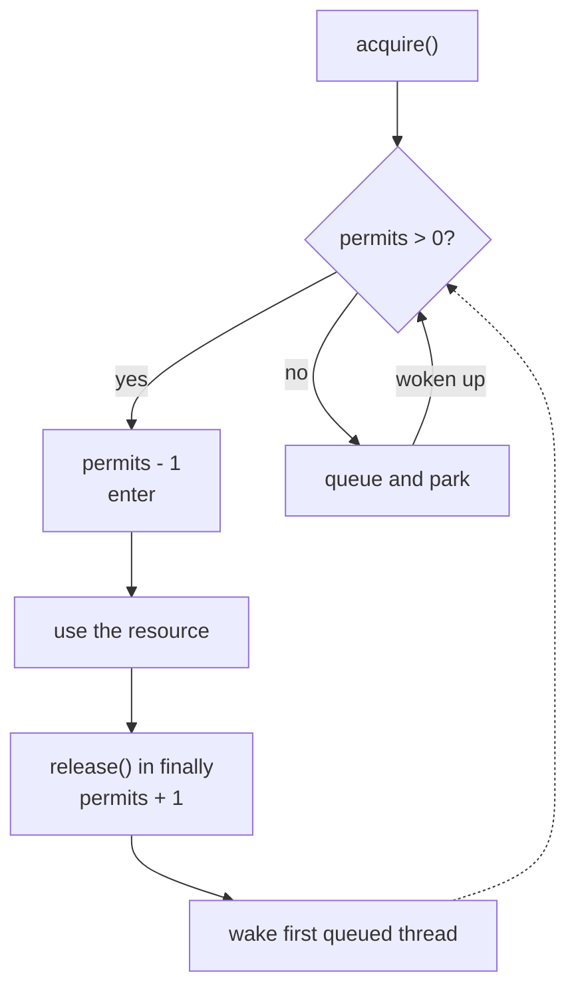
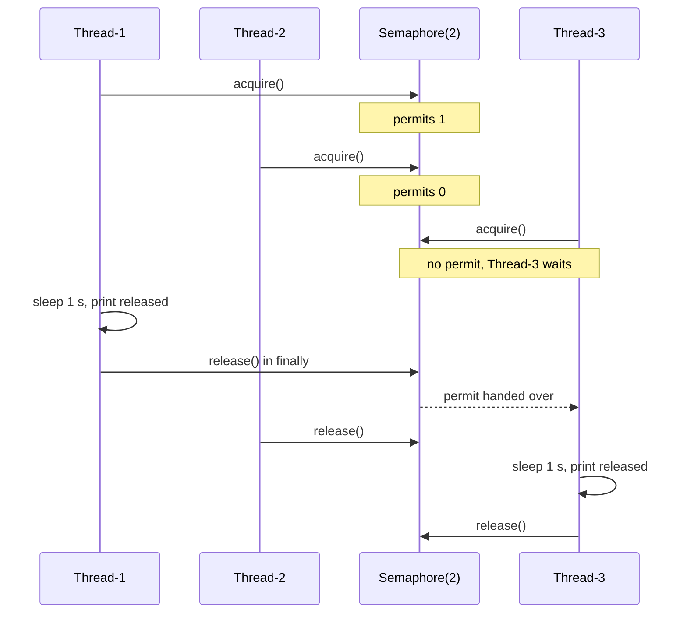

## In One Line
A `Semaphore` holds a number of **permits**. `acquire()` takes one (and waits if none are left), and `release()` gives one back. It limits how many threads can use a resource **at the same time**. Unlike a lock, it has no owner: any thread may release.

## Mental Model
Think of a **car park with 2 spaces and a counter display at the entrance**.

- The display starts at 2: `new Semaphore(2)`.
- A car arrives: if the display shows more than 0, it drives in and the display goes down by one (`acquire()`). If it shows 0, the car **queues at the barrier**.
- A car leaves: the display goes up by one (`release()`), and the first queued car can enter.
- The barrier doesn't check **which** car leaves. It only counts. If someone presses the "car left" button without having parked, the display goes up anyway, and now 3 cars fit in a 2-space car park. That is exactly the bug in the original example.
- A **fair** car park lets queued cars in strictly in arrival order. A non-fair one lets a car that arrives just as a space frees up slip in first.

In the example, the car park is `SharedResource`, the spaces are the 2 permits, and the cars are `Thread-1..3`.

## Concept
### What a semaphore is
The semaphore is one of the oldest concurrency primitives (Dijkstra, 1965, whose operations were called **P** for "wait/acquire" and **V** for "signal/release"). Java's `java.util.concurrent.Semaphore` (Java 5) is a **counting semaphore**:
- The internal count is the number of available **permits**.
- `acquire()` decrements it, blocking while it is 0.
- `release()` increments it and wakes a waiter.
- There are no actual permit objects. It is just a counter, and it doesn't track who holds what.

With **1** permit it is a *binary semaphore*, which can act like a mutex, with important differences explained below.

### API
| Method | Behaviour |
|---|---|
| `new Semaphore(int permits)` / `(permits, boolean fair)` | Initial permits (**may be negative**), non-fair by default |
| `acquire()` / `acquire(int n)` | Take 1 / n permits, blocking until available. Interruptible (`InterruptedException`). `acquire(n)` is all-or-nothing |
| `acquireUninterruptibly()` / `(n)` | Same, but ignores interrupts |
| `tryAcquire()` / `tryAcquire(n)` | Take the permits only if available **now**. Returns `boolean` and **barges** even on a fair semaphore |
| `tryAcquire(timeout, unit)` / `tryAcquire(n, timeout, unit)` | Wait up to the timeout. Respects fairness. Interruptible |
| `release()` / `release(int n)` | Add 1 / n permits and wake waiters. **No ownership check.** `n < 0` → `IllegalArgumentException` |
| `availablePermits()` | Current count (a snapshot, for monitoring) |
| `drainPermits()` | Take all available permits at once and return how many |
| `reducePermits(int)` (protected) | Shrink the count without blocking (for subclasses that resize a pool) |
| `isFair()`, `hasQueuedThreads()`, `getQueueLength()` | Inspection |

### The idiom: acquire BEFORE try
```java
semaphore.acquire();          // if this throws, we own nothing
try {
    useTheResource();
} finally {
    semaphore.release();      // runs only if we really got a permit
}
```
This is the same rule as for `Lock` (see [ReentrantLock](lesson:a06-threads/10-reentrantlock)), but here it matters even more. A lock at least *throws* when you release something you don't own. A semaphore **silently adds a permit**, so the limit you thought you had is gone.

### No ownership, and what that allows
| | `ReentrantLock` | `Semaphore(1)` |
|---|---|---|
| Owner | Yes, the thread that locked | **None** |
| Release by another thread | `IllegalMonitorStateException` | **Allowed** |
| Reentrant | Yes (hold count) | **No.** A second `acquire()` by the same thread blocks itself |
| Release more than acquired | Exception | Permits grow above the initial value |
| Conditions | Yes | No |

Lack of ownership is a **feature** for signalling. One thread can `release()` and a different one `acquire()`, like a "go" signal (`new Semaphore(0)`), or a hand-off where a lock is acquired in one thread and released in another. It is also a **hazard** when you use a semaphore as a mutex, because nothing protects you from releasing twice.

### Fairness
- **Non-fair (default):** a thread calling `acquire()` can take a just-released permit ahead of queued threads. Higher throughput.
- **Fair (`true`):** FIFO order among waiters. Recommended when semaphores control access to resources, to avoid starvation. It also matters for `acquire(n)`: in fair mode, a thread waiting for 3 permits at the head of the queue isn't overtaken by a stream of threads taking 1 each.
- The untimed `tryAcquire()` always barges. `tryAcquire(0, SECONDS)` respects fairness.

### Memory visibility
Actions in a thread before `release()` happen-before actions after a successful `acquire()` in another thread. This is the same as unlock → lock, which is why a semaphore can hand data between threads.

### Negative initial permits
`new Semaphore(1 - N)` needs N `release()` calls before a single `acquire()` succeeds. That turns it into a "wait for N events" gate (see the `NegativePermits` snippet). A [CountDownLatch](lesson:a06-threads/12-countdownlatch) expresses the same thing more clearly and releases **all** waiters.

### How it works inside
`Semaphore` uses an AQS subclass in **shared** mode, with `state` = available permits:
- `acquire(n)` → `tryAcquireShared`: loop { `available = state`; `remaining = available - n`; if `remaining < 0` → fail (enqueue and park); else CAS `state` to `remaining` → success }.
- The fair version first checks `hasQueuedPredecessors()`.
- `release(n)` → CAS `state + n` (an overflow throws `Error("Maximum permit count exceeded")`), then wake queued threads. Shared-mode propagation lets several waiters proceed if enough permits were released.

### Typical uses
- **Limit concurrency to a scarce resource:** at most 10 DB connections, 5 parallel downloads, 3 calls to a rate-limited API in flight.
- **Bounded collections:** acquire before `add`, release after `remove` (the `BoundedHashSet` example from *Java Concurrency in Practice*).
- **Virtual threads (JDK 21):** don't pool virtual threads to limit concurrency. Create one per task and guard the scarce resource with a `Semaphore`. This is the official guidance in JEP 444. See [Virtual threads](lesson:b03-concurrency/07-virtual-threads).
- **Signalling:** `Semaphore(0)`: the producer calls `release()`, the consumer calls `acquire()`.

> [!NOTE] A semaphore limits **how many at once**, not **how many per second**. For rate limiting (for example "100 requests/second"), use a token bucket, such as Guava `RateLimiter`, or a scheduled task that refills permits.

## Diagram

`acquire` only succeeds while the count is positive. `release` puts one back and wakes a waiter, which then re-checks the count.


At most two threads are inside at once. The third gets in only after one of the first two has released. That is why the whole run takes about 2 seconds, not 1 or 3.

## Code
@example Multithreading/ConcurrencyUtilities/SemaphoreExample.java

**Permit arithmetic, including releasing a permit that was never acquired:**
```java
import java.util.concurrent.Semaphore;

public class PermitMath {
    public static void main(String[] args) throws InterruptedException {
        Semaphore s = new Semaphore(3);
        s.acquire(2);
        System.out.println("after acquire(2): " + s.availablePermits());
        System.out.println("tryAcquire(2):    " + s.tryAcquire(2));    // only 1 left -> false, no waiting
        System.out.println("tryAcquire():     " + s.tryAcquire());     // takes the last one
        s.release(3);                                                   // give back all 3
        System.out.println("after release(3): " + s.availablePermits());
        s.release();                                                    // never acquired - still allowed!
        System.out.println("after extra release(): " + s.availablePermits());
        System.out.println("drainPermits():   " + s.drainPermits() + ", left: " + s.availablePermits());
    }
}
```
```output
after acquire(2): 1
tryAcquire(2):    false
tryAcquire():     true
after release(3): 3
after extra release(): 4
drainPermits():   4, left: 0
```

**The original's bug, reproduced.** This is the same `accessResource` shape (acquire inside `try`, release in `finally`), with `Thread-3` interrupted while it waits:
```java
import java.util.concurrent.Semaphore;

public class PermitLeak {
    static final Semaphore semaphore = new Semaphore(2);

    // Same shape as the original accessResource(): acquire() INSIDE try, release() in finally
    static void accessResource(String name) {
        try {
            semaphore.acquire();
            System.out.println(name + " acquired semaphore.");
            Thread.sleep(500);
        } catch (InterruptedException e) {
            System.out.println(name + " interrupted while waiting");
        } finally {
            semaphore.release();              // runs even when acquire() never succeeded
        }
    }

    public static void main(String[] args) throws InterruptedException {
        Thread t1 = new Thread(() -> accessResource("Thread-1"));
        Thread t2 = new Thread(() -> accessResource("Thread-2"));
        t1.start(); t2.start();
        Thread.sleep(100);                     // both permits are taken now
        Thread t3 = new Thread(() -> accessResource("Thread-3"));
        t3.start();
        Thread.sleep(100);                     // Thread-3 is blocked in acquire()
        t3.interrupt();
        t1.join(); t2.join(); t3.join();
        System.out.println("permits now: " + semaphore.availablePermits() + " (started with 2)");
    }
}
```
```output
Thread-1 acquired semaphore.
Thread-2 acquired semaphore.
Thread-3 interrupted while waiting
permits now: 3 (started with 2)
```
The semaphore now lets **three** threads in at once. The fix moves `acquire()` out of the `try`:
```java
static void accessResource(String name) {
    try {
        semaphore.acquire();                  // outside the try/finally that releases
    } catch (InterruptedException e) {
        System.out.println(name + " interrupted while waiting");
        Thread.currentThread().interrupt();   // restore the flag
        return;                               // we own nothing, so release nothing
    }
    try {
        System.out.println(name + " acquired semaphore.");
        Thread.sleep(500);
    } catch (InterruptedException e) {
        Thread.currentThread().interrupt();
    } finally {
        semaphore.release();
    }
}
```
With the same `main`, it prints the following (the first two lines may swap):
```output
Thread-1 acquired semaphore.
Thread-2 acquired semaphore.
Thread-3 interrupted while waiting
permits now: 2 (started with 2)
```

**Limiting concurrency: 6 tasks, never more than 2 inside:**
```java
import java.util.concurrent.ExecutorService;
import java.util.concurrent.Executors;
import java.util.concurrent.Semaphore;
import java.util.concurrent.TimeUnit;
import java.util.concurrent.atomic.AtomicInteger;

public class LimitConcurrency {
    public static void main(String[] args) throws InterruptedException {
        Semaphore permits = new Semaphore(2);                     // at most 2 at a time
        AtomicInteger inside = new AtomicInteger(), maxInside = new AtomicInteger();
        ExecutorService pool = Executors.newFixedThreadPool(6);  // 6 threads compete

        for (int i = 0; i < 6; i++) {
            pool.submit(() -> {
                try {
                    permits.acquire();                            // acquire BEFORE try
                } catch (InterruptedException e) {
                    Thread.currentThread().interrupt();
                    return;
                }
                try {
                    int now = inside.incrementAndGet();
                    maxInside.accumulateAndGet(now, Math::max);
                    Thread.sleep(100);                            // "use the resource"
                    inside.decrementAndGet();
                } catch (InterruptedException e) {
                    Thread.currentThread().interrupt();
                } finally {
                    permits.release();                            // only reached if we own a permit
                }
            });
        }
        pool.shutdown();
        pool.awaitTermination(5, TimeUnit.SECONDS);
        System.out.println("max threads inside at once: " + maxInside.get());
    }
}
```
```output
max threads inside at once: 2
```

**No owner, not reentrant:** a binary semaphore released by a *different* thread:
```java
import java.util.concurrent.Semaphore;

public class OtherThreadReleases {
    public static void main(String[] args) throws InterruptedException {
        Semaphore binary = new Semaphore(1);
        binary.acquire();                                         // main takes the only permit
        System.out.println("main tryAcquire again: " + binary.tryAcquire());   // not reentrant

        Thread helper = new Thread(binary::release);              // a DIFFERENT thread releases
        helper.start();
        helper.join();
        System.out.println("permits after helper released: " + binary.availablePermits());
    }
}
```
```output
main tryAcquire again: false
permits after helper released: 1
```

**Negative initial permits as a "wait for 3 events" gate:**
```java
import java.util.concurrent.Semaphore;

public class NegativePermits {
    public static void main(String[] args) throws InterruptedException {
        Semaphore s = new Semaphore(-2);           // allowed: 3 releases needed before 1 acquire
        for (int i = 1; i <= 3; i++) {
            int id = i;
            new Thread(() -> { System.out.println("worker " + id + " done"); s.release(); }).start();
        }
        s.acquire();                               // waits until permits reach 1
        System.out.println("main: all 3 workers reported, permits = " + s.availablePermits());
    }
}
```
One real run (the worker lines come in any order):
```output
worker 1 done
worker 3 done
worker 2 done
main: all 3 workers reported, permits = 0
```

## Walkthrough
**Header.** The `package` line, the file-name comment, and `import java.util.concurrent.Semaphore;`.

**`class SharedResource`: the guarded resource**
- `private Semaphore semaphore = new Semaphore(2);` — 2 permits, non-fair. At most two threads may be "inside" `accessResource` at once. (It should be `final`.)
- `accessResource(String threadName)`:
  1. `semaphore.acquire()` takes a permit, or blocks until one is free. It throws `InterruptedException`, which is why it sits in a `try`. That placement is the bug (see Traps).
  2. prints `<name> acquired semaphore.`,
  3. `Thread.sleep(1000)` simulates one second of using the resource,
  4. prints `<name> released semaphore.`. The permit has **not** been released yet at this point.
  5. `catch (InterruptedException e)` prints the stack trace,
  6. `finally { semaphore.release(); }` gives the permit back and wakes a waiting thread.

**`class WorkerThread extends Thread`**
- `WorkerThread(SharedResource resource, String name)` — `super(name)` sets the thread name, and the shared resource is stored.
- `run()` calls `resource.accessResource(this.getName())`, passing its own name for the log lines.

**`main`**
- One `SharedResource`, which means one semaphore shared by all.
- Three workers named `"Thread-1"`, `"Thread-2"`, `"Thread-3"`. These are custom names that just look like the JVM's automatic names (which would start at `Thread-0`).
- It starts all three, then `join()`s all three, so `main` ends only after every line is printed.

**What happens.** Three threads compete for two permits. The first two to call `acquire()` get in immediately. The third blocks for about 1 second, until one of them reaches `finally { release(); }`. Then it runs for another second. Total run time is about 2 seconds.

**Why the output varies (this example is marked "varies").** Twelve test runs gave **6 different outputs**:
- **Who gets the first two permits** depends on which threads the scheduler runs first. `Thread-3` is started last, and in the test runs it was never among the first two, but that isn't guaranteed. The original's own comment shows a run where `Thread-3` got in first.
- **Which of the first two finishes first.** Both sleep 1 second and wake within microseconds of each other.
- **Where `Thread-3 acquired` lands.** As soon as the first `release()` happens, `Thread-3` can print `acquired` *before* the second thread prints its `released` line, or after it. The recorded run shows both `released` lines first. Other runs show `Thread-1 released`, `Thread-3 acquired`, `Thread-2 released`.

**What is guaranteed every run:**
- Exactly 3 `acquired` and 3 `released` lines, and each thread's `acquired` comes before its own `released`.
- The third `acquired` line always comes **after at least one `released` line**, because a permit is only returned after its `released` line is printed.
- At no point in the output do more than 2 threads sit between their `acquired` and `released` lines.

**How to run it.** On JDK 21, `java SemaphoreExample.java` fails ("can't find main(String[]) method in class ...SharedResource"). The launcher runs the first class. Compile with `javac` and run `Multithreading.ConcurrencyUtilities.SemaphoreExample`, or use the IDE.

## Traps
> [!ERRATA] **Permit leak bug:** `semaphore.acquire()` is **inside** the `try` whose `finally` calls `semaphore.release()`. If a thread is interrupted while *waiting* in `acquire()`, it never got a permit, but the `finally` still releases one. Because a semaphore has no owner, nothing complains: the permit count silently grows from 2 to 3, and from then on three threads can use the "2-at-a-time" resource. The `PermitLeak` snippet above reproduces it (`permits now: 3 (started with 2)`). Fix: call `acquire()` **before** the `try { ... } finally { release(); }`, and handle `InterruptedException` separately (restore the flag, release nothing).

> [!ERRATA] The log line `released semaphore.` is printed **inside** `try`, before the real `release()` in `finally`. The message runs ahead of reality: at the moment it is printed, the thread still holds the permit. Print it after `release()`, or word it "releasing". Also, the `// Output:` comment shows one particular order (with `Thread-3` acquiring first) as if it were fixed. The recorded run is different, and only the guarantees listed in the Walkthrough hold. `catch (InterruptedException e) { e.printStackTrace(); }` swallows the interrupt, and `semaphore` should be `private final`.

- **Releasing more than you acquired**, or from the wrong code path. There is no exception, just a bigger limit. Pair every successful `acquire` with exactly one `release`, and release `n` if you acquired `n`.
- **Using `Semaphore(1)` as a reentrant lock.** A method holding the permit that calls another method which acquires it again **deadlocks itself**. Use `ReentrantLock` when you need mutual exclusion.
- **`tryAcquire()` without checking the result**, then doing the work and releasing anyway. Always write `if (s.tryAcquire()) { try { ... } finally { s.release(); } }`.
- **Unfair starvation with `acquire(n)`.** In non-fair mode, a thread asking for many permits can wait for ever while single-permit requests keep grabbing them. Use a fair semaphore for multi-permit acquisition.
- **Treating it as a rate limiter.** `Semaphore(10)` allows 10 *concurrent* calls. If each call takes 1 ms, that could still be 10,000 calls per second.
- **`availablePermits()` for decisions** (`if (s.availablePermits() > 0) s.acquire();`) is a check-then-act race. Use `tryAcquire()`.

## Tips & Tricks
- **"Permits are counted, not owned."** Everything special about semaphores (signalling, leaking, releasing from another thread) follows from this.
- **Acquire outside, release in finally.** The same shape as the lock idiom: `s.acquire(); try { ... } finally { s.release(); }`.
- **Semaphore(N) = a bouncer with N wristbands.** `Semaphore(1)` = a mutex *without* an owner. `Semaphore(0)` = a signal.
- **Pick the tool:** "only N at a time" → `Semaphore`. "One at a time, same thread may re-enter" → `ReentrantLock`. "Wait until N things happened" → `CountDownLatch`.
- For limits on virtual threads, a `Semaphore` is the idiomatic JDK 21 tool. Don't use a small thread pool for this.
- Log `availablePermits()` periodically in production. A value that keeps **rising** above the initial count means a leak like the one in the original.

## Interview Q&A
### [Basic] What is a Semaphore in Java and what is it used for?
`java.util.concurrent.Semaphore` (Java 5) is a counting semaphore: it maintains a number of permits. `acquire()` takes a permit, blocking while none are available, and `release()` returns one and wakes a waiter. Its main use is to **limit how many threads access a resource concurrently**: a pool of N connections, N parallel downloads, N calls in flight to a fragile service. It can also build bounded collections and serve as a signalling mechanism between threads.
```java
Semaphore permits = new Semaphore(10);
permits.acquire();
try { callService(); } finally { permits.release(); }
```
**Follow-up:** *What happens when permits run out?* Further `acquire()` calls block (or `tryAcquire` returns `false`) until someone calls `release()`.

### [Basic] What is the difference between a Semaphore and a Lock?
A lock gives **exclusive** access (one thread) and has an **owner**: only the locking thread may unlock, and `ReentrantLock` is reentrant. A semaphore allows **N** concurrent holders and has **no owner**: any thread can call `release()`, and releasing more than was acquired just increases the count. A binary semaphore (`new Semaphore(1)`) resembles a mutex, but it is not reentrant and doesn't protect against a wrong thread releasing it. Locks also support `Condition`s, and semaphores don't.

**Follow-up:** *When is "no owner" actually useful?* For signalling and hand-offs: one thread releases, another acquires, for example a producer signalling a consumer with `Semaphore(0)`.

### [Intermediate] Why must acquire() be called before the try block? What goes wrong otherwise?
If `acquire()` is inside the `try` whose `finally` releases, then an `InterruptedException` thrown while **waiting** jumps to `finally`, which calls `release()` without having acquired. A lock would throw `IllegalMonitorStateException`. A semaphore silently **increments** its count, permanently raising the concurrency limit, and nobody notices until the resource is overloaded. This is exactly the bug in this lesson's example: after one interrupted waiter, a `Semaphore(2)` allows 3 threads. Correct form: `s.acquire(); try { work(); } finally { s.release(); }`.

**Follow-up:** *And with `tryAcquire()`?* Release only in the branch where it returned `true`: `if (s.tryAcquire()) { try { ... } finally { s.release(); } }`.

### [Intermediate] What does fairness mean for a Semaphore, and when do you need it?
In **non-fair** mode (the default), a thread calling `acquire()` can take a permit that was just released even if others are queued (barging). This gives better throughput, but a waiting thread can starve. In **fair** mode (`new Semaphore(n, true)`), permits go to waiting threads in FIFO order. Fairness matters when semaphores guard resource access and starvation is unacceptable, and especially with `acquire(n)`: in non-fair mode, a request for several permits can be overtaken for ever by single-permit requests. The untimed `tryAcquire()` barges even in fair mode.

**Follow-up:** *How do you do a non-barging try?* Use `tryAcquire(0, TimeUnit.SECONDS)`, which honours the fairness setting.

### [Intermediate] Can a Semaphore's permit count go above its initial value, or below zero?
Above: **yes**. `release()` has no upper bound except `Integer.MAX_VALUE` (overflow throws an `Error`), and releasing a permit that was never acquired simply adds one. That is the root of the leak bug. Below zero: the **initial** value may be negative (`new Semaphore(-2)`), which then needs releases before any `acquire` succeeds. After that, acquisitions never take the count below zero, because they block instead. `reducePermits(n)` (protected, for subclasses) can also lower it.

**Follow-up:** *What is `drainPermits()` for?* It atomically takes all currently available permits and returns the number. It is used to temporarily close a gate, or to reset a count.

### [Intermediate] How would you implement a bounded collection with a Semaphore?
Guard the *capacity* with permits: acquire before adding, and release if the add didn't happen or when an element is removed.
```java
class BoundedSet<T> {
    private final Set<T> set = Collections.synchronizedSet(new HashSet<>());
    private final Semaphore sem;
    BoundedSet(int bound) { sem = new Semaphore(bound); }

    boolean add(T o) throws InterruptedException {
        sem.acquire();                       // blocks while full
        boolean added = false;
        try { return added = set.add(o); }
        finally { if (!added) sem.release(); }   // duplicate: give the slot back
    }
    boolean remove(Object o) {
        boolean removed = set.remove(o);
        if (removed) sem.release();
        return removed;
    }
}
```
**Follow-up:** *Why is the collection still synchronized?* The semaphore only limits the **size**. It lets up to `bound` threads in at once, so the set itself must still be thread-safe.

### [Advanced] How is Semaphore implemented internally?
It has an inner `Sync extends AbstractQueuedSynchronizer`, used in **shared** mode, with AQS `state` = available permits, and two subclasses. `NonfairSync.tryAcquireShared(n)` loops: read `state`, compute `remaining = state - n`; if negative, return it (the thread is queued and parked); otherwise CAS `state` to `remaining` and succeed. `FairSync` first returns failure if `hasQueuedPredecessors()`. `release(n)` CAS-adds to `state` (checking overflow) and calls `doReleaseShared`, which unparks the head waiter. Shared-mode propagation lets several waiters proceed if enough permits became available. Nothing records which thread holds permits, and that is why there is no ownership.

**Follow-up:** *Which other classes use AQS shared mode?* `CountDownLatch` and the read lock of `ReentrantReadWriteLock`.

### [Advanced] How do you limit concurrency with virtual threads in Java 21?
Not with a small thread pool: virtual threads are cheap and **should not be pooled** (one per task). Put a `Semaphore` in front of the scarce resource instead, as JEP 444 recommends:
```java
Semaphore dbPermits = new Semaphore(20);
try (var executor = Executors.newVirtualThreadPerTaskExecutor()) {
    for (Request r : requests) executor.submit(() -> {
        dbPermits.acquire();
        try { return query(r); } finally { dbPermits.release(); }
    });
}
```
Thousands of virtual threads can wait on the semaphore cheaply (they unmount while blocked), while only 20 talk to the database at once.

**Follow-up:** *Does waiting in `Semaphore.acquire()` pin the carrier thread?* No. It parks through `LockSupport`, and a virtual thread unmounts when it parks.

### [Advanced] Semaphore vs rate limiter: can a Semaphore enforce "100 requests per second"?
Not by itself. A semaphore bounds **concurrency** (in-flight requests), not **throughput over time**. With 100 permits and 10 ms calls, you could make 10,000 calls per second. A rate limiter uses a **token bucket** or leaky bucket: tokens are added at a fixed rate and each call consumes one. Options: Guava `RateLimiter`, Resilience4j `RateLimiter`, or a semaphore whose permits are replenished by a `ScheduledExecutorService` every second (with `drainPermits` plus `release(n)`, capped). In practice systems often use both: a semaphore (bulkhead) and a rate limiter.

**Follow-up:** *What is a bulkhead?* A resilience pattern that isolates resources: a separate, bounded semaphore or pool per downstream dependency, so one slow service can't exhaust all threads.

## Quiz
### Which statement about the original example's output is ALWAYS true?
- [ ] `Thread-1` and `Thread-2` always acquire first
- [x] The third `acquired` line always comes after at least one `released` line
- [ ] Both `released` lines of the first two threads always come before the third `acquired`
- [ ] The threads always acquire in the order 1, 2, 3
> Only two permits exist, so the third thread can acquire only after one `release()`, which runs after that thread's `released` line. Everything else depends on scheduling. `Thread-3` can be among the first two (the original's comment shows it), and it can print `acquired` between the other two `released` lines.

### What does this print?
```java
Semaphore s = new Semaphore(2);
s.acquire();
s.release();
s.release();
System.out.println(s.availablePermits() + " " + s.tryAcquire(3));
```
- [ ] 2 false
- [x] 3 true
- [ ] IllegalStateException on the second release()
- [ ] 2 true
> Permits are counted, not owned. The extra `release()` raises the count from 2 to 3 without complaint, so `tryAcquire(3)` succeeds. A lock would throw on the extra release; a semaphore doesn't.

### What does this print?
```java
Semaphore mutex = new Semaphore(1);
mutex.acquire();
System.out.println(mutex.tryAcquire() + " " + mutex.availablePermits());
```
- [ ] true 0
- [x] false 0
- [ ] true 1
- [ ] It blocks for ever
> A semaphore is **not reentrant**. The same thread holding the only permit can't get another, so `tryAcquire()` returns `false` immediately and 0 permits remain. It doesn't block because `tryAcquire()` never waits. A plain `acquire()` would block for ever (self-deadlock).

### What does this print?
```java
Semaphore s = new Semaphore(3);
System.out.println(s.tryAcquire(2) + " " + s.tryAcquire(2) + " " + s.availablePermits());
```
- [ ] true true -1
- [x] true false 1
- [ ] true true 0
- [ ] true false 3
> The first call takes 2 of 3 permits. The second needs 2 but only 1 is left. `tryAcquire(n)` is **all-or-nothing**, so it takes none and returns `false`, and 1 permit remains. The count never goes negative through acquisition.

### Spot the bug.
```java
void download(URL url) {
    try {
        permits.acquire();
        fetch(url);
    } catch (InterruptedException e) {
        Thread.currentThread().interrupt();
    } finally {
        permits.release();
    }
}
```
- [ ] `release()` must come before `fetch()`
- [x] An interrupt during `acquire()` still runs `release()`, adding a permit that was never taken
- [ ] `acquire()` can't throw `InterruptedException`
- [ ] Nothing, `release()` in `finally` is the correct idiom
> This is the same bug as the original example. When the waiting thread is interrupted, it jumps to `finally` without owning a permit, and the semaphore's limit silently grows by one each time. Move `permits.acquire()` above the `try`. Having `release()` in `finally` is right, but the acquire must be outside the `try`.

### Which is the best tool to allow at most 5 concurrent calls to a payment API from thousands of virtual threads?
- [ ] `Executors.newFixedThreadPool(5)` of virtual threads
- [x] A `Semaphore(5)` around the API call
- [ ] A `ReentrantLock`
- [ ] A `CountDownLatch(5)`
> Virtual threads shouldn't be pooled. Guarding the resource with a semaphore is the recommended way to limit concurrency. A lock would allow only 1 call at a time, and a latch doesn't limit anything; it only waits for events.

## Takeaways
- `Semaphore(n)` holds n permits: `acquire()` takes one (blocks at 0), `release()` returns one. Use it to allow at most n threads at once.
- Permits are **counted, not owned**: any thread may release, extra releases raise the limit, and `Semaphore(1)` is not reentrant.
- Idiom: `s.acquire(); try { ... } finally { s.release(); }`. Acquiring inside the `try` leaks permits on interrupt (the original's bug: 2 permits became 3).
- `tryAcquire()` is non-blocking, all-or-nothing and barging. Timed `tryAcquire` respects fairness. Fair mode prevents starvation, especially with `acquire(n)`.
- `release()` happens-before a subsequent successful `acquire()`. Internally it is AQS shared mode with `state` = permits.
- Uses: resource pools and bulkheads, bounded collections, signalling with `Semaphore(0)`, and limiting concurrency for virtual threads (JDK 21).
- A semaphore bounds concurrency, not rate. Use a token bucket for "N per second".
- The example's output varies with scheduling, but the third `acquired` always follows at least one `released`.
