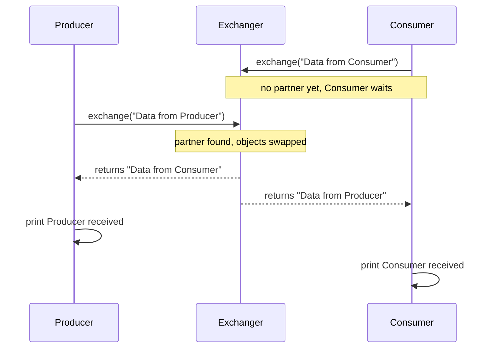
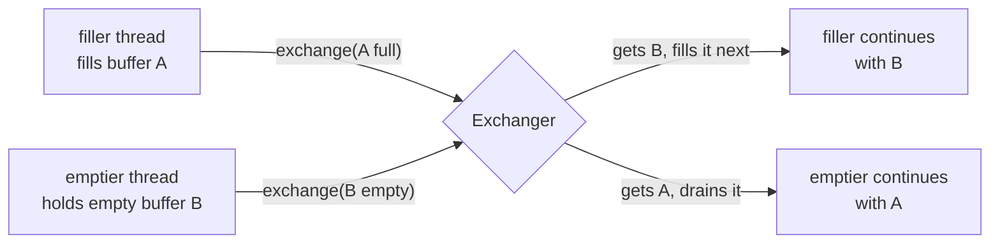

## In One Line
An `Exchanger<V>` is a meeting point where **two threads swap objects**. Each calls `exchange(myObject)`, waits until a partner arrives, and gets the partner's object back.

## Mental Model
Think of **two spies swapping briefcases on a park bench**.

- Spy A arrives with a briefcase and sits down. The partner isn't there yet, so A waits. That's `exchange(data)` blocking.
- Spy B arrives with another briefcase. They swap at once, and both leave with the *other's* case. Both `exchange` calls return, each with the partner's object.
- Neither spy may leave with nothing. If the partner never comes, A waits for ever, unless A set a watch alarm (`exchange(x, timeout, unit)` → `TimeoutException`) or headquarters called A home (interrupt → `InterruptedException`).
- If four spies turn up at the same bench, they pair off **two by two**, in whatever pairs happen to form.
- After the swap, each spy owns only the case they received and must not open the one they handed over. After an exchange, you stop touching the object you gave away.

In the example, the spies are `Producer` and `Consumer`, and the briefcases are the two strings.

## Concept
### What it does
`java.util.concurrent.Exchanger<V>` (Java 5) is the simplest two-party rendezvous with data:
- `V exchange(V x)` — offer `x`, wait for another thread to call `exchange` on the same exchanger, and return **its** object. The other thread receives `x`.
- `V exchange(V x, long timeout, TimeUnit unit)` — same, but throws `TimeoutException` if no partner arrives in time.
- Both methods throw `InterruptedException` if the waiting thread is interrupted.
- `null` is a legal value to offer and to receive.

That's the whole public API: two methods.

### Rules and properties
- **Pairs only.** Exactly two threads take part in each exchange. With more threads, arrivals are paired arbitrarily (first come, first matched, roughly). An odd one out waits for the next arrival.
- **Symmetric.** No thread is "the producer": both give and both receive. It can be seen as a *bidirectional* `SynchronousQueue`.
- **Blocking until matched.** The thread that arrives second completes the swap immediately. The first one blocks (after a short spin on multicore machines) until it is matched.
- **No broken state.** If a waiting thread times out or is interrupted, only *it* leaves. The exchanger remains usable, and nobody else gets an exception (unlike a `CyclicBarrier`).
- **Reusable.** The same exchanger can be used for any number of swaps.

### Memory-consistency guarantee
For each pair that successfully exchanges, actions before `exchange()` in each thread **happen-before** actions after the return from the corresponding `exchange()` in the **other** thread. So you can fill a plain, non-thread-safe object (an `ArrayList`, an array, a `StringBuilder`), hand it over, and the receiver sees all its contents without extra synchronization, provided the giver **stops touching it** after the exchange. Ownership moves with the object.

### Typical use: double buffering (buffer swapping)
The textbook use, also the example in the JDK Javadoc, is a **pipeline with two buffers**. A filler thread fills buffer A while an emptier thread drains buffer B. When A is full and B is empty, they swap, and each continues with the other buffer. No allocation per batch, no shared-queue locking per item, and at any moment each buffer belongs to exactly one thread. Other uses: swapping candidate solutions between worker threads in genetic algorithms, and pairing up tasks in tests.

### How it works inside
`Exchanger` is not built on AQS. It uses its own lock-free algorithm:
- Each thread carries a small per-thread `Node` (kept in a `ThreadLocal`) holding the item it offers and a `match` field.
- **Uncontended:** one shared **slot**. The first thread CASes its node into the slot and waits, spinning briefly, then yielding, then parking. The second thread CASes the slot back to empty, writes its item into the first node's `match`, and unparks it.
- **Contended** (many threads, multicore): if CAS on the single slot keeps failing, it switches to an **arena**, an array of slots in which threads pair up at different indices so they don't all fight over one memory location. This is an *elimination* technique.

You never see any of this, but it explains why `Exchanger` scales under contention and why the first arriver spins briefly before sleeping.

### Exchanger vs its relatives
| Tool | Direction | Parties | Buffering | Use when |
|---|---|---|---|---|
| **`Exchanger<V>`** | **Both ways** | Pairs of 2 | None (rendezvous) | Two threads must swap objects, e.g. buffers |
| `SynchronousQueue<E>` | One way (producer → consumer) | Any producers/consumers | None (hand-off) | Direct hand-off without storage (used by `newCachedThreadPool`) |
| `BlockingQueue<E>` | One way | Many to many | Yes | Classic producer-consumer, see [BlockingQueue](lesson:b03-concurrency/04-blockingqueue-and-concurrent-collections) |
| `CyclicBarrier(2)` | None (just meet) | Exactly N | n/a | Threads meet, but no data is transferred |
| `CompletableFuture<V>` | One way, once | 1 → many | Holds one result | Asynchronous result delivery |

## Diagram

This is the recorded run, where the Consumer arrives first. The second arriver completes the swap without waiting. Either thread may arrive first, but each always receives the *other's* object.


Double buffering: the two buffers keep circulating between the two threads, and each buffer has exactly one owner at a time.

## Code
@example Multithreading/ConcurrencyUtilities/ExchangerExample.java

**Double buffering, the real-world pattern.** The filler hands over full lists, and the emptier hands back empty ones:
```java
import java.util.ArrayList;
import java.util.List;
import java.util.concurrent.Exchanger;

public class DoubleBuffer {
    public static void main(String[] args) throws InterruptedException {
        Exchanger<List<Integer>> exchanger = new Exchanger<>();

        Thread filler = new Thread(() -> {
            List<Integer> buffer = new ArrayList<>();
            int next = 1;
            try {
                for (int round = 0; round < 3; round++) {
                    while (buffer.size() < 3) buffer.add(next++);   // fill a full buffer
                    buffer = exchanger.exchange(buffer);            // hand it over, get an empty one back
                }
            } catch (InterruptedException e) {
                Thread.currentThread().interrupt();
            }
        });

        Thread emptier = new Thread(() -> {
            List<Integer> buffer = new ArrayList<>();
            try {
                for (int round = 0; round < 3; round++) {
                    buffer = exchanger.exchange(buffer);            // hand over empty, get a full one
                    System.out.println("emptier got " + buffer);
                    buffer.clear();                                 // "consume" it
                }
            } catch (InterruptedException e) {
                Thread.currentThread().interrupt();
            }
        });

        filler.start(); emptier.start();
        filler.join(); emptier.join();
    }
}
```
```output
emptier got [1, 2, 3]
emptier got [4, 5, 6]
emptier got [7, 8, 9]
```
Two plain `ArrayList`s, no locks, no `volatile`. The exchange's happens-before edge and the "stop touching what you gave away" rule make it safe. Only one thread prints here, so this output is the same every run.

**Timeout when no partner comes, and `null` as a legal value:**
```java
import java.util.concurrent.Exchanger;
import java.util.concurrent.TimeUnit;
import java.util.concurrent.TimeoutException;

public class ExchangeTimeout {
    public static void main(String[] args) throws InterruptedException {
        Exchanger<String> exchanger = new Exchanger<>();
        try {
            exchanger.exchange("hello?", 500, TimeUnit.MILLISECONDS);   // nobody else shows up
        } catch (TimeoutException e) {
            System.out.println("no partner within 500 ms: " + e.getClass().getSimpleName());
        }

        Thread partner = new Thread(() -> {
            try {
                System.out.println("partner got: " + exchanger.exchange(null));   // null is allowed
            } catch (InterruptedException e) {
                Thread.currentThread().interrupt();
            }
        });
        partner.start();
        String got = exchanger.exchange("hi");
        partner.join();
        System.out.println("main got: " + got);
    }
}
```
```output
no partner within 500 ms: TimeoutException
partner got: hi
main got: null
```
After the timeout, the same exchanger still works for the next pair. A timeout breaks nothing.

**Four threads, one exchanger: they pair off, and the pairs vary:**
```java
import java.util.concurrent.Exchanger;

public class FourThreads {
    public static void main(String[] args) throws InterruptedException {
        Exchanger<String> exchanger = new Exchanger<>();
        Thread[] ts = new Thread[4];
        for (int i = 0; i < 4; i++) {
            String name = "T" + (i + 1);
            ts[i] = new Thread(() -> {
                try {
                    String partner = exchanger.exchange(name);
                    System.out.println(name + " swapped with " + partner);
                } catch (InterruptedException e) {
                    Thread.currentThread().interrupt();
                }
            });
            ts[i].start();
        }
        for (Thread t : ts) t.join();
    }
}
```
Two real runs:
```output
T4 swapped with T3
T3 swapped with T4
T1 swapped with T2
T2 swapped with T1
```
```output
T1 swapped with T3
T2 swapped with T4
T4 swapped with T2
T3 swapped with T1
```
The pairs are always **symmetric** (if T1 got T3, then T3 got T1), but *who* pairs with whom depends on arrival timing. With 5 threads, one would wait for ever.

## Walkthrough
**Header.** The `package` line, the file-name comment, and `import java.util.concurrent.Exchanger;`.

**`class Producer extends Thread`**
- `private Exchanger<String> exchanger;` — the shared exchanger. The type argument says both sides swap `String`s.
- The constructor stores it. No thread name is passed, so the thread gets a default name (`Thread-0`), which the output never shows.
- `run()`:
  1. `String data = "Data from Producer";` — the object to offer.
  2. prints `Producer is exchanging data: Data from Producer`.
  3. `data = exchanger.exchange(data);` — blocks until the consumer also calls `exchange`, then **replaces** `data` with the consumer's string. Reusing the variable nicely shows "give mine, get yours".
  4. prints `Producer received: Data from Consumer`.
  5. `catch (InterruptedException e)` prints the stack trace. `exchange` throws `InterruptedException` if the thread is interrupted while waiting.

**`class Consumer extends Thread`** is the mirror image: it offers `"Data from Consumer"` and receives `"Data from Producer"`. The two classes are identical apart from their strings, a sign that the roles are really symmetric (see Traps).

**`main`**
- `new Exchanger<>()` — the diamond operator infers `Exchanger<String>` from the declared type.
- It creates both threads with the same exchanger and starts the producer, then the consumer.
- `producer.join(); consumer.join();` — `main` waits for both, inside `try/catch (InterruptedException e)`.
- The `// Output:` comment shows one possible order.

**Why the output varies (this example is marked "varies").** Twelve test runs gave **3 different outputs**:

| Runs | Order |
|---|---|
| 7 | Consumer exchanging, Producer exchanging, Producer received, Consumer received (the recorded run) |
| 3 | Producer exchanging, Consumer exchanging, Producer received, Consumer received |
| 2 | Producer exchanging, Consumer exchanging, Consumer received, Producer received |

- **Who prints first:** `producer.start()` is called first, yet the **consumer** printed first in most runs. `start()` only makes a thread runnable, and the OS decides which runs first. Early work in each new thread (the first string concatenation, class initialisation, the first `println`) takes different amounts of time. A bare two-thread test on this machine showed the second-started thread printing first about half the time.
- **Who prints "received" first:** the thread that arrives **second** finds its partner already waiting and returns from `exchange()` immediately, while the first arriver must be unparked (woken) first. So the second arriver usually prints first, but "usually" is not "always": in the 3-run row, the first arriver printed first.

**What is guaranteed every run:**
- `Producer received: Data from Consumer` and `Consumer received: Data from Producer`. The swap itself never varies.
- Both `exchanging` lines come **before** both `received` lines. Each thread prints `exchanging` before calling `exchange()`, and neither call can return until both threads have called it.

**How to run it.** On JDK 21, `java ExchangerExample.java` fails ("can't find main(String[]) method in class ...Producer"). The launcher runs the first class. Compile with `javac` and run `Multithreading.ConcurrencyUtilities.ExchangerExample`, or use the IDE.

## Traps
> [!ERRATA] The class names **`Producer` and `Consumer` are misleading.** In an `Exchanger`, both threads give **and** receive. The "consumer" produces `"Data from Consumer"`, and the "producer" consumes it. The code of the two classes is identical apart from the string. Names like `PartyA`/`PartyB` or `Filler`/`Emptier` (for buffer swapping) describe it honestly. For a real one-way producer-consumer, use a `BlockingQueue`, or a `SynchronousQueue` for a direct hand-off.

> [!ERRATA] The `// Output:` comment shows the producer printing first, as if that were fixed. The recorded run (and most test runs) start with `Consumer is exchanging...`. Only the swap result and "both exchanging lines before both received lines" are guaranteed. Minor: the `exchanger` fields should be `final`, and `catch (InterruptedException e) { e.printStackTrace(); }` swallows the interrupt. Restore it with `Thread.currentThread().interrupt()`.

- **No partner = wait for ever.** A plain `exchange()` with only one participant (or an odd number of threads) blocks until interrupted. Use the timed overload when a partner might not come.
- **More than two threads on one exchanger.** Pairs form arbitrarily, not "Producer with Consumer". If a specific pairing matters, use a separate `Exchanger` per pair.
- **Touching an object after giving it away.** The happens-before guarantee covers writes made *before* the exchange. If the giver keeps modifying the list it handed over, that is a data race. Treat `exchange` as a transfer of ownership.
- **Expecting a broken state like `CyclicBarrier`.** If one waiting thread times out or is interrupted, it alone gets the exception, and the exchanger stays usable. A partner that arrives later just waits for someone else.
- **Using an exchanger for one-way traffic.** If one side always sends a dummy value, you really want a `SynchronousQueue` or a `BlockingQueue`.

## Tips & Tricks
- **"Exchanger = two-way SynchronousQueue."** SynchronousQueue hands an object *over*; Exchanger hands objects *across*, in both directions.
- **"Give yours, get theirs."** `data = exchanger.exchange(data);` is the one-line idiom. Reassign the variable so you can't accidentally keep using the object you gave away.
- **Pairs of two.** Two threads per swap, and an odd one out waits. One exchanger per fixed pair keeps things predictable.
- **Double buffering** is the use case to mention in interviews: two buffers circulating, zero allocation, no per-item locking.
- Prefer the **timed** `exchange` in production code, and treat `TimeoutException` as "partner missing".
- `null` is allowed as a value, handy for "I have nothing to give, but I want yours".

## Interview Q&A
### [Basic] What is an Exchanger in Java?
`java.util.concurrent.Exchanger<V>` (Java 5) is a synchronization point at which **two threads pair up and swap objects**. Each thread calls `exchange(x)`. The first to arrive waits until a partner calls `exchange` on the same exchanger, then each receives the other's object. There's also a timed version, `exchange(x, timeout, unit)`, that throws `TimeoutException`. Both methods are interruptible. It is often described as a bidirectional `SynchronousQueue`. The classic use is double buffering: one thread fills a buffer while another drains a second one, and they swap buffers when ready.

**Follow-up:** *Can you pass `null`?* Yes. `null` is a valid value in both directions.

### [Basic] What happens if only one thread calls exchange()?
It blocks until another thread arrives, the waiting thread is interrupted (`InterruptedException`), or, with the timed overload, the timeout expires (`TimeoutException`). There is no default partner and no way to "exchange with nobody". With an odd number of participating threads, one is always left waiting.

**Follow-up:** *Does the timeout damage the exchanger?* No. Only the waiting thread leaves, and the exchanger remains usable for future pairs. There is no "broken" state as in `CyclicBarrier`.

### [Intermediate] Exchanger vs SynchronousQueue vs BlockingQueue: when do you use which?
- `BlockingQueue` buffers elements **one way**, from any number of producers to any number of consumers. It is the default for producer-consumer.
- `SynchronousQueue` has **zero capacity**: each `put` waits for a `take`, a direct **one-way** hand-off (used by `Executors.newCachedThreadPool`).
- `Exchanger` is a **two-way** rendezvous for exactly **two** threads: each gives an object and gets one back.

If only one side has data, an exchanger is the wrong tool. If both sides must trade something at the same moment (for example buffers), it is the natural one.

**Follow-up:** *Could you build an exchanger from two SynchronousQueues?* Roughly: A does `q1.put(a); b = q2.take();` and B does `a = q1.take(); q2.put(b);`. But it needs agreed roles (who puts first), and it doesn't handle more than two threads. `Exchanger` is symmetric and scales with its arena.

### [Intermediate] Explain the double-buffering pattern with an Exchanger.
Two buffers and two threads: a filler (for example reading from the network) and an emptier (for example writing to disk). The filler fills buffer A while the emptier drains buffer B. When the filler's buffer is full, it calls `exchange(A)`. When the emptier's buffer is empty, it calls `exchange(B)`. They swap and continue: the filler now fills B, the emptier drains A. Benefits: the two stages run in parallel, buffers are reused (no allocation per batch), there is no locking per element, and each buffer has exactly one owner at a time, so plain non-thread-safe collections are safe thanks to the exchange's happens-before guarantee.
```java
buffer = exchanger.exchange(buffer);   // same line in both threads
```
**Follow-up:** *What if the two stages run at very different speeds?* The faster one waits at each exchange. For decoupling with slack, use a `BlockingQueue` with capacity instead.

### [Intermediate] What happens when more than two threads use the same Exchanger?
Threads are paired in arrival order, roughly: any two threads that meet at the exchanger swap, whoever they are. With 4 threads you get 2 pairs, but which pairs is non-deterministic (tested: once T4↔T3 and T1↔T2, another time T1↔T3 and T2↔T4). With an odd count, one thread waits for a future partner. Under heavy contention, the exchanger spreads threads over an internal arena of slots so they pair up at different memory locations.

**Follow-up:** *How do you guarantee that specific threads pair?* Give each pair its own `Exchanger` instance.

### [Advanced] What visibility guarantee does exchange() give? Can you exchange mutable objects?
For each pair that exchanges successfully, actions before `exchange()` in each thread happen-before actions after the corresponding `exchange()` returns in the other thread. So the receiver sees every write the giver made to the object before handing it over, even for plain mutable objects such as `ArrayList` or arrays, without `volatile` or locks. The guarantee covers only writes made **before** the exchange. If the giver keeps modifying the object afterwards, that is a data race. The safe discipline is ownership transfer: after `exchange`, use only what you received (`buf = exchanger.exchange(buf)` enforces it).

**Follow-up:** *Is the exchanged object copied?* No. Only the reference is passed. Both threads could reach the same object, so ownership discipline is essential.

### [Advanced] How is Exchanger implemented?
It is a lock-free design, not AQS. Each thread uses a per-thread `Node` (via a `ThreadLocal`) holding its offered `item` and a `match` field. In the uncontended case there is a single `slot`. The first thread CASes its node in and waits: it spins briefly (on multiprocessors), then yields, then parks. The second thread CASes the slot empty, stores its item in the waiting node's `match`, and unparks it. Under contention, when CAS on the slot fails repeatedly, it grows an **arena** (an array of slots, padded against false sharing) and threads try to meet at various indices. This is an *elimination* technique that spreads contention.

**Follow-up:** *Why spin before parking?* On multicore machines the partner often arrives within microseconds. Spinning briefly avoids the cost of parking and unparking (a context switch) in that common case.

### [Advanced] Exchanger vs CyclicBarrier(2): aren't they the same?
Both make two threads wait for each other, but a `CyclicBarrier(2)` transfers **no data**. You would need shared fields plus the barrier's visibility guarantee to pass objects. A barrier also has a barrier action and the all-or-none broken model: a timeout breaks it for the partner too. An `Exchanger` carries the data itself, returns the partner's object from the same call, supports any number of threads pairing arbitrarily, and a timeout affects only the waiting thread.

**Follow-up:** *When is the barrier the better choice?* When more than two threads must meet, or when you need an action to run once per round.

## Quiz
### Which statement about the original example's output is ALWAYS true?
- [ ] The Producer lines are printed first, because the producer is started first
- [x] Both `exchanging` lines are printed before both `received` lines
- [ ] `Consumer received` is always the last line
- [ ] The output is always identical, because `join()` orders it
> Each thread prints `exchanging` before calling `exchange()`, and neither call returns until both threads have arrived, so both `exchanging` lines precede both `received` lines. Start order doesn't decide run order (the recorded run begins with the Consumer), and the order of the two `received` lines varies too. `join()` only makes `main` wait. It doesn't order the other threads' prints.

### What does this print?
```java
Exchanger<Integer> ex = new Exchanger<>();
Thread t = new Thread(() -> {
    try { System.out.println("t got " + ex.exchange(1)); }
    catch (InterruptedException e) { Thread.currentThread().interrupt(); }
});
t.start();
int got = ex.exchange(2);
t.join();
System.out.println("main got " + got);
```
- [ ] t got 1, then main got 2
- [x] t got 2, then main got 1
- [ ] main got 1, then t got 2
- [ ] It blocks for ever
> Each side receives the **other** side's value: `t` offered 1 and gets 2, and `main` offered 2 and gets 1. `main` prints only after `t.join()`, so `t got 2` is always first. It doesn't block because there are exactly two parties.

### What does this print?
```java
Exchanger<String> ex = new Exchanger<>();
try {
    System.out.println(ex.exchange("ping", 100, TimeUnit.MILLISECONDS));
} catch (TimeoutException e) {
    System.out.println("timeout: " + e.getMessage());
}
```
- [ ] ping
- [ ] null
- [x] timeout: null
- [ ] It blocks for ever
> No other thread ever calls `exchange`, so after 100 ms the timed version throws `TimeoutException`. Its message is `null` (a real run prints `timeout: null`). An exchanger never "returns your own object" or `null` without a partner, and it doesn't block for ever because of the timeout.

### Spot the bug.
```java
Exchanger<List<String>> ex = new Exchanger<>();
// filler thread:
List<String> batch = new ArrayList<>();
batch.add("a"); batch.add("b");
ex.exchange(batch);          // hand over the full batch
batch.add("c");              // keep collecting into the same list
```
- [ ] `exchange` does not accept a `List`
- [x] The filler ignores the returned list and keeps modifying the one it gave away, a data race with the receiving thread
- [ ] The list must be a `CopyOnWriteArrayList` for `exchange` to work
- [ ] Nothing, `exchange` copies the list
> `exchange` passes the **reference**, not a copy. After the swap, the other thread owns `batch`, and adding `"c"` races with it. The happens-before guarantee only covers writes made *before* the exchange. Fix: `batch = ex.exchange(batch);` and keep working with the list you received.

### You need a zero-capacity, ONE-WAY hand-off from producer threads to consumer threads. What fits best?
- [ ] `Exchanger`
- [x] `SynchronousQueue`
- [ ] `CyclicBarrier`
- [ ] `ReentrantReadWriteLock`
> `SynchronousQueue` hands each element directly from a `put` to a `take`, one way, with no storage, and any number of producers and consumers. An `Exchanger` is two-way and pairs exactly two threads, so the consumer would have to send a dummy object back.

### Four threads call `exchange(myName)` on the same Exchanger once each. What is guaranteed?
- [ ] T1 always pairs with T2, and T3 with T4
- [ ] One thread is left waiting for ever
- [x] Two pairs form, and within each pair the swap is symmetric, but which threads pair up varies
- [ ] Every thread receives its own name back
> An exchanger pairs arrivals arbitrarily. Test runs produced T4↔T3 and T1↔T2 once, and T1↔T3 and T2↔T4 another time. With an even count, nobody is left over, and a thread never gets its own object back.

## Takeaways
- `Exchanger<V>` lets exactly **two threads swap objects**: `theirs = exchanger.exchange(mine)` blocks until a partner arrives.
- The API is two methods: `exchange(x)` (interruptible) and `exchange(x, timeout, unit)` (adds `TimeoutException`). `null` is allowed, and the exchanger is reusable.
- It is symmetric and bidirectional ("a two-way SynchronousQueue"). The original's `Producer`/`Consumer` names are misleading, since both sides give and receive.
- With more than two threads, pairs form arbitrarily. An odd one out waits. A timeout or interrupt affects only that thread; there is no broken state.
- Writes before `exchange()` are visible to the partner after its `exchange()` returns. Treat the swap as an **ownership transfer** and don't touch what you gave away.
- The classic use is double buffering: two buffers circulate between a filler and an emptier with no locks and no allocation per batch.
- Internals: a lock-free single slot, growing into an arena of slots under contention, with a brief spin before parking.
- The example's print order varies (start order ≠ run order, and the second arriver usually returns first). The swapped values and "exchanging before received" never vary.
