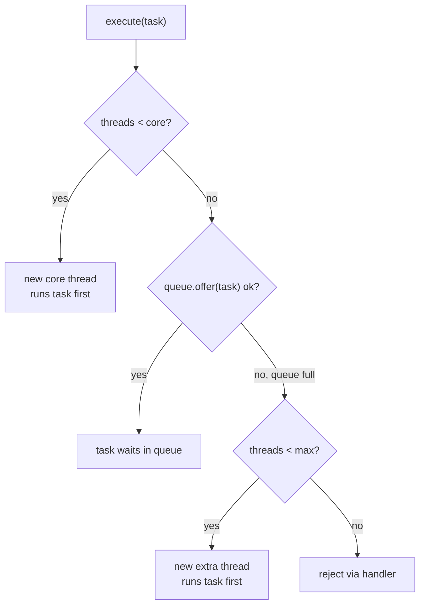
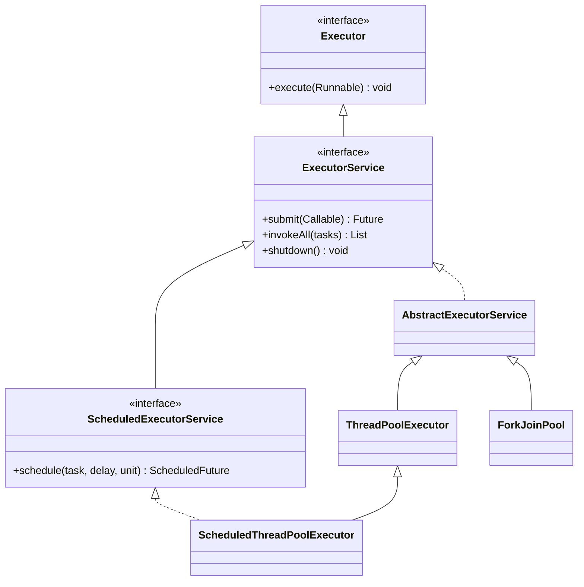
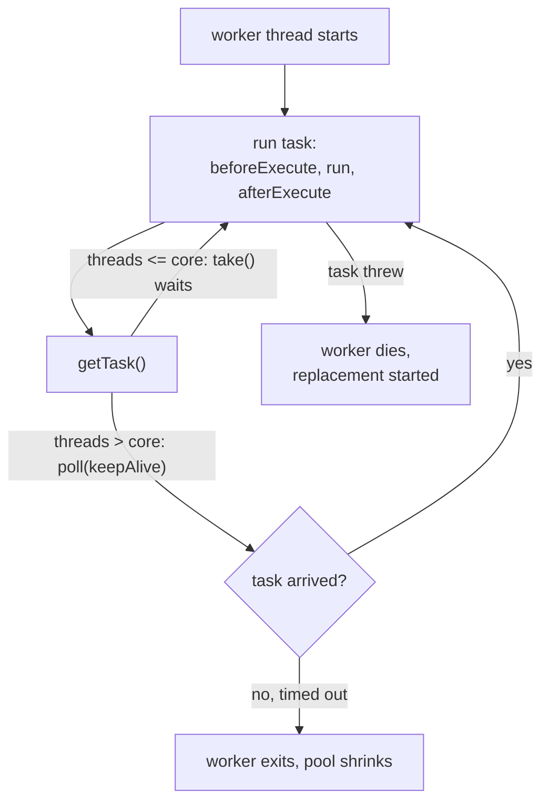

## In One Line
A thread pool keeps a few worker threads alive and feeds them tasks from a queue, so you **submit work** (`executor.execute(task)`) instead of creating a `new Thread` for every job. `ThreadPoolExecutor` is the engine behind almost every pool, and core size, max size, queue, keep-alive and rejection policy decide how it behaves under load.

## Mental Model
Think of a **restaurant kitchen**.

| Kitchen | `ThreadPoolExecutor` |
|---|---|
| Permanent cooks on the payroll | **core threads** (`corePoolSize`) |
| The order rail where tickets wait | the **work queue** (`BlockingQueue<Runnable>`) |
| Temporary cooks hired only when the rail is **full** | **extra threads**, up to `maximumPoolSize` |
| Temps sent home after standing idle for a while | **keep-alive** (`keepAliveTime`) |
| The manager's rule when the kitchen and rail are both full | the **rejection policy** (`RejectedExecutionHandler`) |
| The waiter cooking the dish himself because the kitchen is swamped | `CallerRunsPolicy` |
| Closing time: no new orders, finish the tickets on the rail | `shutdown()` |

The surprise most people miss: the manager hires temps only when the **rail is full**, not when the permanent cooks are busy. A long rail (an unbounded queue) means temps are **never** hired.

## Concept
### Why pools exist
A platform `Thread` maps 1:1 to an operating-system thread. Creating one means a system call, reserving a stack (about 1 MB by default on 64-bit Linux), and registering it with the scheduler. Destroying it costs again. Doing that per task causes three problems:

1. **Latency** — creation time is added to every task.
2. **No upper bound** — 10,000 requests become 10,000 threads, then `OutOfMemoryError: unable to create native thread`, or a machine that spends its time context switching.
3. **No management** — no queue, no statistics, no clean way to stop everything.

A pool fixes all three: threads are **reused**, their number is **bounded**, extra work **waits in a queue**, and the pool can be **shut down** as a unit. It also separates *what* to run (a `Runnable`/`Callable` task) from *how* it runs (which thread, when, how many at once). That split is the whole point of the **Executor framework** (Java 5, JSR-166, by Doug Lea).

### The Executor framework map
| Type | Kind | Role |
|---|---|---|
| `Executor` | interface | One method: `void execute(Runnable)`. "Run this somehow." |
| `ExecutorService` | interface | Adds lifecycle (`shutdown`, `shutdownNow`, `awaitTermination`, `close` in Java 19+) and results (`submit`, `invokeAll`, `invokeAny` returning `Future`s). See [ExecutorService](lesson:a07-executors/02-executor-service). |
| `ScheduledExecutorService` | interface | Adds delayed and periodic tasks. See [ScheduledExecutorService](lesson:a07-executors/03-scheduled-executor-service). |
| `AbstractExecutorService` | abstract class | Implements `submit`/`invokeAll`/`invokeAny` on top of `execute` by wrapping tasks in a `FutureTask`. |
| `ThreadPoolExecutor` | class | The classic pool: core/max threads + a `BlockingQueue`. |
| `ScheduledThreadPoolExecutor` | class | A `ThreadPoolExecutor` with a delay queue. |
| `ForkJoinPool` | class | Work-stealing pool (per-thread deques) behind parallel streams and `CompletableFuture`'s default executor. |
| `Executors` | utility class | Static factory methods that pre-configure the classes above. |

### The seven constructor parameters
```java
public ThreadPoolExecutor(int corePoolSize,
                          int maximumPoolSize,
                          long keepAliveTime,
                          TimeUnit unit,
                          BlockingQueue<Runnable> workQueue,
                          ThreadFactory threadFactory,            // optional
                          RejectedExecutionHandler handler)       // optional
```
| Parameter | Meaning | Default when omitted |
|---|---|---|
| `corePoolSize` | Threads kept alive even when idle (unless `allowCoreThreadTimeOut(true)`). | — |
| `maximumPoolSize` | Hard cap on threads. Extra (non-core) threads are only created when the **queue refuses** a task. | — |
| `keepAliveTime` + `unit` | How long an idle thread above core size waits for work before it dies. | — |
| `workQueue` | Where tasks wait when all core threads are busy. Its type changes the pool's whole personality. | — |
| `threadFactory` | Creates the threads: name, daemon flag, priority, uncaught-exception handler. | `Executors.defaultThreadFactory()` → names `pool-N-thread-M`, non-daemon, normal priority |
| `handler` | What to do with a task that cannot be accepted. | `AbortPolicy` (throws `RejectedExecutionException`) |

Validation: `corePoolSize < 0`, `maximumPoolSize <= 0`, `maximumPoolSize < corePoolSize` or `keepAliveTime < 0` throw `IllegalArgumentException`; a `null` queue, factory or handler throws `NullPointerException`.

### What `execute(task)` does — the three-step algorithm
This is the most asked internals question about pools. From the JDK source:

1. **Fewer than `corePoolSize` threads running?** Start a **new thread** with this task as its *first task* — even if other threads are idle.
2. **Otherwise, try to queue it** (`workQueue.offer(task)`, which never blocks). If it is queued, re-check: if the pool was shut down meanwhile, remove and reject it; if there are zero threads (possible with `corePoolSize = 0`), start one.
3. **Queue refused (full)?** Start a new **non-core thread** with this task, as long as the pool is below `maximumPoolSize`. If that fails too, **reject** the task.

So the order is **core → queue → max → reject**, not "core → max → queue". Two consequences:

- With an **unbounded** queue, step 2 always succeeds, so the pool never grows past `corePoolSize` and **`maximumPoolSize` is ignored**.
- Tasks are **not strictly FIFO**. A task that triggers a new non-core thread in step 3 runs *before* the older tasks already waiting in the queue.

Threads are created **lazily**, one per submission, until core size is reached. `prestartCoreThread()` / `prestartAllCoreThreads()` create them up front.

### Queue types — the pool's personality
| Queue | Behaviour in the pool | Used by |
|---|---|---|
| `SynchronousQueue` | **Direct hand-off**, capacity zero. `offer` succeeds only if an idle thread is waiting right now, so every busy moment creates a new thread (up to max). | `newCachedThreadPool` |
| `LinkedBlockingQueue` (no capacity) | **Unbounded** (`Integer.MAX_VALUE`). Never refuses, so max size is irrelevant and the backlog can grow until `OutOfMemoryError`. | `newFixedThreadPool`, `newSingleThreadExecutor` |
| `LinkedBlockingQueue(n)` / `ArrayBlockingQueue(n)` | **Bounded**. The only kind that makes max size and rejection meaningful. `ArrayBlockingQueue` uses one lock and a fixed array; `LinkedBlockingQueue` uses separate put/take locks. | Hand-built production pools |
| `PriorityBlockingQueue` | Unbounded, ordered by `compareTo`. Tasks must be `Comparable`, so only use `execute` with `Comparable` runnables — `submit` wraps tasks in a non-comparable `FutureTask` and fails with `ClassCastException`. | Priority work |
| `DelayedWorkQueue` (internal) | Heap ordered by trigger time. | `ScheduledThreadPoolExecutor` |

### Rejection policies
A task is rejected when the pool is **shut down**, or when it is **saturated** (bounded queue full **and** `maximumPoolSize` threads busy). The pool then calls `handler.rejectedExecution(task, executor)`. Four built-in policies are nested classes of `ThreadPoolExecutor`:

| Policy | What happens | Use it when |
|---|---|---|
| `AbortPolicy` (default) | Throws `RejectedExecutionException` to the submitter. | You want the caller to know and handle overload. |
| `CallerRunsPolicy` | The **submitting thread runs the task itself** (unless the pool is shut down, then it is dropped). | You want **back-pressure**: the producer is slowed down because it is busy running a task. |
| `DiscardPolicy` | Silently drops the new task. | Losing work is acceptable (e.g. metrics samples). Rarely correct. |
| `DiscardOldestPolicy` | Drops the task at the **head of the queue** (the oldest waiting one) and retries. | Only the latest data matters. Dangerous with a priority queue: it drops the *highest-priority* task. |

You can write your own `RejectedExecutionHandler` (log + metric + throw, or block with `queue.put(task)` — the latter is risky because it can deadlock after shutdown).

### Keep-alive and thread reclamation
- A thread above `corePoolSize` polls the queue with `poll(keepAliveTime)`. If nothing arrives in time, it exits and the pool shrinks back toward core size.
- Core threads call `take()` and wait forever — unless `allowCoreThreadTimeOut(true)` is set (needs a keep-alive > 0), in which case even core threads die when idle and the pool can shrink to zero.
- `keepAliveTime` can be changed later with `setKeepAliveTime`; sizes with `setCorePoolSize` / `setMaximumPoolSize` (Java 9+ throws `IllegalArgumentException` if core would exceed max).

### Inside the pool: `ctl`, workers and the worker loop
- **`ctl`** is one `AtomicInteger` that packs two fields: the **run state** in the top 3 bits and the **worker count** in the low 29 bits (so at most 2^29 − 1 threads). One CAS updates both consistently. Run states: `RUNNING → SHUTDOWN → STOP → TIDYING → TERMINATED` (details in the next lesson).
- Each thread is owned by a private **`Worker`** object that extends `AbstractQueuedSynchronizer` (a tiny non-reentrant lock, held while a task runs so `shutdown()` interrupts only *idle* workers) and implements `Runnable`. Workers live in a `HashSet<Worker>` guarded by `mainLock`.
- **`runWorker` loop**: run the first task, then repeatedly `getTask()` from the queue; around each task call the hooks `beforeExecute(thread, task)` and `afterExecute(task, throwable)`. When `getTask()` returns `null` (timed out, pool stopping, or too many threads) the worker exits.
- **If a task throws**, the exception propagates out of the loop, the worker thread dies (the thread's `UncaughtExceptionHandler` prints the stack trace), and `processWorkerExit` starts a **replacement** thread. That is why thread numbers keep rising in a pool with failing `execute`d tasks. (`submit`ted tasks never throw here — their exception is stored in the `Future`.)
- **Hooks** to override: `beforeExecute`, `afterExecute` (logging, timing, `ThreadLocal` cleanup) and `terminated()` (runs once when the pool is fully terminated).

### The `Executors` factory methods — and their pitfalls
These are the real configurations on JDK 21 (printed by the snippet in Code):

| Factory | What it really builds | Pitfall |
|---|---|---|
| `newFixedThreadPool(n)` | `ThreadPoolExecutor(n, n, 0 ms, new LinkedBlockingQueue<>())` | **Unbounded queue**: a slow consumer lets the backlog grow until `OutOfMemoryError`. Nothing is ever rejected. |
| `newSingleThreadExecutor()` | Same with `n = 1`, wrapped in a delegate so it **cannot be cast** to `ThreadPoolExecutor` and resized | Same unbounded queue. Guarantees tasks run one at a time in submission order. |
| `newCachedThreadPool()` | `ThreadPoolExecutor(0, Integer.MAX_VALUE, 60 s, new SynchronousQueue<>())` | **Unbounded threads**: a burst of slow tasks creates thousands of threads. Idle threads die after 60 s. |
| `newScheduledThreadPool(n)` | `ScheduledThreadPoolExecutor(n)` (max = `MAX_VALUE` but effectively fixed at `n`, unbounded delay queue) | Unbounded queue again. |
| `newSingleThreadScheduledExecutor()` | Non-reconfigurable 1-thread scheduled pool | One slow task delays all the others. |
| `newWorkStealingPool()` (Java 8) | `ForkJoinPool` with parallelism = CPU count, FIFO async mode | Daemon threads: the JVM can exit before tasks finish. No ordering guarantee. |
| `newVirtualThreadPerTaskExecutor()` (Java 21) | New virtual thread per task, no pool | Unbounded concurrency; limit access to scarce resources with a `Semaphore`. See [Virtual Threads](lesson:b03-concurrency/07-virtual-threads). |
| `newThreadPerTaskExecutor(factory)` (Java 21) | New thread from the factory per task | Same. |

Also in `Executors`: `defaultThreadFactory()`, `callable(Runnable)` / `callable(Runnable, T)` adapters, and `unconfigurableExecutorService(es)` to hide the setters.

> [!INTERVIEW] Many coding standards (for example the Alibaba Java guidelines) forbid `Executors.newFixedThreadPool`/`newCachedThreadPool` in production: "create `ThreadPoolExecutor` directly so the queue bound, max threads and rejection policy are explicit decisions."

### Sizing a pool
- **CPU-bound** tasks: about `Ncpu` or `Ncpu + 1` threads (`Runtime.getRuntime().availableProcessors()`). More threads only add context switching.
- **I/O-bound** tasks (Brian Goetz, *Java Concurrency in Practice*): `threads = Ncpu × targetUtilisation × (1 + waitTime / computeTime)`. A task that waits 90 ms on the database for every 10 ms of CPU on 8 cores → `8 × 1 × (1 + 9) = 80` threads.
- **Queue size**: Little's law — items in the system = arrival rate × time in system. Bound the queue to what you can process within your latency budget.
- Then **measure** under load: `getPoolSize()`, `getActiveCount()`, `getQueue().size()`, `getLargestPoolSize()`, `getCompletedTaskCount()`, `getTaskCount()`.
- Separate pools for separate kinds of work (**bulkheads**), so a slow dependency cannot starve everything else.

### Java version notes
| Version | Change |
|---|---|
| 5 | `java.util.concurrent`: `Executor`, `ExecutorService`, `ThreadPoolExecutor`, `Executors` |
| 7 | `ForkJoinPool` |
| 8 | `newWorkStealingPool`, `ForkJoinPool.commonPool()` used by parallel streams and `CompletableFuture` |
| 9 | `setCorePoolSize` above max throws `IllegalArgumentException` |
| 11 | `ThreadPoolExecutor.finalize()` no longer shuts the pool down — always shut pools down yourself |
| 19 | `ExecutorService` is `AutoCloseable` (`close()`), usable in try-with-resources |
| 21 | Virtual threads: `newVirtualThreadPerTaskExecutor()`; `newSingleThreadExecutor` uses a `Cleaner` (older JDKs used `finalize()`) to shut down an unreachable pool |

## Diagram

Core first, then the queue, and only when the queue is full do extra threads appear. An unbounded queue means the "no" branch of the queue check never happens.


The interfaces grow from "run this" to "manage and return results" to "schedule". `Executors` factory methods return instances of the concrete classes at the bottom.


The life of one pooled thread: it loops taking tasks from the queue, and only threads above core size (or all threads with `allowCoreThreadTimeOut`) give up after the keep-alive time.

## Code
@example ThreadPoolAndExecutors/ThreadPoolExample.java

**Watching the three steps happen.** Core 2, max 4, a queue with room for 2. Every task blocks on a latch so nothing finishes while we submit:
```java
import java.util.concurrent.*;

public class PoolGrowth {
    public static void main(String[] args) throws Exception {
        CountDownLatch release = new CountDownLatch(1);
        ThreadPoolExecutor pool = new ThreadPoolExecutor(
                2, 4,                       // core = 2, max = 4
                30, TimeUnit.SECONDS,       // keep-alive for the 2 extra threads
                new ArrayBlockingQueue<>(2) // bounded queue: room for 2 waiting tasks
        );
        for (int i = 1; i <= 7; i++) {
            int id = i;
            try {
                pool.execute(() -> {
                    try { release.await(); } catch (InterruptedException e) { }
                });
                System.out.printf("task %d accepted -> threads=%d, queued=%d%n",
                        id, pool.getPoolSize(), pool.getQueue().size());
            } catch (RejectedExecutionException e) {
                System.out.printf("task %d REJECTED (threads=%d, queued=%d)%n",
                        id, pool.getPoolSize(), pool.getQueue().size());
            }
        }
        release.countDown();
        pool.shutdown();
        pool.awaitTermination(5, TimeUnit.SECONDS);
        System.out.println("completed=" + pool.getCompletedTaskCount()
                + ", largest=" + pool.getLargestPoolSize());
    }
}
```
```output
task 1 accepted -> threads=1, queued=0
task 2 accepted -> threads=2, queued=0
task 3 accepted -> threads=2, queued=1
task 4 accepted -> threads=2, queued=2
task 5 accepted -> threads=3, queued=2
task 6 accepted -> threads=4, queued=2
task 7 REJECTED (threads=4, queued=2)
completed=6, largest=4
```
Tasks 1–2 create core threads, 3–4 fill the queue, 5–6 create extra threads, and 7 finds everything full and is rejected.

**The four rejection policies side by side.** One thread, queue of one, three tasks A, B, C — so C is always the one that does not fit:
```java
import java.util.*;
import java.util.concurrent.*;

public class Policies {
    static void demo(RejectedExecutionHandler policy) throws Exception {
        // 1 thread + a queue with room for 1 task => the 3rd task is rejected
        ThreadPoolExecutor pool = new ThreadPoolExecutor(
                1, 1, 0, TimeUnit.SECONDS, new ArrayBlockingQueue<>(1), policy);
        List<String> ran = Collections.synchronizedList(new ArrayList<>());
        String outcome = "accepted";
        for (String name : List.of("A", "B", "C")) {
            try {
                pool.execute(() -> {
                    ran.add(name + "@" + Thread.currentThread().getName());
                    try { Thread.sleep(200); } catch (InterruptedException e) { }
                });
            } catch (RejectedExecutionException e) {
                outcome = "C threw RejectedExecutionException";
            }
        }
        pool.shutdown();
        pool.awaitTermination(5, TimeUnit.SECONDS);
        List<String> sorted = new ArrayList<>(ran);
        Collections.sort(sorted);
        System.out.println(policy.getClass().getSimpleName() + " ran=" + sorted
                + (outcome.equals("accepted") ? "" : " -> " + outcome));
    }

    public static void main(String[] args) throws Exception {
        demo(new ThreadPoolExecutor.AbortPolicy());
        demo(new ThreadPoolExecutor.CallerRunsPolicy());
        demo(new ThreadPoolExecutor.DiscardPolicy());
        demo(new ThreadPoolExecutor.DiscardOldestPolicy());
    }
}
```
```output
AbortPolicy ran=[A@pool-1-thread-1, B@pool-1-thread-1] -> C threw RejectedExecutionException
CallerRunsPolicy ran=[A@pool-2-thread-1, B@pool-2-thread-1, C@main]
DiscardPolicy ran=[A@pool-3-thread-1, B@pool-3-thread-1]
DiscardOldestPolicy ran=[A@pool-4-thread-1, C@pool-4-thread-1]
```
Note `C@main` (the caller ran it) and that `DiscardOldestPolicy` threw away **B**, the oldest *waiting* task, not A (A was already running). Each pool gets a new number (`pool-1` … `pool-4`) from the default thread factory's global counter.

**Keep-alive and `allowCoreThreadTimeOut`:**
```java
import java.util.concurrent.*;

public class KeepAlive {
    public static void main(String[] args) throws Exception {
        ThreadPoolExecutor pool = new ThreadPoolExecutor(
                1, 3, 1, TimeUnit.SECONDS, new SynchronousQueue<>());
        for (int i = 0; i < 3; i++) {
            pool.execute(() -> sleep(300));   // direct hand-off: each task needs a thread
        }
        System.out.println("busy:            poolSize=" + pool.getPoolSize());
        sleep(2000);                          // idle for longer than keepAlive
        System.out.println("after 2s idle:   poolSize=" + pool.getPoolSize());
        pool.allowCoreThreadTimeOut(true);    // the core thread may now time out too
        sleep(2000);
        System.out.println("core timeout on: poolSize=" + pool.getPoolSize()
                + ", largest=" + pool.getLargestPoolSize());
        pool.execute(() -> System.out.println("a new thread is created on demand: "
                + Thread.currentThread().getName()));
        pool.shutdown();
    }
    static void sleep(long ms) {
        try { Thread.sleep(ms); } catch (InterruptedException e) { Thread.currentThread().interrupt(); }
    }
}
```
```output
busy:            poolSize=3
after 2s idle:   poolSize=1
core timeout on: poolSize=0, largest=3
a new thread is created on demand: pool-1-thread-4
```

**What the `Executors` factories really build (JDK 21):**
```java
import java.util.concurrent.*;

public class Factories {
    static void show(String label, ExecutorService es) {
        String cfg = "";
        if (es instanceof ThreadPoolExecutor tpe) {
            cfg = "core=" + tpe.getCorePoolSize()
                + " max=" + (tpe.getMaximumPoolSize() == Integer.MAX_VALUE ? "MAX_VALUE" : tpe.getMaximumPoolSize())
                + " keepAlive=" + tpe.getKeepAliveTime(TimeUnit.MILLISECONDS) + "ms"
                + " queue=" + tpe.getQueue().getClass().getSimpleName();
        }
        System.out.println(label + " -> " + es.getClass().getSimpleName() + " " + cfg);
        es.shutdown();
    }
    public static void main(String[] args) {
        show("newFixedThreadPool(3)       ", Executors.newFixedThreadPool(3));
        show("newCachedThreadPool()       ", Executors.newCachedThreadPool());
        show("newSingleThreadExecutor()   ", Executors.newSingleThreadExecutor());
        show("newScheduledThreadPool(2)   ", Executors.newScheduledThreadPool(2));
        show("newSingleThreadScheduled..()", Executors.newSingleThreadScheduledExecutor());
        show("newWorkStealingPool()       ", Executors.newWorkStealingPool());
        show("newVirtualThreadPerTask..() ", Executors.newVirtualThreadPerTaskExecutor());
    }
}
```
```output
newFixedThreadPool(3)        -> ThreadPoolExecutor core=3 max=3 keepAlive=0ms queue=LinkedBlockingQueue
newCachedThreadPool()        -> ThreadPoolExecutor core=0 max=MAX_VALUE keepAlive=60000ms queue=SynchronousQueue
newSingleThreadExecutor()    -> AutoShutdownDelegatedExecutorService 
newScheduledThreadPool(2)    -> ScheduledThreadPoolExecutor core=2 max=MAX_VALUE keepAlive=10ms queue=DelayedWorkQueue
newSingleThreadScheduled..() -> DelegatedScheduledExecutorService 
newWorkStealingPool()        -> ForkJoinPool 
newVirtualThreadPerTask..()  -> ThreadPerTaskExecutor
```
The "single" versions are wrappers, not `ThreadPoolExecutor`s — that is how they guarantee nobody can resize them.

**A production-style pool built by hand** — explicit bound, named threads, back-pressure and a `terminated()` hook:
```java
import java.util.*;
import java.util.concurrent.*;
import java.util.concurrent.atomic.AtomicInteger;

public class ProductionPool {
    public static void main(String[] args) throws InterruptedException {
        AtomicInteger n = new AtomicInteger();
        ThreadFactory named = r -> new Thread(r, "order-worker-" + n.incrementAndGet());

        ThreadPoolExecutor pool = new ThreadPoolExecutor(
                3, 3,                                        // fixed size: 3 threads
                0L, TimeUnit.MILLISECONDS,
                new ArrayBlockingQueue<>(100),               // bounded backlog
                named,                                       // meaningful thread names
                new ThreadPoolExecutor.CallerRunsPolicy()) { // back-pressure when full
            @Override
            protected void terminated() {                    // hook: runs once, at the very end
                System.out.println("pool terminated, completed=" + getCompletedTaskCount());
            }
        };

        List<String> log = Collections.synchronizedList(new ArrayList<>());
        for (int i = 1; i <= 3; i++) {
            int id = i;
            pool.execute(() -> log.add("order " + id + " on " + Thread.currentThread().getName()));
        }
        pool.shutdown();
        pool.awaitTermination(10, TimeUnit.SECONDS);
        log.stream().sorted().forEach(System.out::println);
    }
}
```
```output
pool terminated, completed=3
order 1 on order-worker-1
order 2 on order-worker-2
order 3 on order-worker-3
```
`terminated()` runs on the last exiting worker *before* `awaitTermination` returns, so its line always comes first.

**Why the original's busy-wait is bad** — CPU time the waiting `main` thread burns:
```java
import java.lang.management.*;
import java.util.concurrent.*;

public class BusyWait {
    public static void main(String[] args) throws Exception {
        ThreadMXBean mx = ManagementFactory.getThreadMXBean();

        ExecutorService a = Executors.newFixedThreadPool(1);
        a.execute(() -> sleep(2000));
        a.shutdown();
        long cpu = mx.getCurrentThreadCpuTime();
        while (!a.isTerminated()) { }                       // spin
        System.out.printf("busy-wait:        main used %d ms of CPU%n",
                (mx.getCurrentThreadCpuTime() - cpu) / 1_000_000);

        ExecutorService b = Executors.newFixedThreadPool(1);
        b.execute(() -> sleep(2000));
        b.shutdown();
        cpu = mx.getCurrentThreadCpuTime();
        b.awaitTermination(1, TimeUnit.MINUTES);            // block
        System.out.printf("awaitTermination: main used %d ms of CPU%n",
                (mx.getCurrentThreadCpuTime() - cpu) / 1_000_000);
    }
    static void sleep(long ms) { try { Thread.sleep(ms); } catch (InterruptedException e) { } }
}
```
```output
busy-wait:        main used 1924 ms of CPU
awaitTermination: main used 0 ms of CPU
```
The exact number changes per run and machine, but the spin loop always burns about one full core for the whole wait; `awaitTermination` parks the thread and uses nothing.

## Walkthrough
**`ThreadPoolExample.main`**
- `package ThreadPoolAndExecutors;` — the example's folder. (Convention says package names are all lowercase, e.g. `threadpoolandexecutors`; it compiles either way.)
- `import java.util.concurrent.ExecutorService; import java.util.concurrent.Executors;` — the interface we program against and the factory class that builds it.
- `ExecutorService executor = Executors.newFixedThreadPool(3);` — builds `new ThreadPoolExecutor(3, 3, 0L, MILLISECONDS, new LinkedBlockingQueue<>())`: three core threads, no extra threads, an unbounded queue. **No thread exists yet** — they are created lazily as tasks arrive. The variable is typed as the interface `ExecutorService`, so the code does not depend on the concrete class.
- `for (int i = 1; i <= 5; i++) { Runnable worker = new WorkerThread("Task " + i); executor.execute(worker); }` — five tasks are handed over. `execute` returns immediately; it does not run the task in `main`.
  - Tasks 1, 2 and 3 each hit step 1 of the algorithm ("fewer than 3 threads"), so each **creates a new thread with that task as its first task**. That is why, in every run (recorded and our own), **Task 1 runs on `pool-1-thread-1`, Task 2 on `thread-2` and Task 3 on `thread-3`**.
  - Tasks 4 and 5 hit step 2 and wait in the `LinkedBlockingQueue`. Whichever thread finishes first takes Task 4, the next one takes Task 5.
- `executor.shutdown();` — the pool stops accepting new tasks but **will still run the queued tasks 4 and 5**. `shutdown()` does not wait; it returns at once.
- `while (!executor.isTerminated()) { }` — a **busy-wait**: `main` asks "done yet?" millions of times per second. It works (`isTerminated()` reads an atomic field, so the loop sees the change), but it burns a CPU core for about 4 seconds. `executor.awaitTermination(...)` does the same job while sleeping (see the BusyWait snippet).
- `System.out.println("All tasks are finished!");` — guaranteed to be the last line: `isTerminated()` only becomes `true` after every task has finished and every worker has exited.

**`WorkerThread`** (despite the name, it is a *task*, not a thread)
- `class WorkerThread implements Runnable` — package-private top-level class in the same file; it only describes *what to do*. The real threads are the pool's (`pool-1-thread-N`).
- `private String message;` + constructor `this.message = message;` — each task remembers its label ("Task 1" … "Task 5"). It is never reassigned, so it could be `final`.
- `run()` prints `Thread.currentThread().getName() + " (Start) " + message`, calls `processMessage()`, then prints `(End)`. `Thread.currentThread().getName()` shows which pooled thread picked the task up. The default thread factory names threads `pool-<pool number>-thread-<thread number>`; this is the first pool created in the JVM, so it is `pool-1`.
- `processMessage()` — `Thread.sleep(2000)` simulates 2 s of work. `catch (InterruptedException e) { e.printStackTrace(); }` prints and carries on (see Traps).
- The `// Output:` block at the bottom is a comment inside `processMessage()`; it is one possible interleaving, not the guaranteed output.

**Reading the output.** The run takes about **4 seconds**: a first wave of three tasks (0–2 s), then a second wave of two (2–4 s). In the recorded output, `pool-1-thread-2 (End) Task 2` is followed immediately by `pool-1-thread-2 (Start) Task 4` — the thread that finished first grabbed the next queued task at once. The run is marked **varies** because the three threads wake from `sleep(2000)` within microseconds of each other, so which one prints first, and which one wins Task 4 and Task 5, changes from run to run. What never changes: tasks 1–3 on threads 1–3, at most three tasks at a time, only three thread names ever, and the final line last.

## Traps
> [!ERRATA] `while (!executor.isTerminated()) { }` is a busy-wait. The comment says "Wait for all tasks to finish", which is the right intent, but spinning keeps a CPU core at 100% for the whole wait (about 1.9 s of CPU for a 2 s wait in our measurement). Use `executor.awaitTermination(1, TimeUnit.MINUTES)` (and check its boolean result), or in Java 19+ a `try (ExecutorService executor = ...) { ... }` block, whose `close()` waits for you.

> [!ERRATA] The `// Output:` comment (oddly placed inside `processMessage()`) shows one ordering in which all three first-wave tasks end before Task 4 starts, and Task 5 runs on `thread-1`. The real output differs from run to run: the recorded run starts Task 4 on `thread-2` right after Task 2 ends, and Task 5 on `thread-3`. Only the pattern is fixed, not the order.

> [!ERRATA] The class name `WorkerThread` is misleading. It does not extend `Thread` and never becomes one; it is a `Runnable` **task**. In pool terminology the "workers" are the pool's own threads (the private `ThreadPoolExecutor.Worker` class). A name like `PrintTask` would be accurate.

> [!ERRATA] `catch (InterruptedException e) { e.printStackTrace(); }` swallows the interrupt. An interrupt is how `shutdownNow()` or `Future.cancel(true)` asks a task to stop; after catching it, either finish quickly or restore the flag with `Thread.currentThread().interrupt();` so the pool (and any code above) can still see it.

- **Maximum pool size is ignored with an unbounded queue.** `new ThreadPoolExecutor(2, 10, ..., new LinkedBlockingQueue<>())` never has more than 2 threads — the queue always accepts, so step 3 never runs.
- **`corePoolSize = 0` with an unbounded queue gives you one thread**, not ten: step 2 queues the task and then starts a single thread because there were none.
- **Tasks are not strictly FIFO.** A task that causes a new non-core thread runs before older tasks waiting in the queue.
- **Forgetting `shutdown()`** keeps the JVM alive: pool threads are non-daemon, so `main` ends but the program never exits. (A cached pool exits by itself only after its idle threads time out 60 s later.)
- **Exceptions from `execute`d tasks kill the worker thread.** The stack trace goes to `System.err`, a new thread is created (watch the thread number grow), and nothing else tells you. Catch inside the task or override `afterExecute`.
- **`DiscardPolicy` and `DiscardOldestPolicy` lose work silently.** If someone is waiting on the `Future` of a discarded task, they wait forever. Prefer `AbortPolicy` or `CallerRunsPolicy`.
- **`PriorityBlockingQueue` + `submit()`** throws `ClassCastException`: `submit` wraps your task in a `FutureTask`, which is not `Comparable`.
- **Casting `newSingleThreadExecutor()` to `ThreadPoolExecutor`** throws `ClassCastException` — it is a wrapper by design. `newFixedThreadPool(1)` *can* be cast and resized.
- **Thread-local leaks**: pool threads live for a long time, so a `ThreadLocal` set by one task is still there for the next task on that thread. Clean up in `finally` or in `afterExecute`.

> [!WARNING] Do not pool virtual threads (Java 21). They are cheap to create; use `Executors.newVirtualThreadPerTaskExecutor()` and limit concurrency with a `Semaphore` if you need a cap.

## Tips & Tricks
- **Mnemonic — "Core, Queue, Max, Reject" = "C-Q-M-R: Cooks, Queue, More cooks, Refuse."** The pool only hires more cooks when the queue is full.
- **"Unbounded anything is a bug waiting for traffic."** Fixed/single → unbounded queue; cached → unbounded threads. In production build `ThreadPoolExecutor` yourself with a bounded queue.
- **Default choice for a service:** `core = max = N`, `ArrayBlockingQueue(bounded)`, named `ThreadFactory`, `CallerRunsPolicy` (or `AbortPolicy` + a clear error).
- Want the pool to **grow before queuing**? Set `core = max` and call `allowCoreThreadTimeOut(true)`: you get up to N threads immediately and they still shrink when idle.
- **Name your threads** (`order-worker-3` beats `pool-7-thread-3` in a thread dump at 3 a.m.).
- **Separate pools per workload** (bulkhead): a slow downstream call should not starve fast requests.
- **Always pair `shutdown()` with `awaitTermination()`** — or use try-with-resources on Java 19+.
- CPU-bound → about the number of cores; I/O-bound → `cores × (1 + wait/compute)`. Then measure.
- Remember the default name pattern `pool-N-thread-M`: **N counts pools, M counts threads within that pool**, and a rising M in a fixed pool means threads are dying from exceptions.

## Interview Q&A
### [Basic] What is a thread pool and why would you use one instead of creating threads?
A thread pool is a set of pre-created, reusable worker threads that take tasks from a queue. Instead of `new Thread(task).start()` per job, you submit the task to an `ExecutorService`. Benefits: (1) **reuse** — no creation/destruction cost per task, lower latency; (2) **bounded resources** — you cap threads and queue length instead of risking thousands of threads and `OutOfMemoryError: unable to create native thread`; (3) **management** — queuing, rejection, statistics, graceful shutdown; (4) **decoupling** — code submits tasks and does not care how or where they run.

**Follow-up:** *Is a pool always faster?* — No. For a handful of long-lived tasks the gain is small; the main win is predictability under load. With Java 21 virtual threads, creating a thread per task is cheap again, so you do not pool virtual threads.

### [Basic] Explain the parameters of the `ThreadPoolExecutor` constructor.
`corePoolSize` — threads kept alive even when idle. `maximumPoolSize` — upper limit of threads. `keepAliveTime` + `unit` — how long idle threads above core size live. `workQueue` — the `BlockingQueue` where tasks wait. `threadFactory` — creates threads (names, daemon flag, priority); default is `Executors.defaultThreadFactory()`. `handler` — the `RejectedExecutionHandler` used when a task cannot be accepted; default `AbortPolicy`. Illegal combinations (core < 0, max <= 0, max < core, keep-alive < 0) throw `IllegalArgumentException`.

**Follow-up:** *Can you change them later?* — Yes: `setCorePoolSize`, `setMaximumPoolSize`, `setKeepAliveTime`, `allowCoreThreadTimeOut`, `setRejectedExecutionHandler`, `setThreadFactory`. The queue cannot be replaced.

### [Intermediate] What exactly happens when you call `execute()` on a `ThreadPoolExecutor`?
Three steps. (1) If fewer than `corePoolSize` threads exist, start a new thread with this task as its first task — even if other threads are idle. (2) Otherwise offer the task to the queue; if accepted, re-check that the pool is still running (else remove and reject) and that at least one thread exists (else start one). (3) If the queue is full, start a non-core thread if below `maximumPoolSize`; otherwise reject via the handler. So the order is core → queue → max → reject. The state check and thread count use one atomic `ctl` integer, so the decisions are race-safe without a global lock on the fast path.

**Follow-up:** *So when does the pool grow beyond core size?* — Only when the queue refuses a task, i.e. with a bounded queue that is full or a `SynchronousQueue` with no idle thread.

### [Intermediate] Why does `maximumPoolSize` have no effect with `newFixedThreadPool`-style configuration?
Because the queue is an unbounded `LinkedBlockingQueue`. Extra threads are created only in step 3, when `offer` fails, and an unbounded queue never refuses. So the pool stays at `corePoolSize` and the backlog grows instead. With `core = 2, max = 10` and 20 blocked tasks, you get 2 threads and 18 queued tasks.

**Follow-up:** *How do you get "grow to max first, then queue"?* — Use `core = max` with `allowCoreThreadTimeOut(true)`, or a custom queue whose `offer` returns false while the pool is below max (Tomcat's `TaskQueue` does this).

### [Intermediate] What rejection policies exist and when would you use each?
`AbortPolicy` (default) throws `RejectedExecutionException` — use when the caller must know. `CallerRunsPolicy` runs the task in the submitting thread — natural back-pressure, because a producer busy running a task cannot submit more; good for web handlers or batch producers. `DiscardPolicy` drops the task silently — only when losing work is fine. `DiscardOldestPolicy` drops the oldest queued task and retries — only when the newest data matters most. You can also implement `RejectedExecutionHandler` to log, count metrics, or route to a fallback.

**Follow-up:** *When is `CallerRunsPolicy` dangerous?* — When the caller is a latency-critical thread (e.g. an event loop or a UI thread) or when the task is long; the caller's own work stalls. After shutdown it silently drops the task.

### [Intermediate] Why do guidelines tell you not to use the `Executors` factory methods in production?
Because they hide unbounded resources. `newFixedThreadPool` and `newSingleThreadExecutor` use an unbounded `LinkedBlockingQueue`: if producers outpace consumers, the queue grows until `OutOfMemoryError`, and nothing is ever rejected, so you get no signal. `newCachedThreadPool` has max = `Integer.MAX_VALUE` with a `SynchronousQueue`: a burst of slow tasks creates thousands of threads. `newScheduledThreadPool` also has an unbounded queue. Creating `ThreadPoolExecutor` directly forces you to choose the queue bound, thread limits, names and rejection policy.

**Follow-up:** *Where are the factories fine?* — Tests, scripts, bounded batch jobs where you control the number of submitted tasks.

### [Intermediate] What happens when a task throws an exception inside a pool thread?
It depends on how it was submitted. With `execute(Runnable)`, the exception escapes `run()`, the worker's loop ends, the thread's `UncaughtExceptionHandler` prints the stack trace, the thread dies and the pool starts a replacement (thread numbers keep increasing). `afterExecute(task, throwable)` sees it first. With `submit(...)`, the task is wrapped in a `FutureTask`, which catches the exception and stores it; nothing is printed and the thread survives — you only see it when you call `future.get()`, which throws `ExecutionException` with the original as the cause. If nobody calls `get()`, the error is lost.

**Follow-up:** *How do you log failures from `submit`ted tasks centrally?* — Override `afterExecute` and, when `throwable` is null and the runnable is a `Future` that is done, call `get()` to extract the exception; or wrap tasks in a try/catch decorator.

### [Advanced] How do you decide the size of a thread pool?
For **CPU-bound** work, about `Ncpu` (sometimes `+1`) threads — more only adds context switching. For **I/O-bound** work use Goetz's formula `Ncpu × U × (1 + W/C)`, where U is target CPU utilisation and W/C the ratio of waiting to computing time: 8 cores, tasks waiting 90 ms per 10 ms CPU → about 80 threads. Bound the queue using Little's law (arrival rate × acceptable wait). Then load-test and watch `getActiveCount`, queue size, latency and CPU. Use separate pools for different workloads, and remember downstream limits: 80 threads against a 20-connection DB pool just moves the queue.

**Follow-up:** *What changes with virtual threads?* — For blocking I/O you stop sizing pools: one virtual thread per task, and you cap concurrency against scarce resources with a `Semaphore`.

### [Advanced] How does `ThreadPoolExecutor` track its state and worker count internally?
In one `AtomicInteger ctl`: the top 3 bits hold the run state (`RUNNING`, `SHUTDOWN`, `STOP`, `TIDYING`, `TERMINATED`, ordered numerically so comparisons like `runStateAtLeast(c, SHUTDOWN)` are just integer comparisons) and the low 29 bits hold the worker count. A single CAS can check "still running" and increment the count together, which avoids races between `execute` and `shutdown`. Workers are `Worker` objects (each wraps a thread, extends AQS as a simple non-reentrant lock held while running a task) stored in a `HashSet` guarded by `mainLock`. `getTask()` uses `take()` for core threads and `poll(keepAliveTime)` for surplus ones, which is how idle threads expire.

**Follow-up:** *Why does `Worker` use its own non-reentrant lock?* — So `shutdown()` can interrupt only idle workers (those whose lock it can acquire) without interrupting running tasks, and so a task calling `setCorePoolSize` cannot re-acquire the lock and interrupt itself.

### [Advanced] What does `newSingleThreadExecutor()` guarantee that `newFixedThreadPool(1)` does not?
Both use one thread and an unbounded queue, so both run tasks sequentially in submission order, and both replace the thread if a task kills it. The difference: `newSingleThreadExecutor` returns a wrapper exposing only `ExecutorService` methods, so it **cannot be cast to `ThreadPoolExecutor` and reconfigured** to more threads — it guarantees sequential execution forever. `newFixedThreadPool(1)` returns a real `ThreadPoolExecutor` that anyone can resize with `setCorePoolSize`. In JDK 21 the wrapper also registers a `Cleaner` that shuts down the pool if the wrapper becomes unreachable (older JDKs used `finalize()`) — but never rely on that.

**Follow-up:** *Why use a single-thread executor at all?* — To serialise access to a non-thread-safe resource (a file writer, an event log) without locks: every task runs on the same thread, one at a time.

## Quiz
### How many threads does this pool have after 20 long-running tasks are submitted?
```java
ThreadPoolExecutor pool = new ThreadPoolExecutor(
        2, 10, 60, TimeUnit.SECONDS, new LinkedBlockingQueue<>());
// submit 20 tasks that block for a long time
```
- [ ] 10
- [x] 2
- [ ] 20
- [ ] 12
> Verified: `threads=2, queued=18`. After the 2 core threads exist, every task goes into the unbounded queue, which never refuses, so the pool never reaches step 3 and never grows toward `maximumPoolSize = 10`. "10" is the tempting answer if you think the pool grows to max before queuing.

### What does this print? (core 1, max 2, queue capacity 1; each task sleeps 500 ms)
```java
ThreadPoolExecutor pool = new ThreadPoolExecutor(
        1, 2, 30, TimeUnit.SECONDS, new ArrayBlockingQueue<>(1));
for (int i = 1; i <= 3; i++) {
    int id = i;
    pool.execute(() -> {
        System.out.println("start task " + id + " on " + Thread.currentThread().getName());
        try { Thread.sleep(500); } catch (InterruptedException e) { }
    });
    Thread.sleep(100);
}
```
- [ ] start task 1, start task 2, start task 3
- [x] start task 1 on pool-1-thread-1, start task 3 on pool-1-thread-2, start task 2 on pool-1-thread-1
- [ ] start task 1 on pool-1-thread-1, start task 2 on pool-1-thread-2, start task 3 on pool-1-thread-1
- [ ] Task 3 is rejected
> Task 1 creates the core thread. Task 2 goes into the queue (step 2). Task 3 finds the queue full and creates a second thread that runs task 3 **immediately** (step 3). Task 2 only starts at 500 ms when thread-1 frees up. Pools are not FIFO when extra threads are created. Nothing is rejected because max (2) was not exceeded.

### With `DiscardOldestPolicy`, one thread and a queue of size 1, tasks A, B, C are submitted quickly. Which tasks run?
- [ ] A and B
- [ ] B and C
- [x] A and C
- [ ] Only C
> A is already running on the thread, B waits in the queue. C does not fit, so the policy removes the **head of the queue** (B, the oldest *waiting* task) and queues C. A running task is never discarded. Verified output: `DiscardOldestPolicy ran=[A@pool-4-thread-1, C@pool-4-thread-1]`.

### Which rejection policy gives natural back-pressure by making the submitting thread run the task?
- [ ] AbortPolicy
- [x] CallerRunsPolicy
- [ ] DiscardPolicy
- [ ] DiscardOldestPolicy
> The caller runs the rejected task itself, so while it is busy it cannot submit more work — producers slow down to the pool's pace. `AbortPolicy` (the default) only throws `RejectedExecutionException`; it does not slow anyone down unless the caller handles it.

### In the original `ThreadPoolExample`, which statement is true on **every** run?
- [ ] Task 4 always runs on `pool-1-thread-1`
- [x] Task 1 always runs on `pool-1-thread-1`
- [ ] The Start lines always appear in the order Task 1, Task 2, Task 3
- [ ] Five different thread names appear
> The first three tasks each create a new worker thread and become its first task, so Task 1 → thread-1, Task 2 → thread-2, Task 3 → thread-3 every time. Who takes Tasks 4 and 5, and the order of the printed lines, depends on timing — that is why the output is marked "varies". Only three thread names can ever appear with `newFixedThreadPool(3)`.

### After 2 s of idleness, what is `getPoolSize()`?
```java
ThreadPoolExecutor pool = new ThreadPoolExecutor(
        1, 3, 1, TimeUnit.SECONDS, new SynchronousQueue<>());
for (int i = 0; i < 3; i++) pool.execute(() -> sleep(300));
sleep(2000);
System.out.println(pool.getPoolSize());
```
- [ ] 3
- [x] 1
- [ ] 0
- [ ] 2
> The `SynchronousQueue` forces three threads to be created. The two above core size time out after 1 s idle; the core thread stays (it waits with `take()`). It would drop to 0 only after `allowCoreThreadTimeOut(true)`. Verified output: `after 2s idle:   poolSize=1`.

### Spot the bug: this program prints both lines but never exits.
```java
public static void main(String[] args) {
    ExecutorService pool = Executors.newFixedThreadPool(2);
    pool.execute(() -> System.out.println("task done"));
    System.out.println("main done");
}
```
- [ ] `execute` should be `submit`
- [x] The pool is never shut down, and its non-daemon threads keep the JVM alive
- [ ] `newFixedThreadPool(2)` needs at least 2 tasks to start
- [ ] `System.out` is not thread-safe
> The JVM exits only when all non-daemon threads end. Fixed-pool core threads wait forever in `queue.take()`. Add `pool.shutdown()` (plus `awaitTermination`) or use try-with-resources on Java 19+. Using `submit` changes nothing about the lifecycle.

## Takeaways
- A thread pool reuses a bounded set of threads and queues extra work; submit tasks to an `ExecutorService` instead of creating a thread per task.
- `ThreadPoolExecutor.execute` follows **core → queue → max → reject**: extra threads are created only when the queue is full, so with an unbounded queue `maximumPoolSize` is ignored.
- The queue decides the pool's personality: `SynchronousQueue` = hand-off (cached pool), unbounded `LinkedBlockingQueue` = fixed/single pools, bounded `ArrayBlockingQueue` = the production choice.
- Rejection happens on shutdown or saturation; policies are Abort (default, throws), CallerRuns (back-pressure), Discard and DiscardOldest (silent loss).
- Threads above core size die after `keepAliveTime` idle; `allowCoreThreadTimeOut(true)` lets core threads die too.
- `Executors.newFixedThreadPool`/`newSingleThreadExecutor` hide an unbounded queue and `newCachedThreadPool` hides unbounded threads — build `ThreadPoolExecutor` explicitly in production.
- An exception from an `execute`d task kills and replaces the worker thread; a `submit`ted task stores it in the `Future`.
- Always shut a pool down and wait with `awaitTermination` (never a busy-wait loop), or use try-with-resources on Java 19+.
