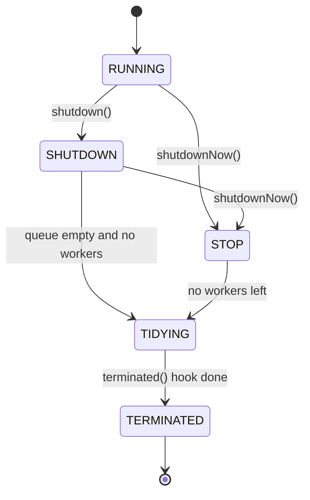
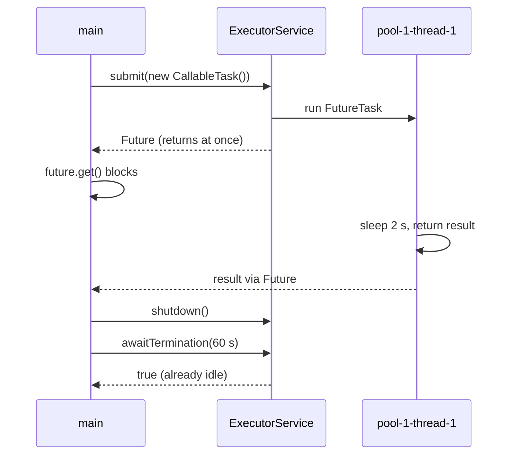

## In One Line
`ExecutorService` is the interface you actually program against: it **accepts tasks** (`execute`, `submit`, `invokeAll`, `invokeAny`), hands back **`Future`s** for results, and has a **lifecycle** you must end yourself (`shutdown`, `shutdownNow`, `awaitTermination`, and `close()` since Java 19).

## Mental Model
Picture a **dry-cleaning shop**.

| Dry cleaner | `ExecutorService` |
|---|---|
| You hand in a shirt and get a **ticket stub** | `Future<String> f = executor.submit(task)` |
| You go shopping, then come back and show the stub | `f.get()` — blocks until the result is ready |
| "If it's not ready in 10 minutes, I'll leave" | `f.get(10, TimeUnit.MINUTES)` → `TimeoutException` |
| Drop off a whole bag and wait until **every** item is done | `invokeAll(tasks)` |
| Ask three shops for the same job and take the **first good one** | `invokeAny(tasks)` — the others are cancelled |
| Closing time: sign says "no new orders", staff finish what is inside | `shutdown()` |
| Fire alarm: stop the machines, give back the bags nobody started | `shutdownNow()` → returns the never-started tasks |
| Waiting at the door until the last employee leaves | `awaitTermination(timeout)` |

`execute` is dropping clothes in a box with **no ticket**: they get cleaned, but you cannot ask about them, and if something goes wrong nobody tells you.

## Concept
### `Executor` vs `ExecutorService`
`Executor` has one method, `void execute(Runnable)`: fire and forget. `ExecutorService extends Executor, AutoCloseable` adds three families of methods:

| Family | Methods |
|---|---|
| **Submit single tasks** (get a `Future`) | `Future<?> submit(Runnable)`, `Future<T> submit(Runnable, T result)`, `Future<T> submit(Callable<T>)` |
| **Bulk execution** | `List<Future<T>> invokeAll(tasks)`, `invokeAll(tasks, timeout, unit)`, `T invokeAny(tasks)`, `invokeAny(tasks, timeout, unit)` |
| **Lifecycle** | `shutdown()`, `List<Runnable> shutdownNow()`, `isShutdown()`, `isTerminated()`, `awaitTermination(timeout, unit)`, `close()` (Java 19) |

`ThreadPoolExecutor` (subclasses `AbstractExecutorService`) also offers `isTerminating()`, which is not on the interface.

### `execute` vs `submit`
| | `execute(Runnable)` | `submit(Runnable / Callable)` |
|---|---|---|
| Declared in | `Executor` | `ExecutorService` |
| Returns | `void` | a `Future` |
| Accepts `Callable` | No | Yes |
| If the task throws | Exception escapes to the worker thread: stack trace printed by the `UncaughtExceptionHandler`, worker thread **dies and is replaced** | Exception is **caught and stored** in the `Future`; nothing printed; thread survives; `get()` throws `ExecutionException` |
| Cancel / wait for it | No | `future.cancel(...)`, `future.get()` |

How `submit` works (`AbstractExecutorService`): it wraps the task with `newTaskFor(...)` into a **`FutureTask`**, calls `execute(futureTask)`, and returns that same `FutureTask` as the `Future`. See [FutureTask](lesson:a07-executors/05-futuretask).

`submit(Runnable)` gives a `Future<?>` whose `get()` returns `null`; `submit(Runnable, result)` returns your fixed `result` on success.

> [!WARNING] A `submit`ted task that fails and whose `Future` nobody calls `get()` on **fails silently**. If you do not need a result, use `execute` (the error is at least printed), or keep the futures and check them.

### Shutting down: `shutdown()` vs `shutdownNow()`
| | `shutdown()` | `shutdownNow()` |
|---|---|---|
| New tasks | Rejected (`RejectedExecutionException` with the default policy) | Rejected |
| Tasks already **queued** | **Still run** | **Removed** from the queue and **returned** as `List<Runnable>` |
| Tasks **running** | Allowed to finish | **Interrupted** (`Thread.interrupt()` on every worker) — best effort |
| Blocks the caller? | No | No |
| Idle workers | Interrupted so they notice and exit | Interrupted |
| Pool state (TPE) | `RUNNING → SHUTDOWN` | `→ STOP` |

Both return **immediately**. Neither waits; that is `awaitTermination`'s job. Calling `shutdown()` again is harmless.

Interrupting is cooperative: a task that never calls a blocking method and never checks `Thread.currentThread().isInterrupted()` keeps running after `shutdownNow()`, and the pool stays in the "terminating" state until it finishes. And if the task catches `InterruptedException` and just carries on, the interrupt is lost.

The list returned by `shutdownNow()` contains the queued **`Runnable`s as the pool stored them** — for `submit`ted tasks those are `FutureTask` wrappers, not your original objects.

### Checking and waiting
| Method | Meaning |
|---|---|
| `isShutdown()` | `true` as soon as `shutdown()`/`shutdownNow()` was called. |
| `isTerminated()` | `true` only when shutdown was requested **and** all tasks have finished **and** all threads have exited. Never `true` without a shutdown call first. |
| `isTerminating()` (TPE only) | Shut down but not yet terminated — if this stays `true`, some task is ignoring interrupts. |
| `awaitTermination(t, unit)` | Blocks until terminated (`true`), the timeout passes (`false`), or the caller is interrupted (`InterruptedException`). It does **not** start a shutdown: without one, it just waits and returns `false`. |

### The standard shutdown idiom (from the `ExecutorService` Javadoc)
```java
void shutdownAndAwaitTermination(ExecutorService pool) {
    pool.shutdown();                                  // 1. no new tasks
    try {
        if (!pool.awaitTermination(60, TimeUnit.SECONDS)) {   // 2. wait politely
            pool.shutdownNow();                       // 3. interrupt stragglers
            if (!pool.awaitTermination(60, TimeUnit.SECONDS)) // 4. wait for them to react
                System.err.println("Pool did not terminate");
        }
    } catch (InterruptedException ex) {
        pool.shutdownNow();                           // we were interrupted: cancel everything
        Thread.currentThread().interrupt();           // and preserve the interrupt status
    }
}
```
The original example is this idiom minus step 4 and minus the re-interrupt (see Traps).

### `close()` and try-with-resources (Java 19+)
Since Java 19, `ExecutorService` is `AutoCloseable`. The default `close()` calls `shutdown()` and then waits with `awaitTermination` (in one-day steps) until the pool terminates. If the waiting thread is interrupted, it calls `shutdownNow()` once, keeps waiting, and re-asserts the interrupt flag at the end. If already terminated it does nothing.
```java
try (ExecutorService pool = Executors.newFixedThreadPool(4)) {
    pool.submit(...);
}   // close(): shutdown + wait until every submitted task is done
```
Caveat: `close()` waits with **no timeout**, and calling it from **inside one of the pool's own tasks** waits forever (the pool cannot terminate while that task is running). The `ForkJoinPool.commonPool()`'s `close()` does nothing.

### Lifecycle states (`ThreadPoolExecutor`)
| State | Accepts new tasks? | Runs queued tasks? | Reached by |
|---|---|---|---|
| `RUNNING` | Yes | Yes | construction |
| `SHUTDOWN` | No | Yes | `shutdown()` |
| `STOP` | No | No (and running ones are interrupted) | `shutdownNow()` |
| `TIDYING` | No | — | queue and workers empty; runs the `terminated()` hook |
| `TERMINATED` | No | — | `terminated()` returned; `awaitTermination` waiters wake up |

The state only moves forward. There is no restart: a terminated executor is garbage, create a new one.

### `invokeAll` and `invokeAny`
**`invokeAll(tasks)`** submits every `Callable`, **waits until all of them have completed** (normally, with an exception, or cancelled), and returns the list of `Future`s **in the same order as the input** — not completion order. Every returned future has `isDone() == true`, so `get()` never blocks, but it can still throw `ExecutionException` for a task that failed. The timed version `invokeAll(tasks, timeout, unit)` cancels (with interrupt) every task not finished when the time runs out; `get()` on those throws `CancellationException`.

**`invokeAny(tasks)`** returns the result of **one task that completed successfully** (the first *successful* one, not merely the first to finish), then cancels the rest with `cancel(true)`. Tasks that throw are skipped. If **all** tasks fail, it throws `ExecutionException` (holding the last failure). The timed version throws `TimeoutException` if no task succeeds in time. An empty collection throws `IllegalArgumentException`.

Both block the calling thread, and both throw `InterruptedException` if the caller is interrupted while waiting. Typical uses: `invokeAll` for "fan out, gather everything" (price quotes from all suppliers); `invokeAny` for "hedged requests" (query three mirrors, keep the fastest good answer).

### `ExecutorCompletionService` — results in completion order
`invokeAll` makes you wait for the slowest task before you can process anything. `ExecutorCompletionService` wraps an executor and puts each finished `Future` on an internal `BlockingQueue`, so `take()` gives you results **as they finish**. `invokeAny` is itself implemented with it.

### Memory visibility
The `ExecutorService` contract gives a **happens-before** chain: everything the submitting thread did before `submit` is visible inside the task, and everything the task did is visible to the thread that returns from `future.get()`. So passing data in and out through a task and its `Future` needs no `volatile` or locks.

### Beyond `ExecutorService`
- `CompletableFuture` (Java 8) adds non-blocking callbacks and composition on top of executors — see [CompletableFuture](lesson:a05-java8/23-completablefuture).
- Structured concurrency (`StructuredTaskScope`, preview in Java 21) treats a group of subtasks as one unit that is cancelled and joined together.

## Diagram

States only move forward. `isShutdown()` is true from SHUTDOWN onward; `isTerminated()` only at TERMINATED; `awaitTermination` wakes up there.


The original example: `submit` returns immediately, `get()` is where `main` waits, and by the time `awaitTermination` is called the only task has already finished.

## Code
@example ThreadPoolAndExecutors/ExecutorServiceExample.java

**`execute` vs `submit` when the task throws:**
```java
import java.util.concurrent.*;

public class ExecVsSubmit {
    public static void main(String[] args) throws Exception {
        ExecutorService pool = Executors.newFixedThreadPool(1);

        pool.execute(() -> {
            System.out.println("execute on " + Thread.currentThread().getName());
            throw new IllegalStateException("boom from execute");
        });
        Thread.sleep(200);

        Future<?> f = pool.submit(() -> {
            System.out.println("submit on " + Thread.currentThread().getName());
            throw new IllegalStateException("boom from submit");
        });
        Thread.sleep(200);
        System.out.println("submit: nothing printed yet, isDone=" + f.isDone());
        try {
            f.get();
        } catch (ExecutionException e) {
            System.out.println("get() -> " + e.getCause());
        }
        pool.shutdown();
    }
}
```
```output
execute on pool-1-thread-1
Exception in thread "pool-1-thread-1" java.lang.IllegalStateException: boom from execute
	at ExecVsSubmit.lambda$main$0(ExecVsSubmit.java:9)
	at java.base/java.util.concurrent.ThreadPoolExecutor.runWorker(ThreadPoolExecutor.java:1144)
	at java.base/java.util.concurrent.ThreadPoolExecutor$Worker.run(ThreadPoolExecutor.java:642)
	at java.base/java.lang.Thread.run(Thread.java:1583)
submit on pool-1-thread-2
submit: nothing printed yet, isDone=true
get() -> java.lang.IllegalStateException: boom from submit
```
The pool has one thread, yet the second task runs on `thread-2`: `thread-1` died from the `execute`d exception and was replaced. The `submit`ted exception printed nothing until `get()`.

**`shutdown()` — queued tasks still run:**
```java
import java.util.concurrent.*;

public class ShutdownDemo {
    public static void main(String[] args) throws Exception {
        ExecutorService pool = Executors.newSingleThreadExecutor();
        for (int i = 1; i <= 3; i++) {
            int id = i;
            pool.execute(() -> {
                try { Thread.sleep(300); } catch (InterruptedException e) { return; }
                System.out.println("job-" + id + " finished");
            });
        }
        pool.shutdown();                      // no new tasks; queued ones still run
        System.out.println("after shutdown(): isShutdown=" + pool.isShutdown()
                + ", isTerminated=" + pool.isTerminated());
        boolean done = pool.awaitTermination(5, TimeUnit.SECONDS);
        System.out.println("after awaitTermination: " + done + ", isTerminated=" + pool.isTerminated());
    }
}
```
```output
after shutdown(): isShutdown=true, isTerminated=false
job-1 finished
job-2 finished
job-3 finished
after awaitTermination: true, isTerminated=true
```

**`shutdownNow()` — interrupt the running task, hand back the rest:**
```java
import java.util.List;
import java.util.concurrent.*;

public class ShutdownNowDemo {
    static Runnable job(String name) {
        return new Runnable() {
            public void run() {
                System.out.println(name + " started");
                try {
                    Thread.sleep(1000);
                    System.out.println(name + " finished");
                } catch (InterruptedException e) {
                    System.out.println(name + " was interrupted");
                }
            }
            public String toString() { return name; }
        };
    }

    public static void main(String[] args) throws Exception {
        ExecutorService pool = Executors.newSingleThreadExecutor();
        pool.execute(job("job-1"));
        pool.execute(job("job-2"));
        pool.execute(job("job-3"));
        Thread.sleep(200);                        // job-1 is running, 2 and 3 are queued

        List<Runnable> neverStarted = pool.shutdownNow(); // interrupts job-1, drains the queue
        boolean terminated = pool.awaitTermination(1, TimeUnit.SECONDS);
        System.out.println("never started: " + neverStarted);
        System.out.println("terminated=" + terminated + ", isShutdown=" + pool.isShutdown()
                + ", isTerminated=" + pool.isTerminated());

        try {
            pool.execute(job("job-4"));
        } catch (RejectedExecutionException e) {
            System.out.println("job-4 rejected: pool is shut down");
        }
    }
}
```
```output
job-1 started
job-1 was interrupted
never started: [job-2, job-3]
terminated=true, isShutdown=true, isTerminated=true
job-4 rejected: pool is shut down
```
The list prints nicely only because these tasks were passed to `execute` and override `toString()`; `submit`ted tasks would show up as `FutureTask` objects.

**Submit variants, a wait without shutdown, and a task that ignores interrupts:**
```java
import java.util.*;
import java.util.concurrent.*;

public class Misc2 {
    public static void main(String[] args) throws Exception {
        ExecutorService pool = Executors.newFixedThreadPool(2);
        Future<?> f1 = pool.submit(() -> System.out.print(""));
        Future<String> f2 = pool.submit(() -> System.out.print(""), "custom result");
        System.out.println("submit(Runnable).get()         = " + f1.get());
        System.out.println("submit(Runnable, result).get() = " + f2.get());

        // awaitTermination without shutdown: just times out
        System.out.println("awaitTermination w/o shutdown  = " + pool.awaitTermination(200, TimeUnit.MILLISECONDS));

        // a task that ignores interrupts survives shutdownNow
        pool.execute(() -> {
            long end = System.nanoTime() + 1_000_000_000L;
            while (System.nanoTime() < end) { }            // busy CPU loop, never checks interrupt
        });
        Thread.sleep(100);
        pool.shutdownNow();
        ThreadPoolExecutor tpe = (ThreadPoolExecutor) pool;
        System.out.println("after shutdownNow: terminated in 200ms? " + pool.awaitTermination(200, TimeUnit.MILLISECONDS)
                + ", isTerminating=" + tpe.isTerminating());
        System.out.println("eventually terminated? " + pool.awaitTermination(5, TimeUnit.SECONDS));
    }
}
```
```output
submit(Runnable).get()         = null
submit(Runnable, result).get() = custom result
awaitTermination w/o shutdown  = false
after shutdownNow: terminated in 200ms? false, isTerminating=true
eventually terminated? true
```

**`invokeAll` and `invokeAny`** (Java 19+ `Future.state()`/`resultNow()`/`exceptionNow()` used for printing):
```java
import java.util.*;
import java.util.concurrent.*;

public class InvokeDemo {
    static Callable<String> task(String name, long ms, boolean fail) {
        return () -> {
            Thread.sleep(ms);
            if (fail) throw new IllegalStateException(name + " failed");
            return name;
        };
    }

    public static void main(String[] args) throws Exception {
        ExecutorService pool = Executors.newFixedThreadPool(3);

        // invokeAll: waits for ALL, futures come back in the SAME order as the input
        List<Callable<String>> tasks = List.of(
                task("slow", 600, false), task("fast", 100, false), task("broken", 200, true));
        long t0 = System.nanoTime();
        List<Future<String>> futures = pool.invokeAll(tasks);
        System.out.printf("invokeAll returned after ~%d ms%n", Math.round((System.nanoTime() - t0) / 1e8) * 100);
        for (Future<String> f : futures) {
            System.out.println("  " + f.state() + " -> "
                    + (f.state() == Future.State.SUCCESS ? f.resultNow() : f.exceptionNow().getMessage()));
        }

        // invokeAny: returns the first SUCCESSFUL result, cancels the rest
        String winner = pool.invokeAny(List.of(
                task("broken", 50, true), task("mirror-B", 300, false), task("mirror-A", 200, false)));
        System.out.println("invokeAny -> " + winner);

        // invokeAny when every task fails
        try {
            pool.invokeAny(List.of(task("x", 10, true), task("y", 20, true)));
        } catch (ExecutionException e) {
            System.out.println("invokeAny, all failed -> " + e.getCause().getClass().getSimpleName());
        }

        // timed invokeAll: unfinished tasks are cancelled
        List<Future<String>> timed = pool.invokeAll(
                List.of(task("quick", 50, false), task("too-slow", 5000, false)), 300, TimeUnit.MILLISECONDS);
        for (Future<String> f : timed) System.out.println("  timed: " + f.state());

        pool.shutdown();
    }
}
```
```output
invokeAll returned after ~600 ms
  SUCCESS -> slow
  SUCCESS -> fast
  FAILED -> broken failed
invokeAny -> mirror-A
invokeAny, all failed -> IllegalStateException
  timed: SUCCESS
  timed: CANCELLED
```
`invokeAll` waited for the slowest task (600 ms) and kept input order. `invokeAny` ignored `broken` even though it finished first, and returned the first **successful** result.

**`ExecutorCompletionService` + try-with-resources (Java 19+):**
```java
import java.util.concurrent.*;

public class CompletionDemo {
    public static void main(String[] args) throws Exception {
        try (ExecutorService pool = Executors.newFixedThreadPool(3)) {     // Java 19+: AutoCloseable
            CompletionService<String> cs = new ExecutorCompletionService<>(pool);
            cs.submit(() -> { Thread.sleep(600); return "A (600 ms)"; });
            cs.submit(() -> { Thread.sleep(200); return "B (200 ms)"; });
            cs.submit(() -> { Thread.sleep(400); return "C (400 ms)"; });
            for (int i = 0; i < 3; i++) {
                System.out.println("done: " + cs.take().get());   // completion order, not submit order
            }
            pool.submit(() -> System.out.println("last task runs before close() returns"));
        }                                                            // close() = shutdown + wait
        System.out.println("after try-with-resources");
    }
}
```
```output
done: B (200 ms)
done: C (400 ms)
done: A (600 ms)
last task runs before close() returns
after try-with-resources
```

## Walkthrough
**`ExecutorServiceExample.main`**
- Imports: `Callable` (a task that returns a value), `ExecutorService`, `Executors`, `Future` (the "ticket stub"), `TimeUnit` (for the timeout).
- `ExecutorService executor = Executors.newSingleThreadExecutor();` — one worker thread, unbounded queue, tasks run one at a time in submission order. The object is a non-reconfigurable wrapper around a `ThreadPoolExecutor(1, 1, ...)`.
- `Future<String> future = executor.submit(new CallableTask());` — `submit(Callable<T>)` wraps the task in a `FutureTask<String>`, queues it, and **returns immediately**. The type parameter flows through: `Callable<String>` → `Future<String>`. The single pool thread (`pool-1-thread-1`) is created now and starts `call()`.
- `String result = future.get();` — `main` **blocks** here for about 2 seconds, until `call()` returns. `get()` can throw `InterruptedException` (main interrupted while waiting), `ExecutionException` (the task threw — the original exception is `getCause()`) or `CancellationException` (unchecked, task cancelled).
- `System.out.println("Result from callable task: " + result);` — prints `Result from callable task: Callable task completed!`, exactly as the inline `// Output:` comment says. The output is deterministic: one task, one print.
- `catch (Exception e) { e.printStackTrace(); }` — one broad catch for all three checked/unchecked failures (see Traps).
- `executor.shutdown();` — no new tasks accepted; the pool will terminate once idle. Here the only task is already finished, so termination is almost instant.
- `if (!executor.awaitTermination(60, TimeUnit.SECONDS)) { executor.shutdownNow(); }` — wait up to 60 s for termination; if it does not happen, interrupt whatever is still running. Here it returns `true` right away, so `shutdownNow()` is not called.
- `catch (InterruptedException e) { executor.shutdownNow(); }` — if `main` itself is interrupted while waiting, force the pool down.
- The program ends: `main` returns, the pool thread has exited, the JVM stops. Total run time is about 2 seconds.

**`CallableTask`**
- `class CallableTask implements Callable<String>` — package-private class in the same file.
- `public String call() throws Exception` — unlike `Runnable.run()`, `call()` **returns a value** and may **throw checked exceptions**, which is why `Thread.sleep(2000)` needs no try/catch here: any exception would be captured by the `FutureTask` and rethrown from `get()` wrapped in `ExecutionException`.
- `return "Callable task completed!";` — becomes the value of `future.get()`.

## Traps
> [!ERRATA] The `catch (InterruptedException e) { executor.shutdownNow(); }` block drops the interrupt: after catching it, the Javadoc idiom also calls `Thread.currentThread().interrupt()` so callers can still see that the thread was asked to stop. It also skips the second `awaitTermination` after `shutdownNow()`, so the method may return while tasks are still running. Harmless in this tiny `main`, wrong in library code.

> [!ERRATA] `catch (Exception e)` around `future.get()` treats "the task failed" (`ExecutionException`), "I was interrupted" (`InterruptedException`, whose flag is then lost) and "the task was cancelled" (`CancellationException`) the same way. Catch them separately, unwrap `e.getCause()` for `ExecutionException`, and restore the interrupt flag for `InterruptedException`.

- **`future.get()` with no timeout can block forever** if the task hangs. Prefer `get(timeout, unit)` and cancel on `TimeoutException`.
- **`shutdown()` does not wait.** Code after it runs while tasks are still in progress; use `awaitTermination` or `close()`.
- **`awaitTermination` does not shut anything down.** Without a prior `shutdown()` it simply waits out the timeout and returns `false`.
- **`isTerminated()` is `false` right after `shutdown()`** while queued tasks are still pending.
- **`shutdownNow()` cannot kill a task.** It interrupts; a task that never checks the flag or swallows `InterruptedException` keeps running (`isTerminating()` stays `true`).
- **Submitting after shutdown** throws `RejectedExecutionException`. There is no restart.
- **Lost exceptions**: `submit` + never calling `get()` = errors vanish.
- **`invokeAll` returns futures in input order**, not completion order; and it waits for the slowest task. Use `ExecutorCompletionService` to process results as they arrive.
- **`invokeAny` returns the first *successful* result**, not the first to finish; if every task fails you get `ExecutionException`.
- **Calling `close()` (or `awaitTermination` with a long timeout) from inside one of the pool's own tasks** never returns: the pool cannot terminate while that task runs.
- **Deadlock by self-submission**: in a single-thread (or saturated fixed) pool, a task that submits another task to the same pool and waits on its `get()` waits forever — the only thread is busy waiting.

## Tips & Tricks
- **"Submit gives a Stub; Execute is Empty-handed."** `submit` → `Future`; `execute` → nothing.
- **"shutdown = Stop accepting; shutdownNow = Stop everything, Now."** And remember `shutdownNow` *returns* the never-started tasks: "Now gives back the Not-started."
- **Shutdown order to memorise: `shutdown` → `awaitTermination` → `shutdownNow` → `awaitTermination` → re-interrupt if interrupted.**
- **Java 19+: use try-with-resources** for short-lived executors. For long-lived ones (a service's pool), shut down in the application's stop hook.
- **`invokeAll` = "wait for All"; `invokeAny` = "Any one good answer".** Futures from `invokeAll` are all done, so `get()` never blocks.
- **Results as they come → `ExecutorCompletionService`** (or `CompletableFuture`).
- **Always call `get()` (or check `state()`) on futures you care about** — it is the only place `submit`ted failures surface.
- Java 19+ `Future.state()`, `resultNow()`, `exceptionNow()` let you inspect finished futures without try/catch — perfect after `invokeAll`.

## Interview Q&A
### [Basic] What is the difference between `Executor` and `ExecutorService`?
`Executor` is the minimal interface — `void execute(Runnable)` — that decouples task submission from how the task is run. `ExecutorService` extends it with **lifecycle management** (`shutdown`, `shutdownNow`, `isShutdown`, `isTerminated`, `awaitTermination`, and `close` since Java 19) and **result-bearing submission** (`submit` returning a `Future`, `invokeAll`, `invokeAny`). In practice you always use `ExecutorService` because you need to shut the pool down.

**Follow-up:** *And `Executors`?* — A utility class with static factory methods (`newFixedThreadPool`, …) that return `ExecutorService` implementations; it is not an interface.

### [Basic] What is the difference between `execute()` and `submit()`?
`execute(Runnable)` returns nothing; if the task throws, the exception reaches the worker thread's uncaught-exception handler (printed to stderr) and the worker is replaced. `submit` accepts a `Runnable` or a `Callable`, wraps it in a `FutureTask` and returns a `Future`; exceptions are captured in the `Future` and surface only when you call `get()`, wrapped in `ExecutionException`. `submit` also lets you cancel the task and wait for it.

**Follow-up:** *Which one hides bugs?* — `submit` if you never call `get()`: the exception is stored and never reported.

### [Basic] What is the difference between `shutdown()` and `shutdownNow()`?
`shutdown()` starts an orderly shutdown: no new tasks are accepted, but already-queued tasks still run, and running tasks finish normally. `shutdownNow()` also rejects new tasks, but **removes** the queued tasks and returns them as a `List<Runnable>`, and **interrupts** running tasks. Neither method waits — use `awaitTermination`. Interrupting is best effort: tasks must respond to interrupts to actually stop.

**Follow-up:** *What is in the returned list for `submit`ted tasks?* — The `FutureTask` wrappers the pool queued, not your original `Callable`s.

### [Intermediate] Explain `isShutdown()`, `isTerminated()` and `awaitTermination()`.
`isShutdown()` becomes `true` the moment `shutdown()` or `shutdownNow()` is called. `isTerminated()` is `true` only after a shutdown **and** all tasks finished **and** all worker threads exited — it can never be true without a shutdown. `awaitTermination(timeout, unit)` blocks until terminated (returns `true`), the timeout expires (`false`), or the waiting thread is interrupted (`InterruptedException`). It does not initiate shutdown itself.

**Follow-up:** *How do you wait for all tasks without shutting down the pool?* — Keep the `Future`s and `get()` each one, use `invokeAll`, or use a `CountDownLatch`/`CompletableFuture.allOf`.

### [Intermediate] How do you shut down an `ExecutorService` correctly?
Two-phase: call `shutdown()` to stop new work; `awaitTermination` with a sensible timeout; if it returns `false`, call `shutdownNow()` to interrupt stragglers and `awaitTermination` again, logging if it still fails. If the waiting thread gets `InterruptedException`, call `shutdownNow()` and restore the interrupt with `Thread.currentThread().interrupt()`. In Java 19+, `try (ExecutorService es = ...) { }` does shutdown-and-wait automatically, but without a timeout.

**Follow-up:** *What if tasks ignore interrupts?* — The pool stays in the terminating state; you must make tasks cooperative (check `isInterrupted()`, use interruptible blocking calls) or, as a last resort, make threads daemon so they do not block JVM exit.

### [Intermediate] What is the difference between `invokeAll` and `invokeAny`?
`invokeAll(tasks)` runs all tasks, **blocks until every one has completed**, and returns their futures in input order — all done, some possibly failed. The timed version cancels tasks still running at the deadline. `invokeAny(tasks)` returns the result of the **first task to complete successfully** and cancels the others; failing tasks are skipped, and if all fail it throws `ExecutionException`; the timed version throws `TimeoutException`. Both throw `InterruptedException` if the caller is interrupted, and `invokeAny` of an empty list throws `IllegalArgumentException`.

**Follow-up:** *Give a use case for `invokeAny`.* — Hedged requests: ask several replicas or mirrors for the same data and take the fastest successful answer.

### [Intermediate] What is `ExecutorCompletionService` for?
It combines an `Executor` with a `BlockingQueue` of completed `Future`s. You `submit` tasks through it and call `take()` (or `poll`) to receive futures **in the order they complete**. That lets you process fast results immediately instead of waiting for the slowest, like `invokeAll` does, or stop early after the first N results. `AbstractExecutorService.invokeAny` is built on it.

**Follow-up:** *What is the modern alternative?* — `CompletableFuture` with `thenAccept` callbacks, or `CompletableFuture.anyOf`/`allOf`.

### [Advanced] What does `close()` do on an `ExecutorService`, and what are its pitfalls?
Added in Java 19 (`ExecutorService extends AutoCloseable`). The default implementation: if not terminated, call `shutdown()`, then loop on `awaitTermination(1, DAYS)` until terminated. If the calling thread is interrupted while waiting, it calls `shutdownNow()` once, keeps waiting for running tasks, and re-asserts the interrupt status before returning. Pitfalls: no timeout (a hung task hangs `close()`); calling it from within one of the pool's own tasks waits forever; `ForkJoinPool.commonPool().close()` is a no-op.

**Follow-up:** *Does `close()` run tasks that were queued?* — Yes, it uses `shutdown()` first, so queued tasks still run (unless it gets interrupted and switches to `shutdownNow()`).

### [Advanced] What memory-visibility guarantees does an `ExecutorService` give?
Actions in a thread before it submits a task **happen-before** any action of that task, and actions of the task **happen-before** a successful return from `Future.get()` in another thread. So you can build an object, submit a task that reads it, and read the task's result from `get()` without extra synchronisation. The guarantee does not cover data shared *between* concurrently running tasks — that still needs thread-safe structures.

**Follow-up:** *Does `invokeAll` give the same guarantee?* — Yes, it is built on the same futures; after it returns, results read via `get()` are safely visible.

### [Advanced] Can a task submitted to an executor deadlock that executor?
Yes — **thread-starvation deadlock**. In a single-thread executor, if task A submits task B to the same executor and then calls `b.get()`, B waits in the queue for the only thread, which is blocked in A waiting for B. The same happens in a fixed pool when all N threads block on subtasks queued behind them. Fixes: do not block on subtasks from inside pool tasks, use a separate pool for subtasks, size the pool for the dependency depth, or use `ForkJoinPool`/`CompletableFuture`, which avoid blocking joins.

**Follow-up:** *How does `ForkJoinPool` avoid it?* — A thread calling `join()` on a forked subtask runs pending tasks itself (work stealing / helping) instead of just blocking.

## Quiz
### What does the original `ExecutorServiceExample` print, and roughly how long does it take?
- [x] `Result from callable task: Callable task completed!` after about 2 seconds
- [ ] The same line after about 60 seconds, because of `awaitTermination(60, ...)`
- [ ] Nothing, because `shutdown()` cancels the task
- [ ] `null`, because `submit` returns before the task finishes
> `get()` blocks about 2 s until `call()` returns. By the time `awaitTermination` runs, the only task is done, so it returns `true` immediately — the 60 s is a maximum, not a delay. `submit` does return early, but `get()` waits for the value.

### What is printed right after `shutdown()` while three 300 ms jobs are still queued/running?
```java
pool.shutdown();
System.out.println("isShutdown=" + pool.isShutdown() + ", isTerminated=" + pool.isTerminated());
```
- [ ] isShutdown=false, isTerminated=false
- [x] isShutdown=true, isTerminated=false
- [ ] isShutdown=true, isTerminated=true
- [ ] It throws IllegalStateException
> `isShutdown()` flips immediately; `isTerminated()` waits until every queued task has run and the threads are gone. `shutdown()` does not wait, so the jobs are still pending. Verified output: `after shutdown(): isShutdown=true, isTerminated=false`.

### One thread is running `job-1`; `job-2` and `job-3` are queued. What does `shutdownNow()` return?
- [ ] An empty list
- [ ] `[job-1, job-2, job-3]`
- [x] `[job-2, job-3]`
- [ ] `[job-1]`
> It returns only the tasks that **never started**, removed from the queue. The running `job-1` is interrupted, not returned. Verified output: `never started: [job-2, job-3]`.

### `invokeAny` gets three tasks: `broken` (fails after 50 ms), `mirror-B` (300 ms), `mirror-A` (200 ms). What does it return?
- [ ] It throws ExecutionException, because `broken` finished first
- [ ] "mirror-B", because it was submitted before mirror-A
- [x] "mirror-A"
- [ ] A list with both mirror results
> `invokeAny` returns the first task to **complete successfully**; failures are skipped. `mirror-A` succeeds first (200 ms), and `mirror-B` is then cancelled. It only throws `ExecutionException` if every task fails.

### What does this print?
```java
ExecutorService pool = Executors.newFixedThreadPool(2);
Future<?> f = pool.submit(() -> System.out.print(""));
System.out.println(f.get());
pool.shutdown();
```
- [ ] An empty line
- [x] null
- [ ] The Runnable's toString()
- [ ] Compile error: Runnable cannot be submitted
> `submit(Runnable)` returns a `Future<?>` whose `get()` yields `null` on success. Use `submit(Runnable, result)` to return a fixed value. The empty `print("")` prints nothing, so the only visible output is `null`.

### Spot the bug: why does this program hang forever?
```java
ExecutorService single = Executors.newSingleThreadExecutor();
Future<Integer> outer = single.submit(() -> {
    Future<Integer> inner = single.submit(() -> 42);
    return inner.get() + 1;
});
System.out.println(outer.get());
```
- [ ] `inner.get()` needs a timeout argument
- [ ] Lambdas cannot return values to `submit`
- [x] The only thread runs `outer`, which waits for `inner`, which is queued behind `outer`
- [ ] `submit` cannot be called from inside a task
> Thread-starvation deadlock: `inner` can only run on the single worker thread, which is blocked inside `outer` waiting for `inner`. Calling `submit` from a task is legal; blocking on the result with no free thread is the bug. A timeout would only turn the hang into a `TimeoutException`.

### What does `awaitTermination(200, MILLISECONDS)` return if `shutdown()` was never called and the pool is idle?
- [ ] true, because no tasks are running
- [x] false, after waiting 200 ms
- [ ] It throws IllegalStateException
- [ ] It shuts the pool down and returns true
> An idle pool is not a terminated pool. Termination requires a shutdown request first, so `awaitTermination` just waits out the timeout and returns `false`. Verified: `awaitTermination w/o shutdown  = false`.

## Takeaways
- `ExecutorService` = `Executor` + lifecycle (`shutdown`, `shutdownNow`, `awaitTermination`, `close`) + result-bearing submission (`submit`, `invokeAll`, `invokeAny`).
- `execute` returns nothing and lets exceptions kill the worker (printed); `submit` wraps the task in a `FutureTask` and stores exceptions until `get()` throws `ExecutionException`.
- `shutdown()` rejects new tasks but runs queued ones; `shutdownNow()` interrupts running tasks and returns the never-started ones. Neither waits.
- `isTerminated()` needs a prior shutdown and all tasks done; `awaitTermination` waits for that and returns `false` on timeout.
- Standard idiom: `shutdown` → `awaitTermination` → `shutdownNow` → `awaitTermination`, and restore the interrupt flag if interrupted; Java 19+ try-with-resources calls `close()` (shutdown + wait, no timeout).
- `invokeAll` waits for all tasks and returns futures in input order; `invokeAny` returns the first successful result and cancels the rest.
- `ExecutorCompletionService` hands you results in completion order.
- A task that blocks on another task in the same saturated pool causes thread-starvation deadlock.
