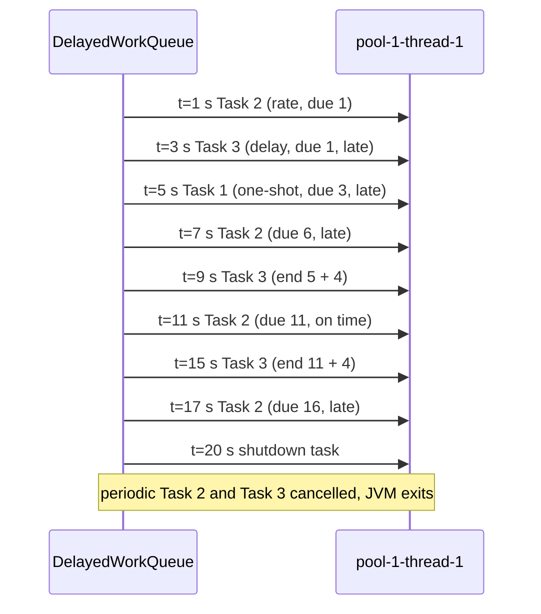
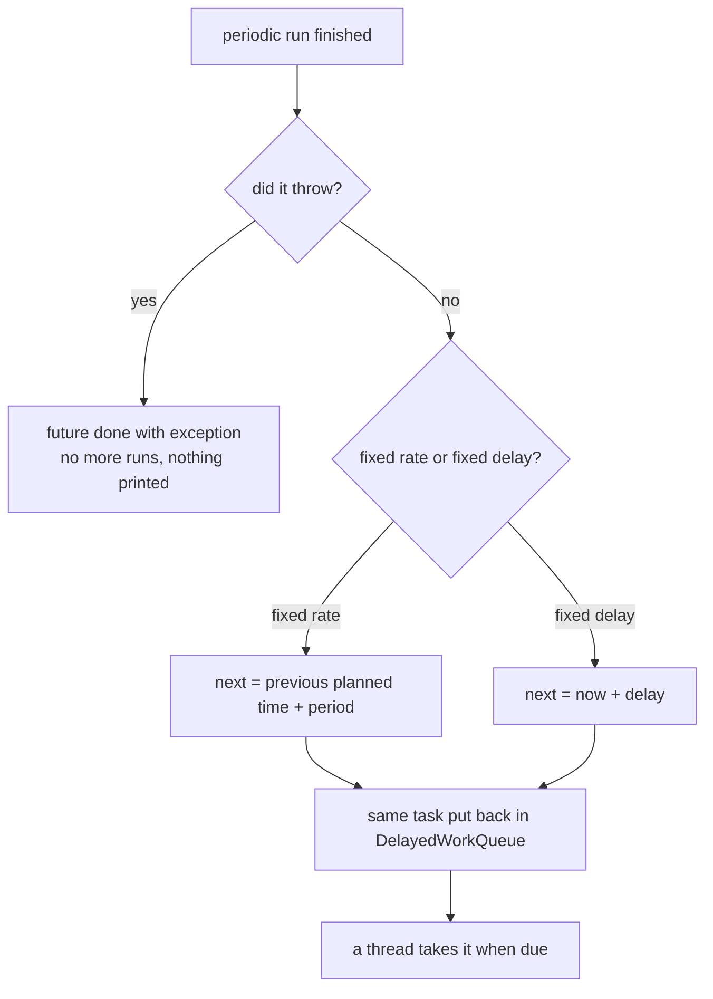
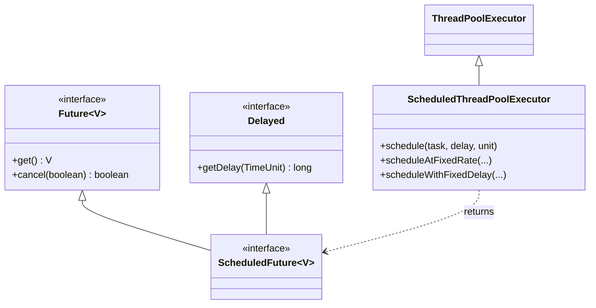

## In One Line
`ScheduledExecutorService` runs tasks **later** (`schedule`) or **repeatedly** (`scheduleAtFixedRate`, `scheduleWithFixedDelay`) on a pool of threads, and is the modern, safer replacement for `java.util.Timer`.

## Mental Model
Think of a **hospital nurse with a medication chart** (one nurse = one pool thread).

| Hospital | `ScheduledExecutorService` |
|---|---|
| "Give patient A a painkiller in 3 hours" | `schedule(task, 3, HOURS)` — one-shot |
| "Antibiotic at 8:00, 14:00, 20:00" — tied to the **clock**, whatever happened before | `scheduleAtFixedRate` — next run = previous **planned** time + period |
| "Check the drip again 4 hours **after you finish** the last check" | `scheduleWithFixedDelay` — next run = **end** of last run + delay |
| The chart, sorted by next due time | the `DelayedWorkQueue` (a heap ordered by trigger time) |
| One nurse busy with patient B, so A's dose is late | tasks delay each other when threads are busy — a delay is a **minimum**, not a promise |
| A dose that went badly: the doctor crosses the whole prescription off | a periodic task that throws is **never run again** |
| End of shift: remaining regular rounds are cancelled, one-off doses still given | `shutdown()` default policies |

## Concept
### The four scheduling methods
`ScheduledExecutorService extends ExecutorService` and adds:

| Method | Runs | Returns |
|---|---|---|
| `schedule(Runnable, delay, unit)` | once, after `delay` | `ScheduledFuture<?>` (`get()` → `null`) |
| `schedule(Callable<V>, delay, unit)` | once, after `delay` | `ScheduledFuture<V>` (`get()` → the value) |
| `scheduleAtFixedRate(Runnable, initialDelay, period, unit)` | at `initialDelay`, `initialDelay + period`, `initialDelay + 2×period`, … | `ScheduledFuture<?>` whose `get()` **never returns normally** |
| `scheduleWithFixedDelay(Runnable, initialDelay, delay, unit)` | first at `initialDelay`, then `delay` after **each run ends** | same |

Periodic methods only take a `Runnable` (a result would be meaningless). `period`/`delay` must be `> 0` (else `IllegalArgumentException`); a zero or negative *initial* delay means "now". `execute(r)` and `submit(r)` on a scheduled pool are simply `schedule(r, 0, NANOSECONDS)`.

`ScheduledFuture<V>` extends `Future<V>` and `Delayed`, so besides `get`/`cancel`/`isDone` it has `getDelay(unit)`: the remaining time until the next run.

### Fixed rate vs fixed delay
| | `scheduleAtFixedRate` | `scheduleWithFixedDelay` |
|---|---|---|
| Next start is computed from | the previous **scheduled** start + period | the previous run's **end** + delay |
| Gap between runs | constant start-to-start (if runs are short) | constant end-to-start |
| A run takes longer than the period | next run starts **late**, right after; overdue runs then run **back-to-back to catch up** | no catch-up; the whole timeline shifts |
| Overlapping runs of the same task? | **Never** | **Never** |
| Good for | clock-like jobs: metrics every 10 s, heartbeats | "poll, then rest": polling a queue or an API, cleanup jobs |

Internally the task stores `period > 0` for fixed rate and `period < 0` for fixed delay; after each run, fixed rate does `time += period` and fixed delay does `time = now + delay`.

### How `ScheduledThreadPoolExecutor` works
- `Executors.newScheduledThreadPool(n)` = `new ScheduledThreadPoolExecutor(n)`, a subclass of `ThreadPoolExecutor` with core size `n`, max `Integer.MAX_VALUE`, and an **unbounded `DelayedWorkQueue`**. Because the queue never refuses, the pool effectively stays at `n` threads and `maximumPoolSize` is useless. Do not set core size to 0 or allow core threads to time out — there may be no thread when a task becomes due.
- Every task is wrapped in a **`ScheduledFutureTask`** (a `FutureTask` subclass) holding `time` (a `System.nanoTime()` trigger time), `period` and a **sequence number**.
- `DelayedWorkQueue` is a **binary heap** ordered by `time`, then by sequence number, so tasks due at the same moment run in **submission order (FIFO)**. Its `take()` blocks until the head is due; one "leader" thread waits exactly until then, others wait indefinitely (leader–follower pattern), avoiding needless wake-ups.
- A worker takes the due task and runs it. For a **periodic** task it calls `FutureTask.runAndReset()` (runs without storing a result and returns the task to `NEW`), computes the next time, and **puts the same task back** in the queue. Since a task is re-queued only after its run finishes, two runs of the same task can never overlap, even with many threads.
- If the run throws, `runAndReset` records the exception, the task is **not re-queued**, and its future completes exceptionally.
- Times use `System.nanoTime()`, so changing the system clock does not affect schedules (unlike `Timer`, which uses `System.currentTimeMillis()`).

### Exceptions in periodic tasks
From the Javadoc: if any execution throws, **subsequent executions are suppressed**, `isDone()` becomes `true`, and `get()` throws `ExecutionException`. Nothing is printed — the exception lives inside the future, and nobody calls `get()` on a periodic future. The job just stops forever. **Always wrap the body of a periodic task in `try/catch`** and log.

The same silence applies to `execute()` on a scheduled pool: because it becomes `schedule(r, 0, ...)`, an exception is stored in a future nobody holds, not printed like with a plain `ThreadPoolExecutor`.

### Cancelling and shutting down
- **Stop one periodic task**: keep its `ScheduledFuture` and call `cancel(false)` (let a running execution finish) or `cancel(true)` (interrupt it).
- A cancelled task stays in the queue until its time comes, unless you call `setRemoveOnCancelPolicy(true)` (Java 7+) or `purge()`. With thousands of cancelled long-delay tasks (e.g. timeouts that usually do not fire) this matters for memory.
- **`shutdown()`** behaviour is controlled by two policies:

| Policy | Default | Effect of `shutdown()` |
|---|---|---|
| `setContinueExistingPeriodicTasksAfterShutdownPolicy` | `false` | Periodic tasks are **cancelled** |
| `setExecuteExistingDelayedTasksAfterShutdownPolicy` | `true` | One-shot delayed tasks **still run** when due |

So by default, `shutdown()` stops the repeating jobs but still fires the pending one-shot ones. `shutdownNow()` cancels everything and interrupts running tasks.

### `ScheduledExecutorService` vs `java.util.Timer`
| | `Timer` (Java 1.3) | `ScheduledThreadPoolExecutor` (Java 5) |
|---|---|---|
| Threads | exactly one | configurable pool |
| A task throws | the Timer thread **dies**; all other tasks stop; later `schedule` calls throw `IllegalStateException: Timer already cancelled.` | only that task stops; the pool keeps working |
| Clock | `System.currentTimeMillis()` — wall-clock changes shift schedules | `System.nanoTime()` — monotonic |
| Task type | must extend `TimerTask` | any `Runnable` / `Callable` |
| Result / cancel handle | none (`TimerTask.cancel()`) | `ScheduledFuture` |

Both have fixed-rate and fixed-delay modes. There is no reason to use `Timer` in new code.

### Choosing the pool size and alternatives
- With **one thread**, every task delays every other task (visible in the original example). Size the pool for the number of jobs that may be due at the same time, and keep scheduled tasks short: if a job is long, let the scheduler just **trigger** it and hand the work to another executor.
- For calendar schedules ("every weekday at 09:00") compute the initial delay with `java.time` and reschedule after each run (fixed rate drifts across daylight-saving changes), or use a scheduler library (Quartz, Spring `@Scheduled(cron = ...)`).
- Java 21 virtual threads have no scheduled executor of their own; a common pattern is a small platform-thread scheduler that submits the real work to `newVirtualThreadPerTaskExecutor()`.

## Diagram

The original example on its single thread (each run takes 2 s). Fixed rate stays anchored to 1, 6, 11, 16…; fixed delay always waits 4 s after the previous end; the one-shot Task 1 is 2 s late because the only thread was busy.


How a periodic `ScheduledFutureTask` is re-queued after every run — and why one exception ends the schedule.


The handle you get back is both a `Future` (cancel, get) and `Delayed` (time left until the next run).

## Code
@example ThreadPoolAndExecutors/ScheduledExecutorServiceExample.java

**The same program with timestamps** (to see when each run really starts):
```java
import java.util.concurrent.*;

public class SchedTimeline {
    static final long T0 = System.nanoTime();
    static String t() { return String.format("t=%4.1fs", (System.nanoTime() - T0) / 1e9); }

    public static void main(String[] args) {
        ScheduledExecutorService scheduler = Executors.newScheduledThreadPool(1);
        scheduler.schedule(task("Task 1"), 3, TimeUnit.SECONDS);
        scheduler.scheduleAtFixedRate(task("Task 2"), 1, 5, TimeUnit.SECONDS);
        scheduler.scheduleWithFixedDelay(task("Task 3"), 1, 4, TimeUnit.SECONDS);
        scheduler.schedule(() -> {
            scheduler.shutdown();
            System.out.println(t() + " Scheduler shutdown initiated");
        }, 20, TimeUnit.SECONDS);
    }

    static Runnable task(String name) {
        return () -> {
            System.out.println(t() + " start " + name);
            try { Thread.sleep(2000); } catch (InterruptedException e) { }
            System.out.println(t() + " end   " + name);
        };
    }
}
```
```output
t= 1.0s start Task 2
t= 3.1s end   Task 2
t= 3.1s start Task 3
t= 5.1s end   Task 3
t= 5.1s start Task 1
t= 7.1s end   Task 1
t= 7.1s start Task 2
t= 9.1s end   Task 2
t= 9.1s start Task 3
t=11.1s end   Task 3
t=11.1s start Task 2
t=13.1s end   Task 2
t=15.1s start Task 3
t=17.1s end   Task 3
t=17.1s start Task 2
t=19.1s end   Task 2
t=20.0s Scheduler shutdown initiated
```

**Fixed rate catches up; fixed delay shifts.** Period/delay 200 ms, and only the 2nd run is slow (700 ms):
```java
import java.util.*;
import java.util.concurrent.*;

public class RateVsDelay {
    static List<Long> trace(boolean fixedRate) throws Exception {
        ScheduledExecutorService ses = Executors.newSingleThreadScheduledExecutor();
        List<Long> starts = Collections.synchronizedList(new ArrayList<>());
        long t0 = System.nanoTime();
        Runnable job = () -> {
            long ms = (System.nanoTime() - t0) / 1_000_000;
            starts.add(Math.round(ms / 100.0) * 100);             // round to 100 ms
            if (starts.size() == 2) sleep(700);                    // 2nd run is slow (700 ms)
        };
        if (fixedRate) ses.scheduleAtFixedRate(job, 0, 200, TimeUnit.MILLISECONDS);
        else           ses.scheduleWithFixedDelay(job, 0, 200, TimeUnit.MILLISECONDS);
        Thread.sleep(1350);
        ses.shutdownNow();
        return starts;
    }
    static void sleep(long ms) { try { Thread.sleep(ms); } catch (InterruptedException e) { } }

    public static void main(String[] args) throws Exception {
        System.out.println("fixed rate  starts (ms): " + trace(true));
        System.out.println("fixed delay starts (ms): " + trace(false));
    }
}
```
```output
fixed rate  starts (ms): [0, 200, 900, 900, 900, 1000, 1200]
fixed delay starts (ms): [0, 200, 1100, 1300]
```
Fixed rate owed runs at 400, 600 and 800 ms, so it fires them **back-to-back at 900 ms**, then returns to the 1000/1200 grid. Fixed delay simply waits 200 ms after the slow run ends (900 + 200 = 1100).

**One exception silently ends a periodic task:**
```java
import java.util.concurrent.*;
import java.util.concurrent.atomic.AtomicInteger;

public class PeriodicException {
    public static void main(String[] args) throws Exception {
        ScheduledExecutorService ses = Executors.newSingleThreadScheduledExecutor();
        AtomicInteger run = new AtomicInteger();
        ScheduledFuture<?> f = ses.scheduleAtFixedRate(() -> {
            int n = run.incrementAndGet();
            System.out.println("run " + n);
            if (n == 3) throw new RuntimeException("bad data in run " + n);
        }, 0, 100, TimeUnit.MILLISECONDS);

        Thread.sleep(1000);                 // would be ~10 runs if nothing went wrong
        System.out.println("isDone=" + f.isDone() + ", runs=" + run.get());
        try {
            f.get();
        } catch (ExecutionException e) {
            System.out.println("get() -> " + e.getCause().getMessage());
        }
        ses.shutdown();
    }
}
```
```output
run 1
run 2
run 3
isDone=true, runs=3
get() -> bad data in run 3
```
No stack trace was printed. Without the explicit `f.get()` you would never know why the job stopped.

**`schedule(Callable)`, swallowed `execute` exceptions, cancel/purge, and shutdown policies:**
```java
import java.util.concurrent.*;

public class SchedMisc {
    public static void main(String[] args) throws Exception {
        ScheduledThreadPoolExecutor stpe = new ScheduledThreadPoolExecutor(1);

        // 1. schedule(Callable) returns a ScheduledFuture with a result and a delay
        ScheduledFuture<String> answer = stpe.schedule(() -> "hello later", 300, TimeUnit.MILLISECONDS);
        System.out.println("delay > 0 right after scheduling? " + (answer.getDelay(TimeUnit.MILLISECONDS) > 0));
        System.out.println("get() -> " + answer.get());

        // 2. execute() on a scheduled pool wraps the task: the exception is NOT printed
        stpe.execute(() -> { throw new IllegalStateException("swallowed"); });
        Thread.sleep(100);
        System.out.println("execute() exception printed? no - it is stored in an unreachable future");

        // 3. cancelled tasks stay in the queue unless removeOnCancel is set
        ScheduledFuture<?> far = stpe.schedule(() -> {}, 1, TimeUnit.HOURS);
        far.cancel(false);
        System.out.println("queue size after cancel (default): " + stpe.getQueue().size());
        stpe.purge();                                  // removes already-cancelled tasks
        System.out.println("queue size after purge(): " + stpe.getQueue().size());
        stpe.setRemoveOnCancelPolicy(true);
        ScheduledFuture<?> far2 = stpe.schedule(() -> {}, 1, TimeUnit.HOURS);
        far2.cancel(false);
        System.out.println("queue size after cancel (removeOnCancel): " + stpe.getQueue().size());

        // 4. what survives shutdown() by default?
        stpe.schedule(() -> System.out.println("delayed task still runs after shutdown"), 200, TimeUnit.MILLISECONDS);
        ScheduledFuture<?> ticker = stpe.scheduleAtFixedRate(() -> {}, 0, 50, TimeUnit.MILLISECONDS);
        System.out.println("continue periodic after shutdown? " + stpe.getContinueExistingPeriodicTasksAfterShutdownPolicy()
                + ", run delayed after shutdown? " + stpe.getExecuteExistingDelayedTasksAfterShutdownPolicy());
        stpe.shutdown();
        System.out.println("periodic ticker cancelled by shutdown? " + ticker.isCancelled());
        System.out.println("terminated: " + stpe.awaitTermination(2, TimeUnit.SECONDS));
    }
}
```
```output
delay > 0 right after scheduling? true
get() -> hello later
execute() exception printed? no - it is stored in an unreachable future
queue size after cancel (default): 1
queue size after purge(): 0
queue size after cancel (removeOnCancel): 0
continue periodic after shutdown? false, run delayed after shutdown? true
periodic ticker cancelled by shutdown? true
delayed task still runs after shutdown
terminated: true
```

**Why `Timer` is worse** — one bad task kills the whole timer:
```java
import java.util.*;

public class TimerDemo {
    public static void main(String[] args) throws Exception {
        Timer timer = new Timer();
        timer.schedule(new TimerTask() {
            public void run() { throw new RuntimeException("one bad task"); }
        }, 0);
        Thread.sleep(200);
        try {
            timer.schedule(new TimerTask() { public void run() { System.out.println("never runs"); } }, 0);
        } catch (IllegalStateException e) {
            System.out.println("next schedule -> IllegalStateException: " + e.getMessage());
        }
    }
}
```
```output
Exception in thread "Timer-0" java.lang.RuntimeException: one bad task
	at TimerDemo$1.run(TimerDemo.java:7)
	at java.base/java.util.TimerThread.mainLoop(Timer.java:566)
	at java.base/java.util.TimerThread.run(Timer.java:516)
next schedule -> IllegalStateException: Timer already cancelled.
```

## Walkthrough
**`ScheduledExecutorServiceExample.main`**
- Imports: `Executors` (factory), `ScheduledExecutorService` (the interface), `TimeUnit` (units for delays).
- `ScheduledExecutorService scheduler = Executors.newScheduledThreadPool(1);` — a `ScheduledThreadPoolExecutor` with **one** thread (`pool-1-thread-1`) and a delay queue. Everything below shares that single thread, which is why the tasks delay each other.
- `scheduler.schedule(new RunnableTask("Task 1"), 3, TimeUnit.SECONDS);` — one-shot, **eligible** at t = 3 s.
- `scheduler.scheduleAtFixedRate(new RunnableTask("Task 2"), 1, 5, TimeUnit.SECONDS);` — planned starts at 1, 6, 11, 16, 21 s…
- `scheduler.scheduleWithFixedDelay(new RunnableTask("Task 3"), 1, 4, TimeUnit.SECONDS);` — first at 1 s, then 4 s after each run **ends**.
- `scheduler.schedule(() -> { scheduler.shutdown(); System.out.println("Scheduler shutdown initiated"); }, 20, TimeUnit.SECONDS);` — a one-shot lambda (a `Runnable`) that shuts the scheduler down from inside its own thread at t = 20 s. That is safe because `shutdown()` does not wait. (Calling `awaitTermination` or `close()` there would wait for itself.)
- `main` then **returns immediately** — all four calls only put tasks in the queue. The JVM keeps running because the pool thread is non-daemon.

**`RunnableTask`**
- `class RunnableTask implements Runnable` with a `private String taskName` set in the constructor — a plain labelled task (it could be `final`).
- `run()` prints `pool-1-thread-1 (Start) <name>`, calls `processTask()` (a 2-second `Thread.sleep`), then prints `(End)`. Every execution therefore occupies the only thread for 2 s.
- `processTask()` catches `InterruptedException` and prints the stack trace (see Traps).

**The timeline** (confirmed by the timestamped copy in Code; each run takes 2 s):

| Time | What runs | Why |
|---|---|---|
| 1–3 s | Task 2 | Tasks 2 and 3 are both due at 1 s; Task 2 was scheduled first (earlier trigger time / lower sequence number). |
| 3–5 s | Task 3 | Due at 1 s, 2 s late. Also earlier than Task 1 (due 3 s). |
| 5–7 s | Task 1 | Due at 3 s but the thread was busy: the 3-second delay is a *minimum*. |
| 7–9 s | Task 2 | Planned for 6 s, late. |
| 9–11 s | Task 3 | Previous run ended at 5 s, + 4 s. |
| 11–13 s | Task 2 | Planned for 11 s — fixed rate is anchored to the plan (1, 6, 11…), so it is back on time. |
| 15–17 s | Task 3 | Ended at 11 s, + 4 s. The thread was idle 13–15 s. |
| 17–19 s | Task 2 | Planned for 16 s, late because Task 3 ran until 17 s. |
| 20 s | shutdown task | `shutdown()` cancels the periodic Task 2 (next at 21 s) and Task 3 (next at 21 s); the line is printed; the pool terminates and the JVM exits after about 20.1 s. |

**About the recorded output.** It matches our run line for line but ends after `pool-1-thread-1 (End) Task 2` — the `Scheduler shutdown initiated` line is missing. That is not the program's fault: the tool that recorded the outputs stops every example after **20 seconds**, and the shutdown task fires 20 s after `main` started, i.e. just after the JVM's own startup time had already eaten into that budget. Run it yourself and you get the full output, including the last line, exactly as the `// Output:` comment shows. Note also that the output is deterministic here (no `.varies` file): with one thread and 2-second gaps there is nothing to race.

## Traps
> [!ERRATA] The comment `// Schedule a task to run after a 3-second delay` reads as if Task 1 runs at 3 s. It actually starts at about **5 s**: with a single pool thread, Task 3 (overdue since 1 s) occupies the thread from 3 to 5 s. A scheduling delay is the *earliest* start time, not a guaranteed one. Likewise, `Task 2` does not run "every 5 seconds" in practice: 1, 7, 11, 17 s — it is late whenever the thread is busy, then catches up to its 1/6/11/16 plan.

> [!ERRATA] The `// Output:` comment is placed inside `run()`, which has nothing to do with output. Its content is correct for a full run (the recorded output is only missing the last line because the recording was cut off at 20 s, see Walkthrough).

> [!ERRATA] `processTask()` catches `InterruptedException` and only prints it. When `shutdownNow()` or `cancel(true)` interrupts a scheduled run, the task should stop (return) or restore the flag with `Thread.currentThread().interrupt()`, not keep going as if nothing happened.

- **An uncaught exception ends a periodic task forever — silently.** Wrap the body in `try { ... } catch (Exception e) { log(e); }`.
- **`execute()`/`submit()` on a scheduled pool also swallow exceptions** (they become zero-delay scheduled tasks).
- **Delays are minimums.** With too few threads, tasks start late; a long task blocks everything behind it.
- **Fixed rate can burst.** After a long pause (slow run, GC pause, laptop sleep) overdue runs execute back-to-back to catch up.
- **Runs of the same periodic task never overlap**, even with a big pool — if you expected parallel runs, schedule a trigger that submits work elsewhere.
- **`get()` on a periodic future blocks until it is cancelled or fails** — it never returns a value.
- **Cancelled tasks are kept in the queue** until their time comes, unless `setRemoveOnCancelPolicy(true)` or `purge()`.
- **`maximumPoolSize` and `allowCoreThreadTimeOut` do nothing useful** on a `ScheduledThreadPoolExecutor`; `corePoolSize = 0` can leave no thread when a task becomes due.
- **Forgetting `shutdown()`** keeps the JVM alive forever — periodic tasks never end by themselves.
- **`period` or `delay` of 0 or less** for periodic methods → `IllegalArgumentException`.

## Tips & Tricks
- **"Rate = the Rota (planned times). Delay = a Deep breath after each run."** Fixed rate follows the timetable; fixed delay rests after finishing.
- **"Periodic + exception = silent death."** Always `try/catch` inside periodic tasks.
- **Keep scheduled tasks tiny**: the scheduler thread should only *trigger* work; do heavy lifting in another executor.
- **Keep the `ScheduledFuture`** — it is your only handle to cancel that job.
- **Polling with back-off?** Use `schedule(...)` again from the end of each run with a computed delay instead of a fixed period.
- **`newSingleThreadScheduledExecutor()`** is perfect for "serialised" periodic housekeeping; use `newScheduledThreadPool(n)` if jobs must not delay one another.
- **Never use `java.util.Timer` in new code** — one exception kills it and it follows the wall clock.
- For cron-like schedules, reach for Spring `@Scheduled(cron = ...)` or Quartz instead of hand-computing periods.

## Interview Q&A
### [Basic] What is `ScheduledExecutorService` and what methods does it add?
It is an `ExecutorService` that can run tasks after a delay or periodically. It adds `schedule(Runnable, delay, unit)`, `schedule(Callable<V>, delay, unit)`, `scheduleAtFixedRate(Runnable, initialDelay, period, unit)` and `scheduleWithFixedDelay(Runnable, initialDelay, delay, unit)`. Each returns a `ScheduledFuture`, which is a `Future` plus `getDelay()`. You get one from `Executors.newScheduledThreadPool(n)` or `newSingleThreadScheduledExecutor()`; the implementation is `ScheduledThreadPoolExecutor`.

**Follow-up:** *Can a periodic task return a value?* — No, periodic methods only accept `Runnable`; their future's `get()` never returns normally.

### [Basic] What is the difference between `scheduleAtFixedRate` and `scheduleWithFixedDelay`?
Fixed rate measures from **start to start**: the next run is planned at `initialDelay + n × period`, regardless of how long runs take. Fixed delay measures from **end to start**: the next run begins `delay` after the previous one finished. If a fixed-rate run takes longer than the period, the next runs start late and then run back-to-back to catch up with the plan; fixed delay never catches up, it just shifts. In neither mode do runs of the same task overlap.

**Follow-up:** *Which one for polling an external API?* — Fixed delay: it guarantees a rest period between calls even when a call is slow, so you do not hammer a struggling service.

### [Intermediate] What happens if a periodic task throws an exception?
All future executions are **suppressed**. The `ScheduledFuture` becomes done, and `get()` would throw `ExecutionException` with the exception as its cause, but nothing is logged and nobody usually calls `get()` on a periodic future. The job simply stops. The pool thread itself is fine and other tasks keep running. The fix is to catch and log exceptions inside the task (or wrap every scheduled `Runnable` in a decorator that does).

**Follow-up:** *What does `java.util.Timer` do in the same situation?* — Worse: the single Timer thread dies, every other task on that Timer stops, and further `schedule` calls throw `IllegalStateException: Timer already cancelled.`

### [Intermediate] What happens if a task takes longer than its period?
The next execution does not start concurrently; it waits until the current run finishes, so it starts late. For fixed rate the next planned time is still `previous planned time + period`, so if several planned times have passed, the task runs repeatedly without pause until it is back on schedule. For fixed delay the next run is simply `end + delay`. If this happens regularly, the pool is effectively running the task non-stop — reduce the work or increase the period.

**Follow-up:** *Would a bigger pool let runs overlap?* — No. A periodic task is re-queued only after its run completes, so the same task never runs twice at once, whatever the pool size.

### [Intermediate] `ScheduledExecutorService` vs `Timer` — why prefer the former?
`Timer` uses one thread, so a slow task delays all others; an uncaught exception kills that thread and cancels the whole Timer; it schedules on `System.currentTimeMillis()`, so wall-clock changes shift tasks; tasks must extend `TimerTask`. `ScheduledThreadPoolExecutor` supports multiple threads, isolates failures to one task, uses the monotonic `System.nanoTime()`, accepts any `Runnable`/`Callable`, returns `ScheduledFuture`s, and integrates with the `ExecutorService` lifecycle.

**Follow-up:** *Is there anything `Timer` does better?* — Not really; it is lighter, but for new code the Javadoc itself recommends `ScheduledThreadPoolExecutor`.

### [Intermediate] How do you stop a periodic task without stopping the whole scheduler?
Keep the `ScheduledFuture` returned by `scheduleAtFixedRate`/`scheduleWithFixedDelay` and call `cancel(false)` (let the current run finish) or `cancel(true)` (interrupt it). The task will not run again; `isCancelled()` and `isDone()` become true. By default the cancelled task object stays in the queue until its next time; call `setRemoveOnCancelPolicy(true)` on the `ScheduledThreadPoolExecutor` to remove it immediately, or `purge()` later.

**Follow-up:** *How can a task cancel itself?* — Throwing an exception works but is ugly; better pass it a reference to its own future (e.g. via an `AtomicReference` set after scheduling) and call `cancel(false)` from inside when a stop condition is met.

### [Advanced] How does `ScheduledThreadPoolExecutor` work internally?
It extends `ThreadPoolExecutor` with core size `n` and an unbounded `DelayedWorkQueue` — a binary heap of `ScheduledFutureTask`s ordered by their `nanoTime` trigger time, ties broken by a sequence number (FIFO). `take()` blocks until the head is due, using a leader–follower scheme so only one thread waits with a timeout. Each `ScheduledFutureTask` extends `FutureTask` and stores `time` and `period` (positive = fixed rate, negative = fixed delay, zero = one-shot). A one-shot task runs via `FutureTask.run()`. A periodic one runs via `runAndReset()`; if it succeeds, the next `time` is computed (`time += period` or `now + delay`) and the same object is re-inserted in the heap. If it throws, it is not re-inserted. Because the queue is unbounded, the pool never grows past core size.

**Follow-up:** *Why use `nanoTime` and not `currentTimeMillis`?* — `nanoTime` is monotonic; system clock adjustments (NTP corrections, manual changes) would otherwise make tasks fire early or late.

### [Advanced] What happens to pending scheduled tasks when you call `shutdown()`?
It depends on two policies. `continueExistingPeriodicTasksAfterShutdown` (default `false`) — periodic tasks are cancelled and removed. `executeExistingDelayedTasksAfterShutdown` (default `true`) — one-shot delayed tasks still run when due, and the pool terminates after the last one. So by default "the regular jobs stop, the one-off timers still fire". You can flip either policy with the corresponding setter before shutting down. `shutdownNow()` ignores the policies: it cancels everything and interrupts running tasks.

**Follow-up:** *In the course example, why does the program end right after "Scheduler shutdown initiated"?* — `shutdown()` cancels the periodic Task 2 and Task 3, there are no delayed tasks left, the pool terminates, and with no non-daemon threads left the JVM exits.

### [Advanced] How would you run a job every day at 09:00?
Compute the initial delay with `java.time`: `Duration.between(now, next9am)` using `ZonedDateTime` in the right zone, then either `scheduleAtFixedRate(job, initialDelay, 24h)` — simple but it drifts by an hour across daylight-saving changes — or, more correctly, `schedule(job, delay)` and have the job reschedule itself for the next 09:00 at the end of every run. For real cron semantics (weekdays, time zones, missed-run handling, clustering) use Spring's `@Scheduled(cron = "0 0 9 * * *")` or Quartz.

**Follow-up:** *What if the machine sleeps overnight?* — `nanoTime` may not advance during system sleep on some platforms, so long delays can fire late; for calendar jobs, recompute from the wall clock after each run.

## Quiz
### In the original example, when does Task 1 (scheduled with a 3-second delay) actually start?
- [ ] At 3 s
- [x] At about 5 s
- [ ] At 1 s, together with Task 2
- [ ] It never runs, because shutdown cancels it
> There is only one pool thread. Task 2 runs 1–3 s and the overdue Task 3 (due at 1 s, earlier than Task 1's 3 s) runs 3–5 s, so Task 1 starts at 5 s. A delay is a minimum. It does run: one-shot tasks are not affected by the 20 s shutdown, which happens long after.

### Why does the recorded output of the original lack the line "Scheduler shutdown initiated"?
- [ ] `shutdown()` kills the thread before `println` runs
- [ ] Periodic tasks prevent the shutdown task from ever running
- [x] The recording was cut off after 20 seconds, just before the shutdown task fired
- [ ] `System.out` is closed by `shutdown()`
> `shutdown()` does not interrupt the running task, so the `println` after it executes; when you run the program yourself it prints the line at about 20 s and exits. The recorder simply stopped each example after 20 seconds, and JVM startup meant the 20 s task had not fired yet.

### What does this print? (period 100 ms, the 3rd run throws)
```java
ScheduledFuture<?> f = ses.scheduleAtFixedRate(() -> {
    int n = run.incrementAndGet();
    if (n == 3) throw new RuntimeException("bad data");
}, 0, 100, TimeUnit.MILLISECONDS);
Thread.sleep(1000);
System.out.println("isDone=" + f.isDone() + ", runs=" + run.get());
```
- [ ] isDone=false, runs=10
- [x] isDone=true, runs=3
- [ ] isDone=false, runs=3
- [ ] A stack trace, then isDone=false, runs=10
> The exception suppresses all later executions and completes the future exceptionally, so it is done after 3 runs. Nothing is printed for the exception itself — it is stored in the future. Verified output: `isDone=true, runs=3`.

### Period 200 ms, the 2nd run takes 700 ms. With `scheduleAtFixedRate`, when do the next runs start (rounded)?
- [ ] 1100, 1300, 1500 ms
- [x] 900, 900, 900, 1000, 1200 ms
- [ ] 900, 1100, 1300 ms
- [ ] 400, 600, 800 ms, overlapping the slow run
> Fixed rate keeps the plan 400/600/800/1000… The runs planned for 400, 600 and 800 were missed, so they fire back-to-back as soon as the slow run ends (900 ms), then the schedule is back on its grid. Runs never overlap. "1100, 1300…" is what fixed *delay* does. Verified: `[0, 200, 900, 900, 900, 1000, 1200]`.

### After `shutdown()` with default policies, which pending tasks still run?
- [ ] All periodic and delayed tasks
- [ ] None — everything is cancelled
- [x] One-shot delayed tasks run when due; periodic tasks are cancelled
- [ ] Periodic tasks keep running; delayed tasks are cancelled
> `continueExistingPeriodicTasksAfterShutdownPolicy` defaults to `false` and `executeExistingDelayedTasksAfterShutdownPolicy` to `true`. Verified output: `periodic ticker cancelled by shutdown? true` followed by `delayed task still runs after shutdown`.

### Spot the bug: the cache refresh "just stopped" last night and nothing was logged.
```java
scheduler.scheduleWithFixedDelay(() -> {
    Data d = remoteService.fetch();     // occasionally throws IOException wrapped in RuntimeException
    cache.replace(d);
}, 0, 30, TimeUnit.SECONDS);
```
- [ ] `scheduleWithFixedDelay` stops after 24 hours
- [x] One exception suppressed all further runs; the body needs a try/catch that logs and continues
- [ ] The delay must be in milliseconds
- [ ] The cache must be `volatile`
> A periodic task that throws is never rescheduled and the exception is stored silently in its future. Wrap the body: `try { ... } catch (Exception e) { log.warn("refresh failed", e); }` so the next run still happens.

### A task scheduled 1 hour ahead is cancelled with `cancel(false)`. What is `getQueue().size()` right after, with default settings?
- [x] 1
- [ ] 0
- [ ] It throws IllegalStateException
- [ ] Unknown until the hour passes
> By default a cancelled scheduled task stays in the queue until its delay elapses (or until `purge()`). With `setRemoveOnCancelPolicy(true)` it is removed immediately and the size would be 0. Verified: `queue size after cancel (default): 1`.

## Takeaways
- `ScheduledExecutorService` adds `schedule` (one-shot, `Runnable` or `Callable`), `scheduleAtFixedRate` and `scheduleWithFixedDelay`, each returning a `ScheduledFuture`.
- Fixed rate: next start = previous **planned** start + period (it catches up after delays); fixed delay: next start = previous **end** + delay. Runs of one task never overlap.
- `ScheduledThreadPoolExecutor` = `ThreadPoolExecutor` + unbounded `DelayedWorkQueue` (heap by `nanoTime`, FIFO on ties); it stays at core size and re-queues periodic tasks after each run.
- A delay is a minimum: with busy threads (like the course example's single thread) tasks start late.
- An exception in a periodic task silently stops it forever — always catch inside the task; `execute` on a scheduled pool also swallows exceptions.
- By default `shutdown()` cancels periodic tasks but still runs pending one-shot delayed tasks; cancelled tasks linger in the queue unless `setRemoveOnCancelPolicy(true)`.
- Prefer `ScheduledExecutorService` over `Timer`: multiple threads, failures isolated, monotonic clock.
