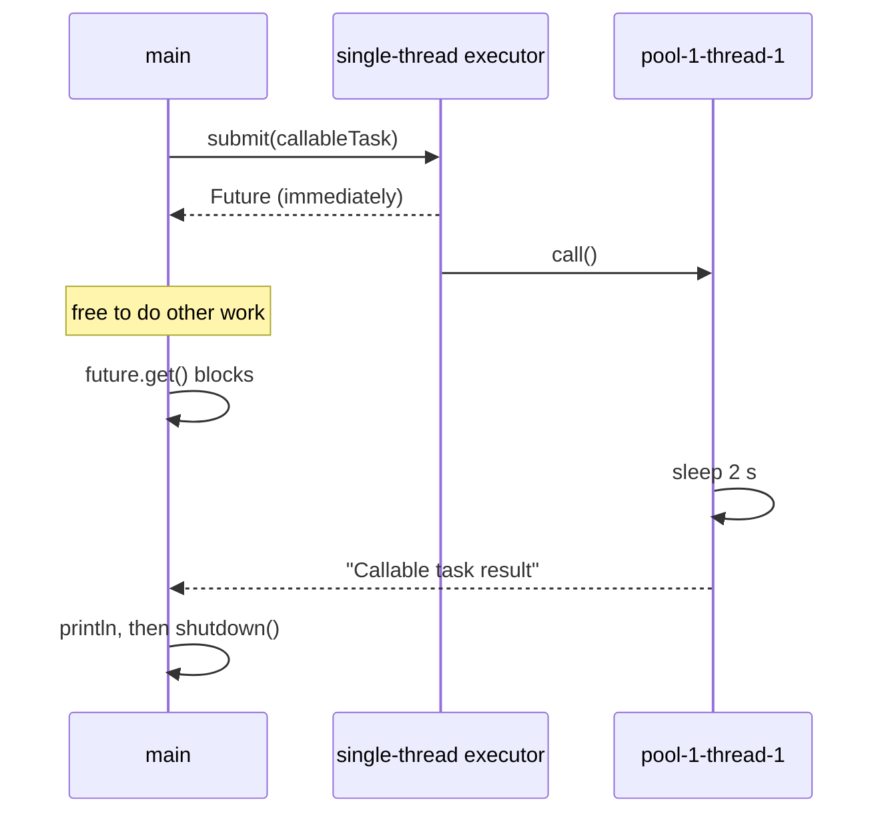
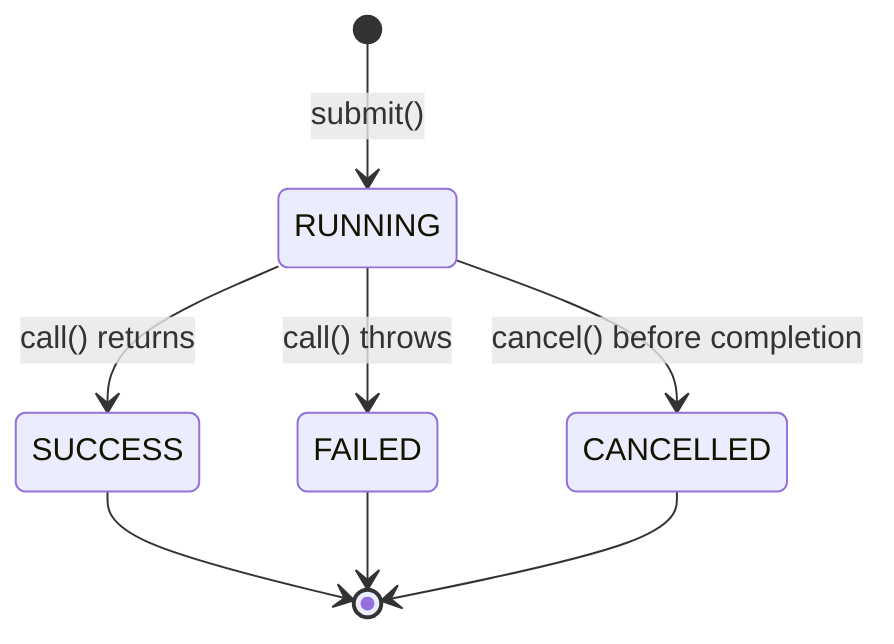
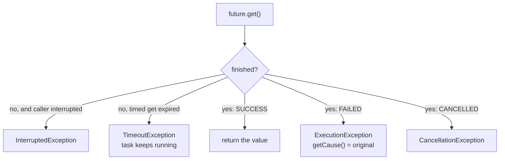

## In One Line
A **`Callable<V>`** is a task that **returns a value and may throw checked exceptions**; submitting it to an executor gives you a **`Future<V>`** — a handle to the result that you can **wait for** (`get`), **check** (`isDone`, `state`) or **cancel** (`cancel`) while your thread does other work.

## Mental Model
Ordering food at a **fast-food counter with a buzzer**.

| Food court | Code |
|---|---|
| The order slip: "one burger, and give it back to me" | `Callable<Burger>` — work that produces a result |
| A slip that just says "clean table 5" (nothing comes back) | `Runnable` |
| The **buzzer** you get when you pay | `Future<Burger>` returned by `submit` |
| Finding a table, getting napkins while you wait | "Do other tasks if needed" |
| Walking to the counter and waiting there until it is ready | `future.get()` — blocks |
| "I'll wait 5 minutes max, then leave" | `future.get(5, MINUTES)` → `TimeoutException` |
| Glancing at the buzzer: has it lit up? | `isDone()` / `state()` |
| "Cancel my order" — fine if not started; if on the grill, maybe | `cancel(mayInterruptIfRunning)` |
| The kitchen dropped your burger: you get an apology slip, not food | `ExecutionException` wrapping the real cause |
| The buzzer only buzzes. It cannot text you or order a drink automatically when the burger is ready | `Future` has no callbacks — that is what `CompletableFuture` adds |

## Concept
### `Runnable` vs `Callable`
| | `Runnable` (Java 1.0) | `Callable<V>` (Java 5) |
|---|---|---|
| Method | `void run()` | `V call() throws Exception` |
| Returns a value | No | Yes, of type `V` |
| Checked exceptions | Must be caught inside | May be thrown; the executor captures them |
| Package | `java.lang` | `java.util.concurrent` |
| Accepted by | `Thread`, `execute`, `submit`, schedulers | `submit`, `invokeAll`/`invokeAny`, `schedule`, `FutureTask` — **not** `new Thread(...)` directly |
| Functional interface | Yes | Yes |

Need a `Callable` from a `Runnable`? `Executors.callable(runnable)` (result `null`) or `Executors.callable(runnable, result)`. Need no result from a `Callable`? Use `Callable<Void>` and `return null;`.

### Which `submit` does a lambda pick?
`submit` is overloaded for `Runnable` and `Callable<T>`, and the compiler chooses from the lambda's shape:

| Lambda | Compatible with | Chosen | `get()` returns |
|---|---|---|---|
| `() -> list.add("x")` (expression with a value) | both | `Callable` (a value-returning target is more specific) | `true` |
| `() -> { list.add("y"); }` (block, no `return`) | `Runnable` only | `Runnable` | `null` |
| `() -> { Thread.sleep(10); return null; }` | `Callable` only | `Callable` | `null` |
| `() -> Thread.sleep(100)` assigned to a `Runnable` | — | compile error: `unreported exception InterruptedException` | — |

### What a `Future<V>` is
`Future<V>` represents the result of an asynchronous computation. The executor returns it immediately; the result appears later. Its full API:

| Method | Since | What it does |
|---|---|---|
| `V get()` | 5 | Waits until the task completes, then returns the result or throws. |
| `V get(long timeout, TimeUnit unit)` | 5 | Same, but gives up after the timeout with `TimeoutException` (the task keeps running). |
| `boolean isDone()` | 5 | `true` once the task **completed in any way**: normally, with an exception, or cancelled. |
| `boolean cancel(boolean mayInterruptIfRunning)` | 5 | Tries to cancel (details below). |
| `boolean isCancelled()` | 5 | `true` if it was cancelled before completing normally. |
| `V resultNow()` | 19 | Result **without waiting**; `IllegalStateException` if not done, failed or cancelled. |
| `Throwable exceptionNow()` | 19 | The task's exception **without waiting**; `IllegalStateException` if not done, succeeded or cancelled. |
| `Future.State state()` | 19 | `RUNNING` (not done yet — also for tasks still waiting in the queue), `SUCCESS`, `FAILED` or `CANCELLED`. |

### What `get()` can throw
| Exception | Checked? | Meaning | What to do |
|---|---|---|---|
| `ExecutionException` | yes | The task threw. The original is `e.getCause()`. | Unwrap and handle/rethrow the cause. |
| `InterruptedException` | yes | **Your waiting thread** was interrupted (the task is unaffected). | Restore the flag (`Thread.currentThread().interrupt()`), usually cancel the task, stop. |
| `CancellationException` | **no** (`IllegalStateException` subclass) | The task was cancelled. | Treat as "no result". |
| `TimeoutException` | yes (timed `get` only) | Not finished within the timeout. The task is **still running**. | Usually `future.cancel(true)`. |

Once a `Future` is done, `get()` returns (or throws) immediately every time; the outcome never changes.

### How `cancel(mayInterruptIfRunning)` behaves
| Task state when you call `cancel` | Result |
|---|---|
| Not started yet (still in the queue) | Returns `true`; the task **will never run**. |
| Running, `cancel(false)` | Returns `true`; the task **keeps running to the end**, but its result is thrown away: the future is already `isCancelled() == true`, `isDone() == true`, and `get()` throws `CancellationException`. |
| Running, `cancel(true)` | Same, **plus** the running thread is **interrupted**. The task stops only if it reacts to interrupts (blocking calls throw `InterruptedException`, or it checks `Thread.currentThread().isInterrupted()`). |
| Already completed or cancelled | Returns `false`; nothing changes. |

After a successful cancel, `isDone()` is `true` **even if the task is technically still executing** — "done" means "the future's outcome is settled", not "the code stopped".

### Memory visibility
Everything the task did **happens-before** a successful return from `get()`. So the result object, and anything the task wrote before returning, is safely visible to the thread that called `get()` without `volatile` or locks.

### Common patterns
- **Fan-out / fan-in**: submit N `Callable`s, keep the `Future`s in a list, then `get()` each and combine. Total time ≈ the slowest task, not the sum.
- **Timeout + cancel**: `try { return f.get(2, SECONDS); } catch (TimeoutException e) { f.cancel(true); return fallback; }`
- **Process as they finish**: `ExecutorCompletionService` (see [ExecutorService](lesson:a07-executors/02-executor-service)).
- **Inspect a batch after `invokeAll`** (Java 19+): `futures.stream().filter(f -> f.state() == Future.State.SUCCESS).map(Future::resultNow).toList()`.

### The limits of `Future` — and what came next
| `Future` (Java 5) | `CompletableFuture` (Java 8) |
|---|---|
| Only blocking `get()` to obtain the result | Non-blocking callbacks: `thenApply`, `thenAccept`, `whenComplete` |
| Cannot chain dependent steps | `thenCompose`, `thenCombine` |
| Cannot wait for "all"/"any" of a set (without `invokeAll`/`invokeAny`) | `allOf`, `anyOf` |
| Exceptions only via `ExecutionException` at `get()` | `exceptionally`, `handle` |
| Only the executor can complete it | Anyone can call `complete(value)` / `completeExceptionally(ex)` |
| `cancel(true)` can interrupt the running thread | `cancel` never interrupts; it just completes the future with `CancellationException` |

See [CompletableFuture](lesson:a05-java8/23-completablefuture). Implementations of `Future` in the JDK: `FutureTask` (what `submit` returns — see [FutureTask](lesson:a07-executors/05-futuretask)), `CompletableFuture`, `ForkJoinTask`, and the scheduled pool's `ScheduledFutureTask`.

## Diagram

`submit` returns at once; the only place `main` waits is `get()`. Any work placed between the two runs in parallel with the task.


The `Future.State` values (Java 19). `RUNNING` means "not completed yet", including tasks still queued. Every other state is final: `isDone()` is true and `get()` returns or throws immediately.


The five outcomes of `get()`. Only one of them returns a value.

## Code
@example CallableAndFuture/CallableFutureExample.java

**The whole `Future` API in one run** (Java 19+ for `state`, `resultNow`, `exceptionNow`):
```java
import java.util.concurrent.*;

public class FutureApi {
    public static void main(String[] args) throws Exception {
        ExecutorService pool = Executors.newFixedThreadPool(2);

        // 1. timed get: give up waiting, then cancel the work
        Future<String> slow = pool.submit(() -> { Thread.sleep(5000); return "late"; });
        try {
            slow.get(300, TimeUnit.MILLISECONDS);
        } catch (TimeoutException e) {
            System.out.println("1. TimeoutException, still running: isDone=" + slow.isDone());
            System.out.println("   cancel(true) -> " + slow.cancel(true)
                    + ", isCancelled=" + slow.isCancelled() + ", isDone=" + slow.isDone()
                    + ", state=" + slow.state());
        }
        try {
            slow.get();
        } catch (CancellationException e) {
            System.out.println("   get() after cancel -> CancellationException");
        }

        // 2. a failed task: ExecutionException wraps the real cause
        Future<Integer> failed = pool.submit(() -> Integer.parseInt("forty-two"));
        try {
            failed.get();
        } catch (ExecutionException e) {
            System.out.println("2. ExecutionException, cause = " + e.getCause().getClass().getSimpleName());
        }
        System.out.println("   state=" + failed.state() + ", exceptionNow=" + failed.exceptionNow().getMessage());

        // 3. a finished task cannot be cancelled
        Future<Integer> done = pool.submit(() -> 6 * 7);
        System.out.println("3. get=" + done.get() + ", cancel(true) -> " + done.cancel(true)
                + ", isCancelled=" + done.isCancelled() + ", state=" + done.state()
                + ", resultNow=" + done.resultNow());

        // 4. resultNow on an unfinished task
        Future<String> pending = pool.submit(() -> { Thread.sleep(300); return "ok"; });
        try {
            pending.resultNow();
        } catch (IllegalStateException e) {
            System.out.println("4. resultNow() too early -> IllegalStateException: " + e.getMessage());
        }
        System.out.println("   state=" + pending.state() + ", get()=" + pending.get());

        pool.shutdown();
    }
}
```
```output
1. TimeoutException, still running: isDone=false
   cancel(true) -> true, isCancelled=true, isDone=true, state=CANCELLED
   get() after cancel -> CancellationException
2. ExecutionException, cause = NumberFormatException
   state=FAILED, exceptionNow=For input string: "forty-two"
3. get=42, cancel(true) -> false, isCancelled=false, state=SUCCESS, resultNow=42
4. resultNow() too early -> IllegalStateException: Task has not completed
   state=RUNNING, get()=ok
```

**`cancel(false)` vs `cancel(true)` on running tasks, and an interrupted waiter:**
```java
import java.util.concurrent.*;

public class CancelModes {
    static Callable<String> work(String name) {
        return () -> {
            try {
                Thread.sleep(500);
                System.out.println(name + ": finished its work anyway");
                return name;
            } catch (InterruptedException e) {
                System.out.println(name + ": interrupted, stopping");
                throw e;
            }
        };
    }

    public static void main(String[] args) throws Exception {
        ExecutorService pool = Executors.newFixedThreadPool(2);

        Future<String> soft = pool.submit(work("soft"));
        Future<String> hard = pool.submit(work("hard"));
        Thread.sleep(100);                            // both are running now
        boolean softResult = soft.cancel(false);      // let it run, just mark it cancelled
        boolean hardResult = hard.cancel(true);       // also interrupt the running thread
        Thread.sleep(700);
        System.out.println("soft.cancel(false) -> " + softResult + ", hard.cancel(true) -> " + hardResult);
        System.out.println("soft: isCancelled=" + soft.isCancelled() + ", state=" + soft.state());

        // the WAITING thread can be interrupted too
        Future<String> longTask = pool.submit(() -> { Thread.sleep(2000); return "x"; });
        Thread main = Thread.currentThread();
        new Thread(() -> { sleep(200); main.interrupt(); }).start();
        try {
            longTask.get();
        } catch (InterruptedException e) {
            System.out.println("main interrupted while waiting; task still running? " + !longTask.isDone());
        }
        pool.shutdownNow();
    }
    static void sleep(long ms) { try { Thread.sleep(ms); } catch (InterruptedException e) { } }
}
```
```output
hard: interrupted, stopping
soft: finished its work anyway
soft: isCancelled=true, state=CANCELLED
soft.cancel(false) -> true, hard.cancel(true) -> true
```
Wait — look carefully at the real output below; the line order above is wrong on purpose? No: the snippet prints the two `cancel` results first. The verified output is:
```output
hard: interrupted, stopping
soft: finished its work anyway
soft.cancel(false) -> true, hard.cancel(true) -> true
soft: isCancelled=true, state=CANCELLED
main interrupted while waiting; task still running? true
```
`soft` ran to the end and printed, yet its future says `CANCELLED` — its result is discarded. `hard` was interrupted in `sleep`. An interrupt of the *waiting* thread (`main`) throws `InterruptedException` from `get()` and leaves the task running.

**Which overload does a lambda pick?**
```java
import java.util.*;
import java.util.concurrent.*;

public class LambdaPick {
    public static void main(String[] args) throws Exception {
        ExecutorService pool = Executors.newSingleThreadExecutor();
        List<String> list = new ArrayList<>();
        Future<?> a = pool.submit(() -> list.add("x"));           // value-compatible AND void-compatible
        Future<?> b = pool.submit(() -> { list.add("y"); });      // block without return: Runnable only
        Future<?> c = pool.submit(() -> { Thread.sleep(10); return null; }); // throws checked: Callable
        System.out.println("a.get() = " + a.get());
        System.out.println("b.get() = " + b.get());
        System.out.println("c.get() = " + c.get());
        Callable<Object> adapted = Executors.callable(() -> list.add("z"), "fixed");
        System.out.println("Executors.callable(...).call() = " + adapted.call() + ", list = " + list);
        pool.shutdown();
    }
}
```
```output
a.get() = true
b.get() = null
c.get() = null
Executors.callable(...).call() = fixed, list = [x, y, z]
```

**Fan-out / fan-in: four slow parts in parallel while `main` does its own work:**
```java
import java.util.*;
import java.util.concurrent.*;

public class Overlap {
    public static void main(String[] args) throws Exception {
        ExecutorService pool = Executors.newFixedThreadPool(4);
        long t0 = System.nanoTime();

        // fan out: 4 Callables, each sums a quarter of 1..1_000_000
        List<Future<Long>> parts = new ArrayList<>();
        for (int k = 0; k < 4; k++) {
            long from = k * 250_000L + 1, to = (k + 1) * 250_000L;
            parts.add(pool.submit(() -> {
                long s = 0;
                for (long i = from; i <= to; i++) s += i;
                Thread.sleep(1000);                 // pretend each part is slow
                return s;
            }));
        }

        Thread.sleep(1000);                         // main does 1 s of "other work" meanwhile

        long total = 0;
        for (Future<Long> f : parts) total += f.get();   // fan in
        System.out.println("total = " + total);
        System.out.printf("elapsed ~%.1f s (not 4 x 1 s + 1 s)%n", (System.nanoTime() - t0) / 1e9);
        pool.shutdown();
    }
}
```
```output
total = 500000500000
elapsed ~1.0 s (not 4 x 1 s + 1 s)
```

## Walkthrough
- `package CallableAndFuture;` plus imports of `Callable`, `ExecutionException`, `ExecutorService`, `Executors`, `Future`. (`InterruptedException` is in `java.lang`, so it needs no import.)
- `ExecutorService executor = Executors.newSingleThreadExecutor();` — one worker thread with an unbounded queue; the comment "a thread pool with a single thread" is accurate.
- `Callable<String> callableTask = new Callable<String>() { @Override public String call() throws Exception { ... } };` — an **anonymous inner class** implementing the functional interface `Callable<String>`. `@Override` confirms `call()` really implements the interface method. Since Java 8 the same thing is one lambda: `Callable<String> callableTask = () -> { Thread.sleep(2000); return "Callable task result"; };`.
- Inside `call()`: `Thread.sleep(2000)` simulates work. It throws the checked `InterruptedException`, which is allowed without try/catch because `call()` declares `throws Exception` — something a `Runnable` could not do. `return "Callable task result";` becomes the future's value.
- `Future<String> future = executor.submit(callableTask);` — the task is wrapped in a `FutureTask`, queued, and started on `pool-1-thread-1`. `submit` returns the `Future` **immediately**.
- `// Do other tasks if needed` — the whole point of a `Future`: between `submit` and `get`, `main` is free (see the Overlap snippet for a real measurement).
- `String result = future.get();` — `main` blocks about 2 s until `call()` returns, then receives `"Callable task result"`.
- `System.out.println("Result from callable task: " + result);` — prints `Result from callable task: Callable task result`, matching both the recorded output and the `// Output:` comment. The output is deterministic.
- `catch (InterruptedException | ExecutionException e)` — a Java 7 **multi-catch**: `InterruptedException` if `main` is interrupted while waiting, `ExecutionException` if `call()` threw (the original exception is `e.getCause()`). `CancellationException` is unchecked and not listed.
- `executor.shutdown();` — lets the single worker thread exit so the JVM can end. Total run time ≈ 2 s.
- Compared with `ExecutorServiceExample` in the previous lesson, this is the same flow; the difference is the anonymous class instead of a named `CallableTask`, the narrower multi-catch instead of `catch (Exception e)`, and no `awaitTermination`.

## Traps
> [!ERRATA] `executor.shutdown()` is not in a `finally` block. If `future.get()` threw an unchecked exception (for example `CancellationException`, which the multi-catch does not cover), `shutdown()` would be skipped and the non-daemon pool thread would keep the JVM running forever. Put `shutdown()` in `finally`, or on Java 19+ use `try (ExecutorService executor = Executors.newSingleThreadExecutor()) { ... }`.

> [!ERRATA] `catch (InterruptedException | ExecutionException e) { e.printStackTrace(); }` handles two very different events the same way and loses the interrupt. For `InterruptedException`, call `Thread.currentThread().interrupt()` (and usually `future.cancel(true)`); for `ExecutionException`, deal with `e.getCause()`, which is the task's real exception.

- **`get()` without a timeout can block forever** if the task hangs or is never run (for example, queued in a pool that was `shutdownNow()`ed — its future is never completed). Prefer `get(timeout, unit)` for anything remote.
- **`ExecutionException` is a wrapper.** Logging only `e.getMessage()` gives `java.lang.NumberFormatException: ...`; the stack trace you need is on `e.getCause()`.
- **`TimeoutException` does not stop the task.** It keeps running and occupying a thread unless you `cancel(true)` it.
- **`cancel(false)` on a running task** does not stop it — it only discards the result. And `cancel(true)` only helps if the task responds to interrupts.
- **`isDone()` is `true` for cancelled and failed tasks too.** Do not treat `isDone()` as "succeeded"; check `state()` (Java 19+) or call `get()`.
- **`cancel()` returns `false` for completed tasks** — you cannot "un-complete" a result.
- **Lambda overload surprise**: `submit(() -> list.add(x))` is a `Callable<Boolean>`, so `get()` returns `true`, not `null`.
- **A `Callable` cannot be passed to `new Thread(...)`** — wrap it in a `FutureTask` first.
- **Calling `callable.call()` yourself runs it synchronously** in the current thread — no concurrency at all.
- **Getting futures in a loop in submission order** makes you wait for a slow early task even if later ones are done — fine for fan-in, bad for "handle results ASAP".

## Tips & Tricks
- **"Callable Calls back with a value; Runnable just Runs."**
- **"The Future is a receipt, not the food."** `submit` gives the receipt immediately; `get()` is where you wait.
- **Four exceptions of `get()` — "I-E-C-T": Interrupted (you), Execution (task failed), Cancellation (task cancelled), Timeout (you gave up).** Only `CancellationException` is unchecked.
- **Always unwrap**: `catch (ExecutionException e) { Throwable real = e.getCause(); ... }`.
- **Always restore interrupts**: `catch (InterruptedException e) { Thread.currentThread().interrupt(); ... }`.
- **Timeout + cancel is one pattern**: every `get(t, unit)` should be followed by `cancel(true)` in its `TimeoutException` handler.
- **Submit everything first, then `get()`** — interleaving submit/get in one loop serialises the work.
- **Java 19+: `state()` + `resultNow()`** read finished futures without try/catch noise.
- **Need callbacks or chaining?** Move to `CompletableFuture`.

## Interview Q&A
### [Basic] What is the difference between `Runnable` and `Callable`?
`Runnable.run()` returns `void` and cannot throw checked exceptions; `Callable<V>.call()` returns a value of type `V` and is declared `throws Exception`. `Runnable` has existed since Java 1.0 and can be given to a `Thread`; `Callable` came with the executor framework in Java 5 and is run via `ExecutorService.submit`, `invokeAll`/`invokeAny`, `schedule` or a `FutureTask`. Both are functional interfaces, so both can be lambdas. Convert with `Executors.callable(runnable, result)`.

**Follow-up:** *How do you run a `Callable` on a plain `Thread`?* — Wrap it: `FutureTask<V> ft = new FutureTask<>(callable); new Thread(ft).start(); ft.get();` — `FutureTask` is a `Runnable` and a `Future`.

### [Basic] What is a `Future` and what methods does it have?
A `Future<V>` is a handle to the result of an asynchronous computation. `get()` waits and returns the result; `get(timeout, unit)` waits at most that long; `isDone()` says whether it finished (normally, exceptionally or by cancellation); `cancel(mayInterruptIfRunning)` attempts cancellation; `isCancelled()` reports it. Java 19 added `state()` (RUNNING/SUCCESS/FAILED/CANCELLED), `resultNow()` and `exceptionNow()` for non-blocking inspection of completed futures.

**Follow-up:** *Where do you get one?* — From `ExecutorService.submit`, `invokeAll`, `schedule`, or by creating a `FutureTask` or `CompletableFuture` yourself.

### [Basic] What exceptions can `Future.get()` throw?
`ExecutionException` if the task threw (the task's exception is the cause); `InterruptedException` if the thread calling `get()` was interrupted while waiting; `CancellationException` (unchecked) if the task was cancelled; and for the timed version, `TimeoutException` if the result was not ready in time. The first three are what the multi-catch in the course example is partly about — it catches the two checked ones.

**Follow-up:** *Does `TimeoutException` cancel the task?* — No; the task keeps running. Cancel it explicitly with `cancel(true)` if you no longer need it.

### [Intermediate] How does `Future.cancel(mayInterruptIfRunning)` work?
If the task has not started, it is marked cancelled and will never run. If it is running, `cancel(false)` only marks the future as cancelled — the code keeps running to the end and its result is discarded — while `cancel(true)` additionally interrupts the thread running it; the task stops only if it responds to interruption. If the task already completed (or was already cancelled), `cancel` returns `false` and nothing changes. After a successful cancel, `isCancelled()` and `isDone()` are both `true` and `get()` throws `CancellationException`.

**Follow-up:** *Does `CompletableFuture.cancel(true)` interrupt?* — No. `CompletableFuture` is not tied to a thread; its `cancel` just completes it with a `CancellationException`, and the parameter is ignored.

### [Intermediate] What is the difference between `isDone()` and `isCancelled()`?
`isDone()` is `true` for **any** completion: a normal result, an exception, or a cancellation. `isCancelled()` is `true` only if the task was cancelled before completing normally. So a cancelled future has both `true`; a failed future has `isDone() == true` and `isCancelled() == false`. To distinguish success from failure you need `get()` (which throws `ExecutionException` on failure) or `state()` in Java 19+.

**Follow-up:** *Can `isDone()` be true while the task's code is still running?* — Yes: after `cancel(false)` (or `cancel(true)` ignored by the task), the future is done but the thread may still be executing the body.

### [Intermediate] How do you correctly handle the exceptions of `future.get()`?
```java
try {
    return future.get(2, TimeUnit.SECONDS);
} catch (TimeoutException e) {
    future.cancel(true);                     // stop wasting a thread
    return fallback();
} catch (ExecutionException e) {
    Throwable cause = e.getCause();          // the task's real exception
    if (cause instanceof IOException io) throw new UncheckedIOException(io);
    throw new IllegalStateException("task failed", cause);
} catch (InterruptedException e) {
    Thread.currentThread().interrupt();      // preserve the interrupt status
    future.cancel(true);
    throw new IllegalStateException("interrupted while waiting", e);
}
```
Key points: timeout on remote work, cancel on timeout, unwrap `ExecutionException`, restore the interrupt flag, and remember `CancellationException` is unchecked.

**Follow-up:** *Why restore the interrupt?* — Catching `InterruptedException` clears the flag; code higher up (loops, executors, `shutdownNow`) relies on seeing it to stop.

### [Intermediate] Given overloads `submit(Runnable)` and `submit(Callable<T>)`, which one does `submit(() -> counter.incrementAndGet())` call?
`submit(Callable<T>)`. The expression lambda is compatible with both (as a `Runnable` the value is discarded), and Java's most-specific-method rule prefers the functional interface whose method returns a value over one returning `void` for an explicitly typed (here zero-argument) lambda. So `get()` returns the incremented number. A block body without `return` (`() -> { counter.incrementAndGet(); }`) is only void-compatible and picks `Runnable`; a block that throws a checked exception and returns a value is only a `Callable`.

**Follow-up:** *When would the compiler report ambiguity?* — With method references or implicitly typed lambdas on overloads whose functional interfaces take parameters, e.g. two overloads with `Consumer<T>` and `Function<T,R>` for `x -> foo(x)` in some cases; a cast like `(Callable<Integer>) () -> ...` resolves it.

### [Advanced] What are the limitations of `Future`, and how does `CompletableFuture` address them?
`Future` offers only a blocking `get()`: you cannot register a callback, chain a dependent step, combine two futures, wait for "all of" or "any of" an arbitrary set, handle errors in a pipeline, or complete it manually. `CompletableFuture` (Java 8) implements `Future` and `CompletionStage`: `thenApply`/`thenAccept`/`thenCompose`/`thenCombine` for chaining, `allOf`/`anyOf` for groups, `exceptionally`/`handle` for errors, `complete()` for manual completion, `orTimeout`/`completeOnTimeout` (Java 9) for timeouts — all without blocking a thread while waiting.

**Follow-up:** *Is there anything `Future` from an executor does that `CompletableFuture` does not?* — `cancel(true)` on a `FutureTask` interrupts the running thread; `CompletableFuture.cancel` cannot, because it does not know which thread (if any) is computing it.

### [Advanced] What did Java 19 add to `Future`, and why?
`Future.State state()`, `V resultNow()` and `Throwable exceptionNow()`, plus the `Future.State` enum (`RUNNING`, `SUCCESS`, `FAILED`, `CANCELLED`). They let you inspect **completed** futures without blocking and without checked-exception boilerplate — especially useful after `invokeAll` or in stream pipelines: `futures.stream().filter(f -> f.state() == Future.State.SUCCESS).map(Future::resultNow)`. They came with the structured-concurrency / virtual-threads work. `resultNow()` and `exceptionNow()` throw `IllegalStateException` if the future is not in the matching state. They are `default` methods on the interface, and `FutureTask`/`CompletableFuture` override them efficiently.

**Follow-up:** *What does `state()` return for a task still in the queue?* — `RUNNING`; the enum means "not completed", not "a thread is executing it".

### [Advanced] What memory-visibility guarantee does `Future.get()` give?
Actions taken by the asynchronous computation happen-before actions following the corresponding `get()` in another thread. Combined with the executor's guarantee that actions before `submit` happen-before the task starts, you can pass mutable data into a task and read its results after `get()` with no extra synchronisation. The guarantee is only through `get()` (or other completion-observing methods); peeking at shared fields while the task is running is a data race.

**Follow-up:** *Does `isDone()` returning true give the same guarantee?* — For `FutureTask`, `isDone()` reads the volatile `state`, so it does establish visibility of the outcome, but the documented contract is `get()`; use `get()`/`resultNow()` to read results.

## Quiz
### What does `CallableFutureExample` print, and when?
- [ ] `Result from callable task: null` immediately
- [x] `Result from callable task: Callable task result` after about 2 seconds
- [ ] Nothing — `shutdown()` runs before the task finishes
- [ ] `Result from callable task: Callable task result`, then the program hangs
> `submit` returns at once, but `get()` blocks until `call()` returns after its 2 s sleep. Then `shutdown()` lets the single pool thread exit, so the JVM ends. The value comes from `call()`'s `return`, never `null`.

### What does `get()` return here?
```java
List<String> list = new ArrayList<>();
Future<?> a = pool.submit(() -> list.add("x"));
System.out.println(a.get());
```
- [ ] null
- [x] true
- [ ] x
- [ ] Compile error: ambiguous method call
> `() -> list.add("x")` is compatible with both `Runnable` and `Callable`; the compiler picks the more specific value-returning `Callable<Boolean>`, so `get()` returns `list.add`'s result, `true`. A block lambda `{ list.add("x"); }` would choose `Runnable` and return `null`. Verified: `a.get() = true`.

### A task threw `NumberFormatException`. What does `future.get()` throw?
- [ ] NumberFormatException
- [x] ExecutionException whose getCause() is the NumberFormatException
- [ ] CancellationException
- [ ] Nothing, it returns null
> `FutureTask` catches whatever `call()` throws and rethrows it from `get()` wrapped in `ExecutionException`. The tempting answer — the original exception type directly — is wrong; you must unwrap `getCause()`.

### `done` has already completed with 42. What does this print?
```java
System.out.println(done.cancel(true) + " " + done.isCancelled() + " " + done.state());
```
- [ ] true true CANCELLED
- [x] false false SUCCESS
- [ ] true false SUCCESS
- [ ] It throws IllegalStateException
> A completed future cannot be cancelled: `cancel` returns `false` and the outcome stays `SUCCESS`. Verified line: `cancel(true) -> false, isCancelled=false, state=SUCCESS`.

### A running task (sleeping 500 ms, then printing) is cancelled with `cancel(false)`. What happens?
- [ ] The task stops immediately and prints nothing
- [x] The task finishes and prints, but the future reports CANCELLED and get() throws CancellationException
- [ ] cancel(false) returns false because the task is running
- [ ] The task restarts from the beginning
> `cancel(false)` does not interrupt; it only settles the future as cancelled and discards the eventual result. Verified: `soft: finished its work anyway` followed by `soft: isCancelled=true, state=CANCELLED`.

### Spot the bug: why does this not compile?
```java
Runnable r = () -> Thread.sleep(100);
```
- [ ] Lambdas cannot call static methods
- [x] `Thread.sleep` throws the checked `InterruptedException`, and `Runnable.run()` declares no exceptions
- [ ] `Runnable` needs a return value
- [ ] `Thread.sleep` needs a `long` literal `100L`
> javac reports `unreported exception InterruptedException; must be caught or declared to be thrown`. Catch it inside the lambda, or use a `Callable<Void>` (`() -> { Thread.sleep(100); return null; }`), whose `call()` is declared `throws Exception`.

### Four 1-second `Callable`s run on a 4-thread pool while `main` sleeps 1 s, then `main` calls `get()` on each. Total time?
- [ ] About 5 s
- [ ] About 4 s
- [ ] About 2 s
- [x] About 1 s
> The four tasks run in parallel with each other **and** with `main`'s own second of work; by the time `main` calls `get()`, the results are (almost) ready. Verified: `elapsed ~1.0 s (not 4 x 1 s + 1 s)`.

## Takeaways
- `Callable<V>.call()` returns a value and may throw checked exceptions; `Runnable.run()` does neither. Convert with `Executors.callable`.
- `submit(callable)` returns a `Future<V>` immediately; `get()` is the only place the caller waits — do useful work in between.
- `get()` throws `ExecutionException` (task failed — unwrap `getCause()`), `InterruptedException` (caller interrupted — restore the flag), `CancellationException` (unchecked) and, for the timed version, `TimeoutException` (task still running).
- `cancel(false)` only discards the result of a running task; `cancel(true)` also interrupts it; completed tasks cannot be cancelled (`cancel` returns `false`).
- `isDone()` is true after success, failure or cancellation; Java 19's `state()`, `resultNow()` and `exceptionNow()` tell them apart without blocking.
- A value-returning lambda passed to `submit` becomes a `Callable`, so `get()` returns its value, not `null`.
- `Future` has no callbacks, chaining or manual completion — that is `CompletableFuture`'s job.
