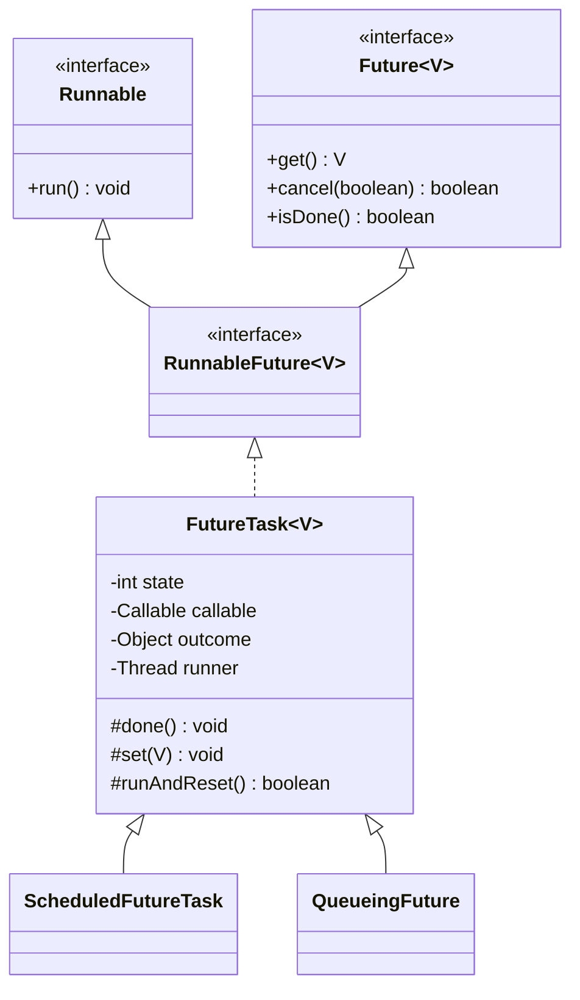
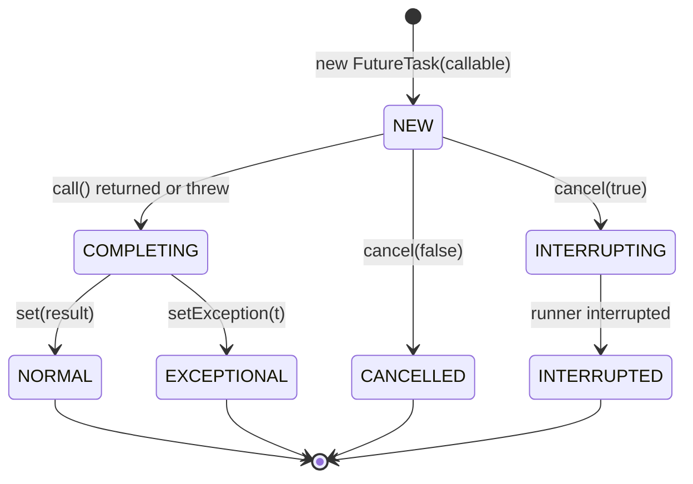
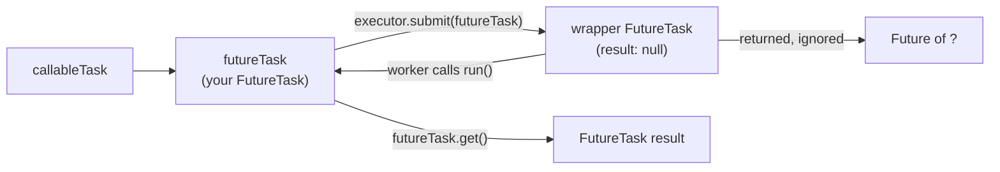

## In One Line
`FutureTask<V>` is a class that is **both a `Runnable` and a `Future<V>`**: it wraps a `Callable` (or a `Runnable` plus a result), so any thread or executor can **run** it, and any thread can **wait for, inspect or cancel** its result. It is the object behind every `ExecutorService.submit()`.

## Mental Model
Think of a **sealed job envelope** at a print shop.

| Print shop | Code |
|---|---|
| Inside the envelope: the instruction sheet ("print 100 flyers") | The `Callable<V>` passed to the constructor |
| The envelope can be handed to **any** worker, or you can open it and do the job yourself | `FutureTask` is a `Runnable`: `new Thread(ft)`, `executor.execute(ft)`, or `ft.run()` |
| The envelope has a window showing its status: *not done*, *done*, *failed*, *cancelled* | `isDone()`, `isCancelled()`, `state()` |
| The finished flyers are sealed back **inside the same envelope** | `set(result)` stores the outcome in the task |
| You wait at the counter until the envelope comes back, then take the flyers | `get()` blocks, then returns the result |
| Once opened and used, the envelope cannot be used again | `run()` executes the `Callable` **at most once** |
| Tearing the envelope up before anyone opens it: the job never happens | `cancel(...)` before `run()` |
| Putting the envelope inside a *second* envelope and handing that out: the outer one comes back "done" but empty | The course example's `executor.submit(futureTask)` |

## Concept
### What it is
```java
public interface RunnableFuture<V> extends Runnable, Future<V> { void run(); }
public class FutureTask<V> implements RunnableFuture<V> { ... }
```
`RunnableFuture` is the "a task that is also its own result handle" interface, and `FutureTask` is its standard implementation (Java 5, `java.util.concurrent`). That double role is the whole point:
- As a **`Runnable`**, it can be given to anything that runs tasks: a plain `Thread`, `Executor.execute`, or you can call `run()` yourself.
- As a **`Future<V>`**, it offers `get()`, `get(timeout, unit)`, `isDone()`, `cancel()`, `isCancelled()`, and since Java 19 `state()`, `resultNow()`, `exceptionNow()`. The full `Future` API is taught in [Callable & Future](lesson:a07-executors/04-callable-and-future).

### Constructors
| Constructor | Result of `get()` | Use when |
|---|---|---|
| `FutureTask(Callable<V> callable)` | Whatever `call()` returns | The normal case |
| `FutureTask(Runnable runnable, V result)` | The fixed `result` you passed (often `null`) | You have a `Runnable` but want a `Future`, for example to wait for it or cancel it |

The second constructor wraps the `Runnable` with `Executors.callable(runnable, result)`. Both throw `NullPointerException` for a `null` task.

### Four ways to run a `FutureTask`
| How | Runs on | Notes |
|---|---|---|
| `new Thread(ft).start()` | A new thread | The way to run a `Callable` without an executor |
| `executor.execute(ft)` | A pool thread | The right call when you built the `FutureTask` yourself |
| `ft.run()` | **The calling thread**, synchronously | Useful for "compute now, but let others wait on the same future" (the memoizer below) |
| `executor.submit(ft)` | A pool thread | Works, but wraps your task in a **second** `FutureTask` and returns that wrapper (the course example does this) |

### You meet `FutureTask` even when you never write `new FutureTask`
- `AbstractExecutorService.submit(...)`, `invokeAll` and `invokeAny` call the protected factory method `newTaskFor(...)`, which returns `new FutureTask<>(...)`. The `Future` you get back from `submit` **is** that `FutureTask`. Subclasses can override `newTaskFor` to return a custom `RunnableFuture` (see [ExecutorService](lesson:a07-executors/02-executor-service)).
- `ScheduledThreadPoolExecutor` uses `ScheduledFutureTask extends FutureTask`, and periodic runs use the protected `runAndReset()` (see [ScheduledExecutorService](lesson:a07-executors/03-scheduled-executor-service)).
- `ExecutorCompletionService` wraps each task in a `QueueingFuture extends FutureTask`, whose `done()` puts the finished task on the completion queue.

### It runs at most once
`run()` starts with: *if the state is not `NEW`, or if another thread is already the `runner`, return immediately*. The runner is claimed with a single compare-and-set. So:
- A second `run()`, or handing the same task to another thread or executor, silently does nothing. The result is computed **once** and cached, and every `get()` returns the same value (`RunsOnce` below).
- A task cancelled **before** it starts never runs its `Callable`.
- To run the same work again you need a **new** `FutureTask`. (`runAndReset()` is `protected`, for subclasses such as periodic scheduled tasks. It runs the task without setting a result and leaves it `NEW`.)

### Inside: a small state machine
Modern `FutureTask` does not use a lock. It has a `volatile int state` changed with CAS (Java 5 and 6 built it on `AbstractQueuedSynchronizer`):

| Constant | Value | Meaning |
|---|---|---|
| `NEW` | 0 | Not finished yet (queued **or** running) |
| `COMPLETING` | 1 | Transient: the outcome is being stored |
| `NORMAL` | 2 | Finished with a result |
| `EXCEPTIONAL` | 3 | `call()` threw; the `Throwable` is stored |
| `CANCELLED` | 4 | `cancel(false)` succeeded |
| `INTERRUPTING` | 5 | Transient: `cancel(true)` is interrupting the runner |
| `INTERRUPTED` | 6 | `cancel(true)` finished interrupting |

Possible transitions: `NEW → COMPLETING → NORMAL`, `NEW → COMPLETING → EXCEPTIONAL`, `NEW → CANCELLED`, and `NEW → INTERRUPTING → INTERRUPTED`. The other fields:
- `callable`: the work. It is set to `null` after completion, to help garbage collection.
- `outcome`: the result **or** the exception. It is a plain field, and the `volatile` write to `state` right after it publishes it safely.
- `runner`: the thread executing `run()`, so that `cancel(true)` knows whom to interrupt.
- `waiters`: a lock-free stack (a *Treiber stack*) of threads blocked in `get()`. `get()` parks them with `LockSupport.park`, and on completion `finishCompletion()` unparks **all** of them, calls `done()`, and clears `callable`.

`Future.State` (Java 19) is the public, simplified view: `NEW`/`COMPLETING` → `RUNNING`, `NORMAL` → `SUCCESS`, `EXCEPTIONAL` → `FAILED`, and the three cancellation states → `CANCELLED`.

### The protected hooks: extending `FutureTask`
| Method | Called when | Default | Typical override |
|---|---|---|---|
| `protected void done()` | Once, after the task completes in **any** way (success, failure, cancel), on the thread that completed it | Does nothing | Completion callbacks, logging, metrics, putting the task on a queue (`ExecutorCompletionService`) |
| `protected void set(V v)` | By `run()` on success | Stores `v` unless already done | Rarely overridden; a subclass can call it to complete the task manually |
| `protected void setException(Throwable t)` | By `run()` when `call()` throws | Stores `t` unless already done | Same |
| `protected boolean runAndReset()` | By periodic subclasses | Runs without storing a result | Scheduled or repeated tasks |

`done()` is the only built-in callback a `Future` has, and it runs **on the completing thread** (the worker, or the thread that called `cancel`). Keep it short and never let it throw. If you need real callbacks and chaining, use [CompletableFuture](lesson:a05-java8/23-completablefuture).

### `cancel` as implemented by `FutureTask`
- The first `cancel` call on a `NEW` task wins: it returns `true`, the state becomes `CANCELLED` (or `INTERRUPTING` → `INTERRUPTED`), waiters are released and `get()` throws `CancellationException`. Later calls return `false`.
- `cancel(true)` interrupts the `runner` thread. The work stops only if it responds to interrupts (`sleep`, `wait` and blocking queue calls throw `InterruptedException`, or the code checks `Thread.currentThread().isInterrupted()`).
- If the work finishes after a successful cancel, its result is discarded: `set()` sees the state is no longer `NEW`.

### Memory visibility
Everything the task did before completing *happens-before* a successful return from `get()` in another thread. So the result, and any objects it built, can be used safely without extra `volatile` or locks.

### `FutureTask` vs `CompletableFuture`
| | `FutureTask` (Java 5) | `CompletableFuture` (Java 8) |
|---|---|---|
| Contains the work? | Yes: a `Callable`/`Runnable` that `run()` executes | No: someone else calls `complete(value)` |
| Is a `Runnable`? | Yes | No |
| Completion callbacks | Only by subclassing (`done()`) | `thenApply`, `thenAccept`, `whenComplete`, `exceptionally`, ... |
| Combining futures | No | `thenCompose`, `thenCombine`, `allOf`, `anyOf` |
| `cancel(true)` interrupts the worker | **Yes** (it knows its `runner`) | No (it has no runner) |
| Complete it manually | Only through the protected `set`/`setException` | `complete`, `completeExceptionally`, `obtrudeValue` |

## Diagram

`FutureTask` is a `Runnable` (so threads and executors can run it) and a `Future` (so callers can wait for it). The JDK's scheduled tasks and completion-service tasks are subclasses.


Only `NEW` can change. Every other state is final: `get()` returns or throws at once, `run()` and `cancel()` do nothing, and `done()` has been called exactly once.


What `submit(futureTask)` really does: your task is treated as a plain `Runnable` and wrapped again. The example works only because it calls `get()` on its own `futureTask`, not on the returned wrapper.

## Code
@example CallableAndFuture/FutureTaskExample.java

The three roles in one program: a `FutureTask` on a plain `Thread`, one run synchronously with `run()`, and one built from a `Runnable` plus a fixed result:
```java
import java.util.concurrent.FutureTask;

public class PlainThread {
    public static void main(String[] args) throws Exception {
        FutureTask<String> task = new FutureTask<>(
                () -> "computed by " + Thread.currentThread().getName());   // a Callable lambda

        new Thread(task, "worker").start();      // FutureTask IS a Runnable
        System.out.println(task.get());          // ... and a Future

        FutureTask<String> inline = new FutureTask<>(
                () -> "computed by " + Thread.currentThread().getName());
        inline.run();                            // no new thread: runs right here, synchronously
        System.out.println(inline.get());

        FutureTask<String> fromRunnable = new FutureTask<>(
                () -> System.out.println("side effect only"), "fixed result");   // Runnable + result
        fromRunnable.run();
        System.out.println(fromRunnable.get());
    }
}
```
```output
computed by worker
computed by main
side effect only
fixed result
```
The first lambda is a `Callable<String>` (it returns a value). The one passed with `"fixed result"` is a `Runnable` (its body is a `void` call), so the two-argument constructor is chosen.

A `FutureTask` runs at most once, no matter how often it is started:
```java
import java.util.concurrent.FutureTask;
import java.util.concurrent.atomic.AtomicInteger;

public class RunsOnce {
    public static void main(String[] args) throws Exception {
        AtomicInteger calls = new AtomicInteger();
        FutureTask<Integer> task = new FutureTask<>(() -> calls.incrementAndGet());

        task.run();
        task.run();                                   // ignored: state is no longer NEW
        Thread t = new Thread(task);
        t.start();                                    // ignored as well
        t.join();

        System.out.println("call() ran " + calls.get() + " time(s), get() = " + task.get() + ", again = " + task.get());
    }
}
```
```output
call() ran 1 time(s), get() = 1, again = 1
```

What `executor.submit(futureTask)` in the course example really returns, and why it hides failures:
```java
import java.util.concurrent.ExecutionException;
import java.util.concurrent.ExecutorService;
import java.util.concurrent.Executors;
import java.util.concurrent.Future;
import java.util.concurrent.FutureTask;

public class DoubleWrap {
    public static void main(String[] args) throws Exception {
        ExecutorService executor = Executors.newSingleThreadExecutor();

        FutureTask<String> ok = new FutureTask<>(() -> "FutureTask result");
        Future<?> outer = executor.submit(ok);                 // what the course example does
        System.out.println("same object?    " + (outer == ok));
        System.out.println("outer type:     " + outer.getClass().getSimpleName());
        System.out.println("outer.get():    " + outer.get());  // the wrapper's own "result"
        System.out.println("ok.get():       " + ok.get());

        FutureTask<String> failing = new FutureTask<>(() -> { throw new IllegalStateException("boom"); });
        Future<?> outer2 = executor.submit(failing);
        System.out.println("outer2.get():   " + outer2.get());  // no exception here!
        try {
            failing.get();
        } catch (ExecutionException e) {
            System.out.println("failing.get():  ExecutionException, cause = " + e.getCause());
        }

        FutureTask<String> better = new FutureTask<>(() -> "via execute");
        executor.execute(better);                              // no second wrapper
        System.out.println("better.get():   " + better.get());

        executor.shutdown();
    }
}
```
```output
same object?    false
outer type:     FutureTask
outer.get():    null
ok.get():       FutureTask result
outer2.get():   null
failing.get():  ExecutionException, cause = java.lang.IllegalStateException: boom
better.get():   via execute
```
Your task catches its own exception and stores it, so from the wrapper's point of view `run()` completed normally.

Observing the states, including `cancel` and the Java 19 methods:
```java
import java.util.concurrent.CountDownLatch;
import java.util.concurrent.FutureTask;

public class States {
    public static void main(String[] args) throws Exception {
        CountDownLatch release = new CountDownLatch(1);
        FutureTask<String> slow = new FutureTask<>(() -> { release.await(); return "hi"; });
        System.out.println("before run:  " + slow.state() + "  isDone=" + slow.isDone());
        Thread t = new Thread(slow);
        t.start();
        Thread.sleep(100);
        System.out.println("running:     " + slow.state() + "  isDone=" + slow.isDone());
        release.countDown();
        t.join();
        System.out.println("finished:    " + slow.state() + "  isDone=" + slow.isDone() + "  result=" + slow.resultNow());

        FutureTask<String> failing = new FutureTask<>(() -> { throw new java.io.IOException("disk"); });
        failing.run();
        System.out.println("failed:      " + failing.state() + "  exception=" + failing.exceptionNow());

        FutureTask<String> cancelled = new FutureTask<>(() -> "never");
        System.out.println("cancel(true) returned " + cancelled.cancel(true) + ", again " + cancelled.cancel(true));
        System.out.println("cancelled:   " + cancelled.state() + "  isDone=" + cancelled.isDone());
        try {
            cancelled.get();
        } catch (java.util.concurrent.CancellationException e) {
            System.out.println("get() threw  " + e.getClass().getSimpleName());
        }
    }
}
```
```output
before run:  RUNNING  isDone=false
running:     RUNNING  isDone=false
finished:    SUCCESS  isDone=true  result=hi
failed:      FAILED  exception=java.io.IOException: disk
cancel(true) returned true, again false
cancelled:   CANCELLED  isDone=true
get() threw  CancellationException
```
`state()` reports `RUNNING` even before any thread has started the task: it means "not completed yet". Note also that `call()` may throw a **checked** `IOException` with no `try`, because `Callable.call()` is declared `throws Exception`.

`cancel(true)` interrupts a running task, and `toString()` (on JDK 21) shows the state. The helper cuts off the identity hash (`FutureTask@1b6d3586`), which changes on every run:
```java
import java.util.concurrent.Callable;
import java.util.concurrent.FutureTask;

public class ToStringAndCancel {
    record Job(String name) implements Callable<String> {
        public String call() throws InterruptedException {
            Thread.sleep(10_000);                         // long, but interruptible
            return name + " done";
        }
    }
    static String tail(Object o) {                        // drop the "@1b6d3586" identity hash
        String s = o.toString();
        return s.substring(s.indexOf('['));
    }

    public static void main(String[] args) throws Exception {
        FutureTask<String> task = new FutureTask<>(new Job("report"));
        System.out.println("new:       " + tail(task));

        Thread runner = new Thread(task, "runner");
        runner.start();
        Thread.sleep(100);
        boolean cancelled = task.cancel(true);            // true = interrupt the running thread
        runner.join();
        System.out.println("cancel(true) = " + cancelled + ", runner finished: " + !runner.isAlive());
        System.out.println("cancelled: " + tail(task));

        FutureTask<String> ok = new FutureTask<>(() -> "42");
        ok.run();
        System.out.println("normal:    " + tail(ok));

        FutureTask<String> bad = new FutureTask<>(() -> { throw new IllegalStateException("boom"); });
        bad.run();
        System.out.println("failed:    " + tail(bad));
    }
}
```
```output
new:       [Not completed, task = Job[name=report]]
cancel(true) = true, runner finished: true
cancelled: [Cancelled]
normal:    [Completed normally]
failed:    [Completed exceptionally: java.lang.IllegalStateException: boom]
```
The 10-second sleep ended after about 100 ms: the interrupt made `sleep` throw, `run()` found the task already cancelled and threw the outcome away, and the runner thread finished.

A completion callback by overriding `done()`:
```java
import java.util.concurrent.Callable;
import java.util.concurrent.CountDownLatch;
import java.util.concurrent.FutureTask;

public class DoneHook {
    static class NotifyingTask<V> extends FutureTask<V> {
        private final CountDownLatch finished = new CountDownLatch(1);
        NotifyingTask(Callable<V> c) { super(c); }

        @Override
        protected void done() {                  // called once, however the task ended
            String how = isCancelled() ? "cancelled"
                       : state() == State.FAILED ? "failed: " + exceptionNow().getMessage()
                       : "succeeded: " + resultNow();
            System.out.println("done() on " + Thread.currentThread().getName() + " -> " + how);
            finished.countDown();
        }
        void awaitDone() throws InterruptedException { finished.await(); }
    }

    public static void main(String[] args) throws Exception {
        NotifyingTask<Integer> ok = new NotifyingTask<>(() -> 6 * 7);
        Thread w = new Thread(ok, "worker-1");
        w.start();
        ok.awaitDone();

        NotifyingTask<Integer> bad = new NotifyingTask<>(() -> Integer.parseInt("x"));
        new Thread(bad, "worker-2").start();
        bad.awaitDone();

        NotifyingTask<Integer> never = new NotifyingTask<>(() -> 1);
        never.cancel(false);                     // cancelled before it ever ran: done() runs in main
        never.run();                             // does nothing now
        System.out.println("never.isDone() = " + never.isDone() + ", isCancelled() = " + never.isCancelled());
    }
}
```
```output
done() on worker-1 -> succeeded: 42
done() on worker-2 -> failed: For input string: "x"
done() on main -> cancelled
never.isDone() = true, isCancelled() = true
```
`done()` runs on whichever thread completed the task: the worker after `run()`, or `main` after `cancel()`.

A classic use: a **memoizing cache** where concurrent requests for the same key share one computation. The winner runs the `FutureTask` in its own thread and the others wait on the same future:
```java
import java.util.ArrayList;
import java.util.HashSet;
import java.util.List;
import java.util.Set;
import java.util.concurrent.*;
import java.util.concurrent.atomic.AtomicInteger;
import java.util.function.Function;

public class MemoizerDemo {
    static class Memoizer<K, V> {                         // after Goetz, "Java Concurrency in Practice"
        private final ConcurrentMap<K, Future<V>> cache = new ConcurrentHashMap<>();
        private final Function<K, V> compute;
        Memoizer(Function<K, V> compute) { this.compute = compute; }

        V get(K key) throws InterruptedException, ExecutionException {
            Future<V> f = cache.get(key);
            if (f == null) {
                FutureTask<V> ft = new FutureTask<>(() -> compute.apply(key));
                f = cache.putIfAbsent(key, ft);           // atomically claim the key
                if (f == null) {                          // we won the race:
                    f = ft;
                    ft.run();                             // compute in THIS thread
                }
            }
            try {
                return f.get();                           // losers wait for the winner's result
            } catch (CancellationException e) {
                cache.remove(key, f);                     // don't cache a cancelled computation
                throw e;
            }
        }
    }

    public static void main(String[] args) throws Exception {
        AtomicInteger computations = new AtomicInteger();
        Memoizer<String, String> loader = new Memoizer<>(key -> {
            computations.incrementAndGet();
            try { Thread.sleep(300); } catch (InterruptedException e) { Thread.currentThread().interrupt(); }
            return key.toUpperCase();                     // pretend this is expensive
        });

        ExecutorService pool = Executors.newFixedThreadPool(5);
        CountDownLatch go = new CountDownLatch(1);
        List<Future<String>> answers = new ArrayList<>();
        for (int i = 0; i < 5; i++) {
            answers.add(pool.submit(() -> { go.await(); return loader.get("config"); }));
        }
        go.countDown();                                   // 5 threads ask for the same key at once
        Set<String> distinct = new HashSet<>();
        for (Future<String> a : answers) distinct.add(a.get());
        System.out.println("requests: 5, computations: " + computations.get() + ", answers: " + distinct);
        System.out.println("later request: " + loader.get("config") + ", computations: " + computations.get());
        pool.shutdown();
    }
}
```
```output
requests: 5, computations: 1, answers: [CONFIG]
later request: CONFIG, computations: 1
```

The course example rewritten: a lambda, `execute` instead of `submit`, a timed `get`, and try-with-resources on the executor (Java 19+, where `close()` shuts the pool down and waits):
```java
import java.util.concurrent.ExecutionException;
import java.util.concurrent.ExecutorService;
import java.util.concurrent.Executors;
import java.util.concurrent.FutureTask;
import java.util.concurrent.TimeUnit;
import java.util.concurrent.TimeoutException;

public class FutureTaskFixed {
    public static void main(String[] args) throws InterruptedException {
        FutureTask<String> futureTask = new FutureTask<>(() -> {
            Thread.sleep(2000);                            // simulate some work
            return "FutureTask result";
        });

        try (ExecutorService executor = Executors.newSingleThreadExecutor()) {   // Java 19+: close() = shutdown + wait
            executor.execute(futureTask);                  // execute, not submit: no second wrapper
            System.out.println("Result from FutureTask: " + futureTask.get(5, TimeUnit.SECONDS));
        } catch (ExecutionException e) {
            System.out.println("task failed: " + e.getCause());
        } catch (TimeoutException e) {
            futureTask.cancel(true);                       // give up and interrupt the worker
            System.out.println("timed out");
        }
    }
}
```
```output
Result from FutureTask: FutureTask result
```
`main` declares `throws InterruptedException` instead of swallowing it. If you do catch it, restore the flag with `Thread.currentThread().interrupt()`.

## Walkthrough
- `package CallableAndFuture;` and the imports: `Callable` (the work), `FutureTask` (work plus result handle), `ExecutorService`/`Executors` (the pool), and `ExecutionException` (a failed task, thrown by `get()`).
- `Callable<String> callableTask = new Callable<String>() { ... };` is an **anonymous inner class** implementing `Callable<String>`. Since Java 8 it would normally be a lambda: `() -> { Thread.sleep(2000); return "FutureTask result"; }`.
  - `@Override public String call() throws Exception` is the single abstract method. It returns a value and may throw checked exceptions, which is why `Thread.sleep(2000)` needs no `try/catch` here.
  - `Thread.sleep(2000); // Simulate some work` makes the worker thread sleep 2 seconds.
  - `return "FutureTask result";` is the value that `get()` will hand back.
- `FutureTask<String> futureTask = new FutureTask<>(callableTask);` wraps the `Callable`. The diamond `<>` infers `String`. The task is now in state `NEW`, and nothing runs yet.
- `ExecutorService executor = Executors.newSingleThreadExecutor();` is a pool with one worker thread and an unbounded queue (see [Thread Pools](lesson:a07-executors/01-thread-pools)). The worker is created when the first task arrives.
- `executor.submit(futureTask);` picks `submit(Runnable)`, because a `FutureTask` is a `Runnable`, not a `Callable`. The pool wraps it in a **new** `FutureTask<Void>`, queues it, and returns that wrapper as a `Future<?>`, which the example ignores. The worker (`pool-1-thread-1`) runs the wrapper, whose `run()` calls `futureTask.run()`, which calls `call()`. The code works, but see Traps.
- `// Do other tasks if needed` is the point of a future: `main` is free until it asks for the result.
- `String result = futureTask.get();` makes `main` **block** until the task completes, about 2 seconds, then returns `"FutureTask result"`. After that the result is cached, and any later `get()` returns it at once.
- `catch (InterruptedException | ExecutionException e) { e.printStackTrace(); }` is a Java 7 multi-catch. `InterruptedException` means `main` was interrupted while waiting. `ExecutionException` means `call()` threw, and the original is `e.getCause()`. Neither happens here.
- `executor.shutdown();` stops the pool from accepting new tasks and lets the idle worker exit. Without it, the non-daemon worker thread would keep the JVM alive for ever.
- **Output.** One line, `Result from FutureTask: FutureTask result`, printed after about 2 seconds (our runs took about 2.7 s in total, including JVM start-up). It never varies: only `main` prints, and only after `get()` has returned. The `// Output:` comment is correct.

## Traps
> [!ERRATA] `executor.submit(futureTask)` double-wraps the task. `submit` treats the `FutureTask` as a plain `Runnable`, wraps it in a second `FutureTask` and returns that wrapper, and the example throws the wrapper away. It only works because the example calls `get()` on its own `futureTask`. If you used the returned `Future` instead, `get()` would return `null`, and it would complete *normally* even when the task failed (`DoubleWrap`: `outer2.get(): null`). Use `executor.execute(futureTask)` for a task you built yourself, or skip `FutureTask` entirely and write `Future<String> f = executor.submit(callableTask);`, since `submit` creates the `FutureTask` for you.

> [!ERRATA] `executor.shutdown()` is not in a `finally` block. If `get()` threw an unchecked exception (for example `CancellationException` after someone cancelled the task), `shutdown()` would be skipped and the pool's non-daemon worker thread would keep the JVM running for ever. Put `shutdown()` in `finally`, or on Java 19+ use `try (ExecutorService executor = ...) { ... }`. Also, `catch (InterruptedException | ExecutionException e) { e.printStackTrace(); }` loses the interrupt flag and does not unwrap `getCause()`. Handle the two exceptions separately.

- **Calling `run()` twice does nothing the second time.** A `FutureTask` is single-use; create a new one to run the work again.
- **`ft.run()` runs in the calling thread.** It is not asynchronous; only `new Thread(ft).start()` or an executor is.
- **A `Callable` cannot be given to `new Thread(...)`** directly: `Thread` takes a `Runnable`. Wrap it in a `FutureTask` first.
- **Nobody calls `get()` → failures vanish.** `FutureTask` catches everything `call()` throws and stores it. Nothing is printed and no uncaught-exception handler runs.
- **`get()` without a timeout can wait for ever**, for example if the task was queued in a pool that was shut down with `shutdownNow()` (the returned list contains it, but it never ran). Prefer `get(timeout, unit)` in production code.
- **`cancel(true)` is a request.** Code that ignores interrupts (a busy loop, or blocking I/O on a classic `InputStream`) keeps running, although the future already reports `CANCELLED`.
- **`done()` runs on the completing thread** (a pool worker or the canceller). A slow or throwing `done()` delays that thread. Keep it tiny.
- **`toString()` output is for debugging only.** Its format is not a specified API.

## Tips & Tricks
- **"FutureTask = Runnable + Future in one object."** Something to run *and* a receipt to collect.
- **"Built it yourself? `execute` it. Let the pool build it? `submit`."** Never `submit` a `FutureTask`.
- **"One envelope, one job."** `run()` works once; the result is cached for every later `get()`.
- **`FutureTask(runnable, result)`** turns fire-and-forget work into something you can wait for or cancel.
- **Need a callback?** Override `done()`. Need chaining? Switch to `CompletableFuture`.
- **Memoizer pattern:** `putIfAbsent(key, futureTask)` claims the key, the winner calls `run()`, everyone calls `get()`. The expensive work runs once, outside any map lock.
- In interviews, say: *"`submit()` wraps my `Callable` in a `FutureTask` via `newTaskFor`, and the `Future` I get back is that `FutureTask`."*

## Interview Q&A
### [Basic] What is `FutureTask`?
`FutureTask<V>` is a concrete class in `java.util.concurrent` that implements `RunnableFuture<V>`, which means it is both a `Runnable` and a `Future<V>`. You construct it with a `Callable<V>` (or a `Runnable` plus a fixed result). Because it is a `Runnable`, any thread or executor can run it. Because it is a `Future`, any thread can `get()` the result, check `isDone()` or `cancel()` it. It runs its task at most once and caches the result or exception. It is also what `ExecutorService.submit` creates internally and returns.

**Follow-up:** *Why does it need to be both?* The executor only knows how to run `Runnable`s, and the caller needs a `Future`. One object bridges the two: the worker calls `run()`, which stores the outcome, and the caller's `get()` reads it.

### [Basic] How do you run a `Callable` using a plain `Thread`?
`Thread` accepts only a `Runnable`, so wrap the `Callable` in a `FutureTask`:
```java
FutureTask<Integer> ft = new FutureTask<>(() -> 6 * 7);
new Thread(ft).start();
int answer = ft.get();   // blocks until the thread has computed it
```
The thread calls `ft.run()`, which calls `call()` and stores the result, and `get()` returns it. Exceptions from `call()` come back from `get()` wrapped in `ExecutionException`.

**Follow-up:** *And to run it in the current thread?* Call `ft.run()` directly. It executes synchronously, and afterwards `get()` returns immediately.

### [Intermediate] What is the difference between `executor.submit(callable)` and creating a `FutureTask` and calling `executor.execute(task)`?
Functionally, almost none. `submit(callable)` calls `newTaskFor(callable)`, which creates `new FutureTask<>(callable)`, then calls `execute(thatTask)` and returns it. Creating the `FutureTask` yourself is useful when you need the object *before* it runs: to hand it to several waiting threads, to run it in the caller's thread (`ft.run()`), to use a subclass with a `done()` callback, or to decide later where it runs. What you should **not** do is `submit(futureTask)`: that wraps it a second time.

**Follow-up:** *Can you make `submit` return your own `FutureTask` subclass?* Yes. Extend `ThreadPoolExecutor` and override `protected <T> RunnableFuture<T> newTaskFor(Callable<T>)` (and the `Runnable` version).

### [Intermediate] What is wrong with `executor.submit(futureTask)` as in the course example?
`submit` sees a `Runnable` (a `FutureTask` is one) and wraps it in another `FutureTask<Void>`. The returned `Future<?>` is that wrapper: its `get()` returns `null`, and because the inner task stores its own exception instead of throwing it, the wrapper completes **normally** even if the work failed. Cancelling the wrapper before it starts means the inner task never runs, while the inner `FutureTask` stays in `NEW` for ever, so `innerTask.get()` would hang. The example happens to work because it waits on its own `futureTask`. The fix is `execute(futureTask)`, or just `submit(callable)`.

**Follow-up:** *Is double-wrapping ever intentional in the JDK?* Yes. `ExecutorCompletionService` wraps each task in a `QueueingFuture` (a `FutureTask` subclass) whose `done()` enqueues the inner future, but it deliberately hands you the inner one.

### [Intermediate] What happens if the same `FutureTask` is run twice?
The second run is a no-op. `run()` returns immediately unless the state is `NEW` and it can CAS itself into the `runner` field. So the `Callable` executes at most once. Every `get()` returns the same cached result, or throws the same `ExecutionException`. This makes a `FutureTask` safe to hand to several threads (only one computes), but useless for repeated work. For that, create a new instance, or subclass and use the protected `runAndReset()` as the scheduled executor does for periodic tasks.

**Follow-up:** *And after `cancel()`?* `run()` does nothing, and `get()` throws `CancellationException`.

### [Intermediate] How can you get notified when a `FutureTask` finishes, without blocking in `get()`?
Subclass it and override the protected `done()` hook. It is called exactly once after the task completes in any way (success, exception or cancellation), on the thread that completed it. Inside, use `isCancelled()`, `get()` (which will not block now), or on Java 19+ `state()`, `resultNow()` and `exceptionNow()`. `ExecutorCompletionService` is built this way. The limits: no chaining, no composition, and the callback runs on a worker thread. For those needs, use `CompletableFuture`.

**Follow-up:** *What if `done()` throws?* The exception propagates out of `run()` (or `cancel()`) on the completing thread. In a pool it goes to the worker, not to your `get()` caller. Keep `done()` short and exception-safe.

### [Advanced] Describe the internal states of `FutureTask`.
A `volatile int state` with seven values: `NEW` (0), `COMPLETING` (1), `NORMAL` (2), `EXCEPTIONAL` (3), `CANCELLED` (4), `INTERRUPTING` (5), `INTERRUPTED` (6). The transitions are `NEW → COMPLETING → NORMAL | EXCEPTIONAL` when `run()` finishes, `NEW → CANCELLED` for `cancel(false)`, and `NEW → INTERRUPTING → INTERRUPTED` for `cancel(true)` (the runner is interrupted in between). All state changes out of `NEW` are CAS operations, so exactly one of "complete" or "cancel" wins. The outcome is stored in a plain `outcome` field during `COMPLETING`, and the volatile write of the final state publishes it. `isDone()` is simply `state != NEW`, and `isCancelled()` is `state >= CANCELLED`. `Future.State` (Java 19) maps them to `RUNNING`, `SUCCESS`, `FAILED` and `CANCELLED`.

**Follow-up:** *Was it always implemented like this?* No. In Java 5 and 6 it was built on `AbstractQueuedSynchronizer`. It was later rewritten with a plain state field and CAS, partly to avoid surprises with interrupt status during cancellation races.

### [Advanced] How does `get()` wait, and what happens when many threads call it?
`get()` checks the state. If the task is not done, it calls `awaitDone`, which pushes a `WaitNode` for the current thread onto a lock-free Treiber stack (`waiters`) and parks the thread with `LockSupport.park` (or `parkNanos` for the timed version). When the task completes or is cancelled, `finishCompletion()` pops every node, unparks every waiting thread, calls `done()` and nulls out the callable. Each woken thread then reads the final state and returns the result or throws. Any number of threads can wait, and all are released together. An interrupted waiter removes its own node and throws `InterruptedException`. A timed-out waiter throws `TimeoutException`, and the task keeps running.

**Follow-up:** *Does `get()` hold a lock while waiting?* No. There is no lock at all, just CAS on `waiters` and parking.

### [Advanced] Implement a thread-safe memoizing cache where each value is computed only once, even under concurrent requests.
Store futures instead of values: `ConcurrentMap<K, Future<V>>`. A requester creates a `FutureTask` and calls `putIfAbsent(key, ft)`. If that returns `null`, it won the race and calls `ft.run()` in its own thread. Every requester then calls `get()` on whichever future is in the map, so latecomers block until the single computation finishes. If the computation was cancelled, remove the entry so it can be retried (`MemoizerDemo`: 5 concurrent requests, 1 computation). Why not `computeIfAbsent(key, k -> expensive(k))`? `ConcurrentHashMap` holds a lock on the key's bin during the mapping function. A long computation blocks updates to other keys in that bin, and a mapping function that touches the map again can throw `IllegalStateException("Recursive update")`. With futures, the map operation stays tiny and the expensive work happens outside it.

**Follow-up:** *What about failures?* As written, a failed computation stays cached (every `get()` throws the same `ExecutionException`). If failures are transient, remove the entry when you catch `ExecutionException` as well.

### [Advanced] `FutureTask` or `CompletableFuture`: which one, and why?
`FutureTask` **contains** its work and is a `Runnable`, so it fits executors and plain threads, runs the work at most once, and `cancel(true)` can interrupt the running thread because it knows its runner. Its only callback mechanism is overriding `done()`. `CompletableFuture` does not contain work; it is completed by whoever calls `complete()` (for example `supplyAsync` on a pool). It offers non-blocking composition (`thenApply`, `thenCompose`, `thenCombine`, `allOf`, `exceptionally`), but its `cancel` only completes the future with `CancellationException` and never interrupts. Use `FutureTask` (usually implicitly, via `submit`) for simple submit-and-wait work that must be interruptible. Use `CompletableFuture` for pipelines, fan-in and callbacks.

**Follow-up:** *Can you turn a `FutureTask` into a `CompletableFuture`?* Not directly. Override `done()` to call `cf.complete(get())` or `cf.completeExceptionally(cause)`, or run the work with `CompletableFuture.supplyAsync` from the start.

## Quiz
### What does the original `FutureTaskExample` do?
- [ ] Prints `Result from FutureTask: null` immediately
- [x] Waits about 2 seconds, then prints `Result from FutureTask: FutureTask result`
- [ ] Prints the result immediately, because `submit` runs the task synchronously
- [ ] Hangs, because the task was submitted as a `Runnable`
> `submit` only queues the (wrapped) task and returns. `futureTask.get()` blocks until the worker has slept 2 seconds and stored the result. Calling `get()` on the task's own `futureTask` returns the real value; `null` would come from the ignored wrapper.

### What does `executor.submit(futureTask).get()` return, when `futureTask` wraps a `Callable` returning `"FutureTask result"`?
- [ ] `"FutureTask result"`
- [x] `null`
- [ ] It throws `ClassCastException`
- [ ] It returns the `futureTask` object itself
> `submit(Runnable)` wraps your task in a second `FutureTask` whose own result is `null`. `DoubleWrap` printed `outer.get(): null`, and `same object? false`.

### What does `RunsOnce` print? (`task.run()` twice, then `new Thread(task).start()`, where the `Callable` increments a counter)
- [ ] `call() ran 3 time(s), get() = 3, again = 3`
- [x] `call() ran 1 time(s), get() = 1, again = 1`
- [ ] `call() ran 1 time(s), get() = 1, again = 2`
- [ ] `IllegalStateException` on the second `run()`
> After the first `run()` the state is no longer `NEW`, so later `run()` calls return without doing anything and without throwing. The result is cached, so every `get()` returns 1.

### In `PlainThread`, what does `inline.run(); System.out.println(inline.get());` print, where the `Callable` returns `"computed by " + Thread.currentThread().getName()`?
- [ ] `computed by worker`
- [ ] `computed by Thread-0`
- [x] `computed by main`
- [ ] Nothing: `get()` blocks for ever because no thread was started
> `run()` is an ordinary method call: the `Callable` executes synchronously in the calling thread, `main`. Afterwards the task is done, so `get()` returns immediately.

### A `FutureTask` is cancelled with `cancel(false)` before any thread runs it. Then `ft.run()` is called. What happens?
- [ ] The task runs, because `cancel(false)` does not interrupt
- [x] `run()` does nothing, and `get()` throws `CancellationException`
- [ ] `run()` throws `CancellationException`
- [ ] `get()` returns `null`
> A task cancelled while `NEW` goes to `CANCELLED`, and `run()` returns immediately for any state other than `NEW`. `mayInterruptIfRunning` only matters if a thread is already running it. `DoneHook`'s `never` task shows `isDone() = true, isCancelled() = true`.

### Spot the bug.
```java
FutureTask<Report> task = new FutureTask<>(this::buildReport);   // may throw
Future<?> handle = executor.submit(task);
handle.get();                        // "if this didn't throw, the report was built"
log.info("report ok");
```
- [ ] `FutureTask` cannot wrap a method reference
- [x] `handle` is a wrapper around `task`; it completes normally even if `buildReport` throws, so failures are logged as success
- [ ] `get()` must always have a timeout
- [ ] `submit` does not accept a `FutureTask`
> The inner `task` catches the exception and stores it, so the wrapper's `run()` returns normally and `handle.get()` returns `null` (`DoubleWrap`: `outer2.get(): null`). Call `task.get()`, or better, use `executor.execute(task)` or `Future<Report> f = executor.submit(this::buildReport)`.

### When is `FutureTask.done()` called?
- [ ] Only when `call()` returns normally
- [ ] Every time `get()` is called
- [x] Exactly once, after the task completes in any way (normally, exceptionally or by cancellation), on the thread that completed it
- [ ] Only when the executor shuts down
> `finishCompletion()` calls `done()` after any final state is reached. `DoneHook` printed it on `worker-1` (success), on `worker-2` (failure) and on `main` (cancellation).

## Takeaways
- `FutureTask<V>` implements `RunnableFuture<V>`, so it is both a `Runnable` (threads and executors can run it) and a `Future<V>` (callers can `get`, check or `cancel` it).
- Construct it from a `Callable<V>` or from a `Runnable` plus a fixed result. Run it with `new Thread(ft).start()`, `executor.execute(ft)`, or synchronously with `ft.run()`.
- `ExecutorService.submit` creates a `FutureTask` for you (`newTaskFor`) and returns it. `submit(futureTask)`, as in the course example, wraps it a second time, and the returned wrapper's `get()` gives `null` and hides failures.
- A `FutureTask` runs at most once and caches its outcome. Internally it is a CAS state machine (`NEW`, `COMPLETING`, `NORMAL`, `EXCEPTIONAL`, `CANCELLED`, `INTERRUPTING`, `INTERRUPTED`) with a lock-free stack of parked `get()` waiters.
- Override the protected `done()` for a completion callback (it runs once, on the completing thread). `set`, `setException` and `runAndReset` are the other hooks.
- `cancel(true)` interrupts the runner thread, and a result produced after cancellation is discarded.
- Classic uses: running a `Callable` on a plain thread, memoizing caches (`putIfAbsent` a `FutureTask`, the winner runs it), and custom executors. Use `CompletableFuture` for callbacks and composition.
- The course example's output never varies (one line after about 2 s). Put `shutdown()` in `finally` (or use try-with-resources on Java 19+), and handle `InterruptedException` and `ExecutionException` properly.
